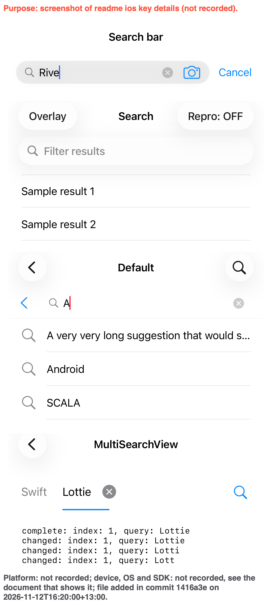
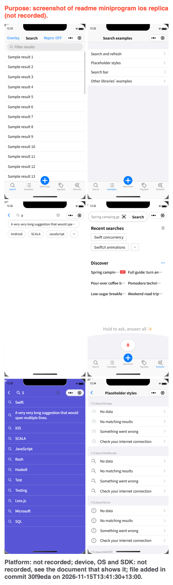
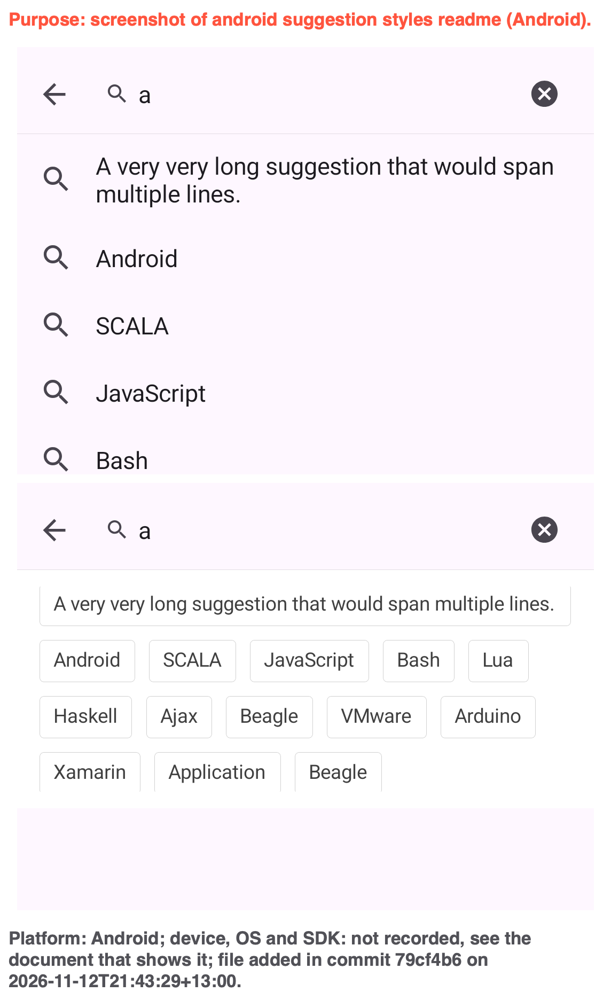

# CYLSearchViewController
模仿iPhone短信聊天里的搜索框样式，点击搜索后，搜索框平滑移动到导航栏上。

## 功能展示


## Screenshots

Key details of the current example, stacked top to bottom: `CYLSearchBarView` with text, a camera accessory and
Cancel (plus page); the Issue #1317 screen with its pinned search bar; `CYLSearchView` suggestions (the
MaterialSearchView "Default" port); `CYLSearchBarView` in its multiple mode (`mode = .multiple`)
with two searches and its event log.



| Field | Value |
|:---|:---|
| Platform | iOS (the core is Swift; the example is Objective-C and Swift) |
| Host | macOS 27.3 (26C5035r), Xcode 27.2 (27B52) |
| Simulator | iPhone 17, iOS 26.1 |
| SDK | iOS SDK 27.2, Swift 5 language mode, deployment target iOS 15.0 |
| Repository | [`9735f79`](https://github.com/ChenYilong/CYLSearchViewController/commit/9735f79) on `feat/swift-core` |
| Taken | 2026-11-12 16:14–16:17 NZDT |

### WeChat Mini Program

The example is a 1:1 copy of the iOS example (`docs/miniprogram-api-alignment.md`). Two columns, left to right then
top to bottom: the Search tab (the Issue #1317 reproduction); the Examples tab; a MaterialSearchView sample with the
suggestions as tags folded to two rows, the chevron as the last tag; the Discover tab; the Themed sample; the
placeholder styles.



| Field | Value |
|:---|:---|
| Platform | Mini program (`CrossPlatform/wechat-miniprogram-cylsearch`) |
| Host | Windows 11 Pro 10.0.22631 |
| Simulator | WeChat DevTools 2.02.2609250 simulator (390 x 844 window; screenshots at the simulator's 289 x 625 px) |
| SDK | Mini program base library 3.6.6 |
| Repository | [`d19e0bb`](https://github.com/ChenYilong/CYLSearchViewController/commit/d19e0bb) on `feat/swift-core-next` |
| Taken | 2026-11-15 13:22–13:38 NZDT (UTC+13) |

More screenshots, one state per row: `docs/search-api-comparison.md` (the Swift ports of five search libraries'
examples) and `docs/CYLTabBarController-Integration.md`.

## Android

`android/` holds the Kotlin translations of the five search libraries and `android/merged`, one Gradle project with
all of them, the `cylsearch` module (`com.cyl.search`: the same CYLSearchBar core as iOS in Kotlin, under the same
names, in `CYLSearchBarView.kt`, `CYLSearchView.kt` and `CYLSearchResources.kt`; pull-to-refresh from
CYLTableViewPlaceHolder's `:placeholder-refresh` module) and an example app that ports the iOS example. The app uses CYLTabBarController's Android tab bar from a configuration file, with a raised plus
button; CYLTabBarController and CollectionViewClassifyMenu are pinned by commit. Build:
`cd android/merged && ./gradlew assembleDebug` (JDK 17). Details: `docs/android-and-cross-platform.md`, the API
table `docs/android-api-alignment.md`.

`CYLSearchView.suggestionStyle` shows suggestions as a list (top) or as tags from CollectionViewClassifyMenu
(bottom); both tabs of the example filter the same suggestions for "a":



| Field | Value |
|:---|:---|
| Platform | Android (Kotlin, `android/merged`) |
| Host | macOS 27.3 (26C5035r), JDK 17.0.21, Gradle 9.3.1, AGP 8.7.3, Kotlin 2.0.21 |
| Emulator | `CYL_API35_arm64`, Android 15 (API 35), arm64-v8a, 1080 × 2400 |
| SDK | compileSdk / targetSdk 35, minSdk 23 |
| Repository | [`ffac758`](https://github.com/ChenYilong/CYLSearchViewController/commit/ffac758) on `feat/swift-core`; CYLTabBarController `f410fa7`, CollectionViewClassifyMenu `eb3590e` |
| Taken | 2026-11-12 21:30–21:40 NZDT |


[我的微博][1]


  [1]: http://weibo.com/luohanchenyilong/

## Issue #1317 reproduction

The app demonstrates `UISearchController` in a navigation item's search bar
with pull-to-refresh and the `CYLTableViewPlaceHolder` empty-state API.

1. Install CocoaPods dependencies with `pod install`.
2. Open `CYLSearchExample.xcworkspace`.
3. Select **Search and refresh**, then pull down on the results table to refresh, or search for text with no
   matching results to show the placeholder.
4. The search bar is pinned by default with
   `navigationItem.hidesSearchBarWhenScrolling = NO`. Tap **Repro: OFF** to
   enable the original scrolling behavior on affected iOS versions; tap again
   to restore the workaround.

The reported repeated inset updates were observed with iOS 12.3 and
`UISearchController`. Whether the issue reproduces depends on the UIKit version.

## Local CocoaPods component

The iOS core, CYLSearchBar, lives in `Sources/CYLSearchBar` (module `CYLSearchViewController`, iOS 15 or later):
three Swift files and four public classes.

| File | Public API |
|:---|:---|
| `CYLSearchBarView.swift` | `CYLSearchBarView` (one field, or several searches with `mode = CYLSearchBarModeMultiple`), `CYLSearchBarItem` (drawn by CollectionViewClassifyMenu's `CYLTagButton`; `animationURL` shows an animated icon), `CYLSearchBarViewDelegate` |
| `CYLSearchView.swift` | `CYLSearchView` (suggestions, results, empty placeholders, pull-to-refresh), `CYLSearchViewDelegate`, `CYLSearchViewDataSource` |
| `CYLSearchResources.swift` | `CYLSearchResources` (bundle images and strings), `CYLSearchSuggestionCache`, `CYLSearchSuggestionCachePolicy` |

It depends only on CollectionViewClassifyMenu (tag suggestions), CYLTableViewPlaceHolder (placeholders and
pull-to-refresh, its `Core` subspec) and CYLTabBarController's shared animated icon + title component
`CYLTabBarController/CYLAnimatedItem`; no other search library and no animation engine. Use these APIs on the main
thread.

Animated icons. The search bar items are CollectionViewClassifyMenu's `CYLTagButton`, a subclass of
CYLTabBarController's `CYLAnimatedItemView`
([guide](https://github.com/ChenYilong/CYLTabBarController/blob/feat/cross-platform-components/docs/Animated-Item.md)).
The core plays no animation by itself: an app that wants animated icons adds the engine subspec of each file type it
plays, pinned by commit like the other sub-repositories (the subspecs are in no CocoaPods release yet):

```ruby
pod 'CYLTabBarController', :subspecs => ['CYLAnimatedItem', 'CYLAnimatedItemSVGA'], # or …LottieSwift, …PAG, …Rive, …GIF
    :git => 'https://github.com/ChenYilong/CYLTabBarController.git', :commit => '<sha>'
pod 'CYLTableViewPlaceHolder', :subspecs => ['Core', 'Lottie'], # the placeholders' animated icons
    :git => 'https://github.com/ChenYilong/CYLTableViewPlaceHolder.git', :commit => '<sha>'
```

On Android the core gets `io.github.chenyilong:cyltabbarcontroller-animateditem` through CollectionViewClassifyMenu;
the app adds the animation libraries (SVGAPlayer, Lottie, libpag, rive-android) and CYLTableViewPlaceHolder's
`placeholder-lottie`. What an item (`CYLSearchBarItem`) shows, by the component's rules:

1. its animation (`animationURL`), when it can play;
2. otherwise its static `image` / `selectedImage`, with the layout of the image alone: without an engine or library,
   for an unknown type, a missing, empty or corrupted file, a failed download, and while a remote file downloads;
3. the component's placeholder, sized like the item's icon, only for an item with an animation file and no static
   image; a text item without an icon never shows one.

Without an engine `playAnimation()` does nothing and `animationURL` is kept. Remote files are read by the engines:
on iOS Rive and SVGA read URLs, Lottie (Swift), PAG and GIF local files only (a remote URL shows the static image at
once); on Android every engine reads URLs. HarmonyOS and the mini program have no such component yet (TODO in
CYLTabBarController): their items keep their own animated icon code.

Results: set `resultsDataSource` (a `CYLSearchViewDataSource`) and, while the query is not empty,
`resultsTableView` lists `searchResults` below the search bar instead of the suggestions. Call `reloadResults` when
the data changes; `-searchView:didSelectResult:` reports a tapped row. Open the page in a view controller with
`showSearchInViewController:animated:` and close it with `closeSearchAnimated:completion:`.

```swift
let searchView = CYLSearchView()
searchView.resultsDataSource = dataSource
searchView.showsEmptyResultsPlaceholder = true
searchView.showSearch(in: navigationController ?? self)
```

Several searches side by side (iammert `MultiSearchView`):

```swift
let bar = CYLSearchBarView()
bar.mode = .multiple
bar.delegate = self // searchBarView(_:didCompleteSearch:at:), didSelectSearch, didRemoveSearchAt, textDidChange(_:at:)
bar.addSearch("Rive")
```

Pull-to-refresh is the core's only refresh API (CYLTableViewPlaceHolder's header inside): `refreshHandler`,
`beginRefreshing`, `endRefreshing` and `isRefreshing` for `resultsTableView`, and the class methods
`setRefreshHandler(_:for:)`, `beginRefreshing(in:)`, `endRefreshing(in:)` and `isRefreshing(in:)` for a scroll
view of yours. End the refresh on every completion path and capture the view controller weakly:

```swift
CYLSearchView.setRefreshHandler({ [weak self] in
    self?.reload { CYLSearchView.endRefreshing(in: table) }
}, for: table)
```

For local development, add the following to a Podfile, adjusting the path:

```ruby
pod 'CYLSearchViewController', :path => '../CYLSearchViewController'
```

The podspec is an unpublished starting point; its `0.1.0` version and source
tag do not imply a CocoaPods release. The original sample remains in the
repository.

## Local Pod reproduction example

The root `CYLSearchExample.xcodeproj` uses app sources in `CYLSearchExample/`
and integration tests in `CYLSearchExampleTests/`. It consumes this Pod and
CYLTableViewPlaceHolder by commit. The example owns the refresh provider, empty-state view, and reproduction switch;
its refresh goes through `CYLSearchView`'s refresh class methods, never CYLTableViewPlaceHolder's refresh API
directly.

```sh
pod install
open CYLSearchExample.xcworkspace
```

Run the `CYLSearchExample` scheme, select **Search and refresh**, pull down to refresh, and tap **Repro: OFF**
to allow the navigation search bar to scroll. Tap **Repro: ON** to restore the
pinned-bar workaround. Tap **Overlay** to open a `CYLSearchView` that searches the same injected data source. This builds the affected interaction, but iOS 15 is
the minimum for this example and the original iOS 12.3 report has not been
reproduced by these tests.

From the repository root, `scripts/pod-lint.sh lib` validates the Pod and
`scripts/ci-build-example.sh` installs and builds the example. Publishing is
only performed when `scripts/pod-lint.sh push` is explicitly invoked.

## Placeholder resources and localization

The empty states come from CYLTableViewPlaceHolder: `CYLPlaceholderView` (a style, a message, or your own image and
text) and `CYLPlaceholderStackView` scenarios, which `CYLSearchView` shows through `emptyResultsScenario` and
`emptySuggestionsScenario` (`emptyResultsView`, `emptySuggestionsView`). Apps that need a placeholder of their own
use `CYLPlaceholderView` directly. `CYLSearchViewController.bundle` holds the core's offline images and strings,
which the other platforms import too.

```objc
CYLPlaceholderView *view =
    [[CYLPlaceholderView alloc] initWithStyle:CYLPlaceholderStyleNoResults message:CYLPlaceholderMessageNoInternet];
CYLPlaceholderView *customText =
    [[CYLPlaceholderView alloc] initWithStyle:CYLPlaceholderStyleEmpty text:@"Your message"];
CYLPlaceholderView *customBoth = [[CYLPlaceholderView alloc] initWithImage:yourImage text:@"Your message"];
```

In the example, select **Placeholder styles** to explore every `CYLPlaceholderStyle` with four messages, and three
custom-input cases.

`CYLSearchResources` loads images from the Pod bundle and resolves localized
strings using preferred languages, falling back to English. English, Simplified
Chinese, Traditional Chinese and Japanese are included; callers can also
request a specific language. Attribution and licenses for the bundled icons
are included in the bundle's `NOTICE` and license files.

## CYLTabBarController (default integration)

The example integrates CYLTabBarController by default: each tab bar controller
is created from a local configuration file and has a plus button with a plus
child view controller. The pod is pinned to the newest CYLTabBarController
commit on any branch (`scripts/latest-cyl-commit.sh --podfile`). The rules are
in `AGENTS.md` and the `cyl-tabbar-integration` skill. The example's root is a
tab bar built from `CYLSearchExample/CYLTabBarConfiguration.json`: Search,
Examples and a plus button that opens the search bar demo, with titles in
English, Simplified and Traditional Chinese and Japanese. Details and
screenshots: `docs/CYLTabBarController-Integration.md`.
