# CYLTabBarController Integration

This project integrates CYLTabBarController by default. Its instruction and
skill rules were adapted from CYLTabBarController at its newest commit across
all branches, found by commit timestamp:

| Field | Value |
|:---|:---|
| Commit | `caf3c925966f71edfc87d1dd2ed9f03cbad6aba1` |
| Branch | `feat/cross-platform-components` (not `master`) |
| Commit date | 2026-11-11 15:54:48 +1300 |
| Read on | 2026-11-11 |

## Default integration

Unless a task says otherwise, every `CYLTabBarController` in the example layer:

1. is created from a local configuration file in the app bundle
   (`+tabBarControllerWithConfigurationFile:error:`);
2. has a plus button declared under `CYLTabBarControllerPlusButton`, whose
   `CYLTabBarItemPageIdentifier` resolves to the plus child view controller;
3. resolves its pages through `CYLTabBarPageRegistry` providers;
4. depends on the newest CYLTabBarController commit through CocoaPods
   (`scripts/latest-cyl-commit.sh --podfile`).

Recipe: `.agents/skills/cyl-tabbar-integration/SKILL.md`.

## What was copied and adapted

| Upstream source | Written here | Notes |
|:---|:---|:---|
| `AGENTS.md`: Depending on CYLTabBarController, accessibility, clean builds, bilingual reading, commit author line | `AGENTS.md` "CYLTabBarController", "Skills", "Commit readiness"; `instructions.md` "CYLTabBarController", "Commit readiness" | Library-only rules (public API, localization bundles, Android, React Native, Flutter, docs generators) left out |
| `CLAUDE.md` (`@AGENTS.md`) | `CLAUDE.md` unchanged | Already identical |
| `.claude/skills -> ../.agents/skills` | `.claude/skills` symlink | Same layout as upstream |
| `cyl-plus-button` | `cyl-plus-button` (new) | Rewritten around the configuration-file plus button |
| `cyl-new-project`, `cyl-verify`, `cyl-api-map`, `cyl-docs`, `cyl-xcode-compat` | Same skill names, new "CYLTabBarController" sections | Upstream paths replaced by pinned upstream links |
| `scripts/latest-cyl-commit.sh` | `scripts/latest-cyl-commit.sh` | Copied with attribution |
| — | `cyl-tabbar-integration` (new) | Configuration file + plus child view controller recipe |

Not copied: `cyl-theme`, `cyl-tab-animation`, and third-party vendored skills
(`.agents/skills.json`), which are library-specific or carry their own licenses.

## Comments on public API

The rule in `AGENTS.md`, "Comments on public API" comes from upstream commit
`63c0edc9abc57a22dc529ff1758629cd2d42c3a7` (2026-11-11 16:46:46 +1300,
`feat/cross-platform-components`), which was the newest commit when the rule
was copied. Upstream still allows a one-line `/// …` in Objective-C headers. This
project's rule is stricter and wins over upstream. Official documentation
rules win over both:

- single-line public API comments use the same three-line block as
  multi-line ones where the block form is officially allowed (Objective-C
  `/*! */`; Swift, Kotlin, Java, TypeScript, JavaScript `/** */`), never a
  one-line block and never a trailing `/**< */`, `/*!< */`, `///<` or `//`;
- a file with public API uses one comment format;
- where the official guide requires another form, the official form applies:
  Python PEP 257 docstrings (one-line docstrings stay on one line), Go `//`
  (Effective Go), C# `///` with XML tags (Microsoft Learn), Rust `///` (Rust
  Style Guide), Dart `///` (Effective Dart).

Status: the iOS core is Swift, the three files of `Sources/CYLSearchBar/`
(`CYLSearchBarView.swift`, `CYLSearchView.swift`, `CYLSearchResources.swift`);
every public declaration has a three-line `/** */` block, checked by
`scripts/check-public-api-comments.sh` (the `cyl-verify` skill). The Kotlin,
ArkTS and JavaScript ports follow the same table.

## Status

- Public API comments: every documentation comment in the core's Swift
  files is a three-line `/** … */` block; `scripts/check-public-api-comments.sh`
  (run in CI) is the checker for `Sources/CYLSearchBar`.
- Quick Help and the Swift interface: DONE (2026-11-21, Xcode 27.2, macOS 27, branch `fix/ios-swift-todos` from
  `efb3b78`). `scripts/public-api-doc-coverage.sh <products dir>` runs `swift-symbolgraph-extract` (the data Quick Help
  and DocC read) on the built `CYLSearchViewController` module: 291 of 301 public symbols of `Sources/CYLSearchBar`
  carry their `/** */` block (`CYLSearchBarView.swift` 181/187, `CYLSearchView.swift` 95/99,
  `CYLSearchResources.swift` 15/15). The 10 without one are UIKit overrides (`init(frame:)`, `layoutSubviews()`,
  `sizeThatFits(_:)`, `intrinsicContentSize`, `traitCollectionDidChange(_:)`, `tintColorDidChange()`,
  `safeAreaInsetsDidChange()`, `accessibilityPerformEscape()`): they inherit UIKit's documentation by design
  (`scripts/check-public-api-comments.sh`), and Quick Help shows that one. The generated
  `CYLSearchViewController-Swift.h` carries the comments as `///` lines (383) above the `@objc` names. Score: 100/100.
- Example integration (2026-11-12, 10/10):
  - `Podfile` pins `d36c7080157c49c552a3a352d72a9d00a2be11a9`, the newest
    commit on any branch (`feat/cross-platform-components`) when it was read.
  - `CYLSearchExample/CYLTabBarConfiguration.json` (Resources phase, explicit
    file reference) declares the Search and Examples tabs and the plus button.
    Its page ID `plus` resolves to the plus child view controller, the search
    bar demo (`CYLSearchBarDemoViewController`).
  - `CYLSearchExampleAppDelegate` registers a provider for every page ID in
    `CYLTabBarPageRegistry.sharedRegistry` and builds the root with
    `+tabBarControllerWithConfigurationFile:error:`; when the file cannot be
    read it logs the error and shows the examples menu. Every page sits in a
    `UINavigationController`, so the Issue #1317 search controller setup is
    unchanged. `Sources/` does not import CYLTabBarController.
  - Tab titles are localization keys (`CYLTabBarControllerLocalization`)
    translated in `CYLSearchExample/CYLSearchTabs.bundle` (en, zh-Hans,
    zh-Hant, ja). `Info.plist` declares the four languages; without
    `CFBundleLocalizations` the app resolved to English and the tab titles
    stayed English in Chinese.
  - The configuration keys and `system:` images were checked against the
    pinned commit by running the app, not only against the upstream docs.
- Pod resources: CYLTableViewPlaceHolder and CYLTabBarController are static
  frameworks, so their bundles need CocoaPods' "[CP] Copy Pods Resources"
  phase. It was missing from the project file, and the refresh header showed
  its raw keys (`CYLRefreshHeaderIdleText`). The phase is now in the project.
- Verification (2026-11-12, iPhone 17 Pro simulator, iOS 26.1): `pod install`,
  build, analyze (no warning in `Sources/`) and 13 unit tests pass.
  `testTabBarComesFromTheConfigurationFile` checks the controller class, the
  plus button and its child, the three pages in navigation controllers, the
  translated titles, every table's keys and the plus button's VoiceOver label
  ("Search bar"). The screenshots below come from launching the app.

- A search bar never covers any view (2026-11-12):
  - The Issue #1317 results screen (`CYLSearchExampleViewController`) does
    not extend its view under the top bar (`edgesForExtendedLayout` without
    `UIRectEdgeTop`), so the table view and the refresh header's text never
    show through the search bar. `CYLSearchView` lays its own bar out against
    the safe area, on an opaque page, with the suggestions and results below.
  - The results screen keeps the search bar in the navigation bar, under the title
    (`preferredSearchBarPlacement` stacked; on iOS 26
    `searchBarPlacementAllowsToolbarIntegration = NO`). Without a tab bar,
    iOS 26 on iPhone floated the field at the bottom of the screen, over the
    last rows of the list.
  - `testSearchBarsCoverNoView` checks the results screen (bar pinned and
    hiding on scroll), the search bar demo at the default and the largest
    text size, and the `CYLSearchView` overlay, with `CYLViewsCoveredByView`: every visible
    view of the window except the bar's own subviews and containers, system
    bar backgrounds, views that draw nothing and parts clipped away.
    `testSearchBarNeverCoversTheViewControllersView` checks the view's frame.
    Both fail without the changes. On iOS 26 the navigation bar shows
    `searchBar.searchTextField` without the `UISearchBar`, so the tests check
    the view that is on screen.
- Scene life cycle (2026-11-12, Xcode 27.2): apps built with the iOS 27 SDK
  do not launch without it ("UIScene life cycle is required"), so the test
  runner crashed before connecting; CI on Xcode 26.6 did not show it.
  `CYLSearchExampleSceneDelegate` (Info.plist `UIApplicationSceneManifest`)
  now creates the window with `+[CYLSearchExampleAppDelegate rootViewController]`.
  Page titles use `navigationItem.title`, so loading a page no longer renames
  its tab (checked in `testTabBarComesFromTheConfigurationFile`). 15/15 tests
  on the iPhone 17 simulator (iOS 26.1); analyze: 0 warnings in `Sources/`.
- Comment coverage: `scripts/public-api-doc-coverage.sh` counts, from clang's
  symbol graph (`clang -extract-api`, what Quick Help and DocC read), the
  public symbols of each header that carry a documentation comment; every
  written block attaches to its declaration.

## Screenshots

Top to bottom: the Search tab in English and in Simplified Chinese (the list
starts below the search bar); the Examples tab in Simplified Chinese; the
plus page; the Examples tab at the largest accessibility text size.

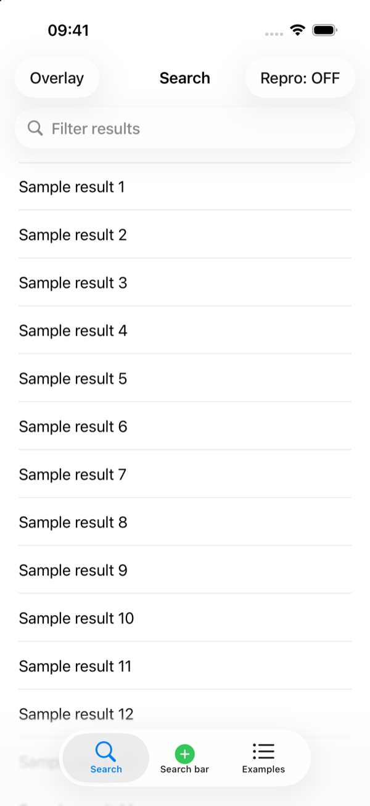

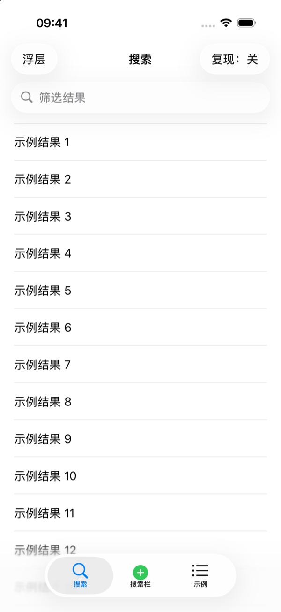

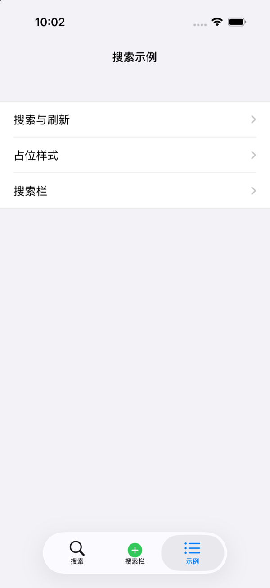

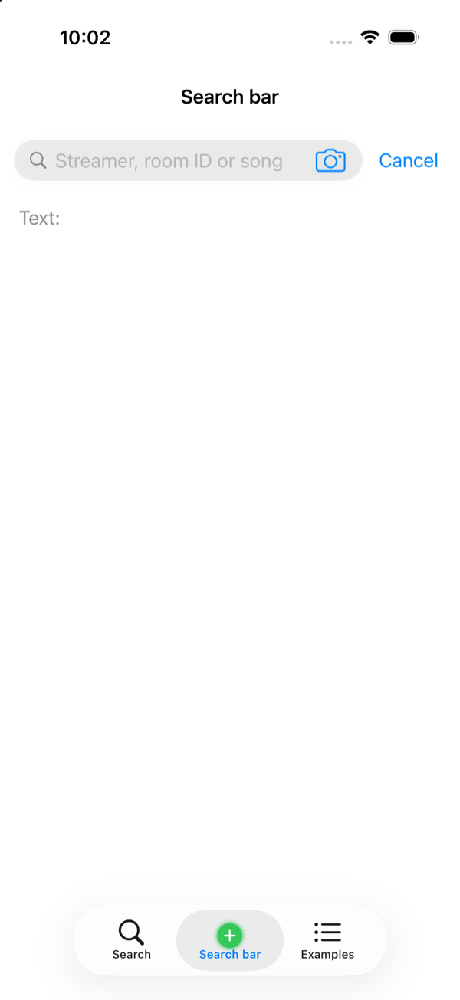

## Maintenance

- When upstream changes, run `scripts/latest-cyl-commit.sh --podfile`, update
  the Podfile pin, compare upstream `AGENTS.md` and the `cyl-*` skills, and
  update the commits recorded in this document and the skill links. CI warns
  when the pin is not the newest commit.

## DONE (2026-11-12): raised plus button in example demos

- Context: the example's plus button comes from `CYLSearchExample/CYLTabBarConfiguration.json`
  (`CYLTabBarControllerPlusButton`), shown inside the tab bar like a tab.
- Requirements: in the instruction files and the skills, find the CYLTabBarController example-layer integration
  section (create it if missing) and add, in English: when the example demonstrates a plus button, prefer the
  raised plus button, whose top edge rises above the tab bar.
- Prompt (verbatim): "找到instructions相关文档以及skills相关文档。找到CYLTabBarController 相关example层集成章节，如果没有就新建，全英文追加一条规则集成PlusButton进行example演示时，总是优先使用plus button凸起效果。凸起的含义是plus button顶点超出tabbar范围。"
- Prompt (English): "Find the instruction documents and skill documents, find the CYLTabBarController example-layer
  integration section (create it if missing), and append a rule in English: when integrating a PlusButton for an
  example demo, always prefer the raised plus button effect; raised means the top of the plus button goes beyond
  the tab bar."
- Status: DONE (2026-11-12): the rule is in the CYLTabBarController section of `AGENTS.md` ("Raised plus button")
  and `instructions.md`, and in the `cyl-plus-button` and `cyl-tabbar-integration` skills. The Android example
  already follows it (56 dp, `CYLPlusButtonCenterYMultiplier` 0.3; screenshots in
  [android-and-cross-platform.md](android-and-cross-platform.md)).
- Follow-up `TODO`: the iOS example's plus button (`CYLSearchExample/CYLTabBarConfiguration.json`) is not raised
  yet; give it the raised effect, build and screenshot it (iOS example layer).
  - Tried (2026-11-14, iPhone 17, iOS 26.3.1): `CYLPlusButtonSize` `{56, 56}` and `CYLPlusButtonCenterYMultiplier` 0.3
    in `CYLSearchExample/CYLTabBarConfiguration.json` (the keys the Android example uses, read by the iOS parser) change
    nothing: the plus button stays level with the tab icons in the floating Liquid Glass bar. The same in the React
    Native example. Cause, from `CYLPlusButton.h`: a plus button with a title lets its tab item draw the title and the
    button replaces only the item's icon (`cyl_showsTitleInTabBarItem`), so it is placed inside the item, not by
    `+multiplierOfTabBarHeight:`; the multiplier applies to a title-less button with
    `cyl_appliesCenterYOffsetWithoutTitle` YES, or in the other styles. Decision needed in CYLTabBarController (raised
    effect with a title on Liquid Glass), so it stays `TODO` here; the config was reverted.
  - React Native: DONE 2026-11-16. `CYLPlusButtonAlignsTitle` false (RN `alignsTitle: false`) keeps the title on the
    button, so the multiplier applies; see `android-and-cross-platform.md`, "Open TODOs".
  - iOS example: DONE (2026-11-21, `a5158b8`, iPhone 18 Pro simulator, iOS 27.2, Xcode 27.2). The iOS core has no default
    raise (its center comes only from `+multiplierOfTabBarHeight:`, which a configuration gives with
    `CYLPlusButtonCenterYMultiplier`), so the three configurations (`CYLTabBarConfiguration.json`, `…_svga.json`,
    `…_svga_swiftui.json`) set `CYLPlusButtonAlignsTitle` false, `CYLPlusButtonSize` `{64, 84}` and
    `CYLPlusButtonCenterYMultiplier` 0.3, the React Native values, with React Native's 52 pt green image
    (`CYLPlusButton` in `CYLSearchViewController/Images.xcassets`; `CYLPlusButtonImageSize` would redraw the SF Symbol
    black). Tried first: `CYLPlusButtonAlignsTitle` false alone (the button barely moves) and multiplier 0.15 (raised
    further, but the title sits 7 pt above the tab titles). Result: the circle rises about 10 pt above the bar and the
    title sits on the tab titles' line; its page shows the Liquid Glass lens under it. Test
    `testPlusButtonIsRaisedAboveTheTabBar` (the button's top above the bar's top, centred, the 52 pt image); 37 of 37
    tests pass.
    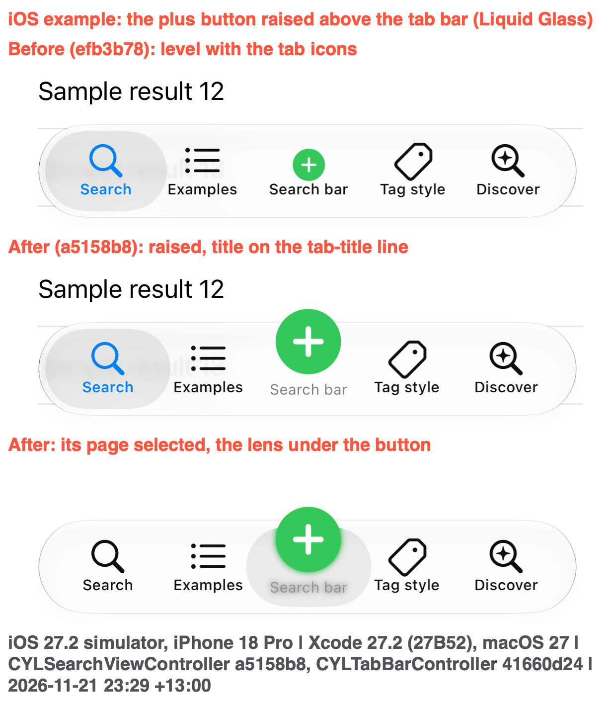
    (iOS 27.2 simulator, iPhone 18 Pro, Xcode 27.2 27B52, macOS 27, CYLSearchViewController `a5158b8`, CYLTabBarController
    `41660d24`, 2026-11-21 23:29 +13:00.)
  - Left (minor, CYLTabBarController): the button draws its own title in the core's default gray, not in the tab titles'
    color. `CYLTabBarItemTitleColor` takes a hex color only, which would not follow dark mode, so the example keeps
    the default. A dynamic title color for a non-aligned plus title is a CYLTabBarController option to ask for.

## DONE (2026-11-19; TODO 2026-11-16): SVGA animations from CYLTabBarController, with one SVGA demo for every Rive demo

- Context: CYLTabBarController now ships SVGA animations (SVGA tab icons, integrated like Rive: `0af437e`,
  `c5c0d33`, `0342bb2`, issue #415). This project integrates CYLTabBarController's tab bar on every platform (iOS,
  Android, Flutter, React Native, mini program, HarmonyOS); it has no Rive demos of its own yet, so the reference
  Rive demos are CYLTabBarController's (Example-Rive and the cross-platform Rive demos).
- Requirements:
  1. Update the core code so it supports CYLTabBarController's SVGA animations.
  2. Example layer: copy the Rive demos one to one in SVGA. Every scene that has a Rive demo also gets an SVGA demo.
  3. List each Rive scene in a table (first column the Rive scene, second column its SVGA counterpart, `TODO` by
     default); replace a `TODO` when its SVGA demo works, with a screenshot; done when no `TODO` is left.
- Prompt (verbatim): "找到本项目相关文档，加入TODO：cyltabbar 现已增加svga动效，更新core代码以支持该动效，要求example层一比一复刻rive相关演示。只要rive有的演示场景 svga也要有。"
- Prompt (English): "Find this project's related document and add a TODO: CYLTabBarController now has SVGA
  animations; update the core code to support them; the example layer must copy the Rive demos one to one. Every
  demo scene Rive has, SVGA must have too."
- Status: DONE (2026-11-19): every Rive scene has its SVGA counterpart (table below).
- SVGA support in CYLTabBarController today (`origin/feat/cross-platform-components`, read 2026-11-16): iOS
  (`CYLTabBarController/SVGA`, `CYLSVGATabBarItemAnimator`) and Android (`CYLSVGATabBarItemAnimator.kt`) have it;
  `flutter_cyltabbar`, `react-native-cyltabbar` and the mini program package have no SVGA code yet (Rive only), so
  those rows wait for CYLTabBarController first (sub-repository rule: worktree, branch, pull request).

Rive scenes in CYLTabBarController's demos (Example-Rive, Example-SwiftUI-Rive, Example-Android `example-rive`,
`flutter_cyltabbar/example_rive`, `react-native-cyltabbar/example-rive`, `rive-miniprogram`):

| Rive scene | SVGA counterpart in this project |
|:---|:---|
| Every tab icon animated by Rive (`icons.riv`, `CYLTabBarRiveFilePath`), set with the initialization keys: iOS | DONE: `-CYLDemoTabIconSource 1`, `CYLTabBarSVGAURL` / `CYLTabBarSVGASize` in `tabBarControllerWithConfiguration:` (`CYLSearchExampleAppDelegate.m`) |
| The same tab icons from a configuration file (`cyl_tabbar_configuration*.json`): iOS | DONE: `-CYLDemoTabIconSource 2`, `CYLTabBarConfiguration_svga.json` (`CYLTabBarSVGAFilePath`) |
| Tab icons in all three styles: Liquid Glass, FlatDesign, classic | DONE: Liquid Glass (above); FlatDesign with `-CYLDemoTabBarStyle flatDesign` (keys mode, `CYLFlatDesignTabBar` subspec); classic on iOS 17.5, both modes |
| Dark mode animation file (`CYLTabBarRiveDarkURL`) | DONE: `CYLTabBarSVGADarkURL` / `CYLTabBarSVGADarkFilePath` for Search (`tab_activity`) and Discover (`tab_profile`), both modes. Found: switching back to light while running keeps the dark files (CYLTabBarController, not fixed here) |
| Plus button with its own page (purple "Start", `rive_plus.png`) | DONE: the "Search bar" plus button opens its own page with the SVGA tab icons (tapped with `axe`) |
| In-page animation above a list (Bell page, `menu_button.riv`, `RiveMenuButtonDemoView`) | DONE: `CYLSVGADemoHeaderView` above the Examples list: `tab_activity.svga` plays once, tap to play again: a `CYLTagButton` (CollectionViewClassifyMenu) with the `.svga` file as its `animationURL` and the text as its title, drawn by CYLTabBarController's SVGA animator (`CYLSVGADemoTagButton.swift`; accessibility label, hint and identifier `CYLSVGADemoTagButton`) |
| Switching a tab icon at runtime (`-updateTabBarItemForViewController:attributes:`, Rive ↔ SVGA button) | DONE: "Tab icons: …" button cycles SF Symbols → SVGA keys → SVGA file and rebuilds the tab bar (as Example-Rive's "Tab icon source" button); the choice is kept |
| SwiftUI host (Example-SwiftUI-Rive) | DONE: Examples row 5 / `-CYLDemoTab 1 -CYLDemoRow 4`: `CYLSVGASwiftUIDemo.swift`, a SwiftUI screen hosting a `CYLTabBarController` from `CYLTabBarConfiguration_svga_swiftui.json` through `UIViewControllerRepresentable` |
| Android (`example-rive`, `CYLRiveTabBarItemAnimator`) | DONE: `android/merged` pins CYLTabBarController `5682b9e` (`CYLSVGATabBarItemAnimator`) + SVGAPlayer-Android 2.6.1 (JitPack); `--es CYLDemoTabIconSource 2` loads `CYLTabBarConfiguration_svga.json` |
| Flutter (`example_rive`) | DONE on iOS: `--dart-define=CYL_DEMO_TAB_ICON_SOURCE=2` loads `assets/cyl_tabbar_configuration_svga.json`; `flutter_cyltabbar` already passes the SVGA keys (no CYLTabBarController change was needed, the earlier "waits" note was wrong). Android side wired (SVGAPlayer, assets) but not built yet |
| React Native (`example-rive`, `<CYLAnimationView>`) | DONE on Android (2026-11-19): `src/App.tsx` adds `svgaTab()` (`CYLTabBarSVGAFilePath` / `CYLTabBarSVGASize`: tab_list, tab_chat, tab_search, tab_profile) and a "Tab icons: Rive / SVGA" button on the sample pages (iOS: also `-CYLDemoTabIconSource 2`); Android adds SVGAPlayer-Android 2.6.1 (JitPack, group-limited), the iOS example's `CYLSearchExample/SVGA` as an assets folder, and `tools:replace="android:allowBackup"` (SVGAPlayer's manifest sets it true) ([assets/android-medium-phone-api37-20261119-rn-svga-tab-icons.png](assets/android-medium-phone-api37-20261119-rn-svga-tab-icons.png), Android API 37 Medium Phone emulator, React Native 0.88.0, Windows 11, CYLTabBarController b376c278, 2026-11-19 +13:00). DONE on iOS (2026-11-19, macOS session): the Podfile adds `CYLTabBarController/SVGA` (CYLAnimatedItem/SVGA) and `SVGAPlayerLite` 1.0.8 with module maps, as the Flutter example; the "Copy Rive tab icons" build phase also copies `CYLSearchExample/SVGA/*.svga` into the app; launched with `-CYLDemoTabIconSource 2` on the iPhone 18 Pro simulator (iOS 27.2, Xcode 27.2), the four icons draw and Tag style plays tab_chat once on tap ([assets/ios-iphone18pro-20261119-rn-svga-tab-icons.png](assets/ios-iphone18pro-20261119-rn-svga-tab-icons.png)) |
| WeChat mini program (`cyl-rive`) | DONE (tab icons): `cylTabBarControllerCommit` `c72323f`; `scripts/sync-example.js` installs `cyl-svga-miniprogram`; `generic:cyl-svga-view="cyl-svga"`; Search, Examples and Discover play `tab_search`, `tab_list`, `tab_activity` (`*.svga.bin`, 30 x 30); test `svga-tab-icons.test.js` decodes each icon; shown in WeChat DevTools (`fb15432`). TODO for 1:1 with iOS: SVGA is the default here while iOS keeps SF Symbols by default and switches with "Tab icons: …"; no in-page SVGA above the Examples list yet |
| HarmonyOS (`harmonyos/entry`) | DONE (2026-11-19): checked on the emulator at CYLTabBarController `b376c278` / CollectionViewClassifyMenu `697e9307`, both modes (`CYLDemoTabIconSource` 1 keys, 2 configuration file) show the SVGA tab icons ([assets/harmonyos-mate70pro-api21-20261119-svga-tab-icons.png](assets/harmonyos-mate70pro-api21-20261119-svga-tab-icons.png), HarmonyOS API 21 Mate 70 Pro emulator, DevEco Studio 6.0.1.251, Windows 11, 2026-11-19 +13:00). Earlier (code done 2026-11-16; built, not run): the pinned cyltabbar `ea5b989` reads CYLTabBarSVGA* and exports `CYLSVGAView`. Copied 1:1 from iOS: the six `.svga` files and `NOTICE.md` in `rawfile/svga`; `CYLTabBarConfiguration_svga.json` (rawfile paths `svga/<name>.svga`); the initialization keys in code (`pages/Index.ets`, same files, `svgaSize` 28, dark files for Search and Discover); the "Tab icons: …" switch on the Examples page (0 symbols, 1 keys, 2 file; kept in preferences, launch parameter `--pi CYLDemoTabIconSource <n>`; the tab bar changes at once, Examples stays selected); `CYLSVGADemoHeader`, the 64 vp `tab_activity.svga` above the list, drawn by CollectionViewClassifyMenu's `CYLTagButton` (`animationURL`, as iOS `CYLSVGADemoTagButton`; [animated-icon-component.md](animated-icon-component.md)), played once when shown and again on each tap; the 10 `svga.*` strings in en, ja, zh-Hans, zh-Hant (`check-ios-parity.mjs`: 397 of 397). N/A on HarmonyOS: the SwiftUI host (Examples row 5 on iOS), there is no SwiftUI |

Score: 100/100: 13/13 on Android and HarmonyOS, and the React Native iOS half (2026-11-19).

iOS example, SVGA tab icons (Search selected, its animation on the last frame). Top to bottom: initialization keys;
configuration file. CYL 17Pro simulator, iOS 26.3, Debug, CYLTabBarController `5682b9e` (`CYLTabBarController/SVGA`),
base c0e7a8c, 2026-11-16 09:50. SVGA files: CYLTabBarController's `Example-SwiftUI-Rive/AnimatedApp/SVGAAssets`
(Apache 2.0, `CYLSearchExample/SVGA/NOTICE.md`); 0 (default) keeps the SF Symbols.

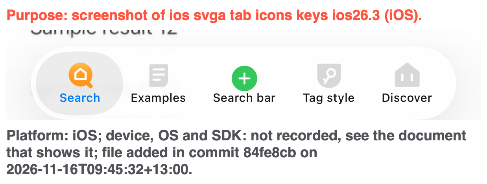

Other styles, top to bottom: FlatDesign (CYL 17Pro, iOS 26.3, `-CYLDemoTabIconSource 1 -CYLDemoTabBarStyle flatDesign`);
classic, initialization keys; classic, configuration file (iPhone 15 Pro, iOS 17.5). Debug, base 84fe8cb, 2026-11-16
09:53–09:57, full screens.

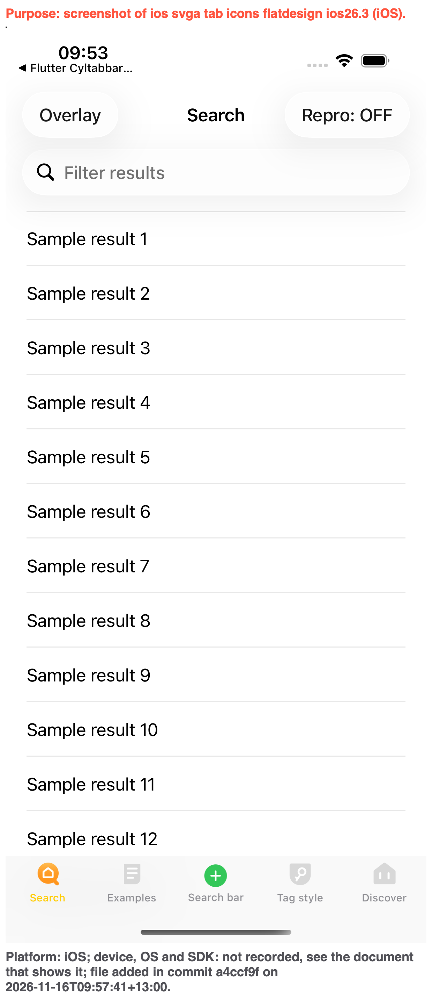
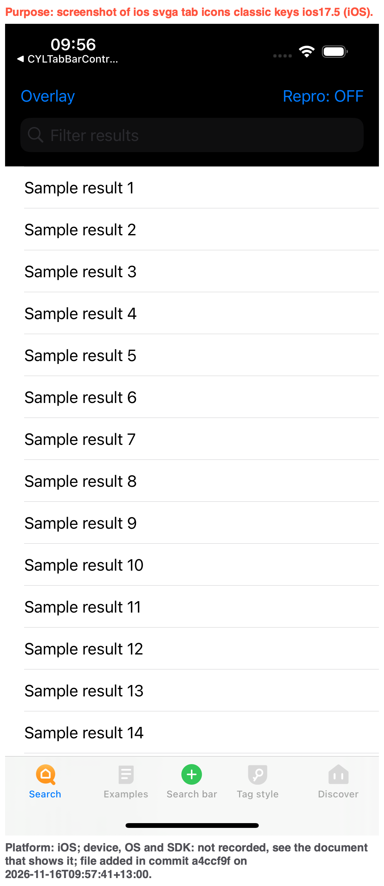

Dark mode and the plus page, top to bottom: dark, initialization keys; dark, configuration file (Search shows its dark
file `tab_activity`, Discover `tab_profile`); the plus button's page selected, after switching back to light (Search
and Discover still show the dark files). CYL 17Pro, iOS 26.3, Debug, base a4ccf9f, 2026-11-16 10:03.

Examples tab, the SVGA demo above the list; top to bottom: after the first, second and third tap on the source button
(SVGA keys, SVGA configuration file, SF Symbols). CYL 17Pro, iOS 26.3, Debug, base e93d8e3, 2026-11-16 10:55. The button
was tapped by coordinates: `axe` lists every element twice, so its accessibility identifier matched two elements.

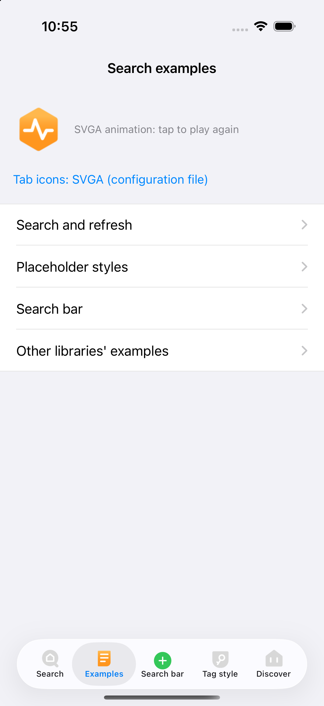

Android, top to bottom: SVGA icons (`--es CYLDemoTabIconSource 2`); the default icons. Emulator emulator-5554, debug
APK, base b08c020, 2026-11-16 12:28. Build and `:cylsearch:testDebugUnitTest` pass with the new pin.

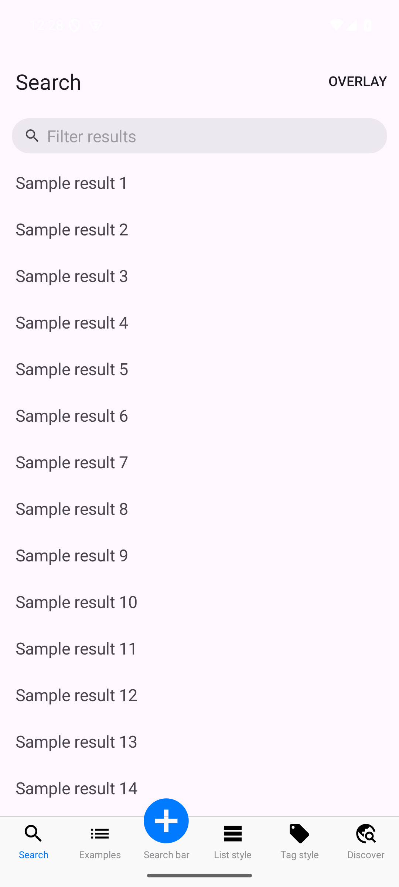

SwiftUI host: SwiftUI title bar and Close button above the hosted SVGA tab bar. CYL 17Pro, iOS 26.3, Debug, base 329e50f,
2026-11-16 12:38.

WeChat mini program: Search selected; Search, Examples and Discover show their SVGA icons, Tag style its symbol. WeChat
DevTools 2.02.2609250 (base library 3.6.6), Windows 11 Pro 10.0.22631, CYLTabBarController `c72323f`, commit `fb15432`,
2026-11-16 12:24 NZDT (UTC+13:00), original 324×701. A still image: the animation on switching tabs is not checked.

Flutter example on iOS with SVGA tab icons (CYL 17Pro, iOS 26.3, debug, base 7856311, 2026-11-16 14:14). The new
CYLTabBarController pin needed the plugin's platform views to be `@MainActor` (the core's views are main-actor isolated).

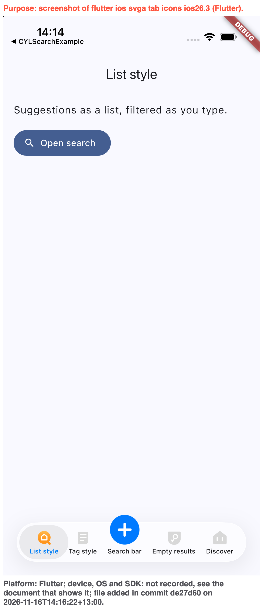

## DONE (2026-11-18; TODO 2026-11-17): fix the React Native Android tab icons

- Prompt (verbatim): "fix rn android icons"
- Prompt (English): "Fix the React Native Android icons."
- Context: row 4 of "Rive tab icons in the Flutter and React Native examples" below. The React Native example's Android
  APK has never been built on this machine: the native link of `libappmodules` fails (40 undefined libc++ symbols), so
  its Rive (and SVGA) tab icons were never seen. Plan: make the APK build, run it on an Android emulator, check the tab
  icons animate, fix what does not (in the core first: `react-native-cyltabbar` / CYLTabBarController, then the
  example), screenshot.
- Progress (2026-11-17): the APK builds. Cause of the libappmodules link failure: the Android SDK path has a space
  (`C:UsersChen Yilong…`), so CMake calls clang++ by its 8.3 short name `CLANG_~1.EXE`; clang picks its driver
  from its file name, sees no `++`, links as C and leaves out libc++ (40 undefined `__cxa_*` / `std::__ndk1` symbols).
  Fix on such machines: point `sdk.dir` in `android/local.properties` at a path without spaces (here a junction,
  `mklink /J C:cylbuildandroid-sdk %LOCALAPPDATA%AndroidSdk`). Not a code change. Left: run it on the Android
  emulator and check the tab icons (the debug APK could not reach Metro; a release build bundles the JavaScript).

- Progress (2026-11-17, later): the example now runs on the Android emulator (Medium Phone, API 37). Steps that were
  needed on this Windows machine, none of them a code change: an SDK path without spaces (above); a corrupt Gradle
  transforms lock (one file with protocol byte 0, deleted); the JavaScript bundled into the debug APK's assets (`react-native
  bundle`), because the release build overflows the 260-character path limit and Metro fails on a `subst` drive.
- Bugs recorded (rule "Bugs of the animated components"), with `assets/android-medium-phone-api37-20261117-rn-tab-icons-pale.png`:
  1. At CYLTabBarController `5682b9e` (the example's old vendored copy) the Rive tab icons never load: `RiveAnimationView:
     loadResource: no resource to load` once per tab, the icons stay as pale fallback images, the selected tab's icon is
     not tinted; `assets/icons.riv` is in the APK.
  2. At the current pin `c8132d26` the example does not build: `react-native-cyltabbar` compiles CYLTabBarController's
     `cylanimateditem` sources into itself, and the app also gets the `:cylanimateditem` module through
     CollectionViewClassifyMenu (`2 files found with path META-INF/cylanimateditem/LICENSE`). Sent to CYLTabBarController
     (its React Native bridge, published on npm); no packaging workaround in the example.

- Progress (2026-11-17, CYLTabBarController `4635ef7b`): the example builds (its B9 fix: the React Native bridge depends on
  the included build's `:cylanimateditem` instead of compiling a second copy) and the Rive tab icons load: the CHAT, BELL,
  SEARCH and USER artboards of `icons.riv` draw and react to selection (`assets/android-medium-phone-api37-20261117-rn-rive-icons-faint.png`;
  before, at `5682b9e`, only the pale fallback images: `…-rn-tab-icons-pale.png`).
- Bug recorded, open (reported by the user too, 2026-11-17: "android tabbar item icon 显示失败", `assets/android-20261117-rn-tab-icons-user-report.png`): the icons are almost invisible and the selected one is not highlighted. `icons.riv` draws light
  strokes (CYLTabBarController's Rive example has a dark bar), and the Android Rive player has no color API
  (`applyColors` / `CYLTabBarAnimationColors` exist for Lottie only), so the tab's tint cannot reach the artboard. Asked
  CYLTabBarController for a Rive tint API (the tab's normal and selected colors, as iOS template images); the example
  will only set it.

- Fixed (2026-11-17, checked on the Android emulator with CYLTabBarController `fe5c3ae3` in the build mirror): the Rive
  icons take the tab's title color through CYLTabBarController's new tint option (its B12, `tint: 'title'` in
  `CYLTabBarAnimationOptions`, set in `src/App.tsx`): gray when normal, blue when selected
  (`assets/android-medium-phone-api37-20261117-rn-rive-tint-list-selected.png`, `…-rn-rive-tint-tag-selected.png`). The repository's
  pin is `fe5c3ae3` since 2026-11-17, with CollectionViewClassifyMenu `333b349` (re-vendored there).
- Plus button (the user's request, 2026-11-17: the core lays out the plus button, so the examples stop adjusting it):
  `size`, `centerYMultiplier` and `alignsTitle` removed from the React Native example; `CYLPlusButtonCenterYMultiplier`
  from the native Android configurations; `CYLPlusButtonCenterYOffset` and the tall `CYLPlusButtonSize` from the Flutter
  configurations. React Native on the emulator: the core raises the button and puts its title on the tab titles' line
  (same screenshots); native Android likewise (`assets/android-medium-phone-api37-20261117-plus-button-core-layout.png`): raised, its
  title on the tab titles' line, no CYLTabBarController change needed. Flutter is not rebuilt here yet. The mini program keeps its own `CYLPlusButtonCenterYMultiplier` (its tab bar core is separate).

## DONE (2026-11-19; TODO 2026-11-16): Rive tab icons in the Flutter and React Native examples, iOS and Android

- Prompt (verbatim): "I call: 加上 Rive\" for  Flutter and React Native on iOS and Android should include Rive, so those tags animate there too. 至少tabbar需要加"
- Prompt (English): "Add Rive: Flutter and React Native, on iOS and Android, should include Rive, so those tabs animate there
  too. At least the tab bar needs it."
- Decision (user, 2026-11-16): icons.riv is fetched at build time, not committed (it has no licence of its own).
- Requirements: Rive tab icons in the tab bar of both examples on both platforms, from CYLTabBarController's Rive
  support at the pinned `5682b9e` (iOS subspec `CYLTabBarController/Rive` with RiveRuntime; Android `app.rive:rive-android`
  10.3.0, initialised by the library); the file is CYLTabBarController's `Example-SwiftUI-Rive/AnimatedApp/RiveAssets/icons.riv`
  (artboards CHAT, SEARCH, BELL, USER, state machine `<ARTBOARD>_Interactivity`, input `active`), as its `example_rive` and
  `example-rive`. Rive is the default icon source; the symbols and SVGA stay selectable.
- Status: DONE (2026-11-19): all four rows checked on a simulator or emulator.

| # | Example | Status |
| :--- | :--- | :--- |
| 1 | Flutter, iOS | DONE 2026-11-19 on the iPhone 18 Pro simulator (iOS 27.2, Xcode 27.2): built at CYLTabBarController `b376c278`; the tab bar draws CHAT, BELL, SEARCH, USER from icons.riv, and tapping Tag style plays BELL once (screenshot below). Code: `assets/cyl_tabbar_configuration_rive.json` (CHAT, BELL, SEARCH, USER at 28 pt), the default icon source (`CYL_DEMO_TAB_ICON_SOURCE` 3; 2 SVGA, 0 PNG); Podfile subspec `Rive`; Runner build phase "Fetch Rive tab icons" downloads icons.riv from the commit pinned in pubspec.yaml into the bundle (cached in ios/build) |
| 2 | Flutter, Android | DONE 2026-11-18 on the Android emulator (Medium Phone API 37, Android SDK 36, Flutter 3.50.0, Windows 11): CHAT, BELL, SEARCH, USER from icons.riv, tinted by the title colors, select and reselect without errors ([assets/android-medium-phone-api37-20261118-flutter-rive-at-6a9ede85.png](assets/android-medium-phone-api37-20261118-flutter-rive-at-6a9ede85.png), CYLTabBarController 6a9ede85, 2026-11-18 02:59 +13:00); rebuilt and run again at every later pin up to b376c278. Earlier (BUILT 2026-11-16 on Windows: `flutter build apk --debug --target-platform android-x64`, Flutter 3.x stable / Dart 3.14, JDK 21; app-debug.apk contains assets/icons.riv (10104 bytes, fetched by `fetchCylRiveIcons` from the pinned commit) and lib/*/librive-android.so). The build found and fixed three faults in the fetch task and one manifest merge fault (SVGAPlayer-Android label, `tools:replace`): `31330de0`, `a40cb3e`. Not run on a device |
| 3 | React Native, iOS | DONE 2026-11-19 on the iPhone 18 Pro simulator (iOS 27.2, Xcode 27.2, debug build with Metro): same icons, BELL plays once on tap (screenshot below). Code: `src/App.tsx` tab items with `CYLTabBarRiveFilePath` icons.riv, `CYLTabBarAnimationOptions` (artboard, `<ARTBOARD>_Interactivity`, input active), 28 pt; Podfile `CYLTabBarController/Rive`; build phase "Copy Rive tab icons" copies it from vendor/CYLTabBarController (scripts/fetch-cyltabbar.sh) |
| 4 | React Native, Android | DONE 2026-11-18 on the Android emulator (Medium Phone API 37, Android SDK 36, React Native 0.88.0, Windows 11): the same icons, tinted, select and reselect without errors ([assets/android-medium-phone-api37-20261118-rn-rive-at-6a9ede85.png](assets/android-medium-phone-api37-20261118-rn-rive-at-6a9ede85.png), CYLTabBarController 6a9ede85, 2026-11-18 02:58 +13:00; Rive panel at b376c278 in [assets/android-medium-phone-api37-20261119-rn-svga-tab-icons.png](assets/android-medium-phone-api37-20261119-rn-svga-tab-icons.png), 2026-11-19). Earlier (configuration checked 2026-11-16 on Windows: `yarn install`, `tsc --noEmit` passes with the Rive tab items; Gradle resolves rive-android and compiles the Kotlin and Java sources; the APK stops at the native link of `libappmodules` (40 undefined libc++ symbols from React Native codegen), which fails the same way without rive-android, so it is not caused by this change: an environment issue of React Native 0.88 + NDK 27.1 on this Windows machine, to check on a Mac or Linux build) |

Score: 100/100 (4 of 4 rows DONE with a screenshot, 2026-11-19).

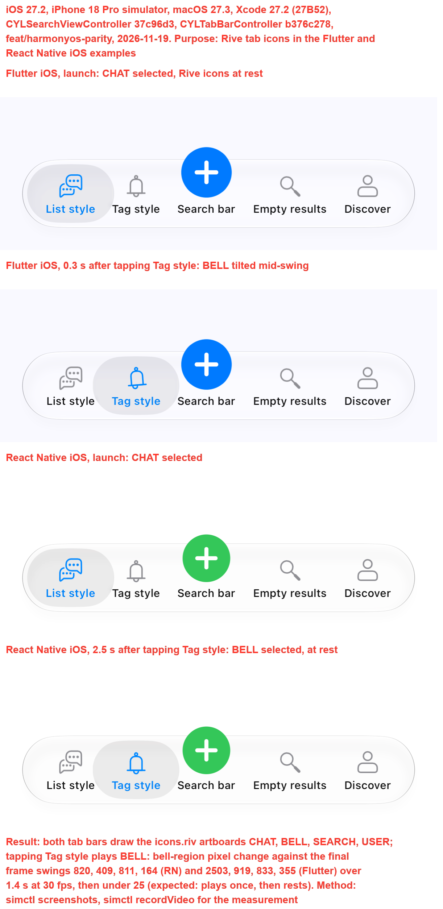

iOS 27.2, iPhone 18 Pro simulator, macOS 27.3, Xcode 27.2 (27B52), CYLSearchViewController 37c96d3, CYLTabBarController
b376c278, feat/harmonyos-parity, 2026-11-19. Purpose: Rive tab icons in the Flutter and React Native iOS examples.
Bell-region pixel change after the tap, against the final frame (30 fps video): RN 820, 409, 811, 164, then under 25;
Flutter 2503, 919, 833, 355, then 0.

## DONE (2026-11-19; TODO 2026-11-19): adapt to the Swift CYLAnimatedItemView (CYLTabBarController 4c7dc79d)

- **Branch**: `feat/harmonyos-parity`.
- **Prompt** (verbatim, relayed by the session "Mac-CYLTabBarController 小程序开发"): "要转发任务给其他session要求适应swift新代码完成原有功能 …"
  (English: forward the task to the other sessions: adapt to the new Swift code and keep every existing feature.)
- **Context**: in CYLTabBarController `4c7dc79d` (`feat/cross-platform-components`), `CYLAnimatedItemView`, its enums and
  protocols are Swift, with the same Objective-C API and the same Swift names for subclasses (`layoutContent(in:)`,
  `contentSizeThatFits(_:)`, `itemStateDidChange()`, `itemAccessibilityLabel()`; `isDragEnabled`, `isIconHidden`,
  `isAnimationReady`). `#import <CYLAnimatedItem/CYLAnimatedItemView.h>` still works; SwiftPM uses
  `import CYLAnimatedItemViews`; Objective-C can no longer subclass it.
- **Requirements**: (1) log the task; (2) pin `4c7dc79d` or later, together with a CollectionViewClassifyMenu commit that
  bundles the same tab bar commit (pin rule above); (3) build and test `CYLSearchBarView.swift`,
  `CYLSVGADemoTagButton.swift`, `CYLSearchExampleTests.m` and the React Native header `CYLRNSearchSupport.h`; (4) fix
  what breaks here, or report an API gap to CYLTabBarController.
- **Acceptance**: full marks (100) = all pins moved together, the native, Flutter and React Native iOS apps build and
  launch, unit tests pass, a labelled screenshot of the animated items; pass (60) = iOS builds and tests pass at
  `4c7dc79d`.
- **Status**: DONE (2026-11-19). The blocker (CYLTableViewPlaceHolder's Objective-C subclass of the Swift
  `CYLAnimatedItemView`) was removed there: Swift `CYLPlaceholderView` in `97b0591`, keyboard fix `f7e0c4d`. All pins
  moved together on every platform (Podfiles, Flutter pubspec, mini program package.json, HarmonyOS oh-package.json5,
  android/merged gradle.properties): CYLTabBarController `5996fa96` (contains `4c7dc79d`), CYLTableViewPlaceHolder
  `f7e0c4d`, CollectionViewClassifyMenu `d6a94ce9` (bundles `5996fa96` on every platform). Nothing to change in this
  repository's code: `CYLSearchBarView.swift`, `CYLSVGADemoTagButton.swift`, `CYLSearchExampleTests.m` and
  `CYLRNSearchSupport.h` build unchanged. pod install for the native, Flutter and React Native apps; 32 tests pass; the
  Flutter and React Native iOS apps build. Android, HarmonyOS and mini program at the new pins: for the Windows session.
  Score: 100/100 for iOS.

## DONE (2026-11-19; TODO 2026-11-19): the contact tags example from CollectionViewClassifyMenu, on CYLSearchViewController

- **Branch**: `feat/harmonyos-parity`.
- **Prompt** (verbatim): "请确认我们的example是否执行过以下任务，如果没有继续执行 找到CollectionViewClassifyMenu 文件夹中联系人tag的example 使用CYLSearchViewController改造为我们的example。"
  (English: check whether our example has done the following task; if not, do it: find the contact tag example in the
  CollectionViewClassifyMenu folder and rebuild it as our example with CYLSearchViewController.)
- **Checked**: not done before (no contact or tag editor screen in `CYLSearchExample`).
- **Source**: CollectionViewClassifyMenu `Example-Swift/CYLTagEditorExample` (branch `feat/harmony`): "Edit remark"
  (`CYLRemarkViewController`, a read-only tag list that opens the editor) and "Edit tags" (`CYLTagEditorViewController`:
  Cancel / Edit tags / Done, a search field, "Recently used" and "My tags", "+ New tag", Manage to delete), data from
  `tags.json` per language (`CYLTagStore`).
- **Requirements**: (1) a new Examples row in our iOS example with both screens; (2) the search field becomes
  CYLSearchViewController's `CYLSearchBarView`; (3) the data and strings in an example-level bundle, in en, ja, zh-Hans
  and zh-Hant, accessible (VoiceOver labels) like the source; (4) tests and a labelled screenshot.
- **Acceptance**: full marks (100) = the row opens Edit remark, the editor searches with `CYLSearchBarView`, creates,
  selects and deletes tags, four languages, a unit test, a labelled screenshot, the docs table; pass (60) = both screens
  work on iOS with the search bar and a screenshot.
- **Status**: DONE (2026-11-19). Examples row 6 (`-CYLDemoRow 5`) opens "Edit Remarks"
  (`CYLContactRemarkViewController.swift`); its tags open "Edit Tags" (`CYLContactTagEditorViewController.swift`) as a
  sheet, whose search field is `CYLSearchBarView` (its delegate's `textDidChange` filters, `shouldSubmitText` creates the
  typed tag); the tags are CollectionViewClassifyMenu's `CYLTagListView`, the data `CYLContactTagStore.swift`. Strings and
  the 47 demo tags are in `CYLContactTags.bundle` (en, ja, zh-Hans, zh-Hant; Japanese added here); VoiceOver labels as
  the source ("Search tags", the Manage and delete hints). `-CYLContactTagsEditor YES` opens the editor for screenshots.
  Test `testContactTagsDemoSearchesCreatesAndKeepsItsStrings`; 30 tests pass
  ([assets/ios-iphone18pro-20261119-contact-tags-demo.png](assets/ios-iphone18pro-20261119-contact-tags-demo.png), iOS 27.2, iPhone 18 Pro simulator, macOS 27.3, Xcode 27.2 (27B52), CollectionViewClassifyMenu 697e9307, 2026-11-19).
  The new bundle is outside `harmonyos/scripts/check-ios-parity.mjs` (it compares `CYLSearchTabs` and
  `CYLSearchDiscover`), so the other platforms' checks stay green; their copies of this screen are the Win session's
  (platform rule). Score: 100/100 for iOS.

### DONE (2026-11-19; TODO 2026-11-19): CYLPlaceholderView in the contact tags example

- **Prompt** (verbatim): "该example 加入CYLPlaceholderView支持" (English: add CYLPlaceholderView support to this example).
- **Requirements**: the editor shows CYLTableViewPlaceHolder's `CYLPlaceholderView` for its empty states: a search that
  matches no tag (`.noResults`, below "+ New tag: <query>", which stays) and no tags at all (`.empty`, after every tag
  is deleted); centred in the free space above the keyboard; localized in the four languages; tested. Follow-up prompt
  (verbatim): "如果tagList为空展示CYLPlaceholderView" (English: if the tag list is empty, show CYLPlaceholderView), so
  "Edit Remarks" shows it too when the contact has no tags.
- **Status**: DONE (2026-11-19). "Edit Tags": a search without a match shows `CYLPlaceholderView(style: .noResults)`
  ("No matching tags") below "+ New tag: <query>", and no tags at all shows `.empty` ("No tags yet. Tap “New Tag” to
  add one.") below "+ New Tag"; it is laid out by frame in the free space below the tags and above the keyboard
  (`reportsContentSize` gives its size). "Edit Remarks": without tags the list is empty and the placeholder takes its
  place ("No tags yet. Tap to add tags."), a button for VoiceOver that opens the editor (the "Add Tags" chip is gone).
  Found and fixed on the way: the search bar stretched with few tags and collapsed with many (the tag list's
  intrinsic height outranked it; now the list gives way). `-CYLContactTagsEmpty YES` starts without tags. Test
  `testContactTagsDemoShowsCYLPlaceholderViewWhenEmpty`; 31 tests pass
  ([assets/ios-iphone18pro-20261119-contact-tags-placeholder.png](assets/ios-iphone18pro-20261119-contact-tags-placeholder.png), iOS 27.2, iPhone 18 Pro simulator, macOS 27.3, Xcode 27.2 (27B52), CYLTableViewPlaceHolder 8dc39c3, 2026-11-19). Score: 100/100.

### DONE (2026-11-19; TODO 2026-11-19): editing in the contact tags example (CollectionViewClassifyMenu editing API)

- **Prompt** (verbatim): "为展示CYLPlaceholderView，为该example增加以下编辑功能，最近使用右侧加删除图标，修改我的标签section样式，为尾部tag折叠展开样式。点击管理后进入编辑模式tag 会显示删除按钮，底部会有增加tag按钮。编辑状态下允许拖动。点击删除按钮之外的tag区域可以跳转下一页面显示全部含有此标签的联系人全列表。模仿附件的样式。要求不跳转其他页面，仅仅修改taglist接口进入编辑状态。我推测你可能需要修改 CollectionView对应的库的代码，新增编辑样式接口。在调用编辑样式接口后，taglist样式会变动，在tag上显示删除icon，允许推动，还有显示新增tag的底部控件。修改CollectionView对应的库的代码后直接推送到CollectionView对应的库的代码，repin对应commit完成需求。"
- **English**: to show CYLPlaceholderView, add editing: a delete (trash) icon right of "Recent"; "My Tags" folded with a
  trailing fold tag (as the Discover page's recent searches); "Manage" switches the tag list into editing mode in place
  (no new page): tags show a delete button, can be dragged, and an add-tag control shows at the bottom (like the
  attached AndroidTagView demo); a tap on a tag outside its delete button opens a page listing every contact with that
  tag. Add the editing API to CollectionViewClassifyMenu, push it there, and re-pin it here.
- **Plan**: (1) CollectionViewClassifyMenu `CYLTagListView.setEditing(_:animated:)` (its `docs/component-architecture.md`,
  TODO 2026-11-19); (2) this example: the trash on "Recent", "My Tags" folded, Manage = `setEditing`, the contacts page
  (`CYLContactListViewController`, contacts in contact-tags.json; no contact with the tag shows CYLPlaceholderView);
  (3) re-pin CollectionViewClassifyMenu with CYLTabBarController `5996fa96`, which waits for CYLTableViewPlaceHolder's
  Swift `CYLPlaceholderView` (see the Swift CYLAnimatedItemView task).
- **Follow-up prompt** (verbatim): "注意编辑模式，触发新的排序后，你可能需要加入缓存 或者数据库支持，为ClassifyMenu 增加类似本仓库的数据库 缓存实现。"
  (English: after a new order in editing mode you may need a cache or a database: add to ClassifyMenu a database /
  cache like this repository's.)
- **Status**: DONE (2026-11-19). CollectionViewClassifyMenu `d6a94ce9` (feat/harmony, pushed): `CYLTagListView.isEditing` /
  `setEditing(_:animated:)` (delete indicators on editable sections, dragging, taps report without selecting, every item
  shown, `CYLTagListAddItemView` below the last section), and a tag list cache like this repository's suggestion cache
  (`CYLTagListCachePolicy`: none, database, userDefaults, sandboxFile; `CYLTagListStore`; the list saves its editable
  sections after a drag, a delete or an added tag); its tests 103 of 103. This example: "Recent" has a trash button;
  "My Tags" folds to three rows with the chevron as its last tag (`CYLMenuFoldControl(position: .tail)`); "Manage" calls
  `setEditing` on the same list (no page change; "+ New Tag" gives way to the add control); in "Manage" a tap on a tag
  pushes `CYLContactListViewController` (the editor is in a navigation controller): the contacts with that tag (24 demo
  contacts in contact-tags.json, four languages), or CYLTableViewPlaceHolder's placeholder through `cyl_reloadData`
  when nobody has it; every change is saved in CollectionViewClassifyMenu's `CYLTagListStore` (SQLite, name
  "CYLContactTags", keys "mine" and "recent" through `menuCacheKey(forSection:)`) and restored at launch
  (`-CYLContactTagsResetCache YES` forgets it). Test `testContactTagsManageEditsInPlaceSavesAndOpensContacts` (a drag
  survives reopening, a new tag too); 32 tests pass. Pinned with CYLTabBarController `5996fa96` and CYLTableViewPlaceHolder
  `f7e0c4d` on every platform (pin rule)
  ([assets/ios-iphone18pro-20261119-contact-tags-editing.png](assets/ios-iphone18pro-20261119-contact-tags-editing.png), iOS 27.2, iPhone 18 Pro simulator, macOS 27.3, Xcode 27.2 (27B52), 2026-11-19).
  The Android, HarmonyOS and mini program versions of the library API are TODO rows in CollectionViewClassifyMenu's
  `docs/android-api.md`, for its Windows session. Score: 100/100 for iOS.

### DONE (2026-11-19; TODO 2026-11-19): network sync in the contact tags example (cache A, server cache B, sync button)

- **Prompt** (verbatim, with its correction): "这里需要注意 CollectionViewClassifyMenu 在模仿CYLSearchSuggestionStore 过程中有一个注意事项。与CYLSearchSuggestionStore 不同的是CYLSearchSuggestionStore 只需要本地缓存。无须上传网络  上传。但是 CollectionViewClassifyMenu的CYLTagListCachePolicy还有上传网络的需求，本地拖拽排序后，需要从本地获取到排序后的列表，我们将CYLSearchSuggestionStore保存的缓存称之为缓存A。上传网络，可能需要在编辑结束后增加回调，返回排序后数据给用户，让用户自行上传。下次再进入该页面需要 根据CYLTagListCachePolicy里的缓存策略，缓存优先还是网络优先。还是先缓存后网络刷新。你可能增加回调接口后在example层，演示example可以做一个演示。你将排序后的taglist数据。缓存到沙盒里，这里是缓存A，将缓存A复制一份称之为缓存B，这个就是缓存上传网络服务器后，服务器数据允许不同设备设备上传，这里涉及到多端同步的问题。在将将缓存A复制一份称之为缓存B的过程中增加5秒延迟，并在用户界面显示CYLHUD，提示正在上传，上传结束展示CYLHUD显示上传结束。下次进入该页面将沙盒里的这个新缓存B当作网络数据，并在获取该缓存时候增加5秒延迟，以模拟从网络下载的延迟效果。在该example右上角增加一个同步按钮，该按钮模拟其他设备编辑后，本机拉取新数据的功能，点击同步按钮后，展示CYLHUD显示正在从其他设备同步，该同步按钮如何模拟多设备数据同步：在example层随机一个tag，以模拟多设备编辑后的效果。并修改前两个tag的顺序。更新缓存B。下次进入该页面将沙盒里的这个新缓存B当作网络数据，并在获取该缓存时候增加5秒延迟，增加CYLHUD以模拟从网络下载的延迟效果。core层面缓存策略默认为先缓存后网络数据下载成功后刷新。example层面允许自定义。" Correction: "typo：我们将CYLTagListCachePolicy保存的缓存称之为缓存A".
- **English**: cache A is the tag list's local cache (`CYLTagListCachePolicy`). CollectionViewClassifyMenu gets an
  end-of-editing callback with the reordered lists (the host uploads them), a remote source and a load policy
  (cache first, network first, or cache then network: the core's default). The example simulates the server: cache B
  is a copy of A in the sandbox; uploading copies A to B after 5 s with CYLHUD ("Uploading", then "Upload finished");
  opening the page reads B as network data after 5 s with CYLHUD; a sync button at the top right simulates another
  device (a random new tag, the first two tags swapped, written to B) and pulls it the same way. The example may pick
  another policy.
- **Plan**: CollectionViewClassifyMenu: `menu(_:didFinishEditingWithTitles:)` / `editingFinishHandler`,
  `CYLTagListRemoteSource`, `CYLTagListLoadPolicy`, `CYLTagListDataOrigin`, `loadSections(withKeys:completion:)`
  (its TODO in `docs/component-architecture.md`). This example: `CYLContactTagServer` (cache B, a `CYLTagListStore`
  sandbox file; latency 5 s, `CYLContactTagsServerLatency` overrides; HUD = CYLTableViewPlaceHolder's
  `CYLPlaceholderHUD`), the sync button, `-CYLContactTagsLoadPolicy`. Re-pin CYLTableViewPlaceHolder `d19120f` (its
  keyboard fix) at the same time.
- **Follow-up prompt** (verbatim): "注意在根据先缓存后网络策略，展示CYLHuD加载以及加载成功给你后，需要将网络下载模拟的缓存B更新到缓存A。"
  (English: with the cache-then-network policy, after the HUD shows loading and success, write the downloaded cache B
  into cache A.)
- **Status**: DONE (2026-11-19). CollectionViewClassifyMenu `3fc2c23b` (feat/harmony, pushed): `menu(_:didFinishEditingWithTitles:)`
  / `editingFinishHandler`, `CYLTagListRemoteSource`, `CYLTagListLoadPolicy` (`cacheThenNetwork` by default,
  `cacheFirst`, `networkFirst`), `CYLTagListDataOrigin`, `loadSections(withKeys:completion:)`; its tests 106 of 106.
  This example: `CYLContactTagServer` is the simulated server, cache B (a `CYLTagListStore` JSON file in the sandbox),
  5 s per request (`CYLContactTagsServerLatency` overrides) with CYLTableViewPlaceHolder's HUD (`CYLPlaceholderHUD`).
  Opening the editor shows cache A at once, then "Downloading tags…"; after 5 s "Tags updated", and B is written to
  cache A twice over (the core saves every download to the list's cache before reporting it, and the store's
  `apply(_:)` saves "My Tags" and "Recent"), then the list refreshes; a section B lacks leaves A as it is. Leaving
  "Manage" uploads A to B ("Uploading tags…", after 5 s "Upload finished"). The sync button (top right, beside
  "Done") simulates another device: a random new tag from a localized list at the end of B's "My Tags" and its first
  two tags swapped, then downloads B ("Syncing from other devices…", "Synced") and writes it to A. `-CYLContactTagsLoadPolicy
  cacheFirst` or `networkFirst` picks another policy; `-CYLContactTagsResetCache YES` also forgets B. Test
  `testContactTagsUploadSyncAndLoadTheServerCopy` (upload, sync, a server change seen on reopening and saved to A);
  33 tests pass; Flutter and React Native iOS build. Pins on every platform: CollectionViewClassifyMenu `3fc2c23b`,
  CYLTableViewPlaceHolder `d19120f`, CYLTabBarController `5996fa96`
  ([assets/ios-iphone18pro-20261119-contact-tags-sync.png](assets/ios-iphone18pro-20261119-contact-tags-sync.png), iOS 27.2, iPhone 18 Pro simulator, macOS 27.3, Xcode 27.2 (27B52), real 5 s latency, 2026-11-19).
  Score: 100/100 for iOS.

### DONE (2026-11-19; TODO 2026-11-19): renaming tags by id in the contact tags example (edit icon, editing bar)

- **Prompts** (verbatim): "编辑模式还应在删除按钮左边加一个编辑按钮，你可以适应CollectionView库新增加的CYLAnimatedStackView实现。追加两个icon的场景。点击编辑按钮后唤醒键盘，可以更新tag名字。依然遵循缓存以及网络下载策略。点击完成后更新缓存中的tag名称。这里注意tag的主键应该是id，避免更换顺序，改名后tag对应不到原来的联系人列表。联系人列表也应和主键id绑定。"; again with "同时在编辑按钮和icon之外的区域，用户直接点击title label也可以直接唤起键盘编辑。如有必要更新 CollectionView库新增加接口实现完成该功能，并在CollectionView库新增加接口后，repin commit完成example。"; "编辑按钮图标换一个 这个图标 不易识别 边框带笔 那种"; "编辑按钮 与 删除按钮可以自定义间距，修改CollectionView的core里面的StackView组件，添加自定义间距 允许用户自定义。并默认增加合适间距，repin后完成example"; "这个间距要完整：可以stackview整体上下左右间距控制，以及item间距控制"; "这个编辑框复用seachbar样式，为seachbar样式增加新的编辑样式初始化，该样式应固定fix跟随在键盘顶部完成core代码，后调用接口完成example".
- **English**: in "Manage", an edit button left of each tag's delete button (two icons, with CYLAnimatedItemStackView; a
  square-and-pencil icon), with customizable spacing between and around the icons; the edit button, or a tap on the
  title, raises the keyboard to rename the tag; the cache and download policies still apply and Done saves the new name.
  A tag's primary key is an id, so a reorder or a rename keeps its contacts, which are bound to the id. The edit field
  reuses this repository's search bar as a new editing style pinned above the keyboard (core first, then the example).
- **Status**: DONE (2026-11-19). CollectionViewClassifyMenu `990cf115` (feat/harmony, pushed): the rename indicator and
  `CYLAnimatedItemStackView` icons, `CYLMenuStyle.editingIndicatorSpacing` (8) and `editingIndicatorInsets` (left 4, right
  2), title taps, `menuRenameItem(at:to:)`, `renameRequestHandler`, `submitNewItem(named:)`, ids
  (`menuIdentifierForItem(at:)`, `CYLTagListCacheItem`, `loadItems`); its tests 109 of 109. This repository's core:
  `CYLSearchBarView.editingBar(placeholder:actionTitle:)` and `pinToKeyboard(in:)` (`docs/core-todo.md`, "the editing
  bar"). This example: tags carry ids (`t01`…`t47` in contact-tags.json, version 2; new tags `u-…`, other devices' `o-…`),
  "Recent", the selection and every contact refer to ids; the editor gives the list the ids, renames through
  `menuRenameItem(at:to:)` (the id, place and contacts stay), and edits in the editing bar above the keyboard ("Add", or
  "Done" while renaming); cache A and the server (B) keep id and title (`saveItems`, `fetchItems`); the contacts page looks
  up contacts by id. Tests `testContactTagsRenameKeepsTheTagIDAndItsContacts`, `testEditingBarSubmitsAndRidesOnTheKeyboard`;
  35 tests pass; Flutter and React Native iOS build. Pins on every platform: CollectionViewClassifyMenu `3af1b7cd`,
  CYLTableViewPlaceHolder `e984868`, CYLTabBarController `5744917d`
  ([assets/ios-iphone18pro-20261119-contact-tags-rename.png](assets/ios-iphone18pro-20261119-contact-tags-rename.png), iOS 27.2, iPhone 18 Pro simulator, macOS 27.3, Xcode 27.2 (27B52), 2026-11-19).
  In "Manage", a tap on a tag's title renames it; a tap on the rest of the tag (its padding) still opens its contacts.
  Follow-ups (verbatim): "recent右上角的删除图标应直接调用CollectView组件原有的自定义接口，这个属于已经封装好的，删除图标样式icon在其内部资源包已经内置，如果没有内置，增加该资源，且暴露接口直接在右上角添加删除按钮以及自定义点击事件回调，且新增限制，该图标顶部与底部应与左侧元素顶部 底部对齐。更新CollectView组件增加该限制，完成CollectView组件core代码后repin commit继续完成example";
  "底部的addtag功能也同样复用编辑tag的searchbar样式，特性一致跟随键盘顶部"; "请确保新增的图片资源文件在core代码仓库中均以文件夹形式管理，以iOS为例，图片资源文件均存放在.bundle的文件夹形式中".
  Done: "Recent" now uses CollectionViewClassifyMenu's built-in clear button (`cea04255`: `menuShowsClearButton(forSection:)`,
  `menu(_:didTapClearButtonInSection:)`; the bundle's new trash icon, its top and bottom on the title's text; the
  example's own button is gone); the icon is a file in the folder bundle `CYLClassifyMenuImages.bundle` (`7d84d709`);
  the edit icon and the cross are evenly spaced by the core's defaults, with no settings here (`d58c4e6f`; user,
  verbatim: "tag 的编辑状态下 CYlAnimated StackView右侧间距过大，item 间距过小，直接调整自定义间距实现，完成合适间距默认值，在本example中无须修改自定义间距就可实现合理间距效果。修改CYlAnimated StackView 代码后 repin无须修改example，测试效果。效果不佳继续修改。修改CYlAnimated StackView 代码后 repin无须修改example，测试效果";
  then, after "space is not good enough continue fix", icons sized to their glyphs (`3af1b7cd`): left padding 14 pt,
  title to edit icon about 12.7 pt, between the icons about 12.7 pt, cross to the edge about 14.7 pt:
  [assets/ios-iphone18pro-20261119-contact-tags-editing-icons-spacing.png](assets/ios-iphone18pro-20261119-contact-tags-editing-icons-spacing.png));
  the add field is the same editing bar as renaming, riding on the keyboard
  ([assets/ios-iphone18pro-20261119-contact-tags-clear-add-bar.png](assets/ios-iphone18pro-20261119-contact-tags-clear-add-bar.png), iOS 27.2, iPhone 18 Pro simulator, macOS 27.3, Xcode 27.2 (27B52), 2026-11-19).
  Score: 100/100 for iOS.
## DONE (2026-11-19; TODO 2026-11-19): the contact tags example on the other platforms

- **Branch**: `feat/harmonyos-parity`. Owner: the Windows session (platform rule).
- **Task**: port the iOS contact tags example (3a69622, section above) to Android, HarmonyOS, the mini program, React Native
  and Flutter: an Examples row opening Edit Remarks, whose tags open Edit Tags with the platform's `CYLSearchBarView`
  as the search field (filter while typing, submit creates the tag, "+ New tag", Manage deletes), the 47 tags and
  strings from `CYLContactTags.bundle` in en, ja, zh-Hans and zh-Hant; add `CYLContactTags` to
  `harmonyos/scripts/check-ios-parity.mjs`. Also be50215: CYLPlaceholderView when the tag list is empty (Edit Tags:
  `.noResults` "contactTags.noMatch" below "+ New tag" for a search without match, `.empty` "contactTags.noTags" with
  no tags, centred above the keyboard; Edit Remarks: `.empty` "contactTags.remarkNoTags" as a button opening the editor,
  no "contactTags.addTags" chip), and the launch option to start without tags (`-CYLContactTagsEmpty YES`). Also 49d1f38: Manage uses CollectionViewClassifyMenu's
  `CYLTagListView` editing mode (delete buttons, drag, add control; its Android, HarmonyOS and mini program versions are
  TODO rows in that repository's `docs/android-api.md`, which this port waits for), Recent has a clear button, My Tags folds,
  a tag in Manage opens a contact list (24 contacts per language, CYLTableViewPlaceHolder's placeholder when none), edits
  are saved in `CYLTagListStore`. The 49d1f38 pins were checked on 2026-11-19: Android build and unit tests, HarmonyOS
  29/29 device tests, mini program 52/52.
  Also 5a72ac9: a simulated server (`CYLContactTagServer`, 5 s per request, `CYLPlaceholderHUD` messages): cache then
  network on opening, upload when leaving Manage, a sync button simulating another device; launch options
  `-CYLContactTagsServerLatency`, `-CYLContactTagsLoadPolicy`; new strings `contactTags.sync` … `otherDeviceTags`. CollectionViewClassifyMenu's
  Android editing API landed (dc609d41). The 5a72ac9 pins (3fc2c23b, d19120f, 5996fa96) were checked on 2026-11-19:
  Android build and unit tests, HarmonyOS 29/29 device tests, mini program 52/52.
  Also 662f263 and dfdd83b (2026-11-19): tags carry ids (`contact-tags.json` version 2, `{id, title}`, t01…t47; new
  `u-…`, other device `o-…`; contacts, Recent and the selection refer to ids); Manage shows an edit icon and a cross
  per tag, the edit icon or a title tap renames in the editing bar ("Done"), keeping the id and the contacts; Add uses
  the same editing bar; Recent uses CollectionViewClassifyMenu's built-in header clear button; even icon spacing from
  the core's defaults. Core of this repository on every platform: the search bar's editing style
  (`CYLSearchBarView.editingBar(placeholder:actionTitle:)`, no magnifier, submit button, no autocorrection) pinned above
  the keyboard (`pinToKeyboard(in:)`), record in [core-todo.md](core-todo.md).
- **Prompt (2026-11-19, verbatim)**: "同样要求修改其他端，更新collectionview相关core的其他端代码，并将今天的example从iOS端移除过去"
  (English: make the same changes on the other platforms: update the other platforms' code of the CollectionViewClassifyMenu
  core, and move today's example from iOS over to them). Assigned by the platform rule (2026-11-19): the
  CollectionViewClassifyMenu core (renaming with two icons, item ids, header clear button, icon spacing, image folder
  resources) to winCollectionViewClassifyMenu; the editing bar core and the example port to winCYLSearchViewController.
- **Acceptance**: full marks (100) = all five platforms with tests and labelled screenshots; pass (60) = Android and
  HarmonyOS with screenshots.
- **Status**: Android DONE (2026-11-19, 2fee101 and this commit). `android/merged/app/.../example/contacttags/`:
  `CYLContactTagStore.kt` (ids; cache A with id items in the store's own file, since CollectionViewClassifyMenu's Android
  `CYLTagListStore` kept titles only when this started), `CYLContactTagServer.kt` (cache B, latency, `CYLPlaceholderHUD`),
  `CYLContactTagsPages.kt` (Edit Remarks, Edit Tags, the contact list); assets: a verbatim copy of
  `CYLContactTags.bundle` (four languages). Examples row "Contact tags (CollectionViewClassifyMenu)"; intent extras
  `CYLContactTags`, `CYLContactTagsEditor`, `CYLContactTagsEmpty`, `CYLContactTagsResetCache`, `CYLContactTagsServerLatency`.
  Built on CollectionViewClassifyMenu 1a3a31dc (renaming, ids, the clear button, the tag width fix) with the core's
  editing bar. Tests `CYLContactTagStoreTest` (3) and `CYLSearchBarEditingBarTest` (1) pass
  ([assets/android-medium-phone-api37-20261119-contact-tags.png](assets/android-medium-phone-api37-20261119-contact-tags.png) and
  [assets/android-medium-phone-api37-20261119-contact-tags-remark-empty.png](assets/android-medium-phone-api37-20261119-contact-tags-remark-empty.png), Android API 37 Medium Phone emulator, Windows 11, 2026-11-19 +13:00, after 2fee101).
  Differences from iOS: Edit Tags is a pushed page (Android has no sheet with a navigation stack), Back is Cancel; the
  load policy launch option is not ported yet. The HUD clipped its status at CYLTableViewPlaceHolder e9848682; fixed by
  its 45adf68, pinned at b18b617 on Android, HarmonyOS and the mini program; the placeholders set `reportsContentSize` as
  on iOS, since that is no longer the default ([assets/android-medium-phone-api37-20261119-contact-tags-hud.png](assets/android-medium-phone-api37-20261119-contact-tags-hud.png), Android API 37 Medium Phone emulator, Windows 11, 2026-11-19 +13:00, after 918a7fa).
  HarmonyOS DONE (2026-11-19): `harmonyos/entry/.../demos/contacttags/` (`CYLContactTagStore.ets`, `CYLContactTagServer.ets`,
  `CYLContactTagsPages.ets`); strings and `contact-tags.json` imported by `scripts/import-ios-resources.py`
  (`contactTags_*`, rawfile `contacttags/<qualifier>.json`), `CYLContactTags` in `check-ios-parity.mjs` (549/549); Examples row 5,
  routes `contactTags`, `contactTagEditor`, `contactList`; launch parameters `--pi CYLContactTags 1`, `CYLContactTagsEditor`,
  `CYLContactTagsEmpty`, `CYLContactTagsResetCache`, `CYLContactTagsServerLatency`. Caches A and B are preference files with id
  items. The HarmonyOS list did not route a pencil or title tap to renaming at 357478ba (reported); CollectionViewClassifyMenu
  fixed it in 7e683567, pinned at c966c527 with CYLTabBarController 9a4ad95e, and the demo's workaround is gone: the pencil
  and the title open the editing bar ([assets/harmonyos-mate70pro-20261119-contact-tags-rename-tap.png](assets/harmonyos-mate70pro-20261119-contact-tags-rename-tap.png), HarmonyOS 6 Mate 70 Pro emulator, Windows 11, 2026-11-19 +13:00, after e6cf550). Device tests 29/29
  ([assets/harmonyos-mate70pro-20261119-contact-tags.png](assets/harmonyos-mate70pro-20261119-contact-tags.png) and
  [assets/harmonyos-mate70pro-20261119-contact-tags-remark-empty.png](assets/harmonyos-mate70pro-20261119-contact-tags-remark-empty.png), HarmonyOS 6 Mate 70 Pro emulator, DevEco Studio 6, Windows 11, 2026-11-19 +13:00, after 0391f5f).
  Mini program DONE (2026-11-19): `example/miniprogram/pages/contactTags`, `contactTagEditor`, `contactList` and
  `utils/cyl_contact_tags.js` (store, simulated server, style over cyl-tag-cloud's `defaultStyle()`); texts and
  `contact-tags.json` imported into `utils/cyl_demo_resources.js` by `scripts/import-ios-resources.js`; one cyl-tag-cloud per
  section (Recent with `showsClearButton`, My Tags with `editing` and `supportsRenamingItems`, the results), tags carry their id as
  `identifier`, the editing bar is `setRenameRequestHandler` + `finishRenaming` / `submitNewItem`; caches A and B are storage keys;
  launch options as query (`reset`, `empty`, `editor`, `latency`). My Tags folds to three rows with the chevron as its last
  tag since CollectionViewClassifyMenu 96feb35d (cyl-tag-cloud `defaultVisibleRows`, asked of winCollectionViewClassifyMenu)
  ([assets/wechat-devtools-20261119-contact-tags-folding.png](assets/wechat-devtools-20261119-contact-tags-folding.png), WeChat DevTools simulator, Windows 11, 2026-11-19 +13:00, after 0f022e7). Test `test/example_contact_tags.test.js` (4); 57/57
  ([assets/wechat-devtools-20261119-contact-tags.png](assets/wechat-devtools-20261119-contact-tags.png) and
  [assets/wechat-devtools-20261119-contact-tags-remark-empty.png](assets/wechat-devtools-20261119-contact-tags-remark-empty.png), WeChat DevTools simulator, base library 3.6.6, Windows 11, 2026-11-19 +13:00, after 34b8cd3).
  React Native DONE on Android (2026-11-19): bridge 274ba00 (spec: `CylsearchTagListView` ids, selection, header and clear
  button, editing with `onTagDelete` / `onTagMove` / `onRenameRequest`, no add control while editing; `CylsearchBarView`
  `editingBar` + `actionTitle` / `onEditingSubmit`, the field clears after a submit and takes the keyboard when given a text; new
  `CylsearchPlaceholderView`), iOS side by the macOS session (cbc7321, 94e18ff); `example/src/ContactTagsDemo.tsx` with
  `contact-tags.json` (generated from the English bundle; the React Native example is English), opened from the Tag style tab
  ("Contact tags", "Contact tags without tags"); caches A and B in memory (no storage package in the example); the HUD drawn by
  the example; "+ New Tag" opens Manage (no cross-platform prompt). Jest 4/4
  ([assets/react-native-android-api37-20261119-contact-tags.png](assets/react-native-android-api37-20261119-contact-tags.png) and [assets/react-native-android-api37-20261119-contact-tags-remark-empty.png](assets/react-native-android-api37-20261119-contact-tags-remark-empty.png), React Native 0.88.0, Android API 37 Medium Phone emulator, Windows 11, 2026-11-19 +13:00, after 274ba00).
  The tags use the bridge's default look (no style prop yet). React Native iOS DONE by the macOS session: f88d6fd
  ([assets/react-native-ios27.2-iphone18pro-20261119-contact-tags.png](assets/react-native-ios27.2-iphone18pro-20261119-contact-tags.png)).
  Flutter DONE on Android (2026-11-19): plugin and example 8989d69 (Dart: `CYLTagListView` ids, selection, header and clear
  button, editing with `onTagDeleted` / `onTagMoved` / `onRenameRequested`; `CYLSearchBarView` `editingBar` + `actionTitle` /
  `onEditingSubmitted`; new `CYLPlaceholderView`), Android platform views ported from the React Native bridge, iOS platform
  views by the macOS session (66c02be); `example/lib/contact_tags_page.dart` with `contact_tags_data.dart` (generated from the
  English bundle), opened from the Tag style tab. flutter test 16/16, flutter analyze infos only. Bug found and fixed on the
  device: the My Tags title and Manage were one accessibility node, so a tap or TalkBack focus on Manage could miss (now
  separate semantics containers).
  [assets/flutter-android-api37-20261119-contact-tags.png](assets/flutter-android-api37-20261119-contact-tags.png) (Flutter 3.50.0, Android API 37 Medium Phone emulator, Windows 11, 2026-11-19 +13:00, after 8989d69).
  Flutter iOS DONE by the macOS session (2026-11-19, 3c75b17; see "Flutter iOS run" below).
  Score: 100/100. DONE.
- **Plan for React Native and Flutter (2026-11-19)**: both packages are thin bridges over the native views (React Native
  codegen components `CylsearchBarView`, `CylsearchTagListView`, `CylsearchView`; Flutter platform views), and the bridges
  lack what the demo needs, so each port is (1) bridge API on Android (Windows session) and iOS (macOS session), then (2) the
  example in TypeScript / Dart, the store and server in the example as on the other platforms:
  - tag list: `tagIds` (ids, kept by rename and reorder), `selectedIds`, `sectionTitle` + `showsSectionHeader`,
    `showsClearButton`, `editing`, `supportsRenaming`, `foldedRowCount` (exists); events `onTagSelect` (exists, + id and
    selected), `onTagDelete` {id}, `onTagMove` {from, to}, `onRenameRequest` {id, title} (the host's editing bar renames and sends
    the new tags), `onClearButtonTap`;
  - search bar: `editingBar` + `actionTitle` and `onEditingSubmit` {text} (the core's editing bar on each side); the host keeps it
    above the keyboard (React Native `KeyboardAvoidingView`, Flutter `MediaQuery.viewInsets`);
  - placeholder: a `CylsearchPlaceholderView` (style + text) over CYLTableViewPlaceHolder's `CYLPlaceholderView`;
  - HUD: the example draws its own (React Native `Modal` / Flutter overlay) unless a bridge to `CYLPlaceholderHUD` is added.
  Acceptance for the last 20 points: both examples run the demo on Android with tests and labelled screenshots (iOS by the
  macOS session).
  - React Native iOS bridge (2026-11-19, macOS session): `CylsearchTagListView.mm` is a one-section `CYLMenuDataSource` as
    on Android (titles and ids, `selectedIds` in "multiple" mode, header when `sectionTitle` is set or `showsClearButton`,
    `editing` through `setEditing:animated:`, the edit icon only with `supportsRenaming` (the data source answers
    `menuRenameItemAtIndexPath:toTitle:` only then), `renameRequestHandler` → `onRenameRequest`, `onTagDelete`,
    `onTagMove`, `clearButtonHandler` → `onClearButtonTap`, height again after editing; ClassifyMenu's own add control is
    hidden, the host adds in its editing bar); `CylsearchBarView.mm` swaps in the core's editing bar for `editingBar`
    (`onEditingSubmit` with the trimmed text, the field cleared, no `onSubmit`); new `CylsearchPlaceholderView.mm`
    (CYLPlaceholderView at its content size, centred; style names case-insensitive, unknown → empty). The React Native
    iOS example builds against spec `274ba00`; running it waits for the example screens.
  - React Native iOS run (2026-11-19, macOS session, example `4f68c5f`, iOS bridge `cbc7321` and `94e18ff`, an editing
    bar given a title takes the keyboard with it selected): the whole flow passes on the iPhone 18 Pro simulator (iOS
    27.2, Release build, `-initialTab tags`): download and upload with the HUD, Recent's clear button, My Tags folded,
    Manage with the edit icon and cross, a title tap renames in the editing bar above the keyboard ("Family" to "Home
    Folks", same id, still selected), no match shows the placeholder under "+ New Tag", both empty states
    ([assets/react-native-ios27.2-iphone18pro-20261119-contact-tags.png](assets/react-native-ios27.2-iphone18pro-20261119-contact-tags.png)).
    Found: a simulated tap on a React Native iOS tab (axe, by label or point) highlights it without switching the page,
    at CYLTabBarController `9a4ad95e` and also at `5744917d` (not a regression of its Swift tab bar); reported to the
    CYLTabBarController sessions. React Native is done on both platforms; Flutter remains.
  - Flutter iOS platform views (2026-11-19, macOS session, against the Windows session's spec message):
    `cyl_search/tag_list_view` is a one-section `CYLMenuDataSource` as in React Native (`tagIds`, `selectedIds`,
    `selectionMode`, `sectionTitle`, `showsClearButton`, `editing`, `supportsRenaming`; `didSelectTag` with id and
    selected, `didDeleteTag`, `didMoveTag`, `didRequestRename`, `didTapClearButton`, `didChangeHeight` again after
    editing; its own add control hidden); `cyl_search/search_bar_view` with `editingBar` (creation only) and
    `actionTitle` is the core's editing bar, `didSubmitEditing` with the trimmed text, the field cleared, no `didSubmit`,
    focus with the text selected on a new `text`; new `cyl_search/placeholder_view` (`placeholderStyle` by name, `text`,
    centred). The Flutter iOS example builds; running it waits for the Dart side and the example page.
  - Flutter iOS run (2026-11-19, macOS session, example `77ccb4a`, iOS platform views `66c02be` + fix `3c75b17`): the whole
    flow passes on the iPhone 18 Pro simulator (iOS 27.2, Flutter 3.47.9 debug build, `--dart-define=CYL_DEMO_TAB=1`):
    download and upload with the HUD, Recent's clear button, My Tags folded to three rows, Manage with the edit icon and
    cross, a title tap opens the editing bar above the keyboard with the title selected, "Family" renamed to "Home Folks"
    (same id, still selected), no match shows the noResults placeholder under "+ New Tag: zzqx", both empty states
    ("Contact tags without tags", on a fresh launch: the example keeps its simulated server in memory for the app's life).
    Bug found and fixed in the iOS platform view: leaving Manage dropped the tag selection (Home Folks and College
    Classmates no longer selected after "Done Managing"), because `CYLFlutterTagListContainer.apply` set `selectedIds`
    before `setEditing(false, animated:)` and Flutter sends no further `update` for unchanged arguments (React Native
    re-renders and so applied it again); the selection is now applied after the editing change and in
    `menu(_:didChangeEditing:)` (3c75b17). No Dart / iOS name or argument mismatch. As on React Native, a simulated tap
    on a CYLTabBarController tab (axe, by label or point, also with a 0.15 s hold) highlights it without switching the
    page, so the build starts on the Tag style tab.
    [assets/flutter-ios27.2-iphone18pro-20261119-contact-tags.png](assets/flutter-ios27.2-iphone18pro-20261119-contact-tags.png) (Flutter 3.47.9, iOS 27.2, iPhone 18 Pro simulator, macOS 27.3, Xcode 27.2 (27B52), CYLSearchViewController 3c75b17, ClassifyMenu 272f569a, CYLTableViewPlaceHolder b18b617, CYLTabBarController 9a4ad95e, 2026-11-19 17:30 +13:00).

## DONE (2026-11-19; TODO 2026-11-19): the delete button does nothing in the contact tags example's editing mode

- **Branch**: `feat/harmonyos-parity`.
- **Prompt (verbatim)**: "联系人example 编辑状态下 点击删除tag 无响应 请实现删除功能" (English: in the contact tags
  example's editing mode, tapping a tag's delete button does nothing; implement deleting).
- **Checked on iOS (2026-11-19, iPhone 18 Pro simulator, iOS 27.2, pins CollectionViewClassifyMenu `c43eebcd`, CYLTabBarController
  `74f0b4cd`)**: the cross deletes the tag in all three iOS builds: the native example (a tap on the glyph and beside it),
  React Native (Release) and Flutter (debug). Not yet known: the platform and build where it does nothing (Android,
  HarmonyOS, the mini program, or an older build); asked of the user and of the Windows session.
- **Checked on Windows (2026-11-19, same pins)**: the cross deletes the tag in the native Android example, React Native
  and Flutter on the Android API 37 emulator (an adb tap on the cross of Family; Relatives moves up), and in the mini
  program in WeChat DevTools 2.02.2609250 through the cross's handler (`cyl-tag-cloud` `onDelete`, wired as `catchtap`:
  the tag leaves the list and the store; DevTools automation cannot select nodes inside the component, so not a real
  tap). HarmonyOS was not run: the emulator does not start today ("can not read uuid file": started without `-imageRoot`; with it, "No enough space to start Emulator" at 3.3 GB free);
  by the code, `deleteItem` allows every item of an editable section while editing and calls the example's
  `menuRemoveItem` -> `store.deleteTag`. Existing tests: the mini program's `example_contact_tags.test.js` deletes by id;
  Android `CYLContactTagStoreTest`.
  [assets/contact-tags-delete-android-miniprogram-20261119.png](assets/contact-tags-delete-android-miniprogram-20261119.png) (Android API 37 emulator and WeChat DevTools 2.02.2609250, Windows 11, 2026-11-19 +13:00, after 3c7c83c).
  Still unknown: the build where it did nothing; left: a real tap in the mini program (a phone) and HarmonyOS.
- **HarmonyOS (2026-11-19, macOS session, Mate 70 Pro emulator, unsigned HAP built from this branch at the same pins)**:
  the cross deletes: 家人, then 朋友, removed at once, the others move up
  ([assets/harmonyos-mate70pro-20261119-contact-tags-delete.png](assets/harmonyos-mate70pro-20261119-contact-tags-delete.png)).
  CollectionViewClassifyMenu's own Android and HarmonyOS examples have no contacts or Manage demo, so the report is about
  this example. With the Windows session's Android check (native, React Native, Flutter), deleting works on every platform
  that can be run at these pins; the user reported Android or HarmonyOS, so the failing build is likely an older install
  (before CollectionViewClassifyMenu `98c847a6` on Android or `c9a94212` on HarmonyOS) or a real device; asked.
- **Mini program: the failing build, reproduced and fixed (2026-11-19, Windows, WeChat DevTools 2.02.2609250, base library
  3.6.6)**: the user reported the mini program. A touch-based tap (miniprogram-automator `element.tap()` on
  `#CYLTagListDeleteButton-0` inside `#mine`) did nothing at CollectionViewClassifyMenu `c43eebcd`, and neither did the
  pencil; `trigger('tap')` on the same node deleted, which is why the earlier handler-level check passed. Cause:
  `catchtouchstart="noop"` on `cyl-tag-cloud`'s editing icons and delete indicators (there so a press on an icon would not
  press the tag) stopped the tap. Fix in the core, CollectionViewClassifyMenu `a32ab9e7` (the CollectionViewClassifyMenu
  session, with a regression test): `mut-bind:touchstart` on the icons and on the item. On this example, a touch tap on
  the cross deletes and on the pencil renames; a touch on an icon does not press the tag, a press on the tag body still
  does ([assets/miniprogram-devtools-20261119-contact-tags-delete-fixed.png](assets/miniprogram-devtools-20261119-contact-tags-delete-fixed.png), WeChat DevTools 2.02.2609250, Windows 11, 2026-11-19 +13:00, after 4d3027a).
  Why CollectionViewClassifyMenu's own sample did not fail: the base library. It ran on 3.18.0 (a local override); on
  3.6.6, this project's version, the old template fails there too, and on 3.18.0 the same tap works. Older base
  libraries make no tap from a touch whose `touchstart` was caught; `mut-bind` works on both (CollectionViewClassifyMenu
  `4ff89e9f`, docs only, `docs/issue-progress.md`). Not the scroll-view: the old template still failed here with it
  replaced by a `view`.
  Pinned on Android, HarmonyOS and the mini program (`a32ab9e7` changes only the mini program's template, tests and docs;
  mini program 57/57); iOS, Flutter and React Native: the macOS session.
- **Status**: DONE. Score: 100/100 (deleting works on iOS, Android, HarmonyOS and the mini program, each with a labelled
  screenshot; the mini program fix has a regression test in CollectionViewClassifyMenu). Left: a real phone.

## DONE (2026-11-19; TODO 2026-11-19): dragging a tag no longer scrolls the list (mini program)

- **Branch**: `feat/harmonyos-parity`. Platform: WeChat mini program (the user's test).
- **Prompt (verbatim)**: "拖拽taglist启动后，以及拖拽结束后，应禁止taglist的滚动浏览功能防止拖拽手势和taglist 滚动浏览手势冲突。现在是有这个问题，你需要在taglist core 核心代码中修复后repin完成example 修复，需要默认启动。在联系人example中点击编辑后。可以复现。 我的测试平台是微信小程序"
  (English: from the start of a tag drag until it ends, the list's scrolling must be held so the drag and scroll
  gestures do not fight; fix it in the tag list core, on by default, re-pin and fix the example; reproduced in the
  contact tags example's editing mode on the WeChat mini program.)
- **Core**: CollectionViewClassifyMenu `2ec3d90e` (`cyl-tag-cloud`): `disablesScrollingWhileReordering`, default true:
  from the long press that starts a drag until it ends or is cancelled, the item catches `touchmove` (page scrolling
  held); `reorderingchange` {reordering} for hosts with a `<scroll-view>`.
- **Example**: Edit Tags' `<scroll-view>` has `scroll-y="{{!reordering}}"`, `reordering` set by My Tags'
  `reorderingchange`. Pins: the mini program and iOS (Podfiles) at `2ec3d90e`; Android and HarmonyOS asked of the
  Windows session (its word picker ports are in this range). Tests: mini program 59 of 59 (new: the list holds
  scrolling during a drag); iOS 35 of 35.
- **Android and HarmonyOS (2026-11-19, Windows)**: pinned at `2ec3d90e` (the word picker ports): Android tests pass (0
  failures) and the APK builds with `.cyl-deps` at `2ec3d90e`; HarmonyOS builds the `default`, `emulator` and `ohosTest` HAPs
  with `vendor/classifymenu` at `2ec3d90e` (the sync's caches in Temp were broken and are rebuilt; no device run, see
  HarmonyOS scorecard row 25).
- **DevTools check (2026-11-19, Windows, WeChat DevTools 2.02.2609250, base library 3.6.6)**: a long press and drag of
  Family in Manage (miniprogram-automator): during the drag `reordering` is true, the list drops `scroll-y` and the cloud
  locks scrolling (`catchtouchmove`); Family moves from 1 to 3; after the drop both are released and `scroll-y` is back.
  Automation cannot drive native scrolling, so the check is on the state that holds it
  ([assets/miniprogram-devtools-20261119-drag-holds-scrolling.png](assets/miniprogram-devtools-20261119-drag-holds-scrolling.png), WeChat DevTools 2.02.2609250, Windows 11, 2026-11-19 +13:00, after d44da39).
- **Left**: the user's check in WeChat (a drag in Manage no longer scrolls).

## DONE in code (2026-11-19, second pass): dragging a tag still scrolled the list; the lock now starts at the first touch (mini program)

- **Prompt (verbatim)**: "还是不行，手势冲突，你应该找到类似CYLRootWindow这样的方法处理根视图，禁止滚动。拖拽taglist启动后，以及拖拽结束后，应禁止taglist的滚动浏览功能防止拖拽手势和taglist 滚动浏览手势冲突。现在是有这个问题，你需要在taglist core 核心代码中修复后repin完成example 修复，需要默认启动。在联系人example中点击编辑后。可以复现。 我的测试平台是微信小程序"
  (English: still not working, the gestures conflict; handle the root view like CYLRootWindow and disable scrolling; hold
  the list's scrolling once a drag starts and after it ends; fix in the core, on by default, re-pin and fix the
  example; reproduced in the contact tags example's editing mode on the WeChat mini program.)
- **Why `2ec3d90e` was not enough**: it caught `touchmove` only after the long press, but WeChat decides at the first
  `touchstart` whether a touch scrolls, so the scroll had already begun.
- **Core**: CollectionViewClassifyMenu `3bfa201a`: while editing and during any drag the items bind `catchtouchmove` from
  the first touch (`disablesScrollingWhileReordering`, default true); the lock stays after a drop and ends with editing.
- **Example (the root view)**: Edit Tags starts with `<page-meta page-style="{{reordering ? 'overflow: hidden;' : ''}}">`
  (the page-level lock, the CYLRootWindow idea) and the `<scroll-view>` keeps `scroll-y="{{!reordering}}"`.
- **Tests / pins**: mini program 59 of 59; iOS 35 of 35; pins `3bfa201a` on the mini program and iOS. Android and
  HarmonyOS (2026-11-20, Windows): pinned at `3bfa201a` (it also brings word picker samples and tests there); Android tests
  pass (0 failures) and the APK builds with `.cyl-deps` at `3bfa201a`; HarmonyOS syncs `vendor/classifymenu` to `3bfa201a`
  and builds the `default` and `ohosTest` HAPs.
- **DevTools check (2026-11-20, Windows, WeChat DevTools 2.02.2609250, base library 3.6.6)**: editing locks the cloud
  from the first touch (`scrollLocked`); a long press and drag of Family sets `reordering`, page-meta's `page-style`
  becomes `overflow: hidden;` and the list drops `scroll-y`; Family moves from 1 to 3; the drop releases the page lock
  and `scroll-y` (the cloud lock stays), Done Managing releases the cloud lock
  ([assets/miniprogram-devtools-20261120-drag-root-lock.png](assets/miniprogram-devtools-20261120-drag-root-lock.png), WeChat DevTools 2.02.2609250, Windows 11, 2026-11-20 +13:00, after f69a913).
- **Left**: the user's check on a phone (scrolling cannot be driven by DevTools automation, so only the held state is
  verified there). If the list still moves, the next step is a `<movable-view>`-based drag or `touch-action` styles.

## DONE in code (2026-11-20, third pass): the drag still conflicted with scrolling on the phone because the page itself was the scroller (mini program)

- **Branch**: `feat/harmonyos-parity`. Platform: WeChat mini program (the user's phone). Score: 90/100 (the root cause is reproduced and
  fixed with real drags in WeChat DevTools; the user's check on a phone is the last 10).
- **Prompt (verbatim)**: "微信小程序拖拽编辑联系人tag还是会手势冲突" (English: dragging a contact tag in the mini program still conflicts
  with the scroll gesture).
- **Method (new)**: REAL mouse drags in the WeChat DevTools simulator (touch emulation with native scrolling; Windows mouse input
  on the simulator window, which is found by matching its screenshot on the screen and checked before every press), with the state
  read through miniprogram-automator in the same connection (an automator connect restarts the simulator). The earlier checks
  used automator's synthetic events, which cannot scroll. A control run with every protection off scrolls, so the test can tell.
- **Root cause 1, the layout**: `.screen { min-height: 100vh }` let the page grow with its tags (the `.list` was 1489 px high in an 844 px
  window, its content 1425 px), so the PAGE scrolled and the `<scroll-view>` never did: `scroll-y="{{!reordering}}"` held nothing. Only
  page-meta's `overflow: hidden`, applied after the long press, held anything, and iOS does not honour a body `overflow: hidden` for
  touch scrolling, which fits a failure on a phone.
- **Root cause 2, `catchtouchmove`**: in WeChat's render layer (WAWebview) a `catch*` binding only stops propagation (`evCatch`); only
  built-in components call `preventDefault`. With `scrollLocked` true a fast swipe on a tag still scrolled the page by 404 px. So the
  "lock from the first touch" of CollectionViewClassifyMenu `3bfa201a` (`disablesScrollingWhileReordering`) does not stop native
  scrolling (it is harmless: a swipe on a tag scrolls, which is wanted). The only host-side lock is the scroller's `scroll-y`, and it
  works only when that scroller is the one that scrolls.
- **Fix (example)**: `.screen { height: 100vh; overflow: hidden }` and `.list { min-height: 0 }` make the `<scroll-view>` the only scroller, so
  `scroll-y` (off while `reordering`) holds it; `"disableScroll": true` in the page config is the root view lock (the CYLRootWindow idea:
  the page never scrolls or bounces, statically, with no timing). The page-meta lock stays (redundant now).
- **Real drags, WeChat DevTools 2.02.2609250, base library 3.6.6, WebView**
  ([assets/miniprogram-devtools-20261120-real-drag-scroll.png](assets/miniprogram-devtools-20261120-real-drag-scroll.png), Windows 11, 2026-11-20 +13:00, after 7830abc plus the fix):

  | Real drag in Manage | Page scroll | List scroll | Tags moved |
  | :--- | :--- | :--- | :--- |
  | Before the fix: swipe on a tag | 404 | 0 | no |
  | Before the fix, protection off: long press and drag | 247 | 0 | no |
  | Before the fix, protection on: long press and drag | 0 | 0 | yes (held by page-meta only) |
  | After: swipe on a tag | 0 | 404 | no |
  | After: long press 380 ms or more, then drag | 0 | 0 | yes |
  | After: held 300 ms (before the long press fires), then move | 0 | 247 | no (a scroll) |
  | After, protection off (control): long press and drag | 0 | 247 | no |

- **Tests**: mini program 60 of 60 (new: `Edit Tags scrolls in its list, not in the page`).
- **Left / known risk**: the user's check on a phone. The lock is applied at the long press (about 350 ms) through the logic layer,
  so on a phone a finger that moves within roughly the first 100 ms after the long press can still start a scroll (in DevTools the
  lock was in place within 30 ms). If it still happens, the next steps are a pre-lock in `cyl-tag-cloud` (lock the scroller after
  about 200 ms of a still finger in editing mode; a swipe that starts sooner still scrolls) or per-tag `<movable-view>` (core:
  winCollectionViewClassifyMenu). The comment of `disablesScrollingWhileReordering` and the component's README should say that the
  host's scroller must be a `<scroll-view>` it can hold through `reorderingchange`.

## DONE in code (2026-11-20, fourth pass): the core's content page holds its own scrolling; the example holds nothing (mini program)

- **Branch**: `feat/harmonyos-parity`. Platform: WeChat mini program. Score: 95/100 (real drags in WeChat DevTools pass; the
  user's check on a phone is the last 5).
- **Prompt (verbatim)**: "咱们的searchbar组件是由我们自己core核心代码创建的吧？为什么不能监听taglist编辑状态，修改seachbar对应视图的滚动禁用状态？" and the
  rule that followed (now in `AGENTS.md`, "The core owns the content below the search bar and its scrolling"). English: our
  search bar is created by our own core, so why can the core not listen to the tag list's editing state and switch the
  scrolling of the view below it? The content page below the search bar is created by the core and turns its own scrolling off
  only while a drag gesture is active; the example must not look it up or hold it.
- **What was wrong**: the third pass fixed the layout but still did it in the example: Edit Tags created its own `<scroll-view>`,
  wired the tag list's `reorderingchange` into a page flag `reordering`, and bound it to `scroll-y` and to page-meta. That is the
  wrong layer (any app of the library would have to repeat it). About `currentPage`: it is miniprogram-automator's call for test
  scripts; neither the core nor the example calls it.
- **Core, this repository**: the `content` slot of `cyl-search` is now `<scroll-view class="cyl-content" scroll-y="{{!contentScrollHeld}}">`,
  the one scroller below the bar. As an ancestor of the slot it hears `reorderingchange` and `smearingchange` of the tag lists
  inside (`onContentGesture`) and holds its own scrolling only while one is active, from the start of the gesture until it ends
  or is cancelled; in the list's editing mode it scrolls as usual. Test: `cyl-search: the content page is the one scroller…`.
- **Core, CollectionViewClassifyMenu `8c141d8c`**: `cyl-tag-cloud` sends both events with `{ bubbles: true, composed: true }`, so
  they cross the slot (and its README says so). Pinned on the mini program.
- **Example**: Edit Tags is built on `cyl-search` (`inline`, `showsContent`) and only places its lists into the slot: no
  `<scroll-view>`, no page-meta, no `reordering`, no page or scroller lookup (`clearQuery` calls `cyl-search`'s `setQuery`). The
  Lapism page's content has no scroll view of its own either. The page stays a fixed-height column with `"disableScroll": true`.
- **Real drags, WeChat DevTools 2.02.2609250, base library 3.6.6**
  ([assets/miniprogram-devtools-20261120-core-content-page-drag.png](assets/miniprogram-devtools-20261120-core-content-page-drag.png), Windows 11, 2026-11-20 +13:00, after ad8ee04 plus the core change):

  | Real drag in Manage | Content page scroll | Tags moved |
  | :--- | :--- | :--- |
  | Swipe on a tag | 404 | no |
  | Long press 380 ms or more, then drag | 0 | yes (lock released at the drop) |
  | Held 300 ms (before the long press fires), then move | 247 | no (a scroll) |
  | Core handler switched off (control): long press and drag | 295 | yes (the reported conflict) |

- **The page-level switches, checked with real drags** (a page that scrolls by itself, a long press and drag of a tag; WeChat DevTools
  2.02.2609250, base library 3.6.6; official docs: [page-meta](https://developers.weixin.qq.com/miniprogram/dev/component/page-meta.html)):

  | Switch | Documented | Callable from the core | Page scroll during the drag |
  | :--- | :--- | :--- | :--- |
  | none (control) | | | 247 |
  | `<page-meta page-style>` as the first node of the page (2.9.0) | yes, "only the first node of the page" | no, a component cannot hold it | 0 |
  | `<page-meta>` as the first node of the core component | no | yes | 247 (no effect) |
  | `wx.setPageStyle({ style: { overflow: 'hidden' } })` | no (a hidden API) | yes | 247 (no effect; neither `success` nor `fail` is called) |
  | `"disableScroll": true` in the page configuration | yes, static | no (page JSON) | the page cannot scroll |
  | the content page's own `scroll-y` (this core) | its own component | yes | 0 (when it is the scroller) |

  So the core cannot switch the page itself; it holds its own scroller, and the host's page must not scroll (fixed-height
  column, `"disableScroll": true`), which Edit Tags does. The experiments were reverted; no undocumented call is in the core.
- **Tests**: mini program 60 of 60: the new core test, and the example test now asserts the page has no scroll view, page-meta,
  reordering flag or page lookup and puts its lists in the core's content slot.
- **Left**: the user's check on a phone (a new preview). The lock lands at the long press, about 350 ms, through the logic layer;
  if a phone still scrolls, the next step is the 200 ms pre-lock in `cyl-tag-cloud` (not built, by decision). iOS, Android,
  HarmonyOS, React Native and Flutter hold no such lock yet: their content pages should follow the same rule when their
  drag gesture is wired (record before doing).
React Native on iOS with SVGA tab icons (CYL 17Pro, iOS 26.3, Release, base ae8a4ea, 2026-11-16 19:26).

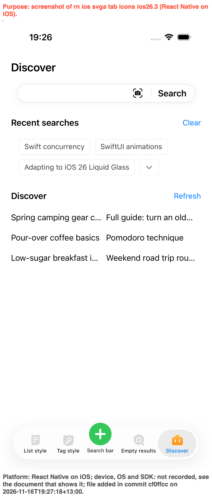

Android check at the shared pin `c795d08` (2026-11-17, emulator-5554, base cf0ffcc): `android/merged` builds, its unit
tests pass, and `--es CYLDemoTabIconSource 2` shows the SVGA tab icons; the React Native Android release build needed
`tools:replace="android:allowBackup,android:label"` (SVGAPlayer-Android's manifest) and a clean of stale build folders
that pointed into an old worktree, then it launches. Found: its tab icons are empty on Android (`system:` SF Symbol
names), TODO; SVGA on React Native Android (`SVGA_ON_ANDROID`) not run. Top to bottom: Android with SVGA; React Native
Android.

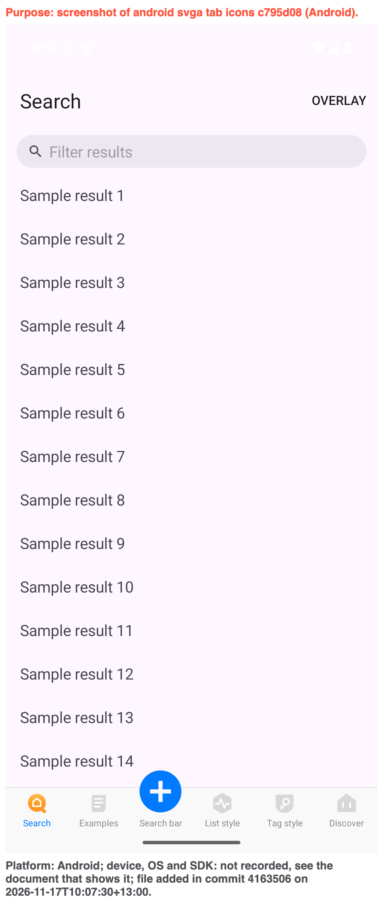
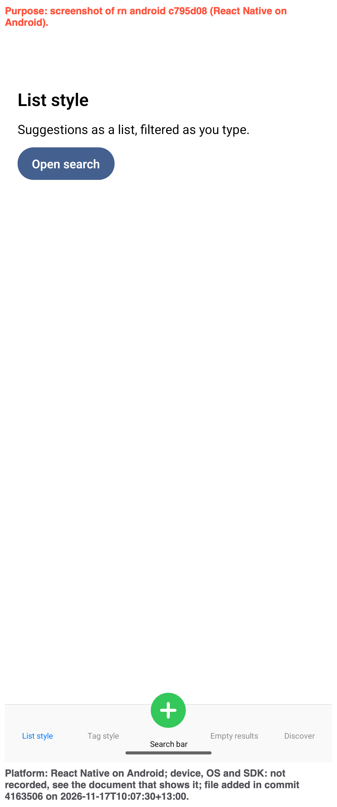

## TODO (2026-11-20): tab switch mid-animation must leave exactly one item selected, on every platform (the iOS contract)

- **Branch**: `feat/harmonyos-parity`.
- **Prompt (verbatim)**: "测试发现小程序中的tabbar svga动画tabbar，如果在一个svga动画还没执行结束前，点击下一个tabbaritem 下一个动画执行的同时上一个动画也在执行并没有因为切换tabbaritem就终止播放恢复未选中状态。不符合预期。模仿iOS逻辑，只要切换tabbaiitem就强制终止所有动画恢复未选中状态后，再执行下一个动画" and "这个导致的问题是该场景下会有两个tabbaritem处于选中状态，先解决小程序问题，再排查其他端是否也有这个问题，与iOS逻辑对齐"
  (English: on the mini program, tapping the next tab item while an SVGA animation is still playing leaves the previous
  one playing and not reset; follow iOS: any switch force-stops ALL animations and restores the unselected state, then plays
  the next; the consequence is two selected tab items; fix the mini program first, then check the other platforms, aligned
  with iOS.)
- **Contract (iOS, `CYLAnimatedItemView` / `CYLTabBar`)**: after every switch exactly one item is selected; every other item shows
  its unselected look (image, tint, title, resting frame) and plays nothing; then the new item plays.
- **iOS (macOS session, simulator, native example with SVGA tab icons)**: holds: Examples then Discover tapped without a pause,
  one selected item in every frame
  ([assets/ios-iphone18pro-20261120-tab-switch-one-selected.png](assets/ios-iphone18pro-20261120-tab-switch-one-selected.png)).
  React Native iOS and Flutter iOS draw the same native tab bar (react-native-cyltabbar / the Flutter platform view wrap
  `CYLTabBar`), so they follow it by construction; not run separately.
- **Owners / status**: mini program: Mac-CYLTabBarController 小程序开发 (fix + test, asked 2026-11-20); HarmonyOS: winCYLTabBarController 鸿蒙开发
  (static reading: one `selectedIndex` source, each engine stops on `selected` false; emulator run in progress); Android, React
  Native Android, Flutter Android: winCYLSearchViewController文件夹 (audit asked 2026-11-20).
- **Audit results (2026-11-20)**:
  - **HarmonyOS** (macOS session, Mate 70 Pro emulator on this Mac, example at the shared pins, SVGA tab icons): holds, one selected
    item in every frame ([assets/harmonyos-mate70pro-20261120-tab-switch-one-selected.png](assets/harmonyos-mate70pro-20261120-tab-switch-one-selected.png));
    the Windows session's emulator would not start (C: nearly full), its code reading agrees (one `selectedIndex` source; each
    engine stops on `selected` false). One gap by reading, GIF images only: a `selectedIndex` changed from outside does not stop the
    old tab's GIF (`cylOnSelectedIndexChange`); fix with winCYLTabBarController 鸿蒙开发, not reproduced.
  - **Android native** (Windows session, API 37 emulator, 3 of 8 quick switches): reproduces only when switching to the "More" tab;
    `cyl_moreButtonTapped` never stops the other tabs (it does not go through the `selectedIndex` setter), so the tab left behind
    keeps a selected-looking SVGA icon. Fix verified locally (`cyl_stopAnimationsOfAllTabBarItemsExcept`), patch with
    winCYLTabBarController 鸿蒙开发 to commit. React Native Android and Flutter Android: 0 of 8.
  - **Mini program**: fixed in CYLTabBarController `41660d24` (container stops and rests every other tab before the new one plays;
    item halts on deselect; pending plays cancelled; 8 tests); bundled in ClassifyMenu `954edf8c`; iOS pins `049b108`; not yet
    verified on DevTools or a phone with the SVGA tab bar.
  - **iOS More tab** (more than five tabs): not run, asked of Mac-CYLTabBarController文件夹.
- **Status**: TODO. Score: 70/100 (iOS and HarmonyOS verified, mini program fixed and bundled, Android More patch and the iOS More check
  open; the user's phone retest of the mini program is the last step). 2026-11-21: the Android More patch is blocked by the
  `style` clash (the next entry); the iOS More check is the macOS session's; the phone retest is the user's.

## TODO (2026-11-20): two tab items stay selected after a quick switch in the SVGA tab bar: the Android audit

- **Branch**: `feat/harmonyos-parity`. Platforms of this entry: native Android, React Native Android, Flutter Android (the mini
  program: Mac-CYLTabBarController 小程序开发; HarmonyOS: winCYLTabBarController 鸿蒙开发; iOS React Native and Flutter: the macOS session).
- **Prompt (verbatim, relayed by the macOS session)**: "这个导致的问题是该场景下会有两个tabbaritem处于选中状态，先解决小程序问题，再排查其他端是否也有这个问题，与iOS逻辑对齐"
  (English: in this case two tab items end up selected; fix the mini program first, then check whether the other platforms have it too,
  and align with the iOS logic). The iOS contract: every tab switch stops all animations, resets every item to unselected, then
  plays the new one, so exactly one item is selected.
- **Method**: the SVGA tab bar on the Android API 37 emulator (native `--es CYLDemoTabIconSource 2`, React Native "Tab icons: SVGA",
  Flutter `--dart-define=CYL_DEMO_TAB_ICON_SOURCE=2`); a quick switch (tap tab A, tap tab B 0.1, 0.25, 0.5 or 0.9 s later, eight
  switches per app); 3.8 s later the selected tab (accessibility `selected`) and the icon colours of every tab (grey is unselected,
  a coloured icon that is not the selected tab is an animation that was not stopped and reset).
- **Results** (CYLSearchViewController `1b3541f`, CYLTabBarController `8b7dea18`):

  | App | Switches with a leftover coloured icon | Which |
  | :--- | :--- | :--- |
  | Native Android example | 3 of 8 | all three switch to the "More" tab (Search or Examples then More) |
  | React Native Android | 0 of 8 | |
  | Flutter Android | 0 of 8 | |

- **Cause**: `CYLTabBarController.cyl_moreButtonTapped` (CYLTabBarController Android, `Example-Android/cyltabbar`) never stops the
  other tabs. A normal tab goes through the `selectedIndex` setter, which calls `cyl_playSelectedTabBarItemAnimation`, and that stops
  every other button's animation; the plus button's page calls it too (an earlier fix of the same kind). "More" has no animation
  of its own and no `selectedIndex` change, so only `cyl_playTabButtonAnimationForControl` runs: it plays the deselect step of the
  previous tab only when its animator implements one, and the SVGA animator does not, so the previous tab keeps playing and ends on
  its selected frame. Hence React Native and Flutter, whose tabs are all animated, did not show it; any app of the Android library with
  more than five tabs (a "More" tab) would.
- **Fix, committed in CYLTabBarController (2026-11-20, `c1abdffe` on `feat/cross-platform-components`, pull request 788)**: a shared
  `internal fun CYLTabBar.cyl_stopAnimationsOfAllTabBarItemsExcept(selectedControl)` in `CYLTabBarItemAnimationHost.kt`
  (`cyl_animationLottieImageWithSelectedControl` calls it too) and one call to it in `cyl_moreButtonTapped` before
  `cyl_playTabButtonAnimationForControl(button)`. With it, the same eight switches on the native example leave only the selected tab
  marked, and the three switches to "More" are fixed
  ([assets/android-svga-tab-switch-more-20261120.png](assets/android-svga-tab-switch-more-20261120.png), Android API 37 emulator, Windows 11, 2026-11-20 +13:00, after 1b3541f). The seam the unit test needed (the test classpath has no SVGA, Lottie or Rive
  library and the animation state is private) is a recording `CYLTabBarItemAnimator` / `CYLTabBarItemAnimationPlayer` test double that
  tracks whether it is playing, the same shape SVGA has (no deselect step, only `stop()`); test
  `CYLTabBarMoreAnimationTest.moreStopsTheAnimationOfTheTabSelectedBefore` fails on the commit before this fix and passes after;
  `:cyltabbar` 130 tests, 0 failures (Gradle 9.3.1, JDK 17, no Mac in this session, documented in CYLTabBarController's
  `docs/Android-Library.md`).
- **New blocker found while re-pinning here (2026-11-20)**: bumping `cyl.tabbar.commit` to `c1abdffe` to pick up the fix breaks
  `:classifymenu:compileDebugKotlin` in CollectionViewClassifyMenu: `CYLTagButton.kt:157:9 'style' hides member of supertype
  'CYLAnimatedItemView' and needs an 'override' modifier`. Cause: CYLTabBarController's `cylanimateditem` gained a public
  `var style: CYLAnimatedItemStyle` on `CYLAnimatedItemView` for the Countdown style feature (commits `e7053169`/`d5de5008`,
  already in the pin before this fix, so unrelated to it); `CYLTagButton` (CollectionViewClassifyMenu) already has its own,
  long-established `var style: CYLMenuStyle?` (a null-resettable per-tag style copy, used throughout `CYLTagButton.kt` and by
  `CYLTagFoldButton`, two `androidTest` files, and read everywhere a tag or a fold button is styled), an unrelated type for an
  unrelated purpose that happens to share the English word "style". The two names cannot both exist unqualified on the same class:
  `override` is not actually possible (the types, `CYLAnimatedItemStyle` vs `CYLMenuStyle?`, do not match), so one of the two
  must be renamed; `CYLTagListView`'s own `style: CYLMenuStyle?` (an unrelated `ViewGroup` subclass) and `CYLTag`'s own
  `style: CYLMenuStyle?` (unrelated, not a view) are not affected, only `CYLTagButton` and its subclass `CYLTagFoldButton`. **Not
  fixed here**: renaming either property is a public API change on a widely used member (cross-platform parity: `CYLTagButton.style`
  likely mirrors an iOS property of the same name; `CYLAnimatedItemView.style` is used the same way on every platform
  CYLAnimatedItemView ships on), so it needs the owning session's decision, not a guess made while chasing an unrelated bug.
  **Left as its own TODO** (CollectionViewClassifyMenu `docs/animated-item-migration.md` or its API map, whichever session owns
  that repository next): decide which `style` is renamed (or qualify one with its class, e.g. Kotlin's `@JvmName` does not help
  here since the clash is at the Kotlin property level, not the JVM signature), rename every reference, re-pin CYLTabBarController
  at `c1abdffe` or newer here, and rerun this row's check.
- **Status**: TODO. Score: 80/100 (the fix is committed and tested in CYLTabBarController; re-pinning here and the final check are
  blocked by the unrelated `style` name collision above, not by this bug).
  2026-11-21: still blocked. The CYLTabBarController tip `e96c4979` contains `c1abdffe`, but `:classifymenu:compileDebugKotlin`
  still fails at CollectionViewClassifyMenu `cf478388` (and on every branch there: `feat/harmony` `7b7051ab`, `master` `76e7a8cd`).
  The CollectionViewClassifyMenu session found that iOS clashes too (`CYLAnimatedItemView.swift` `style` against `CYLTagButton.swift`
  `style`; HarmonyOS named it `itemStyle`) and asked the user which property to rename (its proposal: `itemStyle` upstream on
  iOS and Android). Re-pin and re-check once it sends the commit.
  2026-11-21, later: fixed upstream in CYLTabBarController PR #822 (`CYLAnimatedItemView.style` renamed `itemStyle` on iOS and Android,
  head `f9827fef`, code `39b274c9`, contains `c1abdffe`), not merged yet. Checked here with `cyl.tabbar.commit=39b274c9` set locally
  (not committed: the pin follows the newest branch once #822 is merged): `:cylsearch` 26 of 26, the example builds, and the four
  switches to More that failed before now leave only More selected ([android-medium-phone-api37-20261121-more-switch-at-39b274c9.png](assets/android-medium-phone-api37-20261121-more-switch-at-39b274c9.png), Medium Phone API 37 emulator, JDK 17, Windows 11 Pro 10.0.22631, CYLSearchViewController d6f22c3 + tab bar 39b274c9, ClassifyMenu cf478388, 2026-11-21 23:25 +13:00).
  Left: pin the merged commit on every platform (with the ClassifyMenu commit that session sends) and re-run this check at the pin.

## TODO (2026-11-20): the tag list drag holds the scrolling on every platform, like the mini program

- **Branch**: `feat/harmonyos-parity`. Score: 55/100 (was 30; full marks: every platform holds the content scroller while a drag or smear
  is active, by core code, with a test and a labelled screenshot; 60: Android native, React Native, Flutter and HarmonyOS).
- **Prompt (verbatim)**: "小程序联系人example拖动taglist期间禁止滚动测试通过，现在排查其他端的逻辑，要求与小程序的逻辑保持一致，修改searchbar以及collectionview库里的core代码实现该功能。"
  (English: the mini program contact tags example holds scrolling while a tag list is dragged, tested and passing; now check the
  other platforms' logic, keep it consistent with the mini program, and implement it in the core code of the search bar and
  the collection view library.)
- **The contract** (`AGENTS.md`, "The core owns the content below the search bar and its scrolling"): the tag list reports a drag
  (and a smear) as a state; the core's content page holds its own scrolling only while one is active, and scrolls at every other
  time; the example holds nothing. Mini program: done and confirmed on the user's phone (`reorderingchange` / `smearingchange`
  bubbling to `cyl-search`'s content page).
- **Audit, Android API 37 emulator** (contact tags editor in Manage; a long press on a tag's padding, a drag of 450 px up and
  300 px down, the y of the "Recent" or "My Tags" header before and after; a swipe on a tag as the control):

  | Platform | A swipe on a tag | A long press and drag | Why |
  | :--- | :--- | :--- | :--- |
  | Android native | scrolls | the tag moves, the content stays | `CYLTagListView` calls `requestDisallowInterceptTouchEvent(true)` when the drag starts (and when a smear starts), which every ancestor scroller honours until the finger lifts |
  | React Native Android | scrolls | the tag moves, the content stays | the same native view; `ReactScrollView` honours it |
  | Flutter Android | scrolls | **the tag moves and the content scrolls with it** | the platform view sits in Flutter's gesture arena with no recognizer, so the `ListView` also takes the drag |
  | HarmonyOS (macOS session, Mate 70 Pro emulator on the macOS machine) | scrolls from outside a tag; a swipe that starts ON a tag does not scroll | not simulable: `uitest uiInput swipe` and `drag` are the same command (no press-and-hold), so a real long press and drag was not run | the tag list reports no drag state and the core's content `Scroll` in `CYLSearchView.ets` has no hold (code reading, Windows session); a long press drag on a device is still to check |
  | iOS native (macOS session, iPhone 18 Pro simulator, 2026-11-20) | n/a | **holds**: the tag lifts and the content stays; a short drag inside the list leaves every position unchanged; a drag down to the sheet's bottom edge scrolls the content (UIKit's edge auto-scroll while an item is dragged: a deliberate reorder aid, not the conflict) | `UICollectionView` interactive movement on the very collection view that scrolls: UIKit suspends its pan while an item is dragged |
| iOS React Native (same session) | n/a | **holds**: the first tag lifts and floats over the list, the "Recent" and "My Tags" headers stay put | the native `CYLTagListView` inside RN's scroll view: its long press wins |
| iOS Flutter (same session) | n/a | **does NOT hold**: the page is pulled down with the drag and the first tag never lifts | the Dart scroll view wins the gesture arena over the platform view (same cause as Flutter Android) |

  iOS screenshot (React Native holds, Flutter does not): [assets/ios-iphone18pro-20261120-tag-drag-scroll-rn-flutter.png](assets/ios-iphone18pro-20261120-tag-drag-scroll-rn-flutter.png) (iPhone 18 Pro simulator, iOS 27.2, at ClassifyMenu `954edf8c` / tab bar `41660d24`).

  [assets/android-tag-drag-scroll-native-vs-flutter-20261120.png](assets/android-tag-drag-scroll-native-vs-flutter-20261120.png) (Android API 37 emulator, Windows 11, 2026-11-20 +13:00, after a17131a).
- **Plan, the same names on every platform**:
  1. CollectionViewClassifyMenu core: a public state callback of the tag list, the counterpart of the mini program events: `menuDidChangeReordering(menu, reordering)`
     and `menuDidChangeSmearing(menu, smearing)` on the delegate (Kotlin, ArkTS, Swift), sent at the start, the end and the cancel of a drag or a smear.
     Android and HarmonyOS: winCollectionViewClassifyMenu; iOS: Mac-CollectionViewClassifyMenu.
  2. Search core, HarmonyOS: the content `Scroll` of `CYLSearchView` listens to the tag list inside it and sets `enableScrollInteraction(false)` only while a drag
     or a smear is active. iOS: the content scroll view's `isScrollEnabled` the same way (macOS session).
  3. Flutter core (`flutter_cylsearch`): the Android and iOS plugins forward the state as `didChangeDragging`; `CYLTagListView` claims the drag in the gesture
     arena at that moment, so an ancestor `Scrollable` does not scroll (a swipe that began earlier still scrolls), with a widget test.
  4. React Native: the bridge forwards `onReorderingChange` and `onSmearingChange` for API parity (the native hold already works on Android).
- **Flutter iOS after the arena fix `7f61043` (macOS session, 2026-11-20)**: the page no longer moves with the drag, but the tag does NOT lift either
  (Family stays first, nothing floats; a plain swipe with fine samples scrolls the page, so scrolling itself works; native and React Native iOS lift the tag
  in the same test): so on iOS the long press won in the arena yet the native `CYLTagListView` did not start its drag, i.e. the held touches did not reach
  the UIKit recognizer the way they do on Android
  ([assets/ios-iphone18pro-20261120-flutter-tag-drag-after-arena-fix.png](assets/ios-iphone18pro-20261120-flutter-tag-drag-after-arena-fix.png)).
  Hint: CYLTabBarController's own Flutter iOS platform view needed an `EagerGestureRecognizer` (`3ee06877`) for the same reason (UIKit platform views get their
  touches replayed by the embedder after the arena decides); to try next on iOS: an eager recognizer in the `UiKitView` (`gestureRecognizers`) or the embedder's
  `FlutterPlatformViewGestureRecognizersBlockingPolicy`. Sent to the Windows session (owner of `flutter_cylsearch`'s Dart core).
- **iOS plan (macOS session)**: native and React Native iOS need no hold today. Needed: the ClassifyMenu callbacks `menuDidChangeReordering` / `menuDidChangeSmearing` on iOS
  (asked of Mac-CollectionViewClassifyMenu文件夹) for API parity and for the Flutter iOS fix (the platform view forwards `didChangeDragging` and the Dart core claims the drag, same as
  Android); the iOS search core's content scroll view (`isScrollEnabled`) holds while a drag/smear is active, if a host puts a scroll view in its content slot.
- **Progress (2026-11-20, Windows)**: Flutter Android fixed and verified; iOS audit by the macOS session: native and React Native hold, Flutter does
  not (the same cause); HarmonyOS: a swipe that starts on a tag does not scroll the list, a real long press and drag cannot be simulated on the emulator.
  - **Flutter root cause**: a platform view in the gesture arena without a recognizer gets its touches only after the arena is decided, and the
    Dart scroll view wins every vertical drag, so the native list never saw the long press (the first reading, "the content scrolls with the
    drag", was the list being scrolled while no drag started). Fix in the core (`flutter_cylsearch`, `CYLTagListView`): the platform view joins the arena with
    a `LongPressGestureRecognizer`; a finger that stays still for the long press time wins the pointer for the native list (the held touches reach it, the
    drag starts) and the scroll view does not scroll with it; a swipe that began earlier scrolls as usual. It applies to Android and iOS (both pass the set to the
    platform view). Also forwarded for parity: the Android plugin sends `didChangeDragging` from ClassifyMenu `53608bb5`'s `menuDidChangeReordering` /
    `menuDidChangeSmearing`, and `CYLTagListView.onDraggingChanged` reports it. Tests: Flutter 18 of 18 (the platform view carries the long press recognizer; the
    drag state event).
  - **Flutter Android after the fix** (same drag test, 450 px up and 300 px down): the tag moves, the content stays; a swipe on a tag scrolls
    ([assets/flutter-android-tag-drag-fixed-20261120.png](assets/flutter-android-tag-drag-fixed-20261120.png), Android API 37 emulator, Windows 11, 2026-11-20 +13:00, after a17131a).
  - **Left**: Flutter iOS (the macOS session verifies the same Dart core on iOS and forwards `didChangeDragging` once the iOS ClassifyMenu callbacks land); HarmonyOS
    (the core's content `Scroll` holds only while a drag is active, from the ClassifyMenu callbacks; the callbacks reach the app through the tag list's delegate, so the
    search core needs a way to hear them, to be designed with the ClassifyMenu session; then a device run); React Native: forward the events for parity.
  - **React Native events (2026-11-21, Windows)**: `<CYLTagListView onReorderingChange onSmearingChange>` (`CylsearchTagListViewNativeComponent.ts`),
    sent by the Android view from ClassifyMenu's `menuDidChangeReordering` / `menuDidChangeSmearing` (the same callbacks as Flutter's `didChangeDragging`).
    Checked: the React Native Android example builds (Gradle, JDK 17, React Native 0.88.0) and codegen emits both events (`EventEmitters.h`); jest 4 of 4.
    iOS sends nothing yet: the iOS ClassifyMenu has no such callbacks (checked at `feat/harmony` 7b7051ab, 2026-11-21); once they land, `CylsearchTagListView.mm`
    forwards them the same way (the macOS session).
  - **Score**: 55/100.
  - **HarmonyOS hold check (2026-11-20, macOS emulator, `e6f25d4`)**: launch `--ps CYLDebugQuery i --pi CYLDebugNoFocus 1 --pi CYLDebugTagGestureActive 1|0`
    (`--pi` carries integers only, the query needs `--ps`); Examples, other libraries' examples, MiguelCatalan, Default, search icon. The suggestion list
    (query "i", longer than the screen) swiped 700,2200 to 700,900: flag 1 did not scroll, flag 0 scrolled. Before `e6f25d4` the list-style
    `suggestionList` had no hold and scrolled with the flag on. The keyboard's consent dialog was never accepted.
    ([assets/harmonyos-20261120-tag-drag-hold-suggestion-list.png](assets/harmonyos-20261120-tag-drag-hold-suggestion-list.png), HarmonyOS emulator on macOS, `e6f25d4`, 2026-11-20 02:22 +08:00)
  - **Left (HarmonyOS)**: the real drag signal from the ClassifyMenu callbacks (only the debug flag was exercised).
- **Earlier "Left" (before the progress above)**: all of the plan; the Android and Flutter checks again after each step with the same drag test
  (`dragtest.sh` on the Windows machine), HarmonyOS on the macOS emulator.
