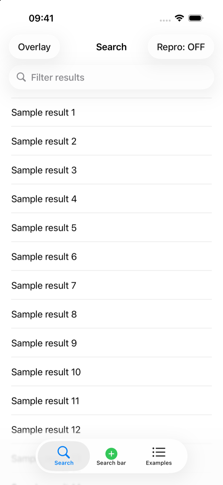
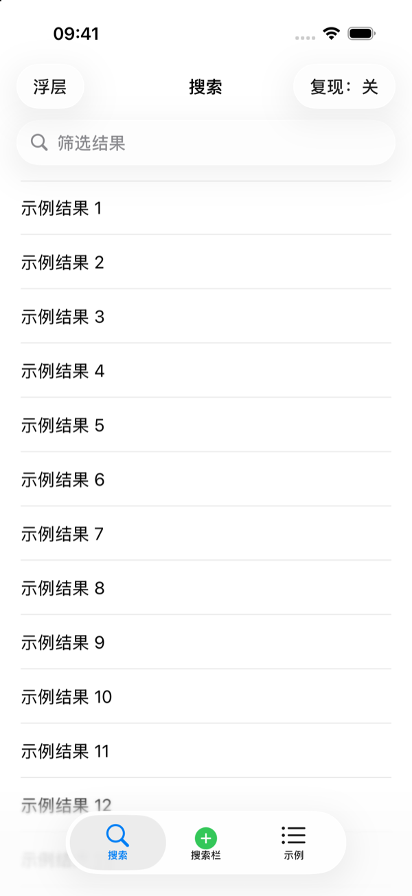
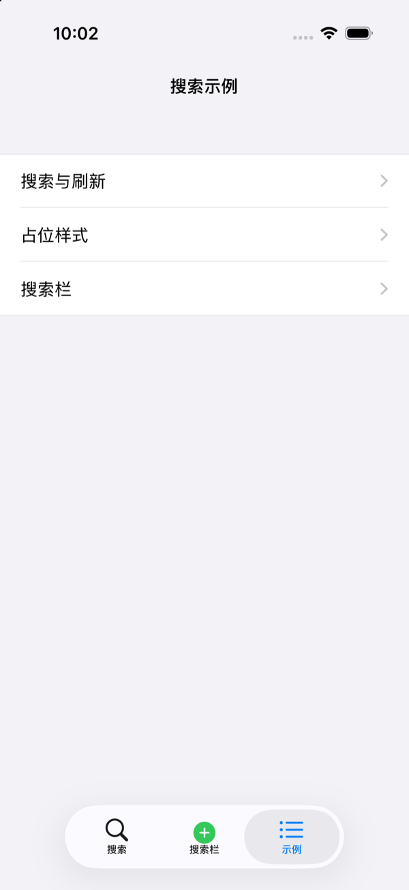
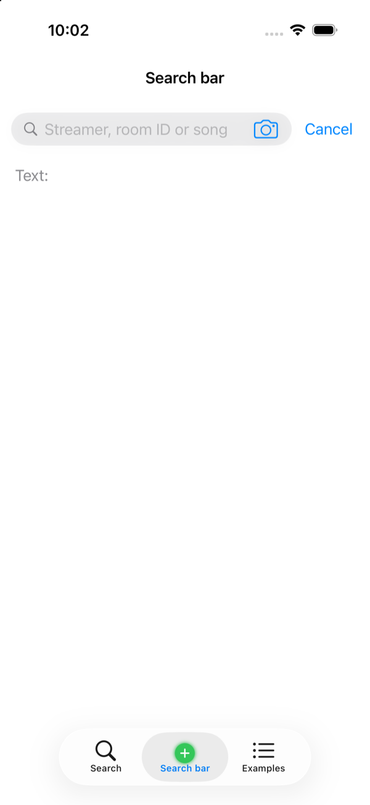
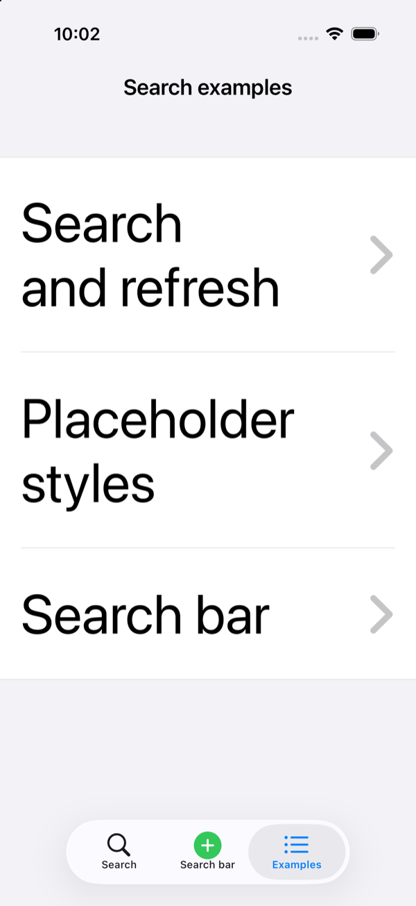

# CYLTabBarController Integration

This project integrates CYLTabBarController by default. Its instruction and
skill rules were adapted from CYLTabBarController at its newest commit across
all branches, found by commit timestamp:

| Field | Value |
|:---|:---|
| Commit | `caf3c925966f71edfc87d1dd2ed9f03cbad6aba1` |
| Branch | `feat/cross-platform-components` (not `master`) |
| Commit date | 2026-11-11 15:54:48 +1300 |
| Read on | 2026-11-11 |

## Default integration

Unless a task says otherwise, every `CYLTabBarController` in the example layer:

1. is created from a local configuration file in the app bundle
   (`+tabBarControllerWithConfigurationFile:error:`);
2. has a plus button declared under `CYLTabBarControllerPlusButton`, whose
   `CYLTabBarItemPageIdentifier` resolves to the plus child view controller;
3. resolves its pages through `CYLTabBarPageRegistry` providers;
4. depends on the newest CYLTabBarController commit through CocoaPods
   (`scripts/latest-cyl-commit.sh --podfile`).

Recipe: `.agents/skills/cyl-tabbar-integration/SKILL.md`.

## What was copied and adapted

| Upstream source | Written here | Notes |
|:---|:---|:---|
| `AGENTS.md`: Depending on CYLTabBarController, accessibility, clean builds, bilingual reading, commit author line | `AGENTS.md` "CYLTabBarController", "Skills", "Commit readiness"; `instructions.md` "CYLTabBarController", "Commit readiness" | Library-only rules (public API, localization bundles, Android, React Native, Flutter, docs generators) left out |
| `CLAUDE.md` (`@AGENTS.md`) | `CLAUDE.md` unchanged | Already identical |
| `.claude/skills -> ../.agents/skills` | `.claude/skills` symlink | Same layout as upstream |
| `cyl-plus-button` | `cyl-plus-button` (new) | Rewritten around the configuration-file plus button |
| `cyl-new-project`, `cyl-verify`, `cyl-api-map`, `cyl-docs`, `cyl-xcode-compat` | Same skill names, new "CYLTabBarController" sections | Upstream paths replaced by pinned upstream links |
| `scripts/latest-cyl-commit.sh` | `scripts/latest-cyl-commit.sh` | Copied with attribution |
| — | `cyl-tabbar-integration` (new) | Configuration file + plus child view controller recipe |

Not copied: `cyl-theme`, `cyl-tab-animation`, and third-party vendored skills
(`.agents/skills.json`), which are library-specific or carry their own licenses.

## Comments on public API

The rule in `AGENTS.md`, "Comments on public API" comes from upstream commit
`63c0edc9abc57a22dc529ff1758629cd2d42c3a7` (2026-11-11 16:46:46 +1300,
`feat/cross-platform-components`), which was the newest commit when the rule
was copied. Upstream still allows a one-line `/// …` in Objective-C headers. This
project's rule is stricter and wins over upstream. Official documentation
rules win over both:

- single-line public API comments use the same three-line block as
  multi-line ones where the block form is officially allowed (Objective-C
  `/*! */`; Swift, Kotlin, Java, TypeScript, JavaScript `/** */`), never a
  one-line block and never a trailing `/**< */`, `/*!< */`, `///<` or `//`;
- a file with public API uses one comment format;
- where the official guide requires another form, the official form applies:
  Python PEP 257 docstrings (one-line docstrings stay on one line), Go `//`
  (Effective Go), C# `///` with XML tags (Microsoft Learn), Rust `///` (Rust
  Style Guide), Dart `///` (Effective Dart).

Status (2026-11-11): the four public headers in `Sources/CYLSearchViewController/`
pass the check in the `cyl-verify` skill (the grep prints nothing). This
repository has no Swift, Kotlin, Java, TypeScript, Dart, Python, Go, C# or Rust
sources yet.

## Status

- Public API comments (2026-11-11): every documentation comment in the
  public headers is a `/*! … */` block. 2026-11-12: `CYLSearchBarView.h`
  converted too; `scripts/check-public-api-comments.sh` (run in CI) is the
  checker for `Sources/CYLSearchViewController/*.h`.
- Quick Help and the Swift interface (2026-11-12, Xcode 27.2): the clang AST
  of each header attaches a `FullComment` to every documented declaration,
  and `xcrun swift-synthesize-interface` shows each block in the generated
  Swift interface (header blocks / Swift blocks: `CYLSearchBarView` 15/15,
  `CYLSearchController` 3/4, `CYLSearchPlaceholderView` 10/10,
  `CYLSearchResources` 4/4, `CYLSearchResultsViewController` 2/2;
  `CYLSearchController` shows one block twice).
- Example integration (2026-11-12, 10/10):
  - `Podfile` pins `d36c7080157c49c552a3a352d72a9d00a2be11a9`, the newest
    commit on any branch (`feat/cross-platform-components`) when it was read.
  - `CYLSearchExample/CYLTabBarConfiguration.json` (Resources phase, explicit
    file reference) declares the Search and Examples tabs and the plus button.
    Its page ID `plus` resolves to the plus child view controller, the search
    bar demo (`CYLSearchBarDemoViewController`).
  - `CYLSearchExampleAppDelegate` registers a provider for every page ID in
    `CYLTabBarPageRegistry.sharedRegistry` and builds the root with
    `+tabBarControllerWithConfigurationFile:error:`; when the file cannot be
    read it logs the error and shows the examples menu. Every page sits in a
    `UINavigationController`, so the Issue #1317 search controller setup is
    unchanged. `Sources/` does not import CYLTabBarController.
  - Tab titles are localization keys (`CYLTabBarControllerLocalization`)
    translated in `CYLSearchExample/CYLSearchTabs.bundle` (en, zh-Hans,
    zh-Hant, ja). `Info.plist` declares the four languages; without
    `CFBundleLocalizations` the app resolved to English and the tab titles
    stayed English in Chinese.
  - The configuration keys and `system:` images were checked against the
    pinned commit by running the app, not only against the upstream docs.
- Pod resources: CYLTableViewPlaceHolder and CYLTabBarController are static
  frameworks, so their bundles need CocoaPods' "[CP] Copy Pods Resources"
  phase. It was missing from the project file, and the refresh header showed
  its raw keys (`CYLRefreshHeaderIdleText`). The phase is now in the project.
- Verification (2026-11-12, iPhone 17 Pro simulator, iOS 26.1): `pod install`,
  build, analyze (no warning in `Sources/`) and 13 unit tests pass.
  `testTabBarComesFromTheConfigurationFile` checks the controller class, the
  plus button and its child, the three pages in navigation controllers, the
  translated titles, every table's keys and the plus button's VoiceOver label
  ("Search bar"). The screenshots below come from launching the app.

- A search bar never covers any view (2026-11-12):
  - `CYLSearchResultsViewController` and `CYLSearchController` do not extend
    their views under the top bar (`edgesForExtendedLayout` without
    `UIRectEdgeTop`). Before, the table view extended under the search bar
    and the refresh header's text showed through it.
  - Both keep the search bar in the navigation bar, under the title
    (`preferredSearchBarPlacement` stacked; on iOS 26
    `searchBarPlacementAllowsToolbarIntegration = NO`). Without a tab bar,
    iOS 26 on iPhone floated the field at the bottom of the screen, over the
    last rows of the list.
  - `testSearchBarsCoverNoView` checks the results screen (bar pinned and
    hiding on scroll), the search bar demo at the default and the largest
    text size, and the overlay, with `CYLViewsCoveredByView`: every visible
    view of the window except the bar's own subviews and containers, system
    bar backgrounds, views that draw nothing and parts clipped away.
    `testSearchBarNeverCoversTheViewControllersView` checks the view's frame.
    Both fail without the changes. On iOS 26 the navigation bar shows
    `searchBar.searchTextField` without the `UISearchBar`, so the tests check
    the view that is on screen.
- Scene life cycle (2026-11-12, Xcode 27.2): apps built with the iOS 27 SDK
  do not launch without it ("UIScene life cycle is required"), so the test
  runner crashed before connecting; CI on Xcode 26.6 did not show it.
  `CYLSearchExampleSceneDelegate` (Info.plist `UIApplicationSceneManifest`)
  now creates the window with `+[CYLSearchExampleAppDelegate rootViewController]`.
  Page titles use `navigationItem.title`, so loading a page no longer renames
  its tab (checked in `testTabBarComesFromTheConfigurationFile`). 15/15 tests
  on the iPhone 17 simulator (iOS 26.1); analyze: 0 warnings in `Sources/`.
- Comment coverage: `scripts/public-api-doc-coverage.sh` counts, from clang's
  symbol graph (`clang -extract-api`, what Quick Help and DocC read), the
  public symbols of each header that carry a documentation comment; every
  written block attaches to its declaration.

## Screenshots

Top to bottom: the Search tab in English and in Simplified Chinese (the list
starts below the search bar); the Examples tab in Simplified Chinese; the
plus page; the Examples tab at the largest accessibility text size.

## Maintenance

- When upstream changes, run `scripts/latest-cyl-commit.sh --podfile`, update
  the Podfile pin, compare upstream `AGENTS.md` and the `cyl-*` skills, and
  update the commits recorded in this document and the skill links. CI warns
  when the pin is not the newest commit.
