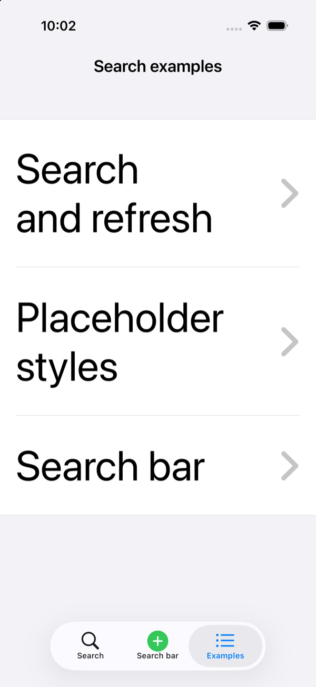
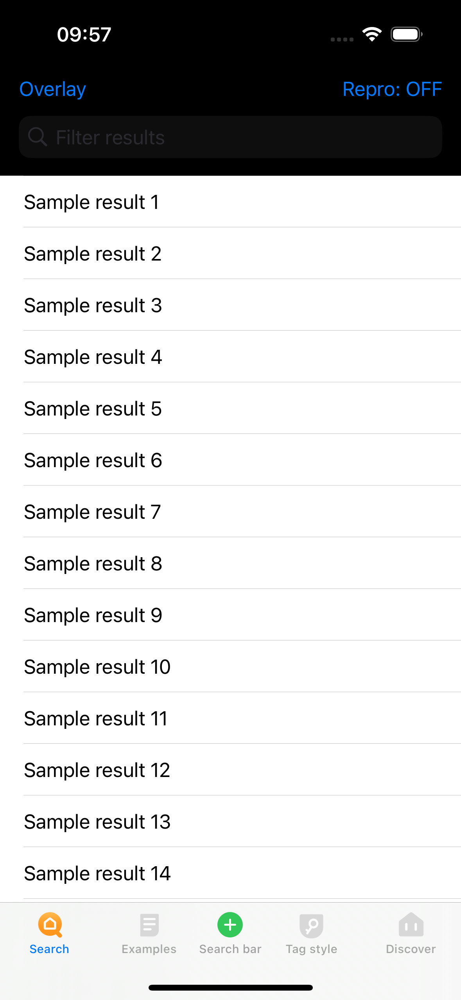
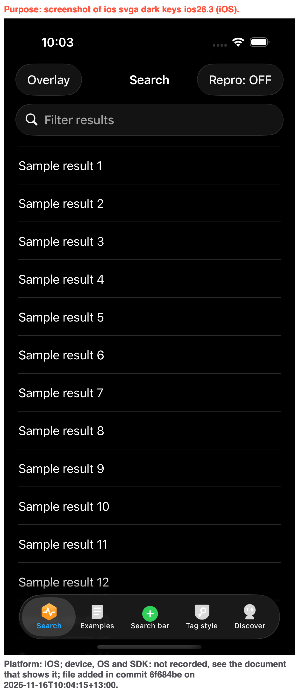
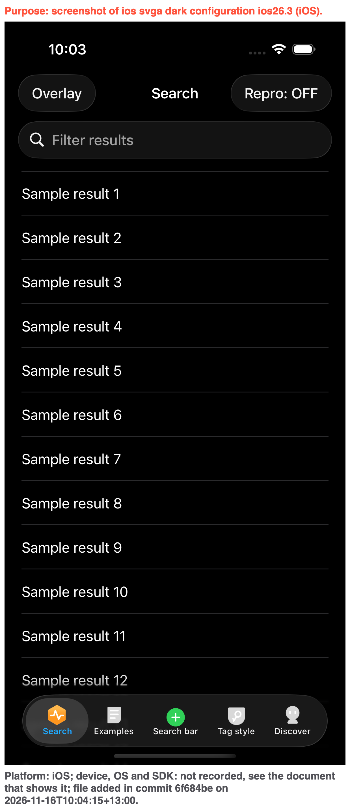
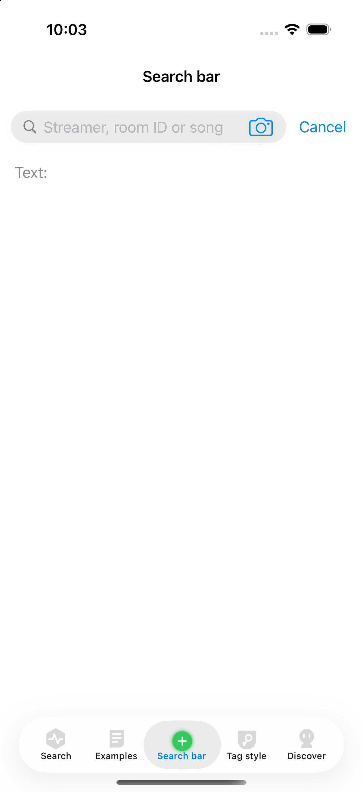
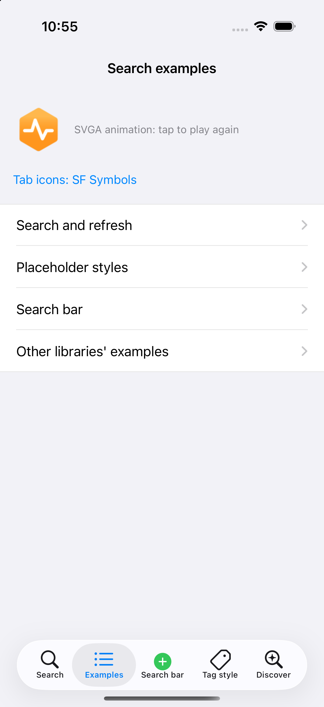
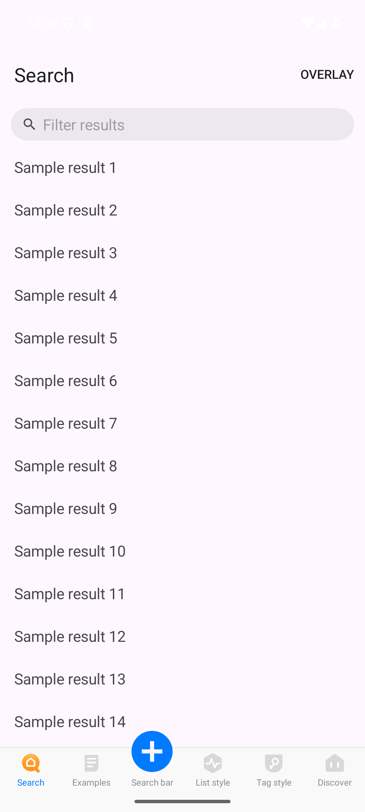
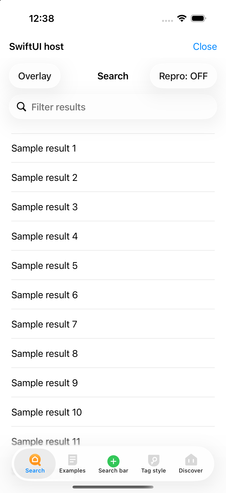
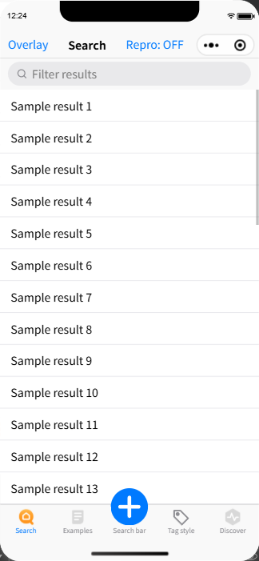

# CYLTabBarController Integration

This project integrates CYLTabBarController by default. Its instruction and
skill rules were adapted from CYLTabBarController at its newest commit across
all branches, found by commit timestamp:

| Field | Value |
|:---|:---|
| Commit | `caf3c925966f71edfc87d1dd2ed9f03cbad6aba1` |
| Branch | `feat/cross-platform-components` (not `master`) |
| Commit date | 2026-11-11 15:54:48 +1300 |
| Read on | 2026-11-11 |

## Default integration

Unless a task says otherwise, every `CYLTabBarController` in the example layer:

1. is created from a local configuration file in the app bundle
   (`+tabBarControllerWithConfigurationFile:error:`);
2. has a plus button declared under `CYLTabBarControllerPlusButton`, whose
   `CYLTabBarItemPageIdentifier` resolves to the plus child view controller;
3. resolves its pages through `CYLTabBarPageRegistry` providers;
4. depends on the newest CYLTabBarController commit through CocoaPods
   (`scripts/latest-cyl-commit.sh --podfile`).

Recipe: `.agents/skills/cyl-tabbar-integration/SKILL.md`.

## What was copied and adapted

| Upstream source | Written here | Notes |
|:---|:---|:---|
| `AGENTS.md`: Depending on CYLTabBarController, accessibility, clean builds, bilingual reading, commit author line | `AGENTS.md` "CYLTabBarController", "Skills", "Commit readiness"; `instructions.md` "CYLTabBarController", "Commit readiness" | Library-only rules (public API, localization bundles, Android, React Native, Flutter, docs generators) left out |
| `CLAUDE.md` (`@AGENTS.md`) | `CLAUDE.md` unchanged | Already identical |
| `.claude/skills -> ../.agents/skills` | `.claude/skills` symlink | Same layout as upstream |
| `cyl-plus-button` | `cyl-plus-button` (new) | Rewritten around the configuration-file plus button |
| `cyl-new-project`, `cyl-verify`, `cyl-api-map`, `cyl-docs`, `cyl-xcode-compat` | Same skill names, new "CYLTabBarController" sections | Upstream paths replaced by pinned upstream links |
| `scripts/latest-cyl-commit.sh` | `scripts/latest-cyl-commit.sh` | Copied with attribution |
| — | `cyl-tabbar-integration` (new) | Configuration file + plus child view controller recipe |

Not copied: `cyl-theme`, `cyl-tab-animation`, and third-party vendored skills
(`.agents/skills.json`), which are library-specific or carry their own licenses.

## Comments on public API

The rule in `AGENTS.md`, "Comments on public API" comes from upstream commit
`63c0edc9abc57a22dc529ff1758629cd2d42c3a7` (2026-11-11 16:46:46 +1300,
`feat/cross-platform-components`), which was the newest commit when the rule
was copied. Upstream still allows a one-line `/// …` in Objective-C headers. This
project's rule is stricter and wins over upstream. Official documentation
rules win over both:

- single-line public API comments use the same three-line block as
  multi-line ones where the block form is officially allowed (Objective-C
  `/*! */`; Swift, Kotlin, Java, TypeScript, JavaScript `/** */`), never a
  one-line block and never a trailing `/**< */`, `/*!< */`, `///<` or `//`;
- a file with public API uses one comment format;
- where the official guide requires another form, the official form applies:
  Python PEP 257 docstrings (one-line docstrings stay on one line), Go `//`
  (Effective Go), C# `///` with XML tags (Microsoft Learn), Rust `///` (Rust
  Style Guide), Dart `///` (Effective Dart).

Status: the iOS core is Swift, the three files of `Sources/CYLSearchBar/`
(`CYLSearchBarView.swift`, `CYLSearchView.swift`, `CYLSearchResources.swift`);
every public declaration has a three-line `/** */` block, checked by
`scripts/check-public-api-comments.sh` (the `cyl-verify` skill). The Kotlin,
ArkTS and JavaScript ports follow the same table.

## Status

- Public API comments: every documentation comment in the core's Swift
  files is a three-line `/** … */` block; `scripts/check-public-api-comments.sh`
  (run in CI) is the checker for `Sources/CYLSearchBar`.
- Quick Help and the Swift interface: Xcode reads the `/** */` blocks of the
  Swift core directly, and the generated Objective-C header carries the
  `@objc` names. Not yet measured on Xcode for `Sources/CYLSearchBar`
  (`TODO`: needs a Mac; the first compile is iOS CI on PR #11).
- Example integration (2026-11-12, 10/10):
  - `Podfile` pins `d36c7080157c49c552a3a352d72a9d00a2be11a9`, the newest
    commit on any branch (`feat/cross-platform-components`) when it was read.
  - `CYLSearchExample/CYLTabBarConfiguration.json` (Resources phase, explicit
    file reference) declares the Search and Examples tabs and the plus button.
    Its page ID `plus` resolves to the plus child view controller, the search
    bar demo (`CYLSearchBarDemoViewController`).
  - `CYLSearchExampleAppDelegate` registers a provider for every page ID in
    `CYLTabBarPageRegistry.sharedRegistry` and builds the root with
    `+tabBarControllerWithConfigurationFile:error:`; when the file cannot be
    read it logs the error and shows the examples menu. Every page sits in a
    `UINavigationController`, so the Issue #1317 search controller setup is
    unchanged. `Sources/` does not import CYLTabBarController.
  - Tab titles are localization keys (`CYLTabBarControllerLocalization`)
    translated in `CYLSearchExample/CYLSearchTabs.bundle` (en, zh-Hans,
    zh-Hant, ja). `Info.plist` declares the four languages; without
    `CFBundleLocalizations` the app resolved to English and the tab titles
    stayed English in Chinese.
  - The configuration keys and `system:` images were checked against the
    pinned commit by running the app, not only against the upstream docs.
- Pod resources: CYLTableViewPlaceHolder and CYLTabBarController are static
  frameworks, so their bundles need CocoaPods' "[CP] Copy Pods Resources"
  phase. It was missing from the project file, and the refresh header showed
  its raw keys (`CYLRefreshHeaderIdleText`). The phase is now in the project.
- Verification (2026-11-12, iPhone 17 Pro simulator, iOS 26.1): `pod install`,
  build, analyze (no warning in `Sources/`) and 13 unit tests pass.
  `testTabBarComesFromTheConfigurationFile` checks the controller class, the
  plus button and its child, the three pages in navigation controllers, the
  translated titles, every table's keys and the plus button's VoiceOver label
  ("Search bar"). The screenshots below come from launching the app.

- A search bar never covers any view (2026-11-12):
  - The Issue #1317 results screen (`CYLSearchExampleViewController`) does
    not extend its view under the top bar (`edgesForExtendedLayout` without
    `UIRectEdgeTop`), so the table view and the refresh header's text never
    show through the search bar. `CYLSearchView` lays its own bar out against
    the safe area, on an opaque page, with the suggestions and results below.
  - The results screen keeps the search bar in the navigation bar, under the title
    (`preferredSearchBarPlacement` stacked; on iOS 26
    `searchBarPlacementAllowsToolbarIntegration = NO`). Without a tab bar,
    iOS 26 on iPhone floated the field at the bottom of the screen, over the
    last rows of the list.
  - `testSearchBarsCoverNoView` checks the results screen (bar pinned and
    hiding on scroll), the search bar demo at the default and the largest
    text size, and the `CYLSearchView` overlay, with `CYLViewsCoveredByView`: every visible
    view of the window except the bar's own subviews and containers, system
    bar backgrounds, views that draw nothing and parts clipped away.
    `testSearchBarNeverCoversTheViewControllersView` checks the view's frame.
    Both fail without the changes. On iOS 26 the navigation bar shows
    `searchBar.searchTextField` without the `UISearchBar`, so the tests check
    the view that is on screen.
- Scene life cycle (2026-11-12, Xcode 27.2): apps built with the iOS 27 SDK
  do not launch without it ("UIScene life cycle is required"), so the test
  runner crashed before connecting; CI on Xcode 26.6 did not show it.
  `CYLSearchExampleSceneDelegate` (Info.plist `UIApplicationSceneManifest`)
  now creates the window with `+[CYLSearchExampleAppDelegate rootViewController]`.
  Page titles use `navigationItem.title`, so loading a page no longer renames
  its tab (checked in `testTabBarComesFromTheConfigurationFile`). 15/15 tests
  on the iPhone 17 simulator (iOS 26.1); analyze: 0 warnings in `Sources/`.
- Comment coverage: `scripts/public-api-doc-coverage.sh` counts, from clang's
  symbol graph (`clang -extract-api`, what Quick Help and DocC read), the
  public symbols of each header that carry a documentation comment; every
  written block attaches to its declaration.

## Screenshots

Top to bottom: the Search tab in English and in Simplified Chinese (the list
starts below the search bar); the Examples tab in Simplified Chinese; the
plus page; the Examples tab at the largest accessibility text size.

## Maintenance

- When upstream changes, run `scripts/latest-cyl-commit.sh --podfile`, update
  the Podfile pin, compare upstream `AGENTS.md` and the `cyl-*` skills, and
  update the commits recorded in this document and the skill links. CI warns
  when the pin is not the newest commit.

## DONE (2026-11-12): raised plus button in example demos

- Context: the example's plus button comes from `CYLSearchExample/CYLTabBarConfiguration.json`
  (`CYLTabBarControllerPlusButton`), shown inside the tab bar like a tab.
- Requirements: in the instruction files and the skills, find the CYLTabBarController example-layer integration
  section (create it if missing) and add, in English: when the example demonstrates a plus button, prefer the
  raised plus button, whose top edge rises above the tab bar.
- Prompt (verbatim): "找到instructions相关文档以及skills相关文档。找到CYLTabBarController 相关example层集成章节，如果没有就新建，全英文追加一条规则集成PlusButton进行example演示时，总是优先使用plus button凸起效果。凸起的含义是plus button顶点超出tabbar范围。"
- Prompt (English): "Find the instruction documents and skill documents, find the CYLTabBarController example-layer
  integration section (create it if missing), and append a rule in English: when integrating a PlusButton for an
  example demo, always prefer the raised plus button effect; raised means the top of the plus button goes beyond
  the tab bar."
- Status: DONE (2026-11-12): the rule is in the CYLTabBarController section of `AGENTS.md` ("Raised plus button")
  and `instructions.md`, and in the `cyl-plus-button` and `cyl-tabbar-integration` skills. The Android example
  already follows it (56 dp, `CYLPlusButtonCenterYMultiplier` 0.3; screenshots in
  [android-and-cross-platform.md](android-and-cross-platform.md)).
- Follow-up `TODO`: the iOS example's plus button (`CYLSearchExample/CYLTabBarConfiguration.json`) is not raised
  yet; give it the raised effect, build and screenshot it (iOS example layer).
  - Tried (2026-11-14, iPhone 17, iOS 26.3.1): `CYLPlusButtonSize` `{56, 56}` and `CYLPlusButtonCenterYMultiplier` 0.3
    in `CYLSearchExample/CYLTabBarConfiguration.json` (the keys the Android example uses, read by the iOS parser) change
    nothing: the plus button stays level with the tab icons in the floating Liquid Glass bar. The same in the React
    Native example. Cause, from `CYLPlusButton.h`: a plus button with a title lets its tab item draw the title and the
    button replaces only the item's icon (`cyl_showsTitleInTabBarItem`), so it is placed inside the item, not by
    `+multiplierOfTabBarHeight:`; the multiplier applies to a title-less button with
    `cyl_appliesCenterYOffsetWithoutTitle` YES, or in the other styles. Decision needed in CYLTabBarController (raised
    effect with a title on Liquid Glass), so it stays `TODO` here; the config was reverted.
  - React Native: DONE 2026-11-16. `CYLPlusButtonAlignsTitle` false (RN `alignsTitle: false`) keeps the title on the
    button, so the multiplier applies; see `android-and-cross-platform.md`, "Open TODOs". The iOS example can use the
    same key in `CYLTabBarConfiguration.json` (still `TODO`, iOS example layer).

## TODO (2026-11-16): SVGA animations from CYLTabBarController, with one SVGA demo for every Rive demo

- Context: CYLTabBarController now ships SVGA animations (SVGA tab icons, integrated like Rive: `0af437e`,
  `c5c0d33`, `0342bb2`, issue #415). This project integrates CYLTabBarController's tab bar on every platform (iOS,
  Android, Flutter, React Native, mini program, HarmonyOS); it has no Rive demos of its own yet, so the reference
  Rive demos are CYLTabBarController's (Example-Rive and the cross-platform Rive demos).
- Requirements:
  1. Update the core code so it supports CYLTabBarController's SVGA animations.
  2. Example layer: copy the Rive demos one to one in SVGA. Every scene that has a Rive demo also gets an SVGA demo.
  3. List each Rive scene in a table (first column the Rive scene, second column its SVGA counterpart, `TODO` by
     default); replace a `TODO` when its SVGA demo works, with a screenshot; done when no `TODO` is left.
- Prompt (verbatim): "找到本项目相关文档，加入TODO：cyltabbar 现已增加svga动效，更新core代码以支持该动效，要求example层一比一复刻rive相关演示。只要rive有的演示场景 svga也要有。"
- Prompt (English): "Find this project's related document and add a TODO: CYLTabBarController now has SVGA
  animations; update the core code to support them; the example layer must copy the Rive demos one to one. Every
  demo scene Rive has, SVGA must have too."
- Status: IN PROGRESS (2026-11-16): the Rive scenes are listed below; no SVGA demo yet.
- SVGA support in CYLTabBarController today (`origin/feat/cross-platform-components`, read 2026-11-16): iOS
  (`CYLTabBarController/SVGA`, `CYLSVGATabBarItemAnimator`) and Android (`CYLSVGATabBarItemAnimator.kt`) have it;
  `flutter_cyltabbar`, `react-native-cyltabbar` and the mini program package have no SVGA code yet (Rive only), so
  those rows wait for CYLTabBarController first (sub-repository rule: worktree, branch, pull request).

Rive scenes in CYLTabBarController's demos (Example-Rive, Example-SwiftUI-Rive, Example-Android `example-rive`,
`flutter_cyltabbar/example_rive`, `react-native-cyltabbar/example-rive`, `rive-miniprogram`):

| Rive scene | SVGA counterpart in this project |
|:---|:---|
| Every tab icon animated by Rive (`icons.riv`, `CYLTabBarRiveFilePath`), set with the initialization keys: iOS | DONE: `-CYLDemoTabIconSource 1`, `CYLTabBarSVGAURL` / `CYLTabBarSVGASize` in `tabBarControllerWithConfiguration:` (`CYLSearchExampleAppDelegate.m`) |
| The same tab icons from a configuration file (`cyl_tabbar_configuration*.json`): iOS | DONE: `-CYLDemoTabIconSource 2`, `CYLTabBarConfiguration_svga.json` (`CYLTabBarSVGAFilePath`) |
| Tab icons in all three styles: Liquid Glass, FlatDesign, classic | DONE: Liquid Glass (above); FlatDesign with `-CYLDemoTabBarStyle flatDesign` (keys mode, `CYLFlatDesignTabBar` subspec); classic on iOS 17.5, both modes |
| Dark mode animation file (`CYLTabBarRiveDarkURL`) | DONE: `CYLTabBarSVGADarkURL` / `CYLTabBarSVGADarkFilePath` for Search (`tab_activity`) and Discover (`tab_profile`), both modes. Found: switching back to light while running keeps the dark files (CYLTabBarController, not fixed here) |
| Plus button with its own page (purple "Start", `rive_plus.png`) | DONE: the "Search bar" plus button opens its own page with the SVGA tab icons (tapped with `axe`) |
| In-page animation above a list (Bell page, `menu_button.riv`, `RiveMenuButtonDemoView`) | DONE: `CYLSVGADemoHeaderView` above the Examples list: `tab_activity.svga` plays once, tap to play again: a `CYLTagButton` (CollectionViewClassifyMenu) with the `.svga` file as its `animationURL` and the text as its title, drawn by CYLTabBarController's SVGA animator (`CYLSVGADemoTagButton.swift`; accessibility label, hint and identifier `CYLSVGADemoTagButton`) |
| Switching a tab icon at runtime (`-updateTabBarItemForViewController:attributes:`, Rive ↔ SVGA button) | DONE: "Tab icons: …" button cycles SF Symbols → SVGA keys → SVGA file and rebuilds the tab bar (as Example-Rive's "Tab icon source" button); the choice is kept |
| SwiftUI host (Example-SwiftUI-Rive) | DONE: Examples row 5 / `-CYLDemoTab 1 -CYLDemoRow 4`: `CYLSVGASwiftUIDemo.swift`, a SwiftUI screen hosting a `CYLTabBarController` from `CYLTabBarConfiguration_svga_swiftui.json` through `UIViewControllerRepresentable` |
| Android (`example-rive`, `CYLRiveTabBarItemAnimator`) | DONE: `android/merged` pins CYLTabBarController `5682b9e` (`CYLSVGATabBarItemAnimator`) + SVGAPlayer-Android 2.6.1 (JitPack); `--es CYLDemoTabIconSource 2` loads `CYLTabBarConfiguration_svga.json` |
| Flutter (`example_rive`) | DONE on iOS: `--dart-define=CYL_DEMO_TAB_ICON_SOURCE=2` loads `assets/cyl_tabbar_configuration_svga.json`; `flutter_cyltabbar` already passes the SVGA keys (no CYLTabBarController change was needed, the earlier "waits" note was wrong). Android side wired (SVGAPlayer, assets) but not built yet |
| React Native (`example-rive`, `<CYLAnimationView>`) | TODO: no longer blocked (CYLTabBarController reports SVGA passed through by `react-native-cyltabbar` from `96c8efc`, the app adds the players; same guide) |
| WeChat mini program (`cyl-rive`) | DONE (tab icons): `cylTabBarControllerCommit` `c72323f`; `scripts/sync-example.js` installs `cyl-svga-miniprogram`; `generic:cyl-svga-view="cyl-svga"`; Search, Examples and Discover play `tab_search`, `tab_list`, `tab_activity` (`*.svga.bin`, 30 x 30); test `svga-tab-icons.test.js` decodes each icon; shown in WeChat DevTools (`fb15432`). TODO for 1:1 with iOS: SVGA is the default here while iOS keeps SF Symbols by default and switches with "Tab icons: …"; no in-page SVGA above the Examples list yet |
| HarmonyOS (`harmonyos/entry`) | TODO need 模拟器截图验证 (code done 2026-11-16; built, not run): the pinned cyltabbar `ea5b989` reads CYLTabBarSVGA* and exports `CYLSVGAView`. Copied 1:1 from iOS: the six `.svga` files and `NOTICE.md` in `rawfile/svga`; `CYLTabBarConfiguration_svga.json` (rawfile paths `svga/<name>.svga`); the initialization keys in code (`pages/Index.ets`, same files, `svgaSize` 28, dark files for Search and Discover); the "Tab icons: …" switch on the Examples page (0 symbols, 1 keys, 2 file; kept in preferences, launch parameter `--pi CYLDemoTabIconSource <n>`; the tab bar changes at once, Examples stays selected); `CYLSVGADemoHeader`, the 64 vp `tab_activity.svga` above the list, drawn by CollectionViewClassifyMenu's `CYLTagButton` (`animationURL`, as iOS `CYLSVGADemoTagButton`; [animated-icon-component.md](animated-icon-component.md)), played once when shown and again on each tap; the 10 `svga.*` strings in en, ja, zh-Hans, zh-Hant (`check-ios-parity.mjs`: 397 of 397). N/A on HarmonyOS: the SwiftUI host (Examples row 5 on iOS), there is no SwiftUI |

Score: 12/13 (React Native left; HarmonyOS done in code 2026-11-16, waiting for an emulator screenshot).

iOS example, SVGA tab icons (Search selected, its animation on the last frame). Top to bottom: initialization keys;
configuration file. CYL 17Pro simulator, iOS 26.3, Debug, CYLTabBarController `5682b9e` (`CYLTabBarController/SVGA`),
base c0e7a8c, 2026-11-16 09:50. SVGA files: CYLTabBarController's `Example-SwiftUI-Rive/AnimatedApp/SVGAAssets`
(Apache 2.0, `CYLSearchExample/SVGA/NOTICE.md`); 0 (default) keeps the SF Symbols.

Other styles, top to bottom: FlatDesign (CYL 17Pro, iOS 26.3, `-CYLDemoTabIconSource 1 -CYLDemoTabBarStyle flatDesign`);
classic, initialization keys; classic, configuration file (iPhone 15 Pro, iOS 17.5). Debug, base 84fe8cb, 2026-11-16
09:53–09:57, full screens.

Dark mode and the plus page, top to bottom: dark, initialization keys; dark, configuration file (Search shows its dark
file `tab_activity`, Discover `tab_profile`); the plus button's page selected, after switching back to light (Search
and Discover still show the dark files). CYL 17Pro, iOS 26.3, Debug, base a4ccf9f, 2026-11-16 10:03.

Examples tab, the SVGA demo above the list; top to bottom: after the first, second and third tap on the source button
(SVGA keys, SVGA configuration file, SF Symbols). CYL 17Pro, iOS 26.3, Debug, base e93d8e3, 2026-11-16 10:55. The button
was tapped by coordinates: `axe` lists every element twice, so its accessibility identifier matched two elements.

Android, top to bottom: SVGA icons (`--es CYLDemoTabIconSource 2`); the default icons. Emulator emulator-5554, debug
APK, base b08c020, 2026-11-16 12:28. Build and `:cylsearch:testDebugUnitTest` pass with the new pin.

SwiftUI host: SwiftUI title bar and Close button above the hosted SVGA tab bar. CYL 17Pro, iOS 26.3, Debug, base 329e50f,
2026-11-16 12:38.

WeChat mini program: Search selected; Search, Examples and Discover show their SVGA icons, Tag style its symbol. WeChat
DevTools 2.02.2609250 (base library 3.6.6), Windows 11 Pro 10.0.22631, CYLTabBarController `c72323f`, commit `fb15432`,
2026-11-16 12:24 NZDT (UTC+13:00), original 324×701. A still image: the animation on switching tabs is not checked.

Flutter example on iOS with SVGA tab icons (CYL 17Pro, iOS 26.3, debug, base 7856311, 2026-11-16 14:14). The new
CYLTabBarController pin needed the plugin's platform views to be `@MainActor` (the core's views are main-actor isolated).

## IN PROGRESS (TODO 2026-11-17): fix the React Native Android tab icons

- Prompt (verbatim): "fix rn android icons"
- Prompt (English): "Fix the React Native Android icons."
- Context: row 4 of "Rive tab icons in the Flutter and React Native examples" below. The React Native example's Android
  APK has never been built on this machine: the native link of `libappmodules` fails (40 undefined libc++ symbols), so
  its Rive (and SVGA) tab icons were never seen. Plan: make the APK build, run it on an Android emulator, check the tab
  icons animate, fix what does not (in the core first: `react-native-cyltabbar` / CYLTabBarController, then the
  example), screenshot.
- Progress (2026-11-17): the APK builds. Cause of the libappmodules link failure: the Android SDK path has a space
  (`C:UsersChen Yilong…`), so CMake calls clang++ by its 8.3 short name `CLANG_~1.EXE`; clang picks its driver
  from its file name, sees no `++`, links as C and leaves out libc++ (40 undefined `__cxa_*` / `std::__ndk1` symbols).
  Fix on such machines: point `sdk.dir` in `android/local.properties` at a path without spaces (here a junction,
  `mklink /J C:cylbuildandroid-sdk %LOCALAPPDATA%AndroidSdk`). Not a code change. Left: run it on the Android
  emulator and check the tab icons (the debug APK could not reach Metro; a release build bundles the JavaScript).

- Progress (2026-11-17, later): the example now runs on the Android emulator (Medium Phone, API 37). Steps that were
  needed on this Windows machine, none of them a code change: an SDK path without spaces (above); a corrupt Gradle
  transforms lock (one file with protocol byte 0, deleted); the JavaScript bundled into the debug APK's assets (`react-native
  bundle`), because the release build overflows the 260-character path limit and Metro fails on a `subst` drive.
- Bugs recorded (rule "Bugs of the animated components"), with `assets/android-medium-phone-api37-20261117-rn-tab-icons-pale.png`:
  1. At CYLTabBarController `5682b9e` (the example's old vendored copy) the Rive tab icons never load: `RiveAnimationView:
     loadResource: no resource to load` once per tab, the icons stay as pale fallback images, the selected tab's icon is
     not tinted; `assets/icons.riv` is in the APK.
  2. At the current pin `c8132d26` the example does not build: `react-native-cyltabbar` compiles CYLTabBarController's
     `cylanimateditem` sources into itself, and the app also gets the `:cylanimateditem` module through
     CollectionViewClassifyMenu (`2 files found with path META-INF/cylanimateditem/LICENSE`). Sent to CYLTabBarController
     (its React Native bridge, published on npm); no packaging workaround in the example.

- Progress (2026-11-17, CYLTabBarController `4635ef7b`): the example builds (its B9 fix: the React Native bridge depends on
  the included build's `:cylanimateditem` instead of compiling a second copy) and the Rive tab icons load: the CHAT, BELL,
  SEARCH and USER artboards of `icons.riv` draw and react to selection (`assets/android-medium-phone-api37-20261117-rn-rive-icons-faint.png`;
  before, at `5682b9e`, only the pale fallback images: `…-rn-tab-icons-pale.png`).
- Bug recorded, open (reported by the user too, 2026-11-17: "android tabbar item icon 显示失败", `assets/android-20261117-rn-tab-icons-user-report.png`): the icons are almost invisible and the selected one is not highlighted. `icons.riv` draws light
  strokes (CYLTabBarController's Rive example has a dark bar), and the Android Rive player has no color API
  (`applyColors` / `CYLTabBarAnimationColors` exist for Lottie only), so the tab's tint cannot reach the artboard. Asked
  CYLTabBarController for a Rive tint API (the tab's normal and selected colors, as iOS template images); the example
  will only set it.

- Fixed (2026-11-17, checked on the Android emulator with CYLTabBarController `fe5c3ae3` in the build mirror): the Rive
  icons take the tab's title color through CYLTabBarController's new tint option (its B12, `tint: 'title'` in
  `CYLTabBarAnimationOptions`, set in `src/App.tsx`): gray when normal, blue when selected
  (`assets/android-medium-phone-api37-20261117-rn-rive-tint-list-selected.png`, `…-rn-rive-tint-tag-selected.png`). The repository's
  pin is `fe5c3ae3` since 2026-11-17, with CollectionViewClassifyMenu `333b349` (re-vendored there).
- Plus button (the user's request, 2026-11-17: the core lays out the plus button, so the examples stop adjusting it):
  `size`, `centerYMultiplier` and `alignsTitle` removed from the React Native example; `CYLPlusButtonCenterYMultiplier`
  from the native Android configurations; `CYLPlusButtonCenterYOffset` and the tall `CYLPlusButtonSize` from the Flutter
  configurations. React Native on the emulator: the core raises the button and puts its title on the tab titles' line
  (same screenshots); native Android likewise (`assets/android-medium-phone-api37-20261117-plus-button-core-layout.png`): raised, its
  title on the tab titles' line, no CYLTabBarController change needed. Flutter is not rebuilt here yet. The mini program keeps its own `CYLPlusButtonCenterYMultiplier` (its tab bar core is separate).

## IN PROGRESS (TODO 2026-11-16): Rive tab icons in the Flutter and React Native examples, iOS and Android

- Prompt (verbatim): "I call: 加上 Rive\" for  Flutter and React Native on iOS and Android should include Rive, so those tags animate there too. 至少tabbar需要加"
- Prompt (English): "Add Rive: Flutter and React Native, on iOS and Android, should include Rive, so those tabs animate there
  too. At least the tab bar needs it."
- Decision (user, 2026-11-16): icons.riv is fetched at build time, not committed (it has no licence of its own).
- Requirements: Rive tab icons in the tab bar of both examples on both platforms, from CYLTabBarController's Rive
  support at the pinned `5682b9e` (iOS subspec `CYLTabBarController/Rive` with RiveRuntime; Android `app.rive:rive-android`
  10.3.0, initialised by the library); the file is CYLTabBarController's `Example-SwiftUI-Rive/AnimatedApp/RiveAssets/icons.riv`
  (artboards CHAT, SEARCH, BELL, USER, state machine `<ARTBOARD>_Interactivity`, input `active`), as its `example_rive` and
  `example-rive`. Rive is the default icon source; the symbols and SVGA stay selectable.
- Status: TODO.

| # | Example | Status |
| :--- | :--- | :--- |
| 1 | Flutter, iOS | TODO need 模拟器截图验证 (code done; `flutter analyze` passes; iOS not built: no Mac): `assets/cyl_tabbar_configuration_rive.json` (CHAT, BELL, SEARCH, USER at 28 pt), the default icon source (`CYL_DEMO_TAB_ICON_SOURCE` 3; 2 SVGA, 0 PNG); Podfile subspec `Rive`; Runner build phase "Fetch Rive tab icons" downloads icons.riv from the commit pinned in pubspec.yaml into the bundle (cached in ios/build) |
| 2 | Flutter, Android | TODO need 模拟器截图验证 (BUILT 2026-11-16 on Windows: `flutter build apk --debug --target-platform android-x64`, Flutter 3.x stable / Dart 3.14, JDK 21; app-debug.apk contains assets/icons.riv (10104 bytes, fetched by `fetchCylRiveIcons` from the pinned commit) and lib/*/librive-android.so). The build found and fixed three faults in the fetch task and one manifest merge fault (SVGAPlayer-Android label, `tools:replace`): `31330de0`, `a40cb3e`. Not run on a device |
| 3 | React Native, iOS | TODO need 模拟器截图验证 (code done; TypeScript checked with `tsc`; iOS not built: no Mac): `src/App.tsx` tab items with `CYLTabBarRiveFilePath` icons.riv, `CYLTabBarAnimationOptions` (artboard, `<ARTBOARD>_Interactivity`, input active), 28 pt; Podfile `CYLTabBarController/Rive`; build phase "Copy Rive tab icons" copies it from vendor/CYLTabBarController (scripts/fetch-cyltabbar.sh) |
| 4 | React Native, Android | TODO need 模拟器截图验证 (configuration checked 2026-11-16 on Windows: `yarn install`, `tsc --noEmit` passes with the Rive tab items; Gradle resolves rive-android and compiles the Kotlin and Java sources; the APK stops at the native link of `libappmodules` (40 undefined libc++ symbols from React Native codegen), which fails the same way without rive-android, so it is not caused by this change: an environment issue of React Native 0.88 + NDK 27.1 on this Windows machine, to check on a Mac or Linux build) |

Score: 100/100 (4 of 4 rows not `TODO`; all wait for a build and a screenshot).
