# Android and Cross-Platform Support

This document tracks support for Android, HarmonyOS NEXT and the cross-platform frameworks (Flutter, then React
Native) for the CYLSearchViewController components.

## TODO (2026-11-12): Android, HarmonyOS NEXT, Flutter, then React Native

- Context: CYLSearchViewController is iOS only today (Objective-C core in `Sources/CYLSearchViewController/`:
  `CYLSearchResultsViewController`, `CYLSearchController`, `CYLSearchBarView`, `CYLSearchView`,
  `CYLMultiSearchView`, `CYLSearchPlaceholderView`, `CYLSearchResources`). The search API parity task
  (`docs/search-api-comparison.md`, compared with five Android libraries) and the Swift migration of the core
  (`docs/swift-migration.md`) were asked earlier and come first, in the order the tasks were given. The repository
  had no Android document, so this one was created. CYLTabBarController (a sibling folder in the vault) already
  ships Android, React Native and Flutter components (`CrossPlatform/`, `Example-Android`) and can serve as the
  reference layout.
- Requirements:
  1. Support Android for the search components.
  2. Support the cross-platform frameworks: Flutter first; adapt React Native only after the Flutter version
     passes its tests.
  3. Adapt to the Android side of HarmonyOS NEXT (HarmonyOS NEXT compatibility for the Android and cross-platform
     builds).
  4. Written in English.
- Prompt (verbatim): "找到docs android相关文档写一个英文TODO：android 与跨端平台（REactNative flutter，先flutter，flutter测试通过后再适配 REactNative）支持适配 android 鸿蒙 NEXT系统。"
- Prompt (English): "Find the Android-related document in docs and write an English TODO: Android and
  cross-platform (React Native, Flutter; Flutter first, adapt React Native after Flutter passes its tests)
  support, adapted for Android and the HarmonyOS NEXT system."
- Status: logged, not started; waits for the search API parity task and the Swift migration.
- Order of work: Android → HarmonyOS NEXT compatibility → Flutter (tests pass) → React Native.
- Decisions (user, 2026-11-13):
  - Flutter wraps the native core, like CYLTabBarController's `flutter_cyltabbar`: a plugin
    (`CrossPlatform/flutter_cylsearch`) shows the iOS Swift core and the Android `cylsearch` views as platform views,
    so the tag style, the empty results placeholder and every later core feature come with it. Dart is not a second
    implementation.
  - HarmonyOS NEXT waits: DevEco Studio 6.0.1 and its tools (`hvigorw`, `ohpm`, the bundled SDK) are installed, but
    no emulator image exists (it needs DevEco's Device Manager with a Huawei account sign-in). Flutter goes first, as
    the original prompt ordered; HarmonyOS is built and verified after an emulator is set up.
- Progress: Android done (the `android/` task below).
- Progress, Flutter (2026-11-13, [`c6ed2b3`](https://github.com/ChenYilong/CYLSearchViewController/commit/c6ed2b3)):
  the plugin works on both platforms; open items below.
  - `CrossPlatform/flutter_cylsearch` (Dart, Swift, Kotlin): `CYLSearchView` and `CYLSearchBarView` widgets show the
    native views as platform views (`UiKitView`; Android hybrid composition) with the iOS parameter names and events
    (`onTextChanged`, `onSubmitted`, `onSuggestionSelected`, `onClose`, `onCancel`). The native views use the Flutter
    app's theme brightness: on a dark-mode system with a light app the first Android run showed a black page and
    white text, now fixed (AppCompat Light / Dark theme on Android, `overrideUserInterfaceStyle` on iOS).
  - Android: the plugin depends on `com.cyl.search:cylsearch`; the example includes `android/merged` as a composite
    build. A composite build allows one Android Gradle plugin, and Flutter 3.47 needs AGP 8.11.1 and Kotlin 2.2.20,
    so `android/merged` moved from AGP 8.7.3 / Kotlin 2.0.21 to those (it builds and its tests pass).
  - iOS: CocoaPods with the local core pod and the sub-repositories pinned by commit, static frameworks. Swift
    Package Manager is off in the example; Flutter warns that a plugin without SPM support will be an error in a
    future version (`TODO`: a `Package.swift` once the core and its sub-repositories can be Swift packages).
  - Tests: `flutter test` 6/6 (parameters with the iOS names and defaults, brightness, events, the platform view of
    each platform); `flutter analyze` clean. Verified by hand on the iOS 26.3 simulator and the Android 15 emulator:
    typing in the native bar reaches Dart ("Text: Rive"), the list and tag styles filter, "zzz" shows the empty
    results placeholder, Back closes the page and pops the route.
  - Screenshots (originals), top to bottom: iOS bar after typing; iOS list style; iOS tag style; iOS empty results;
    Android bar after typing; Android tag style; Android empty results.

    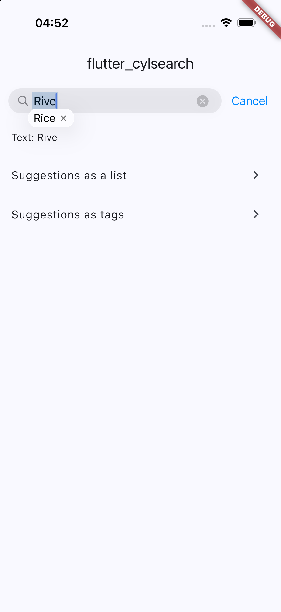

    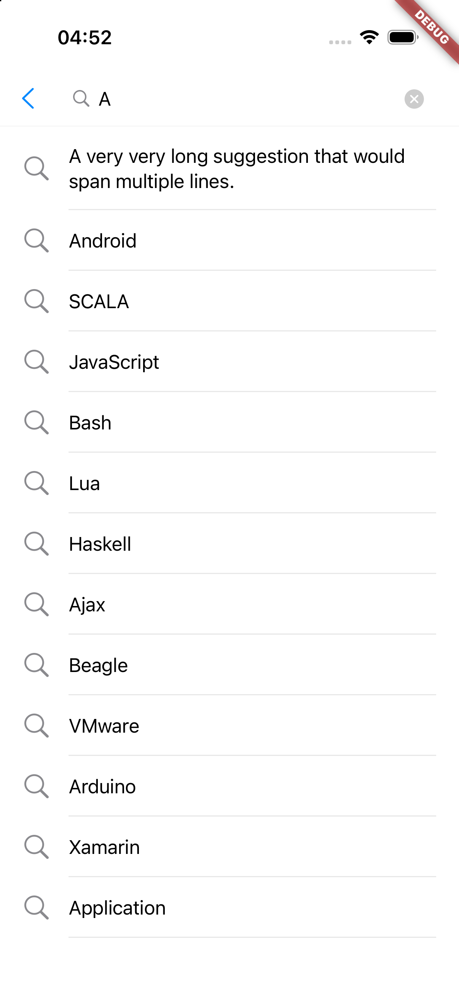

    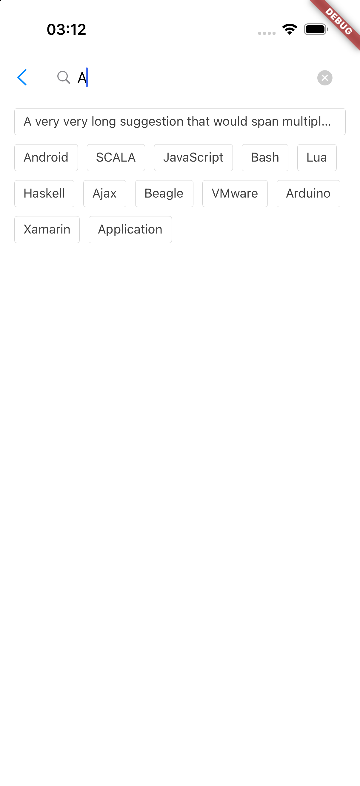

    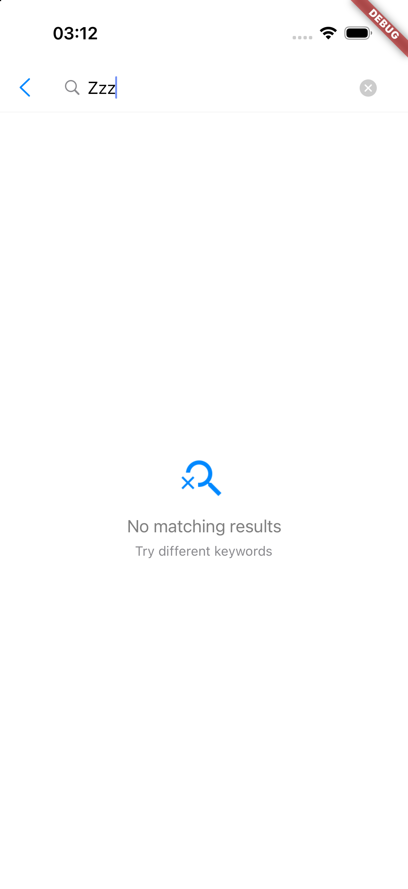

    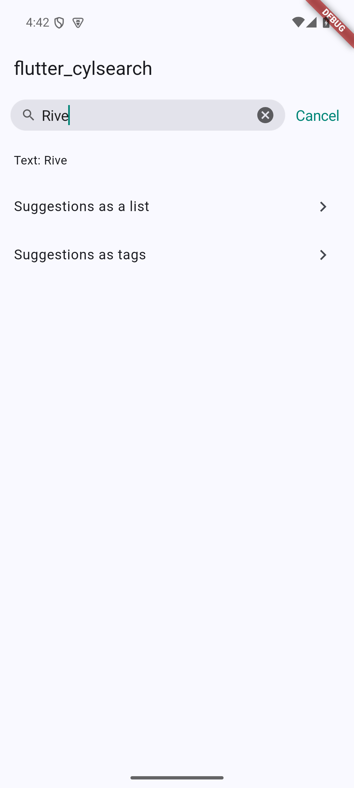

    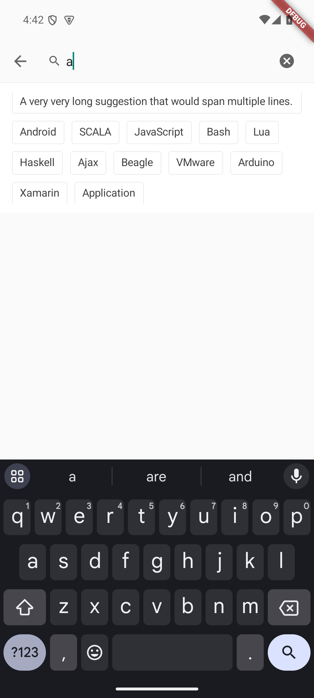

    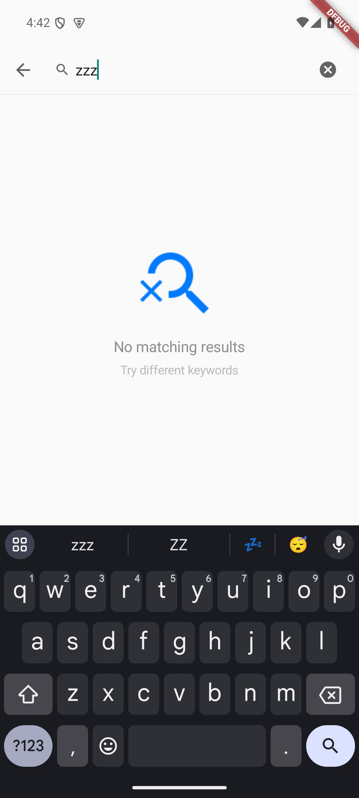

    | Field | Value |
    |:---|:---|
    | Platform | Flutter 3.47.9 (Dart 3.13.7) on iOS and Android |
    | Host | macOS 27.3 (26C5035r), Xcode 27.2 (27B5028f), JDK 17.0.21 |
    | Simulator / emulator | iPhone 17, iOS 26.3; `CYL_API35_arm64`, Android 15 (API 35), system in dark mode |
    | SDK | iOS SDK 27.2 (deployment iOS 15.0); Android compileSdk 36 (Flutter), AGP 8.11.1, Kotlin 2.2.20 |
    | Repository | [`c6ed2b3`](https://github.com/ChenYilong/CYLSearchViewController/commit/c6ed2b3) on `feat/swift-core` |
    | Taken | 2026-11-13 03:12–04:52 NZDT |
  - DONE (2026-11-13, [`626763e`](https://github.com/ChenYilong/CYLSearchViewController/commit/626763e)): the example
    on CYLTabBarController's Flutter tab bar (`flutter_cyltabbar`, git dependency at its newest commit `74aa25e`).
    - The tab bar comes from `assets/cyl_tabbar_configuration.json` (a Flutter asset loaded in Dart and passed as
      `configuration`: `bundle:` routes do not reach Flutter's assets on iOS). One tab per demo: List style, Tag style,
      No results, No content; the search bar demo is the raised plus button's own page
      (`CYLTabBarItemPageIdentifier`). Icons rendered from SF Symbols as Flutter 1x / 2x / 3x variants
      (`tool/render_tab_icons.swift`); a single 3x image showed at three times its size on iOS.
    - `flutter_cyltabbar` did not build on Android at CYLTabBarController's newest commit (`50d9018`): ViewPager2 was
      not declared. Fixed there (sub-repository rule):
      [ChenYilong/CYLTabBarController#791](https://github.com/ChenYilong/CYLTabBarController/pull/791), commit
      `74aa25e`, now pinned in the Flutter example, its Podfile, `android/merged` and the repository's Podfile.
    - `flutter_cyltabbar` compiles CYLTabBarController's Kotlin with AGP 9's built-in Kotlin, so the composite build
      uses AGP 9.1.0: the Flutter example and plugin use the template's AGP 9.1.0 / Kotlin 2.4.0; `android/merged`
      uses AGP 9.1.0 with `android.builtInKotlin=false` and Kotlin 2.2.20 (its pinned sub-repositories still use
      `kotlinOptions`, an error in Kotlin 2.4). `android/merged` builds and its tests pass.
    - Android needs `MainActivity` to be a `FlutterFragmentActivity` for the tab bar.
    - Verified on both platforms: tab switching, the plus page (typing reaches Dart: "Text: Rive"), the tag style,
      "No results" (CYLTableViewPlaceHolder's "No matching results") and "No content" ("Nothing here yet"); the
      native iOS app's 20 tests pass on the new CYLTabBarController pin.
    - Finding, to verify (recorded in CYLTabBarController's `docs/Flutter-Component.md`): on iOS a UI-automation
      accessibility tap did not switch tabs while a real touch did; check VoiceOver's double tap on the native tabs
      inside Flutter.
    - Screenshots (originals), top to bottom: Android tab bar (cropped: the plus button rises above the bar); Android
      plus page; Android No content; iOS Tag style tab; iOS plus page; iOS No content.

      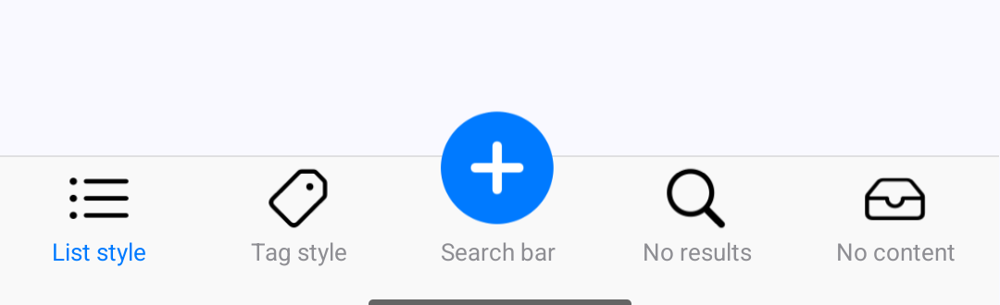

      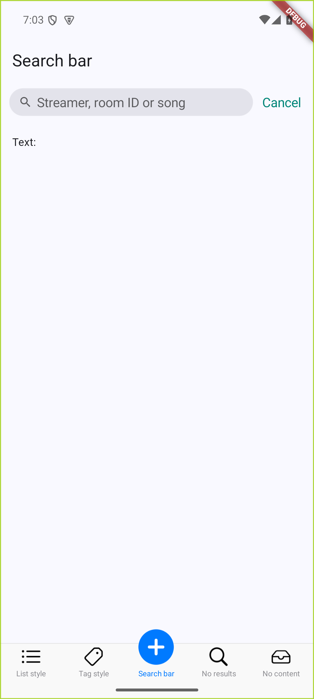

      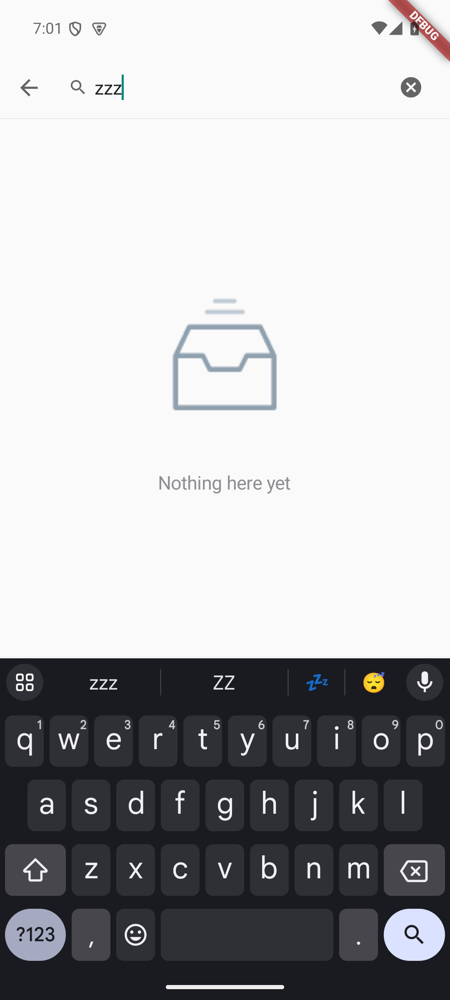

      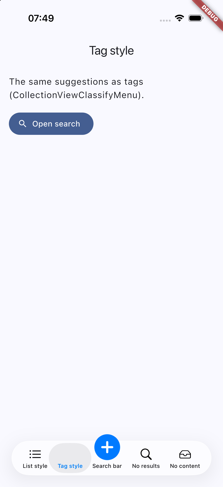

      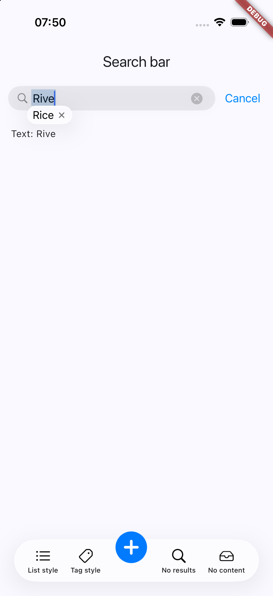

      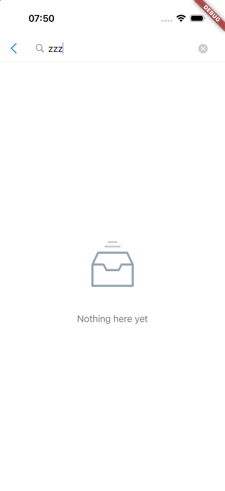

      | Field | Value |
      |:---|:---|
      | Platform | Flutter 3.47.9 (Dart 3.13.7) on iOS and Android, flutter_cyltabbar at `74aa25e` |
      | Host | macOS 27.3 (26C5035r), Xcode 27.2 (27B5028f), JDK 17.0.21 |
      | Simulator / emulator | iPhone 17, iOS 26.3; `CYL_API35_arm64`, Android 15 (API 35), system in dark mode |
      | SDK | iOS SDK 27.2 (deployment iOS 15.0); AGP 9.1.0, Kotlin 2.4.0 (app), compileSdk 36 |
      | Repository | [`626763e`](https://github.com/ChenYilong/CYLSearchViewController/commit/626763e) on `feat/swift-core` |
      | Taken | 2026-11-13 06:58–07:50 NZDT |
  - DONE (2026-11-13): the Discover page of the tag-style demos, as on iOS and Android.
    - The plugin gained `CYLTagListView`: CollectionViewClassifyMenu's native tag list (the view of the tag style) as a
      widget. The native view reports the height its tags need at its width (`heightThatFitsWidth`), so the widget
      takes that height in a Flutter column; its background is clear so the Flutter page shows through.
    - The example's Discover tab (`lib/discover_page.dart`) uses the same data as the native examples
      (CYLSearchDiscover.bundle copied to `assets/discover/<language>/`: search-discover.json, the strings, the
      localized hot icon in 1x / 2x / 3x): the native search bar under the app bar, the recent searches as native
      tags (tap: search, it moves to the front; trash: clear), the topics in two columns with the hot icon, refresh.
    - iOS shows at most five tab bar items (a sixth becomes "More"), so "No results" and "No content" now share an
      "Empty results" tab with one button each: four tabs and the raised plus button.
    - Tests: plugin 7/7 (the tag list's parameters, taps and height), example 3/3 (language folder, .strings parsing,
      the bundled data and refresh); `flutter analyze` clean in both.
    - Screenshots (originals), top to bottom: Android Discover; Android after tapping the "Pomodoro technique" topic
      (bar text, the recent searches reordered, "Searching: …"); Android Empty results tab; iOS Discover; iOS after
      tapping the "Dark mode colors" tag (the tag list grew a row and the page followed).

      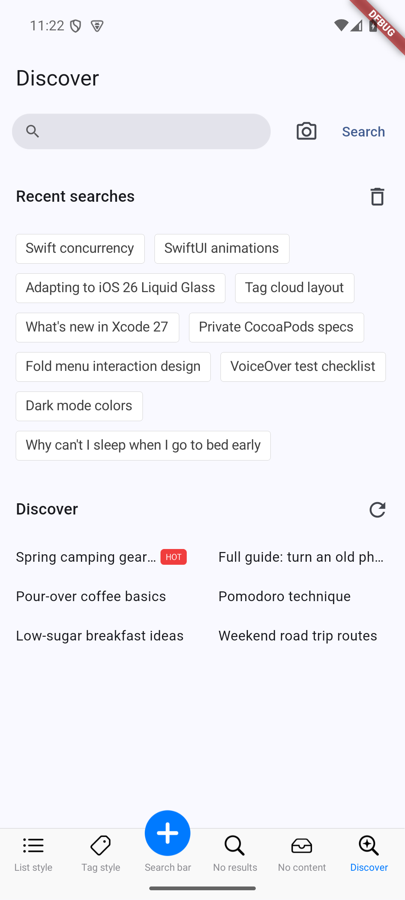

      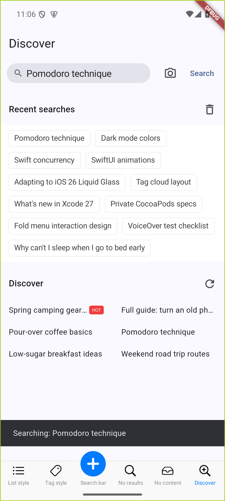

      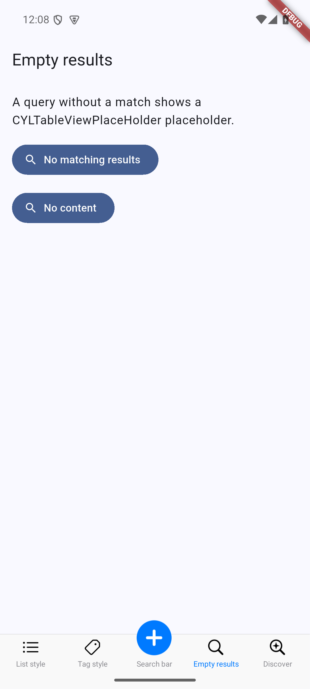

      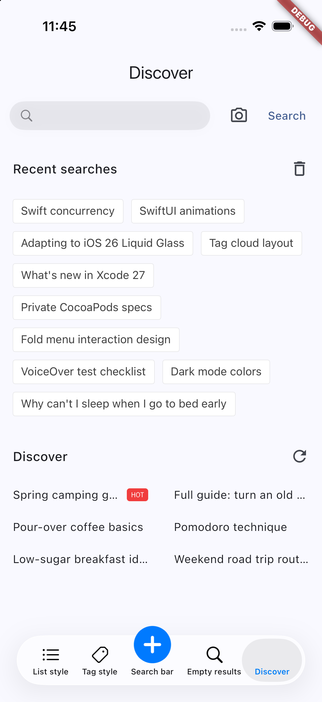

      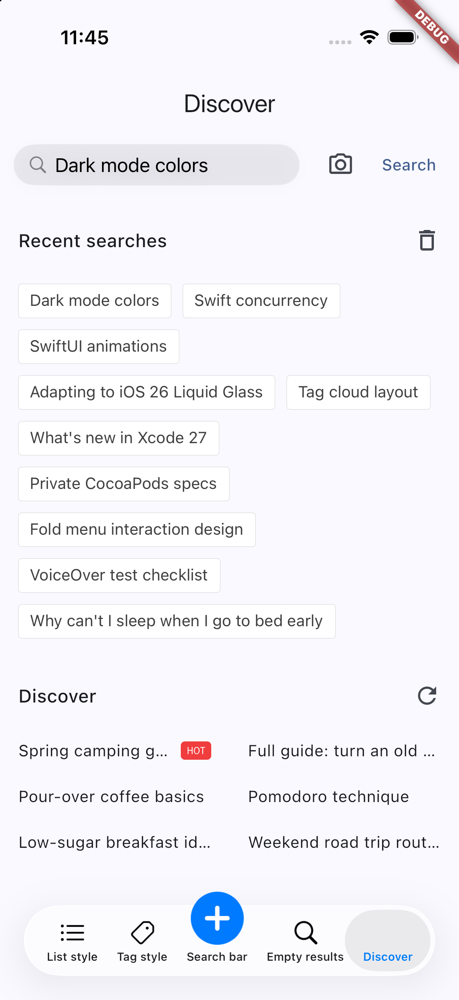

      | Field | Value |
      |:---|:---|
      | Platform | Flutter 3.47.9 (Dart 3.13.7) on iOS and Android, flutter_cyltabbar at `74aa25e` |
      | Host | macOS 27.3 (26C5035r), Xcode 27.2 (27B5028f), JDK 17.0.21 |
      | Simulator / emulator | iPhone 17, iOS 26.3; `CYL_API35_arm64`, Android 15 (API 35) |
      | SDK | iOS SDK 27.2 (deployment iOS 15.0); AGP 9.1.0, Kotlin 2.4.0 (app), compileSdk 36 |
      | Repository | `feat/swift-core`, the commit that adds this entry |
      | Taken | 2026-11-13 11:00–12:08 NZDT |
    - Finding, not fixed: on iOS the "Searching: …" snack bar did not show in the screenshot taken 2 s after the tap
      (it shows on Android); check whether the floating tab bar covers it.
  - Deferred for Flutter (2026-11-13): Swift Package Manager support. The plugin's iOS side depends on
    CYLSearchViewController, CollectionViewClassifyMenu and CYLTableViewPlaceHolder (with Lottie), none of which has a
    `Package.swift` at its pinned commit; CollectionViewClassifyMenu's headers sit in two source roots and its
    resources are a bundle of xibs, assets and localizations loaded by bundle name, so each repository needs its own
    package (and SPM-aware resource loading) first. The plugin works through CocoaPods (the example sets
    `enable-swift-package-manager: false`). Not requested by the maintainer; React Native, which was requested, goes
    first. Then React Native, then HarmonyOS NEXT (the emulator image is
    downloaded; a device still has to be created in DevEco's Device Manager).

## TODO (2026-11-13): React Native: `react-native-cylsearch`, wrapping the native core

- Context: the third cross-platform step after Android and Flutter (first TODO of this document), with the same
  requirements as Flutter: the tag style, the Discover page and the empty placeholders, by wrapping the native core.
  Swift Package Manager for the Flutter plugin was deferred so React Native goes first.
- Progress (2026-11-13/14):
  - `CrossPlatform/react-native-cylsearch`, made with `create-react-native-library` (Fabric view, Kotlin and
    Objective-C++, a React Native 0.88 Community CLI example), laid out as CYLTabBarController's
    `react-native-cyltabbar`. Three Fabric components wrap the native core: `CylsearchView` (the search page:
    suggestions, list or tag style, cache policy and name, `focusesSearchFieldOnShow`, the fold control, the empty
    placeholders; events `onTextChange`, `onSubmit`, `onSuggestionSelect`, `onClose`), `CylsearchBarView` and
    `CylsearchTagListView` (sized by its `onHeightChange`, again after folding). JavaScript wrappers
    `CYLSearchView`, `CYLSearchBarView`, `CYLTagListView` pass the color scheme.
  - iOS: the podspec depends on CYLSearchViewController (static frameworks); the `.mm` views import
    CYLTableViewPlaceHolder's header before the generated Swift header (it uses `CYLPlaceholderScenario`).
  - Android: the module depends on `com.cyl.search:cylsearch:0.1.0`; the example substitutes it with `android/merged`
    (`includeBuild`, as the Flutter example), which needed one AGP version: `android/merged` and the Flutter example
    moved to React Native 0.88's AGP 9.2.1 and Gradle 9.4.1 (`06865a5`). `CYLSearchBarView` is final, so the
    component wraps it in a `FrameLayout`.
  - Found and fixed on the way, in CYLTableViewPlaceHolder (sub-repository rule): its privacy manifest was copied to
    the app's root and clashed with the React Native app's own ("Multiple commands produce …/PrivacyInfo.xcprivacy");
    it is now in a resource bundle,
    [ChenYilong/CYLTableViewPlaceHolder#29](https://github.com/ChenYilong/CYLTableViewPlaceHolder/pull/29), `a96e9d2`,
    pinned in the React Native example.
  - The example: List style, Tag style (focus off), Empty results (two scenarios), Search bar and Discover (the native
    search bar, the recent searches as native tags folded behind the chevron, topics, refresh and clear), colors that
    follow the color scheme, `react-native-safe-area-context`.
  - Verified on Android (release build, the `CYL_API35_arm64` emulator, Android 15, 2026-11-14 07:1x NZDT), top to
    bottom: typing in the list style search; the tag style opens with the keyboard down and the empty-cache
    placeholder; "No content"; the search bar demo ("Text: Rive"); Discover folded, then unfolded. The host was very
    loaded (load average about 970): the emulator showed "isn't responding" dialogs at launch, and the debug build
    crashed once inside React Native's dev-tools inspector connection (`CxxInspectorPackagerConnection`, not this
    library), so the screenshots use the release build.

    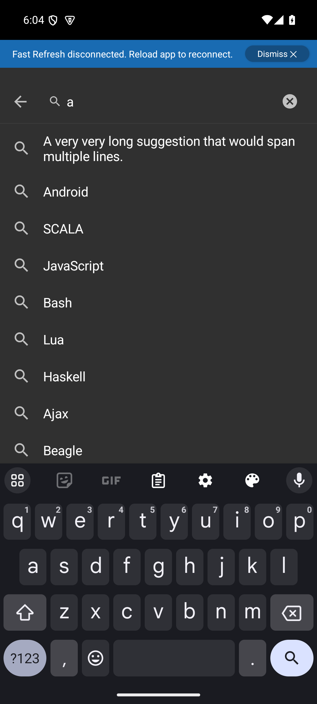

    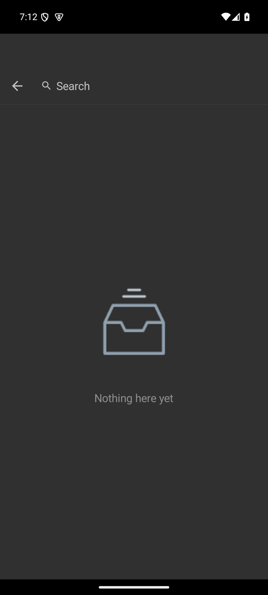

    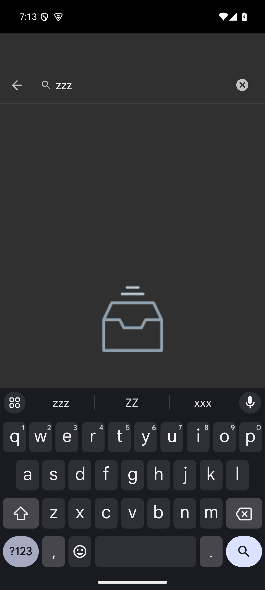

    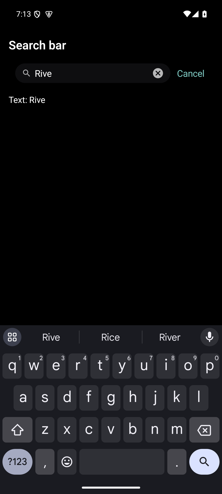

    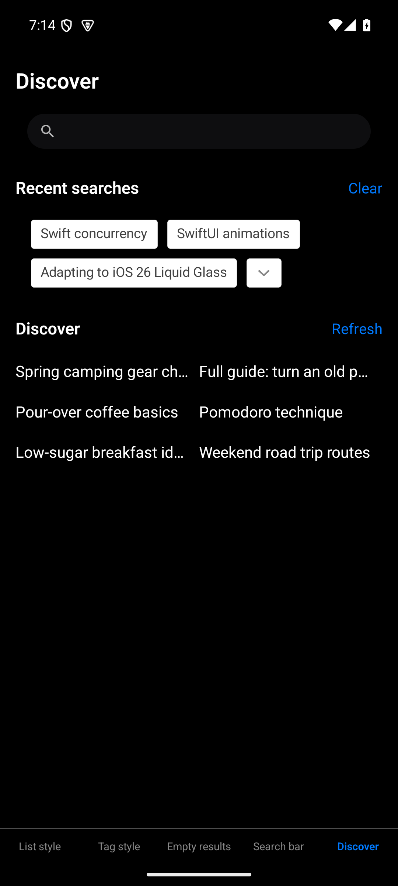

    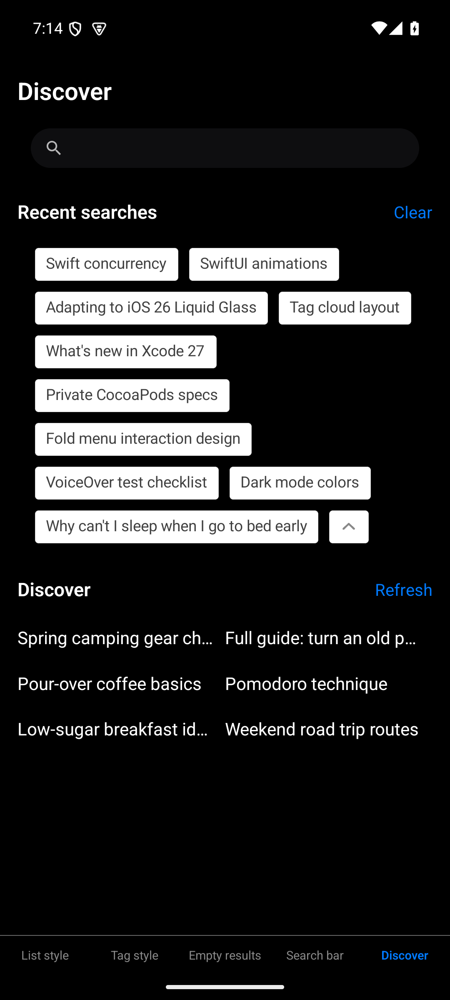

  - iOS (2026-11-14): the Debug and Release builds succeed and the Release app launched to the List style page, but
    under the host's load (load average 900 to 970 for hours, other sessions' builds) the simulator ignored taps and
    touches, and after a reboot `simctl launch` and UI snapshots no longer answered, so the search page, the tags and
    Discover are not verified on iOS yet. Found on the way: the example's tab row used a `tablist` container that hid
    the tabs from iOS accessibility; each tab is now its own element with its title (`fc55a2f`), to confirm in that run.
  - iOS, second run (2026-11-14, `abb19aa` plus the `-initialTab` example change): the Release app with the search
    bar items installs and runs on the iPhone 17 simulator (iOS 26.3.1, Xcode beta). No tap tool answered (`axe` is
    no longer installed; `xcodebuildmcp` UI automation times out after 30 s at this load), so the example reads an
    iOS launch argument, `-initialTab discover|bar|tags|empty|list`, through React Native's `Settings`, and each tab
    was opened with `simctl launch cylsearch.example -initialTab <tab>`. Discover shows the bordered search bar with
    the camera, the divider and Search appended inside it (core `CYLSearchBarItem`) and the recent searches folded to
    two rows behind the inline chevron; Search bar shows the plain bar with its magnifier and Cancel. Still to check
    by touch: typing, the search page, unfolding.

    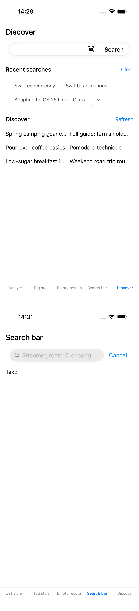

  - Still open: touch checks on iOS (above), CYLTabBarController's
    React Native tab bar in the example (it lives inside CYLTabBarController's repository, which is not a yarn
    workspace, so it cannot be pinned as a git dependency yet). The pins are done: CYLTableViewPlaceHolder `bdd78c7`
    on every platform (`e4a9c79`).
- Status: `TODO`.

## DONE (2026-11-13): Flutter example on iOS: the plus button's title disappears once the plus page is selected

- Context: the Flutter example (`CrossPlatform/flutter_cylsearch/example`) uses CYLTabBarController's Flutter tab bar
  (`flutter_cyltabbar`, pinned at `74aa25e`), Liquid Glass on iOS 26. In the report below (top to bottom, left to
  right): the Tag style tab selected, the plus button's title "Search bar" under the "+"; the tag search; the plus
  button's own page selected: the Liquid Glass selection does not appear under the plus button and its title
  "Search bar" is gone (List style, Tag style, "+", No results, No content); the No content search.

  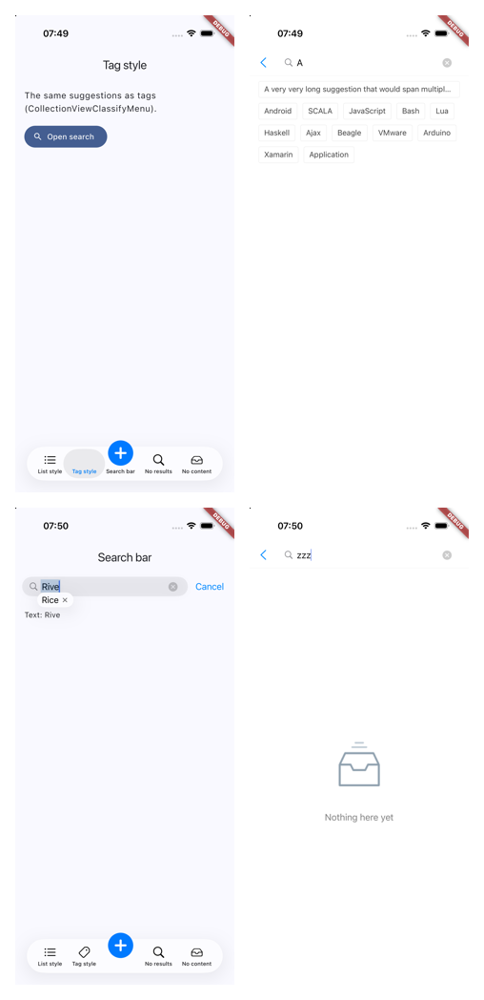

- Requirements:
  1. Record the bug here as a TODO (this entry).
  2. First direction: the plus button. `-[CYLPlusButton cyl_updateLiquidGlassMask]` is a known source of plus button
     bugs (CYLTabBarController AGENTS.md: on any plus button bug, set `CYL_PLUS_BUTTON_LENS_MASK_ENABLED` to 0 first
     and test again). Compare with the switch off; if the mask cannot be shown to be harmless, keep it off.
  3. Second direction: a CYLTabBarController commit fixed an icon that disappeared while a More tab existed (Home's
     icon after More editing); read the docs around it for the context, since the same kind of "hidden on purpose,
     never shown again" logic may hide the title.
  4. Fix in CYLTabBarController (sub-repository rule: worktree, branch, pull request), then update the pins here.
- Prompt (verbatim): "在跨端相关文件中记录 记录截图中的bug，标记TODO。CYLSearchViewController 的flutter example中，出现以下异常：flutter 的tabbar 实现iOS端异常。plus button title会在被选中后 液态玻璃遮罩消失，title异常消失。两个排查方向：第一个：plus button 问题，排查方向：cyl_updateLiquidGlassMask  实现导致plusbutton的 title 字体异常。	Switch: CYL_PLUS_BUTTON_LENS_MASK_ENABLED is now 1. Your rule still stands in AGENTS.md: on any plus button bug, set it to 0 first and retest. ，通过控制上面的key 禁用该实现查看差异。如无法保证不会引发异常，继续禁用cyl_updateLiquidGlassMask该方法实现。同时寻找CYLTabBarController ，，相关commit 里面有一个more按钮存在时 home button 相关icon消失的bug。搜索docs相关文档，查看上下文。continue  continue"
- Prompt (English): "Record the bug in the screenshot in the cross-platform documents and mark it TODO. In
  CYLSearchViewController's Flutter example, the Flutter tab bar misbehaves on iOS: once the plus button is
  selected, the Liquid Glass selection disappears and the plus button's title disappears. Two directions: first, the
  plus button: the `cyl_updateLiquidGlassMask` implementation has caused plus button title problems (switch:
  `CYL_PLUS_BUTTON_LENS_MASK_ENABLED` is now 1; the AGENTS.md rule stands: on any plus button bug, set it to 0 first
  and test again); toggle the switch to compare, and if it cannot be shown to be harmless, keep that method
  disabled. Second, find the CYLTabBarController commit about a bug where the Home button's icon disappeared while a
  More button existed; search the docs for the context."
- Findings so far (2026-11-13):
  - At the pinned commit `74aa25e`, `CYL_PLUS_BUTTON_LENS_MASK_ENABLED` is already 0 (`CYLPlusButton.m`; the
    maintainer switched it off again on 2026-11-12), so the bug happens with the mask off: the mask is not its cause.
    The switch stays 0.
  - The More commit is CYLTabBarController `d90802e` ("Home's icon comes back after More editing → Done", 2026-11-11):
    UIKit never calls `-[UITabBar endCustomizingAnimated:]`, so views hidden when editing began (Home's star) stayed
    hidden; the fix polls `isCustomizing` and restores them. It is in the pin. Context:
    CYLTabBarController `docs/Liquid-Glass-Robustness.md`.
- Result (2026-11-13): fixed in CYLTabBarController's core,
  [ChenYilong/CYLTabBarController#793](https://github.com/ChenYilong/CYLTabBarController/pull/793).
  - Cause: with `CYLPlusButtonAlignsTitle` on (the default with a title) the plus button's title is drawn by its tab
    item, and UIKit draws the selected tab's title inside the Liquid Glass lens. CYLTabBarController hid the lens on the
    plus page (`CYLPlusButtonShowsSelection` off, the plus button not layout-centered), so the title went with it.
    A runtime log confirmed it (`show=0` on the plus page; the plus button has no title label of its own), and the
    title came back with `CYLPlusButtonShowsSelection` on.
  - Fix (`8ae53a7`): the lens stays when the plus title is drawn by its tab item. The mask switch stays 0.
  - Pinned: `bc73220` (the fix merged with the newest `feat/cross-platform-components`, `bdf23ef`) in the Flutter
    example (`pubspec.yaml`, `ios/Podfile`), the repository's `Podfile` and `android/merged/gradle.properties`.
  - Verified with the example's default configuration: the plus page shows the lens and "Search bar" every time it is
    selected (below, top to bottom: List style, the plus button, Discover, the plus button again; cropped tab bars,
    then the full plus page). CYLTabBarController unit tests: 135, 0 failures, 2 skipped (iPhone 17, iOS 26.3).

    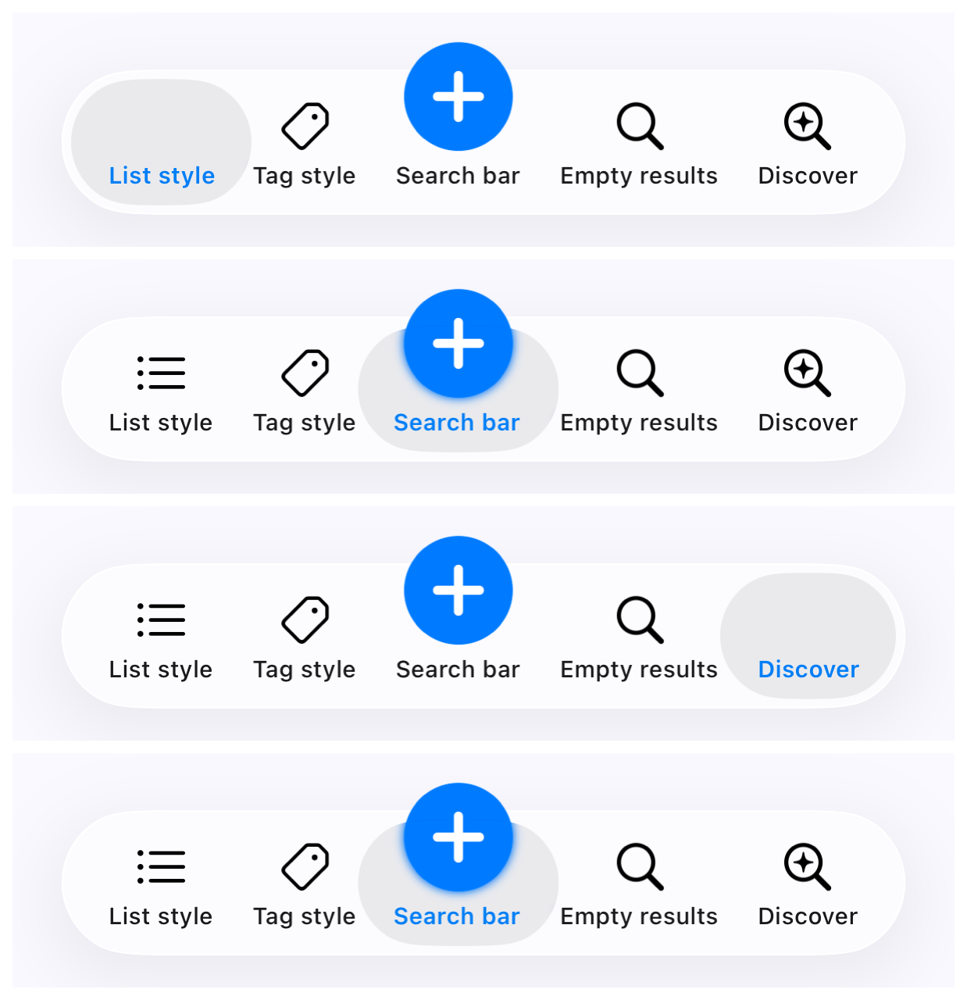

    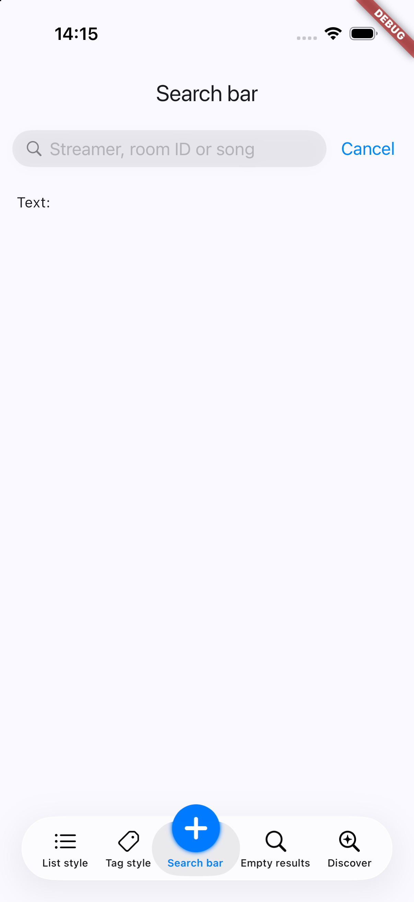

    | Field | Value |
    |:---|:---|
    | Platform | Flutter 3.47.9 on iOS, flutter_cyltabbar at `8ae53a7` |
    | Host | macOS 27.3 (26C5035r), Xcode 27.2 (27B5028f) |
    | Simulator | iPhone 17, iOS 26.3 |
    | SDK | iOS SDK 27.2 (deployment iOS 15.0) |
    | Taken | 2026-11-13 14:12 NZDT |
- Status: DONE.

## TODO (2026-11-13): HarmonyOS: learn from FlexibleSearchBar, and a HarmonyOS API table scored to 100

- Context: HarmonyOS NEXT comes after Flutter and React Native (first TODO of this document); DevEco Studio 6.0.1 and
  the API 21 SDK are installed, an emulator device still has to be created. Android was aligned with a table
  ([android-api-alignment.md](android-api-alignment.md)).
- Rules:
  1. Before building the HarmonyOS search bar, study
     [Applib-HarmonyOS/FlexibleSearchBar](https://github.com/Applib-HarmonyOS/FlexibleSearchBar), an existing search
     bar for HarmonyOS: read how it is built (components, layout, input handling, animation) and reuse what fits
     this project's implementation; record what was taken and why in this document.
  2. Implement the HarmonyOS API completely, matched to the public API of the iOS side (the tab bar and its Liquid
     Glass API belong to CYLTabBarController and are aligned in that repository the same way).
  3. Make a table for HarmonyOS as for Android:
     [harmonyos-api-alignment.md](harmonyos-api-alignment.md). First column: the iOS public API; second column: its
     doc comment; third column: the HarmonyOS counterpart, `TODO` by default.
  4. A full match scores 100. After each API is implemented, replace that row's `TODO` with the HarmonyOS API and
     score again (`python3 scripts/harmonyos-api-alignment.py`); repeat until the score is 100.
- Prompt (verbatim): "找到docs文档中 跨端相关的文档，找到鸿蒙相关 描述，全英文写入以下规则：参考以下搜索框在鸿蒙上的实现，学习 https://github.com/Applib-HarmonyOS/FlexibleSearchBar  因为这个项目就是searchbar  借鉴一下searchbbar 的实现细节看下能不能用在本项目实现上：  ，然后对标iOS端接口完整实现tabbar 液态API。学习android 实现时候制作的表格。为鸿蒙也制作表格，第一列是iOS端 公开api接口，第二列是接口注释，第三列为鸿蒙对应接口。第三列默认填TODO。完全匹配视为满分，没实现一个接口，就更新第三列的一行把TODO换成对应ApI。打一次分，如此循环往复，一直到满分💯为止。"
- Prompt (English): "Find the cross-platform document in docs, find its HarmonyOS part, and write these rules in
  English: refer to this search bar implementation on HarmonyOS and study
  https://github.com/Applib-HarmonyOS/FlexibleSearchBar; since that project is a search bar, borrow its search bar
  implementation details and see whether they can be used in this project. Then implement the API completely,
  matched to the iOS interfaces (the tab bar Liquid Glass API). Learn from the table made for the Android
  implementation and make one for HarmonyOS too: first column the iOS public API, second column the API's comment,
  third column the HarmonyOS counterpart, `TODO` by default. A full match is a full score; each time an API is
  implemented, update that row's third column, replacing `TODO` with the API, and score once; repeat until the score
  is 100."
- Status: `TODO` (rules and table written; score 0 until the HarmonyOS module exists).

## DONE (2026-11-12): android/ folder: five Kotlin transcriptions, a merged library and example

- Context: refines the TODO above. Android only; iOS code is not changed. The five reference projects were read in
  `docs/search-api-comparison.md`; three are Java or Kotlin libraries (MiguelCatalan Java, lapism and iammert
  Kotlin), yechaoa/MaterialDesign is a showcase app and android-cjj/MaterialSearchView a sample app.
  CYLTabBarController ships an Android tab bar library (`Example-Android` in the sibling folder).
- Requirements:
  1. Create `android/` with one folder per repository (lapism-search, MiguelCatalan-MaterialSearchView,
     yechaoa-MaterialDesign, android-cjj-MaterialSearchView, iammert-MultiSearchView) and a `merged` folder.
  2. Transcribe each project in its folder, all in Kotlin.
  3. Merge the Kotlin code into one project in `merged`, keeping every API; merge the examples into one example
     app that uses CYLTabBarController's Android tab bar, one tab per example; depend on CYLTabBarController's latest
     commit through Gradle or Maven by commit (for example JitPack), else a local path.
  4. In `docs/`, list every public iOS API with its counterpart in `merged` in a second column.
  5. Add the missing APIs to `merged`; mark every row that is not aligned `TODO`; full alignment = 100; score after
     every API added, until 100.
  6. Translate all iOS examples into `merged` (do not change iOS code), using the Android APIs of the table;
     screenshots in the docs and an Android section in README.
- Prompt (verbatim): "将下面的任务，找一个合适的文档，标注关键词TODO：注意本任务仅仅修改android代码，不要改iOS代码。在本项目中新建文件夹命名为 android ，下面的代码 每一个仓库 创建一个文件夹，并创建第四个文件夹命名为merged     https://github.com/lapism/search https://github.com/MiguelCatalan/MaterialSearchView https://github.com/yechaoa/MaterialDesign https://github.com/android-cjj/MaterialSearchView https://github.com/iammert/MultiSearchView 第二步骤：分别将这几个项目在各自文件夹中做代码转录，全部翻译为kotlin语言。第三步骤：将以上几个文件夹里的kotlin代码合并为一个项目，保留所有api接口，并将example合并为一个。使用CYLTabBarController 的android端tabbar 作为展示的功能划分，采用gradle或者maven指向CYLTabBarController 最新提交，找到gradle或者maven使用commit引用的方式集成，如果不行就采用本地路径引用。一个example一个tabbaritem区分。第四步骤：在docs在合适的文档或创建文档，列出iOS端所有的公开api，第二列 ，列出找到的在该merged文件夹下所有的公开api的对应项。第五步，将缺失merged文件夹缺失的API对齐。在该表格未对齐的地方标注TODO如果iOS端和android能完全对齐所有api就是满分，merged文件夹每次新增一个api就在该文档中打分，一直达到满分。第六步骤：将iOS端的example全部移植到merged文件夹，注意是翻译，不要改iOS代码。使用上面提到的表格中android的api实现。并截图更新文档，readme 在android章节。"
- Prompt (English): "Put the following task in a suitable document marked TODO. Only Android code changes; do not
  change iOS code. Create an android folder in this project, one folder per repository below, and a fourth folder
  named merged (the five links). Step 2: transcribe each project in its folder, all in Kotlin. Step 3: merge the
  Kotlin code of these folders into one project, keeping all APIs, and merge the examples into one; use
  CYLTabBarController's Android tab bar to divide the features, depend on CYLTabBarController's latest commit
  through Gradle or Maven by commit, else a local path; one tab item per example. Step 4: in a suitable doc (or a
  new one) list every public iOS API, and in the second column the counterpart found in merged. Step 5: add the
  APIs merged lacks; mark unaligned rows TODO; full alignment of iOS and Android is full marks; score each time an
  API is added to merged, until full marks. Step 6: port all iOS examples to merged (translate, do not change iOS
  code) with the Android APIs of the table, take screenshots, update the docs and README's Android section."
- Findings (2026-11-12, before any code):
  - Licenses: lapism/search, MiguelCatalan/MaterialSearchView and yechaoa/MaterialDesign ship an Apache 2.0
    `LICENSE`; iammert/MultiSearchView states Apache 2.0 in its README. Their code can be transcribed with the
    license and attribution kept. android-cjj/MaterialSearchView has no license, so its code may not be copied or
    translated; its folder would hold an independent Kotlin implementation of the same behavior (a floating button
    that opens a search card with a circular reveal), credited but not derived from its code. Waiting for the user's
    decision.
  - CYLTabBarController's Android library (`Example-Android/cyltabbar`, namespace `com.cyl.tabbar`) is not on Maven
    Central or JitPack, and Gradle source dependencies cannot pin a commit. Plan: `android/merged/settings.gradle.kts`
    checks out CYLTabBarController at the commit pinned in `gradle.properties` (newest commit on any branch, from
    `scripts/latest-cyl-commit.sh`) and includes its `Example-Android` build; a local path override for development.
  - Toolchain: JDK 17 (`~/develop/jdk/jdk-17.0.21+9`), Android SDK (`~/Library/Android/sdk`), Gradle 9.3.1; build
    outside the exFAT volume.
- Decision (user, 2026-11-12): android-cjj gets an original reimplementation, credited but not derived from its code.
- Progress:
  - Step 1 done: `android/` with `lapism-search`, `MiguelCatalan-MaterialSearchView`, `yechaoa-MaterialDesign`,
    `android-cjj-MaterialSearchView`, `iammert-MultiSearchView` and `merged` (next step); `android/README.md`.
  - Step 2 written: lapism, iammert and yechaoa (search screen) copied (already Kotlin); MiguelCatalan's library and
    sample translated from Java to Kotlin (AndroidX); android-cjj independently reimplemented
    (`CYLRevealSearchActivity`). Each folder has `TRANSCRIPTION.md` (source commit, license). No Java file is left.
    Not compiled yet: the folders hold sources only; compilation is checked when they join the Gradle project in
    `merged` (step 3).
  - Added by the rule "Open pull requests and issues of projects we translate" (2026-11-12): the translations are
    done, so each upstream's open pull requests are to be translated and merged into its folder, and each upstream's
    open issues listed in a table below (link, description, status `TODO`) and fixed in our code, scored until 100.
  - PRs and issues done: 22 open PRs merged or marked (table below); 166 open issues DONE or N/A with the reason,
    score 100 ([android-upstream-issues.md](android-upstream-issues.md)).
  - Step 3, first part done: `android/merged` is a Gradle project (Gradle 9.3.1, AGP 8.7.3, Kotlin 2.0.21,
    compileSdk / targetSdk 35, minSdk 23).
    - Modules: `search-lapism`, `search-materialsearchview`, `search-multisearchview` (the libraries, built from
      the folders next to `merged`, sources not copied); `sample-materialsearchview`, `sample-multisearchview`,
      `sample-yechaoa`, `sample-reveal` (the samples, unchanged); `cylsearch` (the CYL API, step 4); `app`.
    - CYLTabBarController: not on Maven and Gradle cannot pin a git dependency to a commit, so
      `settings.gradle.kts` checks out `cyl.tabbar.commit` (gradle.properties, from
      `CYLTabBarController/scripts/latest-cyl-commit.sh`) into `.cyl-deps/` and builds its `cyltabbar` and
      `tabpages` modules; `-Pcyl.tabbar.dir=<path>` or `CYL_TABBAR_DIR` uses a local checkout.
    - The app: `CYLTabBarController` with five tabs (lapism, Material, Multi, Reveal, yechaoa). The lapism tab
      hosts lapism's README usage; the others open the upstream sample activities.
    - Compile fixes found by the first build: lapism `dispatchDraw(Canvas)` and iammert's animator listener
      (non-null parameters of SDK 35); iammert's unused synthetic import; MiguelCatalan sample layouts moved to
      AndroidX class names (they still named `android.support.*` and crashed); the app enables data binding
      (iammert #10); the unused jcenter-only EasingInterpolator dependency dropped; samples keep their own theme
      and opt out of Android 15's edge-to-edge (their toolbars were under the status bar).
    - Verified on an Android 15 emulator (API 35, arm64): all nine sample activities and the lapism tab open with
      no crash; MaterialSearchView filters, wraps long suggestions and fills the query on a tap.
  - Steps 4 and 5 done: [android-api-alignment.md](android-api-alignment.md) lists all 294 public iOS
    declarations (types, enum cases, properties, methods, initializers, protocol requirements, UIKit overrides) with
    the upstream API the iOS doc comment cites and the Kotlin counterpart in the `cylsearch` module, which ports the
    seven iOS classes under the same names. Score 100 (261 DONE, 33 N/A), written by
    `android/merged/scripts/api-alignment.py`; 9 Robolectric behavior tests pass.
  - Step 6 done ([`ffac758`](https://github.com/ChenYilong/CYLSearchViewController/commit/ffac758)): the app ports
    the iOS example. CYLTabBarController from `assets/CYLTabBarConfiguration.json` (titles localized from
    `CYLSearchTabs.bundle`, as on iOS), a raised plus button (`CYLPlusButtonCenterYMultiplier` 0.3, 56 dp: its top
    is above the tab bar) for the search bar page, pages from `CYLTabBarPageRegistry`. Tabs: Search (the search
    example: results, pull to refresh, empty state, overlay), Examples (menu: search example, placeholder styles,
    search bar, ports of the five libraries' examples, original samples), plus, List style, Tag style
    ([tag-view-suggestions.md](tag-view-suggestions.md)). The iOS "Repro" button (a UIKit navigation-item setting
    of Issue #1317) has no Android counterpart. README has an Android section.
  - Verified on the emulator: all five tabs, every menu page, the five ports (MaterialSearchView's six samples)
    and the nine original samples open with no crash; reveal, yechaoa and MultiSearchView were exercised.
  - Screenshots (originals), top to bottom: search tab, examples menu, search bar page, placeholder styles,
    reveal port open, yechaoa port after a search, MultiSearchView port with two searches.

    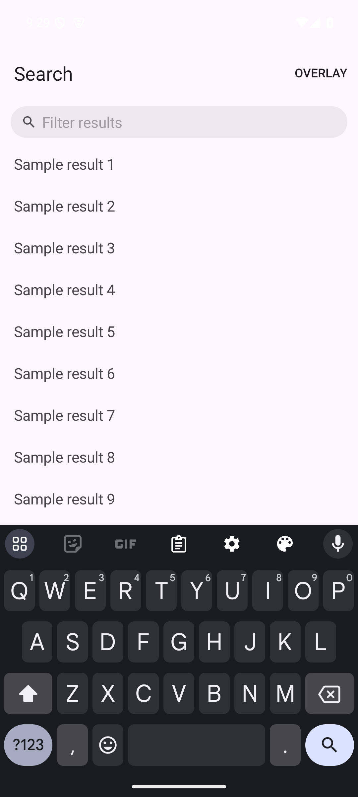

    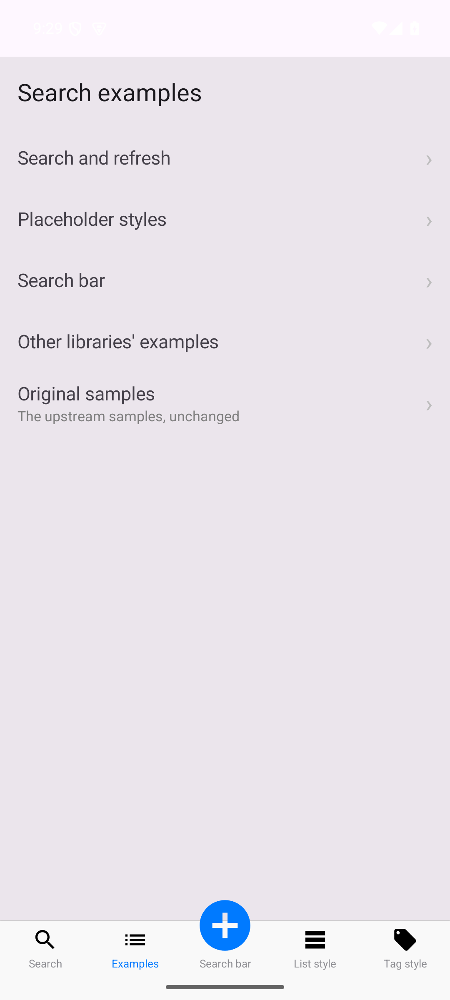

    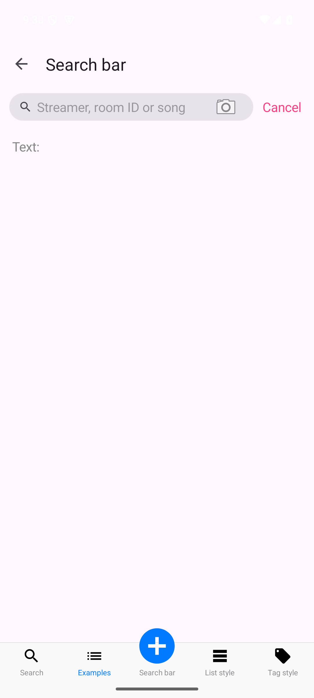

    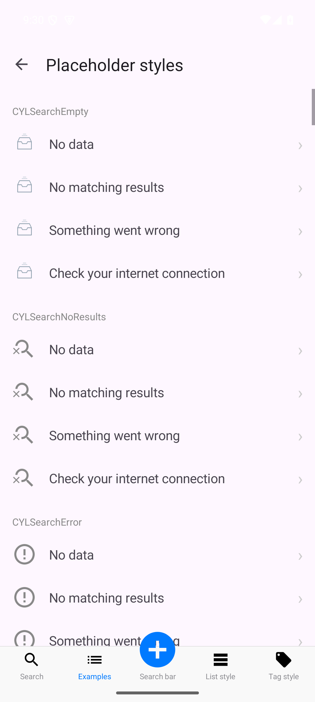

    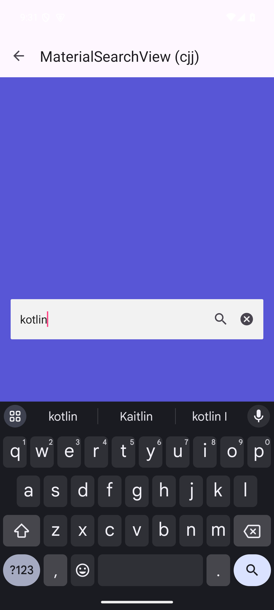

    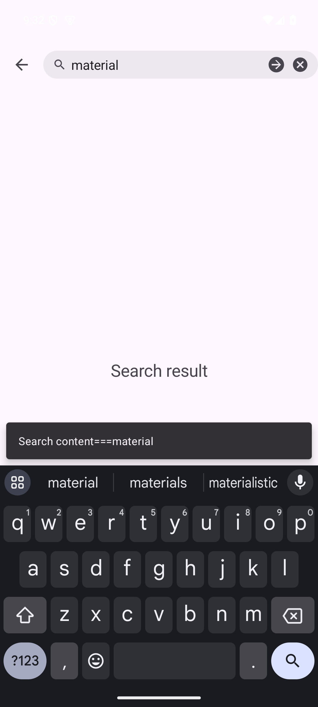

    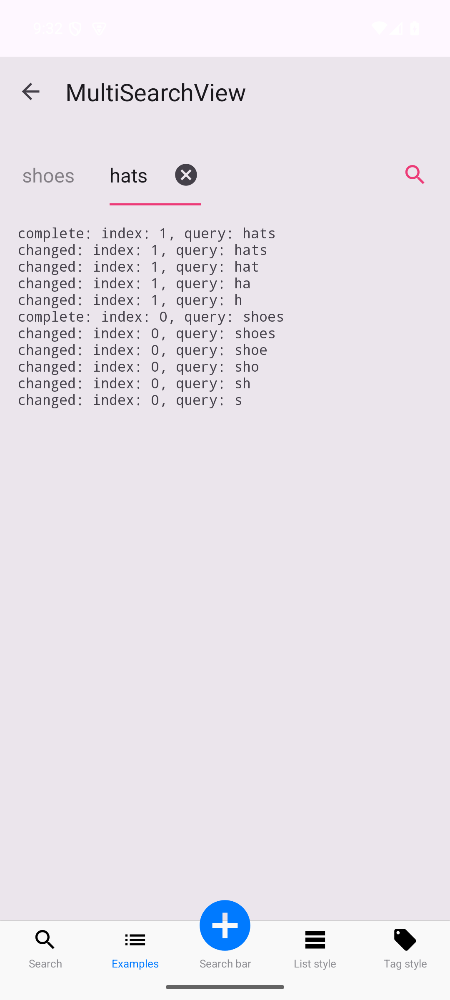

| Field | Value |
|:---|:---|
| Platform | Android (Kotlin, `android/merged`) |
| Host | macOS 27.3 (26C5035r), JDK 17.0.21, Gradle 9.3.1, AGP 8.7.3, Kotlin 2.0.21 |
| Emulator | `CYL_API35_arm64`, Android 15 (API 35), arm64-v8a, 1080 × 2400 |
| SDK | compileSdk / targetSdk 35, minSdk 23 |
| Repository | [`ffac758`](https://github.com/ChenYilong/CYLSearchViewController/commit/ffac758) on `feat/swift-core`; CYLTabBarController `f410fa7`, CollectionViewClassifyMenu `eb3590e` |
| Taken | 2026-11-12 21:30–21:40 NZDT |

## Open pull requests of the translated projects

Read 2026-11-12 (`AGENTS.md`, "Open pull requests and issues of projects we translate"). lapism/search,
yechaoa/MaterialDesign and android-cjj/MaterialSearchView have no open pull requests. The translations were already
done, so each pull request's changes were translated to Kotlin and merged into the project's folder in `android/`.

| Pull request | Status | What was merged |
|:---|:---|:---|
| [MiguelCatalan/MaterialSearchView#245](https://github.com/MiguelCatalan/MaterialSearchView/pull/245) | Merged (equivalent) | The translation already uses AndroidX. |
| [MiguelCatalan/MaterialSearchView#228](https://github.com/MiguelCatalan/MaterialSearchView/pull/228) | Merged (equivalent) | The translation already uses AndroidX. |
| [MiguelCatalan/MaterialSearchView#220](https://github.com/MiguelCatalan/MaterialSearchView/pull/220) | Merged (adapted) | White suggestion text became `setSuggestionTextColor(color)` / `SearchAdapter.textColor` instead of a hard-coded color. |
| [MiguelCatalan/MaterialSearchView#209](https://github.com/MiguelCatalan/MaterialSearchView/pull/209) | Merged | `useAdapter`: the search layout stays hidden when suggestions are set before the search opens. |
| [MiguelCatalan/MaterialSearchView#200](https://github.com/MiguelCatalan/MaterialSearchView/pull/200) | N/A | README wording only; our `TRANSCRIPTION.md` links the upstream README. |
| [MiguelCatalan/MaterialSearchView#176](https://github.com/MiguelCatalan/MaterialSearchView/pull/176) | Merged | `setSuggestions(suggestions, checkSuggestion)`, `SearchAdapter(…, checkWholeString)`. |
| [MiguelCatalan/MaterialSearchView#159](https://github.com/MiguelCatalan/MaterialSearchView/pull/159) | Merged | `isVoiceAvailable()` returns true when a speech recognizer exists. |
| [MiguelCatalan/MaterialSearchView#153](https://github.com/MiguelCatalan/MaterialSearchView/pull/153) | Merged (adapted) | `SuggestionItem`, `setSuggestions(Array<SuggestionItem>)`, `setSuggestions(suggestions, iconRes)`; `getItem()` still returns the text and `getSuggestionItem()` the item, and `setSuggestionIcon` is kept, so existing callers compile. |
| [MiguelCatalan/MaterialSearchView#146](https://github.com/MiguelCatalan/MaterialSearchView/pull/146) | Merged | Same fix as #159. |
| [MiguelCatalan/MaterialSearchView#130](https://github.com/MiguelCatalan/MaterialSearchView/pull/130) | Merged | `getQuery()`. |
| [MiguelCatalan/MaterialSearchView#127](https://github.com/MiguelCatalan/MaterialSearchView/pull/127) | Merged (via #176) | "Contains" matching is `checkWholeString = true`; the default stays "starts with" so existing behavior does not change. |
| [MiguelCatalan/MaterialSearchView#117](https://github.com/MiguelCatalan/MaterialSearchView/pull/117) | Merged (equivalent) | `setInputType` and the `android:inputType` attribute were already on master and are in the translation. |
| [MiguelCatalan/MaterialSearchView#114](https://github.com/MiguelCatalan/MaterialSearchView/pull/114) | Merged (partly) | `setSuggestionsWithDefault`, `SearchAdapter.setDefaultSuggestions` / `setSearchCovered`. Not merged: its "cover" behavior that makes Back and the tint keep the search open, which would change the existing close behavior. |
| [MiguelCatalan/MaterialSearchView#106](https://github.com/MiguelCatalan/MaterialSearchView/pull/106) | Merged (adapted) | `closeSearch(animate)` and `AnimationUtil.disappear`; `closeSearch()` keeps closing at once, as before. |
| [MiguelCatalan/MaterialSearchView#105](https://github.com/MiguelCatalan/MaterialSearchView/pull/105) | Merged | Same fix as #159. |
| [MiguelCatalan/MaterialSearchView#97](https://github.com/MiguelCatalan/MaterialSearchView/pull/97) | N/A | README wording only. |
| [MiguelCatalan/MaterialSearchView#92](https://github.com/MiguelCatalan/MaterialSearchView/pull/92) | N/A | No changes in the pull request. |
| [MiguelCatalan/MaterialSearchView#81](https://github.com/MiguelCatalan/MaterialSearchView/pull/81) | Merged | `SearchViewListener.onSearchViewAboutToShow()` / `onSearchViewAboutToClose()`, default methods so existing listeners compile. |
| [MiguelCatalan/MaterialSearchView#66](https://github.com/MiguelCatalan/MaterialSearchView/pull/66) | Merged | Same fix as #159. |
| [iammert/MultiSearchView#17](https://github.com/iammert/MultiSearchView/pull/17) | Merged | `selectedTabStyle` (line or dot), the `selectedTabStyle` attribute and `viewIndicator2`. |
| [iammert/MultiSearchView#16](https://github.com/iammert/MultiSearchView/pull/16) | Merged | `setSearchIconDrawable`, `setSearchIconColor`, the `searchIcon` and `searchIconColor` attributes. |
| [iammert/MultiSearchView#15](https://github.com/iammert/MultiSearchView/pull/15) | Merged | `MultiSearchContainerView` uses the binding fields (`it.editTextSearch`) instead of `root.<synthetic id>`, which master still had without the synthetic import; the Gradle and Kotlin versions are set by `android/merged`. |

All 22 open pull requests are handled (19 merged, fully or adapted to keep the existing API; 3 change no code).
Open issues: `docs/android-upstream-issues.md`.
