# Animated Icon Component (CYLTagButton)

## Progress against the guide (CYLTabBarController `docs/Animated-Item.md`)

Guide: <https://github.com/ChenYilong/CYLTabBarController/blob/feat/cross-platform-components/docs/Animated-Item.md>,
read at `e3ebc24` (2026-11-17, docs only after `57a527e`). Updated 2026-11-17 17:58 UTC. Score: 29 of 32 rows done (91);
the 4 open rows wait on CI, a device or upstream. Every row with "unverified" is written but has not been compiled or run
(no Xcode, Android SDK, DevEco or WeChat DevTools in the container that wrote it).

Prompt (verbatim): "告诉我 你遵循文档改造的进度，并在本仓库合适地方标注进度以及todo。这个文档是与动效组件相关的。告诉我 你遵循文档改造的进度https://github.com/ChenYilong/CYLTabBarController/blob/feat/cross-platform-components/docs/Animated-Item.md"
(English: "Tell me your progress in following the document, and mark the progress and the TODOs in a suitable place in
this repository. The document is about the animated component.")

### Done

| # | Guide requirement | Platform | Where in this repository | Status |
|:--|:---|:---|:---|:---|
| 1 | Search bar items are the one icon + title component (`CYLTagButton`, a `CYLAnimatedItemView`) | iOS | `CYLSearchBarItemButton: CYLTagButton` in `Sources/CYLSearchBar/CYLSearchBarView.swift` | DONE |
| 2 | The core depends on `CYLAnimatedItem` (Core, static images), never on an engine or CYLTabBarController | iOS | podspec `s.dependency 'CYLAnimatedItem'`; `import CYLAnimatedItem` | DONE, `pod lib lint` passes (run 265) |
| 3 | Only the example adds engines (`CYLAnimatedItem/<Type>`) | iOS | Podfile: `CYLAnimatedItem` `Core`, `SVGA`, `LottieSwift`; Flutter example `SVGA`, `Rive`; React Native example from the vendored checkout | DONE |
| 4 | Pods not on the trunk are named by `:git` + `:commit` | iOS | Podfiles pin CYLTabBarController and `CYLAnimatedItem` at `57a527e` | DONE |
| 5 | Example imports engine headers from the `CYLAnimatedItem` pod | iOS | `CYLSearchExampleAppDelegate.m` imports `<CYLAnimatedItem/CYLSVGATabBarItemAnimator.h>` (`7ee53de`) | DONE, CI pending |
| 6 | Engine-only API guarded or read without the engine | iOS | the core uses only `animationURL`, `playAnimation` and the hooks; tests read `animationPlayer` by key | DONE |
| 7 | Android: depend on `cyltabbarcontroller-animateditem`, package `com.cyl.animateditem` | Android | `android/merged/settings.gradle.kts` includes `:cylanimateditem` and substitutes the Maven coordinate | DONE, unverified |
| 8 | Android: the core links no engine; the app adds the libraries | Android | `cylsearch` has none; `app` adds `libs.lottie` and SVGAPlayer (`:placeholder-lottie` removed with CYLTableViewPlaceHolder `62e40c0`) | DONE, unverified |
| 9 | HarmonyOS: the component by commit (`cylanimateditem` module) | HarmonyOS | `harmonyos/scripts/sync-sub-repositories.py` vendors it next to `vendor/classifymenu`; `build-profile.json5` registers it (`68b5a52`) | DONE, unverified |
| 10 | HarmonyOS: the core links no engine; the app registers engines and the animation builder | HarmonyOS | `cylsearch` depends on no animation library; `entry` registers Lottie, PAG, Rive, SVGA, GIF in `EntryAbility.onCreate` | DONE, unverified |
| 11 | Mini program: `cyl-animated-item` by commit, engines through abstract nodes | Mini program | `cyl-search-bar` / `cyl-search` forward `cyl-lottie-view`, `-pag-`, `-rive-`, `-svga-` to `cyl-tag-button`; the example passes `cyl-lottie` and `cyl-svga` (`68b5a52`) | DONE, `npm test` 51/51, not run in DevTools |
| 12 | Sub-repositories on the component, pinned by commit | all | CollectionViewClassifyMenu `71562ca` (every platform on the component), CYLTableViewPlaceHolder `62e40c0` (placeholders on it) | DONE |
| 13 | The two CYLAnimatedItem bugs found by our CI fixed in the core (module, Lottie only for Lottie files) | all | CYLTabBarController PR #814, merged into #788 (`9a54e26`), pinned since | DONE |
| 14 | A license in every published package (the guide's "license notice in every published package") | all | MIT `LICENSE` in every package bundle; `scripts/check-licenses.sh` in CI (`docs/licenses.md`) | DONE |
| 15 | Parity tables follow the merged API | all | Android, HarmonyOS and mini program tables regenerated, all 100 | DONE |
| 16 | Docs describe the component and the pins | all | this document, `docs/sub-repositories.md`, `README.md` License section | DONE |
| 17 | Pin the newest commit of the newest branch (a merged pull request branch does not count) | all | `AGENTS.md`, `instructions.md`, `cyl-tabbar-integration` skill | DONE |
| 18 | Every iOS failure of the migration fixed in the core first | iOS | ClassifyMenu re-export of `CYLAnimatedItem` (`b15b822`); this repository's only example-layer fix is row 5, recorded as example-only | DONE |
| 21 | HarmonyOS build and run | HarmonyOS | Mate 70 Pro emulator (HarmonyOS 6.0.1, API 21), Windows with DevEco, 2026-11-17: the HAP builds (two example-only compile fixes, `9f9c3d7`); ohosTest 29 of 29 pass at CollectionViewClassifyMenu `232878a` (`b210a1e` for three test fixes). On screen: the SVGA header plays when shown and again on each tap, with its full title (`assets/harmonyos-mate70pro-api21-20261117-svga-tagbutton-title.png`, `…-svga-tagbutton-playing.jpeg`; before: `…-title-cut-before.jpeg`); the search bar's items keep the tint (`…-searchbar-item-tint.jpeg`). The two core bugs found here (a standalone tag measured its title without the UI context; it always took the tap) were fixed in CollectionViewClassifyMenu `232878a` and pinned on every platform. PAG and Rive stay arm64-only on the x86_64 emulator (Scorecard 3 row 25) | DONE |
| 25 | Android build at the CollectionViewClassifyMenu pin | Android | 2026-11-17, Windows (JDK 21, Android SDK): `:app:assembleDebug` and `:cylsearch:testDebugUnitTest` pass (25 tests, 0 failures) at CollectionViewClassifyMenu `c2caa24`, pinned on every platform. Before, its `CYLTagButton.kt` named `com.cyl.tabbar.CYLSize` (fails at `71562ca` and `232878a`); fixed in that repository after this report (`com.cyl.animateditem.CYLSize`) | DONE |
| 26 | Android example: the status bar clock and icons were white on the light page | Android | 2026-11-17, Android emulator Medium Phone (API 37): fixed in the example's theme, `android:windowLightStatusBar` true (`android/merged/app/src/main/res/values/themes.xml`). Example-only: the core has no window code, and neither CYLTabBarController nor the search library sets the status bar; the app draws edge to edge (target SDK 35), so its own theme decides the icons' color. Before: `assets/android-medium-phone-api37-20261117-status-bar-white-on-white.png`; after: `…-status-bar-dark-icons.png` | DONE |
| 27 | Android example: the SVGA demo header above the Examples list (iOS `CYLSVGADemoTagButton`, HarmonyOS `svgaHeader`) | Android | Added (`CYLSearchDemoMenuFragment`): a `CYLTagButton` with `tab_activity.svga`, its title in four languages, played when shown and on each tap; the tag is not clickable (`isClickable = false`, CYLTagButton's documented way to leave touches to its parent, as HarmonyOS's `interactive: false`), so a tap anywhere on the row plays it. Before: `assets/android-medium-phone-api37-20261117-examples-no-svga-header.png`; playing: `…-svga-tagbutton-playing.png` (Android emulator Medium Phone (API 37), CYLTabBarController `57a527e`, CollectionViewClassifyMenu `c2caa24`, 2026-11-17) | DONE |
| 28 | Android: "an SVGA in a `CYLTagButton` never plays" | Android | Not a bug (Android emulator Medium Phone (API 37), CYLTabBarController `57a527e`, CollectionViewClassifyMenu `c2caa24`, 2026-11-17). A device trace (CYLTabBarController's request, its B5) shows the player runs: on open `isAnimating` is false while the file parses and true 300 ms later (the SVGA player's queue); on a tap it is true and still true 200 ms later, same `SVGAImageView`, attached, 168 x 168 px. The first report came from taps that the clickable tag took (the row's tap handler never ran) and from screenshots too slow for the short animation; CYLTabBarController's Robolectric check agreed. Recorded screenshot of the first report: `…-svga-tagbutton-still.png` | DONE (not a bug) |
| 24 | Pin the newest commits | all | 2026-11-17: CYLTabBarController `c8132d26` (with B6) and CollectionViewClassifyMenu `c264d453` (re-vendored `cyl-animated-item` / `cylanimateditem` at `c8132d26`, SVGA type from `cylAnimatedItemType()`), in every pin file (Podfiles, `android/merged/gradle.properties`, `harmonyos/oh-package.json5`, the mini program and Flutter `package.json` / `pubspec.yaml`). Verified here: Android `:app:assembleDebug` and 25 `cylsearch` unit tests; HarmonyOS HAPs and ohosTest 29 of 29 on the emulator; mini program `npm test` 51 of 51 and WeChat DevTools. iOS is checked by CI | DONE |
| 29 | Mini program: SVGA (`.svga.bin`) icon in `cyl-tag-button` | Mini program | Fixed in the two components, as recorded: CYLTabBarController `7b764c73` (B6, in `c8132d26`) and CollectionViewClassifyMenu `c264d453` (its own extension list without svga replaced by `cylAnimatedItemType()`). WeChat DevTools at those pins: `iconKind` "animation", the `cyl-svga` engine loads the file (`animationLoaded` true, fallback hidden) and draws its resting frame (`assets/miniprogram-devtools-20261117-svga-tagbutton-icon.png`; before: `…-no-icon.jpg`). The play on tap is too short for DevTools screenshots (1 to 2 s each) to catch. The stray mark at the top left is CYLTabBarController's B7, open, not confirmed to be theirs | DONE (commit 2bc4727, 2026-11-17) |
| 30 | Mini program: the SVGA in `cyl-tag-button` never played (the user's report) | Mini program | Fixed in CYLTabBarController `ec18c546` (its B11: `cyl-svga`, `cyl-pag` and `cyl-rive` reload only when their file or fit really changes), pinned with `4635ef7b` and CollectionViewClassifyMenu `0583e1d` (re-vendored there). WeChat DevTools: the load counter stays at 1, the movie loads (30 frames), it plays once on open and again on tap (frames 0 to 29); `assets/miniprogram-devtools-20261117-svga-tagbutton-playing.png` shows a frame in the middle of the animation (orange; at rest it is gray). Before: `…-no-play.jpg` | DONE (commit 87a23fa, 2026-11-17) |

### TODO

| # | Item | Platform | Why it is open | Next step |
|:--|:---|:---|:---|:---|
| 19 | A complete iOS CI run of the current tip | iOS | DONE (2026-11-17 11:10 UTC): [run 44060850353](https://github.com/ChenYilong/CYLSearchViewController/actions/runs/44060850353) on `1169228` is fully green: shellcheck, public API comments, licenses, `pod lib lint`, example build and analyze, unit tests 28 of 28. The fixes on the way: the SVGA animator import (`7ee53de`), the SVGA demo button through the runtime (`b2ac3b2`), `CYLMenuFoldControl` `@objcMembers` in ClassifyMenu's core (`bdf2587`), two example test counts (`e258afd`), and `cancel-in-progress: false` so a started run finishes (`f21a314`) | keep it green |
| 19b | CollectionViewClassifyMenu static-library demo ("overridable members that could not be loaded") | iOS | DONE (2026-11-17): cause "CYLAnimatedItemView expected in 'CYLAnimatedItem' but found in 'CYLTabBarController'" (found with `-disable-deserialization-recovery`), fixed in CYLTabBarController `83a8ff8` (its public headers `@import CYLAnimatedItem;`). ClassifyMenu run 44092883295 on `f8301a4` is fully green (menu, tag, example, swift suites, screenshots); the workarounds came out in ClassifyMenu `698260e` | CI on `698260e` confirms without modular headers |
| 20 | Animated icons seen playing in the example | iOS, Android | DONE (2026-11-18). iOS done: the "Example screenshots" job published all 10 screens for `c858644` and `4346ede` (`ci-screenshots/feat-harmonyos-parity/<sha7>/`); the SVGA header and the SwiftUI SVGA tab bar render ([`docs/assets/ios-ci-animated-icons-svga.png`](assets/ios-ci-animated-icons-svga.png), labelled in `docs/CI-CD.md`). HarmonyOS screenshots exist (row 21, from the owner's machine). Android done (2026-11-18): the native example's SVGA header (`CYLTagButton`) plays on tap and returns to rest, measured against the resting frame: 3338, 305, 0 of 6400 sampled icon pixels (`assets/android-medium-phone-api37-20261118-svga-header-playing.png`, Android API 37 Medium Phone emulator, Android SDK 36, Windows 11, CYLTabBarController d8f47b4d, 2026-11-18 +13:00) | none |
| 22 | Mini program run | Mini program | DONE (2026-11-18): re-run in WeChat DevTools at the pins CYLTabBarController `6a9ede85`, CollectionViewClassifyMenu `3b90b29`: the Examples page opens with the SVGA header and the tab bar (`assets/miniprogram-devtools-20261118-examples-at-6a9ede85.png`), no console error; the SVGA plays on tap (its `cyl-svga` engine went from stopped at frame 29 to playing from frame 0; about 30 frames, so it ends before a DevTools screenshot lands); `npm test` 51 of 51. The left item below was closed by rows 29 and 30. Found: 8 console warnings, `cyl-animated-item` receiving null `animationUrl` / `image` and non-number `iconSize` / `speed`, twice each: CollectionViewClassifyMenu's `cyl-tag-button` starts with `data: { view: {} }`, so its first render draws `cyl-animated-item` with undefined values before `render` fills `view`; reported to its session (fix in that repository: an initial `view` with `iconKind: "none"` or full defaults). Earlier run: 2026-11-17, WeChat DevTools on Windows (base library 3.6.6), pins CYLTabBarController `57a527e`, CYLTableViewPlaceHolder `62e40c0`, CollectionViewClassifyMenu `c2caa24` (the mini program's own pin moved from `71562ca`): the example opened blank, "module …/cyl-placeholder-hud/cyl_placeholder_hud.js is not defined" (`assets/miniprogram-devtools-20261117-blank-missing-hud.png`). Cause: our `scripts/sync-example.js` copied two of CYLTableViewPlaceHolder's four components, and `cyl-refresh` needs `cyl-placeholder-hud`; it now copies every component of the package. The example runs with no console error (`…-tag-style-tab.jpg`); `npm test` 51 of 51. Left: no search bar item has an animation in the mini program example and its Examples page has no SVGA header (as Android, row 27), so an animated item cannot be seen yet | run in DevTools, screenshots |
| 23 | Upstream gaps of the component | HarmonyOS, mini program | mini program: GIF without stills, speed or loop and always-on autoplay: fixed in `cyl-animated-item` by CYLTabBarController PR #815 (merged as `faf535e0`, inside the pin `6a9ede85`), DONE (2026-11-18): CollectionViewClassifyMenu `eaddb56` (pinned through `557b91d0`, with CYLTabBarController `6f93ae6b`) forwards `gifFirstFrame`, `gifLastFrame`, `gifDuration`, `autoplay` and `embedded` from `cyl-tag-button`, and starts with `view: { iconKind: "none" }` (the 8 null-property warnings of row 22 are gone: 0 console lines after a relaunch in DevTools, `assets/miniprogram-devtools-20261118-examples-at-557b91d0.png`); `cyl-search-bar` items take `gifFirstFrame`, `gifLastFrame`, `gifDuration`, `animationAutoplay`, `animationEmbedded` and pass them on (test "cyl-search-bar passes GIF stills…", `npm test` 52 of 52). The same pins checked on every other platform: Android build + unit tests, HarmonyOS ohosTest 29 of 29, React Native and Flutter build and run on the Android emulator with their Rive tabs and no crash. Then (2026-11-18) CollectionViewClassifyMenu `27e17e7` (with CYLTabBarController `dcbfdec6`) made `cyl-tag-button`'s `autoplay` default false (the owner's rule: an animated icon rests until it is played, as iOS `CYLTagButton`); `cyl-search-bar`'s `animationAutoplay` follows (default false, `true` plays once on load). Pinned and checked: mini program `npm test` 52 of 52, DevTools no console output, the SVGA header rests and plays on tap (`assets/miniprogram-devtools-20261118-examples-at-27e17e7.png`; the DevTools simulator first stayed blank, also at the previous pins, and a project restart fixed it); Android build + unit tests; HarmonyOS ohosTest 29 of 29 (one error in a first run right after install, 29 of 29 on the rerun); React Native and Flutter build and run with Rive tabs, no crash; HarmonyOS: square icon only, no PixelMap or symbol as the static image (a symbol item shows the placeholder while loading), type by extension only, fixed 4 vp padding and 44 vp minimum height (asked, waiting on the owner) | HarmonyOS part: waits on CYLTabBarController's owner |
| 31 | Pin CYLTabBarController `6a9ede85` (Rive restart on every play, `animationLoops` loops Rive, `numberInput` / `values`; notice from its Mac session, 2026-11-18) and re-check Rive | all but iOS | DONE (2026-11-18): pinned with CollectionViewClassifyMenu `3b90b29` (it re-vendored the mini program at `6a9ede85`) in every pin file. Mini program 51 of 51; Android build + unit tests; HarmonyOS ohosTest 29 of 29 (`assets/harmonyos-mate70pro-api21-20261118-tabbar-at-6a9ede85.png`); React Native and Flutter Rive tabs select and reselect without errors (`assets/android-medium-phone-api37-20261118-rn-rive-at-6a9ede85.png` and `assets/android-medium-phone-api37-20261118-flutter-rive-at-6a9ede85.png` (Android API 37 Medium Phone emulator, Windows 11, 2026-11-18 02:58 +13:00)). React Native needed its old `react-native-cyltabbar/android/build` removed (stale classes gave "internal in file" errors; README note). Our examples have no own loop timers or input toggling for the tab bar. Follow-up DONE: HarmonyOS's tag-button Rive engine (`harmonyos/entry/src/main/ets/animation`) now draws CYLTabBarController's public `CYLRiveIcon` (its own `RiveAnimationView`, reset-then-fire player and renderer switch removed); `CYLRivePlayer` only sets `selected`, `replayToken` and `loops`. Built, ohosTest 29 of 29. Not seen playing: @ohos/rive ships arm64 only (the emulator is x86_64, where `CYLRiveIcon` falls back to the static image) and no tag of this example uses a `.riv` file yet | Check on an arm64 device when one is available |
| 32 | iOS part of row 31: Flutter and React Native Rive tabs at CYLTabBarController `6a9ede85` on the iOS simulator. User prompt, verbatim: "re-pin Rive" (English: re-pin to the new Rive commit and re-check; the pins were already done in row 31, so this covers the platform row 31 left out) | iOS | DONE (2026-11-18). Flutter (2026-11-18, macOS 27.3, Xcode 27.2, iPhone 18 Pro iOS 27.2): the pin did not build on iOS; two fixes: (1) the example Podfile asks for `SVGAPlayerLite` instead of `SVGAPlayer` (CYLAnimatedItem/SVGA uses SVGAPlayerLite, already at `fe5c3ae`; with both pods `Svga.pbobjc.h` was not found), `pod update Protobuf` for the stale lock (3.21.12 to 3.27.2); (2) `FlutterCylsearchPlugin.swift` gives `defaultVisibleRows` an `Int` (CollectionViewClassifyMenu `3b90b29` changed it from `UInt`). Then it builds and runs; launched on Tag style (`--dart-define=CYL_DEMO_TAB=1`), the selected bell stays drawn at rest after the new false-then-true `active` pulse, and the tab bar looks the same at `fe5c3ae` and `6a9ede85`: [flutter-ios27.2-iphone18pro-20261118-rive-tint-fe5c3ae-vs-6a9ede85.png](assets/flutter-ios27.2-iphone18pro-20261118-rive-tint-fe5c3ae-vs-6a9ede85.png). No regression from `6a9ede85`. **Bugs found, not from the pin (same at `fe5c3ae`), TODO**: (B-a) on iOS the Rive icons draw white on the light bar, `tint: "title"` is not applied (unselected icons almost invisible); (B-b) simulated taps (axe, by label or point inside the tab button frame) do not select a tab of the Flutter iOS tab bar, while taps on Flutter content work; the tab bar was never tapped on iOS before (earlier screenshots used `CYL_DEMO_TAB`). Rebased on the 6f93ae6b + CollectionViewClassifyMenu 557b91d pins (another session): still builds on iOS with both fixes. **React Native iOS** DONE (2026-11-18, at CYLTabBarController `dcbfdec6`, CollectionViewClassifyMenu `27e17e7`, React Native 0.88.0): it did not build; three fixes in `CrossPlatform/react-native-cylsearch/ios`: (1) `CYLRNSearchSupport.h` imports `<CYLAnimatedItem/CYLAnimatedItem.h>` before the CollectionViewClassifyMenu Swift header (Objective-C++ does not use its `@import`, so `CYLTagButton`'s superclass `CYLAnimatedItemView` was unknown), and `Cylsearch.podspec` depends on `CYLAnimatedItem`; (2) `CylsearchTagListView.mm` sets the clear list background through `applyConfiguration:` (`style.backgroundColor` is Swift-only in the Swift core) and passes `foldedRowCount` as `NSInteger`; (3) `CylsearchView.mm` lost a stray copy of two data source methods inside its class extension (since `8c425de`, 2026-11-17). Then it builds and runs: taps select and reselect the Rive tabs, the selected bell stays drawn at rest and restarts on reselect: [rn-ios27.2-iphone18pro-20261118-rive-tabs-at-dcbfdec6.png](assets/rn-ios27.2-iphone18pro-20261118-rive-tabs-at-dcbfdec6.png). B-a (white icons) shows here too; B-b does not (React Native taps work), so B-b is Flutter only (its tab bar is a Flutter platform view) | B-a and B-b reported to the Mac CYLTabBarController session (2026-11-18), queued there behind the iPhone Duo tab bar and the remaining GIF-image platforms; it sends the fix commit, then re-pin and re-check here (try a real click in Simulator.app, missing in this Xcode install) |
| 33 | Re-pin CYLTabBarController `d733c80e` (iOS Rive `tint`: "title" follows the bar's selected / unselected tints; includes `3ee06877`, the Flutter platform view tap fix) and re-check B-a and B-b of row 32. Request from the Mac CYLTabBarController session (2026-11-18); the user's prompt for row 32 ("re-pin Rive") covers it | iOS (pins on every platform) | DONE (2026-11-19, rechecked at the current pins; B-b and B-c below are fixed: on the iPhone 18 Pro simulator an axe tap selects Flutter's Tag style tab and plays its BELL, and React Native draws the unselected Rive icons gray at launch, after `51d58545` of row 35; [ios-iphone18pro-20261119-flutter-rn-rive-tab-icons.png](assets/ios-iphone18pro-20261119-flutter-rn-rive-tab-icons.png)). Earlier: DONE in part (2026-11-18, macOS 27.3, Xcode 27.2, iPhone 18 Pro iOS 27.2): every pin file at `d733c80e` (Podfile, Flutter Podfile and pubspec, android/merged, harmonyos, mini program); the iOS app, Flutter and React Native build for iOS. **B-a fixed**: the selected Rive icon draws in the bar's tint (blue), the others gray, and they swap on selection (React Native taps). **B-b still open**: with `3ee06877` (EagerGestureRecognizer) in the build, simulated taps (axe, by point and by label) still do not select a Flutter iOS tab. **New, B-c**: in React Native, right after launch the unselected icons are still pale; they turn gray after the first tab switch (Flutter draws them gray at launch). Evidence: [ios27.2-iphone18pro-20261118-rive-tint-at-d733c80e-flutter-rn.png](assets/ios27.2-iphone18pro-20261118-rive-tint-at-d733c80e-flutter-rn.png). Android, HarmonyOS and the mini program not re-checked at `d733c80e` here. Windows session re-check: Android builds and passes; the mini program failed one test (CollectionViewClassifyMenu `27e17e7` bundles cyl-animated-item at `dcbfdec6`), so the pins moved to CYLTabBarController `70064275` (d733c80e plus an Android comment style change and docs/CI) with CollectionViewClassifyMenu `50a673af`; HarmonyOS fails ArkTS compile until CollectionViewClassifyMenu re-vendors `harmony/cylanimateditem`. **B-c fixed upstream** in CYLTabBarController `51d58545` (2026-11-18, checked here with a local vendor checkout, iPhone 18 Pro iOS 27.2, React Native 0.88.0; not pinned yet, it waits for a CollectionViewClassifyMenu commit that bundles it): unselected icons are gray at launch: [rn-ios27.2-iphone18pro-20261118-rive-launch-tint-d733c80e-vs-51d58545.png](assets/rn-ios27.2-iphone18pro-20261118-rive-launch-tint-d733c80e-vs-51d58545.png). **Lesson**: move the CYLTabBarController pin only together with a CollectionViewClassifyMenu commit that bundles the same tab bar commit (mini program and HarmonyOS) | B-b and B-c to the Mac CYLTabBarController session; Android, HarmonyOS, mini program at `d733c80e` (Windows session) |
| 34 | HarmonyOS fails to compile from CYLTabBarController `d733c80e` on | HarmonyOS | DONE (2026-11-18): CollectionViewClassifyMenu `2202f3c` re-vendors `harmony/cylanimateditem` at `70064275`; pinned; HarmonyOS builds and passes ohosTest 29 of 29 (`assets/harmonyos-mate70pro-api21-20261118-tabbar-at-2202f3c.png`, HarmonyOS API 21 Mate 70 Pro emulator, DevEco Studio 6.0.1.251, Windows 11, 2026-11-18 +13:00); mini program `npm test` 52 of 52; Android build + unit tests. Before: `cyltabbar` reads `speed`, `restartToken` and `loops` on `CYLAnimatedItemAnimationContext`, but CollectionViewClassifyMenu's `harmony/cylanimateditem` (our HarmonyOS copy) is still at `fe5c3ae3`: ArkTS errors at `CYLTabBarController.ets:1260-1263`. Swapping in CYLTabBarController's own `cylanimateditem` at `70064275` builds and passes ohosTest 29 of 29 (`assets/harmonyos-mate70pro-api21-20261118-cylanimateditem-mismatch-at-70064275.png`, HarmonyOS API 21 Mate 70 Pro emulator, DevEco Studio 6.0.1.251, Windows 11, 2026-11-18 +13:00). Pins now CYLTabBarController `70064275` (`d733c80e` + 2 commits without iOS code) with CollectionViewClassifyMenu `50a673af`, whose mini program copy matches (`npm test` 52 of 52); Android build + unit tests pass; React Native and Flutter Android build | none |
| 35 | Pin CYLTabBarController `d8f47b4d` (includes `51d58545`, the Rive tint applied when an animation view is added: the React Native launch tint) with CollectionViewClassifyMenu `6295caf3` | all | DONE (2026-11-18) on Windows: `6295caf3` bundles `d8f47b4d` for the mini program; its `harmony/cylanimateditem` stays at `70064275`, identical because `70064275..d8f47b4d` changes no HarmonyOS file. Mini program `npm test` 52 of 52 and 0 console lines (`assets/miniprogram-devtools-20261118-examples-at-6295caf3.png`, WeChat DevTools base library 3.6.6, Windows 11, 2026-11-18 14:56 +13:00); HarmonyOS ohosTest 29 of 29; Android build + unit tests; React Native and Flutter Android build. Podfile.lock files left for `pod install` on macOS (the change includes `CYLTabBarController.m`) | iOS: `pod install` and the iOS, Flutter iOS and React Native iOS check on macOS (asked the Mac session) |
| 36 | Pin CYLTabBarController `776b4635` with CollectionViewClassifyMenu `fed57ae5` (it bundles `776b4635` for the mini program and HarmonyOS; includes its Android animated-item playback work and the Rive tint fixes) | all | DONE on Windows (2026-11-18): mini program `npm test` 52 of 52; HarmonyOS ohosTest 29 of 29; Android build + unit tests; React Native Android builds. The HarmonyOS sync failed on a hollow temp cache (objects and refs removed); `harmonyos/scripts/sync-sub-repositories.sh` now rebuilds such a cache. Flutter Android builds (resolved `776b4635`) after a repair of the shared SDK: `C:cylbuildlutter` and `C:devlutter` had both lost `dart-sdkindartvm.exe` ("Unable to locate the Dart VM executable"; not Windows Defender, cause unknown, possibly a system cleaner); with the user's consent the dart-sdk cache of `C:cylbuildlutter` was downloaded again. Podfile.lock files left for `pod install` on macOS | iOS `pod install` and check on macOS (asked the Mac session) |
| 37 | Pin CYLTabBarController `b376c278` (includes `2a367ed1`, the every-engine tint overlay fix for Lottie 2.x / PAG / SVGA) with CollectionViewClassifyMenu `47f4f8b6` (it bundles `b376c278` for the mini program and HarmonyOS) | all | DONE on Windows (2026-11-19): mini program `npm test` 52 of 52; HarmonyOS ohosTest 29 of 29; Android build + unit tests; React Native and Flutter Android build. Podfile.lock files left for `pod install` on macOS. iOS DONE on macOS (2026-11-19): `pod install` in the root, Flutter and React Native examples locks `b376c278` and `47f4f8b6` in all three Podfile.lock files; the native app, Flutter iOS and React Native iOS build and launch on the iPhone 18 Pro simulator (iOS 27.2, Xcode 27.2, macOS 27.3) with their tab bars (`assets/ios-iphone18pro-20261119-three-apps-at-b376c278.png`). The React Native vendor checkout was refreshed with `scripts/fetch-cyltabbar.sh` (it was at `d8f47b4`) | none (supersedes row 36's iOS item) |
| 38 | Pin CollectionViewClassifyMenu `697e9307` (newest; still bundles CYLTabBarController `b376c278`, so the tab bar pin stays) | all | DONE on Windows (2026-11-19): mini program `npm test` 52 of 52; HarmonyOS ohosTest 29 of 29; Android build + unit tests; React Native and Flutter Android build. Podfile.lock files left for `pod install` on macOS. iOS DONE on macOS (2026-11-19, `a370400`): `pod install` in the root, Flutter and React Native examples locks `697e9307` and `b376c278` in all three Podfile.lock files; clean builds of the native app, Flutter iOS and React Native iOS launch on the iPhone 18 Pro simulator (iOS 27.2, Xcode 27.2, macOS 27.3) with their tab bars (`assets/ios-iphone18pro-20261119-three-apps-at-menu-697e9307.png`) | none |
| 39 | Repin CYLAnimatedItem to the newest commit `f66e85d5` (branch `feat/harmony-animated-item-engines`, 2026-11-23; `CYLAnimatedItemView` is Swift, same Objective-C API, one engine contract). User prompt, verbatim: "repin cylanimatedITEMview and fix" | all | All 7 pin files moved from `c4a1f8fd` (HarmonyOS from `f51057a7`). The Linux container has no CocoaPods or Xcode, so no build ran here. Static review (the owner tests by hand, 2026-11-23): every member our code and CollectionViewClassifyMenu's `CYLTagButton` override or call (`title`, `image`, `selectedImage`, `animationSpeed`, `animationRestingProgress`, `playAnimation`, `reloadAnimation`, `layoutContent(in:)`, `contentSizeThatFits`, `sizeThatFits`, `itemStateDidChange`, `itemAccessibilityLabel`, `updateItemAccessibility`) is still `open` in the Swift `CYLAnimatedItemView`; the subspecs `Core`, `SVGA`, `LottieSwift` and `Rive` still exist. No source change needed. TODO: the owner's manual test | TODO (2026-11-23) |
| 40 | Rive through the shared engine contract (`cylanimateditemrive` on HarmonyOS; `CYLAnimatedItemView` and its engines elsewhere) on every platform. User prompt, verbatim: "应用cylanimateditemrive新接口改造我们的core核心代码" and "还要求适用于所有平台 iOS android flutter rn 小程序" (English: apply the new interface to our core code, and on every platform) | all | Survey 2026-11-23, static: no core has Rive code of its own. iOS `CYLSearchBarItem.animationURL` and Android `animationURL` (`CYLSearchBarView.kt`), Flutter, React Native and the mini program (`animationURL` in `cyl-search-bar`) all hand the URL, with its `#` options, to CollectionViewClassifyMenu's `CYLTagButton`, a `CYLAnimatedItemView`. The only own Rive glue is the HarmonyOS example's `CYLRiveIconView` / `CYLRiveIconHost` / `CYLRivePlayer`: it stays until ClassifyMenu's `CYLTagAnimatedIcon` routes `.riv` to `CYLRiveAnimationBuilder` (request sent to the ClassifyMenu session). Owner chose the example layer for the HarmonyOS change. DONE in code (static, 2026-11-23): ClassifyMenu `86d085c7` (`CYLTagAnimationBuilder.registerItemBuilder`, engine-free `CYLAnimatedItemPlayer`); HarmonyOS pin moved to `325c7a31`; the example deleted `CYLRiveIconView`, `CYLRiveIconHost` and `CYLRivePlayer` and registers `CYLRiveAnimationBuilder` for Rive (same as ClassifyMenu's example). Example layer by the owner's choice: the core `cylsearch` has no Rive code. TODO: the owner compiles and tests (ArkTS build, host tests, emulator); other platforms need no change | TODO (2026-11-23) |
| 41 | `animationLoops`, `animationSpeed` and `restartAnimation()` on `CYLSearchBarItem`, every platform. User prompt, verbatim: "核心还包括给搜索栏条目新增 animationLoops、animationSpeed、restartAnimation 这类属性(五个平台各加一套)" (English: the core also gets these item properties, on each platform) | iOS, Android, HarmonyOS, mini program, Flutter, React Native | Static code, 2026-11-23: the item classes of iOS, Android, HarmonyOS and the mini program forward them to the item's `CYLTagButton` (`restartAnimation()` is `playAnimation()` on HarmonyOS and the mini program, whose tag buttons have no restart); `CYLSearchBarItem.item(dictionary:)` (iOS) and `fromMap` (Android) read `animationURL`, `animationLoops`, `animationSpeed`, so Flutter (`CYLSearchBarItem`, `CYLSearchBarWidgetController.restartItemAnimation`) and React Native (item fields, ref command `restartItemAnimation(index)`) only pass the keys; both bridges carried no `animationURL` before. Demos (static, 2026-11-23): the Discover page of every example (iOS, Android, HarmonyOS, mini program, Flutter, React Native) shows an animated item (`tab_activity.svga`; Flutter and React Native pass a bare name that the core resolves to the app's bundle or assets) with a loop switch, a speed control and Play again; the texts are the iOS bundle keys `discover.animationItem`, `animationLoops`, `animationSpeed`, `animationPlay` in en, ja, zh-Hans, zh-Hant. TODO: the owner builds and tests; React Native needs the codegen rerun (iOS `pod install`, Android Gradle); the mini program example needs `npm run sync-example` first (its `components` copy is git-ignored and lacks the restart handler) iOS verified (2026-11-23, commit 4981776, iOS 27.2 simulator iPhone 18 Pro): the Discover page loop switch, speed slider and Play again work live (loop on: the item keeps playing and repeats; speed label follows the slider; `animationURL` is not reloaded, upstream guards the same URL), the 188 unit tests pass from a clean build, two new tests cover loops, speed and `setItems(dictionaries:)`: 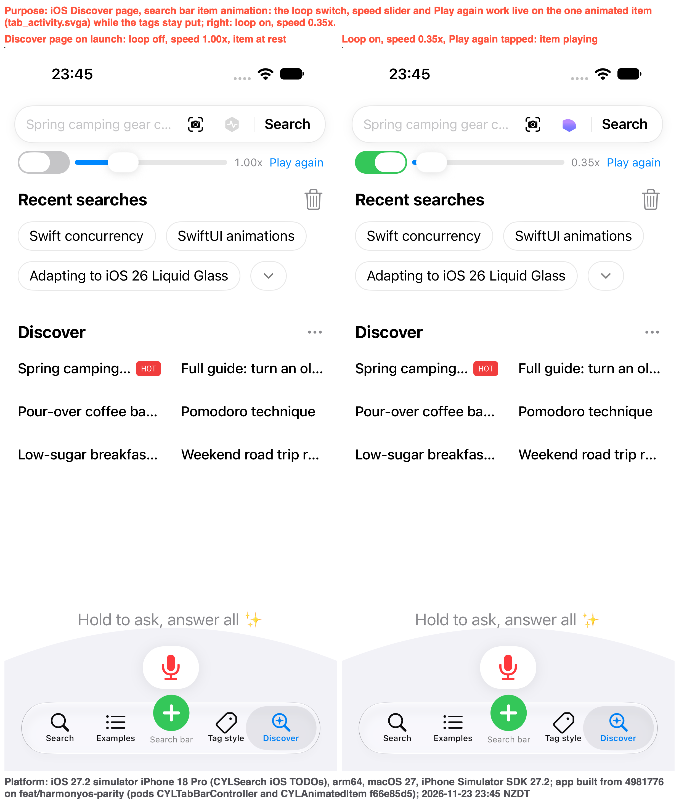 (commit 4981776, 2026-11-23). Flutter on iOS verified the same way (2026-11-23, commit e516029, Flutter 3.47.9, iOS 27.2 simulator): clean `flutter build ios --simulator` succeeds, the example's Discover tab shows the animated item; loop on, speed 0.25x and Play again work live: 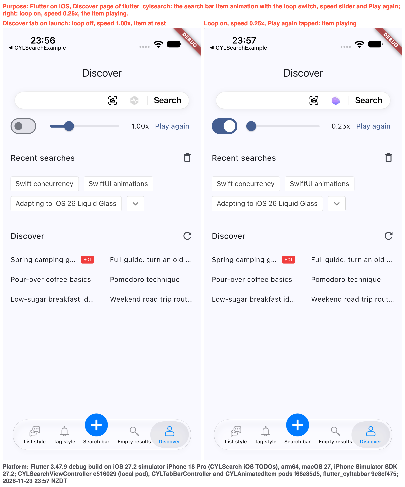 (commit e516029, 2026-11-23). React Native on iOS verified too (2026-11-24, commit e516029 plus the header fix below, React Native 0.88, upstream CYLTabBarController and CYLAnimatedItem `12ed11ff`, iOS 27.2 simulator): the clean Release build succeeds, the Discover tab's Loop switch, Speed - / + and Play again work live:  (commit e516029, 2026-11-24). The build needed one fix on our side: `CYLRNSearchSupport.h` imports SVGAPlayerLite's types before CYLAnimatedItem's Swift header (Objective-C++ cannot use the header's `@import`); the other two causes (`noexcept` on `CYLAnimatedItemResourceBundle`, the same import in react-native-cyltabbar's `.mm` files) are fixed upstream in PR #824 (`6285ccc9`). Not done on iOS: the pins in this repository still point at `f66e85d5`, which does not build the React Native example; moving every pin to the newest PR #824 commit belongs with ClassifyMenu PR #26 (tab bar pin must match ClassifyMenu's bundled commit). | TODO (2026-11-23) |
| 42 | Call upstream's `animationSpeed`, `animationLoops`, `animationRestartToken` and `restart()` directly, or build a wrapper? User prompt, verbatim: "上游 CYLTabBarController 的 CYLAnimationView 已有同名的 animationSpeed、animationLoops、animationRestartToken 和 restart()。在本仓库新建包装，请不要重复实现 直接调用上游接口即可。并请advisor评估 直接调用上游还是新建包装，哪一个方案更有利于本项目，sonnet实现。" (English: upstream's CYLAnimationView already has the same names; do not re-implement them; have the advisor judge whether a direct call or a new wrapper is better for the project; Sonnet implements) | iOS, Android, Flutter, React Native | Advisor verdict, 2026-11-23: call upstream directly, build no wrapper. The item's view is the native `CYLTagButton`, a `CYLAnimatedItemView`, the same native class upstream's React Native `CyltabbarAnimationView` and Flutter `CYLFlutterAnimationView` wrap, so the item props already set its upstream `animationLoops` / `animationSpeed` and call its `restartAnimation()`; a JavaScript or Dart wrapper would be a second platform view outside the bar (broken item layout, 36 pt touch area, accessibility grouping, a second load of the file) and would make the published packages depend on `react-native-cyltabbar` / `flutter_cyltabbar`. Real gap found: the four bridges removed and re-added every item on any change, so a loop or speed change reloaded the animation. Fixed in the core, `CYLSearchBarView.setItems(dictionaries:)` (iOS) / `setItems(maps)` (Android): items whose other keys did not change stay and take the two values in place; the bridges call it. `restartItemAnimation(index)` stays, it is upstream's `restart()` on that item's view; no `animationRestartToken` on the items (nothing to compare). Static code, 2026-11-23. TODO: the owner builds and tests; optional: forward `animationSpeed` only when set so `CYLTagButton` keeps following `style.animationSpeed` (today an item always pushes 1) | TODO (2026-11-23) |

## Animation demo rule (2026-11-24, owner), every example

User prompt, verbatim: "searchbar页面。你如果想在搜索seachbar加动效演示，你应该替换静态图片为对应的东西版本，应该是搜索相关的。比如上面的静态的图片拍照按钮，可以换成拍照的动效版本。并且loop 这一行的example操作应放在seachbar视图之外，比如页面搜索选项的最下面。或者固定在tabbar顶端。不要像下载这样打乱seachbar的演示布局。写入本次迁移的文档应用到所有example中"

1. **Animate an item the bar already has.** To demonstrate an animation in the search bar, replace a static image by its animated version, and make it a search-related one: the camera button's static image becomes an animated camera (`search_camera.json`, a Lottie file, the same file on every platform; the static camera symbol stays as the fallback when the engine is missing). Never add an extra item to the bar for the demo.
2. **The bar keeps its original demo layout:** field, camera, divider, Search button. Nothing is added to it or squeezed against it.
3. **The demo controls stay outside the bar:** the Loop switch, the speed control and Play again close the page's search options (the last block of the scrolling content, below the Discover tags), or are pinned just above the tab bar; never between the bar and the lists. Their accessibility labels and identifiers are unchanged (`CYLSearchDiscoverAnimationLoops`, `CYLSearchDiscoverAnimationSpeed`, `CYLSearchDiscoverAnimationPlay`, or each platform's equivalent).
4. **The controls drive that camera item:** `animationLoops`, `animationSpeed` and `restartAnimation()` on the camera `CYLSearchBarItem`; a change of loops or speed never reloads the file.
5. **The asset:** the canonical file is `CYLSearchExample/CYLSearchDiscover.bundle/search_camera.json` (44 x 44, 30 fps, 60 frames: the lens ring pulses, the flash dot blinks, the first and last frame are equal). Each example copies it into its own resources; an engine without Lottie shows the static camera.

| Example | Rule applied | Verified |
|---|---|---|
| iOS `CYLSearchExample` | yes (`a746489`) | iOS 27.2 simulator, 2026-11-24:  (commit a746489, 2026-11-24) |
| Flutter `flutter_cylsearch/example` | yes (Dart page `lib/discover_page.dart`: camera item plays `search_camera.json`, extra item and its string removed, controls last in the page list, restart index 0; `flutter analyze` passes; commit in the log below) | iOS half verified (2026-11-24, commit 02bcc4b, Flutter 3.47.9, iOS 27.2 simulator iPhone 18 Pro, pins at `f45a8f1d` through local path checkouts): the camera plays `search_camera.json` (12 sampled frames, 12 different images, with Loop on and Play again), the controls are last in the list: 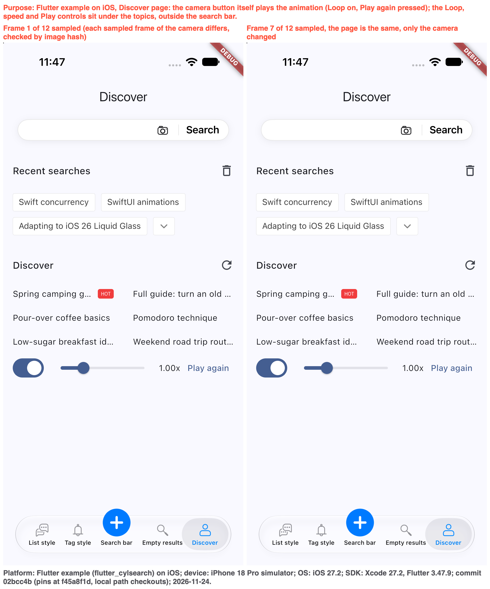 (commit 02bcc4b, 2026-11-24). It needed `search_camera.json` in the Runner target and the `LottieSwift` subspec of CYLAnimatedItem in the example Podfile (the default engines were SVGA and Rive only). TODO: Android half (Windows session) |
| React Native `react-native-cylsearch/example` | yes (`src/App.tsx`: camera item plays `search_camera.json`, extra item and its string removed, controls after the topics, restart index 0; `yarn typecheck` passes; the file is in `ios/.../SVGA` and `android/.../assets`) | iOS half verified (2026-11-24, commit 0b3b64c, React Native 0.88 Release build, iOS 27.2 simulator iPhone 18 Pro, CYLTabBarController and CYLAnimatedItem `f45a8f1d` through the local vendor copy): the camera plays `search_camera.json` (Loop on and Play again: 13 different images in 14 sampled frames; Loop off plays once), the controls are after the topics: 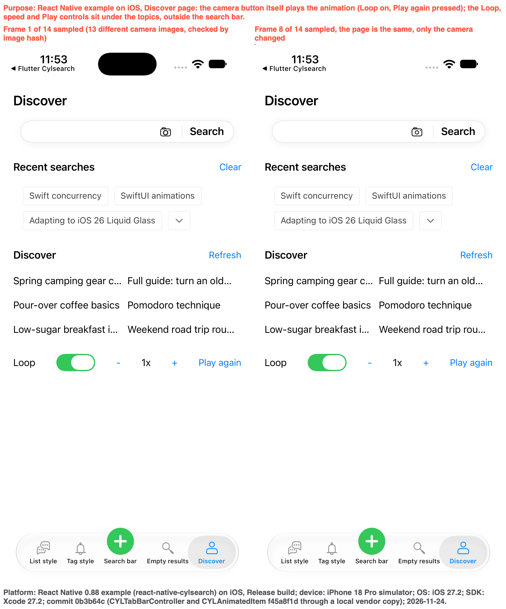 (commit 0b3b64c, 2026-11-24). `search_camera.json` is in the Xcode target (commit 02bcc4b) and the example Podfile links `CYLAnimatedItem/LottieSwift`. Layout fix (2026-11-24, owner: spacing, corners and the HOT icon differed from Flutter): the page uses the Flutter page's metrics (full-width tag list aligned with the headings, 56 pt bar inset 12 pt, topics 16 pt by 10 pt) and the localized `discover-hot` icon (`example/src/assets/discover`, @2x and @3x, from the Flutter assets) after the hot topic; the tag and bar corners were already identical to Flutter's (compared pixel crops): 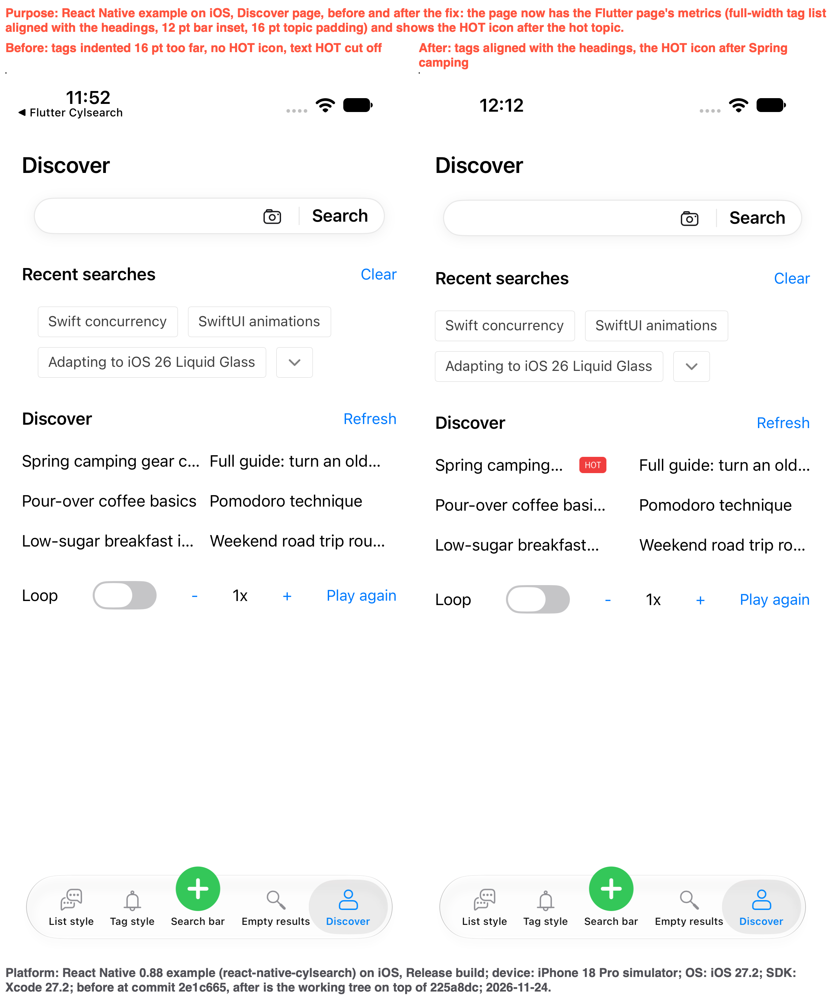 (2026-11-24). TODO: Android half (Windows session) |
| Android | TODO | TODO |
| HarmonyOS | TODO | TODO |
| WeChat mini program | TODO | TODO |

## Default layout contract (2026-11-24, owner), every example

Why: Flutter and React Native looked very different from the native pages although both call the same native components; the examples carried their own padding and headers. The measured cause (pixel crops of tags and bar corners matched): the components were identical, the page shells were not. So the alignment lives in the core, and an example places the components edge to edge.

1. **One horizontal inset, 16 pt (16 dp on Android)**: the search bar's capsule (`CYLSearchBarView.contentInsets`, default `(6, 16, 6, 16)` since 2026-11-24, was 12), the tag list's section header title (`CYLMenuStyle.headerHorizontalInset`, 16) and its tags (`sectionInsets`, 16) all start and end at that inset. Placed edge to edge with no padding, the capsule's left and right edges line up with the section title and the first tag.
2. **The tag list brings its own section header**: `sectionTitle` and `showsClearButton` (built-in trash icon, `onClearButtonTap` / `onClearButtonTapped`) on the Flutter and React Native tag list; an example writes no header for a tag list.
3. **An example writes no padding for these components.** Padding stays only for its own content (titles, the Loop / speed / Play row).
4. Checked by the unit test `testBarCapsuleLinesUpWithTheTagListInset` (capsule `minX` / `maxX` equal the tag list's section insets and header inset), and on the iOS simulator: Flutter and React Native show the capsule, the "Recent searches" title, the tags and the trash on the same inset: 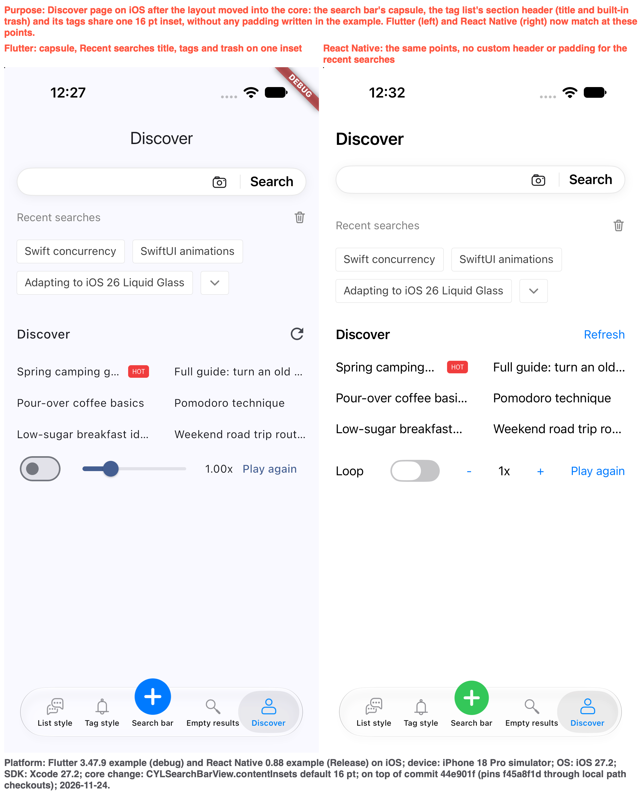 (2026-11-24, commit in the log below).
5. **The "Discover" section header and its refresh icon are in the core (2026-11-24, owner: icon first, the default)**: the tag list's header action `showsRefreshButton` (RN `onRefreshButtonTap`, Flutter `onRefreshButtonTapped`) draws the SF Symbol `arrow.clockwise` with a localized VoiceOver label (`CYLSearchTagListHeader`, strings `tagList.refresh` in en, ja, zh-Hans, zh-Hant), through CollectionViewClassifyMenu's header More button (`menuShowsMoreButton`, whose three dots the core replaces). One header action: the refresh icon wins over the trash. The Discover section is a header-only tag list (`tags` empty, `sectionTitle`, `showsRefreshButton`); the examples write no header and no "Refresh" text. Tapping refresh changes the topics on both (checked on the simulator): 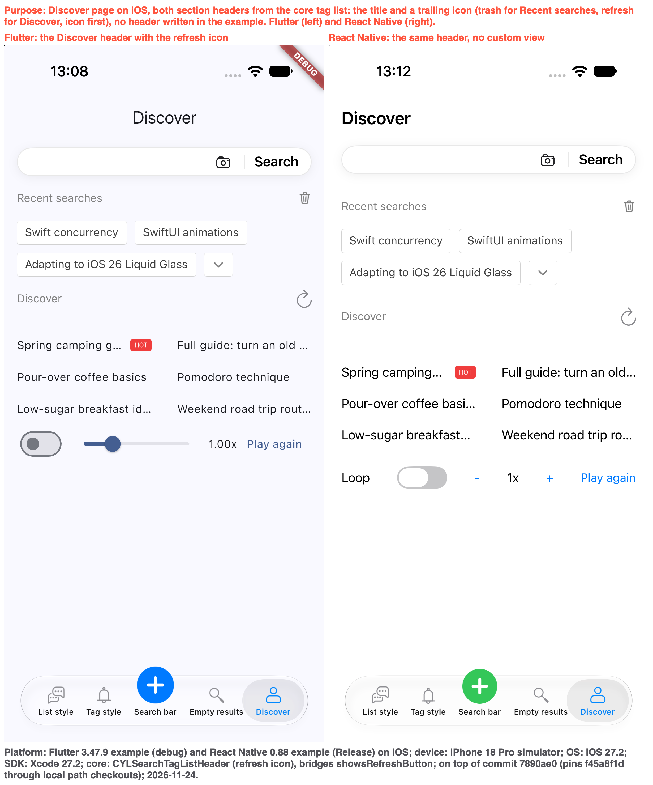 (2026-11-24). Unit test `testTagListHeaderRefreshIconIsAnIconWithALocalizedLabel`. Android: the RN `CylsearchTagListViewNativeComponent.ts` gained `showsRefreshButton` and `onRefreshButtonTap`, so the Android ViewManager needs the setter and the event (TODO, Windows session). Both headers use ClassifyMenu's default gray header font; native iOS Discover sets bold 20 pt in its example (`applyHeaderLook`): whether that becomes the core default is open (owner). Still not in the core, next candidates: the two-column topic grid with the HOT icon (iOS builds it as a `CYLTagListView` grid in the example; Flutter and React Native build their own rows). Other platforms: the same default `contentInsets` 16 (Android 16 dp, HarmonyOS, mini program) is TODO for the Windows session.

6. **The tag look is a default of the search bar core, and every text is localized (2026-11-24, owner)**: `CYLSearchTagListStyle` (iOS core) sets, through `CYLMenuStyle`'s public API only (CollectionViewClassifyMenu is not changed), the look of the iOS example's recent searches: capsule tags (`tagCornerRadius` 0 = capsule in ClassifyMenu, the example's value; `CYLTagCornerRadiusSquare` = square), a 1 pt separator border, 17 pt text, 36 pt high, 12 pt apart, 16 pt section inset, a bold 20 pt section header. The Flutter and React Native bridges apply it to every tag list; an app customizes it with `CYLSearchTagListStyle.tagCornerRadius` and `styleCustomizer`. Unit test `testDefaultTagStyleMatchesTheExampleRecentSearchesAndCanBeCustomized` compares it with the example's `recentStyle()`. Texts (docs/instructions/accessibility-i18n.md): icons are built-in resources (the refresh icon SF Symbol, the trash and chevron of ClassifyMenu, `discover-hot` in each language), every text comes from a localization file in en, ja, zh-Hans and zh-Hant copied from the iOS example: Flutter reads `assets/discover/<lang>/CYLSearchDiscover.strings` and `search-discover.json` (identical to iOS), React Native reads `example/src/search-discover.json` (strings and per-language data, from the iOS files; the language is the iOS preferred language, because Hermes' `Intl` follows the app's own localizations). Core key `tagList.refresh` (Refresh, 更新, 刷新, 重新整理) is in `Resources/CYLSearchViewController.bundle`. Checked on the simulator in zh-Hans: 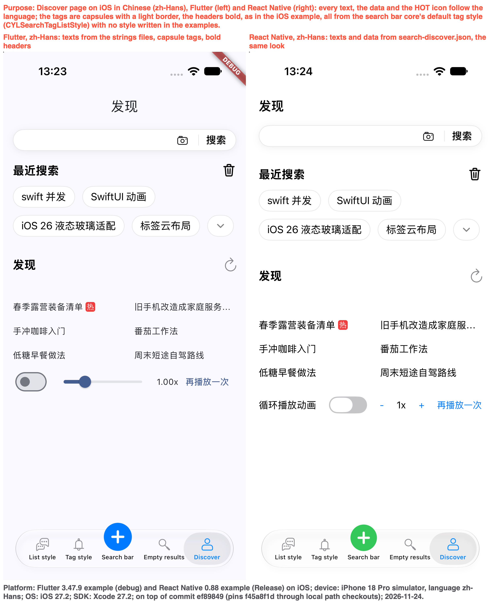 (2026-11-24). Not localized yet (example chrome, not the Discover page): the React Native example's tab titles ("List style" and the others). TODO for the Windows session: the same default tag style and the `tagList.refresh` key on Android (strings.xml in four languages), HarmonyOS (string resources) and the mini program.

7. **Example-layer rule, every platform (2026-11-24, owner): the second section ("Discover" topics) is not in the core, but an example builds it from CollectionViewClassifyMenu's tag list, not by hand; the effect follows the iOS example.** iOS: `CYLTagListView` with `CYLMenuStyle.gridStyle(itemsPerRow: 2)`, `menuImageForItem` (hot icon), the header. Flutter and React Native: the tag list widget / view with `columns: 2`, `tagImages` (the hot icon per tag; a Flutter asset key, or an asset URI in React Native), `foldedRowCount: 0` (no fold, as the iOS example), `sectionTitle` and `showsRefreshButton` for the header; the hand-written topic rows and styles are gone. The bridges gained `columns` and `tagImages` (`gridStyle` and `menuImageForItem` are Swift-only, so the grid look is applied by the core's helper `CYLSearchTagListStyle.applyGrid(columns:to:)`, which only calls ClassifyMenu's public API; no default of the search bar core changes). Checked on the simulator, both pages show the iOS example's rows (same truncation, the HOT icon after the first topic): 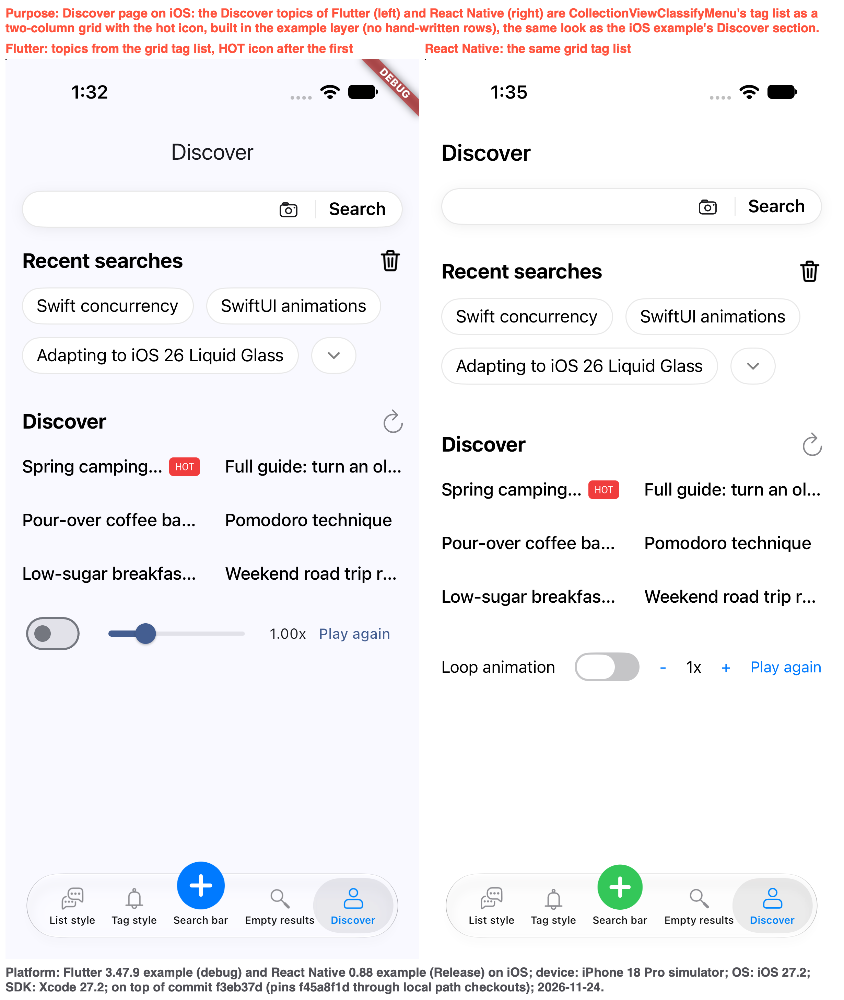 (2026-11-24). Differences from the iOS example, as the owner decided before: the header action is the refresh icon, the iOS example still shows ClassifyMenu's three-dot More icon there (one line to align: `CYLSearchTagListHeader.applyRefreshIcon(to:)` in `CYLSearchDiscoverViewController`). TODO for the Windows session: Android, HarmonyOS and the mini program examples build the topics the same way from their ClassifyMenu tag list (Android `CYLTagListView`, HarmonyOS and the mini program tag list), and the Flutter and React Native bridges on Android (`columns`, `tagImages` params).

8. **Corner radius is a plain number in CollectionViewClassifyMenu (2026-11-24, owner)**: `CYLTagCornerRadiusSquare` is removed and 0 no longer means a capsule: `cornerRadius` is points limited to half the tag height, **0 is square**, half the height or more (for example 1000) is a capsule. ClassifyMenu PR #35 (`feat/corner-radius-numeric`, iOS done and tested: 31 tests; Android, HarmonyOS and the mini program of ClassifyMenu are TODO, the Windows session). In this repository: `CYLSearchTagListStyle.tagCornerRadius` default is 1000 (a capsule, the iOS example's look), the iOS example's recent searches use 1000; the search bar's own tags use a private 0.001 for square corners, valid with both meanings of 0, until the pins move to the merged PR (then 0). TODO in this repository when the PR merges: Android (`CYLSearchBarView.kt` imports the constant), HarmonyOS (`CYLSearchBarView.ets`, `ExamplesMenu.ets`), the mini program example, and the pins.
8b. **Corner radius, the owner's final rule (2026-11-24, every platform and every library)**: the radius is plain points limited to half the height; **0 is square**; the capsule is ONE named constant whose value is 1000 (a macro / constant, documented), and users pass the constant, never the literal 1000; no other value has a special meaning ("unset", negative, 0.001 and the like are not special); `CYLTagCornerRadiusSquare` is deleted everywhere. This overrides ClassifyMenu PR #36's restored `CYLTagCornerRadiusSquare` and Android's "0 = capsule" (the ClassifyMenu session was told to change both, and to apply the rule to `CYLAnimatedItemView` and the other libraries that take a corner radius: CYLTabBarController's badge appearance, CYLTableViewPlaceHolder, the Android, HarmonyOS and mini program ports). In this repository: iOS `CYLSearchTagListStyle.capsuleCornerRadius`, Android `CYLSearchTagListStyle.CAPSULE_CORNER_RADIUS`, both 1000 and the default of `tagCornerRadius`; the iOS example and the Android examples pass the constant. After the pins move together (done on HarmonyOS and the mini program 2026-11-24, ClassifyMenu `4be6cda`, CYLAnimatedItem `c6b3e976`), the constants of the ClassifyMenu libraries replace these repo-local ones, and the search bar's own square tags (a private 0.001 in `CYLSearchBarView.swift` and the Kotlin core, valid under both meanings of 0 until then) become 0. HarmonyOS and the mini program: DONE statically 2026-11-24 (Windows session): their examples pass the library constant and the item square is 0 (status table row "Corner radius 8b"); not run.
9. **React Native tab bar titles are localized (2026-11-24, owner)**: the tab bar titles and the tab page title come from `example/src/search-discover.json` (`tab.list`, `tab.tags`, `tab.empty`, `tab.discover`, `tab.searchBar` in en, ja, zh-Hans, zh-Hant; tag style, search bar and discover are the iOS values of `CYLSearchTabs.strings`, "List style" and "Empty results" have no iOS key and are new translations): 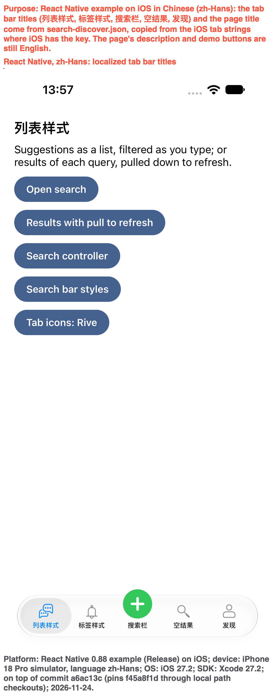 (2026-11-24). Still English in the React Native example (not localized): the tab pages' descriptions and demo buttons ("Open search", "Results with pull to refresh", "Tab icons: Rive", ...) and the demo screens behind them. The Flutter example's tab titles come from its tab bar configuration JSON and are English too.

## Refresh, hot data and navigation bar contract (2026-11-24, owner; designed with the advisor), every platform

Owner prompt: see `docs/task-log.md`, "refresh icon in every example; a larger refresh data set ...; the search bar always embedded in a navigation bar". Three parts, one spec for every session.

### A. The refresh icon is built in (icon first, the default)

Every example's Discover "topics" header shows the refresh icon, never ClassifyMenu's three dots and never text. The icon is a built-in resource of the library of each platform (created when the platform has none), with a localized label (key `tagList.refresh`: Refresh, 更新, 刷新, 重新整理):
- **iOS** (done in the core): `CYLSearchTagListHeader.applyRefreshIcon(to:)` (SF Symbol `arrow.clockwise`). The iOS example applies it after `discoverList.style = Self.discoverStyle()` (a later style assignment replaces it).
- **Android**: a vector drawable `ic_refresh` in the `cylsearch` library (res/drawable), not in the app; the tag list header More button uses it (ClassifyMenu's Android header action API); label from the string resource in four languages. A copied Material icon needs its notice in `licenses` and `scripts/check-licenses.sh` green.
- **HarmonyOS**: a system symbol for refresh if the SDK has one (look it up, never guess a name), otherwise an SVG in the `cylsearch` module's media resources; label `$r('app.string.…')`.
- **Mini program**: an SVG inside the core component package (not the example page); label from the i18n table.

### B. Discover data contract (the same data on all six examples)

- Single source: `CYLSearchExample/CYLSearchDiscover.bundle/<lang>.lproj/search-discover.json` (en, ja, zh-Hans, zh-Hant). Every other example holds a copy made by `python3 scripts/sync-discover-data.py` (`--check` validates the rule and reports copies that differ; a session adds its copy to `COPIES` in the script).
- The pool is whole pages of `discoverCount` (6) records, 4 pages = 24 records (a multiple, as the owner asked), the same topics in the same order in every language.
- A record is `{ "title": "...", "icon": "hot" }`: the hot mark lives in the same record as the tag it marks (`icon` absent = no mark).
- Each page has exactly one hot record; its slot on a page differs from its slot on the next page, wrap-around included. Source slots: 0, 3, 5, 1 (global records 0, 9, 17, 19). The slot comes from the order of the records in the data file ("from the database": the data, not the code, decides the position); if the owner meant a SQLite database instead, only the loader changes.
- Refresh shows the **next page, cyclically** (page = (page + 1) mod pages). No random pick: iOS `randomTopics` and Flutter `randomTopics` are replaced by one `nextPage` rule, React Native's offset logic by the same rule; Android, HarmonyOS and the mini program follow the same rule.
- A test (iOS and Flutter): over 2 × pages refreshes, every page shows exactly one hot record and its slot never equals the previous page's.

### C. The search bar is always in a navigation bar (core first)

The Discover search bar must sit in the navigation bar of the current view; a view without one gets a navigation bar created by the core. The core guarantees it by one entry point per platform; an example never lays the bar out by hand.
- **iOS** `CYLSearchBarView`: `@objc @discardableResult func embedInNavigationBar(of viewController: UIViewController) -> UINavigationBar`. The view controller has a `navigationController`: the bar becomes `navigationItem.titleView` and the controller's navigation bar is returned. It has none: the core installs a `CYLSearchNavigationBar` (a `UINavigationBar` holding this bar as its title view, background under the status bar) at the top of the view controller's view and returns it. After the call a navigation bar always exists. Unit tests for both branches: the bar exists, and the content below starts at or after the bar's maxY (the bar never covers a view). Measure the title view frame on iOS 17.5, 26.5 and 27.2; do not assume the sizing.
- **Bridges (Flutter, React Native)**: the existing bar view gets a prop `embedsInNavigationBar` (Flutter `embedsInNavigationBar`); the native view then renders the `CYLSearchNavigationBar`, so iOS has one code path. Flutter places it as `Scaffold.appBar` (`PreferredSize`), React Native reserves its height under the safe area.
- **Android** `CYLSearchBarView`: `embedInToolbar(activity/fragment)`: use the existing `Toolbar` / action bar, otherwise create a `MaterialToolbar` at the top of the content and put the bar in it.
- **HarmonyOS**: a `NavDestination` title builder; a page without a `Navigation` is wrapped in one by the core.
- **Mini program**: `navigationStyle: custom` with a core navigation bar component, kept clear of the capsule menu button (`wx.getMenuButtonBoundingClientRect`).
- Open conflicts, defaults as noted (report measured values): a standard bar is 44 pt high, Discover's field is 46 pt: embedded, the field is 36 pt; the "Default layout contract" item 1 (capsule edge = 16 pt tag inset) is kept by 16 pt layout margins of the navigation bar, and a back button on the leading side cannot keep it (the measured offset is reported); the search bar replaces the title text ("Discover") in the Flutter AppBar and the React Native big title.

### Status on iOS (2026-11-24, Mac session)

- **A, refresh icon**: the iOS example applies `CYLSearchTagListHeader.applyRefreshIcon(to:)` after its discover style (it showed ClassifyMenu's three dots before); Flutter and React Native already used it.
- **B, data**: `scripts/sync-discover-data.py` (`--check`) validates and copies the data; the iOS source now has 4 pages of 6, one hot record per page at slots 0, 3, 5, 1 (it had two hot records at slot 0 on consecutive pages before); the iOS example, Flutter and React Native show the next page, cyclically (`CYLSearchDiscoverData.topics(onPage:)` / `nextPage(after:)`, Dart `topicsOnPage` / `nextPage`, TypeScript `topicsOnPage` / `nextPage`), the random pick is gone. Tests: iOS `testDiscoverRefreshShowsTheNextPageWithTheHotTopicMoving` (all four languages, 2 x pages refreshes, and the controller's refresh), Flutter `test/discover_data_test.dart`.
- **C, navigation bar**: `CYLSearchBarView.embedInNavigationBar(of:)` and `CYLSearchNavigationBar` (core). With a `navigationController` the bar is the navigation item's title view; without one the core creates the bar, pins it at the top and raises the top safe area by 44 pt. `CYLSearchNavigationBar.holding(_:)` serves the bridges: React Native `embedsInNavigationBar` prop, Flutter `embedsInNavigationBar` (placed as `Scaffold.appBar`). The iOS Discover page lost its hand-laid bar, its own back button and the hidden navigation bar. Measured on the simulator: the capsule edges, the section titles and the tags share the 16 pt inset (x 48 px at 3x) on the iOS example, Flutter and React Native; the field is 36 pt high (it was 46 pt); a back button on the leading side would move the capsule, so the page has none: the native back item of a pushed page is the navigation bar's. The bar sizes itself through `sizeThatFits`: a navigation bar first asks a title view with a zero width, so an embedded bar answers `layoutFittingExpandedSize.width`. Unit tests (structure): `testEmbedInNavigationBarCreatesTheBarWhenTheViewControllerHasNone`, `testEmbedInNavigationBarUsesTheNavigationControllersBar`; the title view is not laid out inside a headless test window (its frame stays 0), so the width is checked on the simulator: 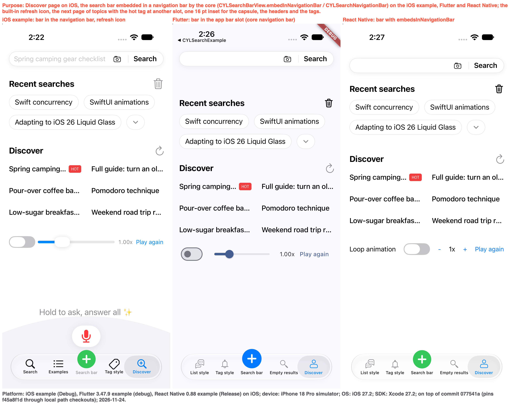 (2026-11-24).
- The conflicts named above, measured: the page title text ("Discover") is gone on Flutter and React Native, the search bar replaces it; the Flutter page had 46 pt more space between the bar and "Recent searches" than the iOS example, fixed (2026-11-24, owner): the Scaffold adds the status bar height to the app bar slot itself, so the `PreferredSize` is 44 pt (it was 44 + the status bar height, counted twice), and the list starts 16 pt under the bar as the iOS example measures (the scroll view 6 pt under the safe area plus 10 pt above its first header). Measured with the accessibility frames: the bar's field at y 66 pt, the first header block at y 122 pt on both: 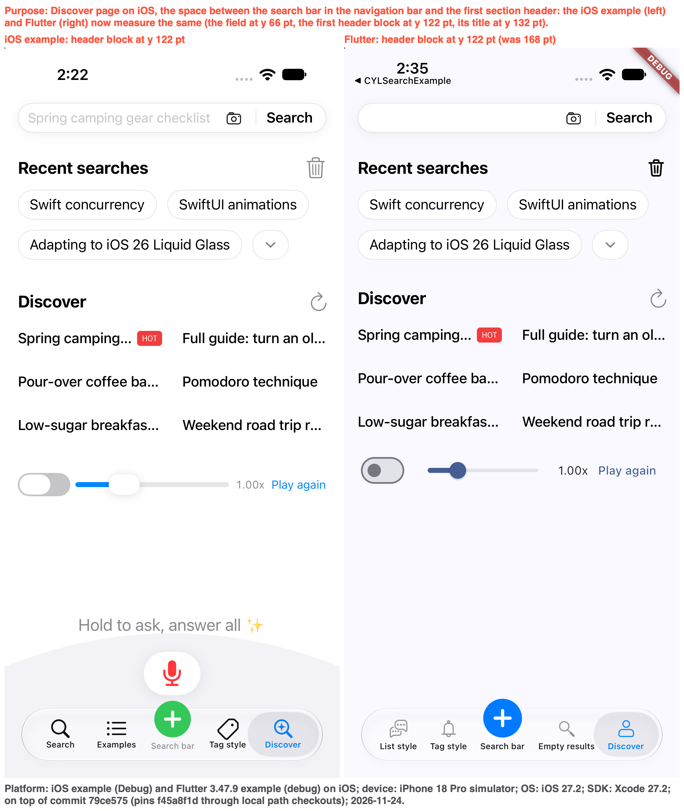 (2026-11-24). React Native (the bar 44 pt in its own view) and the other platforms keep the same 16 pt rule.
- **Pushed second-level page (2026-11-24, owner: debug it with a back button)**: the iOS example opens Discover as a pushed page with `-CYLDemoPushDiscover 1` (the Discover tab pushes a second Discover page on its root). The navigation bar then has the system back button on the leading side and the embedded search bar takes the width that is left, by itself: the title view answers `sizeThatFits` with the whole width and UIKit gives it what the bar has between the back button and the trailing margin; the page has no code for it. Result, measured on the simulator: the capsule's trailing edge stays on the 16 pt inset of the tag list and its headers (x 1136 px at 3x), its leading edge starts after the back button (x 215 px instead of 48 px), so the contract's "capsule edge = first tag" holds on the trailing side only: a leading back button cannot keep the leading alignment, and that is the expected layout (the owner's own expectation: the bar leaves room for the back button): 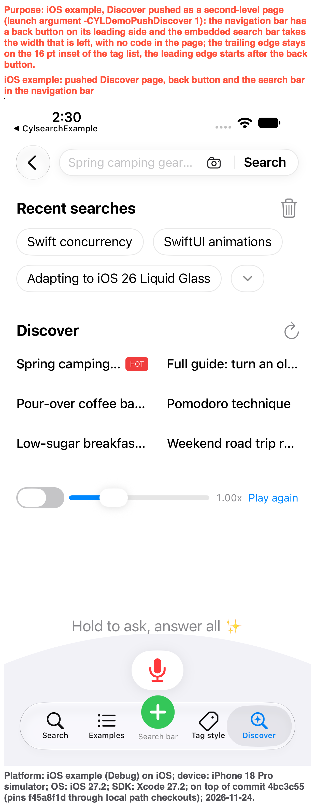 (2026-11-24). The Flutter and React Native pages are root pages without a back button; their Android, HarmonyOS and mini program counterparts should show the same: the bar fills what the navigation bar leaves.
- **Always a second-level page with a back button (2026-11-24, owner, every example)**: the Discover page is never a tab root. iOS: the Discover tab's root is `CYLSearchDiscoverEntryViewController` (one row; it pushes the Discover page at once the first time, and on a tap), so the system back button is always on the navigation bar's left (`-CYLDemoPushDiscover` is gone). Core: `CYLSearchNavigationBar.holding(_:showsBackButton:)` gives the bridges' navigation bar a root item below the search bar's item (the back button, titled with the localized `navigationBar.back`) and reports a tap to `backHandler` without popping. Flutter: `showsBackButton` and `onBackPressed` on `CYLSearchBarView`; the Discover tab shows `CYLSearchDiscoverEntryPage`, which pushes the Discover route, whose back pops it. React Native: `showsBackButton` and `onBackButtonTap`; the Discover tab shows `DiscoverEntry`, the back button closes the page. Checked on the simulator for all three (the back tap returns to the entry page on Flutter and React Native; iOS uses the system back button): 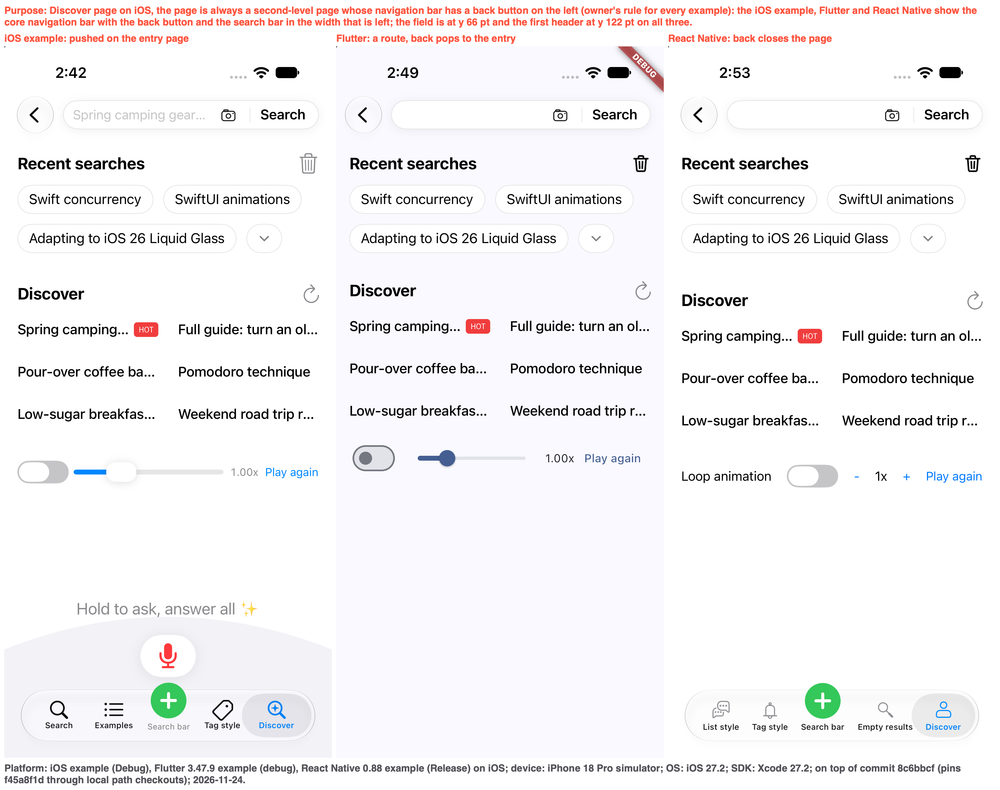 (2026-11-24). React Native's page was moved 16 pt up so its bar and first header sit at y 66 pt and 122 pt as on iOS and Flutter. Test changes: `testSearchBarsCoverNoView` checks the embedded bar (title view, lists below the navigation bar), `testNavigationBarHoldingTheBarCanShowABackButton`; the whole suite passes (199 tests). A pushed Flutter route covers the page but keeps the native tab bar visible after the back tap (it is hidden while the route is open).
- **The adaptive width is the core's job, never the example's (2026-11-24, owner)**: beside a back button the search bar takes the width that is left because the core sizes it, not because a page sets a width. iOS: an embedded `CYLSearchBarView` answers `sizeThatFits` and `intrinsicContentSize` with the whole width (`UIView.layoutFittingExpandedSize.width`) and UIKit gives it what the navigation bar has beside the back button; a plain bar keeps the width it is offered. Pinned by `testEmbeddedBarAsksForTheWholeWidthAndAPlainBarKeepsItsOwn`. The three iOS examples were checked for width code on the bar: none (the iOS Discover page lost its width constraints and back button; Flutter's `PreferredSize` and React Native's `discoverBar` set a height and a margin only). Every other platform follows: Android the core puts the bar into the Toolbar as a custom view that fills the space between the navigation icon and the end (the width is the core's `Toolbar.LayoutParams`, not a page value), HarmonyOS the core's title builder gives the bar `layoutWeight(1)` between the back button and the end, the mini program's core navigation bar component measures the free width from the back button and `wx.getMenuButtonBoundingClientRect` itself; a page of an example never passes a width, margin or padding to fit the back button.
- TODO for the Windows sessions: Android (`winsCYLSearchViewController repository`, some pushed, see the log), HarmonyOS and the mini program (`winsCYLTableViewPlaceHolder directory` asked its owner first, nothing started).

### Test hand-over, one batch (2026-11-24, owner; standard designed with the advisor)

Owner rule: code first, tests and CI last; **no waiting for CI and no waiting for other sessions**. Code is written statically; a platform is tested once, in one batch, by the session that owns it, when its own conditions hold. Nothing waits for the merge of ClassifyMenu PR #35 or for the pins to move: a batch tests whatever is pinned at that moment and records the commits.

**Test-condition standard** (each session checks its own platform; all five must hold):

| # | Condition | How it is checked, without waiting on anyone |
|---|---|---|
| 1 | Code complete: every spec item of the platform is "code done" with a `file:line` pointer (A refresh icon, B data and next page, C navigation bar, back button, width in the core, topics from the ClassifyMenu tag list, texts in four languages, corner radius valid under both meanings of 0) | the checklist below, one row per item per platform |
| 2 | Static checks green (those that need no simulator or emulator) | `python3 scripts/sync-discover-data.py --check`, `scripts/check-public-api-comments.sh`, `scripts/check-screenshot-labels.sh`, `scripts/check-licenses.sh`, `yarn typecheck`, `flutter analyze`; Android: a Kotlin compile when a JDK and the Gradle caches are on the machine |
| 3 | No open owner TODO naming the platform | `docs/task-log.md` has none |
| 4 | Dependency commits recorded, not waited for | the real `git rev-parse HEAD` of every pinned checkout goes into each screenshot footer (a path-override checkout is compared with the Podfile pin first); one extra corner-radius pass runs against the head of PR #35 |
| 5 | Own device free | own simulator / emulator; on Windows the heavy-job lock |

**What each session tests once**, each with a labeled screenshot of the Discover page in en and zh-Hans and of the back tap:
- Mac session (iOS): whole unit suite (0 failures); the Discover page on the iOS example, Flutter and React Native: the field at y 66 pt and the first header at y 122 pt, the capsule's trailing edge on the 16 pt inset, the back tap returns to the entry page, the hot slot over four refreshes is 0, 3, 5, 1; one corner-radius pass built against the PR #35 head.
- `winsCYLSearchViewController repository` (Android): the same on Android, and Flutter and React Native on Android (the props `showsRefreshButton`, `columns`, `tagImages`, `embedsInNavigationBar`, `showsBackButton`, the back and refresh events), ClassifyMenu Android corner radius (0 square, 1000 capsule).
- `winsCYLTableViewPlaceHolder directory` (HarmonyOS, mini program): ohosTest with the refresh button label test, the emulator run, the mini program in DevTools, the corner radius on both.

**Static check results (Mac session, 2026-11-24, nothing run on a device)**: `sync-discover-data.py --check`, `check-public-api-comments.sh`, `check-licenses.sh`, `check-screenshot-labels.sh`, React Native `yarn typecheck` and Flutter `flutter analyze lib`: all green. A Kotlin compile of the Android code is not possible on this Mac: AGP 9.2.1 needs JDK 17 and the machine has JDK 8, 9 and 11 only; it stays in the Windows batch. Real hashes of the Mac path-override checkouts used by the iOS builds: to be written into the footers of the batch screenshots (`git -C /tmp/xpr/cyltab rev-parse HEAD`, `cvcm`, `cyltph`; compare with the Podfile pins first). Trailers: 469 older commits of this branch still carry `Co-Authored-By`; only the five commits of the HarmonyOS / mini program batch were rewritten (owner's yes); older history is not rewritten without an explicit yes.

**iOS batch results (Mac session, 2026-11-24, one run after the code was complete)**: whole unit suite on the iPhone 18 Pro simulator (iOS 27.2): 200 tests, 0 failures. The Discover page on the iOS example, Flutter and React Native, English and zh-Hans (device language): the search bar sits in the core navigation bar beside the back button, the refresh icon, capsule tags, localized texts and data; the hot slot over four refreshes is 0, 3, 5, 1 and back to 0 on the iOS example, Flutter and React Native in English, and on Flutter and React Native in zh-Hans (the iOS example in zh-Hans was only looked at); the back tap returns to the entry page on Flutter and React Native. Found and fixed during the batch: the hot icon had no accessibility label on the Flutter and React Native iOS bridges, so VoiceOver read no "Hot" (a screen-reader gap): the new `tagImageLabels` prop sends the localized label (`discover.hot`) and the bridges set it on the image, as the iOS example does. Hashes recorded in the screenshot footers: CYLTabBarController and CYLAnimatedItem `f45a8f1d`, CollectionViewClassifyMenu `04b39e26`, CYLTableViewPlaceHolder `f4cf9785` (path-override checkouts, equal to the Podfile pins). Screenshots: 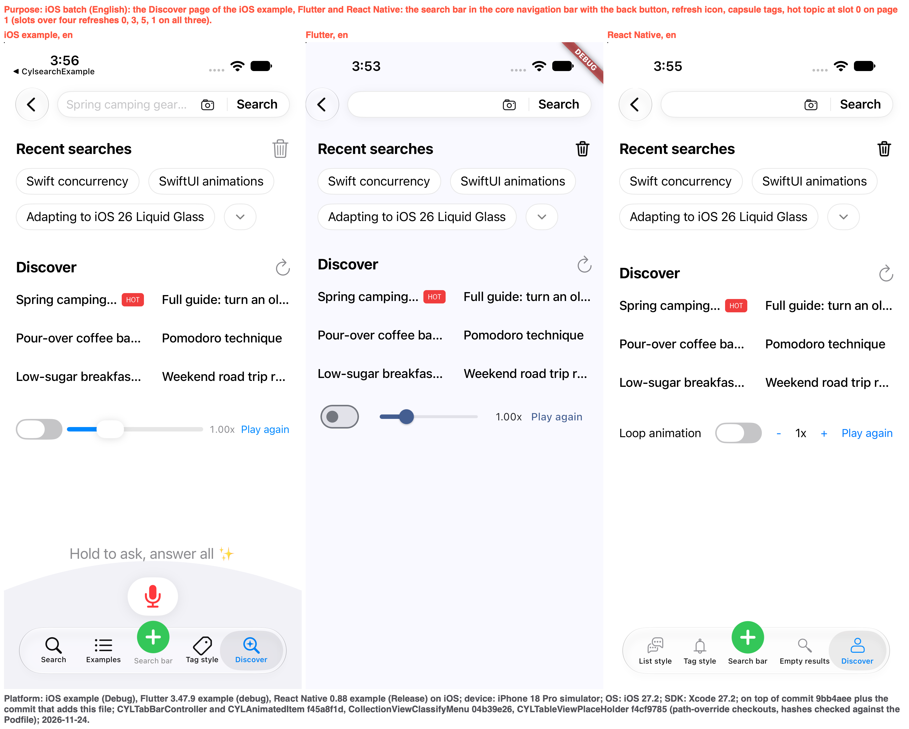 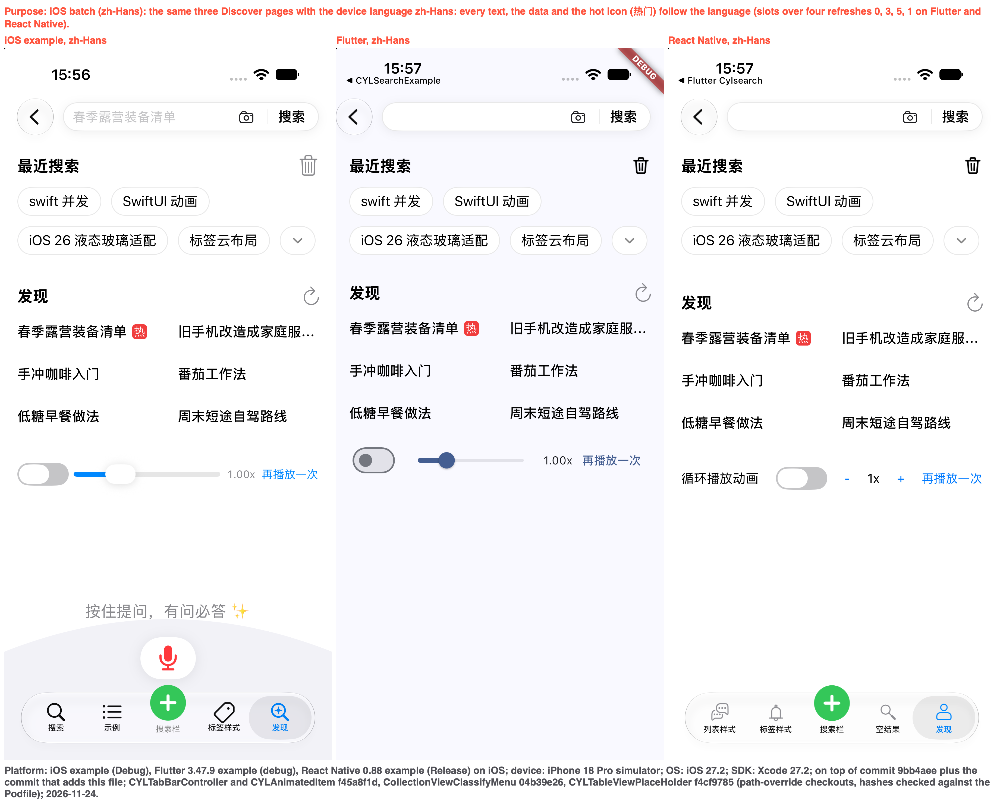 (2026-11-24). Not run in this batch: the corner radius pass against the head of PR #35 (it was run earlier on `/tmp/xpr/cmw`: 31 tests, 0 failures); the iOS CI (last).
Open note from the ClassifyMenu session (2026-11-24): a new tag style API (`backgroundStyle`, `minimumTagSize`) and a new CYLTabBarController hash are coming; this repository does not pin PR #36 or any new hash yet (the owner said not to), and nothing here uses the new API.

**CI last**: every push replaces the pending run, so after the last commit of the work push once and do not push again until that run finishes; report its result as it is.

**Checklist** ("code done" with pointers; `todo` = not written yet; updated by the session that writes the item):

| Item | iOS | Flutter | React Native | Android | HarmonyOS | Mini program |
|---|---|---|---|---|---|---|
| A refresh icon | `CYLSearchTagListHeader.swift` | via core | via core | `CYLSearchTagListHeader.kt` | `CYLSearchRefreshButton` | `cyl-search-refresh-button` |
| B data, next page, hot slot | `CYLSearchDiscoverData.swift` | `discover_page.dart` | `App.tsx` `topicsOnPage` | `CYLSearchDiscoverData` `topicsOnPage` / `nextPage` | done (Windows) | done (Windows) |
| C bar in the navigation bar | `CYLSearchNavigationBar.swift` | `embedsInNavigationBar` | `embedsInNavigationBar` | `embedInToolbar` in `CYLSearchBarView.kt` | `CYLSearchNavigationPage` | `cyl-search-navigation-bar` |
| Back button | system back item | `showsBackButton` | `showsBackButton` | Toolbar back arrow (always a pushed page via More) | NavDestination | nav bar back arrow |
| Width in the core | `sizeThatFits` | via core | via core | `embedInToolbar` (MATCH_PARENT in the core) | `layoutWeight(1)` | `cylNavigationBarWidthsFrom` |
| Topics from the ClassifyMenu tag list | `CYLTagListView` grid | `columns`, `tagImages` | `columns`, `tagImages` | `CYLSearchDiscoverFragment.kt` (`gridStyleWithNumberOfItemsPerRow(2)` + the core style) | `Discover.ets` `CYLTagListView` + `gridStyle(2)` (not run) | `cyl-tag-cloud` grid (hot icon before the title, see below) |
| Texts in four languages | done | done (`lib/example_texts.dart`: tab titles, descriptions, demo buttons) | done (`search-discover.json`) | `cyl_search_*` strings in four languages | `cyl_tagList_refresh` in 29 languages | done |
| Corner radius under both meanings of 0 | `CYLSearchTagListStyle` | via core | via core | `CYLSearchTagListStyle.kt` (default 1000, customizer, bridges apply it) | todo | todo |

### Status on Android (2026-11-24, Windows session): written statically, NOT run yet

| Item | State |
|---|---|
| A, refresh icon | `cyl_search_ic_refresh` (Material refresh, Apache-2.0, same notice as the other icons) and `cyl_search_tagList_refresh` in en / ja / zh-Hans / zh-Hant in the `cylsearch` library; `CYLSearchTagListHeader.applyRefreshIcon` sets `CYLMenuStyle.moreButtonImage`; the Discover topics header uses it. Not built, not seen. |
| B, data | the Android assets copy is in `COPIES` of `scripts/sync-discover-data.py` (`--check` OK); `CYLSearchDiscoverData.topicsOnPage / nextPage` replace `randomTopics`; `CYLSearchDiscoverDataTest` written, not run. |
| C, navigation bar | `CYLSearchBarView.embedInToolbar(toolbar)` / `embedInToolbar(activity, content)`: a Toolbar custom view with match-parent width (the core fills the space beside the back arrow and clears the toolbar's content insets so the capsule keeps the 16 dp inset); the Discover fragment is a second-level page with the Toolbar back arrow and sets no width, margin or padding; `CYLSearchBarEmbedInToolbarTest` written, not run. |
| Bridges | React Native Android ViewManager setters `showsRefreshButton`, `columns`, `tagImages`, `embedsInNavigationBar`, `showsBackButton` (events `onRefreshButtonTap`, `onBackButtonTap`); Flutter Android: the same params on the tag list and bar platform views (`didTapRefreshButton`, `didTapBackButton`). Not compiled. |
| Corner radius (PR #35) | Android part pushed to ClassifyMenu `feat/corner-radius-numeric` (`6787e7f5`): `CYLTagCornerRadiusSquare` removed, 0 square, 1000 capsule, presets keep their looks, `CYLTagCornerRadiusTest` written, not run. CYLSearch's own `CYLSearchBarView.kt` still uses the 0.001 square value (valid in both meanings) until the pins move. |
| Corner radius 8b, HarmonyOS and mini program examples | Pins moved together (2026-11-24): CollectionViewClassifyMenu `4be6cdabcdc561646496aaaf5fc7b3f3a7ed4821` (PR #36 head, stacked on #35, still open; its bundled `cylanimateditem` / `cyl-animated-item` is CYLTabBarController `c6b3e976`, checked in `VENDORED.md` and `COMMIT`) and CYLTabBarController / CYLAnimatedItem `c6b3e976e5f009f3b06003df3a78835c4dd35835` (`cylTabBarControllerCommit`, HarmonyOS `oh-package.json5` and the mini program `package.json`; both vendored copies are re-synced from it). The repo-local constants (`CYL_CORNER_RADIUS_CAPSULE`, `CYLCornerRadius.ets`, `cyl_corner_radius.js`) are deleted: HarmonyOS `Discover.ets` imports `CYLAnimatedItemCornerRadiusCapsule` from `cylanimateditem`, the mini program `pages/discoverSearch` requires `cylAnimatedItemCornerRadiusCapsule` from `miniprogram_npm/cyl-tag-list-miniprogram/cyl-animated-item/cyl_animated_item_model`; the Discover bar passes it as `fieldCornerRadius`. The search bar item square is now plain 0 (`CYLSearchBarView.js`, `CYLSearchBarView.ets`, `ExamplesMenu.ets`): `CYLTagCornerRadiusSquare` no longer exists at the new pin, so its imports were removed (they would not compile). Deliberately left: the search field's -1 sentinel (`textFieldCornerRadius` / `fieldCornerRadius`, a different concept from a tag capsule). Tests: mini program `test/example_corner_radius.test.js` (run; `npm test` 116 of 116: constant from the library, no repo-local file, no 0.001, no literal 1000 for a radius), HarmonyOS `host-logic-test.mjs` "corner radius capsule constant" (run with node, 53 of 53). New with the tab bar pin: `cyltabbar` and `cylanimateditem` depend on the module `cyldeallocblockexecutor` (`file:../cyldeallocblockexecutor`), so `sync-sub-repositories.py` / `.sh` now vendor it from CYLTabBarController and `build-profile.json5` registers it (TODO: a build is needed to prove the module graph, not run here). UI behaviour (the Discover bar as a capsule with the library constant, the search bar items square with 0, both on the pinned libraries) written, not run. |
| Not done | the core default `contentInsets` 16 dp (it makes the `CYLSearchViewQMUIPortTest` SQLite failure appear in the full suite: the example sets 16 itself); the core default tag look (`CYLSearchTagListStyle`); HarmonyOS and the mini program (the other Windows session). Everything is waiting for the single test batch (emulator free, PR #35 merged, pins moved). |

### Status on HarmonyOS and the mini program (2026-11-24, Windows session): written statically, NOT run yet

"Written, not run" = nothing was built or run; only node tests and the checkers ran.

| Row (HarmonyOS, mini program) | State |
| --- | --- |
| Discover topics grid from ClassifyMenu's tag list, HarmonyOS | Written, not run. `Discover.ets` uses `CYLTagListState` / `CYLTagListView` with `CYLMenuStyle.gridStyle(2)` (the iOS `discoverStyle()` changes: 17 pt medium, 36 high, 16 between rows, insets {4, 16, 16, 16}), `menuImageForItem` for the hot icon; the header (title and `CYLSearchRefreshButton`) stays in the page. ClassifyMenu was already a dependency (`file:../vendor/classifymenu`, pin `collectionViewClassifyMenuCommit`). To verify on the emulator: two columns, the hot icon after the title, refresh changes the page, tap searches. |
| Discover topics grid from ClassifyMenu's tag cloud, mini program | Written, node tests run (`example_discover.test.js`). The mini program's `cyl-tag-cloud` has `numberOfItemsPerRow` (equal cells) and tag images with `imageLabel`; `cyl-tag-list` parses `itemsPerRow` but never lays it out. The page uses the cloud: `cylDiscoverCloudTags`, `cylDiscoverCloudStyle` (`example/miniprogram/utils/cyl_discover_logic.js`). TODO (ClassifyMenu repository, not this one): the cloud draws an icon before the title; iOS and HarmonyOS draw the hot icon after it (`imagePlacement` trailing), and the tag list needs the grid layout; the "Tap to search" hint of a topic is not read (the cloud has no per-tag hint). Verify in DevTools. |
| `cyl_tagList_refresh` in the other languages | Done with `harmonyos/scripts/import-cyltabbar-localizations.mjs` (the string is "Refresh" in CYLTabBarController's table, 29 languages). `check-accessibility-i18n.mjs` and `check-ios-parity.mjs` pass. The mini program localizes the four iOS languages only (its core table has no others). The import also brought the strings added since its last run (`cyl_search_foldMore`, `cyl_styles_cancel`, `discover_ok`, `contactTags_*`). |
| `cyl_navigationBar_back` | The iOS key `navigationBar.back` was missing in the HarmonyOS library (`check-ios-parity.mjs` failed); added in the four iOS languages and used by the navigation page's back button. |
| Hot icon screen reader label (iOS `tagImageLabels`, key `discover.hot` / `discover_hot`: Hot, 人気, 热门, 熱門) | Strings were already in both tables (HarmonyOS entry `discover_hot` in all languages, mini program `cyl_demo_resources.js`). Mini program: already present and written, node tests run: the page passes `discover.hot` as `imageLabel` of the hot tag (`cylDiscoverCloudTags`) and `cyl-tag-cloud` hides the picture (`aria-hidden`) and reads "title, label" in the `aria-label` of the cell; test `example_discover.test.js` (4 languages, both the pure tag and the synced cloud's `renderTag`). HarmonyOS: was missing (the label string was unused; ClassifyMenu's `CYLTagListView.icon` builder sets `accessibilityLevel('no')` on the picture and has no per-item image label hook, and `harmonyos/vendor` is git-ignored, so the library is not edited here): `Discover.ets` now leads the hint of a hot topic with `discover_hot` (`cylDiscoverItemHint`, the cell's `accessibilityDescription`), tested in `host-logic-test.mjs` (3 cases, run with node); the UI behaviour is written, not run. TODO for ClassifyMenu (HarmonyOS): expose `menuAccessibilityLabelForImageForItem?: (indexPath) => string | undefined` on `CYLMenuDataSource`, carry it in `CYLTagRenderItem`, and set `.accessibilityText(label)` with `accessibilityLevel('auto')` on the `Image(r.image)` in `icon()` (or append it to the cell's `accessibilityText` as the mini program cloud does); then `Discover.ets` passes it instead of the hint prefix. The mini program cloud has the hook (`tag.imageLabel`), but its picture is `aria-hidden` by design, so it has no `aria-label` of its own. |
| README of `cyl-search-refresh-button`, `cyl-search-navigation-bar` | Written (`src/<component>/README.md`). |
| Label test of the refresh button | Mini program: `test/cyl_search_refresh_button_label.test.js`, run (4 tests). HarmonyOS: `host-logic-test.mjs` "refresh button label" (3 cases, run with node) and the ohosTest case `discoverRefreshButtonHasItsLabel`, written, not run. |
| `cyl-animated-item` pin mismatch | The synced `cyl-animated-item/COMMIT` said `c4a1f8fd` because the mini program package copy comes through ClassifyMenu (`collectionViewClassifyMenuCommit` `04b39e26`, which vendors the tab bar component at `c4a1f8fd`); `package.json` pins `cylTabBarControllerCommit` `f45a8f1d`, and `test/package.test.js` requires both to be equal (it failed). `f45a8f1d` is right (head of CYLTabBarController PR #824, the pin of the other platforms). Fix with the repo's own sync script: `collectionViewClassifyMenuCommit` is now `cd95371c` (ClassifyMenu PR #34, "CYLTabBarController f45a8f1d", which re-fetches the vendored component) and `node scripts/sync-example.js` ran; the test passes. TODO: PR #34 is not merged; when it is (or if its branch is squashed), move the pin to the merged commit with the other pins in the batch. Update 2026-11-24: both ClassifyMenu pins are now `4be6cda` and the tab bar pins `c6b3e976` (PR #34 was superseded by #35 and #36); the HarmonyOS vendor sync ran and needs no build, only a new module `cyldeallocblockexecutor` was added to the sync and the build profile. |

What the owner's single batch runs for these rows: ohosTest (including `discoverRefreshButtonHasItsLabel`) and the emulator run of Discover in en and zh-Hans with the back tap, with TalkBack/screen reader on a hot topic reading "Hot" (en) or "热门" (zh-Hans); the mini program in DevTools in en and zh-Hans with the back tap and the hot topic read as "title, Hot" / "title, 热门"; corner radius 0 versus 1000 of ClassifyMenu on both after PR #35 merged. Also the Discover bar's capsule field (the library constant `CYLAnimatedItemCornerRadiusCapsule` / `cylAnimatedItemCornerRadiusCapsule`, 1000) on both, and the search bar items square (radius 0), on ClassifyMenu `4be6cda` and CYLTabBarController `c6b3e976`; on HarmonyOS the build with the new `cyldeallocblockexecutor` module.

**W2b batch results, Windows (2026-11-24, `win-search-parity`, ClassifyMenu `4be6cda`, CYLTabBarController `c6b3e976`, merged with `origin/feat/harmonyos-parity` `91dcbd5` first, no conflict):**
- Node: mini program `npm test` 116 / 116, `host-logic-test.mjs` 53 / 53 (before and after the merge).
- HarmonyOS build: first run **FAILED** in `entry:default@CompileResource`: `Resource 'cyl_navigationBar_back' conflict. It is first declared at '...cylsearch\src\main
esourcesase\element\string.json' and declared again at ...` (the key was twice in base, ja_JP, zh_CN and zh_TW). Fixed once in `d18bf67` (the second entry removed); then `assembleHap` entry@default, entry@emulator and the ohosTest HAP build, so the new `cyldeallocblockexecutor` module graph compiles (sync run first: all `cylanimateditem*` and `cyldeallocblockexecutor` at `c6b3e976e`).
- ohosTest on the Mate 70 Pro emulator: run 1 **56 run, 0 failure, 6 errors, 50 pass** (`discoverRefreshButtonHasItsLabel` and `discoverTabShowsRecentSearches` pass; errors `examplesMenuOpensPlaceholderStyles` `No control labelled "CYLPlaceholderEmpty"` and the five tests after it, `overlayShowsResultsOfTheDataSource`, `reproductionListPullsToRefresh`, `multipleModeSearchBarAddsSearches`, `tagStyleSampleSearchClosesOnBack`, `searchFlowByLabels`, `searchControllerScreenUsesTheCoreOptions`); the screen after the run showed another app (the CYLTabBarController example's theme picker), so another session was driving the same emulator and the result is not trusted; the Styles page opened by hand shows `CYLPlaceholderEmpty`. Run 2: `App died` (the other session asked for no hypium runs; stopped). The only jscrash in the faultlog (15:11:29, `cylanimateditem/Index` does not export `CYLLiquidGlass`) came from the first `aa test` after the test HAP install failed on the ABI (`install parse native so failed`), so the OLD installed `entry_test` loaded old libraries; the HAP built here has `CYLLiquidGlass` exported by `vendor/cylanimateditem/Index.ets`. Not run: the emulator run of Discover by hand (grid, hot icon, refresh, back, capsule), the hot-label reading.
- Mini program in WeChat DevTools: **FAILED before any page rendered**: console `页面【miniprogram_npm/cyl-tag-list-miniprogram/cyl-animated-item/index】错误: Error: module 'miniprogram_npm/cyl-tag-list-miniprogram/cyl-dealloc-block-executor/registry.js' is not defined, require args is './registry.js'`, then every page: `Page "pages/discover/index" has not been registered yet.` The vendored file `registry.js` (class fields, `?.(`) is listed in the DevTools file cache but not in the bundle. Tried without effect (synced copy only): removing the nested `package.json`, replacing `this.onRegister?.(event)`, moving the class fields into the constructor, a full close and reopen of the project. Cause open (an upstream CYLTabBarController / CYLDeallocBlockExecutor question); grid, back arrow, dark theme, en / zh-Hans screenshots and the capsule radius check are NOT done. DevTools opened with `cli.bat auto --project ... --auto-port 9420 --trust-project` (an `APPID_ERROR` appeared once, then it opened); the project window was closed afterwards.

### Assignments (2026-11-24)

- iOS core, iOS examples, the Flutter and React Native Dart / TypeScript pages and iOS halves, the sync script: the Mac session.
- `winsCYLSearchViewController repository`: Android core and example (A, B, C), the Flutter and React Native Android halves (the four props `showsRefreshButton`, `columns`, `tagImages`, `embedsInNavigationBar`: React Native Android does not build until the ViewManager has all four setters), ClassifyMenu PR #35 on Android.
- `winsCYLTableViewPlaceHolder directory`: HarmonyOS and mini program core and examples (A, B, C), ClassifyMenu PR #35 on HarmonyOS and the mini program.
- Both: work in your own clone or worktree (git stash is shared across worktrees), touch only your own directories, `git pull --rebase` before every push, report commits and results.

### Status: HarmonyOS and mini program (Windows session, 2026-11-24)

| Part | HarmonyOS | Mini program |
|:---|:---|:---|
| A. Refresh icon, label `tagList.refresh` | `CYLSearchRefreshButton` in `cylsearch`: system symbol `sys.symbol.arrow_clockwise` (listed in the SDK's `sysResource.js`, DevEco Studio 6.0.1), label `cyl_tagList_refresh` in base, zh_CN, zh_TW, ja_JP; the Discover header uses it. Seen on the Mate 70 Pro emulator (screenshot below). The accessibility label is not shown by `uitest dumpLayout` (symbol nodes expose no text), so the label itself is unverified on the device | `src/images/refresh.svg` and `cyl-search-refresh-button` in the core package, string `cyl_tagList_refresh` in four languages; the Discover header uses it. Node tests: the four labels, the SVG file, the component. Seen in DevTools (screenshot below) |
| B. Discover data | rawfile copies equal the iOS source (`sync-discover-data.py --check`: OK); refresh = next page, cyclically; hot slot 0 on page 1, 3 on page 2 on the emulator; host tests: wrap-around and one hot record per page with a changing slot, 4 languages | `utils/discover/<lang>.json` equal the source (`--check`: OK), embedded in `cyl_demo_resources.js` by `import-ios-resources.js` (a `.json` cannot be required at run time); node tests as HarmonyOS; DevTools: hot slot 0, then 3 |
| C. Navigation bar | `CYLSearchNavigationPage`: `NavDestination` title builder (`isDestination`), else a `Navigation` created by the core; the title builder gives the bar `layoutWeight(1)` beside the back button (host test checks the rule in the source). Discover is pushed from `DiscoverEntryView` (opened by itself the first time) | `cyl-search-navigation-bar` (custom navigation bar, clear of the menu button), width left for the bar measured by `cylNavigationBarWidthsFrom` (node test with and without a menu button rectangle, with and without the back arrow); Discover is `pages/discoverSearch`, opened with `wx.navigateTo` from the tab's entry page (`pages/discover`, also by itself the first time) |
| Evidence | 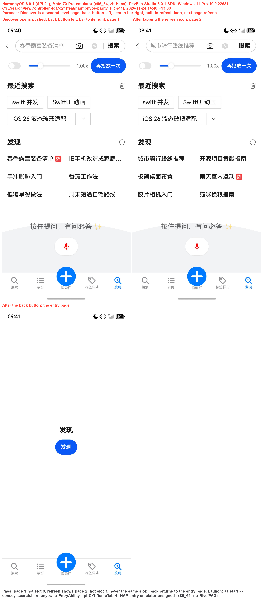 HarmonyOS 6.0.1 (API 21), Mate 70 Pro emulator, DevEco Studio 6.0.1, Windows 11, commit 4df7c2f, 2026-11-24 14:40 +13:00 | 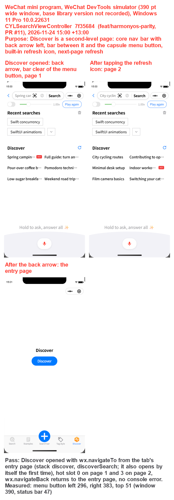 WeChat DevTools simulator, Windows 11, commit 7f35684, 2026-11-24 15:00 +13:00 |

Measured: HarmonyOS (1316 x 2832 px display, `uitest dumpLayout`): the bar's text field spans x 185 to 701, y 174 to 294, the Search item x 1068 to 1215 (the title bar is set to 56 vp, the field to 36 vp in code; the pixel density was not read); mini program: menu button left 296, right 383, top 51 on a 390 pt window, free width beside the back arrow 249 pt (computed by the test for the same rectangle).

TODO (HarmonyOS and mini program, 2026-11-24):
- HarmonyOS: the `NavDestination` branch is verified; the wrapped-`Navigation` branch (`isDestination` false) compiles but no example page uses it. The refresh button's accessibility label (`cyl_tagList_refresh`) is not verified on a device (no hypium test yet). Locales other than base, zh_CN, zh_TW and ja_JP fall back to English for `cyl_tagList_refresh`. The ohosTest suite was not re-run for this change.
- Mini program: `npm test` 102 of 103; the failing test (`the synced CollectionViewClassifyMenu package has cyl-animated-item at the pinned CYLTabBarController commit`) fails because the synced package carries `c4a1f8fd` while `package.json` pins `f45a8f1d`; it is independent of this change. The DevTools base library version was not recorded. The core `README.md` does not document the two new components yet.
- Both: Discover's Discover-topics grid is still hand-built from a grid / flex layout, not from the ClassifyMenu tag list (example-layer rule 7); iOS's example shows the back button only with `-CYLDemoPushDiscover`.

## DONE (2026-11-19; TODO 2026-11-17): one icon + title / animated icon component everywhere

- **Context**: branch `feat/harmonyos-parity` (PR #11). The packaged icon + title component that also plays animated
  icons is CollectionViewClassifyMenu's `CYLTagButton`
  (`CollectionViewClassifyMenu/Class/TagList/CYLTagButton.swift`, branch `feat/harmony`): an icon (`imageView`), a
  title (`titleLabel`), a delete indicator, and `animationURL` / `playAnimation()`, which hand every file format to
  CYLTabBarController's animation engine (`CYLTabBarItemAnimationFactory`, found at runtime) with no per-format code.
  Found in this project: `CYLSearchBarView`'s item control (`CYLSearchBarItemControl`, icon + title + badge, its own
  view), the empty-result placeholders (CYLTableViewPlaceHolder's `CYLPlaceholderView`, whose animated icons use that
  library's own engine, `CYLPlaceholderItemAnimationEngine`, without SVGA), and the example's SVGA demo header
  (`SVGAPlayer` directly). `CYLTagButton` lacks a badge and an icon-above-title layout.
- **Requirements**:
  1. Every component of the project that shows an icon with a title, or plays an animated icon, uses the same
     component, `CYLTagButton`; where it does not, change its implementation so that it does.
  2. A new animation type is then added in that one component only; every component that shows animations supports
     it with no second change.
  3. All platforms: iOS, Android, HarmonyOS and the mini program (CollectionViewClassifyMenu has a `CYLTagButton`
     counterpart on each); React Native and Flutter follow through the native cores.
- **Decisions (user, 2026-11-17)**: everything goes through `CYLTagButton`. CYLTableViewPlaceHolder: layered — its own
  session (task "Every icon + title and animation display goes through CYLPlaceholderView", branch
  `feat/android-refresh-port-followup`, PR #31) first makes everything there go through `CYLPlaceholderView`; then
  `CYLPlaceholderView` draws its animated icon with `CYLTagButton` (CYLTableViewPlaceHolder gains a dependency on
  CollectionViewClassifyMenu and drops its own engine). That step waits for that session, to avoid editing
  `CYLPlaceholderView` in parallel.
- **Plan**:
  1. CollectionViewClassifyMenu (every platform): `CYLTagButton` gains what the other uses need: a badge, an icon
     above the title (a `CYLTagImagePlacement` case), icon-only use; pushed to `feat/harmony` and pinned here.
  2. This repository (every platform): `CYLSearchBarView`'s items are drawn by `CYLTagButton`; the example's SVGA demo
     is a `CYLTagButton` with an `.svga` `animationURL`.
  3. CYLTableViewPlaceHolder: `CYLPlaceholderView`'s animated icon becomes a `CYLTagButton` (after its session).
- **Prompt (verbatim)**: "请确保本项目中所有具有如下特征的组件使用的是同一个组件，如果不是相关代码修改内部实现，以保证使用的是同一个组件，方便我重构该组件就可以把修改应用到所有组件上。我的需求是以后新增动效类型，仅需需要修改这个组件，所有需要使用动效展示的组件都可以支持新增动效，无须在第二个地方修改代码。" (followed by the link to `CYLTagButton.swift` on `feat/harmony`, line 94, and its description)
- **Prompt (English)**: "Make sure every component of this project with the following traits uses the same component;
  where one does not, change its internal implementation so that it does, so that refactoring that component applies
  the change to all of them. My requirement: in the future, adding a new animation type only needs a change to this
  component, and every component that shows animations supports the new type with no change in a second place."
- **Status (2026-11-17)**: step 1 DONE, step 2 DONE on every platform (iOS, Android, HarmonyOS, the mini program; React
  Native and Flutter through the native cores), step 3 TODO (DONE another way on 2026-11-19, "Step 3" below; every platform
  built and run since, row 37). Nothing was compiled or run when this status was written (no Xcode, no Android SDK, no DevEco
  Studio, no WeChat DevTools): see "Unverified".

### Step 1: DONE (2026-11-17), CollectionViewClassifyMenu `1e43253` + `a0c8232`

- `CYLTagButton` gained a badge (`badgeValue`, `badgeColor`, `badgeLabel`), the icon above or below the title
  (`CYLTagImagePlacement.top` / `.bottom`), `height(forTitle:iconSize:style:traitCollection:)` and the standalone
  initializers `init(title:image:)` / `init(title:image:animationURL:)`, on iOS, Android, HarmonyOS and the mini program
  (`cyl-tag-button`), branch `feat/harmony`.
- Pinned here at `15877a483cbaa16bcbc26755f678f166463b5af4` (branch `feat/harmony`; it adds the HarmonyOS and mini
  program parts of step 2 below to `a0c8232`) on every platform: `Podfile`, the React Native and Flutter example
  Podfiles, `android/merged/gradle.properties` (`cyl.classifymenu.commit`), `harmonyos/oh-package.json5`
  (`collectionViewClassifyMenuCommit`) and the mini program's `package.json` (`collectionViewClassifyMenuCommit`).

### Step 2: DONE (2026-11-17) on every platform

- iOS (`Sources/CYLSearchBar/CYLSearchBarView.swift`): every `CYLSearchBarItem` is drawn by a `CYLTagButton`
  (a private subclass that adds only the link to its item, the divider line, the 36 pt touch area and the item's badge
  metrics), styled from the item for each state; `itemView` / `itemViews` are typed `CYLTagButton`;
  `CYLSearchBarItem.animationURL` is forwarded to the button and played on each tap.
- Android (`CYLSearchBarView.kt`): the same with `com.cyl.classifymenu.CYLTagButton` (`CYLSearchBarItemButton`);
  `itemView` / `itemView(context)` / `itemViews` are typed `CYLTagButton`; `CYLSearchBarItem.animationURL: Uri?`.
- Example (iOS): the SVGA demo above the Examples list is a `CYLTagButton` with `tab_activity.svga` as its
  `animationURL` (`CYLSearchExample/CYLSVGADemoTagButton.swift`, used by `CYLSVGADemoHeaderView`); the example no
  longer uses `SVGAPlayer` itself (the SVGA tab icons go through CYLTabBarController). Searched every example for
  other direct animation players or hand-made icon + title views (LottieAnimationView, PAGView, RiveView,
  SVGAPlayer, SVGAImageView, badge views): none left on iOS, Android, React Native and Flutter; the Android and mini
  program examples have no SVGA demo header (only SVGA tab icons through CYLTabBarController).
- Tests: iOS `testSearchBarItemsAreAppendedLikeFlatDesignTabBarItems` and Android `CYLSearchBarItemTest` check that
  an item's view is a `CYLTagButton` showing the item's title, image and badge, and forwarding `animationURL`.
- HarmonyOS (`harmonyos/cylsearch`): `cylsearch` depends on CollectionViewClassifyMenu's HarmonyOS library
  `@cyl/classifymenu` (`harmonyos/scripts/sync-sub-repositories.py` installs `harmony/classifymenu` at
  `collectionViewClassifyMenuCommit` into the git-ignored `harmonyos/vendor/classifymenu`, a module of
  `build-profile.json5`). `CYLSearchBarItem.itemView` is a `CYLTagButton`, created on first use and styled from the
  item by `reloadItemView(barTint)`: no border, the item's background (transparent by default) and 10 vp corners when
  it has one, its tint (else the bar's `itemTintColor`, else `sys.color.font_primary`) for the title and the icon,
  the title attributes of its current state, its icon size, insets, position adjustments and badge (color, text
  attributes, smallest size, insets, offset), at least 36 x 36 vp; a text item shows its title (and its icon), an
  icon item only its icon (its title is the screen reader label); system symbols are drawn with `SymbolGlyph`.
  `CYLSearchBarItemView` draws it through `CYLTagButtonHost` (the V1 bridge inside the V2 bar), grows the touch
  region to 44 vp, dims a disabled item and reads its label and badge; a divider keeps its line.
  `CYLSearchBarItem.animationURL` (`asset:<rawfile>`) is forwarded and played on each tap; `CYLSearchBarView.itemViews`
  returns the `CYLTagButton`s.
- HarmonyOS example: the SVGA demo above the Examples list is a `CYLTagButton` with `asset:svga/tab_activity.svga` as
  its `animationURL` (`ExamplesMenu.ets`, `cylSVGADemoTagButton`, as iOS `CYLSVGADemoTagButton`), played once when
  shown and on each tap; the example no longer uses cyltabbar's `CYLSVGAView` for it.
- One app, both libraries: classifymenu pins `@ohos/lottie` 2.0.38 and `@tencent/libpag` 4.4.31 (its minimum is
  API 12; libpag 4.5.102 needs API 15), cylplaceholder 2.0.28 and 4.5.102; `harmonyos/oh-package.json5` picks one
  version of each with ohpm `overrides` (the newer: `@ohos/lottie` 2.0.38, `@tencent/libpag` 4.5.102, `@ohos/rive`
  1.0.4), so the HAP carries one libpag.
- Mini program (`src/cyl-search-bar`): every item is CollectionViewClassifyMenu's `<cyl-tag-button>`
  (`cyl-tag-list-miniprogram`, an optional peer dependency installed by `scripts/sync-example.js` at
  `collectionViewClassifyMenuCommit`) with the properties of `CYLSearchBarItem.tagButtonProperties(tint)`: a
  transparent box (`allowsTransparentBackground`), no border, the tint of the color mode, the title attributes, the
  icon size, the badge and its color, the item's label for the screen reader; the 36 px box around it takes the taps
  and plays the item's `animationURL` (a key of the app's animation registry) on each tap.
- Tests: HarmonyOS `CYLSearchCore.test.ets` `searchBarItemsAreDrawnByTagButtons` (an item's view is a `CYLTagButton`
  with the item's symbol, badge, tint and `animationURL`; a text item shows its title) and the host logic tests
  `cylSearchBarItemButtonContent`, `cylSearchBarItemInsets`, `cylSearchTouchRegion`; mini program
  `components.test.js` "cyl-search-bar draws each item with cyl-tag-button" (title, image, badge, `animationURL`,
  transparent style, a tap plays the animation) and `package.test.js` (the two sub-dependencies, pinned by commit).
- Tables: `docs/harmonyos-api-alignment.md` 284 / 284 = 100 (`CYLSearchBarItem.animationURL`, `itemView`),
  `docs/miniprogram-api-alignment.md` 284 / 284 = 100.

### DONE (2026-11-17): step 2 on HarmonyOS and the mini program (logged as TODO in `00b8fde`)

- **Context**: CollectionViewClassifyMenu `27777c6b6a35951b9fd639849296dcbfaaae5876` (branch `feat/harmony`) removed
  the four HarmonyOS blockers above (`SymbolGlyph` for `sys.symbol` icons, `ResourceColor` colors, `CYLTagButtonHost`
  for V2 parents, animation versions noted: lottie 2.0.38, libpag 4.4.31 there vs 4.5.102 in cylplaceholder) and the
  mini program one (`allowsTransparentBackground`).
- **Requirements**: HarmonyOS `cylsearch` depends on classifymenu pinned to that commit like cylplaceholder / cyltabbar
  (`oh-package.json5` key, `sync-sub-repositories.py` entry, git-ignored vendor copy); `CYLSearchBarView.ets` draws
  every item with `CYLTagButton` (no border, the item's background, tint, title attributes, icon size; text item =
  title (+ icon), icon item = icon only, divider keeps its line, badge from the item, 44 vp touch area,
  accessibility); `CYLSearchBarItem.animationURL` forwarded; the example's SVGA header becomes a `CYLTagButton`.
  Mini program: `cyl-search-bar` items drawn with classifymenu's `cyl-tag-button` (transparent, iOS look), pinned to
  the same commit; `animationURL` on items. Tests, the parity generators at 100, docs.
- **Prompt**: relayed by the parent session for the task above (same prompt).
- **Result**: step 2 above. CollectionViewClassifyMenu commits on `feat/harmony`: `27777c6` (symbols, `ResourceColor`,
  `minimumSize`, badge metrics, `CYLTagButtonHost`, `allowsTransparentBackground`), `a7d3474` (`playAnimation()`
  before the icon is loaded plays it once loaded), `15877a4` (`cyl-tag-button` `accessibilityLabel`).

### Step 3: DONE another way (2026-11-19), in CYLTableViewPlaceHolder

- CYLTableViewPlaceHolder: `CYLPlaceholderView`'s animated icon becomes a `CYLTagButton` (CYLTableViewPlaceHolder
  depends on CollectionViewClassifyMenu and drops `CYLPlaceholderItemAnimationEngine`); waits for that repository's
  own session (PR #31). 2026-11-19: PR #31 (its mini program placeholder) is still open and `CYLPlaceholderView`'s icon is
  not a `CYLTagButton` yet; this repository only pins that library, so the change is the CYLTableViewPlaceHolder session's
  (asked). Answer (CYLTableViewPlaceHolder session, 2026-11-19): `CYLPlaceholderView` builds on CYLTabBarController's
  `CYLAnimatedItem` directly (not on `CYLTagButton`; no CollectionViewClassifyMenu dependency) on every platform, branch
  `feat/android-refresh-port-followup` (PR #31): iOS `f0320c8`, Android `933ba13`, mini program `bfeb678`, HarmonyOS
  `0847ffe` + `d54eef1`; head `8dc39c3`. The goal (one animated icon component, no separate placeholder engine) is met.
  Left: pin CYLTableViewPlaceHolder `8dc39c3` here (now `62e40c0`), once its CYLAnimatedItem commit matches our
  CYLTabBarController pin `b376c278` (HarmonyOS must keep one `cylanimateditem`; asked). DONE (2026-11-19): `8dc39c3`
  pinned on every platform (`49d1f38`, [sub-repositories.md](sub-repositories.md)); the pin is `c84fce9` today.

### Unverified (resolved 2026-11-19)

- Since then every platform is built and run: iOS on the macOS session's simulator, Android, React Native, Flutter and
  HarmonyOS on the Windows emulators, the mini program in WeChat DevTools (rows 20 to 38). The notes below are kept as written.

- Nothing was compiled here: the Swift core and example (`CYLSearchBarView.swift`, `CYLSVGADemoTagButton.swift`,
  `CYLSearchDemoMenuViewController.m`, the project file entry), the Objective-C test, the Kotlin core and its
  Robolectric test. To check: `pod install`, build and test the shared scheme; `./gradlew :cylsearch:testDebugUnitTest`.
- Not seen on a simulator: the items' look (no border, the field's background behind them, the 36 pt / dp touch
  area, the badge on the icon's corner), an animated bar item, and the SVGA demo header playing `tab_activity.svga`
  through the engine (whether `playAnimation()` before the SVGA file is parsed plays it once it is loaded).
- HarmonyOS, not compiled or run (no DevEco Studio here): `CYLSearchBarView.ets`, `ExamplesMenu.ets`, the ohosTest,
  the ohpm `overrides`; to check: `python3 harmonyos/scripts/sync-sub-repositories.py`, `ohpm install`, build, the
  ohosTest on the emulator, and on screen: the items' look (symbols tinted, theme colors in dark mode, the badge),
  the 44 vp touch region, the V1 tag inside the V2 bar redrawing when an item changes, the SVGA demo playing once.
  Whether `@cyl/classifymenu`'s PAG code runs on libpag 4.5.102 (built against 4.4.31) is not checked.
- Mini program, not opened in WeChat DevTools: the items drawn by `cyl-tag-button` (the camelCase attributes, the
  transparent box, the tap reaching the outer box, the badge position).
- Checks run here: the parity generators (Android 100, iOS 100, HarmonyOS 100, mini program 100),
  `harmonyos-scorecard.py` 100, `check-public-api-comments.sh`, the HarmonyOS host logic tests (30 pass), iOS parity
  (397 match) and accessibility checks (0 problems), the mini program `npm test` (48 pass, with the example synced).

## DONE (2026-11-17): depend on CYLTabBarController's CYLAnimatedItem; no animation engine in the core

- **Context**: CYLTabBarController (`feat/cross-platform-components`, guide
  [docs/Animated-Item.md](https://github.com/ChenYilong/CYLTabBarController/blob/feat/cross-platform-components/docs/Animated-Item.md),
  read at its newest commit `7511f7d`, 2026-11-17 03:36 UTC) ships the shared animated icon + title component `CYLAnimatedItem`: the component's core
  (`CYLTabBarController/CYLAnimatedItem`, CYLUtils only, static images, `CYL_ANIMATION_ENGINE_AVAILABLE` = 0 without an
  engine; Android module `:cylanimateditem`, Maven `io.github.chenyilong:cyltabbarcontroller-animateditem`) and one
  Core-free engine subspec per type (`CYLAnimatedItemLottieSwift`, `…LottieObjectiveC`, `…PAG`, `…PAGEnterprise`,
  `…Rive`, `…SVGA`, `…GIF`). Its migration row for `CYLTagButton`: subclass `CYLAnimatedItemView`, delete
  `CYLTagAnimationEngine` (the run-time lookup) and the own icon / title / animation properties, the delete indicator
  becomes `accessoryView`, the per-state look goes to `itemStateDidChange` / `onItemStateChanged`, the indicator's side to
  `accessoryPlacement`, static measuring stays. HarmonyOS and the mini program have no `CYLAnimatedItem` yet (TODO in
  CYLTabBarController). CYLTableViewPlaceHolder's own session migrates `CYLPlaceholderView` (its task `eb03683`).
- **Requirements**:
  1. Change the CocoaPods, Gradle / Maven and npm configuration as the guide says; the core code depends on the new
     component.
  2. Rework the core so that it shows the same animations through it.
  3. The core does not depend on an animation engine; animated icons show only when the example layer adds an engine.
  4. The components concerned: the packaged animated icon + title core components (CollectionViewClassifyMenu's
     `CYLTagButton` and this repository's search bar items built on it).
- **Plan**: (1) CollectionViewClassifyMenu: `CYLTagButton` subclasses `CYLAnimatedItemView` on iOS and Android; podspec
  `s.dependency 'CYLTabBarController/CYLAnimatedItem'`, Gradle dependency on the animated item module; examples add the
  engine subspecs / animation libraries. (2) This repository: pin CYLTabBarController `35aa757` and the new
  CollectionViewClassifyMenu commit; the core depends on `CYLTabBarController/CYLAnimatedItem` (no engine); the
  example's Podfile adds the engines it plays (SVGA and the others it uses); Android includes `:cylanimateditem`.
  (3) HarmonyOS and the mini program: blocked until CYLTabBarController ships the component there.
- **Prompt (verbatim)**: "https://github.com/ChenYilong/CYLTabBarController/blob/13e717c9/docs/Animated-Item.md 根据文档链接，根据该文档，修改cocoapods gradle maven npm等配置，要求更新core核心代码 ，依赖该新组件。改造core核心代码，要求实现同等动效效果。core核心代码不依赖于动效引擎，仅仅在example层引入动效引擎时才展示动效icon。涉及的组件为本仓库中已经封装好的动效icon加title的核心组件代码。"
- **Prompt (English)**: "Following the linked document, change the CocoaPods, Gradle, Maven, npm and similar
  configuration; update the core code to depend on the new component. Rework the core code to achieve the same
  animation effects. The core code does not depend on the animation engine; animated icons show only when the example
  layer adds the animation engine. The components concerned are this repository's packaged animated icon + title
  core components."
- **Guide link (user, 2026-11-17)**: "更新该文档地址 最新地址https://github.com/ChenYilong/CYLTabBarController/blob/feat/cross-platform-components/docs/Animated-Item.md"
  ("Update the document's address to the newest one: …"). The guide is linked on its branch, so it always shows the
  newest version: <https://github.com/ChenYilong/CYLTabBarController/blob/feat/cross-platform-components/docs/Animated-Item.md>.
- **Status**: done; the verification items below were open then, all DONE since (2026-11-19, see each item). The guide's "Downstream migration status" row for this
  repository says it follows CollectionViewClassifyMenu (its search bar items subclass `CYLTagButton`); the commits are
  CollectionViewClassifyMenu `45101fb` (task log) and `1813025` (the migration), and this repository's checkpoint
  `31d8b8a` plus the commit after it.
- **Result**:
  - Pins: CollectionViewClassifyMenu `181302515f4c7dffa80fac349096d6593764a593` (`feat/harmony`: `CYLTagButton` subclasses
    `CYLAnimatedItemView`) in the `Podfile`, both CrossPlatform example Podfiles, `android/merged/gradle.properties`,
    `harmonyos/oh-package.json5` and the mini program `package.json`; CYLTabBarController
    `7511f7db2c9ada0da015e4b4e0f4c1bb94df8f93` (its branch tip; no code change since `35aa757`) in the `Podfile`, the
    Flutter example's Podfile and `pubspec.yaml` (`flutter_cyltabbar`, which compiles `cylanimateditem` since `09e782a`),
    `gradle.properties` (`cyl.tabbar.commit`, also the React Native checkout), HarmonyOS and the mini program.
    `harmonyos/scripts/sync-sub-repositories.py` and the mini program's `scripts/sync-example.js` ran at the new pins.
  - iOS core: the podspec depends on `CYLTabBarController/CYLAnimatedItem` (no engine) and on
    `CYLTableViewPlaceHolder/Core` instead of `CYLTableViewPlaceHolder/Lottie`, so the core carries no animation engine
    at all (it brought `lottie-ios` before). The example Podfiles add the engines they play: the root `Podfile`
    `CYLAnimatedItem`, `CYLAnimatedItemSVGA` (the SVGA demo tag) and `CYLAnimatedItemLottieSwift` next to the tab bar's
    subspecs, and `CYLTableViewPlaceHolder` `:subspecs => ['Core', 'Lottie']` (the animated placeholders); the Flutter
    example `CYLAnimatedItemSVGA` / `…Rive` and the placeholder's Lottie; the React Native example the placeholder's
    Lottie (its tab bar comes from the vendored CYLTabBarController with `Rive`). `scripts/pod-lint.sh lib` also checks
    out CYLTabBarController at the pinned commit for `--include-podspecs` (the subspec is in no trunk release). The bar
    item button (`CYLSearchBarItemButton`, a `CYLTagButton`) needed no code change: it sets `title`, `image`,
    `selectedImage`, `animationURL`, the badge and its accessibility, which are now the base class's or
    `CYLTagButton`'s overrides; `CYLTagButton`'s `updateItemAccessibility()` keeps the item's label and traits.
  - Android: `settings.gradle.kts` includes `:cylanimateditem` from the pinned CYLTabBarController checkout (`:cyltabbar`
    depends on it), and `build.gradle.kts` substitutes `io.github.chenyilong:cyltabbarcontroller-animateditem` (the
    coordinate CollectionViewClassifyMenu's library asks for) with it; the React Native and Flutter examples substitute
    it in their `includeBuild` of `android/merged` too. `cylsearch` no longer depends on `:placeholder-lottie`: the app
    adds it (and keeps SVGAPlayer), so the core has no animation library. `CYLSearchBarItemButton` passes
    `animationURL?.toString()` (the base class's `String?`) and keeps the item's TalkBack text through
    `accessibilityText()`.
  - Display priority (the component's, inherited): the animation when it can play; otherwise the static image; the
    component's placeholder, sized like the item's icon, only for an item with an animation file and no image; a text
    item never shows one. Documented in `README.md` ("Local CocoaPods component") and on `CYLSearchBarItem.animationURL`.
  - Tests: iOS `testSearchBarItemsFollowTheAnimatedItemDisplayPriority`, Android
    `CYLSearchBarItemTest.itemsFollowTheAnimatedItemDisplayPriority` (static image over placeholder, placeholder without
    an image, none for a text item); the existing item tests read `animationURL` as the base class's type on Android.
  - Checks run here: `scripts/check-public-api-comments.sh` OK; `android/merged/scripts/api-alignment.py` 100,
    `ios-alignment.mjs` (with `.cyl-deps/CollectionViewClassifyMenu` at `1813025`) 842 / 842 = 100,
    `harmonyos-api-alignment.py` 100, `harmonyos-scorecard.py` 100 (309 / 309), `miniprogram-api-alignment.py` 100;
    HarmonyOS host tests (`host-logic-test.mjs` 30 pass, `check-accessibility-i18n.mjs` 0 problems,
    `check-ios-parity.mjs` 397 / 397); mini program `npm test` 48 pass.
- **DONE (2026-11-19; was blocked upstream)**: the component shipped on both (CYLTabBarController `842aef8`), and both
  platforms moved onto it: "the guide re-read at `57a527e`" below. Original note: HarmonyOS and the mini program. CYLTabBarController has no `CYLAnimatedItem` component
  there yet (the guide's TODO 3 and 4), so `harmonyos/cylsearch` and the mini program's `cyl-search-bar` keep the
  animated icon code of CollectionViewClassifyMenu's `CYLTagButton` ports; move them onto the component when it ships.
- **DONE (verification, 2026-11-18 to 2026-11-19)**: rows 31 and 34 to 38 of the table above ran all of it: `pod install`
  and the iOS builds on macOS (`a370400`), the Android build and unit tests, the React Native and Flutter Android builds,
  HarmonyOS ohosTest 29 of 29, the mini program `npm test`. Original note: no Xcode, Android SDK or DevEco here, so nothing was compiled or run: (1) `pod install`, the
  example build and analyzer, the unit tests and `scripts/pod-lint.sh lib` in iOS CI; (2) the Android build and tests
  (`./gradlew :cylsearch:testDebugUnitTest :app:assembleDebug`), including the `:cylanimateditem` substitution; (3)
  the React Native and Flutter Android builds: `react-native-cyltabbar` / `flutter_cyltabbar` compile
  `cylanimateditem`'s sources themselves, and `cylsearch` now brings the `:cylanimateditem` project through
  CollectionViewClassifyMenu, so check for duplicate `com.cyl.animateditem` / `com.cyl.tabbar` classes (if so, exclude
  `io.github.chenyilong:cyltabbarcontroller-animateditem` from the app's runtime classpath there); (4) screenshots of
  the SVGA demo tag and the animated placeholders against the previous ones.

## DONE (2026-11-17, pending CI): CYLAnimatedItem is its own pod and module

- **Context**: branch `feat/harmonyos-parity` (PR #11). The guide
  ([docs/Animated-Item.md](https://github.com/ChenYilong/CYLTabBarController/blob/feat/cross-platform-components/docs/Animated-Item.md))
  changed at `1f0fcce` (`c53d2899`): the component is the pod and module `CYLAnimatedItem`, with no dependency on
  CYLTabBarController (subspecs `Core`, `Engine`, `LottieObjectiveC`, `Lottie`, `LottieSwift`, `PAG`, `PAGEnterprise`,
  `Rive`, `SVGA`, `GIF`); Swift `import CYLAnimatedItem`, Objective-C `@import CYLAnimatedItem;` or
  `#import <CYLAnimatedItem/CYLAnimatedItemView.h>`; Android engine classes in `com.cyl.animateditem`. Until it is on
  the trunk, Podfiles name `pod 'CYLAnimatedItem'` by `:git` + `:commit`. CollectionViewClassifyMenu followed in
  `7183711`.
- **Requirements**: re-read the guide and adjust: the podspec depends on `CYLAnimatedItem` (no engine); the example
  takes its engines from `CYLAnimatedItem/<Type>`; pins CYLTabBarController `1f0fcce`, CollectionViewClassifyMenu
  `7183711`; lint includes the `CYLAnimatedItem` podspec.
- **Prompt (verbatim)**: "更新了该文档地址 最新地址https://github.com/ChenYilong/CYLTabBarController/blob/feat/cross-platform-components/docs/Animated-Item.md 文档更新了一些描述 请重新阅读 调整"
- **Prompt (English)**: "The document was updated, latest address …/docs/Animated-Item.md; some descriptions changed. Please
  read it again and adjust."
- **Status**: adjusted, pending CI (nothing compiles here: no Xcode, Android SDK or DevEco).
  - Podspec: `s.dependency 'CYLAnimatedItem'` (its default subspec `Core`: static images, no engine) instead of
    `CYLTabBarController/CYLAnimatedItem`.
  - `CYLSearchBarView.swift` imports `CYLAnimatedItem` where the module exists (CocoaPods); Swift Package Manager still
    compiles the component into CYLTabBarController and reaches it through CollectionViewClassifyMenu.
  - Example Podfile: `pod 'CYLAnimatedItem', :subspecs => ['Core', 'SVGA', 'LottieSwift']` by `:git` + `:commit`;
    CYLTabBarController keeps only its own subspecs (`Core`, `SVGA`, `CYLFlatDesignTabBar`). Flutter example: the
    `CYLAnimatedItem` pod with `SVGA` and `Rive`; React Native example: `pod 'CYLAnimatedItem'` from the same vendored
    checkout as CYLTabBarController.
  - Tests: `#import <CYLAnimatedItem/CYLAnimatedItemView.h>`.
  - `scripts/pod-lint.sh lib` checks out `CYLAnimatedItem` (CYLTabBarController's repository at the pinned commit)
    instead of CYLTabBarController: neither this podspec nor CollectionViewClassifyMenu's depends on the tab bar any
    more.
  - Pins: CYLTabBarController `1f0fcce` (Podfiles, Gradle, ohpm, npm, pub), CollectionViewClassifyMenu `7183711`.
  - Android: CollectionViewClassifyMenu's `CYLTagButton` imports from `com.cyl.animateditem`; `cylsearch` imports
    nothing from `com.cyl.tabbar`, so it needed no change.
  - Parity tables regenerated (descriptions only, all at 100); HarmonyOS scorecard 309/309.
  - Still TODO, as before: HarmonyOS and the mini program wait for the component upstream (guide TODO 5); the
    CYLTableViewPlaceHolder pin `f488e2f` predates its own migration.
- **Pins moved again** (2026-11-17): CYLTabBarController `fbd05d5` (PR #814: `CYLAnimatedItem.podspec` defines its
  module; the Lottie animator takes no file Lottie cannot play) and CollectionViewClassifyMenu `98182e8` (static-library
  Podfiles, test wait, the same pin). Pending CI.

## DONE (2026-11-17): the guide re-read at `caf0a38` / `ee106e8`

- **Prompt (verbatim)**: "我已更新了该文档地址 最新地址https://github.com/ChenYilong/CYLTabBarController/blob/feat/cross-platform-components/docs/Animated-Item.md 文档更新了一些描述 请重新阅读 调整"
- **Prompt (English)**: "I updated the document, latest address …/docs/Animated-Item.md; some descriptions changed. Please read
  it again and adjust."
- **What changed in the guide** since `1f0fcce`: the text now describes the `CYLAnimatedItem` pod throughout
  (`b53011f`); per-type animation guards in `CYLAnimatedItem/Core` (`d1c2418`); type keys compile without their
  engine and fall back to the static image (`caf0a38`); subclasses guard engine-only API (`animationPlayer`,
  `animationSource`) with `CYL_ANIMATION_ENGINE_AVAILABLE`; downstream rows: `pod 'CYLAnimatedItem'` plus
  `CYLAnimatedItem/<Type>`, `import CYLAnimatedItem`, Android `com.cyl.animateditem`.
- **Result**: already followed, no code change. The core uses only API declared without an engine
  (`animationURL`, `playAnimation`, the hooks) and checks the engine at run time; tests read `animationPlayer` by key.
- **Pin kept at `fbd05d5`, not the branch tip `ee106e8`** (05:18 UTC, "license notice in every published package"):
  the tip does not contain PR #814 (`CYLAnimatedItem.podspec` `DEFINES_MODULE`, no Lottie view for an unplayable
  file), so pinning it would bring back two CI failures. Move the pin to the branch once PR #814 is merged into
  it: DONE. PR #814 was merged on 2026-11-17 05:24 UTC, and every pin since (today `41660d24`) contains it (`git merge-base
  --is-ancestor`, checked 2026-11-21).

## DONE (2026-11-17): the guide re-read at `ec12a9d`

- **Prompt (verbatim)**: "我已经更新了该文档地址 最新地址https://github.com/ChenYilong/CYLTabBarController/blob/feat/cross-platform-components/docs/Animated-Item.md 文档更新了一些描述 请重新阅读 调整"
- **Prompt (English)**: "I updated the document, latest address …/docs/Animated-Item.md; some descriptions changed. Please read
  it again and adjust."
- **What changed** (`ec12a9d`, after `ee106e8`): the resources paragraph names each platform's license location
  (iOS `CYLAnimatedItem.bundle/LICENSE`, Android `META-INF/cylanimateditem/LICENSE` in the AAR); the commit list adds
  the per-type guards (`CYL_LOTTIE_AVAILABLE`, `CYL_GIF_AVAILABLE`, `CYL_PAG_AVAILABLE`, `CYL_RIVE_AVAILABLE`,
  `CYL_SVGA_AVAILABLE`), the engine-free type keys and "a license notice in every published package"; the iOS CI
  status (run 839 on `caf0a38`: Carthage, the root Podfile with `pod 'CYLAnimatedItem'` and Example-Swift-03 passed).
- **Adjusted**: the license layout follows the same rule as CYLTabBarController: the Android library's license and
  icon notices moved from `assets/CYLSearchViewController.bundle/` to `src/main/resources/META-INF/cylsearch/` (inside
  the AAR), and the mini program's component folder gets `src/LICENSE` (`docs/licenses.md`). The animated item code
  needed no change: it uses no type key or engine-only API.
- **Pin**: still `fbd05d5`; the branch tip `ec12a9d` does not contain PR #814 yet.
- **Pin update** (2026-11-17): CollectionViewClassifyMenu `98182e8` → `4622434` (its newest commit: MIT license in
  every package, `d0c82cb` / `f752b6c`; CYLTabBarController pins back at `fbd05d5` until PR #814 is merged, recorded in
  its AGENTS.md). CYLTabBarController stays `fbd05d5` here too.
- **PR #814 merged** (2026-11-17): the owner merged it into `feat/cross-platform-components` (PR #788, `9a54e26`), so
  CYLTabBarController moves from `fbd05d5` to `9a54e26`, the branch tip, and CollectionViewClassifyMenu to `6ee254c`
  (the same pin). `47aec88` (engine report, on the merged PR's branch, not in #788) waits until it is merged.
- **Pin settled** (2026-11-17): the owner chose `9a54e26` (the #788 merge) over `47aec88` (a newer commit on the
  merged PR #814 branch). CollectionViewClassifyMenu `3ccf775` pins it again; this repository pins CollectionViewClassifyMenu
  `3ccf775`. The rule (a merged pull request branch does not count) is in AGENTS.md, instructions.md and the
  `cyl-tabbar-integration` skill.
- **Pin `0a63bed`** (2026-11-17): CYLTabBarController moves to the #788 tip `0a63bed` (engine report, license notices,
  both #814 fixes kept); CollectionViewClassifyMenu to `edba997` (the same pin).

## DONE (2026-11-17): the guide re-read at `0a63bed`

- **Prompt (verbatim)**: "我已经更新了该文档地址 最新地址https://github.com/ChenYilong/CYLTabBarController/blob/feat/cross-platform-components/docs/Animated-Item.md 文档更新了一些描述 请重新阅读 调整"
- **Prompt (English)**: "I updated the document, latest address …/docs/Animated-Item.md; some descriptions changed. Please read
  it again and adjust."
- **What changed**: the guide records the two CYLAnimatedItem bugs found by CollectionViewClassifyMenu's CI as fixed in
  CYLTabBarController's core (`DEFINES_MODULE` in `CYLAnimatedItem.podspec`; the Lottie animator takes only a Lottie
  document) and updates failure case (4) to match; the branch tip is still `0a63bed`, already pinned.
- **Adjusted**: nothing in this repository needed the module workaround (its Podfiles build frameworks).
  CollectionViewClassifyMenu dropped its `:modular_headers` workaround (`4171135`), pinned here. Pending CI.
- **Pin** (2026-11-17): CollectionViewClassifyMenu `b4d0e51` (its example's engine report; no core change).
- **Pins** (2026-11-17): CYLTabBarController `d875dd1` (#788 tip: remote GIF/PAG downloads, late-failure fallback); CollectionViewClassifyMenu `320c3eb` (re-export of `CYLAnimatedItem`, the Android menu buttons and filter header on `CYLTagButton`, the same pin).
- **CI on `15a6144`** (run 44027141867): `pod lib lint` passes. The example build and the unit tests failed on one line:
  `CYLSearchExampleAppDelegate.m` imported `<CYLTabBarController/CYLSVGATabBarItemAnimator.h>`, a header that moved to
  the `CYLAnimatedItem` pod (`CYLAnimatedItem/SVGA`). Example-only: the core has no such import; the example now
  imports `<CYLAnimatedItem/CYLSVGATabBarItemAnimator.h>`. Pending CI.

## DONE (2026-11-19; TODO 2026-11-17): the guide re-read at `57a527e`: CYLAnimatedItem on HarmonyOS and the mini program

- **Context**: CYLTabBarController `842aef8` adds the component on HarmonyOS (ohpm module
  `CrossPlatform/harmonyos-cyltabbar/cylanimateditem`, `CYLAnimatedItemView`, engines registered by the app with
  `CYLAnimatedItemEngines.register(...)` and an `animationBuilder`, no animation library in the module) and on the WeChat
  mini program (`src/cyl-animated-item` in cyl-tabbar-miniprogram, engines as abstract nodes `cyl-lottie-view` and its
  siblings, GIF through `<image>`). Unpublished: taken by commit (HarmonyOS `file:` or a copy of the folder at the pinned
  commit; mini program `github:ChenYilong/CYLTabBarController#<sha>` or a copy of `src/cyl-animated-item`). `57a527e`
  fixes the iOS umbrella header (animator headers) and an accessory test. Pins move to `57a527e`.
- **Requirements**: re-read the guide and adjust; import unreleased components by commit; do not block progress; the core
  depends on no animation engine, only the examples add engines; every platform.
- **Prompt (verbatim)**: "我已经更新了该文档地址 最新地址https://github.com/ChenYilong/CYLTabBarController/blob/feat/cross-platform-components/docs/Animated-Item.md 文档更新了一些描述 请重新阅读 调整"
- **Prompt (English)**: "I updated the document, latest address …/docs/Animated-Item.md; some descriptions changed. Please read it
  again and adjust."
- **Status**: started. Pins `57a527e`; HarmonyOS and mini program migrations next (not buildable here: no DevEco, no WeChat
  DevTools).
- **Pin** (2026-11-17): CollectionViewClassifyMenu `71562ca` (HarmonyOS `CYLTagButton` on `cylanimateditem`, mini program tags on `cyl-animated-item`, both by commit `57a527e`). The HarmonyOS vendor copy and the mini program search bar follow next.
- **Status** (2026-11-17, HarmonyOS and mini program on the pinned CollectionViewClassifyMenu `71562ca`): done in code, not
  compiled or run (no DevEco Studio, no WeChat DevTools here), so the heading stayed `TODO` until the Windows runs of
  2026-11-18 and 2026-11-19 (table rows 31, 34 to 38).
  - **How the component arrives, by commit.** Both platforms take CYLTabBarController's component through
    CollectionViewClassifyMenu's vendored copy at `57a527e` (checked here: the same files as CYLTabBarController
    `57a527e`, plus ClassifyMenu's `README.md` / `COMMIT` / `LICENSE`).
    - HarmonyOS: `harmonyos/scripts/sync-sub-repositories.py` now also copies ClassifyMenu `harmony/cylanimateditem`
      (at `collectionViewClassifyMenuCommit`) into `harmonyos/vendor/cylanimateditem`, next to `vendor/classifymenu`,
      so the vendored `"cylanimateditem": "file:../cylanimateditem"` resolves; `harmonyos/build-profile.json5`
      registers the module. `cylsearch` still depends only on `cylplaceholder` and `@cyl/classifymenu`: no animation
      library. The example `harmonyos/entry` registers the engines (`cylRegisterExampleAnimationEngines()` in
      `EntryAbility.onCreate`: `CYLAnimatedItemEngines.register('Lottie' | 'PAG' | 'Rive' | 'SVGA' | 'GIF')` and
      `CYLTagAnimationBuilder.register(...)`) with the players and views ported unchanged from ClassifyMenu's example
      (`entry/src/main/ets/animation/`, SVGA decoder included), and adds `@ohos/lottie`, `@tencent/libpag` (4.5.102,
      the root override) and `@ohos/rive` to its own `oh-package.json5`.
    - Mini program: `scripts/sync-example.js` copies ClassifyMenu's `cyl-tag-list-miniprogram/miniprogram_dist`, which
      now holds `cyl-animated-item` (with its `COMMIT` = `57a527e` and `LICENSE`) and `cyl-animation-placeholder`; the
      script fails when either is missing. `src/cyl-search-bar` declares the abstract nodes `cyl-lottie-view`,
      `cyl-pag-view`, `cyl-rive-view`, `cyl-svga-view` (default: ClassifyMenu's `cyl-animation-placeholder`) and
      forwards them to `cyl-tag-button`; `src/cyl-search` declares and forwards them to its `cyl-search-bar`s. The
      package links no engine. Every search bar of the example passes `generic:cyl-lottie-view="cyl-lottie"` and
      `generic:cyl-svga-view="cyl-svga"` (CYLTabBarController's players, already installed for the tab bar) and the
      placeholder for PAG and Rive (the example installs no PAG or Rive player).
  - **API.** HarmonyOS `CYLSearchBarView` / `CYLSearchBarItem` unchanged: the fields it sets on `CYLTagButton`
    (`image`, `selectedImage`, `animationURL`, `style.animationSize`, badge, `playAnimation()`) are unchanged at `71562ca`.
    One behavior change from ClassifyMenu: while the animation loads (or with no engine registered), the static image
    under it is the item's `image` when it is a resource or a path; a system symbol cannot be drawn there, so the
    component's placeholder shows. Mini program: added the four abstract nodes on `cyl-search-bar` and `cyl-search`.
  - **Checks.** Mini program `npm test`: 51 of 51 (3 new tests: the slots are declared and forwarded, the synced
    `cyl-animated-item` is at the pinned commit, every example search bar passes its engines);
    `node harmonyos/scripts/host-logic-test.mjs` 30 of 30; `check-ios-parity.mjs` 397 match;
    `check-accessibility-i18n.mjs` 0 problems; `harmonyos-scorecard.py` 100/100; `miniprogram-api-alignment.py`
    100/100 (no change); `check-licenses.sh` OK; `check-public-api-comments.sh` OK.
  - **DONE (2026-11-19).** The HAP builds and ohosTest passes 29 of 29 on the Mate 70 Pro emulator at every pin since (latest CYLTabBarController `b376c278`, CollectionViewClassifyMenu `697e9307`); the mini program runs in WeChat DevTools and the SVGA item plays on tap (rows 22, 29, 30; screenshots in `docs/assets/`). Was: Build the HAP with DevEco Studio (ohpm install of the `file:` modules and the three animation libraries;
    `PAGFile.LoadFromAssets` and the Rive view against `@tencent/libpag` 4.5.102 and `@ohos/rive` 1.0.4) and run the
    ohosTest suite on the emulator; run the mini program in WeChat DevTools and check an animated search bar item
    (SVGA / Lottie) plays on tap and falls back to its image; screenshots for both (AGENTS.md, "Screenshots").
