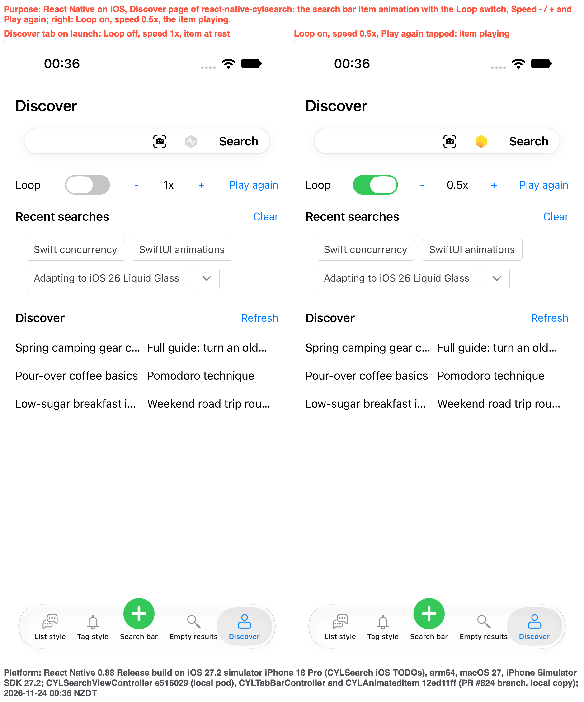
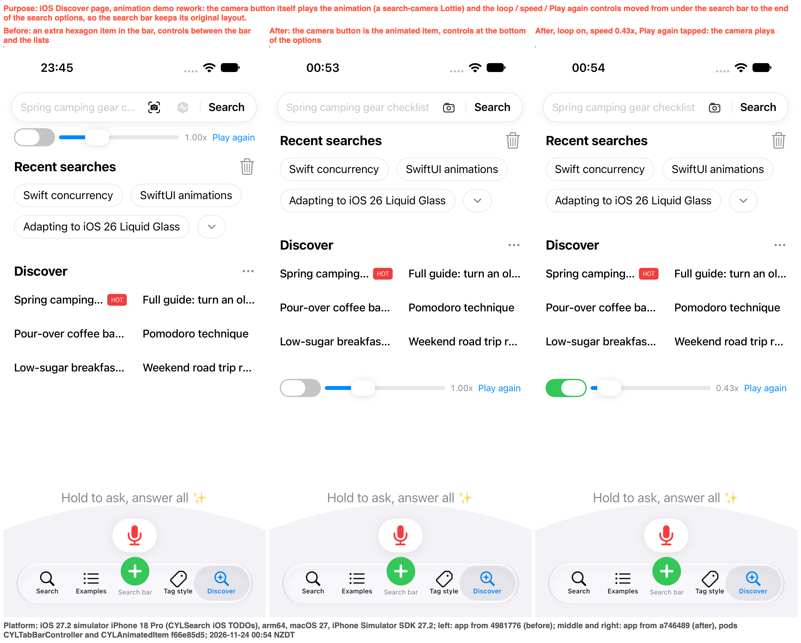

# Animated Icon Component (CYLTagButton)

## Progress against the guide (CYLTabBarController `docs/Animated-Item.md`)

Guide: <https://github.com/ChenYilong/CYLTabBarController/blob/feat/cross-platform-components/docs/Animated-Item.md>,
read at `e3ebc24` (2026-11-17, docs only after `57a527e`). Updated 2026-11-17 17:58 UTC. Score: 29 of 32 rows done (91);
the 4 open rows wait on CI, a device or upstream. Every row with "unverified" is written but has not been compiled or run
(no Xcode, Android SDK, DevEco or WeChat DevTools in the container that wrote it).

Prompt (verbatim): "告诉我 你遵循文档改造的进度，并在本仓库合适地方标注进度以及todo。这个文档是与动效组件相关的。告诉我 你遵循文档改造的进度https://github.com/ChenYilong/CYLTabBarController/blob/feat/cross-platform-components/docs/Animated-Item.md"
(English: "Tell me your progress in following the document, and mark the progress and the TODOs in a suitable place in
this repository. The document is about the animated component.")

### Done

| # | Guide requirement | Platform | Where in this repository | Status |
|:--|:---|:---|:---|:---|
| 1 | Search bar items are the one icon + title component (`CYLTagButton`, a `CYLAnimatedItemView`) | iOS | `CYLSearchBarItemButton: CYLTagButton` in `Sources/CYLSearchBar/CYLSearchBarView.swift` | DONE |
| 2 | The core depends on `CYLAnimatedItem` (Core, static images), never on an engine or CYLTabBarController | iOS | podspec `s.dependency 'CYLAnimatedItem'`; `import CYLAnimatedItem` | DONE, `pod lib lint` passes (run 265) |
| 3 | Only the example adds engines (`CYLAnimatedItem/<Type>`) | iOS | Podfile: `CYLAnimatedItem` `Core`, `SVGA`, `LottieSwift`; Flutter example `SVGA`, `Rive`; React Native example from the vendored checkout | DONE |
| 4 | Pods not on the trunk are named by `:git` + `:commit` | iOS | Podfiles pin CYLTabBarController and `CYLAnimatedItem` at `57a527e` | DONE |
| 5 | Example imports engine headers from the `CYLAnimatedItem` pod | iOS | `CYLSearchExampleAppDelegate.m` imports `<CYLAnimatedItem/CYLSVGATabBarItemAnimator.h>` (`7ee53de`) | DONE, CI pending |
| 6 | Engine-only API guarded or read without the engine | iOS | the core uses only `animationURL`, `playAnimation` and the hooks; tests read `animationPlayer` by key | DONE |
| 7 | Android: depend on `cyltabbarcontroller-animateditem`, package `com.cyl.animateditem` | Android | `android/merged/settings.gradle.kts` includes `:cylanimateditem` and substitutes the Maven coordinate | DONE, unverified |
| 8 | Android: the core links no engine; the app adds the libraries | Android | `cylsearch` has none; `app` adds `libs.lottie` and SVGAPlayer (`:placeholder-lottie` removed with CYLTableViewPlaceHolder `62e40c0`) | DONE, unverified |
| 9 | HarmonyOS: the component by commit (`cylanimateditem` module) | HarmonyOS | `harmonyos/scripts/sync-sub-repositories.py` vendors it next to `vendor/classifymenu`; `build-profile.json5` registers it (`68b5a52`) | DONE, unverified |
| 10 | HarmonyOS: the core links no engine; the app registers engines and the animation builder | HarmonyOS | `cylsearch` depends on no animation library; `entry` registers Lottie, PAG, Rive, SVGA, GIF in `EntryAbility.onCreate` | DONE, unverified |
| 11 | Mini program: `cyl-animated-item` by commit, engines through abstract nodes | Mini program | `cyl-search-bar` / `cyl-search` forward `cyl-lottie-view`, `-pag-`, `-rive-`, `-svga-` to `cyl-tag-button`; the example passes `cyl-lottie` and `cyl-svga` (`68b5a52`) | DONE, `npm test` 51/51, not run in DevTools |
| 12 | Sub-repositories on the component, pinned by commit | all | CollectionViewClassifyMenu `71562ca` (every platform on the component), CYLTableViewPlaceHolder `62e40c0` (placeholders on it) | DONE |
| 13 | The two CYLAnimatedItem bugs found by our CI fixed in the core (module, Lottie only for Lottie files) | all | CYLTabBarController PR #814, merged into #788 (`9a54e26`), pinned since | DONE |
| 14 | A license in every published package (the guide's "license notice in every published package") | all | MIT `LICENSE` in every package bundle; `scripts/check-licenses.sh` in CI (`docs/licenses.md`) | DONE |
| 15 | Parity tables follow the merged API | all | Android, HarmonyOS and mini program tables regenerated, all 100 | DONE |
| 16 | Docs describe the component and the pins | all | this document, `docs/sub-repositories.md`, `README.md` License section | DONE |
| 17 | Pin the newest commit of the newest branch (a merged pull request branch does not count) | all | `AGENTS.md`, `instructions.md`, `cyl-tabbar-integration` skill | DONE |
| 18 | Every iOS failure of the migration fixed in the core first | iOS | ClassifyMenu re-export of `CYLAnimatedItem` (`b15b822`); this repository's only example-layer fix is row 5, recorded as example-only | DONE |
| 21 | HarmonyOS build and run | HarmonyOS | Mate 70 Pro emulator (HarmonyOS 6.0.1, API 21), Windows with DevEco, 2026-11-17: the HAP builds (two example-only compile fixes, `9f9c3d7`); ohosTest 29 of 29 pass at CollectionViewClassifyMenu `232878a` (`b210a1e` for three test fixes). On screen: the SVGA header plays when shown and again on each tap, with its full title (`assets/harmonyos-mate70pro-api21-20261117-svga-tagbutton-title.png`, `…-svga-tagbutton-playing.jpeg`; before: `…-title-cut-before.jpeg`); the search bar's items keep the tint (`…-searchbar-item-tint.jpeg`). The two core bugs found here (a standalone tag measured its title without the UI context; it always took the tap) were fixed in CollectionViewClassifyMenu `232878a` and pinned on every platform. PAG and Rive stay arm64-only on the x86_64 emulator (Scorecard 3 row 25) | DONE |
| 25 | Android build at the CollectionViewClassifyMenu pin | Android | 2026-11-17, Windows (JDK 21, Android SDK): `:app:assembleDebug` and `:cylsearch:testDebugUnitTest` pass (25 tests, 0 failures) at CollectionViewClassifyMenu `c2caa24`, pinned on every platform. Before, its `CYLTagButton.kt` named `com.cyl.tabbar.CYLSize` (fails at `71562ca` and `232878a`); fixed in that repository after this report (`com.cyl.animateditem.CYLSize`) | DONE |
| 26 | Android example: the status bar clock and icons were white on the light page | Android | 2026-11-17, Android emulator Medium Phone (API 37): fixed in the example's theme, `android:windowLightStatusBar` true (`android/merged/app/src/main/res/values/themes.xml`). Example-only: the core has no window code, and neither CYLTabBarController nor the search library sets the status bar; the app draws edge to edge (target SDK 35), so its own theme decides the icons' color. Before: `assets/android-medium-phone-api37-20261117-status-bar-white-on-white.png`; after: `…-status-bar-dark-icons.png` | DONE |
| 27 | Android example: the SVGA demo header above the Examples list (iOS `CYLSVGADemoTagButton`, HarmonyOS `svgaHeader`) | Android | Added (`CYLSearchDemoMenuFragment`): a `CYLTagButton` with `tab_activity.svga`, its title in four languages, played when shown and on each tap; the tag is not clickable (`isClickable = false`, CYLTagButton's documented way to leave touches to its parent, as HarmonyOS's `interactive: false`), so a tap anywhere on the row plays it. Before: `assets/android-medium-phone-api37-20261117-examples-no-svga-header.png`; playing: `…-svga-tagbutton-playing.png` (Android emulator Medium Phone (API 37), CYLTabBarController `57a527e`, CollectionViewClassifyMenu `c2caa24`, 2026-11-17) | DONE |
| 28 | Android: "an SVGA in a `CYLTagButton` never plays" | Android | Not a bug (Android emulator Medium Phone (API 37), CYLTabBarController `57a527e`, CollectionViewClassifyMenu `c2caa24`, 2026-11-17). A device trace (CYLTabBarController's request, its B5) shows the player runs: on open `isAnimating` is false while the file parses and true 300 ms later (the SVGA player's queue); on a tap it is true and still true 200 ms later, same `SVGAImageView`, attached, 168 x 168 px. The first report came from taps that the clickable tag took (the row's tap handler never ran) and from screenshots too slow for the short animation; CYLTabBarController's Robolectric check agreed. Recorded screenshot of the first report: `…-svga-tagbutton-still.png` | DONE (not a bug) |
| 24 | Pin the newest commits | all | 2026-11-17: CYLTabBarController `c8132d26` (with B6) and CollectionViewClassifyMenu `c264d453` (re-vendored `cyl-animated-item` / `cylanimateditem` at `c8132d26`, SVGA type from `cylAnimatedItemType()`), in every pin file (Podfiles, `android/merged/gradle.properties`, `harmonyos/oh-package.json5`, the mini program and Flutter `package.json` / `pubspec.yaml`). Verified here: Android `:app:assembleDebug` and 25 `cylsearch` unit tests; HarmonyOS HAPs and ohosTest 29 of 29 on the emulator; mini program `npm test` 51 of 51 and WeChat DevTools. iOS is checked by CI | DONE |
| 29 | Mini program: SVGA (`.svga.bin`) icon in `cyl-tag-button` | Mini program | Fixed in the two components, as recorded: CYLTabBarController `7b764c73` (B6, in `c8132d26`) and CollectionViewClassifyMenu `c264d453` (its own extension list without svga replaced by `cylAnimatedItemType()`). WeChat DevTools at those pins: `iconKind` "animation", the `cyl-svga` engine loads the file (`animationLoaded` true, fallback hidden) and draws its resting frame (`assets/miniprogram-devtools-20261117-svga-tagbutton-icon.png`; before: `…-no-icon.jpg`). The play on tap is too short for DevTools screenshots (1 to 2 s each) to catch. The stray mark at the top left is CYLTabBarController's B7, open, not confirmed to be theirs | DONE (commit 2bc4727, 2026-11-17) |
| 30 | Mini program: the SVGA in `cyl-tag-button` never played (the user's report) | Mini program | Fixed in CYLTabBarController `ec18c546` (its B11: `cyl-svga`, `cyl-pag` and `cyl-rive` reload only when their file or fit really changes), pinned with `4635ef7b` and CollectionViewClassifyMenu `0583e1d` (re-vendored there). WeChat DevTools: the load counter stays at 1, the movie loads (30 frames), it plays once on open and again on tap (frames 0 to 29); `assets/miniprogram-devtools-20261117-svga-tagbutton-playing.png` shows a frame in the middle of the animation (orange; at rest it is gray). Before: `…-no-play.jpg` | DONE (commit 87a23fa, 2026-11-17) |

### TODO

| # | Item | Platform | Why it is open | Next step |
|:--|:---|:---|:---|:---|
| 19 | A complete iOS CI run of the current tip | iOS | DONE (2026-11-17 11:10 UTC): [run 44060850353](https://github.com/ChenYilong/CYLSearchViewController/actions/runs/44060850353) on `1169228` is fully green: shellcheck, public API comments, licenses, `pod lib lint`, example build and analyze, unit tests 28 of 28. The fixes on the way: the SVGA animator import (`7ee53de`), the SVGA demo button through the runtime (`b2ac3b2`), `CYLMenuFoldControl` `@objcMembers` in ClassifyMenu's core (`bdf2587`), two example test counts (`e258afd`), and `cancel-in-progress: false` so a started run finishes (`f21a314`) | keep it green |
| 19b | CollectionViewClassifyMenu static-library demo ("overridable members that could not be loaded") | iOS | DONE (2026-11-17): cause "CYLAnimatedItemView expected in 'CYLAnimatedItem' but found in 'CYLTabBarController'" (found with `-disable-deserialization-recovery`), fixed in CYLTabBarController `83a8ff8` (its public headers `@import CYLAnimatedItem;`). ClassifyMenu run 44092883295 on `f8301a4` is fully green (menu, tag, example, swift suites, screenshots); the workarounds came out in ClassifyMenu `698260e` | CI on `698260e` confirms without modular headers |
| 20 | Animated icons seen playing in the example | iOS, Android | DONE (2026-11-18). iOS done: the "Example screenshots" job published all 10 screens for `c858644` and `4346ede` (`ci-screenshots/feat-harmonyos-parity/<sha7>/`); the SVGA header and the SwiftUI SVGA tab bar render ([`docs/assets/ios-ci-animated-icons-svga.png`](assets/ios-ci-animated-icons-svga.png), labelled in `docs/CI-CD.md`). HarmonyOS screenshots exist (row 21, from the owner's machine). Android done (2026-11-18): the native example's SVGA header (`CYLTagButton`) plays on tap and returns to rest, measured against the resting frame: 3338, 305, 0 of 6400 sampled icon pixels (`assets/android-medium-phone-api37-20261118-svga-header-playing.png`, Android API 37 Medium Phone emulator, Android SDK 36, Windows 11, CYLTabBarController d8f47b4d, 2026-11-18 +13:00) | none |
| 22 | Mini program run | Mini program | DONE (2026-11-18): re-run in WeChat DevTools at the pins CYLTabBarController `6a9ede85`, CollectionViewClassifyMenu `3b90b29`: the Examples page opens with the SVGA header and the tab bar (`assets/miniprogram-devtools-20261118-examples-at-6a9ede85.png`), no console error; the SVGA plays on tap (its `cyl-svga` engine went from stopped at frame 29 to playing from frame 0; about 30 frames, so it ends before a DevTools screenshot lands); `npm test` 51 of 51. The left item below was closed by rows 29 and 30. Found: 8 console warnings, `cyl-animated-item` receiving null `animationUrl` / `image` and non-number `iconSize` / `speed`, twice each: CollectionViewClassifyMenu's `cyl-tag-button` starts with `data: { view: {} }`, so its first render draws `cyl-animated-item` with undefined values before `render` fills `view`; reported to its session (fix in that repository: an initial `view` with `iconKind: "none"` or full defaults). Earlier run: 2026-11-17, WeChat DevTools on Windows (base library 3.6.6), pins CYLTabBarController `57a527e`, CYLTableViewPlaceHolder `62e40c0`, CollectionViewClassifyMenu `c2caa24` (the mini program's own pin moved from `71562ca`): the example opened blank, "module …/cyl-placeholder-hud/cyl_placeholder_hud.js is not defined" (`assets/miniprogram-devtools-20261117-blank-missing-hud.png`). Cause: our `scripts/sync-example.js` copied two of CYLTableViewPlaceHolder's four components, and `cyl-refresh` needs `cyl-placeholder-hud`; it now copies every component of the package. The example runs with no console error (`…-tag-style-tab.jpg`); `npm test` 51 of 51. Left: no search bar item has an animation in the mini program example and its Examples page has no SVGA header (as Android, row 27), so an animated item cannot be seen yet | run in DevTools, screenshots |
| 23 | Upstream gaps of the component | HarmonyOS, mini program | mini program: GIF without stills, speed or loop and always-on autoplay: fixed in `cyl-animated-item` by CYLTabBarController PR #815 (merged as `faf535e0`, inside the pin `6a9ede85`), DONE (2026-11-18): CollectionViewClassifyMenu `eaddb56` (pinned through `557b91d0`, with CYLTabBarController `6f93ae6b`) forwards `gifFirstFrame`, `gifLastFrame`, `gifDuration`, `autoplay` and `embedded` from `cyl-tag-button`, and starts with `view: { iconKind: "none" }` (the 8 null-property warnings of row 22 are gone: 0 console lines after a relaunch in DevTools, `assets/miniprogram-devtools-20261118-examples-at-557b91d0.png`); `cyl-search-bar` items take `gifFirstFrame`, `gifLastFrame`, `gifDuration`, `animationAutoplay`, `animationEmbedded` and pass them on (test "cyl-search-bar passes GIF stills…", `npm test` 52 of 52). The same pins checked on every other platform: Android build + unit tests, HarmonyOS ohosTest 29 of 29, React Native and Flutter build and run on the Android emulator with their Rive tabs and no crash. Then (2026-11-18) CollectionViewClassifyMenu `27e17e7` (with CYLTabBarController `dcbfdec6`) made `cyl-tag-button`'s `autoplay` default false (the owner's rule: an animated icon rests until it is played, as iOS `CYLTagButton`); `cyl-search-bar`'s `animationAutoplay` follows (default false, `true` plays once on load). Pinned and checked: mini program `npm test` 52 of 52, DevTools no console output, the SVGA header rests and plays on tap (`assets/miniprogram-devtools-20261118-examples-at-27e17e7.png`; the DevTools simulator first stayed blank, also at the previous pins, and a project restart fixed it); Android build + unit tests; HarmonyOS ohosTest 29 of 29 (one error in a first run right after install, 29 of 29 on the rerun); React Native and Flutter build and run with Rive tabs, no crash; HarmonyOS: square icon only, no PixelMap or symbol as the static image (a symbol item shows the placeholder while loading), type by extension only, fixed 4 vp padding and 44 vp minimum height (asked, waiting on the owner) | HarmonyOS part: waits on CYLTabBarController's owner |
| 31 | Pin CYLTabBarController `6a9ede85` (Rive restart on every play, `animationLoops` loops Rive, `numberInput` / `values`; notice from its Mac session, 2026-11-18) and re-check Rive | all but iOS | DONE (2026-11-18): pinned with CollectionViewClassifyMenu `3b90b29` (it re-vendored the mini program at `6a9ede85`) in every pin file. Mini program 51 of 51; Android build + unit tests; HarmonyOS ohosTest 29 of 29 (`assets/harmonyos-mate70pro-api21-20261118-tabbar-at-6a9ede85.png`); React Native and Flutter Rive tabs select and reselect without errors (`assets/android-medium-phone-api37-20261118-rn-rive-at-6a9ede85.png` and `assets/android-medium-phone-api37-20261118-flutter-rive-at-6a9ede85.png` (Android API 37 Medium Phone emulator, Windows 11, 2026-11-18 02:58 +13:00)). React Native needed its old `react-native-cyltabbar/android/build` removed (stale classes gave "internal in file" errors; README note). Our examples have no own loop timers or input toggling for the tab bar. Follow-up DONE: HarmonyOS's tag-button Rive engine (`harmonyos/entry/src/main/ets/animation`) now draws CYLTabBarController's public `CYLRiveIcon` (its own `RiveAnimationView`, reset-then-fire player and renderer switch removed); `CYLRivePlayer` only sets `selected`, `replayToken` and `loops`. Built, ohosTest 29 of 29. Not seen playing: @ohos/rive ships arm64 only (the emulator is x86_64, where `CYLRiveIcon` falls back to the static image) and no tag of this example uses a `.riv` file yet | Check on an arm64 device when one is available |
| 32 | iOS part of row 31: Flutter and React Native Rive tabs at CYLTabBarController `6a9ede85` on the iOS simulator. User prompt, verbatim: "re-pin Rive" (English: re-pin to the new Rive commit and re-check; the pins were already done in row 31, so this covers the platform row 31 left out) | iOS | DONE (2026-11-18). Flutter (2026-11-18, macOS 27.3, Xcode 27.2, iPhone 18 Pro iOS 27.2): the pin did not build on iOS; two fixes: (1) the example Podfile asks for `SVGAPlayerLite` instead of `SVGAPlayer` (CYLAnimatedItem/SVGA uses SVGAPlayerLite, already at `fe5c3ae`; with both pods `Svga.pbobjc.h` was not found), `pod update Protobuf` for the stale lock (3.21.12 to 3.27.2); (2) `FlutterCylsearchPlugin.swift` gives `defaultVisibleRows` an `Int` (CollectionViewClassifyMenu `3b90b29` changed it from `UInt`). Then it builds and runs; launched on Tag style (`--dart-define=CYL_DEMO_TAB=1`), the selected bell stays drawn at rest after the new false-then-true `active` pulse, and the tab bar looks the same at `fe5c3ae` and `6a9ede85`: [flutter-ios27.2-iphone18pro-20261118-rive-tint-fe5c3ae-vs-6a9ede85.png](assets/flutter-ios27.2-iphone18pro-20261118-rive-tint-fe5c3ae-vs-6a9ede85.png). No regression from `6a9ede85`. **Bugs found, not from the pin (same at `fe5c3ae`), TODO**: (B-a) on iOS the Rive icons draw white on the light bar, `tint: "title"` is not applied (unselected icons almost invisible); (B-b) simulated taps (axe, by label or point inside the tab button frame) do not select a tab of the Flutter iOS tab bar, while taps on Flutter content work; the tab bar was never tapped on iOS before (earlier screenshots used `CYL_DEMO_TAB`). Rebased on the 6f93ae6b + CollectionViewClassifyMenu 557b91d pins (another session): still builds on iOS with both fixes. **React Native iOS** DONE (2026-11-18, at CYLTabBarController `dcbfdec6`, CollectionViewClassifyMenu `27e17e7`, React Native 0.88.0): it did not build; three fixes in `CrossPlatform/react-native-cylsearch/ios`: (1) `CYLRNSearchSupport.h` imports `<CYLAnimatedItem/CYLAnimatedItem.h>` before the CollectionViewClassifyMenu Swift header (Objective-C++ does not use its `@import`, so `CYLTagButton`'s superclass `CYLAnimatedItemView` was unknown), and `Cylsearch.podspec` depends on `CYLAnimatedItem`; (2) `CylsearchTagListView.mm` sets the clear list background through `applyConfiguration:` (`style.backgroundColor` is Swift-only in the Swift core) and passes `foldedRowCount` as `NSInteger`; (3) `CylsearchView.mm` lost a stray copy of two data source methods inside its class extension (since `8c425de`, 2026-11-17). Then it builds and runs: taps select and reselect the Rive tabs, the selected bell stays drawn at rest and restarts on reselect: [rn-ios27.2-iphone18pro-20261118-rive-tabs-at-dcbfdec6.png](assets/rn-ios27.2-iphone18pro-20261118-rive-tabs-at-dcbfdec6.png). B-a (white icons) shows here too; B-b does not (React Native taps work), so B-b is Flutter only (its tab bar is a Flutter platform view) | B-a and B-b reported to the Mac CYLTabBarController session (2026-11-18), queued there behind the iPhone Duo tab bar and the remaining GIF-image platforms; it sends the fix commit, then re-pin and re-check here (try a real click in Simulator.app, missing in this Xcode install) |
| 33 | Re-pin CYLTabBarController `d733c80e` (iOS Rive `tint`: "title" follows the bar's selected / unselected tints; includes `3ee06877`, the Flutter platform view tap fix) and re-check B-a and B-b of row 32. Request from the Mac CYLTabBarController session (2026-11-18); the user's prompt for row 32 ("re-pin Rive") covers it | iOS (pins on every platform) | DONE (2026-11-19, rechecked at the current pins; B-b and B-c below are fixed: on the iPhone 18 Pro simulator an axe tap selects Flutter's Tag style tab and plays its BELL, and React Native draws the unselected Rive icons gray at launch, after `51d58545` of row 35; [ios-iphone18pro-20261119-flutter-rn-rive-tab-icons.png](assets/ios-iphone18pro-20261119-flutter-rn-rive-tab-icons.png)). Earlier: DONE in part (2026-11-18, macOS 27.3, Xcode 27.2, iPhone 18 Pro iOS 27.2): every pin file at `d733c80e` (Podfile, Flutter Podfile and pubspec, android/merged, harmonyos, mini program); the iOS app, Flutter and React Native build for iOS. **B-a fixed**: the selected Rive icon draws in the bar's tint (blue), the others gray, and they swap on selection (React Native taps). **B-b still open**: with `3ee06877` (EagerGestureRecognizer) in the build, simulated taps (axe, by point and by label) still do not select a Flutter iOS tab. **New, B-c**: in React Native, right after launch the unselected icons are still pale; they turn gray after the first tab switch (Flutter draws them gray at launch). Evidence: [ios27.2-iphone18pro-20261118-rive-tint-at-d733c80e-flutter-rn.png](assets/ios27.2-iphone18pro-20261118-rive-tint-at-d733c80e-flutter-rn.png). Android, HarmonyOS and the mini program not re-checked at `d733c80e` here. Windows session re-check: Android builds and passes; the mini program failed one test (CollectionViewClassifyMenu `27e17e7` bundles cyl-animated-item at `dcbfdec6`), so the pins moved to CYLTabBarController `70064275` (d733c80e plus an Android comment style change and docs/CI) with CollectionViewClassifyMenu `50a673af`; HarmonyOS fails ArkTS compile until CollectionViewClassifyMenu re-vendors `harmony/cylanimateditem`. **B-c fixed upstream** in CYLTabBarController `51d58545` (2026-11-18, checked here with a local vendor checkout, iPhone 18 Pro iOS 27.2, React Native 0.88.0; not pinned yet, it waits for a CollectionViewClassifyMenu commit that bundles it): unselected icons are gray at launch: [rn-ios27.2-iphone18pro-20261118-rive-launch-tint-d733c80e-vs-51d58545.png](assets/rn-ios27.2-iphone18pro-20261118-rive-launch-tint-d733c80e-vs-51d58545.png). **Lesson**: move the CYLTabBarController pin only together with a CollectionViewClassifyMenu commit that bundles the same tab bar commit (mini program and HarmonyOS) | B-b and B-c to the Mac CYLTabBarController session; Android, HarmonyOS, mini program at `d733c80e` (Windows session) |
| 34 | HarmonyOS fails to compile from CYLTabBarController `d733c80e` on | HarmonyOS | DONE (2026-11-18): CollectionViewClassifyMenu `2202f3c` re-vendors `harmony/cylanimateditem` at `70064275`; pinned; HarmonyOS builds and passes ohosTest 29 of 29 (`assets/harmonyos-mate70pro-api21-20261118-tabbar-at-2202f3c.png`, HarmonyOS API 21 Mate 70 Pro emulator, DevEco Studio 6.0.1.251, Windows 11, 2026-11-18 +13:00); mini program `npm test` 52 of 52; Android build + unit tests. Before: `cyltabbar` reads `speed`, `restartToken` and `loops` on `CYLAnimatedItemAnimationContext`, but CollectionViewClassifyMenu's `harmony/cylanimateditem` (our HarmonyOS copy) is still at `fe5c3ae3`: ArkTS errors at `CYLTabBarController.ets:1260-1263`. Swapping in CYLTabBarController's own `cylanimateditem` at `70064275` builds and passes ohosTest 29 of 29 (`assets/harmonyos-mate70pro-api21-20261118-cylanimateditem-mismatch-at-70064275.png`, HarmonyOS API 21 Mate 70 Pro emulator, DevEco Studio 6.0.1.251, Windows 11, 2026-11-18 +13:00). Pins now CYLTabBarController `70064275` (`d733c80e` + 2 commits without iOS code) with CollectionViewClassifyMenu `50a673af`, whose mini program copy matches (`npm test` 52 of 52); Android build + unit tests pass; React Native and Flutter Android build | none |
| 35 | Pin CYLTabBarController `d8f47b4d` (includes `51d58545`, the Rive tint applied when an animation view is added: the React Native launch tint) with CollectionViewClassifyMenu `6295caf3` | all | DONE (2026-11-18) on Windows: `6295caf3` bundles `d8f47b4d` for the mini program; its `harmony/cylanimateditem` stays at `70064275`, identical because `70064275..d8f47b4d` changes no HarmonyOS file. Mini program `npm test` 52 of 52 and 0 console lines (`assets/miniprogram-devtools-20261118-examples-at-6295caf3.png`, WeChat DevTools base library 3.6.6, Windows 11, 2026-11-18 14:56 +13:00); HarmonyOS ohosTest 29 of 29; Android build + unit tests; React Native and Flutter Android build. Podfile.lock files left for `pod install` on macOS (the change includes `CYLTabBarController.m`) | iOS: `pod install` and the iOS, Flutter iOS and React Native iOS check on macOS (asked the Mac session) |
| 36 | Pin CYLTabBarController `776b4635` with CollectionViewClassifyMenu `fed57ae5` (it bundles `776b4635` for the mini program and HarmonyOS; includes its Android animated-item playback work and the Rive tint fixes) | all | DONE on Windows (2026-11-18): mini program `npm test` 52 of 52; HarmonyOS ohosTest 29 of 29; Android build + unit tests; React Native Android builds. The HarmonyOS sync failed on a hollow temp cache (objects and refs removed); `harmonyos/scripts/sync-sub-repositories.sh` now rebuilds such a cache. Flutter Android builds (resolved `776b4635`) after a repair of the shared SDK: `C:cylbuildlutter` and `C:devlutter` had both lost `dart-sdkindartvm.exe` ("Unable to locate the Dart VM executable"; not Windows Defender, cause unknown, possibly a system cleaner); with the user's consent the dart-sdk cache of `C:cylbuildlutter` was downloaded again. Podfile.lock files left for `pod install` on macOS | iOS `pod install` and check on macOS (asked the Mac session) |
| 37 | Pin CYLTabBarController `b376c278` (includes `2a367ed1`, the every-engine tint overlay fix for Lottie 2.x / PAG / SVGA) with CollectionViewClassifyMenu `47f4f8b6` (it bundles `b376c278` for the mini program and HarmonyOS) | all | DONE on Windows (2026-11-19): mini program `npm test` 52 of 52; HarmonyOS ohosTest 29 of 29; Android build + unit tests; React Native and Flutter Android build. Podfile.lock files left for `pod install` on macOS. iOS DONE on macOS (2026-11-19): `pod install` in the root, Flutter and React Native examples locks `b376c278` and `47f4f8b6` in all three Podfile.lock files; the native app, Flutter iOS and React Native iOS build and launch on the iPhone 18 Pro simulator (iOS 27.2, Xcode 27.2, macOS 27.3) with their tab bars (`assets/ios-iphone18pro-20261119-three-apps-at-b376c278.png`). The React Native vendor checkout was refreshed with `scripts/fetch-cyltabbar.sh` (it was at `d8f47b4`) | none (supersedes row 36's iOS item) |
| 38 | Pin CollectionViewClassifyMenu `697e9307` (newest; still bundles CYLTabBarController `b376c278`, so the tab bar pin stays) | all | DONE on Windows (2026-11-19): mini program `npm test` 52 of 52; HarmonyOS ohosTest 29 of 29; Android build + unit tests; React Native and Flutter Android build. Podfile.lock files left for `pod install` on macOS. iOS DONE on macOS (2026-11-19, `a370400`): `pod install` in the root, Flutter and React Native examples locks `697e9307` and `b376c278` in all three Podfile.lock files; clean builds of the native app, Flutter iOS and React Native iOS launch on the iPhone 18 Pro simulator (iOS 27.2, Xcode 27.2, macOS 27.3) with their tab bars (`assets/ios-iphone18pro-20261119-three-apps-at-menu-697e9307.png`) | none |
| 39 | Repin CYLAnimatedItem to the newest commit `f66e85d5` (branch `feat/harmony-animated-item-engines`, 2026-11-23; `CYLAnimatedItemView` is Swift, same Objective-C API, one engine contract). User prompt, verbatim: "repin cylanimatedITEMview and fix" | all | All 7 pin files moved from `c4a1f8fd` (HarmonyOS from `f51057a7`). The Linux container has no CocoaPods or Xcode, so no build ran here. Static review (the owner tests by hand, 2026-11-23): every member our code and CollectionViewClassifyMenu's `CYLTagButton` override or call (`title`, `image`, `selectedImage`, `animationSpeed`, `animationRestingProgress`, `playAnimation`, `reloadAnimation`, `layoutContent(in:)`, `contentSizeThatFits`, `sizeThatFits`, `itemStateDidChange`, `itemAccessibilityLabel`, `updateItemAccessibility`) is still `open` in the Swift `CYLAnimatedItemView`; the subspecs `Core`, `SVGA`, `LottieSwift` and `Rive` still exist. No source change needed. TODO: the owner's manual test | TODO (2026-11-23) |
| 40 | Rive through the shared engine contract (`cylanimateditemrive` on HarmonyOS; `CYLAnimatedItemView` and its engines elsewhere) on every platform. User prompt, verbatim: "应用cylanimateditemrive新接口改造我们的core核心代码" and "还要求适用于所有平台 iOS android flutter rn 小程序" (English: apply the new interface to our core code, and on every platform) | all | Survey 2026-11-23, static: no core has Rive code of its own. iOS `CYLSearchBarItem.animationURL` and Android `animationURL` (`CYLSearchBarView.kt`), Flutter, React Native and the mini program (`animationURL` in `cyl-search-bar`) all hand the URL, with its `#` options, to CollectionViewClassifyMenu's `CYLTagButton`, a `CYLAnimatedItemView`. The only own Rive glue is the HarmonyOS example's `CYLRiveIconView` / `CYLRiveIconHost` / `CYLRivePlayer`: it stays until ClassifyMenu's `CYLTagAnimatedIcon` routes `.riv` to `CYLRiveAnimationBuilder` (request sent to the ClassifyMenu session). Owner chose the example layer for the HarmonyOS change. DONE in code (static, 2026-11-23): ClassifyMenu `86d085c7` (`CYLTagAnimationBuilder.registerItemBuilder`, engine-free `CYLAnimatedItemPlayer`); HarmonyOS pin moved to `325c7a31`; the example deleted `CYLRiveIconView`, `CYLRiveIconHost` and `CYLRivePlayer` and registers `CYLRiveAnimationBuilder` for Rive (same as ClassifyMenu's example). Example layer by the owner's choice: the core `cylsearch` has no Rive code. TODO: the owner compiles and tests (ArkTS build, host tests, emulator); other platforms need no change | TODO (2026-11-23) |
| 41 | `animationLoops`, `animationSpeed` and `restartAnimation()` on `CYLSearchBarItem`, every platform. User prompt, verbatim: "核心还包括给搜索栏条目新增 animationLoops、animationSpeed、restartAnimation 这类属性(五个平台各加一套)" (English: the core also gets these item properties, on each platform) | iOS, Android, HarmonyOS, mini program, Flutter, React Native | Static code, 2026-11-23: the item classes of iOS, Android, HarmonyOS and the mini program forward them to the item's `CYLTagButton` (`restartAnimation()` is `playAnimation()` on HarmonyOS and the mini program, whose tag buttons have no restart); `CYLSearchBarItem.item(dictionary:)` (iOS) and `fromMap` (Android) read `animationURL`, `animationLoops`, `animationSpeed`, so Flutter (`CYLSearchBarItem`, `CYLSearchBarWidgetController.restartItemAnimation`) and React Native (item fields, ref command `restartItemAnimation(index)`) only pass the keys; both bridges carried no `animationURL` before. Demos (static, 2026-11-23): the Discover page of every example (iOS, Android, HarmonyOS, mini program, Flutter, React Native) shows an animated item (`tab_activity.svga`; Flutter and React Native pass a bare name that the core resolves to the app's bundle or assets) with a loop switch, a speed control and Play again; the texts are the iOS bundle keys `discover.animationItem`, `animationLoops`, `animationSpeed`, `animationPlay` in en, ja, zh-Hans, zh-Hant. TODO: the owner builds and tests; React Native needs the codegen rerun (iOS `pod install`, Android Gradle); the mini program example needs `npm run sync-example` first (its `components` copy is git-ignored and lacks the restart handler) iOS verified (2026-11-23, commit 4981776, iOS 27.2 simulator iPhone 18 Pro): the Discover page loop switch, speed slider and Play again work live (loop on: the item keeps playing and repeats; speed label follows the slider; `animationURL` is not reloaded, upstream guards the same URL), the 188 unit tests pass from a clean build, two new tests cover loops, speed and `setItems(dictionaries:)`:  (commit 4981776, 2026-11-23). Flutter on iOS verified the same way (2026-11-23, commit e516029, Flutter 3.47.9, iOS 27.2 simulator): clean `flutter build ios --simulator` succeeds, the example's Discover tab shows the animated item; loop on, speed 0.25x and Play again work live:  (commit e516029, 2026-11-23). React Native on iOS verified too (2026-11-24, commit e516029 plus the header fix below, React Native 0.88, upstream CYLTabBarController and CYLAnimatedItem `12ed11ff`, iOS 27.2 simulator): the clean Release build succeeds, the Discover tab's Loop switch, Speed - / + and Play again work live:  (commit e516029, 2026-11-24). The build needed one fix on our side: `CYLRNSearchSupport.h` imports SVGAPlayerLite's types before CYLAnimatedItem's Swift header (Objective-C++ cannot use the header's `@import`); the other two causes (`noexcept` on `CYLAnimatedItemResourceBundle`, the same import in react-native-cyltabbar's `.mm` files) are fixed upstream in PR #824 (`6285ccc9`). Not done on iOS: the pins in this repository still point at `f66e85d5`, which does not build the React Native example; moving every pin to the newest PR #824 commit belongs with ClassifyMenu PR #26 (tab bar pin must match ClassifyMenu's bundled commit). | TODO (2026-11-23) |
| 42 | Call upstream's `animationSpeed`, `animationLoops`, `animationRestartToken` and `restart()` directly, or build a wrapper? User prompt, verbatim: "上游 CYLTabBarController 的 CYLAnimationView 已有同名的 animationSpeed、animationLoops、animationRestartToken 和 restart()。在本仓库新建包装，请不要重复实现 直接调用上游接口即可。并请advisor评估 直接调用上游还是新建包装，哪一个方案更有利于本项目，sonnet实现。" (English: upstream's CYLAnimationView already has the same names; do not re-implement them; have the advisor judge whether a direct call or a new wrapper is better for the project; Sonnet implements) | iOS, Android, Flutter, React Native | Advisor verdict, 2026-11-23: call upstream directly, build no wrapper. The item's view is the native `CYLTagButton`, a `CYLAnimatedItemView`, the same native class upstream's React Native `CyltabbarAnimationView` and Flutter `CYLFlutterAnimationView` wrap, so the item props already set its upstream `animationLoops` / `animationSpeed` and call its `restartAnimation()`; a JavaScript or Dart wrapper would be a second platform view outside the bar (broken item layout, 36 pt touch area, accessibility grouping, a second load of the file) and would make the published packages depend on `react-native-cyltabbar` / `flutter_cyltabbar`. Real gap found: the four bridges removed and re-added every item on any change, so a loop or speed change reloaded the animation. Fixed in the core, `CYLSearchBarView.setItems(dictionaries:)` (iOS) / `setItems(maps)` (Android): items whose other keys did not change stay and take the two values in place; the bridges call it. `restartItemAnimation(index)` stays, it is upstream's `restart()` on that item's view; no `animationRestartToken` on the items (nothing to compare). Static code, 2026-11-23. TODO: the owner builds and tests; optional: forward `animationSpeed` only when set so `CYLTagButton` keeps following `style.animationSpeed` (today an item always pushes 1) | TODO (2026-11-23) |

## Animation demo rule (2026-11-24, owner), every example

User prompt, verbatim: "searchbar页面。你如果想在搜索seachbar加动效演示，你应该替换静态图片为对应的东西版本，应该是搜索相关的。比如上面的静态的图片拍照按钮，可以换成拍照的动效版本。并且loop 这一行的example操作应放在seachbar视图之外，比如页面搜索选项的最下面。或者固定在tabbar顶端。不要像下载这样打乱seachbar的演示布局。写入本次迁移的文档应用到所有example中"

1. **Animate an item the bar already has.** To demonstrate an animation in the search bar, replace a static image by its animated version, and make it a search-related one: the camera button's static image becomes an animated camera (`search_camera.json`, a Lottie file, the same file on every platform; the static camera symbol stays as the fallback when the engine is missing). Never add an extra item to the bar for the demo.
2. **The bar keeps its original demo layout:** field, camera, divider, Search button. Nothing is added to it or squeezed against it.
3. **The demo controls stay outside the bar:** the Loop switch, the speed control and Play again close the page's search options (the last block of the scrolling content, below the Discover tags), or are pinned just above the tab bar; never between the bar and the lists. Their accessibility labels and identifiers are unchanged (`CYLSearchDiscoverAnimationLoops`, `CYLSearchDiscoverAnimationSpeed`, `CYLSearchDiscoverAnimationPlay`, or each platform's equivalent).
4. **The controls drive that camera item:** `animationLoops`, `animationSpeed` and `restartAnimation()` on the camera `CYLSearchBarItem`; a change of loops or speed never reloads the file.
5. **The asset:** the canonical file is `CYLSearchExample/CYLSearchDiscover.bundle/search_camera.json` (44 x 44, 30 fps, 60 frames: the lens ring pulses, the flash dot blinks, the first and last frame are equal). Each example copies it into its own resources; an engine without Lottie shows the static camera.

| Example | Rule applied | Verified |
|---|---|---|
| iOS `CYLSearchExample` | yes (`a746489`) | iOS 27.2 simulator, 2026-11-24:  (commit a746489, 2026-11-24) |
| Flutter `flutter_cylsearch/example` | yes (Dart page `lib/discover_page.dart`: camera item plays `search_camera.json`, extra item and its string removed, controls last in the page list, restart index 0; `flutter analyze` passes; commit in the log below) | TODO: no emulator run and no labeled screenshot yet (the Dart page is shared with Android; the iOS half runs on the Mac) |
| React Native `react-native-cylsearch/example` | yes (`src/App.tsx`: camera item plays `search_camera.json`, extra item and its string removed, controls after the topics, restart index 0; `yarn typecheck` passes; the file is in `ios/.../SVGA` and `android/.../assets`) | TODO: no emulator run and no labeled screenshot yet (the TypeScript page is shared with Android; the iOS half runs on the Mac, and `search_camera.json` still has to be added to the Xcode target) |
| Android | TODO | TODO |
| HarmonyOS | TODO | TODO |
| WeChat mini program | TODO | TODO |

## DONE (2026-11-19; TODO 2026-11-17): one icon + title / animated icon component everywhere

- **Context**: branch `feat/harmonyos-parity` (PR #11). The packaged icon + title component that also plays animated
  icons is CollectionViewClassifyMenu's `CYLTagButton`
  (`CollectionViewClassifyMenu/Class/TagList/CYLTagButton.swift`, branch `feat/harmony`): an icon (`imageView`), a
  title (`titleLabel`), a delete indicator, and `animationURL` / `playAnimation()`, which hand every file format to
  CYLTabBarController's animation engine (`CYLTabBarItemAnimationFactory`, found at runtime) with no per-format code.
  Found in this project: `CYLSearchBarView`'s item control (`CYLSearchBarItemControl`, icon + title + badge, its own
  view), the empty-result placeholders (CYLTableViewPlaceHolder's `CYLPlaceholderView`, whose animated icons use that
  library's own engine, `CYLPlaceholderItemAnimationEngine`, without SVGA), and the example's SVGA demo header
  (`SVGAPlayer` directly). `CYLTagButton` lacks a badge and an icon-above-title layout.
- **Requirements**:
  1. Every component of the project that shows an icon with a title, or plays an animated icon, uses the same
     component, `CYLTagButton`; where it does not, change its implementation so that it does.
  2. A new animation type is then added in that one component only; every component that shows animations supports
     it with no second change.
  3. All platforms: iOS, Android, HarmonyOS and the mini program (CollectionViewClassifyMenu has a `CYLTagButton`
     counterpart on each); React Native and Flutter follow through the native cores.
- **Decisions (user, 2026-11-17)**: everything goes through `CYLTagButton`. CYLTableViewPlaceHolder: layered — its own
  session (task "Every icon + title and animation display goes through CYLPlaceholderView", branch
  `feat/android-refresh-port-followup`, PR #31) first makes everything there go through `CYLPlaceholderView`; then
  `CYLPlaceholderView` draws its animated icon with `CYLTagButton` (CYLTableViewPlaceHolder gains a dependency on
  CollectionViewClassifyMenu and drops its own engine). That step waits for that session, to avoid editing
  `CYLPlaceholderView` in parallel.
- **Plan**:
  1. CollectionViewClassifyMenu (every platform): `CYLTagButton` gains what the other uses need: a badge, an icon
     above the title (a `CYLTagImagePlacement` case), icon-only use; pushed to `feat/harmony` and pinned here.
  2. This repository (every platform): `CYLSearchBarView`'s items are drawn by `CYLTagButton`; the example's SVGA demo
     is a `CYLTagButton` with an `.svga` `animationURL`.
  3. CYLTableViewPlaceHolder: `CYLPlaceholderView`'s animated icon becomes a `CYLTagButton` (after its session).
- **Prompt (verbatim)**: "请确保本项目中所有具有如下特征的组件使用的是同一个组件，如果不是相关代码修改内部实现，以保证使用的是同一个组件，方便我重构该组件就可以把修改应用到所有组件上。我的需求是以后新增动效类型，仅需需要修改这个组件，所有需要使用动效展示的组件都可以支持新增动效，无须在第二个地方修改代码。" (followed by the link to `CYLTagButton.swift` on `feat/harmony`, line 94, and its description)
- **Prompt (English)**: "Make sure every component of this project with the following traits uses the same component;
  where one does not, change its internal implementation so that it does, so that refactoring that component applies
  the change to all of them. My requirement: in the future, adding a new animation type only needs a change to this
  component, and every component that shows animations supports the new type with no change in a second place."
- **Status (2026-11-17)**: step 1 DONE, step 2 DONE on every platform (iOS, Android, HarmonyOS, the mini program; React
  Native and Flutter through the native cores), step 3 TODO (DONE another way on 2026-11-19, "Step 3" below; every platform
  built and run since, row 37). Nothing was compiled or run when this status was written (no Xcode, no Android SDK, no DevEco
  Studio, no WeChat DevTools): see "Unverified".

### Step 1: DONE (2026-11-17), CollectionViewClassifyMenu `1e43253` + `a0c8232`

- `CYLTagButton` gained a badge (`badgeValue`, `badgeColor`, `badgeLabel`), the icon above or below the title
  (`CYLTagImagePlacement.top` / `.bottom`), `height(forTitle:iconSize:style:traitCollection:)` and the standalone
  initializers `init(title:image:)` / `init(title:image:animationURL:)`, on iOS, Android, HarmonyOS and the mini program
  (`cyl-tag-button`), branch `feat/harmony`.
- Pinned here at `15877a483cbaa16bcbc26755f678f166463b5af4` (branch `feat/harmony`; it adds the HarmonyOS and mini
  program parts of step 2 below to `a0c8232`) on every platform: `Podfile`, the React Native and Flutter example
  Podfiles, `android/merged/gradle.properties` (`cyl.classifymenu.commit`), `harmonyos/oh-package.json5`
  (`collectionViewClassifyMenuCommit`) and the mini program's `package.json` (`collectionViewClassifyMenuCommit`).

### Step 2: DONE (2026-11-17) on every platform

- iOS (`Sources/CYLSearchBar/CYLSearchBarView.swift`): every `CYLSearchBarItem` is drawn by a `CYLTagButton`
  (a private subclass that adds only the link to its item, the divider line, the 36 pt touch area and the item's badge
  metrics), styled from the item for each state; `itemView` / `itemViews` are typed `CYLTagButton`;
  `CYLSearchBarItem.animationURL` is forwarded to the button and played on each tap.
- Android (`CYLSearchBarView.kt`): the same with `com.cyl.classifymenu.CYLTagButton` (`CYLSearchBarItemButton`);
  `itemView` / `itemView(context)` / `itemViews` are typed `CYLTagButton`; `CYLSearchBarItem.animationURL: Uri?`.
- Example (iOS): the SVGA demo above the Examples list is a `CYLTagButton` with `tab_activity.svga` as its
  `animationURL` (`CYLSearchExample/CYLSVGADemoTagButton.swift`, used by `CYLSVGADemoHeaderView`); the example no
  longer uses `SVGAPlayer` itself (the SVGA tab icons go through CYLTabBarController). Searched every example for
  other direct animation players or hand-made icon + title views (LottieAnimationView, PAGView, RiveView,
  SVGAPlayer, SVGAImageView, badge views): none left on iOS, Android, React Native and Flutter; the Android and mini
  program examples have no SVGA demo header (only SVGA tab icons through CYLTabBarController).
- Tests: iOS `testSearchBarItemsAreAppendedLikeFlatDesignTabBarItems` and Android `CYLSearchBarItemTest` check that
  an item's view is a `CYLTagButton` showing the item's title, image and badge, and forwarding `animationURL`.
- HarmonyOS (`harmonyos/cylsearch`): `cylsearch` depends on CollectionViewClassifyMenu's HarmonyOS library
  `@cyl/classifymenu` (`harmonyos/scripts/sync-sub-repositories.py` installs `harmony/classifymenu` at
  `collectionViewClassifyMenuCommit` into the git-ignored `harmonyos/vendor/classifymenu`, a module of
  `build-profile.json5`). `CYLSearchBarItem.itemView` is a `CYLTagButton`, created on first use and styled from the
  item by `reloadItemView(barTint)`: no border, the item's background (transparent by default) and 10 vp corners when
  it has one, its tint (else the bar's `itemTintColor`, else `sys.color.font_primary`) for the title and the icon,
  the title attributes of its current state, its icon size, insets, position adjustments and badge (color, text
  attributes, smallest size, insets, offset), at least 36 x 36 vp; a text item shows its title (and its icon), an
  icon item only its icon (its title is the screen reader label); system symbols are drawn with `SymbolGlyph`.
  `CYLSearchBarItemView` draws it through `CYLTagButtonHost` (the V1 bridge inside the V2 bar), grows the touch
  region to 44 vp, dims a disabled item and reads its label and badge; a divider keeps its line.
  `CYLSearchBarItem.animationURL` (`asset:<rawfile>`) is forwarded and played on each tap; `CYLSearchBarView.itemViews`
  returns the `CYLTagButton`s.
- HarmonyOS example: the SVGA demo above the Examples list is a `CYLTagButton` with `asset:svga/tab_activity.svga` as
  its `animationURL` (`ExamplesMenu.ets`, `cylSVGADemoTagButton`, as iOS `CYLSVGADemoTagButton`), played once when
  shown and on each tap; the example no longer uses cyltabbar's `CYLSVGAView` for it.
- One app, both libraries: classifymenu pins `@ohos/lottie` 2.0.38 and `@tencent/libpag` 4.4.31 (its minimum is
  API 12; libpag 4.5.102 needs API 15), cylplaceholder 2.0.28 and 4.5.102; `harmonyos/oh-package.json5` picks one
  version of each with ohpm `overrides` (the newer: `@ohos/lottie` 2.0.38, `@tencent/libpag` 4.5.102, `@ohos/rive`
  1.0.4), so the HAP carries one libpag.
- Mini program (`src/cyl-search-bar`): every item is CollectionViewClassifyMenu's `<cyl-tag-button>`
  (`cyl-tag-list-miniprogram`, an optional peer dependency installed by `scripts/sync-example.js` at
  `collectionViewClassifyMenuCommit`) with the properties of `CYLSearchBarItem.tagButtonProperties(tint)`: a
  transparent box (`allowsTransparentBackground`), no border, the tint of the color mode, the title attributes, the
  icon size, the badge and its color, the item's label for the screen reader; the 36 px box around it takes the taps
  and plays the item's `animationURL` (a key of the app's animation registry) on each tap.
- Tests: HarmonyOS `CYLSearchCore.test.ets` `searchBarItemsAreDrawnByTagButtons` (an item's view is a `CYLTagButton`
  with the item's symbol, badge, tint and `animationURL`; a text item shows its title) and the host logic tests
  `cylSearchBarItemButtonContent`, `cylSearchBarItemInsets`, `cylSearchTouchRegion`; mini program
  `components.test.js` "cyl-search-bar draws each item with cyl-tag-button" (title, image, badge, `animationURL`,
  transparent style, a tap plays the animation) and `package.test.js` (the two sub-dependencies, pinned by commit).
- Tables: `docs/harmonyos-api-alignment.md` 284 / 284 = 100 (`CYLSearchBarItem.animationURL`, `itemView`),
  `docs/miniprogram-api-alignment.md` 284 / 284 = 100.

### DONE (2026-11-17): step 2 on HarmonyOS and the mini program (logged as TODO in `00b8fde`)

- **Context**: CollectionViewClassifyMenu `27777c6b6a35951b9fd639849296dcbfaaae5876` (branch `feat/harmony`) removed
  the four HarmonyOS blockers above (`SymbolGlyph` for `sys.symbol` icons, `ResourceColor` colors, `CYLTagButtonHost`
  for V2 parents, animation versions noted: lottie 2.0.38, libpag 4.4.31 there vs 4.5.102 in cylplaceholder) and the
  mini program one (`allowsTransparentBackground`).
- **Requirements**: HarmonyOS `cylsearch` depends on classifymenu pinned to that commit like cylplaceholder / cyltabbar
  (`oh-package.json5` key, `sync-sub-repositories.py` entry, git-ignored vendor copy); `CYLSearchBarView.ets` draws
  every item with `CYLTagButton` (no border, the item's background, tint, title attributes, icon size; text item =
  title (+ icon), icon item = icon only, divider keeps its line, badge from the item, 44 vp touch area,
  accessibility); `CYLSearchBarItem.animationURL` forwarded; the example's SVGA header becomes a `CYLTagButton`.
  Mini program: `cyl-search-bar` items drawn with classifymenu's `cyl-tag-button` (transparent, iOS look), pinned to
  the same commit; `animationURL` on items. Tests, the parity generators at 100, docs.
- **Prompt**: relayed by the parent session for the task above (same prompt).
- **Result**: step 2 above. CollectionViewClassifyMenu commits on `feat/harmony`: `27777c6` (symbols, `ResourceColor`,
  `minimumSize`, badge metrics, `CYLTagButtonHost`, `allowsTransparentBackground`), `a7d3474` (`playAnimation()`
  before the icon is loaded plays it once loaded), `15877a4` (`cyl-tag-button` `accessibilityLabel`).

### Step 3: DONE another way (2026-11-19), in CYLTableViewPlaceHolder

- CYLTableViewPlaceHolder: `CYLPlaceholderView`'s animated icon becomes a `CYLTagButton` (CYLTableViewPlaceHolder
  depends on CollectionViewClassifyMenu and drops `CYLPlaceholderItemAnimationEngine`); waits for that repository's
  own session (PR #31). 2026-11-19: PR #31 (its mini program placeholder) is still open and `CYLPlaceholderView`'s icon is
  not a `CYLTagButton` yet; this repository only pins that library, so the change is the CYLTableViewPlaceHolder session's
  (asked). Answer (CYLTableViewPlaceHolder session, 2026-11-19): `CYLPlaceholderView` builds on CYLTabBarController's
  `CYLAnimatedItem` directly (not on `CYLTagButton`; no CollectionViewClassifyMenu dependency) on every platform, branch
  `feat/android-refresh-port-followup` (PR #31): iOS `f0320c8`, Android `933ba13`, mini program `bfeb678`, HarmonyOS
  `0847ffe` + `d54eef1`; head `8dc39c3`. The goal (one animated icon component, no separate placeholder engine) is met.
  Left: pin CYLTableViewPlaceHolder `8dc39c3` here (now `62e40c0`), once its CYLAnimatedItem commit matches our
  CYLTabBarController pin `b376c278` (HarmonyOS must keep one `cylanimateditem`; asked). DONE (2026-11-19): `8dc39c3`
  pinned on every platform (`49d1f38`, [sub-repositories.md](sub-repositories.md)); the pin is `c84fce9` today.

### Unverified (resolved 2026-11-19)

- Since then every platform is built and run: iOS on the macOS session's simulator, Android, React Native, Flutter and
  HarmonyOS on the Windows emulators, the mini program in WeChat DevTools (rows 20 to 38). The notes below are kept as written.

- Nothing was compiled here: the Swift core and example (`CYLSearchBarView.swift`, `CYLSVGADemoTagButton.swift`,
  `CYLSearchDemoMenuViewController.m`, the project file entry), the Objective-C test, the Kotlin core and its
  Robolectric test. To check: `pod install`, build and test the shared scheme; `./gradlew :cylsearch:testDebugUnitTest`.
- Not seen on a simulator: the items' look (no border, the field's background behind them, the 36 pt / dp touch
  area, the badge on the icon's corner), an animated bar item, and the SVGA demo header playing `tab_activity.svga`
  through the engine (whether `playAnimation()` before the SVGA file is parsed plays it once it is loaded).
- HarmonyOS, not compiled or run (no DevEco Studio here): `CYLSearchBarView.ets`, `ExamplesMenu.ets`, the ohosTest,
  the ohpm `overrides`; to check: `python3 harmonyos/scripts/sync-sub-repositories.py`, `ohpm install`, build, the
  ohosTest on the emulator, and on screen: the items' look (symbols tinted, theme colors in dark mode, the badge),
  the 44 vp touch region, the V1 tag inside the V2 bar redrawing when an item changes, the SVGA demo playing once.
  Whether `@cyl/classifymenu`'s PAG code runs on libpag 4.5.102 (built against 4.4.31) is not checked.
- Mini program, not opened in WeChat DevTools: the items drawn by `cyl-tag-button` (the camelCase attributes, the
  transparent box, the tap reaching the outer box, the badge position).
- Checks run here: the parity generators (Android 100, iOS 100, HarmonyOS 100, mini program 100),
  `harmonyos-scorecard.py` 100, `check-public-api-comments.sh`, the HarmonyOS host logic tests (30 pass), iOS parity
  (397 match) and accessibility checks (0 problems), the mini program `npm test` (48 pass, with the example synced).

## DONE (2026-11-17): depend on CYLTabBarController's CYLAnimatedItem; no animation engine in the core

- **Context**: CYLTabBarController (`feat/cross-platform-components`, guide
  [docs/Animated-Item.md](https://github.com/ChenYilong/CYLTabBarController/blob/feat/cross-platform-components/docs/Animated-Item.md),
  read at its newest commit `7511f7d`, 2026-11-17 03:36 UTC) ships the shared animated icon + title component `CYLAnimatedItem`: the component's core
  (`CYLTabBarController/CYLAnimatedItem`, CYLUtils only, static images, `CYL_ANIMATION_ENGINE_AVAILABLE` = 0 without an
  engine; Android module `:cylanimateditem`, Maven `io.github.chenyilong:cyltabbarcontroller-animateditem`) and one
  Core-free engine subspec per type (`CYLAnimatedItemLottieSwift`, `…LottieObjectiveC`, `…PAG`, `…PAGEnterprise`,
  `…Rive`, `…SVGA`, `…GIF`). Its migration row for `CYLTagButton`: subclass `CYLAnimatedItemView`, delete
  `CYLTagAnimationEngine` (the run-time lookup) and the own icon / title / animation properties, the delete indicator
  becomes `accessoryView`, the per-state look goes to `itemStateDidChange` / `onItemStateChanged`, the indicator's side to
  `accessoryPlacement`, static measuring stays. HarmonyOS and the mini program have no `CYLAnimatedItem` yet (TODO in
  CYLTabBarController). CYLTableViewPlaceHolder's own session migrates `CYLPlaceholderView` (its task `eb03683`).
- **Requirements**:
  1. Change the CocoaPods, Gradle / Maven and npm configuration as the guide says; the core code depends on the new
     component.
  2. Rework the core so that it shows the same animations through it.
  3. The core does not depend on an animation engine; animated icons show only when the example layer adds an engine.
  4. The components concerned: the packaged animated icon + title core components (CollectionViewClassifyMenu's
     `CYLTagButton` and this repository's search bar items built on it).
- **Plan**: (1) CollectionViewClassifyMenu: `CYLTagButton` subclasses `CYLAnimatedItemView` on iOS and Android; podspec
  `s.dependency 'CYLTabBarController/CYLAnimatedItem'`, Gradle dependency on the animated item module; examples add the
  engine subspecs / animation libraries. (2) This repository: pin CYLTabBarController `35aa757` and the new
  CollectionViewClassifyMenu commit; the core depends on `CYLTabBarController/CYLAnimatedItem` (no engine); the
  example's Podfile adds the engines it plays (SVGA and the others it uses); Android includes `:cylanimateditem`.
  (3) HarmonyOS and the mini program: blocked until CYLTabBarController ships the component there.
- **Prompt (verbatim)**: "https://github.com/ChenYilong/CYLTabBarController/blob/13e717c9/docs/Animated-Item.md 根据文档链接，根据该文档，修改cocoapods gradle maven npm等配置，要求更新core核心代码 ，依赖该新组件。改造core核心代码，要求实现同等动效效果。core核心代码不依赖于动效引擎，仅仅在example层引入动效引擎时才展示动效icon。涉及的组件为本仓库中已经封装好的动效icon加title的核心组件代码。"
- **Prompt (English)**: "Following the linked document, change the CocoaPods, Gradle, Maven, npm and similar
  configuration; update the core code to depend on the new component. Rework the core code to achieve the same
  animation effects. The core code does not depend on the animation engine; animated icons show only when the example
  layer adds the animation engine. The components concerned are this repository's packaged animated icon + title
  core components."
- **Guide link (user, 2026-11-17)**: "更新该文档地址 最新地址https://github.com/ChenYilong/CYLTabBarController/blob/feat/cross-platform-components/docs/Animated-Item.md"
  ("Update the document's address to the newest one: …"). The guide is linked on its branch, so it always shows the
  newest version: <https://github.com/ChenYilong/CYLTabBarController/blob/feat/cross-platform-components/docs/Animated-Item.md>.
- **Status**: done; the verification items below were open then, all DONE since (2026-11-19, see each item). The guide's "Downstream migration status" row for this
  repository says it follows CollectionViewClassifyMenu (its search bar items subclass `CYLTagButton`); the commits are
  CollectionViewClassifyMenu `45101fb` (task log) and `1813025` (the migration), and this repository's checkpoint
  `31d8b8a` plus the commit after it.
- **Result**:
  - Pins: CollectionViewClassifyMenu `181302515f4c7dffa80fac349096d6593764a593` (`feat/harmony`: `CYLTagButton` subclasses
    `CYLAnimatedItemView`) in the `Podfile`, both CrossPlatform example Podfiles, `android/merged/gradle.properties`,
    `harmonyos/oh-package.json5` and the mini program `package.json`; CYLTabBarController
    `7511f7db2c9ada0da015e4b4e0f4c1bb94df8f93` (its branch tip; no code change since `35aa757`) in the `Podfile`, the
    Flutter example's Podfile and `pubspec.yaml` (`flutter_cyltabbar`, which compiles `cylanimateditem` since `09e782a`),
    `gradle.properties` (`cyl.tabbar.commit`, also the React Native checkout), HarmonyOS and the mini program.
    `harmonyos/scripts/sync-sub-repositories.py` and the mini program's `scripts/sync-example.js` ran at the new pins.
  - iOS core: the podspec depends on `CYLTabBarController/CYLAnimatedItem` (no engine) and on
    `CYLTableViewPlaceHolder/Core` instead of `CYLTableViewPlaceHolder/Lottie`, so the core carries no animation engine
    at all (it brought `lottie-ios` before). The example Podfiles add the engines they play: the root `Podfile`
    `CYLAnimatedItem`, `CYLAnimatedItemSVGA` (the SVGA demo tag) and `CYLAnimatedItemLottieSwift` next to the tab bar's
    subspecs, and `CYLTableViewPlaceHolder` `:subspecs => ['Core', 'Lottie']` (the animated placeholders); the Flutter
    example `CYLAnimatedItemSVGA` / `…Rive` and the placeholder's Lottie; the React Native example the placeholder's
    Lottie (its tab bar comes from the vendored CYLTabBarController with `Rive`). `scripts/pod-lint.sh lib` also checks
    out CYLTabBarController at the pinned commit for `--include-podspecs` (the subspec is in no trunk release). The bar
    item button (`CYLSearchBarItemButton`, a `CYLTagButton`) needed no code change: it sets `title`, `image`,
    `selectedImage`, `animationURL`, the badge and its accessibility, which are now the base class's or
    `CYLTagButton`'s overrides; `CYLTagButton`'s `updateItemAccessibility()` keeps the item's label and traits.
  - Android: `settings.gradle.kts` includes `:cylanimateditem` from the pinned CYLTabBarController checkout (`:cyltabbar`
    depends on it), and `build.gradle.kts` substitutes `io.github.chenyilong:cyltabbarcontroller-animateditem` (the
    coordinate CollectionViewClassifyMenu's library asks for) with it; the React Native and Flutter examples substitute
    it in their `includeBuild` of `android/merged` too. `cylsearch` no longer depends on `:placeholder-lottie`: the app
    adds it (and keeps SVGAPlayer), so the core has no animation library. `CYLSearchBarItemButton` passes
    `animationURL?.toString()` (the base class's `String?`) and keeps the item's TalkBack text through
    `accessibilityText()`.
  - Display priority (the component's, inherited): the animation when it can play; otherwise the static image; the
    component's placeholder, sized like the item's icon, only for an item with an animation file and no image; a text
    item never shows one. Documented in `README.md` ("Local CocoaPods component") and on `CYLSearchBarItem.animationURL`.
  - Tests: iOS `testSearchBarItemsFollowTheAnimatedItemDisplayPriority`, Android
    `CYLSearchBarItemTest.itemsFollowTheAnimatedItemDisplayPriority` (static image over placeholder, placeholder without
    an image, none for a text item); the existing item tests read `animationURL` as the base class's type on Android.
  - Checks run here: `scripts/check-public-api-comments.sh` OK; `android/merged/scripts/api-alignment.py` 100,
    `ios-alignment.mjs` (with `.cyl-deps/CollectionViewClassifyMenu` at `1813025`) 842 / 842 = 100,
    `harmonyos-api-alignment.py` 100, `harmonyos-scorecard.py` 100 (309 / 309), `miniprogram-api-alignment.py` 100;
    HarmonyOS host tests (`host-logic-test.mjs` 30 pass, `check-accessibility-i18n.mjs` 0 problems,
    `check-ios-parity.mjs` 397 / 397); mini program `npm test` 48 pass.
- **DONE (2026-11-19; was blocked upstream)**: the component shipped on both (CYLTabBarController `842aef8`), and both
  platforms moved onto it: "the guide re-read at `57a527e`" below. Original note: HarmonyOS and the mini program. CYLTabBarController has no `CYLAnimatedItem` component
  there yet (the guide's TODO 3 and 4), so `harmonyos/cylsearch` and the mini program's `cyl-search-bar` keep the
  animated icon code of CollectionViewClassifyMenu's `CYLTagButton` ports; move them onto the component when it ships.
- **DONE (verification, 2026-11-18 to 2026-11-19)**: rows 31 and 34 to 38 of the table above ran all of it: `pod install`
  and the iOS builds on macOS (`a370400`), the Android build and unit tests, the React Native and Flutter Android builds,
  HarmonyOS ohosTest 29 of 29, the mini program `npm test`. Original note: no Xcode, Android SDK or DevEco here, so nothing was compiled or run: (1) `pod install`, the
  example build and analyzer, the unit tests and `scripts/pod-lint.sh lib` in iOS CI; (2) the Android build and tests
  (`./gradlew :cylsearch:testDebugUnitTest :app:assembleDebug`), including the `:cylanimateditem` substitution; (3)
  the React Native and Flutter Android builds: `react-native-cyltabbar` / `flutter_cyltabbar` compile
  `cylanimateditem`'s sources themselves, and `cylsearch` now brings the `:cylanimateditem` project through
  CollectionViewClassifyMenu, so check for duplicate `com.cyl.animateditem` / `com.cyl.tabbar` classes (if so, exclude
  `io.github.chenyilong:cyltabbarcontroller-animateditem` from the app's runtime classpath there); (4) screenshots of
  the SVGA demo tag and the animated placeholders against the previous ones.

## DONE (2026-11-17, pending CI): CYLAnimatedItem is its own pod and module

- **Context**: branch `feat/harmonyos-parity` (PR #11). The guide
  ([docs/Animated-Item.md](https://github.com/ChenYilong/CYLTabBarController/blob/feat/cross-platform-components/docs/Animated-Item.md))
  changed at `1f0fcce` (`c53d2899`): the component is the pod and module `CYLAnimatedItem`, with no dependency on
  CYLTabBarController (subspecs `Core`, `Engine`, `LottieObjectiveC`, `Lottie`, `LottieSwift`, `PAG`, `PAGEnterprise`,
  `Rive`, `SVGA`, `GIF`); Swift `import CYLAnimatedItem`, Objective-C `@import CYLAnimatedItem;` or
  `#import <CYLAnimatedItem/CYLAnimatedItemView.h>`; Android engine classes in `com.cyl.animateditem`. Until it is on
  the trunk, Podfiles name `pod 'CYLAnimatedItem'` by `:git` + `:commit`. CollectionViewClassifyMenu followed in
  `7183711`.
- **Requirements**: re-read the guide and adjust: the podspec depends on `CYLAnimatedItem` (no engine); the example
  takes its engines from `CYLAnimatedItem/<Type>`; pins CYLTabBarController `1f0fcce`, CollectionViewClassifyMenu
  `7183711`; lint includes the `CYLAnimatedItem` podspec.
- **Prompt (verbatim)**: "更新了该文档地址 最新地址https://github.com/ChenYilong/CYLTabBarController/blob/feat/cross-platform-components/docs/Animated-Item.md 文档更新了一些描述 请重新阅读 调整"
- **Prompt (English)**: "The document was updated, latest address …/docs/Animated-Item.md; some descriptions changed. Please
  read it again and adjust."
- **Status**: adjusted, pending CI (nothing compiles here: no Xcode, Android SDK or DevEco).
  - Podspec: `s.dependency 'CYLAnimatedItem'` (its default subspec `Core`: static images, no engine) instead of
    `CYLTabBarController/CYLAnimatedItem`.
  - `CYLSearchBarView.swift` imports `CYLAnimatedItem` where the module exists (CocoaPods); Swift Package Manager still
    compiles the component into CYLTabBarController and reaches it through CollectionViewClassifyMenu.
  - Example Podfile: `pod 'CYLAnimatedItem', :subspecs => ['Core', 'SVGA', 'LottieSwift']` by `:git` + `:commit`;
    CYLTabBarController keeps only its own subspecs (`Core`, `SVGA`, `CYLFlatDesignTabBar`). Flutter example: the
    `CYLAnimatedItem` pod with `SVGA` and `Rive`; React Native example: `pod 'CYLAnimatedItem'` from the same vendored
    checkout as CYLTabBarController.
  - Tests: `#import <CYLAnimatedItem/CYLAnimatedItemView.h>`.
  - `scripts/pod-lint.sh lib` checks out `CYLAnimatedItem` (CYLTabBarController's repository at the pinned commit)
    instead of CYLTabBarController: neither this podspec nor CollectionViewClassifyMenu's depends on the tab bar any
    more.
  - Pins: CYLTabBarController `1f0fcce` (Podfiles, Gradle, ohpm, npm, pub), CollectionViewClassifyMenu `7183711`.
  - Android: CollectionViewClassifyMenu's `CYLTagButton` imports from `com.cyl.animateditem`; `cylsearch` imports
    nothing from `com.cyl.tabbar`, so it needed no change.
  - Parity tables regenerated (descriptions only, all at 100); HarmonyOS scorecard 309/309.
  - Still TODO, as before: HarmonyOS and the mini program wait for the component upstream (guide TODO 5); the
    CYLTableViewPlaceHolder pin `f488e2f` predates its own migration.
- **Pins moved again** (2026-11-17): CYLTabBarController `fbd05d5` (PR #814: `CYLAnimatedItem.podspec` defines its
  module; the Lottie animator takes no file Lottie cannot play) and CollectionViewClassifyMenu `98182e8` (static-library
  Podfiles, test wait, the same pin). Pending CI.

## DONE (2026-11-17): the guide re-read at `caf0a38` / `ee106e8`

- **Prompt (verbatim)**: "我已更新了该文档地址 最新地址https://github.com/ChenYilong/CYLTabBarController/blob/feat/cross-platform-components/docs/Animated-Item.md 文档更新了一些描述 请重新阅读 调整"
- **Prompt (English)**: "I updated the document, latest address …/docs/Animated-Item.md; some descriptions changed. Please read
  it again and adjust."
- **What changed in the guide** since `1f0fcce`: the text now describes the `CYLAnimatedItem` pod throughout
  (`b53011f`); per-type animation guards in `CYLAnimatedItem/Core` (`d1c2418`); type keys compile without their
  engine and fall back to the static image (`caf0a38`); subclasses guard engine-only API (`animationPlayer`,
  `animationSource`) with `CYL_ANIMATION_ENGINE_AVAILABLE`; downstream rows: `pod 'CYLAnimatedItem'` plus
  `CYLAnimatedItem/<Type>`, `import CYLAnimatedItem`, Android `com.cyl.animateditem`.
- **Result**: already followed, no code change. The core uses only API declared without an engine
  (`animationURL`, `playAnimation`, the hooks) and checks the engine at run time; tests read `animationPlayer` by key.
- **Pin kept at `fbd05d5`, not the branch tip `ee106e8`** (05:18 UTC, "license notice in every published package"):
  the tip does not contain PR #814 (`CYLAnimatedItem.podspec` `DEFINES_MODULE`, no Lottie view for an unplayable
  file), so pinning it would bring back two CI failures. Move the pin to the branch once PR #814 is merged into
  it: DONE. PR #814 was merged on 2026-11-17 05:24 UTC, and every pin since (today `41660d24`) contains it (`git merge-base
  --is-ancestor`, checked 2026-11-21).

## DONE (2026-11-17): the guide re-read at `ec12a9d`

- **Prompt (verbatim)**: "我已经更新了该文档地址 最新地址https://github.com/ChenYilong/CYLTabBarController/blob/feat/cross-platform-components/docs/Animated-Item.md 文档更新了一些描述 请重新阅读 调整"
- **Prompt (English)**: "I updated the document, latest address …/docs/Animated-Item.md; some descriptions changed. Please read
  it again and adjust."
- **What changed** (`ec12a9d`, after `ee106e8`): the resources paragraph names each platform's license location
  (iOS `CYLAnimatedItem.bundle/LICENSE`, Android `META-INF/cylanimateditem/LICENSE` in the AAR); the commit list adds
  the per-type guards (`CYL_LOTTIE_AVAILABLE`, `CYL_GIF_AVAILABLE`, `CYL_PAG_AVAILABLE`, `CYL_RIVE_AVAILABLE`,
  `CYL_SVGA_AVAILABLE`), the engine-free type keys and "a license notice in every published package"; the iOS CI
  status (run 839 on `caf0a38`: Carthage, the root Podfile with `pod 'CYLAnimatedItem'` and Example-Swift-03 passed).
- **Adjusted**: the license layout follows the same rule as CYLTabBarController: the Android library's license and
  icon notices moved from `assets/CYLSearchViewController.bundle/` to `src/main/resources/META-INF/cylsearch/` (inside
  the AAR), and the mini program's component folder gets `src/LICENSE` (`docs/licenses.md`). The animated item code
  needed no change: it uses no type key or engine-only API.
- **Pin**: still `fbd05d5`; the branch tip `ec12a9d` does not contain PR #814 yet.
- **Pin update** (2026-11-17): CollectionViewClassifyMenu `98182e8` → `4622434` (its newest commit: MIT license in
  every package, `d0c82cb` / `f752b6c`; CYLTabBarController pins back at `fbd05d5` until PR #814 is merged, recorded in
  its AGENTS.md). CYLTabBarController stays `fbd05d5` here too.
- **PR #814 merged** (2026-11-17): the owner merged it into `feat/cross-platform-components` (PR #788, `9a54e26`), so
  CYLTabBarController moves from `fbd05d5` to `9a54e26`, the branch tip, and CollectionViewClassifyMenu to `6ee254c`
  (the same pin). `47aec88` (engine report, on the merged PR's branch, not in #788) waits until it is merged.
- **Pin settled** (2026-11-17): the owner chose `9a54e26` (the #788 merge) over `47aec88` (a newer commit on the
  merged PR #814 branch). CollectionViewClassifyMenu `3ccf775` pins it again; this repository pins CollectionViewClassifyMenu
  `3ccf775`. The rule (a merged pull request branch does not count) is in AGENTS.md, instructions.md and the
  `cyl-tabbar-integration` skill.
- **Pin `0a63bed`** (2026-11-17): CYLTabBarController moves to the #788 tip `0a63bed` (engine report, license notices,
  both #814 fixes kept); CollectionViewClassifyMenu to `edba997` (the same pin).

## DONE (2026-11-17): the guide re-read at `0a63bed`

- **Prompt (verbatim)**: "我已经更新了该文档地址 最新地址https://github.com/ChenYilong/CYLTabBarController/blob/feat/cross-platform-components/docs/Animated-Item.md 文档更新了一些描述 请重新阅读 调整"
- **Prompt (English)**: "I updated the document, latest address …/docs/Animated-Item.md; some descriptions changed. Please read
  it again and adjust."
- **What changed**: the guide records the two CYLAnimatedItem bugs found by CollectionViewClassifyMenu's CI as fixed in
  CYLTabBarController's core (`DEFINES_MODULE` in `CYLAnimatedItem.podspec`; the Lottie animator takes only a Lottie
  document) and updates failure case (4) to match; the branch tip is still `0a63bed`, already pinned.
- **Adjusted**: nothing in this repository needed the module workaround (its Podfiles build frameworks).
  CollectionViewClassifyMenu dropped its `:modular_headers` workaround (`4171135`), pinned here. Pending CI.
- **Pin** (2026-11-17): CollectionViewClassifyMenu `b4d0e51` (its example's engine report; no core change).
- **Pins** (2026-11-17): CYLTabBarController `d875dd1` (#788 tip: remote GIF/PAG downloads, late-failure fallback); CollectionViewClassifyMenu `320c3eb` (re-export of `CYLAnimatedItem`, the Android menu buttons and filter header on `CYLTagButton`, the same pin).
- **CI on `15a6144`** (run 44027141867): `pod lib lint` passes. The example build and the unit tests failed on one line:
  `CYLSearchExampleAppDelegate.m` imported `<CYLTabBarController/CYLSVGATabBarItemAnimator.h>`, a header that moved to
  the `CYLAnimatedItem` pod (`CYLAnimatedItem/SVGA`). Example-only: the core has no such import; the example now
  imports `<CYLAnimatedItem/CYLSVGATabBarItemAnimator.h>`. Pending CI.

## DONE (2026-11-19; TODO 2026-11-17): the guide re-read at `57a527e`: CYLAnimatedItem on HarmonyOS and the mini program

- **Context**: CYLTabBarController `842aef8` adds the component on HarmonyOS (ohpm module
  `CrossPlatform/harmonyos-cyltabbar/cylanimateditem`, `CYLAnimatedItemView`, engines registered by the app with
  `CYLAnimatedItemEngines.register(...)` and an `animationBuilder`, no animation library in the module) and on the WeChat
  mini program (`src/cyl-animated-item` in cyl-tabbar-miniprogram, engines as abstract nodes `cyl-lottie-view` and its
  siblings, GIF through `<image>`). Unpublished: taken by commit (HarmonyOS `file:` or a copy of the folder at the pinned
  commit; mini program `github:ChenYilong/CYLTabBarController#<sha>` or a copy of `src/cyl-animated-item`). `57a527e`
  fixes the iOS umbrella header (animator headers) and an accessory test. Pins move to `57a527e`.
- **Requirements**: re-read the guide and adjust; import unreleased components by commit; do not block progress; the core
  depends on no animation engine, only the examples add engines; every platform.
- **Prompt (verbatim)**: "我已经更新了该文档地址 最新地址https://github.com/ChenYilong/CYLTabBarController/blob/feat/cross-platform-components/docs/Animated-Item.md 文档更新了一些描述 请重新阅读 调整"
- **Prompt (English)**: "I updated the document, latest address …/docs/Animated-Item.md; some descriptions changed. Please read it
  again and adjust."
- **Status**: started. Pins `57a527e`; HarmonyOS and mini program migrations next (not buildable here: no DevEco, no WeChat
  DevTools).
- **Pin** (2026-11-17): CollectionViewClassifyMenu `71562ca` (HarmonyOS `CYLTagButton` on `cylanimateditem`, mini program tags on `cyl-animated-item`, both by commit `57a527e`). The HarmonyOS vendor copy and the mini program search bar follow next.
- **Status** (2026-11-17, HarmonyOS and mini program on the pinned CollectionViewClassifyMenu `71562ca`): done in code, not
  compiled or run (no DevEco Studio, no WeChat DevTools here), so the heading stayed `TODO` until the Windows runs of
  2026-11-18 and 2026-11-19 (table rows 31, 34 to 38).
  - **How the component arrives, by commit.** Both platforms take CYLTabBarController's component through
    CollectionViewClassifyMenu's vendored copy at `57a527e` (checked here: the same files as CYLTabBarController
    `57a527e`, plus ClassifyMenu's `README.md` / `COMMIT` / `LICENSE`).
    - HarmonyOS: `harmonyos/scripts/sync-sub-repositories.py` now also copies ClassifyMenu `harmony/cylanimateditem`
      (at `collectionViewClassifyMenuCommit`) into `harmonyos/vendor/cylanimateditem`, next to `vendor/classifymenu`,
      so the vendored `"cylanimateditem": "file:../cylanimateditem"` resolves; `harmonyos/build-profile.json5`
      registers the module. `cylsearch` still depends only on `cylplaceholder` and `@cyl/classifymenu`: no animation
      library. The example `harmonyos/entry` registers the engines (`cylRegisterExampleAnimationEngines()` in
      `EntryAbility.onCreate`: `CYLAnimatedItemEngines.register('Lottie' | 'PAG' | 'Rive' | 'SVGA' | 'GIF')` and
      `CYLTagAnimationBuilder.register(...)`) with the players and views ported unchanged from ClassifyMenu's example
      (`entry/src/main/ets/animation/`, SVGA decoder included), and adds `@ohos/lottie`, `@tencent/libpag` (4.5.102,
      the root override) and `@ohos/rive` to its own `oh-package.json5`.
    - Mini program: `scripts/sync-example.js` copies ClassifyMenu's `cyl-tag-list-miniprogram/miniprogram_dist`, which
      now holds `cyl-animated-item` (with its `COMMIT` = `57a527e` and `LICENSE`) and `cyl-animation-placeholder`; the
      script fails when either is missing. `src/cyl-search-bar` declares the abstract nodes `cyl-lottie-view`,
      `cyl-pag-view`, `cyl-rive-view`, `cyl-svga-view` (default: ClassifyMenu's `cyl-animation-placeholder`) and
      forwards them to `cyl-tag-button`; `src/cyl-search` declares and forwards them to its `cyl-search-bar`s. The
      package links no engine. Every search bar of the example passes `generic:cyl-lottie-view="cyl-lottie"` and
      `generic:cyl-svga-view="cyl-svga"` (CYLTabBarController's players, already installed for the tab bar) and the
      placeholder for PAG and Rive (the example installs no PAG or Rive player).
  - **API.** HarmonyOS `CYLSearchBarView` / `CYLSearchBarItem` unchanged: the fields it sets on `CYLTagButton`
    (`image`, `selectedImage`, `animationURL`, `style.animationSize`, badge, `playAnimation()`) are unchanged at `71562ca`.
    One behavior change from ClassifyMenu: while the animation loads (or with no engine registered), the static image
    under it is the item's `image` when it is a resource or a path; a system symbol cannot be drawn there, so the
    component's placeholder shows. Mini program: added the four abstract nodes on `cyl-search-bar` and `cyl-search`.
  - **Checks.** Mini program `npm test`: 51 of 51 (3 new tests: the slots are declared and forwarded, the synced
    `cyl-animated-item` is at the pinned commit, every example search bar passes its engines);
    `node harmonyos/scripts/host-logic-test.mjs` 30 of 30; `check-ios-parity.mjs` 397 match;
    `check-accessibility-i18n.mjs` 0 problems; `harmonyos-scorecard.py` 100/100; `miniprogram-api-alignment.py`
    100/100 (no change); `check-licenses.sh` OK; `check-public-api-comments.sh` OK.
  - **DONE (2026-11-19).** The HAP builds and ohosTest passes 29 of 29 on the Mate 70 Pro emulator at every pin since (latest CYLTabBarController `b376c278`, CollectionViewClassifyMenu `697e9307`); the mini program runs in WeChat DevTools and the SVGA item plays on tap (rows 22, 29, 30; screenshots in `docs/assets/`). Was: Build the HAP with DevEco Studio (ohpm install of the `file:` modules and the three animation libraries;
    `PAGFile.LoadFromAssets` and the Rive view against `@tencent/libpag` 4.5.102 and `@ohos/rive` 1.0.4) and run the
    ohosTest suite on the emulator; run the mini program in WeChat DevTools and check an animated search bar item
    (SVGA / Lottie) plays on tap and falls back to its image; screenshots for both (AGENTS.md, "Screenshots").
