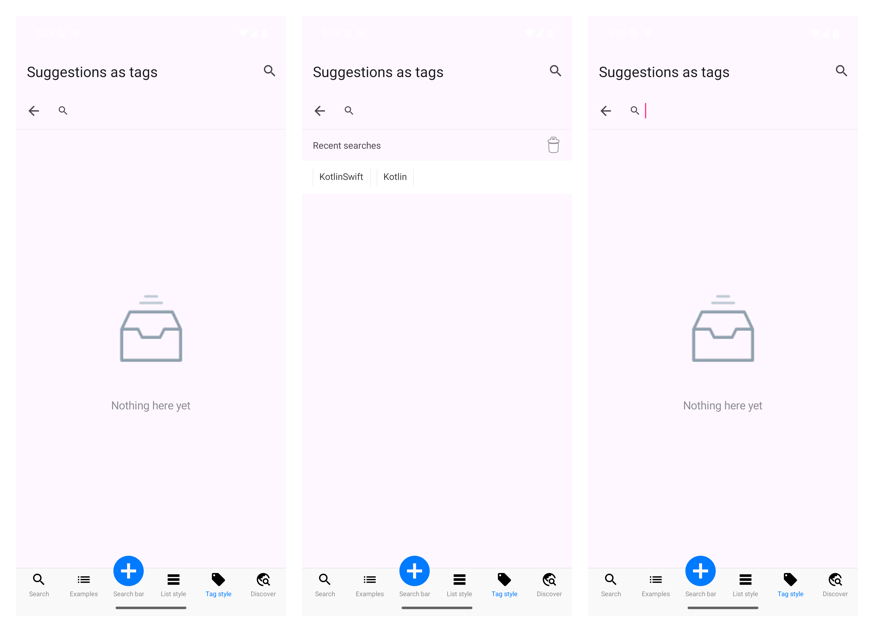
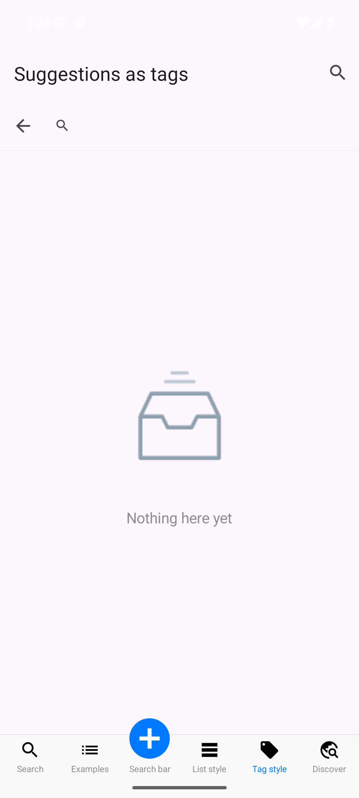
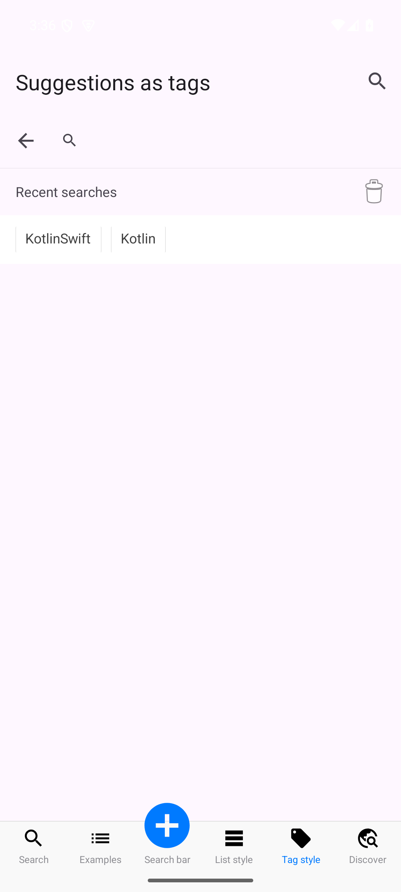
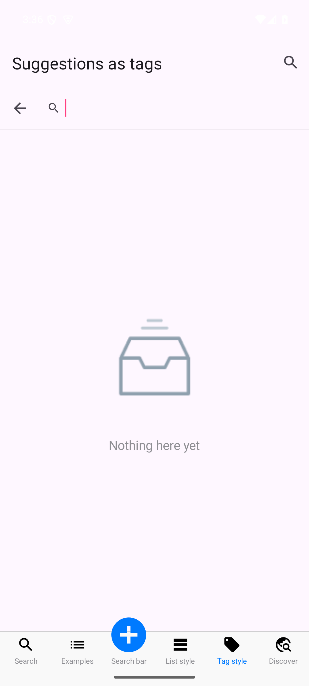
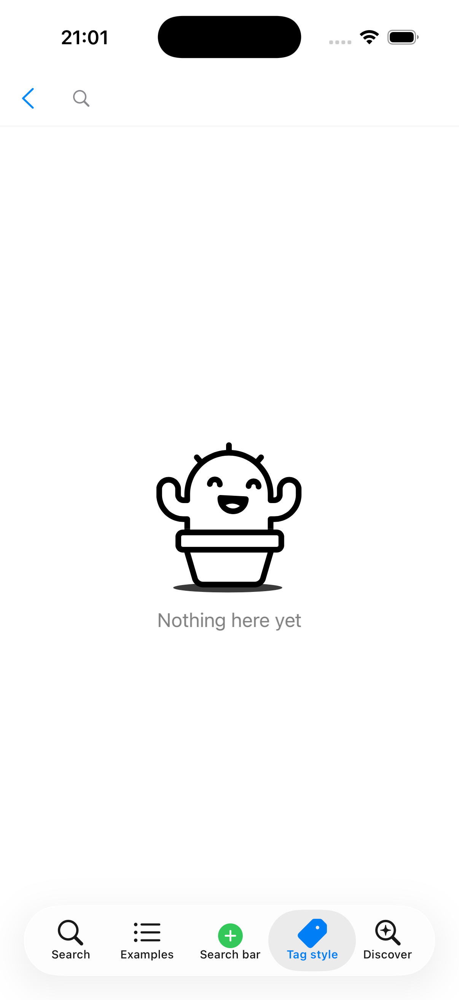

# Core TODO

Features of the core (`Sources/CYLSearchViewController`, Swift; mirrored in `android/merged/cylsearch` and wrapped by
the cross-platform packages) that are planned but not built yet. Implement them in the core first; the examples only
pass parameters.

## Core behavior rules

Rules every implementation of the core follows (iOS, Android, and the native views behind the cross-platform
packages). A test checks each rule.

1. **Focus alone changes nothing below the search bar (2026-11-13).** Focusing the search field (cursor shown, keyboard up) without typing changes nothing below the search bar: the area under it (the cached queries and their header, the suggestions, the empty placeholder) looks exactly as it does while the field is not focused. That area is updated only when the person changes the text (typing, deleting, pasting, the clear button, a selected suggestion) or when its data changes (a submitted query, the cache cleared).

## DONE (2026-11-13): focusing the field without typing must not change the suggestion area

- Context: the screenshot below (Android example, Tag style tab, after the cache work): the search opens with focus
  off; the person then taps the field (cursor and keyboard) without typing. The area below the bar must stay as it was
  before the tap; the core must not refresh it on focus, only on text changes (rule 1 above).

  

- Requirements:
  1. Record the bug as a TODO with the screenshot (this entry).
  2. Write the rule into the instructions and the docs, in a core behavior section (created above).
  3. Fix it in the core on iOS and Android: focus and blur never change the list, the header or the placeholder; only
     text changes and data changes do. Add a test per platform.
- Prompt (verbatim): "全英文记录该内容为TODO 并附带截图：这个截图里有一个bug，只聚焦光标 调出键盘 不输入任何文字的时候，下方搜索框备选区 显示应该和未调出键盘，光标未聚焦时保持一致。只在用户有输入内容时 更新搜索框下方显示内容，将该规则记入instructions相关和docs相关文件，core核心逻辑实现章节，没有就新建。continue"
- Prompt (English): "Record this in English as a TODO with the screenshot: there is a bug in this screenshot. When the
  cursor is only focused and the keyboard raised, without typing any text, the suggestion area under the search field
  should look the same as when the keyboard is not raised and the cursor not focused. Update the content under the
  search field only when the person enters something. Write this rule into the instructions and docs files, in the core
  logic implementation section; create one if there is none."
- Result (2026-11-13):
  - Finding: neither core refreshes the area on focus. On iOS, `searchBarViewDidBeginEditing` / `DidEndEditing` only report
    focus to the delegate; on Android, focus runs `textStateChanged()`, which only updates the bar's own placeholder and
    clear button, without reporting a text change. In the report, the field in the second and third pictures had been
    focused by the verification script (it tapped the field to delete the text); the third picture is the correct
    empty-cache state after the trash button, not a change caused by focus.
  - The rule is now enforced by a test on each platform, with and without cached queries: before focus, while focused
    and after losing focus, the list, its header, the empty placeholder and the list's frame are identical
    (`testFocusAloneChangesNothingBelowTheSearchBar`, iOS 24/24; `focusAloneChangesNothingBelowTheSearchBar`, Android
    14/14).
- Status: DONE.

## DONE (2026-11-14; TODO 2026-11-13): a cache for the suggestion list, with cache policies

- Context (survey of the core and every example, 2026-11-13):
  - The Swift core has no cache: `CYLSearchView.suggestions` is set by the app, and the Discover pages (iOS, Android,
    Flutter) keep their recent searches in memory only (loaded from `search-discover.json`, lost on relaunch).
  - The only persistent store in the repository is the legacy Objective-C `CYLSearchController`
    (`CYLSearchViewController/Class/Controller/CYLSearchController.m`): the search history in `NSUserDefaults` under
    `kSearchHistory`, newest first, written after each search and after deleting a row (per-row delete icons
    `search_history_delete_icon_*`, history icon `SearchHistory`). It is the code to extract first.
  - No database is used anywhere (no SQLite, Core Data, Room or `SQLiteOpenHelper` in the core, the examples or the
    Android ports); no example offers more than one cache policy. So the best existing form is `NSUserDefaults` with
    a single policy; this task adds a database and a policy enum.
- Requirements:
  1. When the search field is focused, the suggestion list shows; by default its items come from the local cache.
  2. Each new query submitted (search tapped) is added to the cache, newest first, without duplicates; the next time
     the list opens, the query is there.
  3. A delete icon at the top right of the suggestion list clears the whole cache (with confirmation for
     accessibility: an announcement such as "Recent searches cleared").
  4. The cache lives in the core as public API, not in the examples.
  5. The cache policy is an enum, default the local cache. Storage forms ranked as asked: a database first (SQLite,
     available on every platform without a third-party dependency: `libsqlite3` on iOS, `SQLiteOpenHelper` on
     Android, `sqflite` or the native store through the plugin on Flutter, the native store on React Native,
     `@ohos.data.relationalStore` on HarmonyOS), then other forms (`NSUserDefaults` / `SharedPreferences`, a file in
     the app's sandbox).
  6. Several policies, at least one defined in a way that leaves room for more: for example
     `CYLSearchSuggestionCachePolicy` with `.none`, `.database` (default, the local cache), `.userDefaults`,
     `.sandboxFile`, and a protocol (`CYLSearchSuggestionCache`: load, add, remove, clear) so an app can plug in its own
     store; a maximum count; a key or table name so several search screens keep separate caches.
  7. Extract the code that exists in the repository first (the `CYLSearchController` history logic, the Discover
     pages' recent-search handling) instead of writing it again.
  8. Same API on Android (API alignment table) and in the cross-platform packages.
- Progress (2026-11-13):
  - iOS core: `Sources/CYLSearchViewController/CYLSearchSuggestionCache.swift`: `CYLSearchSuggestionCachePolicy`
    (`none`, `database` default, `userDefaults`, `sandboxFile`), the `CYLSearchSuggestionCache` protocol (load, add,
    remove, clear) and `CYLSearchSuggestionStore` (the built-in stores; SQLite through the system `libsqlite3`, linked by
    the podspec; `maximumCount` 20; `name` separates caches). `CYLSearchView`: `suggestionCachePolicy`,
    `suggestionCacheName`, `suggestionCache` (a store of yours), `suggestionCacheHeaderView` with
    `suggestionCacheTitleLabel` ("Recent searches") and `clearSuggestionCacheButton` (trash, top right),
    `clearSuggestionCache()`, `showsEmptySuggestionsPlaceholder` / `emptySuggestionsScenario` / `emptySuggestionsView`.
    Every submitted query is cached; an empty query lists the cache under the header; typing puts cached matches
    before `suggestions`. Strings in four languages. Unit tests: every policy, the view's cache and clear button.
  - Android: the same API in `cylsearch` (`CYLSearchSuggestionCache.kt`: `SQLiteOpenHelper`, `SharedPreferences`, a JSON
    file), Robolectric tests 3/3 (13/13 in the module), API alignment 100 at 323 rows.
  - Flutter: `CYLSearchView(suggestionCachePolicy:, suggestionCacheName:, focusesSearchFieldOnShow:)`, passed to both
    native views; plugin tests 7/7.
  - Examples pass the parameters: iOS MaterialSearchView samples (cache "MaterialSearchView"; the "Tag style" tab with
    focus off), Android `CYLSuggestionStyleFragment` / `CYLSearchPortsFragment`, the Flutter example (cache
    "FlutterExample"; Tag style with focus off).
  - Verified on the Android emulator (Android 15, API 35; 2026-11-13 15:2x NZDT), top to bottom: the Tag style search
    opens with the keyboard down and the empty placeholder; after two searches, "Recent searches" lists them newest
    first with the trash button; the trash button clears them and the placeholder comes back.

    

    

    

  - Animated placeholder, iOS (2026-11-13): CYLTableViewPlaceHolder is pinned at `9d49d16` (`feat/android-refresh-port`,
    the newest code commit; the only newer commit, `92a8a00`, is the automatic `ci-screenshots` branch). There every
    scenario's icon is a bundled animation with its still image as the fallback (`componentWithBundledAnimation:`,
    `animationFileNames(for:)`), and it plays when an animation engine subspec is installed. The core podspec now
    depends on `CYLTableViewPlaceHolder/Lottie` (bringing `lottie-ios` >= 4.5.1, 4.6.1 installed), so the empty
    suggestions placeholder and the empty results placeholder animate by default; without the engine they fall back
    to the still image. Pins moved in the `Podfile`, the Flutter example's `ios/Podfile` and
    `android/merged/gradle.properties`. Note: a stale CocoaPods cache entry for that commit installed only CYLRefresh
    (no placeholder headers); `pod cache clean CYLTableViewPlaceHolder --all` fixed it.
    Verified (iPhone 17 simulator, iOS 26.3, 2026-11-13 21:01 NZDT): the Tag style sample opens with focus off and an
    empty cache, and shows the animated cactus (`CYLPlaceholderNoDrafts.json`) with "Nothing here yet"; three frames
    0.6 s apart differ (below: the page, then the three frames side by side). iOS tests 25/25.

    

    

  - Pin update (2026-11-14): CYLTableViewPlaceHolder is pinned at `bdd78c7` everywhere (main `Podfile`, the Flutter
    and React Native example Podfiles, `android/merged/gradle.properties`): the newest commit on any branch, a merge of
    `feat/android-refresh-port` (`3514839`) into the privacy-manifest fix (`a96e9d2`, PR #29), so the privacy manifest
    ships in its own `CYLTableViewPlaceHolderPrivacy.bundle` and no longer clashes with an app's own
    `PrivacyInfo.xcprivacy`. Verified: iOS tests 25/25, Android unit tests 16/16 (JDK 17). The Flutter example's
    `Podfile.lock` updates on its next `pod install`.
  - Still open: Android's placeholder module (CYLTableViewPlaceHolder `android/placeholder`, at `9d49d16`) has no
    animation support yet (only still images), so Android shows the still image; adding animated icons there is a
    CYLTableViewPlaceHolder task (sub-repository rule). React Native and HarmonyOS with the cross-platform work.
- Prompt (verbatim): "找到docs中关于core功能TODO 相关描述。如果没有就新建一个，加入以下core核心代码，全英文写入：总结现在所有example以及core核心代码，为搜索备选列表加入缓存策略。每次搜索框光标处于聚焦状态，那么就开始显示搜索备选列表，备选列表默认从本地缓存中获取。每次输入新的内容点击搜索后，都更新本地缓存，下一次进入搜索备选列表可以看到原有数据加入了缓存中。点击搜索备选框右上角的删除图标可以全部清理缓存。具体缓存实现在总结现在所有example以及core核心代码，放入到core核心代码中。形成api接口。缓存策略可以是一个枚举。默认为本地缓存。也可能是本地数据 沙河中的数据。总结现在所有example以及core核心代码中缓存形式做的最好的，最好是数据库，其次才是其他形式缓存格式。以及缓存策略总结现在所有example以及core核心代码中缓存策略形式做的最好的，最好是多个缓存策略，如果没有我们自己新增，至少定义一个保证以后新增缓存策略。优先提取现在仓库中已经存在的代码。 第二个TODO是光标聚焦功能，该功能含义是进入搜索界面，后自动聚焦光标，目的是唤起键盘，以及显示搜索备选框。新增接口默认实现聚焦，同时允许用户自定义 不使用聚焦。只显示搜索备选框，搜索备选框为空的时候，也就是本地缓存或者数据库空的时候展示CYLPlaceholder提示。只有在用户点击搜索框才手动聚焦。该参数应该是一个bool值。这个参数决定键盘唤起的时间。优先在core层面实现上面功能，example层负责新增参数传入。CYLPlaceholder 优先使用动图效果，其次才是静态图片。"
- Prompt (English): "Find the core feature TODO description in docs; if there is none, create one and add the following
  core work, written in English. Survey all examples and the core, and add a cache policy for the search suggestion
  list. Whenever the search field's cursor is focused, show the suggestion list; by default it comes from the local
  cache. Each time new text is entered and search is tapped, update the local cache, so the next time the list opens
  the earlier data is in the cache. Tapping the delete icon at the top right of the suggestion list clears the whole
  cache. Put the cache implementation, after surveying all examples and the core, into the core as an API. The cache
  policy can be an enum, default the local cache; it may also be local data in the sandbox. Find the best cache form
  among the examples and the core: a database is best, other formats come second. Likewise for the cache policy: best
  is several policies; if there are none, add our own, at least one defined so that more can be added later. Extract
  code that already exists in the repository first. The second TODO is the focus feature: entering the search screen
  focuses the cursor automatically, to raise the keyboard and show the suggestion list. The new API focuses by
  default and lets the app choose not to: then only the suggestion list shows, and when it is empty (the local cache
  or database is empty) a CYLPlaceholder message shows; the field is focused only when the user taps it. The
  parameter is a Bool; it decides when the keyboard appears. Implement these in the core first; the examples pass the
  new parameters. CYLPlaceholder prefers an animated image, a still image second."
- Status: DONE (2026-11-14) on iOS, Android, Flutter and React Native: `suggestionCachePolicy` (none, database
  default, user defaults, sandbox file; `CYLSearchSuggestionCache` for more), `suggestionCacheName`, the "Recent
  searches" header with its clear button, and the empty-cache placeholder. Tests: iOS 26/26, Android 16/16, Flutter
  Dart 8/8. Two follow-ups live in their own entries: the animated placeholder on Android waits for
  CYLTableViewPlaceHolder's Android port (its PR #28: `CYLPlaceholderStackView` does not play the scenarios'
  animations yet; then `cylsearch` registers a Lottie factory and pins that commit), and HarmonyOS
  ([harmonyos-api-alignment.md](harmonyos-api-alignment.md)).

## DONE (2026-11-14; TODO 2026-11-13): focus the search field on entry, as a Bool, with a placeholder for an empty list

- Context: `CYLSearchView.showSearch(animated:)` focuses the field today, so the keyboard always rises when the
  search opens (the Flutter platform view calls it on creation). There is no way to open the search with the
  suggestion list shown and the keyboard down. The empty-results placeholder
  (`showsEmptyResultsPlaceholder`, CYLTableViewPlaceHolder's `CYLPlaceholderStackView`) covers a query without
  results, not an empty suggestion list.
- Requirements:
  1. A Bool on the core (for example `focusesSearchFieldOnShow`, default `true`): `true` focuses the field when the
     search screen opens, which raises the keyboard and shows the suggestion list; `false` shows the suggestion list
     without focusing, and the field is focused only when the user taps it. The Bool decides when the keyboard
     appears.
  2. While the suggestion list is empty (the cache or database is empty), a CYLPlaceholder message shows in its
     place, through CYLTableViewPlaceHolder; prefer an animated placeholder (its `CYLPlaceholderItemAnimation`
     subspec: Lottie, PAG, GIF), a still image second.
  3. In the core first, on iOS and Android and through the cross-platform packages; the examples only pass the new
     parameter (at least one example with focus off).
- Prompt: the same prompt as the entry above (its second part).
- Status: DONE (2026-11-14) on iOS, Android, Flutter and React Native: `focusesSearchFieldOnShow` (default on);
  with it off the suggestion list shows without the keyboard, and an empty list shows the CYLTableViewPlaceHolder
  placeholder (animated on iOS; a still image on Android until the follow-up above). The Tag style samples pass
  `false`. Tests: `testFocusesSearchFieldOnShowDecidesWhenTheKeyboardAppears`, Android `CYLSearchBehaviorTest`.
