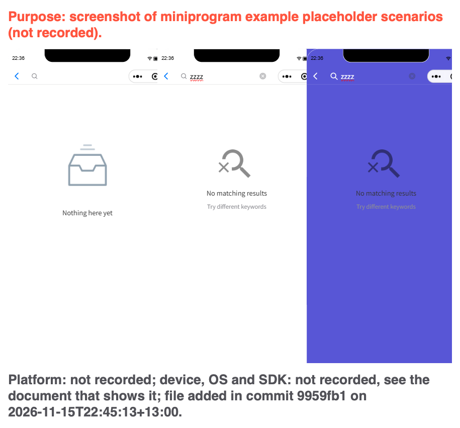
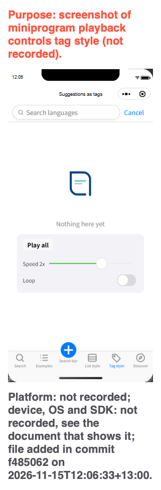

# WeChat Mini Program API alignment

The mini program core (`CrossPlatform/wechat-miniprogram-cylsearch`) is CYLSearchBar, like iOS
([search-core-merge.md](search-core-merge.md)): the components `cyl-search-bar` (`mode` single or multiple) and
`cyl-search` (suggestions, results through `setResultsDataSource` or `results`, empty placeholders from
CYLTableViewPlaceHolder's `cyl-placeholder`, pull-to-refresh through `setRefreshHandler`, `refresherEnabled` and
`bind:refresh`), on the core modules `src/core/CYLSearchBarView.js`, `CYLSearchView.js` and `CYLSearchResources.js`.
Dated task entries below record the work in their own time and name the components of that time.

## DONE (2026-11-15; TODO 2026-11-15): mini program core aligned with every iOS public API; example with CYLTabBarController's mini program tab bar

- Branch: `feat/swift-core` (PR #8). Package: `CrossPlatform/wechat-miniprogram-cylsearch`.
- Prompt (verbatim): "item1 完善 core核心代码 对标 iOS端所有公开API ，然后完善 example ，并使用CYLTabBarController 微信小程序端的组件用来做tabbar item2 你先帮我创建工程，我再用ide打开，然后再进行下一步使用模拟器打开项目"
- Prompt (English): "Item 1: complete the core code, matching every public iOS API; then complete the example, using
  CYLTabBarController's WeChat Mini Program component as the tab bar. Item 2: first create the project for me; I open
  it in the IDE, then the next step opens the project in the simulator."
- Requirements:
  1. The mini program core (`src/`) has a counterpart for every public declaration of
     `Sources/CYLSearchViewController/*.swift`, or a stated N/A; a generated table here, scored to 100.
  2. The example covers the features like the other platforms' examples (search, examples, search bar, list style,
     tag style, discover), one tab each.
  3. The example's tab bar is CYLTabBarController's mini program component (`cyl-tabbar-miniprogram`), pinned by
     commit.
  4. Item 2 (HarmonyOS): the project in a permanent folder the user opens in DevEco Studio:
     `~/develop/CYLSearchViewController-swift-core/harmonyos` (the `feat/swift-core` worktree, moved there on
     2026-11-15); signing and the emulator run come next.
- Context: the HarmonyOS models (`harmonyos/cylsearch/src/main/ets`) already match the iOS API at 397/397; the mini
  program core is ported from them to JavaScript. The table script follows `scripts/harmonyos-api-alignment.py`.
- Progress (2026-11-15): core DONE. `src/core/` holds the HarmonyOS models ported to CommonJS (the UI structs cut
  off, the types stripped by the TypeScript compiler, then edited by hand): storage on `wx.setStorageSync` (database:
  a key per cache; user defaults: one shared key) and `wx.getFileSystemManager()` (sandbox file);
  `CYLSearchResources` / `CYLSearchResourceReference` (`$r`) on generated string tables and `src/images/*.svg`;
  `CYLSearchPlatform` gives the ArkUI names the models use (`animateTo`, `TextInputController`, `focusControl`,
  `InputType`…). New component `cyl-search-bar-item` (iOS `CYLSearchBarItemView`); `cyl-search-bar` gets the
  `leading` / `trailing` slots and a default search icon. Table below: 397/397, 100/100. Node tests 14/14
  (`test/core.test.js` 6). Next: the example with CYLTabBarController's mini program tab bar.
- Progress (2026-11-15): example DONE. Five tab pages and the plus button's page (`pages/plus`, opened with
  `wx.navigateTo`, since a mini program has at most five tab pages). The tab bar is `cyl-tab-bar` of
  CYLTabBarController pinned at `a8e5305` (`package.json` `cylTabBarControllerCommit`, fetched by
  `scripts/sync-example.js`), configured with the iOS and Android examples' keys (`utils/cyl_search_tabs.js`), with a
  raised plus button. Verified in WeChat DevTools (base library 3.6.6) with `scripts/devtools-screenshots.js`: every
  tab, the empty-cache placeholder with the keyboard down, filtering, "No matching results", the Discover items, and
  the plus page's plain, bordered and slotted bars; no console errors. The script waits for the first page before
  relaunching (an earlier relaunch fails with "Uncaught").

  

- Progress (2026-11-15, later): Lottie placeholders DONE. `cyl-search` has an optional abstract node
  `cyl-animation-view` (default: `cyl-search-animation-placeholder`, draws nothing) and the properties
  `emptySuggestionsAnimation` / `emptyResultsAnimation`. The example passes `cyl-lottie` (CYLTabBarController's
  `cyl-lottie-miniprogram`, same pinned commit, installed by `scripts/sync-example.js`) with
  `CYLPlaceholderNoDrafts.json` (Tag style, empty cache) and `CYLPlaceholderNoResults.json` (List style, no results),
  copied from CYLTableViewPlaceHolder with `LICENSE.lottie-ios`, `LICENSE.useanimations` and `NOTICE.animations`.
  Verified in WeChat DevTools: both draw above their text (screens 2 and 4 of the screenshot); single frames only, motion
  not measured. The screenshot script retries the first relaunch after a compile.
- Status: DONE (2026-11-15).

## DONE (2026-11-15): the example as on iOS, before publishing to npm

- Branch: `feat/swift-core-next` (PR #9).
- Prompt (verbatim): "先把本项目的example 丰富到与iOS端保持一致再考虑发布npm"
- Prompt (English): "First enrich this project's example until it is consistent with iOS, then consider publishing to
  npm."
- Gaps left by the first 1:1 copy, found by reading the iOS example and `CYLSearchView.swift` again:
  1. Empty placeholders. iOS `CYLSearchView` shows CYLTableViewPlaceHolder's `CYLPlaceholderStackView` for
     `emptyResultsScenario` (`CYLPlaceholderScenarioNoSearchResults`: icon, title, hint) and
     `emptySuggestionsScenario` (`CYLPlaceholderScenarioNoContent`), static (`componentsForScenario`, no animation).
     The mini program drew its own placeholder with Lottie animations and playback controls.
  2. Pull to refresh. iOS uses CYLTableViewPlaceHolder's `CYLRefreshNormalHeader` (arrow, state and last-updated
     texts); the mini program used the native scroll-view refresher.
  3. Dark mode. iOS follows the system; the mini program had `prefers-color-scheme` rules but no `"darkmode": true`,
     so they never applied.
- Done:
  1. Core: `cyl-search` has iOS's `emptyResultsScenario` / `emptySuggestionsScenario` (scenario names), drawn by the
     abstract node `cyl-empty-view` (default `cyl-search-empty-view`: the library's CYLSearchPlaceholderView, so the
     package keeps no dependency); `emptyPlaceholderAnimated` (off, as on iOS), `animationSpeed`, `animationLoops`
     and `playAnimationFromStart()` stay for a view that animates. Removed: `emptyResultsText`,
     `emptySuggestionsText`, `emptyResultsAnimation`, `emptySuggestionsAnimation`, the node `cyl-animation-view` and
     `cyl-search-animation-placeholder` (not published, no caller outside the example).
  2. Sub-repository: CYLTableViewPlaceHolder's mini program package (`cyl-placeholder`, `cyl-refresh`), pinned at its
     newest commit that has it, `8ee7013` (`cylTableViewPlaceHolderCommit`; the newest of all, `1cac0d1` on
     `ci-screenshots`, holds screenshots only), synced with its licenses by `scripts/sync-example.js` as the tab bar is.
     CYLTabBarController's mini program pin moves to its newest commit `c006143`, as the iOS Podfile did.
  3. Example: `demo-components/cyl-demo-empty-view` renders `<cyl-placeholder scenario>` and is passed to the
     MaterialSearchView samples (`generic:cyl-empty-view`); their Lottie files, the playback controls and
     `utils/cyl_animation_controls.js` are gone, as iOS has none (the "Animation examples: playback controls" rule
     covers pages that show animations; none does now). The reproduction uses `<cyl-refresh header="normal">`.
  4. Dark mode: `app.json` `"darkmode": true` with `theme.json` (status bar text, window background); dark rules added
     to `cyl-search-bar-item`, `cyl-search-placeholder`, the gallery's template images and the reveal page's indigo.
- Verified in WeChat DevTools 2.02.2609250 (base library 3.6.6, Windows 11 Pro 10.0.22631): the empty cache shows
  NoContent ("Nothing here yet"), a query without results NoSearchResults ("No matching results", "Try different
  keywords"), also on the Themed sample; `cyl-refresh` goes Refreshing (54 px normal header) and back to Idle with the
  last-updated time saved; the 18 pages and 11 interactions run again with the new tab bar; no console error. Node tests
  31/31. Not verified: the dark appearance (wechatide has no theme switch; switch the simulator to dark mode in
  DevTools to see it).

| Platform | Screenshot | Environment |
| :--- | :--- | :--- |
| Mini program |  | CYLTableViewPlaceHolder's NoContent (empty cache), NoSearchResults, the same on the Themed sample. Windows 11 Pro 10.0.22631; WeChat DevTools 2.02.2609250 simulator (screenshots at 289 x 625 px); base library 3.6.6; branch `feat/swift-core-next`; 2026-11-15 22:36 NZDT (UTC+13) |

## DONE (2026-11-15): cyl-search-miniprogram as a mini program library

- Branch: `feat/swift-core-next` (PR #9).
- Prompt (verbatim): "你也要将searchviewcontroller封装为一个小程序库。学习wechat-miniprogram-cylplaceholder他的封装过程"
- Prompt (English): "Also package SearchViewController as a mini program library, learning from how
  wechat-miniprogram-cylplaceholder was packaged."
- What cyl-placeholder-miniprogram (CYLTableViewPlaceHolder `CrossPlatform/wechat-miniprogram-cylplaceholder`) does,
  and what this package now does the same way:
  1. `project.config.json` at the package root, `miniprogramRoot` `example/miniprogram/`, the `beforeCompile` /
     `beforePreview` / `beforeUpload` hooks run `node scripts/sync-example.js` (`scriptsEnable`): the package folder
     opens in DevTools as is. Your AppID in the git-ignored `project.private.config.json` at the same place.
  2. `package.json`: `repository.directory`, `miniprogram: "src"` (what DevTools' Build npm copies), `main`, `files`
     (`src`, `README.md`, `LICENSE`), scripts `test` / `sync-example` / `import-ios`.
  3. `LICENSE` (MIT, the user's choice on 2026-11-15; the iOS podspec says "All rights reserved"), with the licenses of
     the bundled images next to them.
  4. `scripts/sync-example.js` copies with its own `copyDir` (`fs.cpSync` crashes Node 22 on Windows) and copies each
     installed library's `LICENSE`.
  5. The README in the same order: install, usage with the properties and events of each component, example,
     development, license.
- Beyond the model, checked as a library: `npm pack` (106 files, `src/`, `README.md`, `LICENSE` only), installed into a
  new mini program, DevTools Build npm, rendered. That found three faults that only a library build shows, all fixed
  and covered by `test/package.test.js`:
  1. `require('cyl-search-miniprogram')` loads the `index.js` of the built folder: the entry is `src/index.js`
     (`main`), which loads `src/cyl_search.js`.
  2. A mini program resolves no folder to its `index.js`: `require('./core')` failed; every relative require names a
     file (a test walks `src/`).
  3. DevTools' "filter unused files" does not see a `require` inside an object spread (`{ ...require('./core/index') }`)
     and drops that file ("module … is not defined"): the entry uses plain `Object.assign(module.exports, require(…))`.
  The same `main` fault exists in cyl-placeholder-miniprogram (`main` is `src/cyl-placeholder/cyl_placeholder.js`, so
  `require('cyl-placeholder-miniprogram')` finds no `index.js` after Build npm); its README uses paths, so it does not
  show there. Fixed there the same day, with its object-spread entry (fault 3), in
  [CYLTableViewPlaceHolder PR #32](https://github.com/ChenYilong/CYLTableViewPlaceHolder/pull/32) (`a72ff3f`).
- Verified in WeChat DevTools 2.02.2609250 (base library 3.6.6): the consumer page renders `cyl-search-bar` with items,
  `cyl-multi-search`, `cyl-search-placeholder` (its image path resolves inside `miniprogram_npm`) and opens
  `cyl-search`; `require('cyl-search-miniprogram')` gives 41 exports. The package folder opens and runs the example
  after `npm run sync-example`; the DevTools hooks did not run when the project was opened and refreshed through the
  CLI, neither with `simulator_refresh` nor with a full compile (`simulator_open_page`). cyl-placeholder-miniprogram's
  identical hooks do not run that way either (checked the same day): DevTools runs a project's custom commands only
  after you allow them in its own window. Run `npm run sync-example` when driving DevTools from the CLI. Node tests 30/30.

| Path (under `CrossPlatform/wechat-miniprogram-cylsearch/`) | Role |
| --- | --- |
| `package.json`, `LICENSE`, `README.md` | The npm package (`main` `src/index.js`, `miniprogram` `src`, `files`) |
| `project.config.json` (+ git-ignored `project.private.config.json`) | The DevTools project: the example, the sync hooks |
| `src/index.js`, `src/cyl_search.js` | The JavaScript entry: the core and the helpers |
| `src/core/` | The core: a counterpart of every public iOS API (ported from the HarmonyOS models) |
| `src/cyl-search-bar/`, `src/cyl-search-bar-item/`, `src/cyl-search/`, `src/cyl-search-controller/`, `src/cyl-multi-search/`, `src/cyl-search-placeholder/`, `src/cyl-search-animation-placeholder/` | The components |
| `src/cyl-search/*.js` | The components' logic: view model, items, suggestion cache, playback, tag fold, navigation metrics, format |
| `src/images/` | Icons; `placeholder/` holds the 41 placeholder images of the iOS bundle and their licenses |
| `scripts/import-ios-resources.js` | Re-imports the iOS images, texts and Discover data |
| `scripts/sync-example.js` | Copies `src/` and CYLTabBarController's tab bar and Lottie player into the example (DevTools hooks) |
| `scripts/devtools-screenshots.js` | Drives every page of the example with miniprogram-automator |
| `example/miniprogram/` | The example, a 1:1 copy of the iOS example |
| `test/*.test.js` | `node --test` unit tests |

## DONE (2026-11-15): the example is a 1:1 copy of the iOS example

- Branch: `feat/swift-core-next` (PR #9). Code: [`d19e0bb`](https://github.com/ChenYilong/CYLSearchViewController/commit/d19e0bb).
- Prompt (verbatim): "小程序example层要一比一复刻"
- Prompt (English): "The mini program's example layer must replicate [the iOS example] one to one."
- Reading: the reference is the iOS example (`CYLSearchExample`), the one every other port follows. Before, the mini
  program example had its own simplified pages (five tabs, one of them a List style tab iOS does not have).
- Requirements:
  1. The same tabs (`CYLTabBarConfiguration.json`: four tabs and the plus button's page), the same pages, the same
     texts in the same languages (en, ja, zh-Hans, zh-Hant), the same data and images, the same interactions.
  2. The example passes only data, style parameters and taps; what it needs that the core lacks goes into the core
     (`AGENTS.md`, "Swift core: examples adapt to the core", and "change the core when an example needs it").
- Resources: `scripts/import-ios-resources.js` reads `Resources/CYLSearchViewController.bundle` (texts, the 41
  placeholder images into `src/images/placeholder/` with their licenses), `CYLSearchTabs.bundle` and
  `CYLSearchDiscover.bundle` (texts, `search-discover.json`, the localized hot icons) into
  `example/miniprogram/utils/cyl_demo_resources.js`; `utils/cyl_demo_text.js` fills the iOS formats (`%@`, `%lu`,
  `%1$lu`).

| iOS (`CYLSearchExample`) | Mini program (`example/miniprogram`) |
| :--- | :--- |
| `CYLTabBarConfiguration.json`: Search, Examples, Tag style, Discover, plus button "Search bar" | `utils/cyl_search_tabs.js` (the same keys and titles); the plus button's `plus` page is a tab page, as on iOS |
| `CYLSearchExampleViewController` (Issue #1317: Overlay, Repro ON/OFF, pull to refresh, 40 sample results, "No matching results") | `demo-components/cyl-demo-reproduction` in `pages/search` (tab) and `pages/reproduction` (pushed) |
| `CYLSearchController` overlay | core `cyl-search-controller` |
| `CYLSearchDemoMenuViewController` (4 rows) | `pages/examples` |
| `CYLSearchPlaceholderGalleryViewController` (41 styles × 4 messages, 3 custom rows) and its detail | `pages/styles`, `pages/placeholderDetail`; core `cyl-search-placeholder` |
| `CYLSearchBarDemoViewController` (Cancel, shadow, camera, "Text: …", "Searched: …") | `demo-components/cyl-demo-search-bar` in `pages/plus` (tab) and `pages/searchBar` (pushed) |
| `CYLSearchPortsViewController` (5 rows) | `pages/ports` |
| `CYLLapismSearchViewController` | `pages/lapism` (bar as a button, results in `cyl-search`'s `content` slot) |
| `CYLMaterialSearchMenuViewController` and `CYLMaterialSearchSampleViewController` (Default, Themed, Voice, Sticky, Tabs, Input type) | `demo-components/cyl-demo-material-menu`, `pages/materialMenu`, `pages/materialSample`, `utils/cyl_material_samples.js` |
| `CYLSuggestionDemoPages.tagStyleViewController` (the same samples, tags, keyboard down) | `pages/tagStyle` |
| `CYLYechaoaSearchViewController` | `pages/yechaoa` (iconified bar in the navigation bar, submit button, snackbar, result) |
| `CYLRevealSearchViewController` | `pages/reveal` (circular reveal over 1 s from a centered button) |
| `CYLMultiSearchDemoViewController` | `pages/multiSearch`; core `cyl-multi-search` |
| `CYLSearchDiscoverViewController` (recent searches folded inline, discover grid, More, hold to ask) | `pages/discover`, `utils/cyl_discover_logic.js`; core `cyl_tag_fold.js` |
| `CYLSnackbar`, `UINavigationBar` items | `demo-components/cyl-demo-snackbar`, `demo-components/cyl-demo-nav` |

- Core changes for the example: `cyl-search-bar` (navigation button, voice, submit and clear buttons, field look,
  `editable`, iconified states with fade or circular reveal, `setText`, `setIconified`); `cyl-search` (back arrow
  instead of Cancel as on iOS, colors, voice, `content` slot, `closesOnSubmit`, `setQuery`, `coversNavigationBar`, the
  inline tag fold measured from the real tag widths); new `cyl-search-placeholder`, `cyl-search-controller`,
  `cyl-multi-search`.
- Platform differences (no iOS counterpart possible):
  - WeChat's menu button (the capsule) stays at the top trailing corner of every page. Pages use
    `"navigationStyle": "custom"`; a bar that takes the navigation bar's place (the search page, the overlay, the
    Discover bar) is centered on the capsule and ends before it (`cyl_navigation_metrics.js`).
  - Speech recognition needs a plugin: the Voice sample shows "Speech recognition is not available." as iOS does when
    recognition is unavailable. Hold to ask changes the hint only, as on iOS.
  - The camera of the Discover bar opens a modal with the iOS alert's texts.
- Verified in WeChat DevTools 2.02.2609250 (base library 3.6.6, Windows 11 Pro 10.0.22631) with `wechatide-skill`: all
  18 pages and 11 interactions (the overlay filtering, Repro ON with no results, the Themed sample's suggestions, the
  tags folded and unfolded, the snackbar after a submit, lapism's filtered content, yechaoa's expanded bar and result,
  the circular reveal, MultiSearchView's items and event log, the search bar's "Searched: …", Discover's search, More
  and fold). The console has no error. One warning stays after dozens of relaunches in a row: "21 listeners of event
  ThemeChange", from CYLTabBarController's `cyl-tab-bar` (it adds the listener when attached and removes it when
  detached); not fixed here. Node tests 26/26.

| Platform | Screenshot | Environment |
| :--- | :--- | :--- |
| Mini program |  | Left to right, top to bottom: Search tab, Examples tab, Search bar tab after a search, Tag style tab, Discover tab, the pushed reproduction ("Overlay" in place of the back button). Windows 11 Pro 10.0.22631; WeChat DevTools 2.02.2609250 simulator (390 x 844 window, screenshots at 289 x 625 px); base library 3.6.6; [`d19e0bb`](https://github.com/ChenYilong/CYLSearchViewController/commit/d19e0bb); 2026-11-15 13:22–13:38 NZDT (UTC+13) |
| Mini program |  | Placeholder styles; custom image and text; NoInternet with the network message; Other libraries' examples; lapism filtered; Themed suggestions; tags folded; the overlay filtering; Repro ON with no results; yechaoa after a submit (snackbar); the circular reveal opened; MultiSearchView with its event log. Same environment |

## DONE (2026-11-15): playback controls on the animated placeholders; WeChat DevTools Skills

Update (2026-11-15, 1:1 example): the List style tab is gone (iOS has none); the playback controls are on every
MaterialSearchView sample (`pages/materialSample`), the pages that show the animated placeholders.

- Branch: `feat/swift-core-next` (based on `feat/swift-core` at `bab8444`).
- Prompt (verbatim): "基于新分支 开始下微信小程序开发。找到docs里面任何提及微信小程序的信息开始开发。找到crossplatorm
  相关文件夹，没有就新建，新建或者更微信小程序开发。微信小程序开发者工具Skills ，根据文档"
- Prompt (English): "On the new branch, start the WeChat Mini Program work: begin from everything in docs that
  mentions the mini program; find the CrossPlatform folder (create it if missing) and create or update the mini
  program there; use the WeChat DevTools Skills, following the documentation."
- Requirements, from the docs: `AGENTS.md`, "Animation examples: playback controls" (every example page that shows
  animations offers "Play all", a speed slider and a loop switch, applied live, with accessibility labels; change the
  core when an example needs it), and the `AGENTS.md` TODO to install the DevTools Skills
  (<https://developers.weixin.qq.com/miniprogram/dev/devtools/Skills.html>).
- Core: `cyl-search` gets `animationSpeed` (0.25 to 3, rounded to 0.25), `animationLoops`, `playAnimationFromStart()`
  and the slot `placeholder-footer` under the empty placeholder. The strategy without views is
  `src/cyl-search/cyl_search_animation_playback.js` (Node tests 3; all 17/17).
- Example: List style (no results) and Tag style (empty cache) put the controls in that slot
  (`utils/cyl_animation_controls.js`; the slider counts quarter steps 1 to 12).
- `scripts/sync-example.js` checks out only the two mini program folders of CYLTabBarController (sparse checkout):
  the full checkout failed on Windows with "Filename too long".
- DevTools Skills: `wechatide-skill` 0.3.11 ships with WeChat DevTools 2.02.2609250 and is linked into
  `~/.claude/skills`; `check_wechatide_status` gives `versionRelation: equal`. On Windows `wechatide` is not on `PATH`:
  call `C:\Program Files (x86)\Tencent\微信web开发者工具\wechatide.cmd` (the skill's own install check reports
  `cli_unavailable` because it does not quote that path). The CLI needs the service port on (Settings → Security)
  and a logged-in DevTools.
- Verified with the skill's automation tools: the slider set to 2x and the loop switched off reach the Lottie player
  (`playSpeed` 2, `loop` false); switching the loop on resumes playback; "Play all" plays again with the loop off;
  the console buffer has no line at all (no error, no warning).

| Platform | Screenshot | Environment |
| :--- | :--- | :--- |
| Mini program |  | Windows 11 Pro 10.0.22631; WeChat DevTools 2.02.2609250 simulator (iPhone frame, original 289 x 625 px); base library 3.6.6; branch `feat/swift-core-next` on `bab8444`; 2026-11-15 12:05 NZDT (UTC+13) |
| Mini program |  | Same; 2026-11-15 12:05 NZDT (UTC+13) |

<!-- miniprogram-api-alignment:begin -->
Rows: 284; implemented or N/A 284, TODO 0; score 100/100.

| iOS public API | Doc comment | Mini program |
| :--- | :--- | :--- |
| **enum `CYLSearchBarMode`** | What a `CYLSearchBarView` holds: one field, or several searches side by side. | `CYLSearchBarMode` |
| `CYLSearchBarMode.single` | One search field (the default). | `CYLSearchBarMode.single` |
| `CYLSearchBarMode.multiple` | Several searches side by side (iammert `MultiSearchView`): `newSearchButton` starts a new search, a completed search becomes an entry of `searches` in a horizontally scrolling row, with an indicator under the selected one and a remove bu… | `CYLSearchBarMode.multiple` |
| **enum `CYLSearchBarNavigationIcon`** | The icon of the navigation button before the field (lapism `NavigationIconCompat`). | `CYLSearchBarNavigationIcon` |
| `CYLSearchBarNavigationIcon.none` | No navigation button. | `CYLSearchBarNavigationIcon.none` |
| `CYLSearchBarNavigationIcon.arrow` | A back arrow (`chevron.backward`). | `CYLSearchBarNavigationIcon.arrow` |
| `CYLSearchBarNavigationIcon.search` | A magnifier (`magnifyingglass`). | `CYLSearchBarNavigationIcon.search` |
| **enum `CYLSearchBarIconPosition`** | Where the search button sits while the bar is iconified. | `CYLSearchBarIconPosition` |
| `CYLSearchBarIconPosition.trailing` | At the trailing end, like an Android `SearchView` in a toolbar. | `CYLSearchBarIconPosition.trailing` |
| `CYLSearchBarIconPosition.center` | In the middle, like a floating action button that opens a search card. | `CYLSearchBarIconPosition.center` |
| `CYLSearchBarIconPosition.leading` | At the leading end. | `CYLSearchBarIconPosition.leading` |
| **enum `CYLSearchBarExpansionAnimation`** | How the field opens and closes when `iconified` changes with animation. | `CYLSearchBarExpansionAnimation` |
| `CYLSearchBarExpansionAnimation.fade` | The field grows from the icon and fades in. | `CYLSearchBarExpansionAnimation.fade` |
| `CYLSearchBarExpansionAnimation.circularReveal` | A circle grows from the icon until it uncovers the whole field (Material circular reveal). | `CYLSearchBarExpansionAnimation.circularReveal` |
| **enum `CYLSearchBarItemStyle`** | How an item appended to a search bar looks, like the FlatDesign tab bar's item appearance. | `CYLSearchBarItemStyle` |
| `CYLSearchBarItemStyle.icon` | An icon button with a 36 pt touch area (a camera, a filter). | `CYLSearchBarItemStyle.icon` |
| `CYLSearchBarItemStyle.divider` | A thin vertical line between two items; it takes no taps and VoiceOver skips it. | `CYLSearchBarItemStyle.divider` |
| `CYLSearchBarItemStyle.text` | A text button (a "Search" button); an image, when set, comes before the title. | `CYLSearchBarItemStyle.text` |
| **enum `CYLSearchBarStyle`** | The fixed look of the whole bar: the field on the left stays, the items are appended after its text. | `CYLSearchBarStyle` |
| `CYLSearchBarStyle.plain` | The field as configured by its own properties (the default; nothing is changed). | `CYLSearchBarStyle.plain` |
| `CYLSearchBarStyle.bordered` | A capsule with a 1 pt separator-colored border on the system background, the field and its items inside one outline (the Discover search bar). | `CYLSearchBarStyle.bordered` |
| **protocol `CYLSearchBarViewDelegate`** | Events of a `CYLSearchBarView`. | `CYLSearchBarViewDelegate` |
| `CYLSearchBarViewDelegate.-searchBarViewShouldBeginEditing:` | Asks whether a tap may start editing. Return NO to use the bar as a button that opens another search page (lapism `MaterialSearchBar.setOnClickListener`); `-searchBarViewDidTapWhileNotEditable:` is called instead. | `CYLSearchBarViewDelegate.searchBarViewShouldBeginEditing` |
| `CYLSearchBarViewDelegate.-searchBarViewDidTapWhileNotEditable:` | The bar was tapped while `-searchBarViewShouldBeginEditing:` refused editing. | `CYLSearchBarViewDelegate.searchBarViewDidTapWhileNotEditable` |
| `CYLSearchBarViewDelegate.-searchBarViewDidBeginEditing:` | Editing started. | `CYLSearchBarViewDelegate.searchBarViewDidBeginEditing` |
| `CYLSearchBarViewDelegate.-searchBarViewDidEndEditing:` | Editing ended. | `CYLSearchBarViewDelegate.searchBarViewDidEndEditing` |
| `CYLSearchBarViewDelegate.-searchBarView:textDidChange:` | The text changed (typing, the clear button, Cancel with `clearsTextOnCancel`). | `CYLSearchBarViewDelegate.searchBarViewTextDidChange` |
| `CYLSearchBarViewDelegate.-searchBarViewSearchButtonClicked:` | The keyboard's Search key. | `CYLSearchBarViewDelegate.searchBarViewSearchButtonClicked` |
| `CYLSearchBarViewDelegate.-searchBarViewCancelButtonClicked:` | Cancel was tapped. | `CYLSearchBarViewDelegate.searchBarViewCancelButtonClicked` |
| `CYLSearchBarViewDelegate.-searchBarViewNavigationButtonClicked:` | The navigation button before the field (`navigationIcon`, `navigationImage`). | `CYLSearchBarViewDelegate.searchBarViewNavigationButtonClicked` |
| `CYLSearchBarViewDelegate.-searchBarViewVoiceButtonClicked:` | The voice button (`showsVoiceButton`). Start speech recognition here and pass the result to `-setText:submit:`. | `CYLSearchBarViewDelegate.searchBarViewVoiceButtonClicked` |
| `CYLSearchBarViewDelegate.-searchBarView:shouldSubmitText:` | Asks whether the query may be submitted (the Search key, the submit button or `-setText:submit:` with YES). Return NO to keep it. Without this method, every non-empty query is submitted. | `CYLSearchBarViewDelegate.searchBarViewShouldSubmitText` |
| `CYLSearchBarViewDelegate.-searchBarView:didChangeIconified:` | The field opened or closed (`iconified`). | `CYLSearchBarViewDelegate.searchBarViewDidChangeIconified` |
| `CYLSearchBarViewDelegate.-searchBarView:didSelectItem:` | An appended item was tapped (`-[CYLSearchBarView addItem:]`), like `-tabBar:didSelectItem:`. | `CYLSearchBarViewDelegate.searchBarViewDidSelectItem` |
| `CYLSearchBarViewDelegate.-searchBarView:textDidChange:atIndex:` | `CYLSearchBarModeMultiple`: the text of the search being typed changed (MultiSearchView `onTextChanged`). `CYLSearchBarModeSingle` reports `-searchBarView:textDidChange:` instead. | `CYLSearchBarViewDelegate.searchBarViewTextDidChange` |
| `CYLSearchBarViewDelegate.-searchBarView:didCompleteSearch:atIndex:` | `CYLSearchBarModeMultiple`: a search was completed and became an entry of `searches` (`onSearchComplete`). | `CYLSearchBarViewDelegate.searchBarViewDidCompleteSearch` |
| `CYLSearchBarViewDelegate.-searchBarView:didRemoveSearchAtIndex:` | `CYLSearchBarModeMultiple`: a search was removed by its remove button or `-removeSearchAtIndex:` (`onSearchItemRemoved`). | `CYLSearchBarViewDelegate.searchBarViewDidRemoveSearchAtIndex` |
| `CYLSearchBarViewDelegate.-searchBarView:didSelectSearch:atIndex:` | `CYLSearchBarModeMultiple`: a search was selected by a tap or `-selectSearchAtIndex:` (`onItemSelected`). | `CYLSearchBarViewDelegate.searchBarViewDidSelectSearch` |
| **class `CYLSearchBarView`** | A configurable search bar: a rounded field with a magnifier, text and clear button, views of the host inside the field after the text (a camera, a "Search" button) or before the field (a back button), and an optional Cancel button. Use i… | `CYLSearchBarView` |
| `CYLSearchBarView.delegate` | Receives the events. | `CYLSearchBarView.delegate` |
| `CYLSearchBarView.textField` | The text field inside the field. | N/A: the mini program has no view objects; `<cyl-search-bar>` draws its `<input>` from the properties |
| `CYLSearchBarView.fieldView` | The rounded field that holds the magnifier, the text and `trailingAccessoryViews`. | N/A: the mini program has no view objects; `<cyl-search-bar>` draws it from the properties |
| `CYLSearchBarView.searchIconView` | The magnifier at the start of the field (decorative: hidden from VoiceOver). | N/A: the mini program has no view objects; `<cyl-search-bar>` draws it from the properties |
| `CYLSearchBarView.cancelButton` | The Cancel button after the field (`showsCancelButton`). | N/A: the mini program has no view objects; `<cyl-search-bar>` draws it from the properties |
| `CYLSearchBarView.placeholderLabel` | Draws the placeholder at the full font size, cut off with an ellipsis when it does not fit. | N/A: the mini program has no view objects; `<cyl-search-bar>` draws it from the properties |
| `CYLSearchBarView.navigationButton` | The button before the field. It is shown when `navigationIcon` is not none or `navigationImage` is set, and `leadingView` is nil; taps call `-searchBarViewNavigationButtonClicked:` and `navigationHandler`. | N/A: the mini program has no view objects; `<cyl-search-bar>` draws it from the properties |
| `CYLSearchBarView.voiceButton` | A microphone inside the field, shown while the text is empty; it calls `-searchBarViewVoiceButtonClicked:`. | N/A: the mini program has no view objects; `<cyl-search-bar>` draws it from the properties |
| `CYLSearchBarView.submitButton` | A submit button inside the field, shown while there is text; it submits the query like the Search key. | N/A: the mini program has no view objects; `<cyl-search-bar>` draws it from the properties |
| `CYLSearchBarView.iconButton` | The button shown while `iconified` is YES. VoiceOver reads it as "Search". | N/A: the mini program has no view objects; `<cyl-search-bar>` draws it from the properties |
| `CYLSearchBarView.text` | The text of the field. | `CYLSearchBarView.text` |
| `CYLSearchBarView.placeholder` | The placeholder, drawn by `placeholderLabel` and kept on the text field for VoiceOver. | `CYLSearchBarView.placeholder` |
| `CYLSearchBarView.font` | The font of the text, the placeholder and Cancel. The body text style by default, following Dynamic Type; a custom font is used as given (pass a `UIFontMetrics` font to scale it). | `CYLSearchBarView.font` |
| `CYLSearchBarView.textColor` | The text color. `labelColor` by default. | `CYLSearchBarView.textColor` |
| `CYLSearchBarView.placeholderColor` | The placeholder color. `placeholderTextColor` when nil. | `CYLSearchBarView.placeholderColor` |
| `CYLSearchBarView.cursorColor` | The color of the text cursor (MaterialSearchView `setCursorDrawable`). The tint color by default. | `CYLSearchBarView.cursorColor` |
| `CYLSearchBarView.fieldHeight` | The height of the field; it grows when the scaled text needs more. 36 by default. | `CYLSearchBarView.fieldHeight` |
| `CYLSearchBarView.contentInsets` | The space around the field. (6, 12, 6, 12) by default. | `CYLSearchBarView.contentInsets` |
| `CYLSearchBarView.fieldBackgroundColor` | The field's background. `tertiarySystemFillColor` by default. | `CYLSearchBarView.fieldBackgroundColor` |
| `CYLSearchBarView.fieldCornerRadius` | The field's corner radius; negative makes a capsule. -1 by default. | `CYLSearchBarView.fieldCornerRadius` |
| `CYLSearchBarView.fieldBorderColor` | The field's border color; nil draws no border. | `CYLSearchBarView.fieldBorderColor` |
| `CYLSearchBarView.fieldBorderWidth` | The field's border width, used with `fieldBorderColor`. 0 by default. | `CYLSearchBarView.fieldBorderWidth` |
| `CYLSearchBarView.fieldShadowOpacity` | The field's shadow, 0 to 1. 0 by default. | `CYLSearchBarView.fieldShadowOpacity` |
| `CYLSearchBarView.searchIcon` | The magnifier; nil shows none. `magnifyingglass` by default. | `CYLSearchBarView.searchIcon` |
| `CYLSearchBarView.searchIconTintColor` | The magnifier's tint. `secondaryLabelColor` by default. | `CYLSearchBarView.searchIconTintColor` |
| `CYLSearchBarView.trailingAccessoryViews` | Views of yours inside the field after the text, scaled down when they would squeeze it. | `<cyl-search-bar>` slot `trailing` (multiple slots) |
| `CYLSearchBarView.items` | The appended items, in order, after the text and after `trailingAccessoryViews` (like the FlatDesign tab bar's `items`). The field stays; only items are appended. | `CYLSearchBarView.items` |
| `CYLSearchBarView.itemViews` | The views of `items` (`CYLTagButton`s), in the same order. | N/A: the mini program has no view objects; `<cyl-search-bar>` draws each item of `items` with `<cyl-tag-button>` |
| `CYLSearchBarView.itemTintColor` | The icon and title color of every item without its own `tintColor`; nil uses the label color. | `CYLSearchBarView.itemTintColor` |
| `CYLSearchBarView.searchBarStyle` | The fixed look of the bar. `.bordered` draws the field and its items inside one capsule outline. | `CYLSearchBarView.searchBarStyle` |
| `CYLSearchBarView.fieldBackgroundImage` | An image drawn behind the field's content, clipped to its corners. | `CYLSearchBarView.fieldBackgroundImage` |
| `CYLSearchBarView.selectedItem` | The first selected item (an item with `selectable` YES that was tapped on), or nil. | `CYLSearchBarView.selectedItem` |
| `CYLSearchBarView.selectedIndex` | The index of `selectedItem`, or `NSNotFound`. | `CYLSearchBarView.selectedIndex` |
| `CYLSearchBarView.addItem(_:)` | Appends an item after the others. | `CYLSearchBarView.addItem` |
| `CYLSearchBarView.insertItem(_:at:)` | Inserts an item at an index (clamped to `items`); an item already in a bar moves here. | `CYLSearchBarView.insertItem` |
| `CYLSearchBarView.addItem(style:title:image:index:handler:)` | Creates an item and inserts it at an index; `NSNotFound` or a larger index appends it. Mirrors `-addItemWithTitle:tabBarItemImage:tabBarItemSelectedImage:index:`. | `CYLSearchBarView.addItem` |
| `CYLSearchBarView.removeItem(_:)` | Removes an item from the bar. | `CYLSearchBarView.removeItem` |
| `CYLSearchBarView.removeAllItems()` | Removes every item. | `CYLSearchBarView.removeAllItems` |
| `CYLSearchBarView.hasItem(of:)` | YES when an item of the style was appended (a text "Search" button), like `-hasPlusButton`. | `CYLSearchBarView.hasItem` |
| `CYLSearchBarView.leadingView` | A view of yours before the field (a back button); it wins over the navigation button. | `<cyl-search-bar>` slot `leading` |
| `CYLSearchBarView.showsCancelButton` | Shows the Cancel button after the field. NO by default. | `CYLSearchBarView.showsCancelButton` |
| `CYLSearchBarView.cancelButtonTitle` | The Cancel title. The localized "Cancel" by default. | `CYLSearchBarView.cancelButtonTitle` |
| `CYLSearchBarView.cancelButtonEndsEditing` | Taps on Cancel also end editing and clear nothing. YES by default. | `CYLSearchBarView.cancelButtonEndsEditing` |
| `CYLSearchBarView.clearsTextOnCancel` | Taps on Cancel also clear the text (lapism `setTextClearOnBackPressed`). NO by default. | `CYLSearchBarView.clearsTextOnCancel` |
| `CYLSearchBarView.clearsTextOnEndEditing` | Ending editing also clears the text (lapism `setTextClearOnClearFocus`). NO by default. | `CYLSearchBarView.clearsTextOnEndEditing` |
| `CYLSearchBarView.navigationIcon` | A built-in navigation icon. `CYLSearchBarNavigationIconNone` by default. | `CYLSearchBarView.navigationIcon` |
| `CYLSearchBarView.navigationImage` | A custom navigation icon; it wins over `navigationIcon`. | `CYLSearchBarView.navigationImage` |
| `CYLSearchBarView.navigationAccessibilityLabel` | What VoiceOver reads for the navigation button. Defaults to "Back" for the arrow and "Search" for the magnifier. | `CYLSearchBarView.navigationAccessibilityLabel` |
| `CYLSearchBarView.navigationBackgroundColor` | A circle drawn behind the navigation icon. Nil (none) by default. | `CYLSearchBarView.navigationBackgroundColor` |
| `CYLSearchBarView.navigationShadowOpacity` | The shadow of that circle, 0 to 1 (lapism `setNavigationElevation`). 0 by default. | `CYLSearchBarView.navigationShadowOpacity` |
| `CYLSearchBarView.navigationHandler` | Called on taps on the navigation button, after the delegate. | `CYLSearchBarView.navigationHandler` |
| `CYLSearchBarView.showsVoiceButton` | Shows `voiceButton` while the text is empty. NO by default. | `CYLSearchBarView.showsVoiceButton` |
| `CYLSearchBarView.voiceImage` | The voice button's icon. `mic` by default. | `CYLSearchBarView.voiceImage` |
| `CYLSearchBarView.showsSubmitButton` | Shows `submitButton` while there is text (Android `isSubmitButtonEnabled`). NO by default. | `CYLSearchBarView.showsSubmitButton` |
| `CYLSearchBarView.submitImage` | The submit button's icon. `arrow.forward.circle.fill` by default. | `CYLSearchBarView.submitImage` |
| `CYLSearchBarView.clearImage` | A custom clear button icon, shown while editing with text. Nil keeps the system clear button. | `CYLSearchBarView.clearImage` |
| `CYLSearchBarView.keyboardType` | The keyboard type (Android `inputType`). `UIKeyboardTypeDefault` by default. | `CYLSearchBarView.keyboardType` |
| `CYLSearchBarView.returnKeyType` | The return key (Android `imeOptions`). `UIReturnKeySearch` by default. | `CYLSearchBarView.returnKeyType` |
| `CYLSearchBarView.autocapitalizationType` | Automatic capitalization. `UITextAutocapitalizationTypeSentences` by default. | `CYLSearchBarView.autocapitalizationType` |
| `CYLSearchBarView.autocorrectionType` | Automatic correction. `UITextAutocorrectionTypeDefault` by default. | N/A: the mini program `<input>` has no autocorrection trait |
| `CYLSearchBarView.isSecureTextEntry` | Hides the typed characters (Android `inputType="textPassword"`). NO by default. | `CYLSearchBarView.isSecureTextEntry` |
| `CYLSearchBarView.maximumTextLength` | The longest text a person can type (Android `maxLength`); 0 means no limit. 0 by default. | `CYLSearchBarView.maximumTextLength` |
| `CYLSearchBarView.isIconified` | Shows only a search button instead of the field (Android `SearchView.isIconified`). Tapping the button opens the field and starts editing. NO by default. | `CYLSearchBarView.isIconified` |
| `CYLSearchBarView.iconifiedByDefault` | When YES, the field closes back to its icon when editing ends with no text (Android `setIconifiedByDefault`). NO by default. | `CYLSearchBarView.iconifiedByDefault` |
| `CYLSearchBarView.expansionAnimation` | How the field opens and closes. `CYLSearchBarExpansionAnimationFade` by default. | `CYLSearchBarView.expansionAnimation` |
| `CYLSearchBarView.iconPosition` | Where `iconButton` sits while iconified; the field opens from there. `CYLSearchBarIconPositionTrailing` by default. | `CYLSearchBarView.iconPosition` |
| `CYLSearchBarView.animationDuration` | The length of the opening and closing animations, in seconds. 0.3 by default. | `CYLSearchBarView.animationDuration` |
| `CYLSearchBarView.mode` | One field (`CYLSearchBarModeSingle`, the default) or several searches side by side (`CYLSearchBarModeMultiple`, iammert `MultiSearchView`). The text style (`placeholder`, `font`, `textColor`, `placeholderColor`, the keyboard options, `ma… | `CYLSearchBarView.mode` |
| `CYLSearchBarView.searches` | `CYLSearchBarModeMultiple`: the texts of the searches, completed searches first, then the one being typed. | `CYLSearchBarView.searches` |
| `CYLSearchBarView.selectedSearchIndex` | `CYLSearchBarModeMultiple`: the index of the selected search in `searches`, or `NSNotFound` when none is selected. | `CYLSearchBarView.selectedSearchIndex` |
| `CYLSearchBarView.isEditingNewSearch` | `CYLSearchBarModeMultiple`: YES while a new search is being typed (MultiSearchView `isInSearchMode`). | `CYLSearchBarView.isEditingNewSearch` |
| `CYLSearchBarView.newSearchButton` | `CYLSearchBarModeMultiple`: the button at the trailing end; it starts a new search, or completes the one being typed. VoiceOver reads it as "New search". | N/A: the mini program has no view objects; `<cyl-search-bar mode="multiple">` draws it |
| `CYLSearchBarView.minimumTextLength` | `CYLSearchBarModeMultiple`: a search shorter than this is dropped by `-completeSearch`. 3 by default, as in MultiSearchView. | `CYLSearchBarView.minimumTextLength` |
| `CYLSearchBarView.searchIndicatorColor` | `CYLSearchBarModeMultiple`: the color of the indicator under the selected search and of `newSearchButton`; the tint color when nil. | `CYLSearchBarView.searchIndicatorColor` |
| `CYLSearchBarView.unselectedSearchAlpha` | `CYLSearchBarModeMultiple`: the opacity of the searches that are not selected, 0 to 1. 0.5 by default. | `CYLSearchBarView.unselectedSearchAlpha` |
| `CYLSearchBarView.searchFieldWidth` | `CYLSearchBarModeMultiple`: the width of the field of a new search, in points (at least 44). 160 by default. | `CYLSearchBarView.searchFieldWidth` |
| `CYLSearchBarView.newSearchImage` | `CYLSearchBarModeMultiple`: the icon of `newSearchButton`. `magnifyingglass` by default. | `CYLSearchBarView.newSearchImage` |
| `CYLSearchBarView.removeSearchImage` | `CYLSearchBarModeMultiple`: the icon of the remove button on the selected search. `xmark.circle.fill` by default. | `CYLSearchBarView.removeSearchImage` |
| `CYLSearchBarView.beginNewSearch()` | `CYLSearchBarModeMultiple`: starts a new search and shows the keyboard (MultiSearchView `search`). Does nothing while a search is being typed, or in `CYLSearchBarModeSingle`. | `CYLSearchBarView.beginNewSearch` |
| `CYLSearchBarView.completeSearch()` | `CYLSearchBarModeMultiple`: completes the search being typed (`completeSearch`). It becomes the selected search, or is dropped when shorter than `minimumTextLength`. | `CYLSearchBarView.completeSearch` |
| `CYLSearchBarView.addSearch(_:)` | `CYLSearchBarModeMultiple`: adds a completed search without typing it, and selects it. An empty text is ignored. | `CYLSearchBarView.addSearch` |
| `CYLSearchBarView.selectSearch(at:)` | `CYLSearchBarModeMultiple`: selects a search, like a tap on it. | `CYLSearchBarView.selectSearch` |
| `CYLSearchBarView.removeSearch(at:)` | `CYLSearchBarModeMultiple`: removes a search, like a tap on its remove button. The next search is selected, or the previous one when the last search went away. | `CYLSearchBarView.removeSearch` |
| `CYLSearchBarView.init(frame:)` | — | `new CYLSearchBarView(…)` |
| `CYLSearchBarView.init(coder:)` | Creates the bar from an archive (a storyboard or a XIB). | N/A: no archives in the mini program (the state is restored with `decodeRestorableState`) |
| `CYLSearchBarView.setText(_:submit:)` | Sets the text and, when `submit` is YES and the text is not empty, submits it as if the Search key were tapped (MaterialSearchView `setQuery`, lapism `setTextQuery`). | `CYLSearchBarView.setText` |
| `CYLSearchBarView.submit()` | Submits the current text: asks `-searchBarView:shouldSubmitText:`, then calls `-searchBarViewSearchButtonClicked:`. Returns NO when the text is empty or the delegate refused it. | `CYLSearchBarView.submit` |
| `CYLSearchBarView.showKeyboard()` | Starts editing and shows the keyboard. | `CYLSearchBarView.showKeyboard` |
| `CYLSearchBarView.hideKeyboard()` | Ends editing and hides the keyboard. | `CYLSearchBarView.hideKeyboard` |
| `CYLSearchBarView.setIconified(_:animated:)` | Opens or closes the field, with `expansionAnimation` when `animated` is YES. Opening also starts editing. | `CYLSearchBarView.setIconified` |
| `CYLSearchBarView.encodeRestorableState(with:)` | Saves the text, whether it is editing and whether it is iconified (`onSaveInstanceState`). | `CYLSearchBarView.encodeRestorableState` |
| `CYLSearchBarView.decodeRestorableState(with:)` | Restores the text, the iconified state and editing (`onRestoreInstanceState`). | `CYLSearchBarView.decodeRestorableState` |
| `CYLSearchBarView.traitCollectionDidChange(_:)` | — | N/A: system colors (the page styles) follow the color mode by themselves |
| `CYLSearchBarView.tintColorDidChange()` | — | N/A: no inherited tint in the mini program (`searchIndicatorColor` and the colors are properties) |
| `CYLSearchBarView.intrinsicContentSize` | — | `CYLSearchBarView.intrinsicContentSize` |
| `CYLSearchBarView.sizeThatFits(_:)` | — | N/A: the mini program measures a component from its declaration (`intrinsicContentSize` gives the height) |
| `CYLSearchBarView.layoutSubviews()` | — | N/A: the mini program lays a component out from its declaration |
| `CYLSearchBarView.textFieldShouldBeginEditing(_:)` | Asks the delegate whether editing may start; a refusal reports a tap instead. | N/A: a UIKit protocol conformance (the components report the same events to the model) |
| `CYLSearchBarView.textFieldShouldReturn(_:)` | The return key submits the text. | N/A: a UIKit protocol conformance (the components report the same events to the model) |
| `CYLSearchBarView.textField(_:shouldChangeCharactersIn:replacementString:)` | Enforces `maximumTextLength`; deleting is always allowed. | N/A: a UIKit protocol conformance (the components report the same events to the model) |
| `CYLSearchBarView.textFieldDidBeginEditing(_:)` | Reports the start of editing. | N/A: a UIKit protocol conformance (the components report the same events to the model) |
| `CYLSearchBarView.textFieldDidEndEditing(_:)` | Clears the text and closes to the icon when configured, then reports the end of editing. | N/A: a UIKit protocol conformance (the components report the same events to the model) |
| `CYLSearchBarView.becomeFirstResponder()` | Starts editing in the text field. | `CYLSearchBarView.becomeFirstResponder` |
| `CYLSearchBarView.resignFirstResponder()` | Ends editing; the bar itself also gives up first responder as UIKit expects. | `CYLSearchBarView.resignFirstResponder` |
| **class `CYLSearchBarItem`** | One element after the text of a `CYLSearchBarView`: a model independent of its view, like `CYLFlatDesignTabBarItem`. Append it with `-[CYLSearchBarView addItem:]`; its view is `itemView`. | `CYLSearchBarItem` |
| `CYLSearchBarItem.style` | How the item looks (icon, divider or text); set when the item is created. | `CYLSearchBarItem.style` |
| `CYLSearchBarItem.title` | The text of a text item, and the VoiceOver label of an icon item without `accessibilityLabel`. | `CYLSearchBarItem.title` |
| `CYLSearchBarItem.image` | The icon (a template image is tinted with `tintColor`). | `CYLSearchBarItem.image` |
| `CYLSearchBarItem.selectedImage` | The icon while `selected` is YES; nil uses `image`. | `CYLSearchBarItem.selectedImage` |
| `CYLSearchBarItem.animatedImage` | An animated icon (`+[UIImage animatedImageWithImages:duration:]`), drawn instead of `image` when set. | `CYLSearchBarItem.animatedImage` |
| `CYLSearchBarItem.animationURL` | An animated icon file (Lottie .json, .pag, .riv, .svga, .gif), drawn by the item's `CYLTagButton` (a `CYLAnimatedItemView`) when the app adds the engine of its type (`CYLTabBarController/CYLAnimatedItem<Type>`; the core adds none) and pl… | `CYLSearchBarItem.animationURL` |
| `CYLSearchBarItem.imageSize` | The icon size; zero uses 20 x 20 pt. | `CYLSearchBarItem.imageSize` |
| `CYLSearchBarItem.itemAccessibilityLabel` | What VoiceOver reads; nil reads `title`. | `CYLSearchBarItem.itemAccessibilityLabel` |
| `CYLSearchBarItem.itemAccessibilityIdentifier` | A test identifier for the item view. | `CYLSearchBarItem.itemAccessibilityIdentifier` |
| `CYLSearchBarItem.isEnabled` | NO dims the item and ignores taps. YES by default. | `CYLSearchBarItem.isEnabled` |
| `CYLSearchBarItem.isSelectable` | YES makes each tap toggle `selected` (a filter that stays on). NO by default. | `CYLSearchBarItem.isSelectable` |
| `CYLSearchBarItem.isSelected` | The selected state (drawn with `selectedImage`, `selectedBackgroundColor` and the selected title attributes). | `CYLSearchBarItem.isSelected` |
| `CYLSearchBarItem.tintColor` | The icon and title color; nil uses the bar's `itemTintColor`. | `CYLSearchBarItem.tintColor` |
| `CYLSearchBarItem.backgroundColor` | The item background; nil is clear. | `CYLSearchBarItem.backgroundColor` |
| `CYLSearchBarItem.selectedBackgroundColor` | The item background while selected; nil uses `backgroundColor`. | `CYLSearchBarItem.selectedBackgroundColor` |
| `CYLSearchBarItem.contentInsets` | Space around the icon and title inside the item; `UIEdgeInsetsZero` uses the style's default. | `CYLSearchBarItem.contentInsets` |
| `CYLSearchBarItem.imagePositionAdjustment` | Moves the icon without changing the item's size. | `CYLSearchBarItem.imagePositionAdjustment` |
| `CYLSearchBarItem.titlePositionAdjustment` | Moves the title without changing the item's size. | `CYLSearchBarItem.titlePositionAdjustment` |
| `CYLSearchBarItem.badgeValue` | The badge text; nil hides the badge, an empty string draws a dot. | `CYLSearchBarItem.badgeValue` |
| `CYLSearchBarItem.badgeColor` | The badge background; nil is system red. | `CYLSearchBarItem.badgeColor` |
| `CYLSearchBarItem.badgeSize` | The smallest badge size; zero uses 16 x 16 pt (a dot is 8 x 8 pt). | `CYLSearchBarItem.badgeSize` |
| `CYLSearchBarItem.badgeContentInsets` | Space around the badge text. | `CYLSearchBarItem.badgeContentInsets` |
| `CYLSearchBarItem.badgePositionAdjustment` | Moves the badge from the icon's top trailing corner. | `CYLSearchBarItem.badgePositionAdjustment` |
| `CYLSearchBarItem.handler` | Called on each tap, after `-searchBarView:didSelectItem:`. | `CYLSearchBarItem.handler` |
| `CYLSearchBarItem.index` | The item's position in its bar's `items`; `NSNotFound` when it is in no bar. | `CYLSearchBarItem.index` |
| `CYLSearchBarItem.itemView` | The item's view, a `CYLTagButton` (CollectionViewClassifyMenu) created on first use. The bar adds it inside its field and sends its taps to `-searchBarView:didSelectItem:` and `handler`. | N/A: the mini program has no view objects; `<cyl-search-bar>` draws the item with CollectionViewClassifyMenu's `<cyl-tag-button>` from `CYLSearchBarItem.tagButtonProperties()` |
| `CYLSearchBarItem.init(style:title:image:)` | An item of the given style with a title and an icon. | `new CYLSearchBarItem(…)` |
| `CYLSearchBarItem.init(title:image:)` | An icon item, or a text item when the title is set and the image is nil. | `new CYLSearchBarItem(…)` |
| `CYLSearchBarItem.init(title:image:selectedImage:)` | Like `-initWithTitle:image:`, with an icon for the selected state. | `new CYLSearchBarItem(…)` |
| `CYLSearchBarItem.iconItem(image:title:handler:)` | An icon item: the title is what VoiceOver reads. | `CYLSearchBarItem.iconItem` |
| `CYLSearchBarItem.textItem(title:handler:)` | A text item (a "Search" button). | `CYLSearchBarItem.textItem` |
| `CYLSearchBarItem.divider()` | A divider between two items. | `CYLSearchBarItem.divider` |
| `CYLSearchBarItem.item(dictionary:)` | An item from plain values, for the cross-platform wrappers (Flutter, React Native): `style` (`icon`, `divider`, `text`), `title`, `image` (`camera`, `mic`, `search`, `back`, else an asset or SF Symbol name), `accessibilityIdentifier`, `i… | `CYLSearchBarItem.item` |
| `CYLSearchBarItem.setTitleTextAttributes(_:for:)` | The title attributes for a state (`UIControlStateNormal`, `UIControlStateSelected`, `UIControlStateDisabled`). | `CYLSearchBarItem.setTitleTextAttributes` |
| `CYLSearchBarItem.titleTextAttributes(for:)` | The title attributes set for a state, or nil. | `CYLSearchBarItem.titleTextAttributes` |
| `CYLSearchBarItem.setBadgeTextAttributes(_:for:)` | The badge text attributes for a state. | `CYLSearchBarItem.setBadgeTextAttributes` |
| `CYLSearchBarItem.badgeTextAttributes(for:)` | The badge text attributes set for a state, or nil. | `CYLSearchBarItem.badgeTextAttributes` |
| `CYLSearchBarItem.actualBadgeSuperView()` | The view the badge is drawn in (the item view). | N/A: the mini program has no view objects; the badge is drawn by the item's `<cyl-tag-button>` |
| **class `CYLSearchResources`** | Images and localized strings of `CYLSearchViewController.bundle`, the resource bundle of this pod. | `CYLSearchResources` |
| `CYLSearchResources.resourceBundle` | The resource bundle, found next to this class's framework or in the main bundle; nil when it is missing. | `CYLSearchResources.resourceBundle` |
| `CYLSearchResources.image(named:)` | An image of the resource bundle, or nil (logged) when it is missing. | `CYLSearchResources.imageNamed` |
| `CYLSearchResources.localizedString(forKey:)` | The text of `key` in the language the app shows (the preferred languages), English when the key has no translation, or the key itself (logged) when it is missing everywhere. | `CYLSearchResources.localizedString` |
| `CYLSearchResources.localizedString(forKey:language:)` | The text of `key` in `language` (for example "zh-Hans"), or in the preferred languages when `language` is nil. | `CYLSearchResources.localizedString` |
| **enum `CYLSearchSuggestionStyle`** | How the suggestions are shown under the search bar (`CYLSearchView.suggestionStyle`). | `CYLSearchSuggestionStyle` |
| `CYLSearchSuggestionStyle.list` | One suggestion per row with its icon, in `suggestionsTableView`. | `CYLSearchSuggestionStyle.list` |
| `CYLSearchSuggestionStyle.tags` | Tags that wrap like words, in `suggestionsTagView` (CollectionViewClassifyMenu's `CYLTagListView`). | `CYLSearchSuggestionStyle.tags` |
| **protocol `CYLSearchViewDelegate`** | Events of a `CYLSearchView`: opening and closing, the query, focus, suggestions and the voice button. | `CYLSearchViewDelegate` |
| `CYLSearchViewDelegate.-searchViewDidShow:` | The search view finished opening (MaterialSearchView `onSearchViewShown`). | `CYLSearchViewDelegate.searchViewDidShow` |
| `CYLSearchViewDelegate.-searchViewDidClose:` | The search view finished closing (MaterialSearchView `onSearchViewClosed`). | `CYLSearchViewDelegate.searchViewDidClose` |
| `CYLSearchViewDelegate.-searchView:textDidChange:` | The query changed (`onQueryTextChange`). | `CYLSearchViewDelegate.searchViewTextDidChange` |
| `CYLSearchViewDelegate.-searchView:didSubmitText:` | The query was submitted (`onQueryTextSubmit`). Return YES when you handled it and the search view stays open; return NO (or leave this method out) to let the search view close. | `CYLSearchViewDelegate.searchViewDidSubmitText` |
| `CYLSearchViewDelegate.-searchView:didChangeFocus:` | The field started or stopped editing (lapism `OnFocusChangeListener`). | `CYLSearchViewDelegate.searchViewDidChangeFocus` |
| `CYLSearchViewDelegate.-searchView:didSelectSuggestion:atIndex:` | A suggestion was tapped (MaterialSearchView `setOnItemClickListener`). The field shows it first, and it is submitted when `submitsOnSuggestionSelection` is YES. | `CYLSearchViewDelegate.searchViewDidSelectSuggestion` |
| `CYLSearchViewDelegate.-searchViewVoiceButtonClicked:` | The voice button was tapped. Start speech recognition and pass the result to `-setQuery:submit:`. | `CYLSearchViewDelegate.searchViewVoiceButtonClicked` |
| `CYLSearchViewDelegate.-searchViewNavigationButtonClicked:` | The navigation button (the back arrow by default) was tapped. Without this method it closes the search view. | `CYLSearchViewDelegate.searchViewNavigationButtonClicked` |
| `CYLSearchViewDelegate.-searchView:didSelectResult:` | A row of `resultsTableView` was tapped (was `-searchResultsViewController:didSelectResult:`). | `CYLSearchViewDelegate.searchViewDidSelectResult` |
| **protocol `CYLSearchViewDataSource`** | Supplies the results of a `CYLSearchView` and configures their cells (was `CYLSearchResultsDataSource`). While it is set and the query is not empty, `resultsTableView` lists the results under the search bar instead of the suggestions. | `CYLSearchViewDataSource` |
| `CYLSearchViewDataSource.-searchView:resultsForQuery:` | The results for `query` (never empty: an empty query shows the suggestions instead). | `CYLSearchViewDataSource.searchViewResultsForQuery` |
| `CYLSearchViewDataSource.-searchView:configureResultCell:withResult:` | Shows `result` in `cell`, a row of `resultsTableView`. | `CYLSearchViewDataSource.searchViewConfigureResultCell` |
| **class `CYLSearchView`** | A search page that opens over its host view: a `CYLSearchBarView` at the top of the safe area, a divider, a list of suggestions filtered as you type, the results of `resultsDataSource`, and an optional content view of yours below (Miguel… | `CYLSearchView` |
| `CYLSearchView.delegate` | Receives the events of the search view. | `CYLSearchView.delegate` |
| `CYLSearchView.searchBarView` | The search bar at the top. Style it directly (placeholder, colors, icons, keyboard, voice button). | `CYLSearchView.searchBarView` |
| `CYLSearchView.dividerView` | The line under the search bar. | N/A: the mini program has no view objects; `<cyl-search>` draws the divider (`dividerColor`) |
| `CYLSearchView.suggestionsTableView` | The table that lists the suggestions. | N/A: the mini program has no view objects; `<cyl-search>` draws the suggestions list |
| `CYLSearchView.suggestionsTagView` | The tags that show the suggestions when `suggestionStyle` is `CYLSearchSuggestionStyleTags` (CollectionViewClassifyMenu's `CYLTagListView`). Style it directly: `style`, spacing, rows, colors. | N/A: the mini program has no view objects; `<cyl-search>` draws the tags (`suggestionsFoldControl`) |
| `CYLSearchView.suggestionsFoldControl` | The fold control of the tag suggestions (CollectionViewClassifyMenu's `CYLMenuFoldControl`). An inline chevron as the last tag by default, as in the example's Discover page: tap it to show every row, again to fold. Position `CYLMenuFoldC… | `CYLSearchView.suggestionsFoldControl` |
| `CYLSearchView.suggestionsFoldedRowCount` | The rows of tag suggestions shown while folded. 2 by default; 0 shows every row. | `CYLSearchView.suggestionsFoldedRowCount` |
| `CYLSearchView.suggestionStyle` | How the suggestions are shown: a list (`CYLSearchSuggestionStyleList`, the default) or tags (`CYLSearchSuggestionStyleTags`). A tapped tag works like a tapped row. | `CYLSearchView.suggestionStyle` |
| `CYLSearchView.showsEmptyResultsPlaceholder` | Shows CYLTableViewPlaceHolder's placeholder for `emptyResultsScenario` under the search bar while a non-empty query matches no suggestion, in both suggestion styles, or `resultsDataSource` returns no result. NO by default. | `CYLSearchView.showsEmptyResultsPlaceholder` |
| `CYLSearchView.emptyResultsScenario` | The CYLTableViewPlaceHolder scenario of that placeholder. `CYLPlaceholderScenarioNoSearchResults` (an icon, a title and a hint) by default; `CYLPlaceholderScenarioNoContent` shows the plain empty state. | `CYLSearchView.emptyResultsScenario` |
| `CYLSearchView.emptyResultsView` | The placeholder shown for empty results (CYLTableViewPlaceHolder's `CYLPlaceholderStackView`), created the first time it is shown; nil before. Style it after it appears, or change `emptyResultsScenario`. | `<cyl-search>` `emptyResultsView()` (the `cyl-placeholder` of CYLTableViewPlaceHolder) |
| `CYLSearchView.resultsDataSource` | Supplies the results (was `CYLSearchController`'s and `CYLSearchResultsViewController`'s `searchDataSource`). While it is set and the query is not empty, `resultsTableView` lists them under the search bar and the suggestions are hidden;… | `CYLSearchView.resultsDataSource` |
| `CYLSearchView.resultsTableView` | The table that lists `searchResults` (was `CYLSearchResultsViewController.tableView`). Style it directly; its data source and delegate are the search view. | `<cyl-search>` results list, drawn from `results` / `setResultsDataSource()` inside `cyl-refresh` |
| `CYLSearchView.searchResults` | The results of the current query, from `resultsDataSource`; empty while the suggestions are shown. | `CYLSearchView.searchResults` |
| `CYLSearchView.refreshHandler` | Pull-to-refresh of `resultsTableView` (CYLTableViewPlaceHolder's normal header inside): non-nil adds it, nil removes it. Call `-endRefreshing` on every completion path, and do not capture the view controller strongly. | `CYLSearchView.refreshHandler` |
| `CYLSearchView.isRefreshing` | YES while `resultsTableView` refreshes. | `CYLSearchView.isRefreshing` |
| `CYLSearchView.beginRefreshing()` | Starts the refresh of `resultsTableView`, as a pull would; calls `refreshHandler`. | `CYLSearchView.beginRefreshing` |
| `CYLSearchView.endRefreshing()` | Stops the refresh of `resultsTableView`. | `CYLSearchView.endRefreshing` |
| `CYLSearchView.setRefreshHandler(_:)` | The same pull-to-refresh on a scroll view of yours, such as the table of a screen whose navigation item holds a `UISearchController` (the Issue #1317 page): non-nil adds CYLTableViewPlaceHolder's normal header with the handler, nil remov… | `CYLSearchView.setRefreshHandler` |
| `CYLSearchView.beginRefreshing(in:)` | Starts the refresh of a scroll view set up with `+setRefreshHandler:forScrollView:`. | `CYLSearchView.beginRefreshing` |
| `CYLSearchView.endRefreshing(in:)` | Stops the refresh of a scroll view set up with `+setRefreshHandler:forScrollView:`. Call it on every completion path of the handler. | `CYLSearchView.endRefreshing` |
| `CYLSearchView.isRefreshing(in:)` | YES while a scroll view set up with `+setRefreshHandler:forScrollView:` refreshes. | `CYLSearchView.isRefreshing` |
| `CYLSearchView.dividerColor` | The color of `dividerView` (lapism `setDividerColor`). `separatorColor` by default; clear hides it. | `CYLSearchView.dividerColor` |
| `CYLSearchView.contentView` | A view of yours shown under the divider, behind the suggestions (lapism `addView`): a results list, a history, anything. Nil by default. | `CYLSearchView.contentView` |
| `CYLSearchView.scrimColor` | The color behind the page while it is open (lapism `setScrimColor`). Nil (none) by default; the page itself uses `backgroundColor`, `systemBackgroundColor` by default. | `CYLSearchView.scrimColor` |
| `CYLSearchView.suggestions` | The suggestions to filter as the text changes (MaterialSearchView `setSuggestions`). | `CYLSearchView.suggestions` |
| `CYLSearchView.suggestionFilter` | Decides whether a suggestion matches the query. Nil uses a case- and diacritic-insensitive "contains" test. An empty query matches nothing unless `showsSuggestionsForEmptyQuery` is YES. | `CYLSearchView.suggestionFilter` |
| `CYLSearchView.showsSuggestionsForEmptyQuery` | Lists every suggestion while the query is empty. NO by default. | `CYLSearchView.showsSuggestionsForEmptyQuery` |
| `CYLSearchView.filteredSuggestions` | The suggestions that match the current query, in their original order. | `CYLSearchView.filteredSuggestions` |
| `CYLSearchView.suggestionImage` | The icon before each suggestion (MaterialSearchView `setSuggestionIcon`). `magnifyingglass` by default; nil shows none. | `CYLSearchView.suggestionImage` |
| `CYLSearchView.suggestionImageTintColor` | The tint of `suggestionImage`. `secondaryLabelColor` by default. | `CYLSearchView.suggestionImageTintColor` |
| `CYLSearchView.suggestionBackgroundColor` | The background of the suggestion rows (`setSuggestionBackground`). Nil keeps the page background. | `CYLSearchView.suggestionBackgroundColor` |
| `CYLSearchView.suggestionTextColor` | The color of the suggestion text. `labelColor` by default. | `CYLSearchView.suggestionTextColor` |
| `CYLSearchView.suggestionLineBreakMode` | How a long suggestion is cut (MaterialSearchView `setEllipsize`). `NSLineBreakByWordWrapping` by default (whole text on several lines); `NSLineBreakByTruncatingTail` keeps one line with an ellipsis. | `CYLSearchView.suggestionLineBreakMode` |
| `CYLSearchView.submitsOnSuggestionSelection` | Submits a suggestion as soon as it is tapped (`setSubmitOnClick`). NO by default: the field shows it and the person can edit it. | `CYLSearchView.submitsOnSuggestionSelection` |
| `CYLSearchView.suggestionCellConfiguration` | Configures each suggestion cell after the defaults (a custom adapter's `getView`). Optional. | `CYLSearchView.suggestionCellConfiguration` |
| `CYLSearchView.suggestionCachePolicy` | Where submitted queries are cached for the suggestion list (`CYLSearchSuggestionCachePolicyDatabase`, a local SQLite database, by default). While the query is empty, the list shows the cached queries, newest first, under a header whose d… | `CYLSearchView.suggestionCachePolicy` |
| `CYLSearchView.suggestionCacheName` | Separates the caches of different search screens. "CYLSearchView" by default. | `CYLSearchView.suggestionCacheName` |
| `CYLSearchView.suggestionCache` | The cache in use: the built-in store of `suggestionCachePolicy`, or a store of yours (set it after the policy). Nil when the policy is `CYLSearchSuggestionCachePolicyNone`. | `CYLSearchView.suggestionCache` |
| `CYLSearchView.suggestionCacheHeaderView` | The header above the cached queries: a title and, at its trailing edge, `clearSuggestionCacheButton`. | N/A: the mini program has no view objects; `<cyl-search>` draws the cache header |
| `CYLSearchView.suggestionCacheTitleLabel` | The title of `suggestionCacheHeaderView` ("Recent searches"). | `CYLSearchView.suggestionCacheTitle` |
| `CYLSearchView.clearSuggestionCacheButton` | Clears the whole cache (a trash icon at the top right of the suggestion list). | `CYLSearchView.clearSuggestionCache()` (the header button calls it) |
| `CYLSearchView.showsEmptySuggestionsPlaceholder` | Shows CYLTableViewPlaceHolder's placeholder for `emptySuggestionsScenario` while the query is empty and the cache holds nothing, so an open search is never a blank page. YES by default. | `CYLSearchView.showsEmptySuggestionsPlaceholder` |
| `CYLSearchView.emptySuggestionsScenario` | The scenario of that placeholder. `CYLPlaceholderScenarioNoContent` by default. | `CYLSearchView.emptySuggestionsScenario` |
| `CYLSearchView.emptySuggestionsView` | The placeholder shown for an empty cache, created the first time it is shown; nil before. | `<cyl-search>` `emptySuggestionsView()` (the `cyl-placeholder` of CYLTableViewPlaceHolder) |
| `CYLSearchView.focusesSearchFieldOnShow` | Focuses the search field when the search opens, which raises the keyboard. YES by default. NO opens the search with the suggestion list (or the empty placeholder) and the keyboard down; the field is focused when the person taps it. | `CYLSearchView.focusesSearchFieldOnShow` |
| `CYLSearchView.searchOpen` | YES while the search view is open (MaterialSearchView `isSearchOpen`). | `CYLSearchView.isSearchOpen` |
| `CYLSearchView.animationDuration` | The length of the open and close animations, in seconds (`setAnimationDuration`). 0.25 by default. | `CYLSearchView.animationDuration` |
| `CYLSearchView.closesOnSubmit` | Closes the search view after a submitted query that the delegate did not handle. YES by default. | `CYLSearchView.closesOnSubmit` |
| `CYLSearchView.query` | The current query (lapism `getTextQuery`). | `CYLSearchView.query` |
| `CYLSearchView.backgroundColor` | The page background (the view itself only shows the scrim). `systemBackgroundColor` by default. | `CYLSearchView.backgroundColor` |
| `CYLSearchView.init(frame:)` | — | `new CYLSearchView(…)` |
| `CYLSearchView.init(coder:)` | Creates the search view from an archive (a storyboard or a XIB). | N/A: no archives in the mini program (the state is restored with `decodeRestorableState`) |
| `CYLSearchView.layoutSubviews()` | — | N/A: the mini program lays a component out from its declaration |
| `CYLSearchView.safeAreaInsetsDidChange()` | — | N/A: `<cyl-search>` reads the safe area from the navigation metrics (`CYLSearchResources`) |
| `CYLSearchView.install(in:)` | Adds the search view over `view` (pinned to its edges) without opening it. `-showSearch` calls it with the key window's root view when the search view has no superview. | `<cyl-search inline>` (drawn in place, always open) |
| `CYLSearchView.showSearch()` | Opens the search view with animation and starts editing (`showSearch`). | `CYLSearchView.showSearch` |
| `CYLSearchView.showSearch(animated:)` | Opens the search view and starts editing (`showSearch(animate)`). | `CYLSearchView.showSearch` |
| `CYLSearchView.closeSearch()` | Closes the search view with animation and ends editing (`closeSearch`). | `CYLSearchView.closeSearch` |
| `CYLSearchView.closeSearch(animated:)` | Closes the search view and ends editing. | `CYLSearchView.closeSearch` |
| `CYLSearchView.closeSearch(animated:completion:)` | Closes the search view and ends editing, then calls `completion` once the view is hidden; at once when it is already closed (was `-[CYLSearchController hide:]`). | `CYLSearchView.closeSearch` |
| `CYLSearchView.encodeRestorableState(with:)` | Saves whether the search view is open and its query (`onSaveInstanceState`). UIKit calls it for a view with a `restorationIdentifier` inside a restored view controller. | `CYLSearchView.encodeRestorableState` |
| `CYLSearchView.decodeRestorableState(with:)` | Restores the query and reopens the search view when it was open (`onRestoreInstanceState`). | `CYLSearchView.decodeRestorableState` |
| `CYLSearchView.accessibilityPerformEscape()` | — | `CYLSearchView.accessibilityPerformEscape` |
| `CYLSearchView.attach(to:)` | Makes a bar button item open the search view (`setMenuItem`). | `CYLSearchView.attachToMenuItem` |
| `CYLSearchView.setQuery(_:submit:)` | Sets the query and submits it when `submit` is YES (`setQuery`, `setTextQuery`). | `CYLSearchView.setQuery` |
| `CYLSearchView.showSuggestions()` | Lists the suggestions that match the current query (`showSuggestions`). | `CYLSearchView.showSuggestions` |
| `CYLSearchView.reloadResults()` | Queries `resultsDataSource` again for the current query and reloads `resultsTableView` (was `reloadSearchResults` and `reloadResultsTableView`). Call it when the results changed, for example after a refresh. | `CYLSearchView.reloadResults` |
| `CYLSearchView.dismissSuggestions()` | Hides the suggestions and the results (`dismissSuggestions`). | `CYLSearchView.dismissSuggestions` |
| `CYLSearchView.clearSuggestionCache()` | Removes every cached query (the delete button of `suggestionCacheHeaderView`) and shows the list again. | `CYLSearchView.clearSuggestionCache` |
| `CYLSearchView.searchBarView(_:textDidChange:)` | Filters the suggestions and reports the change. | N/A: a UIKit protocol conformance (the components report the same events to the model) |
| `CYLSearchView.searchBarViewSearchButtonClicked(_:)` | Reports the submitted query and closes unless the delegate handled it. | N/A: a UIKit protocol conformance (the components report the same events to the model) |
| `CYLSearchView.searchBarViewNavigationButtonClicked(_:)` | Reports the navigation button, or closes the search view. | N/A: a UIKit protocol conformance (the components report the same events to the model) |
| `CYLSearchView.searchBarViewVoiceButtonClicked(_:)` | Reports the voice button. | N/A: a UIKit protocol conformance (the components report the same events to the model) |
| `CYLSearchView.searchBarViewCancelButtonClicked(_:)` | Cancel closes the search view. | N/A: a UIKit protocol conformance (the components report the same events to the model) |
| `CYLSearchView.searchBarViewDidBeginEditing(_:)` | Reports focus. | N/A: a UIKit protocol conformance (the components report the same events to the model) |
| `CYLSearchView.searchBarViewDidEndEditing(_:)` | Reports the loss of focus. | N/A: a UIKit protocol conformance (the components report the same events to the model) |
| `CYLSearchView.tableView(_:numberOfRowsInSection:)` | One row per result in `resultsTableView`, one row per matching suggestion while the suggestions are shown. | N/A: a UIKit protocol conformance (the components report the same events to the model) |
| `CYLSearchView.tableView(_:cellForRowAt:)` | A result row configured by `resultsDataSource`, or a suggestion row: icon, text, background, then `suggestionCellConfiguration`. | N/A: a UIKit protocol conformance (the components report the same events to the model) |
| `CYLSearchView.tableView(_:didSelectRowAt:)` | Reports a tapped result (`-searchView:didSelectResult:`); for a suggestion, fills the field with it, reports it, and submits it when `submitsOnSuggestionSelection` is YES. | N/A: a UIKit protocol conformance (the components report the same events to the model) |
<!-- miniprogram-api-alignment:end -->
