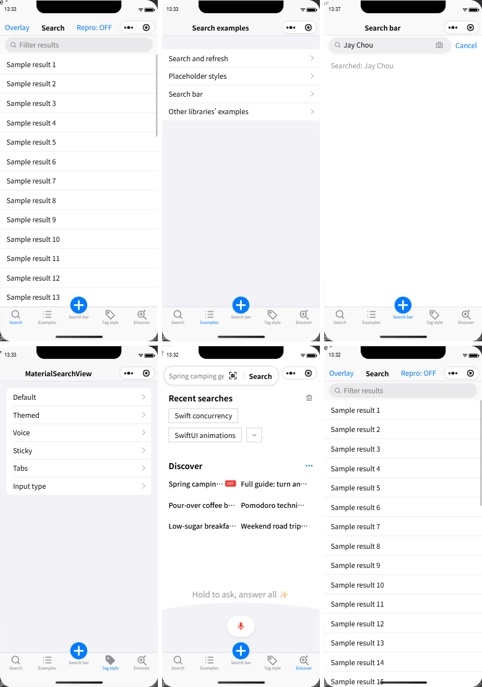
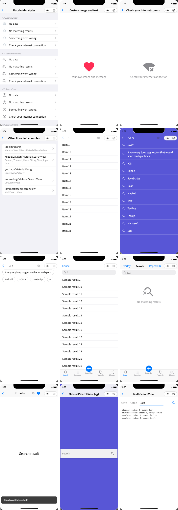
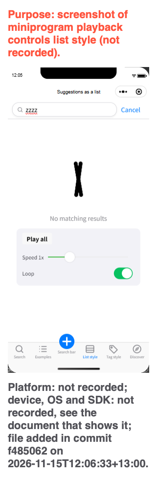

# WeChat Mini Program API alignment

## DONE (2026-11-15; TODO 2026-11-15): mini program core aligned with every iOS public API; example with CYLTabBarController's mini program tab bar

- Branch: `feat/swift-core` (PR #8). Package: `CrossPlatform/wechat-miniprogram-cylsearch`.
- Prompt (verbatim): "item1 完善 core核心代码 对标 iOS端所有公开API ，然后完善 example ，并使用CYLTabBarController 微信小程序端的组件用来做tabbar item2 你先帮我创建工程，我再用ide打开，然后再进行下一步使用模拟器打开项目"
- Prompt (English): "Item 1: complete the core code, matching every public iOS API; then complete the example, using
  CYLTabBarController's WeChat Mini Program component as the tab bar. Item 2: first create the project for me; I open
  it in the IDE, then the next step opens the project in the simulator."
- Requirements:
  1. The mini program core (`src/`) has a counterpart for every public declaration of
     `Sources/CYLSearchViewController/*.swift`, or a stated N/A; a generated table here, scored to 100.
  2. The example covers the features like the other platforms' examples (search, examples, search bar, list style,
     tag style, discover), one tab each.
  3. The example's tab bar is CYLTabBarController's mini program component (`cyl-tabbar-miniprogram`), pinned by
     commit.
  4. Item 2 (HarmonyOS): the project in a permanent folder the user opens in DevEco Studio:
     `~/develop/CYLSearchViewController-swift-core/harmonyos` (the `feat/swift-core` worktree, moved there on
     2026-11-15); signing and the emulator run come next.
- Context: the HarmonyOS models (`harmonyos/cylsearch/src/main/ets`) already match the iOS API at 397/397; the mini
  program core is ported from them to JavaScript. The table script follows `scripts/harmonyos-api-alignment.py`.
- Progress (2026-11-15): core DONE. `src/core/` holds the HarmonyOS models ported to CommonJS (the UI structs cut
  off, the types stripped by the TypeScript compiler, then edited by hand): storage on `wx.setStorageSync` (database:
  a key per cache; user defaults: one shared key) and `wx.getFileSystemManager()` (sandbox file);
  `CYLSearchResources` / `CYLSearchResourceReference` (`$r`) on generated string tables and `src/images/*.svg`;
  `CYLSearchPlatform` gives the ArkUI names the models use (`animateTo`, `TextInputController`, `focusControl`,
  `InputType`…). New component `cyl-search-bar-item` (iOS `CYLSearchBarItemView`); `cyl-search-bar` gets the
  `leading` / `trailing` slots and a default search icon. Table below: 397/397, 100/100. Node tests 14/14
  (`test/core.test.js` 6). Next: the example with CYLTabBarController's mini program tab bar.
- Progress (2026-11-15): example DONE. Five tab pages and the plus button's page (`pages/plus`, opened with
  `wx.navigateTo`, since a mini program has at most five tab pages). The tab bar is `cyl-tab-bar` of
  CYLTabBarController pinned at `a8e5305` (`package.json` `cylTabBarControllerCommit`, fetched by
  `scripts/sync-example.js`), configured with the iOS and Android examples' keys (`utils/cyl_search_tabs.js`), with a
  raised plus button. Verified in WeChat DevTools (base library 3.6.6) with `scripts/devtools-screenshots.js`: every
  tab, the empty-cache placeholder with the keyboard down, filtering, "No matching results", the Discover items, and
  the plus page's plain, bordered and slotted bars; no console errors. The script waits for the first page before
  relaunching (an earlier relaunch fails with "Uncaught").

  

- Progress (2026-11-15, later): Lottie placeholders DONE. `cyl-search` has an optional abstract node
  `cyl-animation-view` (default: `cyl-search-animation-placeholder`, draws nothing) and the properties
  `emptySuggestionsAnimation` / `emptyResultsAnimation`. The example passes `cyl-lottie` (CYLTabBarController's
  `cyl-lottie-miniprogram`, same pinned commit, installed by `scripts/sync-example.js`) with
  `CYLPlaceholderNoDrafts.json` (Tag style, empty cache) and `CYLPlaceholderNoResults.json` (List style, no results),
  copied from CYLTableViewPlaceHolder with `LICENSE.lottie-ios`, `LICENSE.useanimations` and `NOTICE.animations`.
  Verified in WeChat DevTools: both draw above their text (screens 2 and 4 of the screenshot); single frames only, motion
  not measured. The screenshot script retries the first relaunch after a compile.
- Status: DONE (2026-11-15).

## DONE (2026-11-15): the example is a 1:1 copy of the iOS example

- Branch: `feat/swift-core-next` (PR #9). Code: [`d19e0bb`](https://github.com/ChenYilong/CYLSearchViewController/commit/d19e0bb).
- Prompt (verbatim): "小程序example层要一比一复刻"
- Prompt (English): "The mini program's example layer must replicate [the iOS example] one to one."
- Reading: the reference is the iOS example (`CYLSearchExample`), the one every other port follows. Before, the mini
  program example had its own simplified pages (five tabs, one of them a List style tab iOS does not have).
- Requirements:
  1. The same tabs (`CYLTabBarConfiguration.json`: four tabs and the plus button's page), the same pages, the same
     texts in the same languages (en, ja, zh-Hans, zh-Hant), the same data and images, the same interactions.
  2. The example passes only data, style parameters and taps; what it needs that the core lacks goes into the core
     (`AGENTS.md`, "Swift core: examples adapt to the core", and "change the core when an example needs it").
- Resources: `scripts/import-ios-resources.js` reads `Resources/CYLSearchViewController.bundle` (texts, the 41
  placeholder images into `src/images/placeholder/` with their licenses), `CYLSearchTabs.bundle` and
  `CYLSearchDiscover.bundle` (texts, `search-discover.json`, the localized hot icons) into
  `example/miniprogram/utils/cyl_demo_resources.js`; `utils/cyl_demo_text.js` fills the iOS formats (`%@`, `%lu`,
  `%1$lu`).

| iOS (`CYLSearchExample`) | Mini program (`example/miniprogram`) |
| :--- | :--- |
| `CYLTabBarConfiguration.json`: Search, Examples, Tag style, Discover, plus button "Search bar" | `utils/cyl_search_tabs.js` (the same keys and titles); the plus button's `plus` page is a tab page, as on iOS |
| `CYLSearchExampleViewController` (Issue #1317: Overlay, Repro ON/OFF, pull to refresh, 40 sample results, "No matching results") | `demo-components/cyl-demo-reproduction` in `pages/search` (tab) and `pages/reproduction` (pushed) |
| `CYLSearchController` overlay | core `cyl-search-controller` |
| `CYLSearchDemoMenuViewController` (4 rows) | `pages/examples` |
| `CYLSearchPlaceholderGalleryViewController` (41 styles × 4 messages, 3 custom rows) and its detail | `pages/styles`, `pages/placeholderDetail`; core `cyl-search-placeholder` |
| `CYLSearchBarDemoViewController` (Cancel, shadow, camera, "Text: …", "Searched: …") | `demo-components/cyl-demo-search-bar` in `pages/plus` (tab) and `pages/searchBar` (pushed) |
| `CYLSearchPortsViewController` (5 rows) | `pages/ports` |
| `CYLLapismSearchViewController` | `pages/lapism` (bar as a button, results in `cyl-search`'s `content` slot) |
| `CYLMaterialSearchMenuViewController` and `CYLMaterialSearchSampleViewController` (Default, Themed, Voice, Sticky, Tabs, Input type) | `demo-components/cyl-demo-material-menu`, `pages/materialMenu`, `pages/materialSample`, `utils/cyl_material_samples.js` |
| `CYLSuggestionDemoPages.tagStyleViewController` (the same samples, tags, keyboard down) | `pages/tagStyle` |
| `CYLYechaoaSearchViewController` | `pages/yechaoa` (iconified bar in the navigation bar, submit button, snackbar, result) |
| `CYLRevealSearchViewController` | `pages/reveal` (circular reveal over 1 s from a centered button) |
| `CYLMultiSearchDemoViewController` | `pages/multiSearch`; core `cyl-multi-search` |
| `CYLSearchDiscoverViewController` (recent searches folded inline, discover grid, More, hold to ask) | `pages/discover`, `utils/cyl_discover_logic.js`; core `cyl_tag_fold.js` |
| `CYLSnackbar`, `UINavigationBar` items | `demo-components/cyl-demo-snackbar`, `demo-components/cyl-demo-nav` |

- Core changes for the example: `cyl-search-bar` (navigation button, voice, submit and clear buttons, field look,
  `editable`, iconified states with fade or circular reveal, `setText`, `setIconified`); `cyl-search` (back arrow
  instead of Cancel as on iOS, colors, voice, `content` slot, `closesOnSubmit`, `setQuery`, `coversNavigationBar`, the
  inline tag fold measured from the real tag widths); new `cyl-search-placeholder`, `cyl-search-controller`,
  `cyl-multi-search`.
- Platform differences (no iOS counterpart possible):
  - WeChat's menu button (the capsule) stays at the top trailing corner of every page. Pages use
    `"navigationStyle": "custom"`; a bar that takes the navigation bar's place (the search page, the overlay, the
    Discover bar) is centered on the capsule and ends before it (`cyl_navigation_metrics.js`).
  - Speech recognition needs a plugin: the Voice sample shows "Speech recognition is not available." as iOS does when
    recognition is unavailable. Hold to ask changes the hint only, as on iOS.
  - The camera of the Discover bar opens a modal with the iOS alert's texts.
- Verified in WeChat DevTools 2.02.2609250 (base library 3.6.6, Windows 11 Pro 10.0.22631) with `wechatide-skill`: all
  18 pages and 11 interactions (the overlay filtering, Repro ON with no results, the Themed sample's suggestions, the
  tags folded and unfolded, the snackbar after a submit, lapism's filtered content, yechaoa's expanded bar and result,
  the circular reveal, MultiSearchView's items and event log, the search bar's "Searched: …", Discover's search, More
  and fold). The console has no error. One warning stays after dozens of relaunches in a row: "21 listeners of event
  ThemeChange", from CYLTabBarController's `cyl-tab-bar` (it adds the listener when attached and removes it when
  detached); not fixed here. Node tests 26/26.

| Platform | Screenshot | Environment |
| :--- | :--- | :--- |
| Mini program |  | Left to right, top to bottom: Search tab, Examples tab, Search bar tab after a search, Tag style tab, Discover tab, the pushed reproduction ("Overlay" in place of the back button). Windows 11 Pro 10.0.22631; WeChat DevTools 2.02.2609250 simulator (390 x 844 window, screenshots at 289 x 625 px); base library 3.6.6; [`d19e0bb`](https://github.com/ChenYilong/CYLSearchViewController/commit/d19e0bb); 2026-11-15 13:22–13:38 NZDT (UTC+13) |
| Mini program |  | Placeholder styles; custom image and text; NoInternet with the network message; Other libraries' examples; lapism filtered; Themed suggestions; tags folded; the overlay filtering; Repro ON with no results; yechaoa after a submit (snackbar); the circular reveal opened; MultiSearchView with its event log. Same environment |

## DONE (2026-11-15): playback controls on the animated placeholders; WeChat DevTools Skills

Update (2026-11-15, 1:1 example): the List style tab is gone (iOS has none); the playback controls are on every
MaterialSearchView sample (`pages/materialSample`), the pages that show the animated placeholders.

- Branch: `feat/swift-core-next` (based on `feat/swift-core` at `bab8444`).
- Prompt (verbatim): "基于新分支 开始下微信小程序开发。找到docs里面任何提及微信小程序的信息开始开发。找到crossplatorm
  相关文件夹，没有就新建，新建或者更微信小程序开发。微信小程序开发者工具Skills ，根据文档"
- Prompt (English): "On the new branch, start the WeChat Mini Program work: begin from everything in docs that
  mentions the mini program; find the CrossPlatform folder (create it if missing) and create or update the mini
  program there; use the WeChat DevTools Skills, following the documentation."
- Requirements, from the docs: `AGENTS.md`, "Animation examples: playback controls" (every example page that shows
  animations offers "Play all", a speed slider and a loop switch, applied live, with accessibility labels; change the
  core when an example needs it), and the `AGENTS.md` TODO to install the DevTools Skills
  (<https://developers.weixin.qq.com/miniprogram/dev/devtools/Skills.html>).
- Core: `cyl-search` gets `animationSpeed` (0.25 to 3, rounded to 0.25), `animationLoops`, `playAnimationFromStart()`
  and the slot `placeholder-footer` under the empty placeholder. The strategy without views is
  `src/cyl-search/cyl_search_animation_playback.js` (Node tests 3; all 17/17).
- Example: List style (no results) and Tag style (empty cache) put the controls in that slot
  (`utils/cyl_animation_controls.js`; the slider counts quarter steps 1 to 12).
- `scripts/sync-example.js` checks out only the two mini program folders of CYLTabBarController (sparse checkout):
  the full checkout failed on Windows with "Filename too long".
- DevTools Skills: `wechatide-skill` 0.3.11 ships with WeChat DevTools 2.02.2609250 and is linked into
  `~/.claude/skills`; `check_wechatide_status` gives `versionRelation: equal`. On Windows `wechatide` is not on `PATH`:
  call `C:\Program Files (x86)\Tencent\微信web开发者工具\wechatide.cmd` (the skill's own install check reports
  `cli_unavailable` because it does not quote that path). The CLI needs the service port on (Settings → Security)
  and a logged-in DevTools.
- Verified with the skill's automation tools: the slider set to 2x and the loop switched off reach the Lottie player
  (`playSpeed` 2, `loop` false); switching the loop on resumes playback; "Play all" plays again with the loop off;
  the console buffer has no line at all (no error, no warning).

| Platform | Screenshot | Environment |
| :--- | :--- | :--- |
| Mini program |  | Windows 11 Pro 10.0.22631; WeChat DevTools 2.02.2609250 simulator (iPhone frame, original 289 x 625 px); base library 3.6.6; branch `feat/swift-core-next` on `bab8444`; 2026-11-15 12:05 NZDT (UTC+13) |
| Mini program |  | Same; 2026-11-15 12:05 NZDT (UTC+13) |

<!-- miniprogram-api-alignment:begin -->
Rows: 397; implemented or N/A 397, TODO 0; score 100/100.

| iOS public API | Doc comment | Mini program |
| :--- | :--- | :--- |
| **protocol `CYLMultiSearchViewDelegate`** | Events of a `CYLMultiSearchView` (iammert `MultiSearchViewListener`). | `CYLMultiSearchViewDelegate` |
| `CYLMultiSearchViewDelegate.-multiSearchView:textDidChange:atIndex:` | The text of the search being typed changed (`onTextChanged`). | `CYLMultiSearchViewDelegate.multiSearchViewTextDidChange` |
| `CYLMultiSearchViewDelegate.-multiSearchView:didCompleteSearch:atIndex:` | A search was completed and became an item (`onSearchComplete`). | `CYLMultiSearchViewDelegate.multiSearchViewDidCompleteSearch` |
| `CYLMultiSearchViewDelegate.-multiSearchView:didRemoveItemAtIndex:` | An item was removed (`onSearchItemRemoved`). | `CYLMultiSearchViewDelegate.multiSearchViewDidRemoveItemAtIndex` |
| `CYLMultiSearchViewDelegate.-multiSearchView:didSelectItem:atIndex:` | An item was selected by a tap (`onItemSelected`). | `CYLMultiSearchViewDelegate.multiSearchViewDidSelectItem` |
| **class `CYLMultiSearchView`** | Several searches side by side (iammert `MultiSearchView`): the search button starts a new search; a completed search becomes an item in a horizontally scrolling row, with an indicator under the selected item and a remove button on it. Us… | `CYLMultiSearchView` |
| `CYLMultiSearchView.delegate` | Receives the events. | `CYLMultiSearchView.delegate` |
| `CYLMultiSearchView.selectedIndex` | The selected item, or `NSNotFound` when there is none. | `CYLMultiSearchView.selectedIndex` |
| `CYLMultiSearchView.inSearchMode` | YES while a new search is being typed (`isInSearchMode`). | `CYLMultiSearchView.isInSearchMode` |
| `CYLMultiSearchView.searchButton` | The button at the trailing end: it starts a search, or completes the one being typed. | N/A: the mini program has no view objects; `<cyl-multi-search>` draws it (`searchImage`) |
| `CYLMultiSearchView.placeholder` | The placeholder of a new search (`android:hint`). "Search" by default. | `CYLMultiSearchView.placeholder` |
| `CYLMultiSearchView.font` | The font of the items (`android:textSize`). The body text style by default, following Dynamic Type. | `CYLMultiSearchView.font` |
| `CYLMultiSearchView.textColor` | The text color (`android:textColor`). `labelColor` by default. | `CYLMultiSearchView.textColor` |
| `CYLMultiSearchView.placeholderColor` | The placeholder color (`android:textColorHint`). `placeholderTextColor` by default. | `CYLMultiSearchView.placeholderColor` |
| `CYLMultiSearchView.maximumTextLength` | The longest search a person can type (`android:maxLength`); 0 means no limit. 0 by default. | `CYLMultiSearchView.maximumTextLength` |
| `CYLMultiSearchView.minimumTextLength` | A search shorter than this is dropped when it is completed. 3 by default, as in MultiSearchView. | `CYLMultiSearchView.minimumTextLength` |
| `CYLMultiSearchView.returnKeyType` | The return key (`android:imeOptions`). `UIReturnKeySearch` by default. | `CYLMultiSearchView.returnKeyType` |
| `CYLMultiSearchView.keyboardType` | The keyboard (`android:inputType`). `UIKeyboardTypeDefault` by default. | `CYLMultiSearchView.keyboardType` |
| `CYLMultiSearchView.autocapitalizationType` | Capitalization (`textCapSentences`). `UITextAutocapitalizationTypeSentences` by default. | N/A: the mini program `<input>` has no capitalization trait |
| `CYLMultiSearchView.indicatorColor` | The color of the indicator under the selected item and of the buttons. `tintColor` by default. | `CYLMultiSearchView.indicatorColor` |
| `CYLMultiSearchView.unselectedItemAlpha` | The opacity of items that are not selected. 0.5 by default. | `CYLMultiSearchView.unselectedItemAlpha` |
| `CYLMultiSearchView.searchFieldWidth` | The width of the field for a new search, in points. 160 by default. | `CYLMultiSearchView.searchFieldWidth` |
| `CYLMultiSearchView.animationDuration` | The length of the animations, in seconds. 0.25 by default. | `CYLMultiSearchView.animationDuration` |
| `CYLMultiSearchView.searchImage` | The search button's icon. `magnifyingglass` by default. | `CYLMultiSearchView.searchImage` |
| `CYLMultiSearchView.removeImage` | The remove button's icon. `xmark.circle.fill` by default. | `CYLMultiSearchView.removeImage` |
| `CYLMultiSearchView.searchTexts` | The texts of the items, completed searches first, then the one being typed. | `CYLMultiSearchView.searchTexts` |
| `CYLMultiSearchView.init(frame:)` | — | `new CYLMultiSearchView(…)` |
| `CYLMultiSearchView.init(coder:)` | — | N/A: no archives in the mini program (the state is restored with `decodeRestorableState`) |
| `CYLMultiSearchView.tintColorDidChange()` | — | N/A: system colors follow the theme by themselves (`indicatorColor` overrides) |
| `CYLMultiSearchView.traitCollectionDidChange(_:)` | — | N/A: system colors (the page styles) follow the color mode by themselves |
| `CYLMultiSearchView.intrinsicContentSize` | — | `CYLMultiSearchView.intrinsicContentSize` |
| `CYLMultiSearchView.layoutSubviews()` | — | N/A: the mini program lays a component out from its declaration |
| `CYLMultiSearchView.search()` | Starts a new search and shows the keyboard (`search`). Does nothing while a search is being typed. | `CYLMultiSearchView.search` |
| `CYLMultiSearchView.completeSearch()` | Completes the search being typed (`completeSearch`): it becomes the selected item, or is dropped when shorter than `minimumTextLength`. | `CYLMultiSearchView.completeSearch` |
| `CYLMultiSearchView.addSearchText(_:)` | Adds a completed search without typing it and selects it. | `CYLMultiSearchView.addSearchText` |
| `CYLMultiSearchView.selectItem(at:)` | Selects an item, like a tap on it. | `CYLMultiSearchView.selectItemAtIndex` |
| `CYLMultiSearchView.removeItem(at:)` | Removes an item, like a tap on its remove button. | `CYLMultiSearchView.removeItemAtIndex` |
| `CYLMultiSearchView.textFieldShouldBeginEditing(_:)` | Only the search being typed is editable; a tap on a completed one selects it. | N/A: a UIKit protocol conformance (the components report the same events to the model) |
| `CYLMultiSearchView.textFieldShouldReturn(_:)` | The return key completes the search. | N/A: a UIKit protocol conformance (the components report the same events to the model) |
| `CYLMultiSearchView.textField(_:shouldChangeCharactersIn:replacementString:)` | Enforces `maximumTextLength`. | N/A: a UIKit protocol conformance (the components report the same events to the model) |
| **enum `CYLSearchBarItemStyle`** | How an item appended to a search bar looks, like the FlatDesign tab bar's item appearance. | `CYLSearchBarItemStyle` |
| `CYLSearchBarItemStyle.icon` | An icon button with a 36 pt touch area (a camera, a filter). | `CYLSearchBarItemStyle.icon` |
| `CYLSearchBarItemStyle.divider` | A thin vertical line between two items; it takes no taps and VoiceOver skips it. | `CYLSearchBarItemStyle.divider` |
| `CYLSearchBarItemStyle.text` | A text button (a "Search" button); an image, when set, comes before the title. | `CYLSearchBarItemStyle.text` |
| **enum `CYLSearchBarStyle`** | The fixed look of the whole bar: the field on the left stays, the items are appended after its text. | `CYLSearchBarStyle` |
| `CYLSearchBarStyle.plain` | The field as configured by its own properties (the default; nothing is changed). | `CYLSearchBarStyle.plain` |
| `CYLSearchBarStyle.bordered` | A capsule with a 1 pt separator-colored border on the system background, the field and its items inside one outline (the Discover search bar). | `CYLSearchBarStyle.bordered` |
| **class `CYLSearchBarItem`** | One element after the text of a `CYLSearchBarView`: a model independent of its view, like `CYLFlatDesignTabBarItem`. Append it with `-[CYLSearchBarView addItem:]`; its view is `itemView`. | `CYLSearchBarItem` |
| `CYLSearchBarItem.style` | How the item looks (icon, divider or text); set when the item is created. | `CYLSearchBarItem.style` |
| `CYLSearchBarItem.title` | The text of a text item, and the VoiceOver label of an icon item without `accessibilityLabel`. | `CYLSearchBarItem.title` |
| `CYLSearchBarItem.image` | The icon (a template image is tinted with `tintColor`). | `CYLSearchBarItem.image` |
| `CYLSearchBarItem.selectedImage` | The icon while `selected` is YES; nil uses `image`. | `CYLSearchBarItem.selectedImage` |
| `CYLSearchBarItem.animatedImage` | An animated icon (`+[UIImage animatedImageWithImages:duration:]`), drawn instead of `image` when set. | `CYLSearchBarItem.animatedImage` |
| `CYLSearchBarItem.imageSize` | The icon size; zero uses 20 x 20 pt. | `CYLSearchBarItem.imageSize` |
| `CYLSearchBarItem.itemAccessibilityLabel` | What VoiceOver reads; nil reads `title`. | `CYLSearchBarItem.itemAccessibilityLabel` |
| `CYLSearchBarItem.itemAccessibilityIdentifier` | A test identifier for the item view. | `CYLSearchBarItem.itemAccessibilityIdentifier` |
| `CYLSearchBarItem.isEnabled` | NO dims the item and ignores taps. YES by default. | `CYLSearchBarItem.isEnabled` |
| `CYLSearchBarItem.isSelectable` | YES makes each tap toggle `selected` (a filter that stays on). NO by default. | `CYLSearchBarItem.isSelectable` |
| `CYLSearchBarItem.isSelected` | The selected state (drawn with `selectedImage`, `selectedBackgroundColor` and the selected title attributes). | `CYLSearchBarItem.isSelected` |
| `CYLSearchBarItem.tintColor` | The icon and title color; nil uses the bar's `itemTintColor`. | `CYLSearchBarItem.tintColor` |
| `CYLSearchBarItem.backgroundColor` | The item background; nil is clear. | `CYLSearchBarItem.backgroundColor` |
| `CYLSearchBarItem.selectedBackgroundColor` | The item background while selected; nil uses `backgroundColor`. | `CYLSearchBarItem.selectedBackgroundColor` |
| `CYLSearchBarItem.contentInsets` | Space around the icon and title inside the item; `UIEdgeInsetsZero` uses the style's default. | `CYLSearchBarItem.contentInsets` |
| `CYLSearchBarItem.imagePositionAdjustment` | Moves the icon without changing the item's size. | `CYLSearchBarItem.imagePositionAdjustment` |
| `CYLSearchBarItem.titlePositionAdjustment` | Moves the title without changing the item's size. | `CYLSearchBarItem.titlePositionAdjustment` |
| `CYLSearchBarItem.badgeValue` | The badge text; nil hides the badge, an empty string draws a dot. | `CYLSearchBarItem.badgeValue` |
| `CYLSearchBarItem.badgeColor` | The badge background; nil is system red. | `CYLSearchBarItem.badgeColor` |
| `CYLSearchBarItem.badgeSize` | The smallest badge size; zero uses 16 x 16 pt (a dot is 8 x 8 pt). | `CYLSearchBarItem.badgeSize` |
| `CYLSearchBarItem.badgeContentInsets` | Space around the badge text. | `CYLSearchBarItem.badgeContentInsets` |
| `CYLSearchBarItem.badgePositionAdjustment` | Moves the badge from the icon's top trailing corner. | `CYLSearchBarItem.badgePositionAdjustment` |
| `CYLSearchBarItem.handler` | Called on each tap, after `-searchBarView:didSelectItem:`. | `CYLSearchBarItem.handler` |
| `CYLSearchBarItem.index` | The item's position in its bar's `items`; `NSNotFound` when it is in no bar. | `CYLSearchBarItem.index` |
| `CYLSearchBarItem.init(style:title:image:)` | An item of the given style with a title and an icon. | `new CYLSearchBarItem(…)` |
| `CYLSearchBarItem.init(title:image:)` | An icon item, or a text item when the title is set and the image is nil. | `new CYLSearchBarItem(…)` |
| `CYLSearchBarItem.init(title:image:selectedImage:)` | Like `-initWithTitle:image:`, with an icon for the selected state. | `new CYLSearchBarItem(…)` |
| `CYLSearchBarItem.iconItem(image:title:handler:)` | An icon item: the title is what VoiceOver reads. | `CYLSearchBarItem.iconItem` |
| `CYLSearchBarItem.textItem(title:handler:)` | A text item (a "Search" button). | `CYLSearchBarItem.textItem` |
| `CYLSearchBarItem.divider()` | A divider between two items. | `CYLSearchBarItem.divider` |
| `CYLSearchBarItem.item(dictionary:)` | An item from plain values, for the cross-platform wrappers (Flutter, React Native): `style` (`icon`, `divider`, `text`), `title`, `image` (`camera`, `mic`, `search`, `back`, else an asset or SF Symbol name), `accessibilityIdentifier`, `i… | `CYLSearchBarItem.item` |
| `CYLSearchBarItem.setTitleTextAttributes(_:for:)` | The title attributes for a state (`UIControlStateNormal`, `UIControlStateSelected`, `UIControlStateDisabled`). | `CYLSearchBarItem.setTitleTextAttributes` |
| `CYLSearchBarItem.titleTextAttributes(for:)` | The title attributes set for a state, or nil. | `CYLSearchBarItem.titleTextAttributes` |
| `CYLSearchBarItem.setBadgeTextAttributes(_:for:)` | The badge text attributes for a state. | `CYLSearchBarItem.setBadgeTextAttributes` |
| `CYLSearchBarItem.badgeTextAttributes(for:)` | The badge text attributes set for a state, or nil. | `CYLSearchBarItem.badgeTextAttributes` |
| `CYLSearchBarItem.actualBadgeSuperView()` | The view the badge is drawn in (the item view). | N/A: the mini program has no view objects; the badge is drawn by `<cyl-search-bar>` |
| **class `CYLSearchBarItemView`** | The view of a `CYLSearchBarItem` (a control), like `CYLFlatDesignTabBarButton`. | `<cyl-search-bar-item>` (component) |
| `CYLSearchBarItemView.item` | The item this view draws. | `<cyl-search-bar-item item="…">` (its `item` property) |
| `CYLSearchBarItemView.imageView` | The icon. | N/A: the mini program has no view objects; `<cyl-search-bar>` draws it from the properties |
| `CYLSearchBarItemView.titleLabel` | The title of a text item. | N/A: the mini program has no view objects; `<cyl-search-bar>` draws it from the properties |
| `CYLSearchBarItemView.badgeLabel` | The badge (`badgeValue`). | N/A: the mini program has no view objects; `<cyl-search-bar>` draws it from the properties |
| `CYLSearchBarItemView.init(item:)` | The view for an item; the item's `itemView` is the one the bar shows. | `<cyl-search-bar>` draws each item of `items` (`CYLSearchBarItem.itemDictionary()`) |
| `CYLSearchBarItemView.init(coder:)` | Not supported: an item view is created from its item. | N/A: no archives in the mini program (the state is restored with `decodeRestorableState`) |
| `CYLSearchBarItemView.actualBadgeSuperView()` | The view the badge is drawn in (this view). | N/A: the mini program has no view objects; the badge is drawn by `<cyl-search-bar>` |
| `CYLSearchBarItemView.traitCollectionDidChange(_:)` | — | N/A: system colors (the page styles) follow the color mode by themselves |
| `CYLSearchBarItemView.intrinsicContentSize` | — | N/A: the mini program measures `<cyl-search-bar>` from its content (36 px minimum) |
| `CYLSearchBarItemView.sizeThatFits(_:)` | — | N/A: the mini program measures a component from its declaration (`intrinsicContentSize` gives the height) |
| `CYLSearchBarItemView.layoutSubviews()` | — | N/A: the mini program lays a component out from its declaration |
| **enum `CYLSearchBarNavigationIcon`** | The icon of the navigation button before the field (lapism `NavigationIconCompat`). | `CYLSearchBarNavigationIcon` |
| `CYLSearchBarNavigationIcon.none` | No navigation button. | `CYLSearchBarNavigationIcon.none` |
| `CYLSearchBarNavigationIcon.arrow` | A back arrow (`chevron.backward`). | `CYLSearchBarNavigationIcon.arrow` |
| `CYLSearchBarNavigationIcon.search` | A magnifier (`magnifyingglass`). | `CYLSearchBarNavigationIcon.search` |
| **enum `CYLSearchBarIconPosition`** | Where the search button sits while the bar is iconified. | `CYLSearchBarIconPosition` |
| `CYLSearchBarIconPosition.trailing` | At the trailing end, like an Android `SearchView` in a toolbar. | `CYLSearchBarIconPosition.trailing` |
| `CYLSearchBarIconPosition.center` | In the middle, like a floating action button that opens a search card. | `CYLSearchBarIconPosition.center` |
| `CYLSearchBarIconPosition.leading` | At the leading end. | `CYLSearchBarIconPosition.leading` |
| **enum `CYLSearchBarExpansionAnimation`** | How the field opens and closes when `iconified` changes with animation. | `CYLSearchBarExpansionAnimation` |
| `CYLSearchBarExpansionAnimation.fade` | The field grows from the icon and fades in. | `CYLSearchBarExpansionAnimation.fade` |
| `CYLSearchBarExpansionAnimation.circularReveal` | A circle grows from the icon until it uncovers the whole field (Material circular reveal). | `CYLSearchBarExpansionAnimation.circularReveal` |
| **protocol `CYLSearchBarViewDelegate`** | Events of a `CYLSearchBarView`. | `CYLSearchBarViewDelegate` |
| `CYLSearchBarViewDelegate.-searchBarViewShouldBeginEditing:` | Asks whether a tap may start editing. Return NO to use the bar as a button that opens another search page (lapism `MaterialSearchBar.setOnClickListener`); `-searchBarViewDidTapWhileNotEditable:` is called instead. | `CYLSearchBarViewDelegate.searchBarViewShouldBeginEditing` |
| `CYLSearchBarViewDelegate.-searchBarViewDidTapWhileNotEditable:` | The bar was tapped while `-searchBarViewShouldBeginEditing:` refused editing. | `CYLSearchBarViewDelegate.searchBarViewDidTapWhileNotEditable` |
| `CYLSearchBarViewDelegate.-searchBarViewDidBeginEditing:` | Editing started. | `CYLSearchBarViewDelegate.searchBarViewDidBeginEditing` |
| `CYLSearchBarViewDelegate.-searchBarViewDidEndEditing:` | Editing ended. | `CYLSearchBarViewDelegate.searchBarViewDidEndEditing` |
| `CYLSearchBarViewDelegate.-searchBarView:textDidChange:` | The text changed (typing, the clear button, Cancel with `clearsTextOnCancel`). | `CYLSearchBarViewDelegate.searchBarViewTextDidChange` |
| `CYLSearchBarViewDelegate.-searchBarViewSearchButtonClicked:` | The keyboard's Search key. | `CYLSearchBarViewDelegate.searchBarViewSearchButtonClicked` |
| `CYLSearchBarViewDelegate.-searchBarViewCancelButtonClicked:` | Cancel was tapped. | `CYLSearchBarViewDelegate.searchBarViewCancelButtonClicked` |
| `CYLSearchBarViewDelegate.-searchBarViewNavigationButtonClicked:` | The navigation button before the field (`navigationIcon`, `navigationImage`). | `CYLSearchBarViewDelegate.searchBarViewNavigationButtonClicked` |
| `CYLSearchBarViewDelegate.-searchBarViewVoiceButtonClicked:` | The voice button (`showsVoiceButton`). Start speech recognition here and pass the result to `-setText:submit:`. | `CYLSearchBarViewDelegate.searchBarViewVoiceButtonClicked` |
| `CYLSearchBarViewDelegate.-searchBarView:shouldSubmitText:` | Asks whether the query may be submitted (the Search key, the submit button or `-setText:submit:` with YES). Return NO to keep it. Without this method, every non-empty query is submitted. | `CYLSearchBarViewDelegate.searchBarViewShouldSubmitText` |
| `CYLSearchBarViewDelegate.-searchBarView:didChangeIconified:` | The field opened or closed (`iconified`). | `CYLSearchBarViewDelegate.searchBarViewDidChangeIconified` |
| `CYLSearchBarViewDelegate.-searchBarView:didSelectItem:` | An appended item was tapped (`-[CYLSearchBarView addItem:]`), like `-tabBar:didSelectItem:`. | `CYLSearchBarViewDelegate.searchBarViewDidSelectItem` |
| **class `CYLSearchBarView`** | A configurable search bar: a rounded field with a magnifier, text and clear button, views of the host inside the field after the text (a camera, a "Search" button) or before the field (a back button), and an optional Cancel button. Use i… | `CYLSearchBarView` |
| `CYLSearchBarView.delegate` | Receives the events. | `CYLSearchBarView.delegate` |
| `CYLSearchBarView.textField` | The text field inside the field. | `CYLSearchBarView.textField` |
| `CYLSearchBarView.fieldView` | The rounded field that holds the magnifier, the text and `trailingAccessoryViews`. | N/A: the mini program has no view objects; `<cyl-search-bar>` draws it from the properties |
| `CYLSearchBarView.searchIconView` | The magnifier at the start of the field (decorative: hidden from VoiceOver). | N/A: the mini program has no view objects; `<cyl-search-bar>` draws it from the properties |
| `CYLSearchBarView.cancelButton` | The Cancel button after the field (`showsCancelButton`). | N/A: the mini program has no view objects; `<cyl-search-bar>` draws it from the properties |
| `CYLSearchBarView.placeholderLabel` | Draws the placeholder at the full font size, cut off with an ellipsis when it does not fit. | N/A: the mini program has no view objects; `<cyl-search-bar>` draws it from the properties |
| `CYLSearchBarView.navigationButton` | The button before the field. It is shown when `navigationIcon` is not none or `navigationImage` is set, and `leadingView` is nil; taps call `-searchBarViewNavigationButtonClicked:` and `navigationHandler`. | N/A: the mini program has no view objects; `<cyl-search-bar>` draws it from the properties |
| `CYLSearchBarView.voiceButton` | A microphone inside the field, shown while the text is empty; it calls `-searchBarViewVoiceButtonClicked:`. | N/A: the mini program has no view objects; `<cyl-search-bar>` draws it from the properties |
| `CYLSearchBarView.submitButton` | A submit button inside the field, shown while there is text; it submits the query like the Search key. | N/A: the mini program has no view objects; `<cyl-search-bar>` draws it from the properties |
| `CYLSearchBarView.iconButton` | The button shown while `iconified` is YES. VoiceOver reads it as "Search". | N/A: the mini program has no view objects; `<cyl-search-bar>` draws it from the properties |
| `CYLSearchBarView.text` | The text of the field. | `CYLSearchBarView.text` |
| `CYLSearchBarView.placeholder` | The placeholder, drawn by `placeholderLabel` and kept on the text field for VoiceOver. | `CYLSearchBarView.placeholder` |
| `CYLSearchBarView.font` | The font of the text, the placeholder and Cancel. The body text style by default, following Dynamic Type; a custom font is used as given (pass a `UIFontMetrics` font to scale it). | `CYLSearchBarView.font` |
| `CYLSearchBarView.textColor` | The text color. `labelColor` by default. | `CYLSearchBarView.textColor` |
| `CYLSearchBarView.placeholderColor` | The placeholder color. `placeholderTextColor` when nil. | `CYLSearchBarView.placeholderColor` |
| `CYLSearchBarView.cursorColor` | The color of the text cursor (MaterialSearchView `setCursorDrawable`). The tint color by default. | `CYLSearchBarView.cursorColor` |
| `CYLSearchBarView.fieldHeight` | The height of the field; it grows when the scaled text needs more. 36 by default. | `CYLSearchBarView.fieldHeight` |
| `CYLSearchBarView.contentInsets` | The space around the field. (6, 12, 6, 12) by default. | `CYLSearchBarView.contentInsets` |
| `CYLSearchBarView.fieldBackgroundColor` | The field's background. `tertiarySystemFillColor` by default. | `CYLSearchBarView.fieldBackgroundColor` |
| `CYLSearchBarView.fieldCornerRadius` | The field's corner radius; negative makes a capsule. -1 by default. | `CYLSearchBarView.fieldCornerRadius` |
| `CYLSearchBarView.fieldBorderColor` | The field's border color; nil draws no border. | `CYLSearchBarView.fieldBorderColor` |
| `CYLSearchBarView.fieldBorderWidth` | The field's border width, used with `fieldBorderColor`. 0 by default. | `CYLSearchBarView.fieldBorderWidth` |
| `CYLSearchBarView.fieldShadowOpacity` | The field's shadow, 0 to 1. 0 by default. | `CYLSearchBarView.fieldShadowOpacity` |
| `CYLSearchBarView.searchIcon` | The magnifier; nil shows none. `magnifyingglass` by default. | `CYLSearchBarView.searchIcon` |
| `CYLSearchBarView.searchIconTintColor` | The magnifier's tint. `secondaryLabelColor` by default. | `CYLSearchBarView.searchIconTintColor` |
| `CYLSearchBarView.trailingAccessoryViews` | Views of yours inside the field after the text, scaled down when they would squeeze it. | `<cyl-search-bar>` slot `trailing` (multiple slots) |
| `CYLSearchBarView.items` | The appended items, in order, after the text and after `trailingAccessoryViews` (like the FlatDesign tab bar's `items`). The field stays; only items are appended. | `CYLSearchBarView.items` |
| `CYLSearchBarView.itemViews` | The views of `items`, in the same order. | `CYLSearchBarView.itemViews` |
| `CYLSearchBarView.itemTintColor` | The icon and title color of every item without its own `tintColor`; nil uses the label color. | `CYLSearchBarView.itemTintColor` |
| `CYLSearchBarView.searchBarStyle` | The fixed look of the bar. `.bordered` draws the field and its items inside one capsule outline. | `CYLSearchBarView.searchBarStyle` |
| `CYLSearchBarView.fieldBackgroundImage` | An image drawn behind the field's content, clipped to its corners. | `CYLSearchBarView.fieldBackgroundImage` |
| `CYLSearchBarView.selectedItem` | The first selected item (an item with `selectable` YES that was tapped on), or nil. | `CYLSearchBarView.selectedItem` |
| `CYLSearchBarView.selectedIndex` | The index of `selectedItem`, or `NSNotFound`. | `CYLSearchBarView.selectedIndex` |
| `CYLSearchBarView.addItem(_:)` | Appends an item after the others. | `CYLSearchBarView.addItem` |
| `CYLSearchBarView.insertItem(_:at:)` | Inserts an item at an index (clamped to `items`); an item already in a bar moves here. | `CYLSearchBarView.insertItem` |
| `CYLSearchBarView.addItem(style:title:image:index:handler:)` | Creates an item and inserts it at an index; `NSNotFound` or a larger index appends it. Mirrors `-addItemWithTitle:tabBarItemImage:tabBarItemSelectedImage:index:`. | `CYLSearchBarView.addItem` |
| `CYLSearchBarView.removeItem(_:)` | Removes an item from the bar. | `CYLSearchBarView.removeItem` |
| `CYLSearchBarView.removeAllItems()` | Removes every item. | `CYLSearchBarView.removeAllItems` |
| `CYLSearchBarView.hasItem(of:)` | YES when an item of the style was appended (a text "Search" button), like `-hasPlusButton`. | `CYLSearchBarView.hasItem` |
| `CYLSearchBarView.leadingView` | A view of yours before the field (a back button); it wins over the navigation button. | `<cyl-search-bar>` slot `leading` |
| `CYLSearchBarView.showsCancelButton` | Shows the Cancel button after the field. NO by default. | `CYLSearchBarView.showsCancelButton` |
| `CYLSearchBarView.cancelButtonTitle` | The Cancel title. The localized "Cancel" by default. | `CYLSearchBarView.cancelButtonTitle` |
| `CYLSearchBarView.cancelButtonEndsEditing` | Taps on Cancel also end editing and clear nothing. YES by default. | `CYLSearchBarView.cancelButtonEndsEditing` |
| `CYLSearchBarView.clearsTextOnCancel` | Taps on Cancel also clear the text (lapism `setTextClearOnBackPressed`). NO by default. | `CYLSearchBarView.clearsTextOnCancel` |
| `CYLSearchBarView.clearsTextOnEndEditing` | Ending editing also clears the text (lapism `setTextClearOnClearFocus`). NO by default. | `CYLSearchBarView.clearsTextOnEndEditing` |
| `CYLSearchBarView.navigationIcon` | A built-in navigation icon. `CYLSearchBarNavigationIconNone` by default. | `CYLSearchBarView.navigationIcon` |
| `CYLSearchBarView.navigationImage` | A custom navigation icon; it wins over `navigationIcon`. | `CYLSearchBarView.navigationImage` |
| `CYLSearchBarView.navigationAccessibilityLabel` | What VoiceOver reads for the navigation button. Defaults to "Back" for the arrow and "Search" for the magnifier. | `CYLSearchBarView.navigationAccessibilityLabel` |
| `CYLSearchBarView.navigationBackgroundColor` | A circle drawn behind the navigation icon. Nil (none) by default. | `CYLSearchBarView.navigationBackgroundColor` |
| `CYLSearchBarView.navigationShadowOpacity` | The shadow of that circle, 0 to 1 (lapism `setNavigationElevation`). 0 by default. | `CYLSearchBarView.navigationShadowOpacity` |
| `CYLSearchBarView.navigationHandler` | Called on taps on the navigation button, after the delegate. | `CYLSearchBarView.navigationHandler` |
| `CYLSearchBarView.showsVoiceButton` | Shows `voiceButton` while the text is empty. NO by default. | `CYLSearchBarView.showsVoiceButton` |
| `CYLSearchBarView.voiceImage` | The voice button's icon. `mic` by default. | `CYLSearchBarView.voiceImage` |
| `CYLSearchBarView.showsSubmitButton` | Shows `submitButton` while there is text (Android `isSubmitButtonEnabled`). NO by default. | `CYLSearchBarView.showsSubmitButton` |
| `CYLSearchBarView.submitImage` | The submit button's icon. `arrow.forward.circle.fill` by default. | `CYLSearchBarView.submitImage` |
| `CYLSearchBarView.clearImage` | A custom clear button icon, shown while editing with text. Nil keeps the system clear button. | `CYLSearchBarView.clearImage` |
| `CYLSearchBarView.keyboardType` | The keyboard type (Android `inputType`). `UIKeyboardTypeDefault` by default. | `CYLSearchBarView.keyboardType` |
| `CYLSearchBarView.returnKeyType` | The return key (Android `imeOptions`). `UIReturnKeySearch` by default. | `CYLSearchBarView.returnKeyType` |
| `CYLSearchBarView.autocapitalizationType` | Automatic capitalization. `UITextAutocapitalizationTypeSentences` by default. | N/A: the mini program `<input>` has no capitalization trait |
| `CYLSearchBarView.autocorrectionType` | Automatic correction. `UITextAutocorrectionTypeDefault` by default. | N/A: the mini program `<input>` has no autocorrection trait |
| `CYLSearchBarView.isSecureTextEntry` | Hides the typed characters (Android `inputType="textPassword"`). NO by default. | `CYLSearchBarView.isSecureTextEntry` |
| `CYLSearchBarView.maximumTextLength` | The longest text a person can type (Android `maxLength`); 0 means no limit. 0 by default. | `CYLSearchBarView.maximumTextLength` |
| `CYLSearchBarView.isIconified` | Shows only a search button instead of the field (Android `SearchView.isIconified`). Tapping the button opens the field and starts editing. NO by default. | `CYLSearchBarView.isIconified` |
| `CYLSearchBarView.iconifiedByDefault` | When YES, the field closes back to its icon when editing ends with no text (Android `setIconifiedByDefault`). NO by default. | `CYLSearchBarView.iconifiedByDefault` |
| `CYLSearchBarView.expansionAnimation` | How the field opens and closes. `CYLSearchBarExpansionAnimationFade` by default. | `CYLSearchBarView.expansionAnimation` |
| `CYLSearchBarView.iconPosition` | Where `iconButton` sits while iconified; the field opens from there. `CYLSearchBarIconPositionTrailing` by default. | `CYLSearchBarView.iconPosition` |
| `CYLSearchBarView.animationDuration` | The length of the opening and closing animations, in seconds. 0.3 by default. | `CYLSearchBarView.animationDuration` |
| `CYLSearchBarView.init(frame:)` | — | `new CYLSearchBarView(…)` |
| `CYLSearchBarView.init(coder:)` | — | N/A: no archives in the mini program (the state is restored with `decodeRestorableState`) |
| `CYLSearchBarView.setText(_:submit:)` | Sets the text and, when `submit` is YES and the text is not empty, submits it as if the Search key were tapped (MaterialSearchView `setQuery`, lapism `setTextQuery`). | `CYLSearchBarView.setText` |
| `CYLSearchBarView.submit()` | Submits the current text: asks `-searchBarView:shouldSubmitText:`, then calls `-searchBarViewSearchButtonClicked:`. Returns NO when the text is empty or the delegate refused it. | `CYLSearchBarView.submit` |
| `CYLSearchBarView.showKeyboard()` | Starts editing and shows the keyboard. | `CYLSearchBarView.showKeyboard` |
| `CYLSearchBarView.hideKeyboard()` | Ends editing and hides the keyboard. | `CYLSearchBarView.hideKeyboard` |
| `CYLSearchBarView.setIconified(_:animated:)` | Opens or closes the field, with `expansionAnimation` when `animated` is YES. Opening also starts editing. | `CYLSearchBarView.setIconified` |
| `CYLSearchBarView.encodeRestorableState(with:)` | Saves the text, whether it is editing and whether it is iconified (`onSaveInstanceState`). | `CYLSearchBarView.encodeRestorableState` |
| `CYLSearchBarView.decodeRestorableState(with:)` | Restores the text, the iconified state and editing (`onRestoreInstanceState`). | `CYLSearchBarView.decodeRestorableState` |
| `CYLSearchBarView.traitCollectionDidChange(_:)` | — | N/A: system colors (the page styles) follow the color mode by themselves |
| `CYLSearchBarView.intrinsicContentSize` | — | `CYLSearchBarView.intrinsicContentSize` |
| `CYLSearchBarView.sizeThatFits(_:)` | — | N/A: the mini program measures a component from its declaration (`intrinsicContentSize` gives the height) |
| `CYLSearchBarView.layoutSubviews()` | — | N/A: the mini program lays a component out from its declaration |
| `CYLSearchBarView.textFieldShouldBeginEditing(_:)` | Asks the delegate whether editing may start; a refusal reports a tap instead. | N/A: a UIKit protocol conformance (the components report the same events to the model) |
| `CYLSearchBarView.textFieldShouldReturn(_:)` | The return key submits the text. | N/A: a UIKit protocol conformance (the components report the same events to the model) |
| `CYLSearchBarView.textField(_:shouldChangeCharactersIn:replacementString:)` | Enforces `maximumTextLength`; deleting is always allowed. | N/A: a UIKit protocol conformance (the components report the same events to the model) |
| `CYLSearchBarView.textFieldDidBeginEditing(_:)` | Reports the start of editing. | N/A: a UIKit protocol conformance (the components report the same events to the model) |
| `CYLSearchBarView.textFieldDidEndEditing(_:)` | Clears the text and closes to the icon when configured, then reports the end of editing. | N/A: a UIKit protocol conformance (the components report the same events to the model) |
| `CYLSearchBarView.becomeFirstResponder()` | Starts editing in the text field. | `CYLSearchBarView.becomeFirstResponder` |
| `CYLSearchBarView.resignFirstResponder()` | Ends editing; the bar itself also gives up first responder as UIKit expects. | `CYLSearchBarView.resignFirstResponder` |
| **protocol `CYLSearchControllerDelegate`** | Events of a `CYLSearchController`. | `CYLSearchControllerDelegate` |
| `CYLSearchControllerDelegate.-searchControllerDidCancel:` | Cancel was tapped and the overlay is gone. | `CYLSearchControllerDelegate.searchControllerDidCancel` |
| **class `CYLSearchController`** | An animated search overlay that uses the same injectable result source as `CYLSearchResultsViewController`. Keep the controller while it is presented. | `CYLSearchController` |
| `CYLSearchController.delegate` | Receives the cancel event. | `CYLSearchController.delegate` |
| `CYLSearchController.resultsViewController` | The results controller shown inside the overlay. | `CYLSearchController.resultsViewController` |
| `CYLSearchController.presented` | YES while the overlay is on screen or animating in. | `CYLSearchController.isPresented` |
| `CYLSearchController.init(searchDataSource:)` | Creates the overlay with the data source of its results. | `new CYLSearchController(…)` |
| `CYLSearchController.init(nibName:bundle:)` | Not available: use `init(searchDataSource:)`. | N/A: not available on iOS either (`@available(*, unavailable)`) |
| `CYLSearchController.init(coder:)` | Not available: use `init(searchDataSource:)`. | N/A: no archives in the mini program (the state is restored with `decodeRestorableState`) |
| `CYLSearchController.viewDidLayoutSubviews()` | Keeps the view below the navigation bar and its search bar after every layout (a search bar never covers a view). | N/A: the overlay is laid out below the safe area by the mini program, never over the page it hides |
| `CYLSearchController.viewDidLoad()` | — | N/A: the mini program components have no load phase (`<cyl-search>`) |
| `CYLSearchController.show(in:)` | Adds a child navigation controller to the host and animates it into view. | `CYLSearchController.showInViewController` |
| `CYLSearchController.hide(_:)` | Completion is called after the overlay is removed, including when not presented. | `CYLSearchController.hide` |
| **enum `CYLSearchPlaceholderKind`** | The common placeholder kinds: an empty list, no search results, or an error. | `CYLSearchPlaceholderKind` |
| `CYLSearchPlaceholderKind.empty` | Nothing to show yet. | `CYLSearchPlaceholderKind.empty` |
| `CYLSearchPlaceholderKind.noResults` | The search found nothing. | `CYLSearchPlaceholderKind.noResults` |
| `CYLSearchPlaceholderKind.error` | Loading failed. | `CYLSearchPlaceholderKind.error` |
| **enum `CYLSearchPlaceholderStyle`** | The image of a placeholder; each style has an image in the resource bundle. | `CYLSearchPlaceholderStyle` |
| `CYLSearchPlaceholderStyle.empty` | The Empty placeholder image. | `CYLSearchPlaceholderStyle.empty` |
| `CYLSearchPlaceholderStyle.noResults` | The NoResults placeholder image. | `CYLSearchPlaceholderStyle.noResults` |
| `CYLSearchPlaceholderStyle.error` | The Error placeholder image. | `CYLSearchPlaceholderStyle.error` |
| `CYLSearchPlaceholderStyle.wifiOff` | The WifiOff placeholder image. | `CYLSearchPlaceholderStyle.wifiOff` |
| `CYLSearchPlaceholderStyle.signalWifiOff` | The SignalWifiOff placeholder image. | `CYLSearchPlaceholderStyle.signalWifiOff` |
| `CYLSearchPlaceholderStyle.noInternet` | The NoInternet placeholder image. | `CYLSearchPlaceholderStyle.noInternet` |
| `CYLSearchPlaceholderStyle.cloudOff` | The CloudOff placeholder image. | `CYLSearchPlaceholderStyle.cloudOff` |
| `CYLSearchPlaceholderStyle.syncProblem` | The SyncProblem placeholder image. | `CYLSearchPlaceholderStyle.syncProblem` |
| `CYLSearchPlaceholderStyle.syncDisabled` | The SyncDisabled placeholder image. | `CYLSearchPlaceholderStyle.syncDisabled` |
| `CYLSearchPlaceholderStyle.networkLocked` | The NetworkLocked placeholder image. | `CYLSearchPlaceholderStyle.networkLocked` |
| `CYLSearchPlaceholderStyle.bluetoothDisabled` | The BluetoothDisabled placeholder image. | `CYLSearchPlaceholderStyle.bluetoothDisabled` |
| `CYLSearchPlaceholderStyle.locationOff` | The LocationOff placeholder image. | `CYLSearchPlaceholderStyle.locationOff` |
| `CYLSearchPlaceholderStyle.publicOff` | The PublicOff placeholder image. | `CYLSearchPlaceholderStyle.publicOff` |
| `CYLSearchPlaceholderStyle.errorOutline` | The ErrorOutline placeholder image. | `CYLSearchPlaceholderStyle.errorOutline` |
| `CYLSearchPlaceholderStyle.warning` | The Warning placeholder image. | `CYLSearchPlaceholderStyle.warning` |
| `CYLSearchPlaceholderStyle.reportProblem` | The ReportProblem placeholder image. | `CYLSearchPlaceholderStyle.reportProblem` |
| `CYLSearchPlaceholderStyle.blocked` | The Blocked placeholder image. | `CYLSearchPlaceholderStyle.blocked` |
| `CYLSearchPlaceholderStyle.help` | The Help placeholder image. | `CYLSearchPlaceholderStyle.help` |
| `CYLSearchPlaceholderStyle.hourglass` | The Hourglass placeholder image. | `CYLSearchPlaceholderStyle.hourglass` |
| `CYLSearchPlaceholderStyle.locked` | The Locked placeholder image. | `CYLSearchPlaceholderStyle.locked` |
| `CYLSearchPlaceholderStyle.visibilityOff` | The VisibilityOff placeholder image. | `CYLSearchPlaceholderStyle.visibilityOff` |
| `CYLSearchPlaceholderStyle.searchOff` | The SearchOff placeholder image. | `CYLSearchPlaceholderStyle.searchOff` |
| `CYLSearchPlaceholderStyle.folderOff` | The FolderOff placeholder image. | `CYLSearchPlaceholderStyle.folderOff` |
| `CYLSearchPlaceholderStyle.folderOpen` | The FolderOpen placeholder image. | `CYLSearchPlaceholderStyle.folderOpen` |
| `CYLSearchPlaceholderStyle.downloadOff` | The DownloadOff placeholder image. | `CYLSearchPlaceholderStyle.downloadOff` |
| `CYLSearchPlaceholderStyle.uploadOff` | The UploadOff placeholder image. | `CYLSearchPlaceholderStyle.uploadOff` |
| `CYLSearchPlaceholderStyle.inbox` | The Inbox placeholder image. | `CYLSearchPlaceholderStyle.inbox` |
| `CYLSearchPlaceholderStyle.brokenImage` | The BrokenImage placeholder image. | `CYLSearchPlaceholderStyle.brokenImage` |
| `CYLSearchPlaceholderStyle.imageUnavailable` | The ImageUnavailable placeholder image. | `CYLSearchPlaceholderStyle.imageUnavailable` |
| `CYLSearchPlaceholderStyle.photoLibrary` | The PhotoLibrary placeholder image. | `CYLSearchPlaceholderStyle.photoLibrary` |
| `CYLSearchPlaceholderStyle.musicOff` | The MusicOff placeholder image. | `CYLSearchPlaceholderStyle.musicOff` |
| `CYLSearchPlaceholderStyle.videoOff` | The VideoOff placeholder image. | `CYLSearchPlaceholderStyle.videoOff` |
| `CYLSearchPlaceholderStyle.personOff` | The PersonOff placeholder image. | `CYLSearchPlaceholderStyle.personOff` |
| `CYLSearchPlaceholderStyle.groupOff` | The GroupOff placeholder image. | `CYLSearchPlaceholderStyle.groupOff` |
| `CYLSearchPlaceholderStyle.eventBusy` | The EventBusy placeholder image. | `CYLSearchPlaceholderStyle.eventBusy` |
| `CYLSearchPlaceholderStyle.emptyCart` | The EmptyCart placeholder image. | `CYLSearchPlaceholderStyle.emptyCart` |
| `CYLSearchPlaceholderStyle.favorite` | The Favorite placeholder image. | `CYLSearchPlaceholderStyle.favorite` |
| `CYLSearchPlaceholderStyle.batteryAlert` | The BatteryAlert placeholder image. | `CYLSearchPlaceholderStyle.batteryAlert` |
| `CYLSearchPlaceholderStyle.unknownDevice` | The UnknownDevice placeholder image. | `CYLSearchPlaceholderStyle.unknownDevice` |
| `CYLSearchPlaceholderStyle.phoneDisabled` | The PhoneDisabled placeholder image. | `CYLSearchPlaceholderStyle.phoneDisabled` |
| `CYLSearchPlaceholderStyle.wrongLocation` | The WrongLocation placeholder image. | `CYLSearchPlaceholderStyle.wrongLocation` |
| `CYLSearchPlaceholderStyle.count` | The Count placeholder image. | `CYLSearchPlaceholderStyle.count` |
| **enum `CYLSearchPlaceholderMessage`** | The localized message of a placeholder. | `CYLSearchPlaceholderMessage` |
| `CYLSearchPlaceholderMessage.empty` | "No data". | `CYLSearchPlaceholderMessage.empty` |
| `CYLSearchPlaceholderMessage.noResults` | "No matching results". | `CYLSearchPlaceholderMessage.noResults` |
| `CYLSearchPlaceholderMessage.error` | "Something went wrong". | `CYLSearchPlaceholderMessage.error` |
| `CYLSearchPlaceholderMessage.network` | "Check your internet connection". | `CYLSearchPlaceholderMessage.network` |
| **class `CYLSearchPlaceholderView`** | An image above a message, centered in its bounds: the empty, no-result and error states of a list. | `CYLSearchPlaceholderView` |
| `CYLSearchPlaceholderView.imageView` | The image, 80 × 80 points, tinted with `secondaryLabelColor` (except the colored empty image). | `CYLSearchPlaceholderView.image` |
| `CYLSearchPlaceholderView.textLabel` | The message, in the body text style with Dynamic Type. | `CYLSearchPlaceholderView.text` |
| `CYLSearchPlaceholderView.imageName(for:)` | The name of the image of `style` in the resource bundle. | `CYLSearchPlaceholderView.imageNameForStyle` |
| `CYLSearchPlaceholderView.init(kind:)` | A placeholder of a common kind with its built-in image and message. | `new CYLSearchPlaceholderView(…)` |
| `CYLSearchPlaceholderView.init(style:message:)` | A built-in image with a built-in message. | `new CYLSearchPlaceholderView(…)` |
| `CYLSearchPlaceholderView.init(style:text:)` | A built-in image with your own text. | `new CYLSearchPlaceholderView(…)` |
| `CYLSearchPlaceholderView.init(image:message:)` | Your own image with a built-in message. | `new CYLSearchPlaceholderView(…)` |
| `CYLSearchPlaceholderView.init(image:text:)` | Your own image and text. | `new CYLSearchPlaceholderView(…)` |
| **class `CYLSearchResources`** | Images and localized strings of `CYLSearchViewController.bundle`, the resource bundle of this pod. | `CYLSearchResources` |
| `CYLSearchResources.resourceBundle` | The resource bundle, found next to this class's framework or in the main bundle; nil when it is missing. | `CYLSearchResources.resourceBundle` |
| `CYLSearchResources.image(named:)` | An image of the resource bundle, or nil (logged) when it is missing. | `CYLSearchResources.imageNamed` |
| `CYLSearchResources.localizedString(forKey:)` | The text of `key` in the language the app shows (the preferred languages), English when the key has no translation, or the key itself (logged) when it is missing everywhere. | `CYLSearchResources.localizedString` |
| `CYLSearchResources.localizedString(forKey:language:)` | The text of `key` in `language` (for example "zh-Hans"), or in the preferred languages when `language` is nil. | `CYLSearchResources.localizedString` |
| **protocol `CYLSearchResultsDataSource`** | Supplies the results of a `CYLSearchResultsViewController` and configures their cells. | `CYLSearchResultsDataSource` |
| `CYLSearchResultsDataSource.-searchResultsViewController:resultsForQuery:` | The results for `query` (an empty string while nothing is typed). | `CYLSearchResultsDataSource.searchResultsViewControllerResultsForQuery` |
| `CYLSearchResultsDataSource.-searchResultsViewController:configureCell:withResult:` | Shows `result` in `cell`. | `CYLSearchResultsDataSource.searchResultsViewControllerConfigureCell` |
| `CYLSearchResultsDataSource.-searchResultsViewController:didSelectResult:` | A result was tapped. | `CYLSearchResultsDataSource.searchResultsViewControllerDidSelectResult` |
| **class `CYLSearchResultsViewController`** | A table of search results with a search bar in its navigation item, driven by a `CYLSearchResultsDataSource`. The search bar stays pinned under the title, and the view starts below it, so the bar never covers the list. | `CYLSearchResultsViewController` |
| `CYLSearchResultsViewController.searchDataSource` | The data source given at creation. | `CYLSearchResultsViewController.searchDataSource` |
| `CYLSearchResultsViewController.searchController` | The search controller installed in the navigation item. | `CYLSearchResultsViewController.searchController` |
| `CYLSearchResultsViewController.searchResults` | The results of the last query. | `CYLSearchResultsViewController.searchResults` |
| `CYLSearchResultsViewController.init(searchDataSource:)` | Creates the controller with its data source (plain table style). | `new CYLSearchResultsViewController(…)` |
| `CYLSearchResultsViewController.init(style:)` | Not available: use `init(searchDataSource:)`. | N/A: not available on iOS either (`@available(*, unavailable)`) |
| `CYLSearchResultsViewController.init(nibName:bundle:)` | Not available: use `init(searchDataSource:)`. | N/A: not available on iOS either (`@available(*, unavailable)`) |
| `CYLSearchResultsViewController.init(coder:)` | Not available: use `init(searchDataSource:)`. | N/A: no archives in the mini program (the state is restored with `decodeRestorableState`) |
| `CYLSearchResultsViewController.viewDidLayoutSubviews()` | Keeps the view below the navigation bar and its search bar after every layout (a search bar never covers a view): on some devices ("iPhone Duo") UIKit places the view 10 pt under the stacked search bar. | N/A: `<cyl-search-results>` lays the bar above the list in one column, never over it |
| `CYLSearchResultsViewController.viewDidLoad()` | — | N/A: the mini program components have no load phase (`<cyl-search-results>`) |
| `CYLSearchResultsViewController.reloadSearchResults()` | Requeries the data source using the current search text and reloads the table. | `CYLSearchResultsViewController.reloadSearchResults` |
| `CYLSearchResultsViewController.reloadResultsTableView()` | Override to integrate a custom table reload, such as an empty-state provider. | `CYLSearchResultsViewController.reloadResultsTableView` |
| `CYLSearchResultsViewController.updateSearchResults(for:)` | Requeries the results when the search text changes. | `CYLSearchResultsViewController.updateSearchResults` |
| `CYLSearchResultsViewController.tableView(_:numberOfRowsInSection:)` | — | N/A: a UIKit protocol conformance (the components report the same events to the model) |
| `CYLSearchResultsViewController.tableView(_:cellForRowAt:)` | — | N/A: a UIKit protocol conformance (the components report the same events to the model) |
| `CYLSearchResultsViewController.tableView(_:didSelectRowAt:)` | — | N/A: a UIKit protocol conformance (the components report the same events to the model) |
| **class `CYLSearchSuggestionStore`** | The built-in caches: a database, `NSUserDefaults` or a file, behind one class. | `CYLSearchSuggestionStore` |
| `CYLSearchSuggestionStore.policy` | The policy of this store. | `CYLSearchSuggestionStore.policy` |
| `CYLSearchSuggestionStore.name` | Separates the caches of different search screens: the database table key, the defaults key or the file name. | `CYLSearchSuggestionStore.name` |
| `CYLSearchSuggestionStore.maximumCount` | The largest number of queries kept; the oldest go first. 20 by default. | `CYLSearchSuggestionStore.maximumCount` |
| `CYLSearchSuggestionStore.cache(policy:name:)` | Makes the store for `policy` and `name`; nil for `CYLSearchSuggestionCachePolicyNone`. | `CYLSearchSuggestionStore.cache` |
| `CYLSearchSuggestionStore.init(policy:name:)` | Makes the store for `policy` (not `none`) and `name`. | `new CYLSearchSuggestionStore(…)` |
| `CYLSearchSuggestionStore.cachedQueries()` | The cached queries, newest first. | `CYLSearchSuggestionStore.cachedQueries` |
| `CYLSearchSuggestionStore.addQuery(_:)` | Adds `query` at the front, without repeating it. | `CYLSearchSuggestionStore.addQuery` |
| `CYLSearchSuggestionStore.removeQuery(_:)` | Removes `query`. | `CYLSearchSuggestionStore.removeQuery` |
| `CYLSearchSuggestionStore.removeAllQueries()` | Removes every cached query. | `CYLSearchSuggestionStore.removeAllQueries` |
| **enum `CYLSearchSuggestionStyle`** | How the suggestions are shown under the search bar (`CYLSearchView.suggestionStyle`). | `CYLSearchSuggestionStyle` |
| `CYLSearchSuggestionStyle.list` | One suggestion per row with its icon, in `suggestionsTableView`. | `CYLSearchSuggestionStyle.list` |
| `CYLSearchSuggestionStyle.tags` | Tags that wrap like words, in `suggestionsTagView` (CollectionViewClassifyMenu's `CYLTagListView`). | `CYLSearchSuggestionStyle.tags` |
| **protocol `CYLSearchViewDelegate`** | Events of a `CYLSearchView`: opening and closing, the query, focus, suggestions and the voice button. | `CYLSearchViewDelegate` |
| `CYLSearchViewDelegate.-searchViewDidShow:` | The search view finished opening (MaterialSearchView `onSearchViewShown`). | `CYLSearchViewDelegate.searchViewDidShow` |
| `CYLSearchViewDelegate.-searchViewDidClose:` | The search view finished closing (MaterialSearchView `onSearchViewClosed`). | `CYLSearchViewDelegate.searchViewDidClose` |
| `CYLSearchViewDelegate.-searchView:textDidChange:` | The query changed (`onQueryTextChange`). | `CYLSearchViewDelegate.searchViewTextDidChange` |
| `CYLSearchViewDelegate.-searchView:didSubmitText:` | The query was submitted (`onQueryTextSubmit`). Return YES when you handled it and the search view stays open; return NO (or leave this method out) to let the search view close. | `CYLSearchViewDelegate.searchViewDidSubmitText` |
| `CYLSearchViewDelegate.-searchView:didChangeFocus:` | The field started or stopped editing (lapism `OnFocusChangeListener`). | `CYLSearchViewDelegate.searchViewDidChangeFocus` |
| `CYLSearchViewDelegate.-searchView:didSelectSuggestion:atIndex:` | A suggestion was tapped (MaterialSearchView `setOnItemClickListener`). The field shows it first, and it is submitted when `submitsOnSuggestionSelection` is YES. | `CYLSearchViewDelegate.searchViewDidSelectSuggestion` |
| `CYLSearchViewDelegate.-searchViewVoiceButtonClicked:` | The voice button was tapped. Start speech recognition and pass the result to `-setQuery:submit:`. | `CYLSearchViewDelegate.searchViewVoiceButtonClicked` |
| `CYLSearchViewDelegate.-searchViewNavigationButtonClicked:` | The navigation button (the back arrow by default) was tapped. Without this method it closes the search view. | `CYLSearchViewDelegate.searchViewNavigationButtonClicked` |
| **class `CYLSearchView`** | A search page that opens over its host view: a `CYLSearchBarView` at the top of the safe area, a divider, a list of suggestions filtered as you type, and an optional content view of yours below (MiguelCatalan and lapism `MaterialSearchVi… | `CYLSearchView` |
| `CYLSearchView.delegate` | Receives the events of the search view. | `CYLSearchView.delegate` |
| `CYLSearchView.searchBarView` | The search bar at the top. Style it directly (placeholder, colors, icons, keyboard, voice button). | `CYLSearchView.searchBarView` |
| `CYLSearchView.dividerView` | The line under the search bar. | N/A: the mini program has no view objects; `<cyl-search>` draws the divider (`dividerColor`) |
| `CYLSearchView.suggestionsTableView` | The table that lists the suggestions. | N/A: the mini program has no view objects; `<cyl-search>` draws the list (`suggestionCellConfiguration`) |
| `CYLSearchView.suggestionsTagView` | The tags that show the suggestions when `suggestionStyle` is `CYLSearchSuggestionStyleTags` (CollectionViewClassifyMenu's `CYLTagListView`). Style it directly: `style`, spacing, rows, colors. | N/A: the mini program has no view objects; `<cyl-search>` draws the tags (`suggestionsFoldControl`) |
| `CYLSearchView.suggestionsFoldControl` | The fold control of the tag suggestions (CollectionViewClassifyMenu's `CYLMenuFoldControl`). An inline chevron as the last tag by default, as in the example's Discover page: tap it to show every row, again to fold. Position `CYLMenuFoldC… | `CYLSearchView.suggestionsFoldControl` |
| `CYLSearchView.suggestionsFoldedRowCount` | The rows of tag suggestions shown while folded. 2 by default; 0 shows every row. | `CYLSearchView.suggestionsFoldedRowCount` |
| `CYLSearchView.suggestionStyle` | How the suggestions are shown: a list (`CYLSearchSuggestionStyleList`, the default) or tags (`CYLSearchSuggestionStyleTags`). A tapped tag works like a tapped row. | `CYLSearchView.suggestionStyle` |
| `CYLSearchView.showsEmptyResultsPlaceholder` | Shows CYLTableViewPlaceHolder's placeholder for `emptyResultsScenario` under the search bar while a non-empty query matches no suggestion, in both suggestion styles. NO by default. | `CYLSearchView.showsEmptyResultsPlaceholder` |
| `CYLSearchView.emptyResultsScenario` | The CYLTableViewPlaceHolder scenario of that placeholder. `CYLPlaceholderScenarioNoSearchResults` (an icon, a title and a hint) by default; `CYLPlaceholderScenarioNoContent` shows the plain empty state. | `CYLSearchView.emptyResultsScenario` |
| `CYLSearchView.emptyResultsView` | The placeholder shown for empty results (CYLTableViewPlaceHolder's `CYLPlaceholderStackView`), created the first time it is shown; nil before. Style it after it appears, or change `emptyResultsScenario`. | `CYLSearchView.emptyResultsView` |
| `CYLSearchView.dividerColor` | The color of `dividerView` (lapism `setDividerColor`). `separatorColor` by default; clear hides it. | `CYLSearchView.dividerColor` |
| `CYLSearchView.contentView` | A view of yours shown under the divider, behind the suggestions (lapism `addView`): a results list, a history, anything. Nil by default. | `CYLSearchView.contentView` |
| `CYLSearchView.scrimColor` | The color behind the page while it is open (lapism `setScrimColor`). Nil (none) by default; the page itself uses `backgroundColor`, `systemBackgroundColor` by default. | `CYLSearchView.scrimColor` |
| `CYLSearchView.suggestions` | The suggestions to filter as the text changes (MaterialSearchView `setSuggestions`). | `CYLSearchView.suggestions` |
| `CYLSearchView.suggestionFilter` | Decides whether a suggestion matches the query. Nil uses a case- and diacritic-insensitive "contains" test. An empty query matches nothing unless `showsSuggestionsForEmptyQuery` is YES. | `CYLSearchView.suggestionFilter` |
| `CYLSearchView.showsSuggestionsForEmptyQuery` | Lists every suggestion while the query is empty. NO by default. | `CYLSearchView.showsSuggestionsForEmptyQuery` |
| `CYLSearchView.filteredSuggestions` | The suggestions that match the current query, in their original order. | `CYLSearchView.filteredSuggestions` |
| `CYLSearchView.suggestionImage` | The icon before each suggestion (MaterialSearchView `setSuggestionIcon`). `magnifyingglass` by default; nil shows none. | `CYLSearchView.suggestionImage` |
| `CYLSearchView.suggestionImageTintColor` | The tint of `suggestionImage`. `secondaryLabelColor` by default. | `CYLSearchView.suggestionImageTintColor` |
| `CYLSearchView.suggestionBackgroundColor` | The background of the suggestion rows (`setSuggestionBackground`). Nil keeps the page background. | `CYLSearchView.suggestionBackgroundColor` |
| `CYLSearchView.suggestionTextColor` | The color of the suggestion text. `labelColor` by default. | `CYLSearchView.suggestionTextColor` |
| `CYLSearchView.suggestionLineBreakMode` | How a long suggestion is cut (MaterialSearchView `setEllipsize`). `NSLineBreakByWordWrapping` by default (whole text on several lines); `NSLineBreakByTruncatingTail` keeps one line with an ellipsis. | `CYLSearchView.suggestionLineBreakMode` |
| `CYLSearchView.submitsOnSuggestionSelection` | Submits a suggestion as soon as it is tapped (`setSubmitOnClick`). NO by default: the field shows it and the person can edit it. | `CYLSearchView.submitsOnSuggestionSelection` |
| `CYLSearchView.suggestionCellConfiguration` | Configures each suggestion cell after the defaults (a custom adapter's `getView`). Optional. | `CYLSearchView.suggestionCellConfiguration` |
| `CYLSearchView.suggestionCachePolicy` | Where submitted queries are cached for the suggestion list (`CYLSearchSuggestionCachePolicyDatabase`, a local SQLite database, by default). While the query is empty, the list shows the cached queries, newest first, under a header whose d… | `CYLSearchView.suggestionCachePolicy` |
| `CYLSearchView.suggestionCacheName` | Separates the caches of different search screens. "CYLSearchView" by default. | `CYLSearchView.suggestionCacheName` |
| `CYLSearchView.suggestionCache` | The cache in use: the built-in store of `suggestionCachePolicy`, or a store of yours (set it after the policy). Nil when the policy is `CYLSearchSuggestionCachePolicyNone`. | `CYLSearchView.suggestionCache` |
| `CYLSearchView.suggestionCacheHeaderView` | The header above the cached queries: a title and, at its trailing edge, `clearSuggestionCacheButton`. | N/A: the mini program has no view objects; `<cyl-search>` draws it |
| `CYLSearchView.suggestionCacheTitleLabel` | The title of `suggestionCacheHeaderView` ("Recent searches"). | `CYLSearchView.suggestionCacheTitle` |
| `CYLSearchView.clearSuggestionCacheButton` | Clears the whole cache (a trash icon at the top right of the suggestion list). | `CYLSearchView.clearSuggestionCache()` (the header button calls it) |
| `CYLSearchView.showsEmptySuggestionsPlaceholder` | Shows CYLTableViewPlaceHolder's placeholder for `emptySuggestionsScenario` while the query is empty and the cache holds nothing, so an open search is never a blank page. YES by default. | `CYLSearchView.showsEmptySuggestionsPlaceholder` |
| `CYLSearchView.emptySuggestionsScenario` | The scenario of that placeholder. `CYLPlaceholderScenarioNoContent` by default. | `CYLSearchView.emptySuggestionsScenario` |
| `CYLSearchView.emptySuggestionsView` | The placeholder shown for an empty cache, created the first time it is shown; nil before. | `CYLSearchView.emptySuggestionsView` |
| `CYLSearchView.focusesSearchFieldOnShow` | Focuses the search field when the search opens, which raises the keyboard. YES by default. NO opens the search with the suggestion list (or the empty placeholder) and the keyboard down; the field is focused when the person taps it. | `CYLSearchView.focusesSearchFieldOnShow` |
| `CYLSearchView.searchOpen` | YES while the search view is open (MaterialSearchView `isSearchOpen`). | `CYLSearchView.isSearchOpen` |
| `CYLSearchView.animationDuration` | The length of the open and close animations, in seconds (`setAnimationDuration`). 0.25 by default. | `CYLSearchView.animationDuration` |
| `CYLSearchView.closesOnSubmit` | Closes the search view after a submitted query that the delegate did not handle. YES by default. | `CYLSearchView.closesOnSubmit` |
| `CYLSearchView.query` | The current query (lapism `getTextQuery`). | `CYLSearchView.query` |
| `CYLSearchView.backgroundColor` | The page background (the view itself only shows the scrim). `systemBackgroundColor` by default. | `CYLSearchView.backgroundColor` |
| `CYLSearchView.init(frame:)` | — | `new CYLSearchView(…)` |
| `CYLSearchView.init(coder:)` | — | N/A: no archives in the mini program (the state is restored with `decodeRestorableState`) |
| `CYLSearchView.layoutSubviews()` | — | N/A: the mini program lays a component out from its declaration |
| `CYLSearchView.safeAreaInsetsDidChange()` | — | N/A: the mini program keeps the page inside the safe area by itself |
| `CYLSearchView.install(in:)` | Adds the search view over `view` (pinned to its edges) without opening it. `-showSearch` calls it with the key window's root view when the search view has no superview. | `CYLSearchView.installInView` |
| `CYLSearchView.showSearch()` | Opens the search view with animation and starts editing (`showSearch`). | `CYLSearchView.showSearch` |
| `CYLSearchView.showSearch(animated:)` | Opens the search view and starts editing (`showSearch(animate)`). | `CYLSearchView.showSearch` |
| `CYLSearchView.closeSearch()` | Closes the search view with animation and ends editing (`closeSearch`). | `CYLSearchView.closeSearch` |
| `CYLSearchView.closeSearch(animated:)` | Closes the search view and ends editing. | `CYLSearchView.closeSearch` |
| `CYLSearchView.encodeRestorableState(with:)` | Saves whether the search view is open and its query (`onSaveInstanceState`). UIKit calls it for a view with a `restorationIdentifier` inside a restored view controller. | `CYLSearchView.encodeRestorableState` |
| `CYLSearchView.decodeRestorableState(with:)` | Restores the query and reopens the search view when it was open (`onRestoreInstanceState`). | `CYLSearchView.decodeRestorableState` |
| `CYLSearchView.accessibilityPerformEscape()` | — | `CYLSearchView.accessibilityPerformEscape` |
| `CYLSearchView.attach(to:)` | Makes a bar button item open the search view (`setMenuItem`). | `CYLSearchView.attachToMenuItem` |
| `CYLSearchView.setQuery(_:submit:)` | Sets the query and submits it when `submit` is YES (`setQuery`, `setTextQuery`). | `CYLSearchView.setQuery` |
| `CYLSearchView.showSuggestions()` | Lists the suggestions that match the current query (`showSuggestions`). | `CYLSearchView.showSuggestions` |
| `CYLSearchView.dismissSuggestions()` | Hides the suggestions (`dismissSuggestions`). | `CYLSearchView.dismissSuggestions` |
| `CYLSearchView.clearSuggestionCache()` | Removes every cached query (the delete button of `suggestionCacheHeaderView`) and shows the list again. | `CYLSearchView.clearSuggestionCache` |
| `CYLSearchView.searchBarView(_:textDidChange:)` | Filters the suggestions and reports the change. | N/A: a UIKit protocol conformance (the components report the same events to the model) |
| `CYLSearchView.searchBarViewSearchButtonClicked(_:)` | Reports the submitted query and closes unless the delegate handled it. | N/A: a UIKit protocol conformance (the components report the same events to the model) |
| `CYLSearchView.searchBarViewNavigationButtonClicked(_:)` | Reports the navigation button, or closes the search view. | N/A: a UIKit protocol conformance (the components report the same events to the model) |
| `CYLSearchView.searchBarViewVoiceButtonClicked(_:)` | Reports the voice button. | N/A: a UIKit protocol conformance (the components report the same events to the model) |
| `CYLSearchView.searchBarViewCancelButtonClicked(_:)` | Cancel closes the search view. | N/A: a UIKit protocol conformance (the components report the same events to the model) |
| `CYLSearchView.searchBarViewDidBeginEditing(_:)` | Reports focus. | N/A: a UIKit protocol conformance (the components report the same events to the model) |
| `CYLSearchView.searchBarViewDidEndEditing(_:)` | Reports the loss of focus. | N/A: a UIKit protocol conformance (the components report the same events to the model) |
| `CYLSearchView.tableView(_:numberOfRowsInSection:)` | One row per matching suggestion while the suggestions are shown. | N/A: a UIKit protocol conformance (the components report the same events to the model) |
| `CYLSearchView.tableView(_:cellForRowAt:)` | A suggestion row: icon, text, background, then `suggestionCellConfiguration`. | N/A: a UIKit protocol conformance (the components report the same events to the model) |
| `CYLSearchView.tableView(_:didSelectRowAt:)` | Fills the field with the suggestion, reports it, and submits it when `submitsOnSuggestionSelection` is YES. | N/A: a UIKit protocol conformance (the components report the same events to the model) |
<!-- miniprogram-api-alignment:end -->
