# QMUISearchBar and QMUISearchController in CYLSearchBar (Swift)

Design and task record for bringing QMUI_iOS's `QMUISearchBar` and `QMUISearchController` (and the
`UISearchBar+QMUI` / `UISearchController+QMUI` categories they rely on) into this repository's Swift core
(`Sources/CYLSearchBar`), with CYL names, and their example into `CYLSearchExample`.

## DONE (2026-11-21, `feat/harmonyos-parity`, PR #11): port QMUISearchBar / QMUISearchController to Swift

- **Context**: source: `Vibe-Coding-Projects/QMUI_iOS-fixed` (fork of Tencent/QMUI_iOS, imported in `792c9dda`),
  files `QMUIKit/QMUIComponents/QMUISearchBar.{h,m}`, `QMUISearchController.{h,m}` and their dependencies
  `QMUIKit/UIKitExtensions/UISearchBar+QMUI.{h,m}`, `UISearchController+QMUI.{h,m}`. Our current search code:
  `Sources/CYLSearchBar/CYLSearchBarView.swift` (a custom `UIView` bar), `CYLSearchView.swift` (a custom overlay
  with suggestions and results), `CYLSearchResources.swift` (history), plus the legacy Objective-C app files
  `CYLSearchViewController/Class/CYLSearchBar` (a `UISearchBar` subclass) and
  `Class/Controller/CYLSearchController` (a hand-made search page). The owner chose to commit on PR #11's branch
  (asked 2026-11-21: three open PRs otherwise). Design by this session (with the advisor); code by Sonnet agents,
  one per phase, reviewed and tested here between phases. Clone: `/tmp/xpr/csvc-qmui`.
- **Requirements**:
  1. Design document in `docs/` (this file), then the code written by the default Sonnet model.
  2. Rename to this project's naming rules first (`CYL` prefix, `cyl_` for category members), then Swift.
  3. Merge into the project: into a fitting existing class, else as a new class; and merge our fitting code into the
     new class, so that QMUI's design and interfaces are available here.
  4. Replicate QMUI's search bar example in `CYLSearchExample`.
  5. Read QMUI's comments closely: keep its design reasoning and every edge case it handles (the QMUI classes are
     proven in production; our current code is a draft and less robust).
- **Prompt (verbatim)**: "advisor 请参考 下面几个searchbar实现， 进行设计， 设计文档放docs中， 并交给默认sonnet模型进行代码实现。 该实现与我们 的searchbar高度相似， 先改为 合适的类命名规范， 再转为Swift， 再merge到我们的项目中， 找到合适的类合并。 如果没有合适的类就单独放项目中，并将我们项目中合适的代码也按照这个新加入的类进行合并， 保证可以将下面的类的设计， 以及接口引入我们的项目。 并将下面项目中对应的searchbar 的exmaple 也复刻进我的的Example中， 并详细阅读下面代码中注释， 注意他说明的设计思路， 以及边界场景处理，下面几个类是经过实际项目的验证的， 我们现有代码仅仅是草稿， 总体没有下面的代码更健壮。 /Volumes/obsidian/chenyilong/chenyilong/Vibe-Coding-Projects/QMUI_iOS-fixed/QMUIKit/QMUIComponents/QMUISearchBar.h /Volumes/obsidian/chenyilong/chenyilong/Vibe-Coding-Projects/QMUI_iOS-fixed/QMUIKit/QMUIComponents/QMUISearchBar.m /Volumes/obsidian/chenyilong/chenyilong/Vibe-Coding-Projects/QMUI_iOS-fixed/QMUIKit/QMUIComponents/QMUISearchController.h /Volumes/obsidian/chenyilong/chenyilong/Vibe-Coding-Projects/QMUI_iOS-fixed/QMUIKit/QMUIComponents/QMUISearchController.m"
- **Prompt (English)**: "Advisor, use the search bar implementations below as the reference for a design; put the design
  document in docs and hand the implementation to the default Sonnet model. It is very similar to our search bar: first
  rename to suitable class naming rules, then convert to Swift, then merge into our project, finding the fitting classes
  to merge with. If no class fits, add it to the project on its own, and merge the fitting code of our project into the
  new class, so that the design and interfaces of the classes below come into our project. Also replicate the
  corresponding search bar example of that project into our Example. Read the comments in the code below in detail:
  note the design reasoning they explain and the handling of edge cases; these classes are proven in real projects,
  our existing code is only a draft and overall less robust than theirs." (followed by the four file paths above)
- **Requirements (added 2026-11-21, second message)**: the implementation follows QMUI_iOS-fixed
  `docs/issue-tracker.md` and handles the search issues [#1319](https://github.com/Tencent/QMUI_iOS/issues/1319),
  [#1251](https://github.com/Tencent/QMUI_iOS/issues/1251), [#1229](https://github.com/Tencent/QMUI_iOS/issues/1229),
  [#1313](https://github.com/Tencent/QMUI_iOS/issues/1313), [#1160](https://github.com/Tencent/QMUI_iOS/issues/1160) and
  the `issues1160-TestSearchBar` project. Prompt (verbatim): "默认模型在代码实现过程中， 要参考 /Volumes/obsidian/chenyilong/chenyilong/Vibe-Coding-Projects/QMUI_iOS-fixed/docs/issue-tracker.md  注意实现过程中， 考虑里面的searchbar相关的issue https://github.com/Tencent/QMUI_iOS/issues/1319 https://github.com/Tencent/QMUI_iOS/issues/1251  https://github.com/Tencent/QMUI_iOS/issues/1229  https://github.com/Tencent/QMUI_iOS/issues/1313 https://github.com/Tencent/QMUI_iOS/issues/1160 /Volumes/obsidian/chenyilong/chenyilong/Vibe-Coding-Projects/QMUI_iOS-fixed/issues1160-TestSearchBar". English: "While the default model implements the code, it must refer to issue-tracker.md and take the search bar issues in it into account: #1319, #1251, #1229, #1313, #1160, and the issues1160-TestSearchBar project."
- **Status** (2026-11-22): design written (below); **phase 1 done** (`1ffabb0` core, `96ad416` example and tests; suite: 62 tests, 0 failures on iOS 27.2): `CYLSearchBar`, `CYLSearchBarAppearance`, the "Search bar styles" screen, rows B1 to B13 and E23; **phase 2 done** (`a9f59e6` core, `1f33609` example and tests; suite: 101 tests, 0 failures on iOS 27.2): `CYLSearchController`, `CYLSearchControllerDelegate`, the "Search controller" screen, rows E1 to E22 (E21 checked, open for a touch run); **phase 3 done** (`611ada8`, `1c95bbe`, `a9f927e`, `41a8747`; suite: 119 tests, 0 failures on iOS 27.2): `CYLSearchTableViewController`, header snapping, the explicit background fix, the four issue screens (menu rows 10 to 13) and `CYLSearchIssueScenarioTests`, rows I1 to I5, B9, B10; E21 checked by touch (not reproduced); phase 4 next. Phase 1 to 3 notes are in "Phase 1 log" to "Phase 3 log" below. **Phase 4 done** (2026-11-22; `6351389`, `28cb7d9`, `72c45bf` and the documentation commit; suite: 122 tests, 0 failures on iOS 27.2): E21 reproduced with a plain `UISearchController` (a UIKit bug, a public-API workaround in the core), I4 checked with real drags, the merge table, licenses, screenshots and the score. **Result: 94 / 100 (pass 60)**, see "Score" and "Remaining TODO" at the end.

## DONE (2026-11-22, `feat/harmonyos-parity`, PR #11): phase 3 of the QMUI search port

- **Context**: phases 1 and 2 are done (up to `02fbad8`; 101 tests, 0 failures on iOS 27.2). This phase: `CYLSearchTableViewController`
  (the replacement of `QMUICommonTableViewController (Search)`), the owner's issues I1 to I5 with their screens and tests, the
  core bug of phase 2 (a hand-set background image or `barTintColor` is not drawn while searching, row B9), and the real check of E21.
- **Requirements** (the phase 3 scope as given, English original):
  1. `Sources/CYLSearchBar/CYLSearchTableViewController.swift`: `showsSearchBar` (creating / removing the `CYLSearchController` and the
     header bar only once the view is loaded; setting it before `viewDidLoad` waits for `viewDidLoad`), `searchController`,
     `searchBar`, `hidesSearchBarWhenEmptyViewShowing` (removes the header while an empty view shows and puts it back
     hidden-initially after, #128 "force" behaviour), `setUpSearchBar()` hook, clears results selection in `viewWillAppear` unless
     `allowsMultipleSelection`, default empty `updateResults`. Move the Styles screen onto it.
  2. The owner's issues I1 to I5, each with its example screen (menu rows "Navigation item" I3, "Bar in a view" I2, "Short list" I4,
     "Collection view" I5; I1 is checked on the Search controller screen) and its test (class `CYLSearchIssueScenarioTests`). I4
     (#1160, also B10 / #1207): finish `installSearchBar(asHeaderOf:)`: estimated row / header / footer heights 0, enough bottom inset
     that the header can scroll out even with 3 rows, snap fully shown / hidden at the end of dragging, without stealing the
     table's delegate. I3 (#1229): `install(in:)` keeps the wrapper alive (associated with the contents view controller), the test
     proves no crash plus delegate callbacks. Add every new bar to `testSearchBarsCoverNoView`.
  3. Core bug from phase 2: a hand-set `setBackgroundImage(_:for:barMetrics:)` or `barTintColor` on a `CYLSearchBar` does not draw
     while searching; an explicit call wins over `appearanceStyle`; with a test; update row B9.
  4. E21 (#680) real check on the iOS 27.2 simulator (results showing, push, start an interactive pop, cancel it halfway, push
     again; look for search results flashing). Port a public-API fix only if it reproduces; write the result and method in row E21.
  Not in this phase: phase 4 (merge table, licenses, screenshots, final score).
- **Prompt**: "You are implementing PHASE 3 of the design in docs/qmui-search-controller.md ... PHASE 3 SCOPE 1. ...
  `CYLSearchTableViewController.swift` ... 2. The owner's issues I1-I5 ... 3. Core bug from phase 2 ... 4. E21 (#680) real check ...
  Update the doc rows (I1-I5, B9, B10, E21), the Status line, and a Phase 3 log. Do not do phase 4." (the scope items are quoted in
  Requirements above).
- **Status**: DONE (2026-11-22): `611ada8` explicit background, `1c95bbe` core, `a9f927e` example and tests, `41a8747` E21 push; 119 tests, 0 failures. See "Phase 3 log".

## Sources read (2026-11-21)

| Source | Where | Notes |
| --- | --- | --- |
| `QMUISearchBar.{h,m}` (20 + 40 lines) | QMUI_iOS-fixed `792c9dda`, `QMUIKit/QMUIComponents/` | A `UISearchBar` subclass that only calls `qmui_styledAsQMUISearchBar`. |
| `QMUISearchController.{h,m}` (168 + 537) | same | Wrapper view controller around `UISearchController`, its results table, launch view, empty view, swipe to dismiss, the #1541 leak fixes, `QMUICommonTableViewController (Search)`. |
| `UISearchBar+QMUI.{h,m}` (116 + 951) | `QMUIKit/UIKitExtensions/` | Styling (placeholder / text / font / margins / cancel button / accessory views) and the table-header bug fixes (#233, #830, #950, #1207, #1473, iOS 13/14 layout). |
| `UISearchController+QMUI.{h,m}` (42 + 279) | same | `alwaysShowSearchResultsController`, `forwardAppearanceMethodsFromPresentingController`, `dimmingColor`, `launchView`, `searchBarMaxY`, the #680 transition fix. |
| `QDSearchViewController.m`, `QDSearchBarViewController.m` | [QMUI/QMUIDemo_iOS](https://github.com/QMUI/QMUIDemo_iOS) `018ca3a3`, `qmuidemo/Modules/Demos/UIKit/` (not in the vault; read from GitHub) | The two demo screens to replicate (below). |
| `docs/issue-tracker.md`, `docs/issue-answers.md` | QMUI_iOS-fixed | Search issues the owner named: #1160, #1229, #1251, #1313, #1319; also #128, #233, #680, #830, #950, #1207, #1473, #1541 from the source comments. |
| `issues1160-TestSearchBar/` | QMUI_iOS-fixed | Only an empty Xcode template (`ViewController.m` has an empty `viewDidLoad`): the #1160 scenario is rebuilt here from the issue text. |

## Decisions

1. **Target**: this repository's core, `Sources/CYLSearchBar` (pod `CYLSearchViewController`, module
   `CYLSearchViewController`). Commits on `feat/harmonyos-parity` (PR #11), as the owner chose.
2. **No existing class fits a merge.** `CYLSearchBarView` is a custom `UIView` field (not a `UISearchBar`), and
   `CYLSearchView` is a custom overlay (not a `UISearchController`). QMUI's classes wrap UIKit's own search controller,
   so they come in as **new classes**, and our fitting code is merged into them (table below). `CYLSearchBarView` and
   `CYLSearchView` keep their API; they are not folded into the new classes.
3. **Names** (`CYL` prefix; Swift names without underscores, Objective-C names through `@objc(...)`):

   | QMUI | CYL (Swift / Objective-C) | File |
   | --- | --- | --- |
   | `QMUISearchBar` | `CYLSearchBar` (`UISearchBar` subclass) | `Sources/CYLSearchBar/CYLSearchBar.swift` |
   | `UISearchBar (QMUI)` members | members of `CYLSearchBar` (no category: the subclass can override `layoutSubviews`, so no swizzling) plus `CYLSearchBarAppearance` (the style values QMUI took from its configuration table) | same file + `CYLSearchBarAppearance.swift` |
   | `QMUISearchController` | `CYLSearchController` (`UIViewController` wrapper, same shape as QMUI's) | `CYLSearchController.swift` |
   | `UISearchController (QMUI)` members | members of `CYLSearchController`, implemented in a private `UISearchController` subclass (`CYLSystemSearchController`) that it owns | same file |
   | `QMUISearchControllerDelegate` | `CYLSearchControllerDelegate` (`@objc`, `UITableViewDataSource & UITableViewDelegate`) | same file |
   | `QMUISearchResultsTableViewController` | `CYLSearchResultsTableViewController` (internal) | same file |
   | `QMUICommonTableViewController (Search)` | `CYLSearchTableViewController` (`UITableViewController` subclass with `showsSearchBar`, `searchController`, `searchBar`, `hidesSearchBarWhenEmptyViewShowing`) | `CYLSearchTableViewController.swift` |
   | `QMUIEmptyView` | `CYLTableViewPlaceHolder` (already a dependency, `CYLPlaceholderScenario` as in `CYLSearchView`) | — |

   The legacy Objective-C `CYLSearchViewController/Class/CYLSearchBar` and `Class/Controller/CYLSearchController` are
   **not compiled** by any target (`CYLSearchExample.xcodeproj` has no reference to `CYLSearchViewController/Class`),
   so the names are free in the module. Their behaviour is merged (below) and the files stay untouched as history.
4. **iOS 15 floor, no private API, no global swizzling.** QMUI hooks private classes and selectors
   (`_UISearchControllerView`, `UIDimmingView`, `_updateVisibilityOfSearchResultsForSearchBar:`,
   `_updateInsetsForTableView:`, `_UISearchBarLayout`, `_modalSourceViewController`) and swizzles
   `UIViewController` / `UINavigationController` globally. Each one is replaced by public API, by an override in
   our own subclass, or dropped with a reason and a test (table below). `beginIgnoringInteractionEvents` becomes
   `window.isUserInteractionEnabled = false`; the delegate window becomes the contents view controller's
   `view.window` (scene-based apps). Code only for iOS 8–12 is dropped.
5. **License**: every ported file starts with Tencent's MIT notice (as in the source) followed by "Ported to Swift for
   CYLSearchViewController, 2026"; the port is added to `docs/licenses.md` and the pod's third-party notices
   (`AGENTS.md` "Licenses in published packages").

## Public API (Swift; every member `@objc`, three-line `/** */` comment, `scripts/check-public-api-comments.sh`)

```swift
@objc(CYLSearchBar) open class CYLSearchBar: UISearchBar {
    /** Applies CYLSearchBarAppearance.default (the merged default style). Called from both initializers. */
    @objc open func applyDefaultAppearance()
    @objc public var appearanceStyle: CYLSearchBarAppearance            // font, colors, field / bar background images, icons
    @objc public var usedAsTableHeaderView: Bool                        // QMUI qmui_usedAsTableHeaderView (default false)
    @objc public var centersPlaceholder: Bool                           // qmui_centerPlaceholder
    @objc public var placeholderColor: UIColor?
    @objc public var textColor: UIColor?
    @objc public var font: UIFont?                                      // text and placeholder
    @objc public var textFieldMargins: UIEdgeInsets                      // on top of UIKit's own (10, 8, 10, 8)
    @objc public var textFieldMarginsProvider: ((CYLSearchBar, Bool) -> UIEdgeInsets)?   // wins over textFieldMargins
    @objc public var cancelButton: UIButton? { get }                     // nil until UIKit creates it
    @objc public var cancelButtonFont: UIFont?
    @objc public var cancelButtonMarginsProvider: ((CYLSearchBar, Bool) -> UIEdgeInsets)?
    @objc public var alwaysEnablesCancelButton: Bool                     // default true; only without a UISearchController
    @objc public var backgroundView: UIView? { get }
    @objc public var segmentedControl: UISegmentedControl? { get }
    @objc public var leadingAccessoryView: UIView?                       // QMUI left accessory
    @objc public var showsLeadingAccessoryView: Bool
    @objc public func setShowsLeadingAccessoryView(_ shows: Bool, animated: Bool)
    @objc public var leadingAccessoryViewMargins: UIEdgeInsets
    @objc public var trailingAccessoryView: UIView?                      // QMUI right accessory
    @objc public var showsTrailingAccessoryView: Bool
    @objc public func setShowsTrailingAccessoryView(_ shows: Bool, animated: Bool)
    @objc public var trailingAccessoryViewMargins: UIEdgeInsets
    @objc public weak var searchController: UISearchController? { get }  // qmui_searchController
    @objc public static func textFieldBackgroundImage(color: UIColor?) -> UIImage?
    @objc public static func backgroundImage(color: UIColor?, borderColor: UIColor?) -> UIImage?
}

@objc(CYLSearchControllerDelegate) public protocol CYLSearchControllerDelegate: UITableViewDataSource, UITableViewDelegate {
    /** Called on every text change, also with "" (first activation, all text deleted, the clear button), as UIKit does. */
    @objc(searchController:updateResultsForSearchString:)
    func searchController(_ searchController: CYLSearchController, updateResultsFor searchString: String)
    @objc optional func willPresentSearchController(_ searchController: CYLSearchController)
    @objc optional func didPresentSearchController(_ searchController: CYLSearchController)
    @objc optional func willDismissSearchController(_ searchController: CYLSearchController)
    @objc optional func didDismissSearchController(_ searchController: CYLSearchController)
    @objc optional func searchController(_ searchController: CYLSearchController, didLoadSearchResultsTableView tableView: UITableView)
    @objc optional func searchController(_ searchController: CYLSearchController, willShowEmptyView emptyView: UIView)
}

@objc(CYLSearchController) open class CYLSearchController: UIViewController, UISearchResultsUpdating, UISearchControllerDelegate {
    @objc public init(contentsViewController: UIViewController, resultsViewController: UIViewController)   // designated
    @objc public convenience init(contentsViewController: UIViewController, resultsTableViewStyle: UITableView.Style)
    @objc public convenience init(contentsViewController: UIViewController)
    @objc public weak var searchResultsDelegate: CYLSearchControllerDelegate?
    @objc public var searchController: UISearchController { get }       // for navigationItem.searchController (#1229)
    @objc public var searchResultsController: UIViewController? { get }
    @objc public var searchBar: CYLSearchBar { get }
    @objc public var tableView: UITableView? { get }
    @objc public var launchView: UIView?
    @objc public var dimmingColor: UIColor?
    @objc public var isActive: Bool
    @objc public func setActive(_ active: Bool, animated: Bool)
    @objc public var hidesNavigationBarDuringPresentation: Bool          // default true
    @objc public var alwaysShowsSearchResultsController: Bool            // UISearchController.showsSearchResultsController (public, iOS 13)
    @objc public var forwardsAppearanceFromContentsViewController: Bool
    @objc public var supportsSwipeToDismissSearch: Bool                  // default false
    @objc public var swipeGestureRecognizer: UIScreenEdgePanGestureRecognizer? { get }
    @objc public var searchBarMaxY: CGFloat { get }                      // in searchController.view coordinates
    @objc public var prefersStatusBarHiddenProvider: (() -> Bool)?
    @objc public var preferredStatusBarStyleProvider: (() -> UIStatusBarStyle)?
    @objc public func showEmptyView(text: String?, detailText: String?, buttonTitle: String?, buttonAction: (() -> Void)?)
    @objc public func showEmptyView(scenario: CYLPlaceholderScenario)
    @objc public func hideEmptyView()
    @objc public var isEmptyViewShowing: Bool { get }
    /** Installs the bar as the table's header (sets usedAsTableHeaderView and the #1160 / #1473 handling). */
    @objc public func installSearchBar(asHeaderOf tableView: UITableView)
    /** Installs the system controller on a navigation item (#1229: the wrapper itself is not a UISearchController). */
    @objc public func install(in navigationItem: UINavigationItem)
    /** Phase 3: whether a header bar scrolls out above a short list and settles fully shown / hidden (default true). */
    @objc public var snapsHeaderSearchBar: Bool
}

/** Phase 3: QMUICommonTableViewController (Search). */
@objc(CYLSearchTableViewController) open class CYLSearchTableViewController: UITableViewController, CYLSearchControllerDelegate {
    @objc public var showsSearchBar: Bool                       // default false; acts once the view is loaded
    @objc public private(set) var searchController: CYLSearchController?
    @objc public private(set) var searchBar: CYLSearchBar?
    @objc public var hidesSearchBarWhenEmptyViewShowing: Bool   // default false
    @objc public var hidesSearchBarInitially: Bool              // default false; QMUI shouldHideTableHeaderViewInitial
    @objc open func setUpSearchBar()                            // QMUI initSearchController (after the bar exists, before it is the header)
    @objc(searchController:updateResultsForSearchString:) open func searchController(_:updateResultsFor:)   // empty
    @objc public func showEmptyView(text: String?, detailText: String?)
    @objc public func showEmptyView(scenario: CYLPlaceholderScenario)
    @objc public func hideEmptyView()
    @objc public var isEmptyViewShowing: Bool { get }
}
```

## Edge cases: every QMUI comment, its Swift approach, its test

Tests are XCTest classes in `CYLSearchExampleTests`, one class per feature (`CYLSearchBarStyleTests`,
`CYLSearchControllerLifecycleTests`, `CYLSearchControllerLaunchViewTests`, `CYLSearchControllerSwipeTests`,
`CYLSearchIssueScenarioTests`); Swift files if the target builds Swift, otherwise Objective-C (the target's
existing file is `CYLSearchExampleTests.m`). A row is done when its test passes.

| # | QMUI behaviour / comment | Swift approach | Test |
| --- | --- | --- | --- |
| E1 | `definesPresentationContext = YES` on the contents VC: the bar does not stay on the navigation bar after pushing from the results; the results table's top inset fits the bar | same, in the designated initializer | push from results: the bar is not in the pushed screen's window hierarchy; results `contentInset.top` ≥ `searchBarMaxY` — **Done: a9f59e6, 1f33609, test `testE1PresentationContextAndResultsInsetFitTheBar` (CYLSearchControllerLifecycleTests). With the automatic adjustment off, UIKit's own inset left the first rows under the bar on iOS 27.2 (first row at y 18, bar bottom 117), so `CYLSearchResultsTableViewController` sets the top inset from the bar's bottom edge (the safe area for a bar that is not in a window)** |
| E2 | #1541 (a): popped (`popToRootViewController`) while searching leaks; QMUI swizzles `didMoveToParentViewController:` globally | an invisible child view controller (`CYLSearchPresentationGuard`) added to the contents VC; when it disappears and the contents VC is no longer in any window's view-controller hierarchy, dismiss the system search controller without animation. No swizzling | `testPopToRootWhileSearchingReleasesContents`: weak reference to the contents VC and the wrapper is nil after the pop — **Done: a9f59e6, 1f33609, test `testE2PopToRootWhileSearchingReleasesContents`. Measured on iOS 27.2 with the guard switched off: contents and wrapper leak; with it they are released** |
| E3 | #1541 (b): `window.rootViewController = x` while searching leaks; QMUI overrides `-[UINavigationController dealloc]` in a category | the same guard (its view leaves the window) | `testReplacingRootWhileSearchingReleasesContents` — **Done: a9f59e6, 1f33609, test `testE3ReplacingRootWhileSearchingReleasesContents` (leaks without the guard on iOS 27.2, released with it); `testGuardDoesNotDismissWhileTheContentsAreCovered` checks that a push from the results does not trigger it, `testGuardKeepsTheSearchUnderAFullScreenModal` that a full-screen modal over the root (which takes the root's view out of the window) does not either: the contents count as alive when the top of their ancestors is the root view controller of the window the guard was last in** |
| E4 | iOS 15 changed `obscuresBackgroundDuringPresentation` to NO; QMUI sets YES | same | default is `true`; `false` with `launchView` or `alwaysShowsSearchResultsController` — **Done: a9f59e6, test `testE4ObscuringDefaultAndSwitches`** |
| E5 | `loadViewIfNeeded` of the system controller in `viewDidLoad`, else dealloc loads its view and warns | same | create and release a wrapper without showing it: no "load the view while deallocating" log, weak ref nil — **Done: a9f59e6, test `testE5SystemViewIsLoadedWithTheWrapper` (the system view is loaded with the wrapper's, an unshown wrapper and its system controller are released; the "load the view while deallocating" log itself cannot be read from XCTest)** |
| E6 | `setActive(false, animated: false)` leaves the Cancel button shown (UIKit bug); QMUI hides it and restores `automaticallyShowsCancelButton` in the next `willPresent` | same (`hasSetShowsCancelButton` flag) | `testDeactivateWithoutAnimationHidesCancel` and the next activation shows Cancel again — **Done: a9f59e6, test `testE6DeactivateWithoutAnimationHidesCancel`. The bug reproduces on iOS 27.2: with a plain `UISearchController`, Cancel is still shown after `isActive = false` without animation** |
| E7 | #1473: results table `contentInsetAdjustmentBehavior = .never` and `keyboardDismissMode = .onDrag` | same in `CYLSearchResultsTableViewController` | push from results and back: results `contentInset` unchanged — **Done: a9f59e6, test `testE7ResultsTableKeepsItsInsetAcrossPushAndBack`** |
| E8 | the empty view is not shown while the text is empty (it would sit on the dimming view) | `showEmptyView` returns early when `searchBar.text` is empty | activate with empty text and call `showEmptyView`: nothing added — **Done: a9f59e6, test `testE8EmptyViewIsNotShownForEmptyText`** |
| E9 | the empty view is laid out again in the results' `viewDidLayoutSubviews`; hidden on dismiss | same | rotate / resize while shown: frame fills the results view; dismissed: hidden — **Done: a9f59e6, test `testE9EmptyViewIsLaidOutAgainAndHiddenOnDismiss` (the empty view starts under the bar and fills the results; resized window)** |
| E10 | `updateResults` also receives "" | forward `searchBar.text ?? ""` | clear button → delegate gets "" — **Done: a9f59e6, test `testE10UpdateResultsAlsoReceivesEmptyText`** |
| E11 | swipe: the gesture lives on the window, so it only begins when the touch is inside the search view | `gestureRecognizerShouldBegin` checks `view.isDescendant(of: searchController.view)` | a gesture starting outside does not begin — **Done: a9f59e6, test `testE11GestureBeginsOnlyInsideTheSearchView` (CYLSearchControllerSwipeTests); the decision is `swipeMayBegin(from:)`, which `gestureRecognizerShouldBegin` calls with the hit-tested view; XCTest cannot start a screen edge touch** |
| E12 | swipe: snapshot of the window behind, mask alpha follows the finger, >¼ width and rightward velocity dismisses, else springs back; interaction off during the animations | same; `window.isUserInteractionEnabled` instead of `beginIgnoringInteractionEvents` | simulate states: completes, cancels, interaction restored in both — **Done: a9f59e6, tests `testE12SwipeCompletesAndRestoresInteraction`, `testE12SwipeCancelsAndRestoresInteraction`; driven through the methods the recognizer calls (`swipeBegan`, `swipeChanged`, `swipeEnded`), not through a touch** |
| E13 | swipe: after completing, the snapshot moves on top of the window to hide the dismissal flicker, removed 0.15 s later | same | snapshot removed and gesture removed from the window after dismissal — **Done: a9f59e6, test `testE13SnapshotCoversTheWindowThenIsRemoved`. The update UIKit sends with "" while the search is left would have removed the snapshot cover at once, so clearing the snapshot on empty text is skipped while the swipe dismisses** |
| E14 | swipe: start a swipe, cancel it, tap ×: the snapshot behind must go too; cancel button dismissal after a cancelled swipe shows no snapshot | `resetSnapshot` on empty text, `cleanSnapshot` in `willDismiss` unless dismissed by swipe | both sequences leave no snapshot in the window — **Done: a9f59e6, tests `testE14ClearingTextAfterACancelledSwipeRemovesTheSnapshot`, `testE14CancelAfterACancelledSwipeLeavesNoSnapshot`** |
| E15 | launchView fills everything below the bar; shown while the text is empty; re-laid out in `viewDidLayoutSubviews` (animated with the transaction's duration) | `CYLSystemSearchController` overrides `viewWillAppear` / `viewDidLayoutSubviews`; frame = results superview bounds minus `searchBarMaxY` | launch view frame below the bar on activation and after rotation; hidden when text is entered — **Done: a9f59e6, tests `testE15LaunchViewFillsTheSpaceUnderTheBar`, `testLaunchViewSetAfterTheViewIsLoadedIsAdded` (CYLSearchControllerLaunchViewTests); the launch view stays behind the results, which are hidden while the text is empty and shown with text** |
| E16 | `searchBarMaxY` reads the private `_UISearchBarContainerView` | `searchBar.convert(searchBar.bounds, to: searchController.view).maxY` | equals the bar's bottom in the search view — **Done: a9f59e6, test `testE16SearchBarMaxYIsTheBarsBottomInTheSearchView`** |
| E17 | `setActive(true, animated: false)` lays out the system controller but not the results: QMUI calls `setNeedsLayout` on the results view | same in the subclass's `viewDidLayoutSubviews` | activate without animation: results laid out with the right `searchBarMaxY` — **Done: a9f59e6, test `testE17ActivateWithoutAnimationLaysTheResultsOut`** |
| E18 | `alwaysShowSearchResultsController` via a private selector; mutually exclusive with launchView and obscuring | public `showsSearchResultsController = true`; clears `launchView`, `obscures… = false`; turning it off restores obscuring only if it was used | results visible on activation with empty text — **Done: a9f59e6, test `testE18AlwaysShowsSearchResultsController` (CYLSearchControllerLaunchViewTests)** |
| E19 | `dimmingColor` via private `UIDimmingView` | our own dimming view in the search view (behind the results, above the contents), shown while the text is empty, tap = cancel; `obscures… = false` while set; ignored when `launchView` is set | color of the view under the bar equals `dimmingColor`; tap cancels — **Done: a9f59e6, test `testE19DimmingViewColorPlacementAndTap` (CYLSearchControllerLaunchViewTests); the tap is the recognizer's action `dimmingViewTapped`** |
| E20 | `forwardAppearanceMethodsFromPresentingController` swizzles every `UIViewController` | the guard child receives its parent's appearance calls and forwards `begin/endAppearanceTransition` to the active system controller | push from contents while searching (navigation bar hidden case): results controller gets `viewWillDisappear` / `viewDidAppear` on return — **Done: a9f59e6, test `testE20ForwardedAppearanceReachesTheResultsController`. On iOS 27.2 UIKit forwards nothing by itself (option off: no calls on the results controller); on: viewWillDisappear / viewDidDisappear after a push, viewWillAppear / viewDidAppear after the pop** |
| E21 | #680: `_UISearchControllerView didMoveToWindow` removes a transition view when a half-cancelled pop gesture is followed by a push | **check on iOS 26 / 27 first**: interactive pop cancelled then push; port only if the results flash during the push, with the test | `testCancelledPopThenPushShowsNoResults` (kept as a passing regression test if not reproducible, with the note) — **Checked, not reproduced programmatically; not ported. `testCancelledPopThenPushShowsNoResults` (CYLSearchControllerLifecycleTests) runs the closest sequence XCTest can (push, pop and push again, with animation) and passes: no search view over the pushed screen. The real trigger, a cancelled interactive pop (a touch), was not run on iOS 27.2: open** **Phase 3 touch run (2026-11-22, iOS 27.2, iPhone 18 Pro simulator, `axe` HID input + `simctl io recordVideo`, frames read with ffmpeg): the Search controller screen now pushes a detail screen on a result (example change); with "H" typed and results showing: push, a slow edge drag to 90 pt and back to 4 pt (`axe draw`, 3 s, pop cancelled, the pushed screen stays), Back, push again. The second push shows the results sliding under the new screen as normal, no results of the search flashing: not reproduced, nothing ported. Test `testE21SearchIsDrawnAgainAfterAnAnimatedPushAndPop` (41a8747) keeps the animated push / pop. Separate finding, not fixed: a slow interactive pop that completes (edge drag 3 s, `axe draw 2,450 70,450 110,450 70,450 20,450`) returned to a blank "Search controller" page (no bar, no list) while `isActive` was still true; a fast swipe (0.4 s) and the Back button restore the search. It also happens with the presentation guard and swipe-to-dismiss switched off, so it is not those; not checked against a plain `UISearchController`; open for the owner** **Phase 4 (2026-11-22, iOS 27.2): reproduced with a plain `UISearchController` and corrected. The "blank page" is the pushed screen: the pop was cancelled (`interactionChanged cancelled=true`), the navigation controller's top is the pushed screen, but the navigation bar draws the contents' title and a back button to the screen before (a stale bar) over a blank pushed screen; the back button pops correctly. A throwaway plain screen (`UISearchController` as the header, results table, a pushed screen; removed afterwards) did the same with the same drag (`axe draw 2,450 70,450 110,450 70,450 20,450 --duration 3`, twice), so it is a UIKit bug and not ours. A straight 3 s drag that completes shows no problem. Public-API workaround, tried on the plain screen first: hiding and showing the navigation bar again (`setNavigationBarHidden` twice, no animation, hidden state kept) after the cancelled pop puts "Helps" and the right back title back; `setViewControllers` with the same array did not. Done in `6351389`: the presentation guard calls `contentsWillAppear()` at the start of an interactive transition while the search is presented, registers the transition coordinator's completion, and on `isCancelled` runs `resynchronizeNavigationBar()`. Test `testE21NavigationBarIsSynchronizedAgainOnlyWhileSearching` (the repair itself: two changes of `isHidden`, the hidden state kept, nothing without a search); XCTest cannot drag from the edge, so the real trigger was run by touch: with the fix the same drag leaves "Helps" and "Search controller". Evidence: `qmui-search-e21-cancelled-pop-ios27.2-20261122.png`. Done** |
| E22 | status bar blocks are forwarded to the system controller and `setNeedsStatusBarAppearanceUpdate` in will present / dismiss | `prefersStatusBarHiddenProvider`, `preferredStatusBarStyleProvider` on both | the system controller's `preferredStatusBarStyle` follows the provider — **Done: a9f59e6, test `testE22StatusBarProvidersReachTheSystemController`** |
| E23 | `searchBar.frame` empty → `sizeToFit` | same | width > 0, height > 0 right after init — **Done: 1ffabb0, test `testEmptyFrameIsSizedOnInit` (an empty frame gives 402 x 64 on iOS 27)** |
| B1 | #830: the placeholder color is reset when the bar moves to a window | `didMoveToWindow` re-applies placeholder color / font (`searchTextField.attributedPlaceholder`) | color still set after adding to a window — **Done: 1ffabb0, test `testB1PlaceholderColorSurvivesWindowAndPlaceholderChange` (reads the visible placeholder label; also after a changed placeholder and a second window)** |
| B2 | centred placeholder (search icon + placeholder centred while not editing); widths can be negative mid-animation, use `bounds.size.width` | the public `UISearchBar.setPositionAdjustment(_:for: .search)`, computed in `layoutSubviews` from the placeholder width, reset to `.zero` while editing | icon centred at rest, leading while editing, no negative widths — **Done: 1ffabb0, test `testB2CenteredPlaceholder` (icon and text centered within 3 pt, leading while editing or typing, a zero width skipped). The icon's place is measured with no adjustment first (iOS 27: left inset 12, not QMUI's 6), because UIKit sets the field's frame again after `layoutSubviews`** |
| B3 | text field margins on top of UIKit's (10, 8, 10, 8); a per-active-state block wins | adjust `searchTextField.frame` in `layoutSubviews` after `super` | frames for both states — **Done: 1ffabb0, tests `testB3TextFieldMargins`, `testMarginsSurviveUIKitRelayouts` (applied once, never twice, after Cancel animations, width changes, editing)** |
| B4 | cancel button font / margins; the button is created lazily | find the `UIButton` among the bar's descendants after `super.layoutSubviews` (no private keys); apply font and margins | font applied once the button exists — **Done: 1ffabb0, test `testB4CancelButtonFontAndMargins`. iOS 26 and later draw Cancel as an xmark `UIButton.Configuration` with no title, so the font has no visible effect there (applied to the title label and the configuration's text attributes); the localized title is the button's accessibility label. Objective-C name `cyl_cancelButton` because `UISearchBar` answers `cancelButton` itself (test `testNoSelectorOverridesAPrivateUISearchBarMethod`)** |
| B5 | `alwaysEnablesCancelButton` (no search controller): UIKit disables Cancel when the keyboard goes down | re-enable in `layoutSubviews` / `resignFirstResponder` when `searchController == nil` | Cancel enabled after editing ends — **Done: 1ffabb0, test `testB5AlwaysEnablesCancelButton` (reproduced: UIKit disables Cancel at rest and after editing; KVO on `isEnabled`)** |
| B6 | leading / trailing accessory views: `sizeToFit`, vertical centre with the field, 8 pt gap, show / hide animated with a guard against fast toggling (state flag, not `isHidden`) | same | toggling twice quickly ends in the requested state; field shrinks by the accessory width + gap — **Done: 1ffabb0, test `testB6AccessoryViews` (field gives up width + margins, centered on the field, fast toggling ends in the last request, replacing a view removes the old one)** |
| B7 | iOS 13: Cancel jitters when leaving search as a table header with `showsCancelButton` already on | **check on iOS 26 / 27**; port only if it reproduces | frame sequence of Cancel while deactivating — **Checked, not reproduced on iOS 27.2 (dropped, test kept): `testB7CancelDoesNotJitterWhenLeavingSearch` samples the Cancel button and the field on the presentation layer every 30 ms while a header bar leaves search (`automaticallyShowsCancelButton = false`, `showsCancelButton = true`): Cancel stays level with the field and moves one way. Plain `UISearchController`; rerun with `CYLSearchController` in phase 2**. Rerun with `CYLSearchController` (phase 2): **`testB7WithCYLSearchControllerCancelDoesNotJitter` passes: Cancel moves one way and stays level with the field; the offset settles by 1 pt at the end (6 to 7)** |
| B8 | #233: as a table header on iOS 11 the bar's y is too high while searching; iOS 13 iPad negative y | **check**; if it does not reproduce on iOS 15+ drop, with the test kept | `testTableHeaderBarFrameWhileSearching` — **Checked, not reproduced on iOS 27.2 (dropped, test kept): `testTableHeaderBarFrameWhileSearching` samples the presentation layer: the active bar sits at the status bar's bottom (y 54), never negative while dismissing, and ends under the navigation bar**. Rerun with `CYLSearchController` (phase 2): **`testB8WithCYLSearchControllerHeaderBarFrame` passes (below the status bar, never negative)** |
| B9 | #950: 1 px gap above the bar as a table header | **check**; port the background extension only if the gap is measured | pixel row above the bar has the bar's color — **Checked, not reproduced on iOS 27.2 (dropped, test kept): `testB9NoGapAboveTheHeaderBar` reads window pixels through an sRGB RGBA context (control pixel: the table's red reads 255, 0, 0) at the bar's first two rows, at rest and while searching: blue, no red**. Rerun with `CYLSearchController` (phase 2): **`testB9WithCYLSearchControllerNoGapAboveTheHeaderBar` passes with the bar background set through `appearanceStyle.barBackgroundColor`. A background image set by hand with `setBackgroundImage` on a `CYLSearchBar` (or `barTintColor`) did not show while searching: the table behind read through (red, dimmed); not isolated, use the appearance** — **Phase 3 (611ada8): a hand-set image or `barTintColor` now wins. Cause: the appearance was applied again when the bar first laid out in a window (the trait re-apply), and an image set for `.default` alone is not the one UIKit asks for while searching. `CYLSearchBar` overrides `setBackgroundImage(_:for:barMetrics:)` and `barTintColor`: an explicit image is kept and drawn for the other metrics, a tint becomes the background colour (with the style's border), a nil hands the background back to `appearanceStyle`; tests `testB9ExplicitBackgroundImageWinsWhileSearching`, `testB9NilBackgroundImageHandsBackToTheAppearance`, `testB9ExplicitBarTintWinsWhileSearching` (pixel reads at rest and searching)** |
| B10 | #1207: as a header with short content the bar can become invisible | covered with #1160 (I4) | — — **Not done here: phase 3 (I4, the "Short list" scenario)** **Phase 3: Done: 1c95bbe, a9f927e, test `testI4ShortListHeaderSettlesFullyShownOrHidden` (see I4). On iOS 27.2 the bar is never invisible: plain UIKit already pads the content size of a short list so that the header can scroll out (control test `testI4ControlPlainTableOnThisSystem`: content 780 for three rows, largest offset = hidden offset)** |
| B11 | iOS 14 beta font change breaks the field height; active height 56 forced | drop (beta-only / iOS 11-era); test that changing `font` keeps the field height | field height unchanged after font change — **Dropped (beta-only iOS 14 behaviour; the 56 pt active height is QMUI's own choice): test `testB11FontChangeKeepsFieldHeight` keeps the check. Done: 1ffabb0. One related fix: with a `nil` font, text color, search icon and clear icon assigned to UIKit the field was 62 pt tall on iOS 27 (which of the four causes it was not isolated), so a `nil` value is never assigned to UIKit** |
| B12 | index bar (A–Z) moves a header search bar; private `_updateInsetsForTableView:` | drop the switch (private); document | — — **Dropped (needs the private `_updateInsetsForTableView:`): the bar offers no index bar switch, test `testB12IndexBarSwitchIsNotOffered`** |
| B13 | `qmui_styledAsQMUISearchBar`: font, colors, search / clear icons, tint, field background image and border, bar background image with a bottom border (background image instead of `barTintColor` so the border colour can change) | `applyDefaultAppearance()` from `CYLSearchBarAppearance.default`; merged legacy `CYLSearchBar` defaults (below) | every appearance value lands on the bar — **Done: 1ffabb0, tests `testB13DefaultAppearanceLandsOnTheBar`, `testB13EveryAppearanceValueLandsOnTheBar`, `testB13ImageGenerators`, `testB13DarkModeDrawsTheFieldColorAgain`** |

## The owner's issues (QMUI_iOS-fixed `docs/issue-tracker.md`)

| # | Issue | What the port does | Example scenario | Test |
| --- | --- | --- | --- | --- |
| I1 | [#1319](https://github.com/Tencent/QMUI_iOS/issues/1319) the bar jumps on activation (a plain `UISearchController` too) | E1 `definesPresentationContext`; the examples set `edgesForExtendedLayout` / `extendedLayoutIncludesOpaqueBars` consistently and document it | the main replica screen | bar's frame in the window: no vertical jump > 0.5 pt between the last frame before and the first frame after activation when `hidesNavigationBarDuringPresentation = false` **Done: a9f927e, test `testI1BarDoesNotJumpOnActivation` (CYLSearchIssueScenarioTests): with `hidesNavigationBarDuringPresentation = false` every display-link frame of the animated activation is within 0.5 pt of the start, and the bar is back after Cancel** |
| I2 | [#1251](https://github.com/Tencent/QMUI_iOS/issues/1251) bar added as a plain subview is misplaced when the navigation bar hides | doc + example: plain subview with `hidesNavigationBarDuringPresentation = false` (UIKit only animates a header or a navigation-item bar) | "Bar in a view" screen | bar stays inside the safe area and covers no view while searching (`testSearchBarsCoverNoView`) **Done: a9f927e, screen "Bar in a view" (menu row 10), test `testI2PlainSubviewBarStaysInTheSafeArea`; added to `testSearchBarsCoverNoView`. Finding: with `hidesNavigationBarDuringPresentation = false` alone UIKit still moved the bar to y 0 (under the navigation bar) while searching on iOS 27.2: the screen also removes `.top` from `edgesForExtendedLayout` (the same fix as I1 / #1319), then the bar does not move** **Phase 4 (real tap run on iOS 27.2, 2026-11-22): the test did not catch two defects. (1) The bar was 0 pt wide while searching (UIKit moves the bar into its own container and drops the Auto Layout constraints to the screen's view): fixed in `28cb7d9` with a width constraint that names no other view; the test now checks the width. (2) UIKit places that container at the bar's y plus the safe area top of the presentation, so the bar ends 116 pt (one navigation bar height) below its rest position; with the view extended under the navigation bar it was 116 pt too low as well (measured, frames and constraints alike). Not fixed: a plain subview bar is the case UIKit does not animate (QMUI's answer to #1251 is the same: use a header or a navigation item). The test pins the measured offset, so a change in UIKit shows. Row stays open for the offset: screenshot in "Screenshots"** |
| I3 | [#1229](https://github.com/Tencent/QMUI_iOS/issues/1229) assigning the wrapper to `navigationItem.searchController` crashes | `install(in:)` assigns `searchController` (the system one), keeps `usedAsTableHeaderView = false`; the wrapper is retained by the contents VC (associated or a stored property in the example) | "Navigation item" screen | install, activate, type, cancel: no crash, delegate gets the text **Done: 1c95bbe, a9f927e, screen "Navigation item" (menu row 9), test `testI3NavigationItemInstallSurvivesASearch`: `install(in:)` now associates the wrapper with the contents view controller; the screen holds only a weak reference; activate, type four texts, Cancel: no crash, the delegate got every text, and wrapper and screen are released afterwards. The bar is `.stacked` (on iOS 26 and later an iPhone floats it at the bottom over the list)** **Phase 4 screenshot (iOS 27.2): while searching, a black band shows behind the bar where the navigation bar was; not investigated (listed in "Remaining TODO")** |
| I4 | [#1160](https://github.com/Tencent/QMUI_iOS/issues/1160) the header bar does not snap under the navigation bar when content is short (UIKit bug; QMUI's answer: no estimated heights, avoid the four header/footer methods) | `installSearchBar(asHeaderOf:)` sets `estimatedRowHeight = 0` (and section header/footer estimates) and keeps enough bottom inset that the header can scroll out of sight; on end of dragging it snaps fully shown / hidden | "Short list" screen with 3 rows (rebuilds `issues1160-TestSearchBar`, which is empty) | scroll half the header away and release: ends fully hidden or fully shown **Done: 1c95bbe, a9f927e, screen "Short list" (menu row 11, `CYLSearchTableViewController`), tests `testI4ShortListHeaderSettlesFullyShownOrHidden`, `testI4BottomInsetFillsWhatUIKitDoesNotPad`, `testI4ControlPlainTableOnThisSystem`. `installSearchBar(asHeaderOf:)` sets the three estimated heights to 0, a retained `CYLSearchHeaderSnapper` adds only the bottom inset the header needs (KVO of `contentSize` and `bounds`; what it added is taken out of every sum; the owner's own inset is the base), and settles the header fully shown / hidden when the drag ends. The end of the drag comes from a target on the table's pan gesture recognizer (state `.ended`, release velocity, rest offset projected with `decelerationRate`; only a rest offset inside the header band is settled), so the table's delegate is not replaced or wrapped; XCTest cannot drag, so the test drives the same `settle(velocityY:)`. `snapsHeaderSearchBar` turns it off. On iOS 27.2 UIKit pads the content size of a short list itself (plain control: three rows, content 780, the header can be hidden), so the inset is a fallback for systems that do not, tested with a table whose content size is forced short; the snapping itself is the new behaviour. Not run with a real drag** **Phase 4 real drag (iOS 27.2 simulator, axe `draw 200,600 200,<600 - d> --duration 2.5`, Row 1 read from `axe describe-ui` 2.5 s after the release): d = 20 and 25 pt settle fully shown (Row 1 at y 180), d = 40, 50 and 60 pt settle fully hidden (Row 1 at y 116); the header is 64 pt, so the threshold is 32 pt. A first run right after launch ended shown for 60 pt (the table was not laid out yet) and was repeated. Evidence: `qmui-search-i4-short-list-drag-ios27.2-20261122.png`. Done, checked by touch** |
| I5 | [#1313](https://github.com/Tencent/QMUI_iOS/issues/1313) bar in a collection view header jitters after cancel | doc + example: the bar lives in a container we own above the collection view (or `install(in:)`), never in a reusable view | "Collection view" screen | after cancel the bar's frame is the same as before activation **Done: a9f927e, screen "Collection view" (menu row 12), test `testI5BarInContainerReturnsToItsFrameAfterCancel` (two rounds of activate, type, Cancel: the same window frame and the container is the bar's superview again). The container (`CYLSearchBarContainerView`) lays the bar out in `layoutSubviews`** **Phase 4 screenshot (iOS 27.2): while searching, the bar sits 116 pt below its rest position, the same UIKit offset as row I2 (the test only compares the frame after Cancel); open with I2** |

## Merging our code into the new classes

| Our code | Goes into | How |
| --- | --- | --- |
| legacy `CYLSearchBar.m` defaults: field background RGB(187,186,193), tint RGB(0,104,248), placeholder "搜索", no bar background, Cancel title "取消" | `CYLSearchBarAppearance.default` | as defaults; placeholder and Cancel title localized through the core's string table (as `CYLSearchBarView` does) |
| `CYLSearchResources` search history (newest first, no duplicates, saved) | the example's launch view (recent searches) and an optional `CYLSearchController.historyStore` hook | reuse, no copy |
| `CYLSearchView` empty results placeholder (`CYLTableViewPlaceHolder`, `CYLPlaceholderScenario`) | `CYLSearchController.showEmptyView` | same placeholder component and scenarios |
| `CYLTagListView` (CollectionViewClassifyMenu, already a dependency) | the replica of `QDRecentSearchView` (QMUI's `QMUIFloatLayoutView` of ghost buttons) | tags instead of buttons |
| the search-bar placement rule (`AGENTS.md`, `testSearchBarsCoverNoView`) | every new screen | add each new bar to the test |

### Merge table status (phase 4, 2026-11-22)

| Our code | Status |
| --- | --- |
| legacy `CYLSearchBar.m` defaults | **Done: phase 1, `1ffabb0`**, tests `testB13DefaultAppearanceLandsOnTheBar`, `testB13EveryAppearanceValueLandsOnTheBar`: RGB(187,186,193) field, tint RGB(0,104,248), localized placeholder and Cancel title |
| `CYLSearchResources` search history | **Done: `6351389`**, tests `testHistoryStoreReceivesTheSubmittedQueries` (core), `testSubmittedSearchesFormTheHistoryOfTheLaunchView` (example), `testSearchControllerFromObjectiveC`. The history store is the existing `CYLSearchSuggestionStore` of `CYLSearchView` (database, `NSUserDefaults` or file; newest first, no duplicates), not a copy: `CYLSearchResources.suggestionCache(policy:name:)` (`suggestionCacheWithPolicy:name:`) makes it, `CYLSearchController.historyStore` (`CYLSearchSuggestionCache`, nil by default) receives the query of the keyboard's return key (`.primaryActionTriggered` of `searchTextField`, public API, trimmed, blank ignored). The Search controller screen sets one (`userDefaults`, name `CYLSearchControllerDemo`) and its launch view lists it as tags, newest first, with a trash button that clears it; with no history it shows QMUI's eight suggestions. The launch view reads the history when it enters the window (each activation), not while it stays on screen |
| `CYLSearchView` empty placeholder | **Done: phase 2, `a9f59e6`**, `showEmptyView(text:...)` / `showEmptyView(scenario:)` use `CYLTableViewPlaceHolder` (`CYLPlaceholderScenario`); tests E8, E9 |
| `CYLTagListView` | **Done: phase 2, `1f33609`**, `CYLRecentSearchLaunchView` (tags of height 29, spacing 10); test `testLaunchViewHoldsTheRecentSearchesAsTags` |
| the placement rule | **Done**: every new bar is in `testSearchBarsCoverNoView` (styles, controller at rest and searching with results and the empty view, navigation item, bar in a view, short list, collection view) |
| `CYLSearchBarView`, `CYLSearchView`, the #1317 page | **Unchanged since `2ecf2ef`**: `git diff 2ecf2ef..HEAD` is empty for `Sources/CYLSearchBar/CYLSearchBarView.swift`, `CYLSearchView.swift` and `CYLSearchExample/CYLSearchExampleViewController.swift`; their tests live in the Swift files converted from the old `CYLSearchExampleTests.m` (PR #13; `CYLSearchExampleSearchTests`, `CYLSearchExampleSearchBarTests`, `CYLSearchExampleParityTests` and the others), and all 122 tests pass |

## Example (`CYLSearchExample`)

New rows in `CYLSearchDemoMenuViewController` (localized through `cylDemoText`):

1. **Search controller** — replica of `QDSearchViewController`: table of the 10 keywords (Helps, Maintain, Liver,
   Health, Function, Supports, Healthy, Fat, Metabolism, Nuturally), `CYLSearchController(contentsViewController:)`,
   `supportsSwipeToDismissSearch = true`, launch view = recent searches (title "Recent searches" with a bottom border,
   26 pt padding plus safe area, 20 pt gap, tags 69 × 29 minimum, 10 pt spacing, the 8 suggestions), bar as the table
   header (`installSearchBar(asHeaderOf:)`), results = matching keywords × 20 rows with the match highlighted in the
   tint color, empty view "No matching results" when nothing matches.
2. **Search bar styles** — replica of `QDSearchBarViewController` (`CYLSearchTableViewController` with
   `showsSearchBar = true`): sections Placeholder (switch "Center placeholder"; row "Change placeholder" → "A very very
   very long placeholder"), Layout (row "Adjust the field at rest" → margins (0, 32, 0, 32) at rest, 0 when active;
   row "Adjust Cancel while searching" → (0, −16, 0, 0) when active, and activates search), AccessoryView (switch
   "Animated"; rows "Show / Hide Cancel", "Show / Hide leading accessory", "Show / Hide trailing accessory"; accessories
   are 30 × 30 stroked rounded squares, margins 8, hidden at first).
3. **Issue scenarios**: "Navigation item" (I3), "Bar in a view" (I2), "Short list" (I4), "Collection view" (I5).

Every screen: English and Chinese strings, Dynamic Type, dark mode, the bar never covers a view.

## Phases (each by a Sonnet agent; reviewed, tested and pushed here before the next)

1. `CYLSearchBar` + `CYLSearchBarAppearance` (rows B1–B13), Objective-C visibility test, the "Search bar styles" screen.
2. `CYLSearchController` + `CYLSearchResultsTableViewController` + guard (rows E1–E23), the "Search controller" screen.
3. `CYLSearchTableViewController`, the issue scenarios I1–I5 and their screens.
4. Merge table above, docs (`docs/search-api-comparison.md` / `docs/search-bar-view.md` cross-links), licenses, final score.

## Acceptance (100; pass 60)

| Criterion | Points |
| --- | --- |
| Classes and API as above, `@objc` names, Objective-C visibility test, public API comments check passes | 15 |
| Edge-case rows E1–E23 and B1–B13: each implemented (or dropped with the written reason) and its test passing | 30 |
| Issue rows I1–I5: scenario screen and passing test each | 15 |
| Example: both QMUI demo screens replicated, all new screens in `testSearchBarsCoverNoView` | 15 |
| Merge table done; `CYLSearchBarView` / `CYLSearchView` / #1317 page unchanged and their tests still pass | 10 |
| Whole iOS suite green on a clean build; labeled screenshots of the two replica screens in `docs/assets/` | 10 |
| License notices, this document's status and score updated | 5 |

## Phase 1 log (2026-11-22, `feat/harmonyos-parity`, PR #11)

Commits: `1ffabb0` (`Sources/CYLSearchBar/CYLSearchBar.swift`, `CYLSearchBarAppearance.swift`), `96ad416` (the example screen, strings, tests). Suite on iOS 27.2: 62 tests, 0 failures (baseline before the phase: 36 on the old base; the Swift test conversion of PR #13 was merged meanwhile); `scripts/check-public-api-comments.sh` passes.

- **Done**: Public API of the design (`CYLSearchBar`, `CYLSearchBarAppearance`; the Objective-C test `testSearchBarFromObjectiveC` in `CYLSearchCoreObjectiveCSmokeTests.m`, since PR #13 deleted `CYLSearchExampleTests.m`); rows E23, B1 to B6, B13; rows B7 to B9 checked (not reproduced) and B11, B12 dropped with a check; B10 is phase 3.
- **Example**: row "Search bar styles" (index 7 of the examples menu; `CYLSearchBarStylesViewController` on `CYLSearchBarHostTableViewController`, the stand-in of `CYLSearchTableViewController`: same names `searchBar`, `showsSearchBar`, so phase 3 swaps the superclass). Sections and texts as QDSearchBarViewController: Placeholder ("Center placeholder" switch, "Change placeholder" to "A very very very long placeholder"), Layout ("Adjust the field at rest" margins (0, 32, 0, 32) at rest and zero when active, "Adjust Cancel while searching" margins (0, -16, 0, 0) when active, and starts editing), AccessoryView ("Animated" switch, "Show / Hide Cancel", "Show / Hide leading accessory", "Show / Hide trailing accessory"; 30 x 30 stroked rounded squares, margins 8, hidden first). English, Chinese (Simplified and Traditional) and Japanese strings (`styles.*`, `demo.searchBarStyles`) are in the core's string table like the other `demo.*` keys. Without a search controller (phase 2) the screen shows Cancel by hand while editing.
- **Added to `testSearchBarsCoverNoView`** (`CYLSearchExampleSearchBarTests.swift`): the screen's bar at both text sizes, at rest and while editing, with Cancel and both accessory views shown.
- **Findings that shaped the code**:
  1. `UISearchBar` answers the private selectors `cancelButton` and `setCancelButton:`; a Swift `@objc` member of that name would silently override them. Objective-C name `cyl_cancelButton`; the test compares every own method of `CYLSearchBar` with its superclass chain.
  2. On iOS 27 the hierarchy is bar, a wrapper view, then the background view and `_UISearchBarSearchContainerView` (field, Cancel button; no Auto Layout, frames only). The field is 44 pt high (QMUI assumed 36); the default field height is measured once for the image generator. Icon left inset 12.
  3. UIKit sets the field and Cancel frames again after `layoutSubviews` (QMUI hooks `setFrame:` for this), so `CYLSearchBar` keeps KVO on both frames and tracks the last frame it set, to tell UIKit's frame from its own: margins are applied to UIKit's frame once, never twice.
  4. Assigning `nil` for the font, the text color, the search icon and the clear icon to the `UISearchBar` together made the field 62 pt tall (seen on iOS 27.2; which of the four does it was not isolated): the bar assigns them only when set, and restores defaults only after an earlier value.
  5. The legacy `CYLSearchBar` put RGB 187, 186, 193 on the bar's `backgroundColor` (a grey bar behind a white field); the design puts it on the field and leaves the bar background empty. Light mode only: dark mode uses RGB 58, 58, 60 and the generated images are drawn again when the interface style changes.
  6. `qmui_searchController` has no public source; `searchController` is `public internal(set) weak` for `CYLSearchController` (phase 2) to set. `usedAsTableHeaderView` is a stored flag read by phases 2 and 3 (#1160, #1473): B7 to B9 need no fix on iOS 27.
- **Phase 3 note**: `CYLSearchBarStylesViewController` configures its bar in an overridable `setUpSearchBar()` hook of its base class (QMUI's `initSearchController`); `CYLSearchTableViewController` must provide a hook with that name, or the base-class swap breaks the screen.
- **Verified only on iOS 27.2** (simulator, Xcode 27.2): behaviour on iOS 15 to 26 is untested. Possible differences: KVO on `UIView.frame` of UIKit's own views (not documented as KVO-compliant, works on 27.2), a titled Cancel button instead of the xmark, a 36 pt field instead of 44 pt, the results of B5 and B7 to B9.
- **Not done in phase 1 (for later phases or the owner)**: E1 to E22 (phase 2), I1 to I5 and B10 (phase 3), merge table, licenses (the Tencent notice for the port in `docs/licenses.md` and the pod's notices), screenshots, score (phase 4). `AGENTS.md`, "Mini program example: a 1:1 copy of the iOS example": the new screen needs a mini program twin in a follow-up.

## Phase 2 log (2026-11-22, `feat/harmonyos-parity`, PR #11)

Commits: `a9f59e6` (`Sources/CYLSearchBar/CYLSearchController.swift`), `1f33609` (the "Search controller" screen, strings, tests), the guard fix for a full-screen modal in the commit after them. Suite on a clean build with `sh scripts/unit-tests.sh "CYL ClassifyMenu TODO"`: Executed 101 tests, with 0 failures (62 before the phase, 39 new); `scripts/check-public-api-comments.sh` passes.

- **Done**: `CYLSearchControllerDelegate`, `CYLSearchController`, the internal `CYLSearchResultsTableViewController`, the internal `CYLSystemSearchController` (a `UISearchController` subclass whose `searchBar` is the `CYLSearchBar`; UIKit sets itself as the bar's delegate and calls the updater through it, checked on iOS 27.2), the invisible `CYLSearchPresentationGuard` child view controller; rows E1 to E22 (E21: see its row); B7 to B9 rerun with `CYLSearchController`; `installSearchBar(asHeaderOf:)` and `install(in:)` in their simple form (the wrapper is kept alive by an associated object on the table view / the navigation item; `install(in:)` is `installInNavigationItem:` in Objective-C). Not done here (phase 3): the #1160 snapping and the issue screens.
- **Example**: row "Search controller" (index 8 of the examples menu; `CYLSearchControllerDemoViewController` and `CYLRecentSearchLaunchView`): the ten keywords, the bar as the table header, swipe to dismiss on, launch view with the title "Recent searches" (bottom border, 26 pt padding plus safe area, 20 pt gap) and the eight suggestions as `CYLTagListView` tags (height 29, spacing 10; no 69 pt minimum width: CYLMenuStyle has none), results of twenty rows per match with the match in the tint color, empty view "No matching results". English, Chinese (Simplified and Traditional) and Japanese strings (`demo.searchController`, `controller.*`). Added to `testSearchBarsCoverNoView` at rest and while searching at both text sizes, with results ("H") and the empty view ("zzz"); the Objective-C smoke test `testSearchControllerFromObjectiveC` creates a controller, sets delegate, launch view, dimming color and calls `setActive:animated:`.
- **Findings that shaped the code**:
  1. Overriding `searchBar` of `UISearchController` in a Swift subclass works on iOS 27.2: UIKit reads the property, the bar gets its delegate and text updates reach `updateSearchResults(for:)`.
  2. #1541 leaks on iOS 27.2 for both paths (`popToRootViewController`, replaced root) without the guard; with the guard contents, wrapper and system controller are released. The guard asks "is the contents view controller in any window?" by walking `parent` / `presentingViewController` to a view in a window, so a push from the results (the contents are only covered) does not dismiss. A full-screen modal over the root removes the root's view from the window too; a first version of the guard dismissed the search there, so the walk also accepts a top that is the root view controller of the window the guard was last in (found in review, test added).
  3. UIKit forwards no appearance calls from the contents to the results controller on iOS 27.2 (E20), so the option is not a no-op.
  4. The results table: with `contentInsetAdjustmentBehavior = .never` (#1473) UIKit's inset left rows under the bar, so the inset is set from the bar's bottom edge. In the navigation-item case on iOS 26 and later the field is at the bottom of the screen and the safe area is used.
  5. The results table's frame spans the whole screen (UIKit); `CYLViewsCoveredByView` counts it as covered by the bar, so the cover test leaves the table out and checks that the first row and the empty view start under the bar.
  6. A background image set by hand with `setBackgroundImage` on a `CYLSearchBar` was not drawn while searching (row B9); use `appearanceStyle`. Not isolated; a phase 1 area.
- **Verified only on iOS 27.2** (simulator, Xcode 27.2). Behaviour on iOS 15 to 26 is untested: the private view structure the code avoids (results view's superview, bar container) was only observed on 27.2; the bar's Cancel xmark, bottom search placement for navigation items (iOS 26+) and the field height differ per version.
- **Not done / for the owner**: E21 on a touch run (cancel an interactive pop, then push; `cyl-verify` real pointer input) and a screenshot of the new screen (phase 4: labeled originals in `docs/assets/`); the mini program twin of the new screen (`AGENTS.md`, "Mini program example"); `docs/licenses.md` entry for the ported file (phase 4); `Podfile.lock` is not committed (`pod install` rewrites it: it was out of date with the Podfile, which pins newer CollectionViewClassifyMenu and CYLTableViewPlaceHolder commits, before the phase).

## Phase 3 log (2026-11-22, `feat/harmonyos-parity`, PR #11)

- **Commits**: `611ada8` explicit bar background (B9), `1c95bbe` `CYLSearchTableViewController` + `CYLSearchHeaderSnapper` + `install(in:)` retention + overlay top edge, `a9f927e` issue screens, tests and strings, `41a8747` E21 push on the Search controller screen. Suite: 119 tests, 0 failures (iOS 27.2); `check-public-api-comments.sh` passes.
- **Files**: core `Sources/CYLSearchBar/CYLSearchTableViewController.swift`, `CYLSearchHeaderSnapper.swift` (internal), `CYLSearchBar.swift`, `CYLSearchController.swift`; example `CYLSearchNavigationItemDemoViewController`, `CYLSearchBarInViewDemoViewController`, `CYLSearchShortListDemoViewController`, `CYLSearchCollectionViewDemoViewController` (menu rows 10 to 13), the Styles screen now on `CYLSearchTableViewController` (`CYLSearchBarHostTableViewController` removed); tests `CYLSearchIssueScenarioTests`, `CYLSearchTableViewControllerTests`, B9 tests in `CYLSearchControllerLifecycleTests`, the four bars in `testSearchBarsCoverNoView`, `testSearchTableViewControllerFromObjectiveC`.
- **Findings that shaped the code**:
  1. A bar owned by a `UISearchController` has no `delegate` of its own (it reads nil): the Styles screen no longer assigns one, a test checks it is never reassigned.
  2. A bar in a navigation item stays in the navigation bar while searching, and the presentation (its dimming view and `_UISearchControllerView`) reaches under it. The launch, dimming and empty views started at y 0 there, under the navigation bar; they now start at the safe area (`topEdge(in:)`).
  3. A plain-subview or container bar needs `edgesForExtendedLayout` without `.top`, else UIKit puts it at y 0 while searching, even with `hidesNavigationBarDuringPresentation = false`.
  4. iOS 26 and later float a navigation-item bar at the bottom of an iPhone, over the list: the screen uses `.stacked` and turns toolbar integration off, as the results screen does.
  5. iOS 27.2 pads the content size of a short list by itself, so the #1160 inset is a fallback there; the settle at the end of a drag is the added behaviour.
- **Verified only on iOS 27.2.** The header settling was driven through its `settle(velocityY:)` entry (XCTest cannot drag) and not with a real drag on "Short list".
- **Not done / for the owner**: the blank page after a slow completed interactive pop with the search active (row E21, open); a real-drag check of the header settling; screenshots and the rest of phase 4 (merge table, licenses, final score); the mini program twin of the new screens; `Podfile.lock` not committed.

## Phase 4 log (2026-11-22, `feat/harmonyos-parity`, PR #11)

- **Commits**: `6351389` (E21 workaround, `historyStore`, `CYLSearchResources.suggestionCache`, the example's history, tests), `28cb7d9` ("Bar in a view" width, test), `72c45bf` (licenses, cross links), and the documentation and screenshots commit that holds this text. Suite on a clean build with `sh scripts/unit-tests.sh "CYL ClassifyMenu TODO"`: Executed 122 tests, with 0 failures (119 before the phase, 3 new: `testE21NavigationBarIsSynchronizedAgainOnlyWhileSearching`, `testHistoryStoreReceivesTheSubmittedQueries`, `testSubmittedSearchesFormTheHistoryOfTheLaunchView`; the width check joined `testI2PlainSubviewBarStaysInTheSafeArea`, the Objective-C smoke test gained the history hook). `bash scripts/check-public-api-comments.sh`, `bash scripts/check-licenses.sh` ("Licenses: OK (9 files)") pass.
- **Files**: core `Sources/CYLSearchBar/CYLSearchController.swift`, `CYLSearchResources.swift`; example `CYLSearchControllerDemoViewController.swift` (history, trash button, a keyword on the pushed screen), `CYLSearchBarInViewDemoViewController.swift`; tests `CYLSearchControllerLifecycleTests`, `CYLSearchControllerDemoTests`, `CYLSearchIssueScenarioTests`, `CYLSearchCoreObjectiveCSmokeTests.m`; licenses `Resources/CYLSearchViewController.bundle/LICENSE.QMUI`, `NOTICE`, `scripts/check-licenses.sh`, `docs/licenses.md`; cross links in `docs/search-api-comparison.md` and `docs/search-bar-view.md`; the screenshots below and their inputs in `docs/assets/raw/`.
- **Findings that shaped the code**:
  1. The "blank page after a slow completed pop" of phase 3 was a misreading: the pop was cancelled and the pushed screen (blank in the demo) was on top under a stale navigation bar. Plain UIKit does the same (row E21).
  2. A throwaway screen is the right control: the same drag, the same state, no wrapper in the way.
  3. Touch runs found what the XCTest of phase 3 did not: the 0 pt wide bar of "Bar in a view", and the 116 pt offset of the bar of a plain subview or a container while searching (rows I2, I5). A unit test that samples frames needs a width check and the absolute position, not only "did not move".
  4. `axe draw` needs a settled screen: a drag started right after launch (table not laid out) gave a wrong result once; wait 5 s after launch, 2.5 s after a drag.
  5. A return key does reach `searchTextField` as `.primaryActionTriggered` under `UISearchController`, while the bar's own delegate is not available (phase 3 finding 1); that is how the history gets its queries.
- **Verified only on iOS 27.2** (iPhone 18 Pro simulator, Xcode 27.2, macOS 27.3). The `axe` and screenshot runs used a status bar override (9:41) except for the E21 "before" panels and the I4 panels.

## Screenshots (phase 4)

Originals (cropped to nothing, 1206 x 2622 px, 72 dpi) are in `docs/assets/raw/`; the images below are stitched with `scripts/stitch-screenshots.swift` (header, captions, footer outside the panels, as AGENTS.md asks).

| Image | Label |
| --- | --- |
| 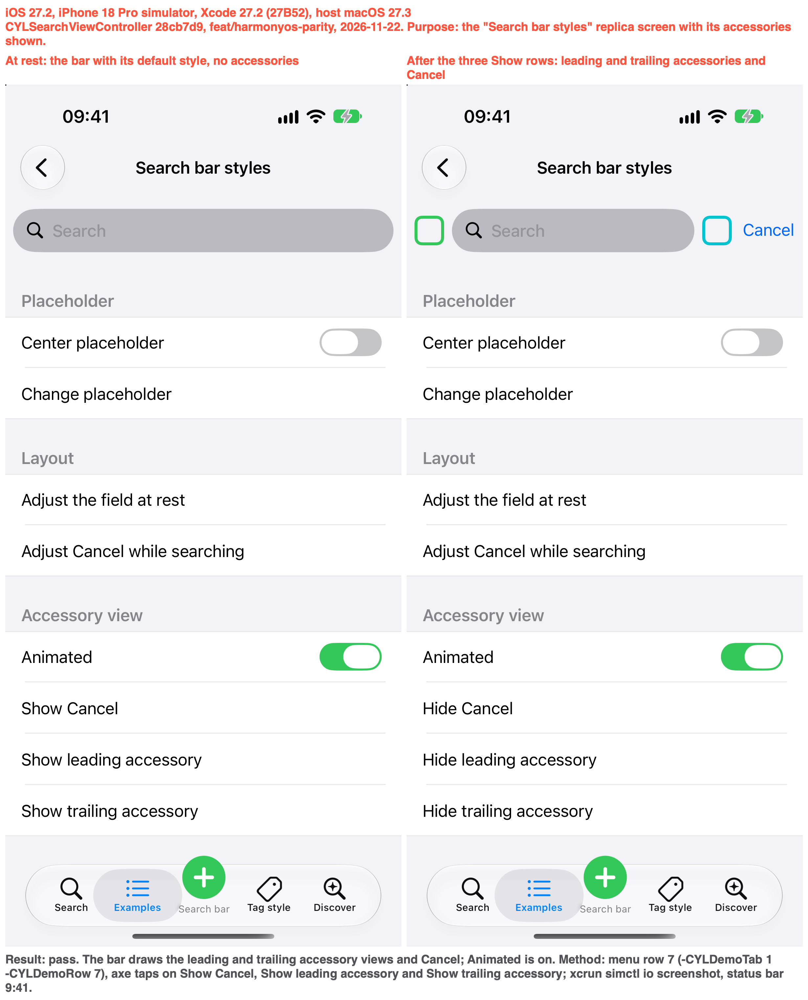 | iOS, iPhone 18 Pro simulator (iOS 27.2), Xcode 27.2 (27B52), macOS 27.3 (26C5035r), CYLSearchViewController `28cb7d9`, `feat/harmonyos-parity`, 2026-11-22 04:30 to 04:39 NZDT. Replica of QDSearchBarViewController |
|  | iOS, iPhone 18 Pro simulator (iOS 27.2), Xcode 27.2 (27B52), macOS 27.3 (26C5035r), CYLSearchViewController `28cb7d9`, `feat/harmonyos-parity`, 2026-11-22 04:30 to 04:39 NZDT. Replica of QDSearchViewController in its states |
|  | iOS, iPhone 18 Pro simulator (iOS 27.2), Xcode 27.2 (27B52), macOS 27.3 (26C5035r), CYLSearchViewController `28cb7d9`, `feat/harmonyos-parity`, 2026-11-22 04:30 to 04:39 NZDT. Rows I2 to I5; shows the open findings |
| 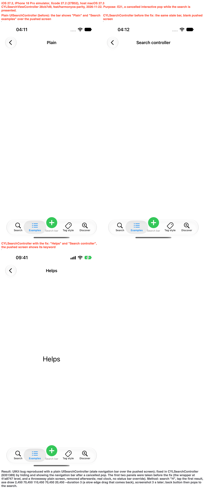 | iOS, iPhone 18 Pro simulator (iOS 27.2), Xcode 27.2 (27B52), macOS 27.3 (26C5035r), CYLSearchViewController `28cb7d9` (fix in `6351389`), `feat/harmonyos-parity`, 2026-11-22 04:11 to 04:32 NZDT |
|  | iOS, iPhone 18 Pro simulator (iOS 27.2), Xcode 27.2 (27B52), macOS 27.3 (26C5035r), CYLSearchViewController `6351389`, `feat/harmonyos-parity`, 2026-11-22 04:19 to 04:22 NZDT |

## Score (2026-11-22): 94 / 100 (pass 60)

| Criterion | Points | Got | Why not all |
| --- | --- | --- | --- |
| Classes and API as above, `@objc` names, Objective-C visibility test, public API comments check passes | 15 | 15 | every name of the "Public API" block exists in the sources (checked by script); `testSearchBarFromObjectiveC`, `testSearchControllerFromObjectiveC`, `testSearchTableViewControllerFromObjectiveC`; `check-public-api-comments.sh` passes. Two additions beyond the design: `historyStore`, `CYLSearchResources.suggestionCache(policy:name:)` |
| Edge-case rows E1 to E23 and B1 to B13: implemented (or dropped with the written reason) and test passing | 30 | 29 | -1: E21's real trigger (a cancelled interactive pop) cannot be started from XCTest, so the test covers the repair, and the gesture was verified by touch and screenshot only. B11 and B12 are dropped with a reason and a test, E6/E20 and others were measured on iOS 27.2 only |
| Issue rows I1 to I5: scenario screen and passing test each | 15 | 11 | -2 I2: the screen's bar was 0 pt wide while searching (fixed) and ends 116 pt below its rest position (UIKit, open; the test pins it); -1 I5: same offset, the test only compares the frame after Cancel; -1 I3: a black band shows behind the bar while searching on iOS 27.2 (not investigated). I1 and I4 are fully done (I4 by real drags) |
| Example: both QMUI demo screens replicated, every new screen in `testSearchBarsCoverNoView` | 15 | 14 | -1: the recent searches are tags without QMUI's 69 pt minimum width (`CYLMenuStyle` has none) and a tap on a tag does nothing, as in the demo's static view; both screens, all menu rows and all bars are covered by the test |
| Merge table done; `CYLSearchBarView` / `CYLSearchView` / #1317 page unchanged and their tests still pass | 10 | 10 | all rows done (above); the three files are unchanged since `2ecf2ef`; 122 tests pass |
| Whole iOS suite green on a clean build; labeled screenshots of the two replica screens in `docs/assets/` | 10 | 10 | Executed 122 tests, with 0 failures; the screenshots above, labeled, `check-screenshot-labels.sh` |
| License notices, this document's status and score updated | 5 | 5 | `LICENSE.QMUI`, `NOTICE`, `docs/licenses.md`, `check-licenses.sh`; this document |
| **Total** | **100** | **94** | |

## Remaining TODO

1. **iOS 15 to 26 unverified.** Everything ran on iOS 27.2 (Xcode 27.2). Likely differences: the Cancel xmark, 36 pt versus 44 pt field height, KVO on UIKit's own frames, the bottom placement of a navigation item bar on iOS 26 and later, the views UIKit builds for the presentation. Run `sh scripts/unit-tests.sh` on an iOS 15, 17 and 26 simulator and compare the rows B1 to B9, E1 to E21.
2. **Rows I2 and I5: the 116 pt offset** of the bar while searching (a plain subview or a container: UIKit puts its container at the bar's y plus the presentation's safe area top). Options to try: compensate in `willPresentSearchController` (hidden bar at y minus the safe area top) or recommend the navigation item / header for this case in the docs; then make the tests compare the absolute position.
3. **Row I3: the black band** behind the bar while searching in the navigation item screen (iOS 27.2). Find out whether it is the navigation bar's background during the hide animation or a defect of the example.
4. **The mini program twin of the new screens** (AGENTS.md, "Mini program example: a 1:1 copy of the iOS example"): "Search bar styles", "Search controller" and the four issue screens have no mini program, Android, HarmonyOS, React Native or Flutter counterpart yet (the port is Swift for iOS).
5. **E21 on iOS 15 to 26**: the stale navigation bar and the workaround were seen on iOS 27.2 only; check with the same `axe draw`.
6. **The history launch view** reads the store when it enters the window; it is not refreshed while it stays on screen (a submit followed by clearing the text shows the old tags until the next activation).
7. `Podfile.lock` is not committed (`pod install` rewrites it; the lock is older than the Podfile's pins).


## Other platforms: parity table (2026-11-22, `feat/harmonyos-parity`, PR #11)

Task: `docs/task-log.md`, "the open items of the QMUI search port". Each platform ports the behaviour of the iOS classes
into the class it belongs to (`instructions.md`: a parameter or a mode of an existing class first, a new class only for a
new concept). The issue scenarios I1–I5 are UIKit defects (`UISearchController` and table header offsets, a navigation
item crash); a platform without that UIKit code path marks them N/A with that reason instead of a screen. Counterpart
cells say TODO until the platform's agent reports the file and test.

| iOS source API | Description | Android (Kotlin) | HarmonyOS (ArkTS) | Mini program | React Native | Flutter |
| --- | --- | --- | --- | --- | --- | --- |
| `CYLSearchBar.centersPlaceholder` | placeholder centred at rest, leading while editing | `CYLSearchBarView.centersPlaceholder` | `CYLSearchBarView.centersPlaceholder` | bar `centersPlaceholder` | `CylsearchBarView` prop (Android; iOS TODO after merge) | `CYLSearchBarView` widget param (Android; iOS TODO after merge) |
| `placeholder` / `placeholderColor` / `textColor` / `font` | text and placeholder style | existing `CYLSearchBarView` properties (+ `tintColor`) | existing `CYLSearchBarView` properties | existing bar properties (`fontSize`) | props (both) | params (both) |
| `textFieldMargins` / `textFieldMarginsProvider(bar, active)` | field margins at rest and while searching | `textFieldMargins`, `textFieldMarginsProvider` | `textFieldMargins`, `textFieldMarginsProvider` | `textFieldMargins`, `activeTextFieldMargins`, `setTextFieldMarginsProvider(fn)` | `fieldMargins` / `searchingFieldMargins` (Android; iOS TODO) | `textFieldMargins` / `activeTextFieldMargins` (Android; iOS TODO) |
| `cancelButtonMarginsProvider(bar, active)` / `cancelButtonFont` | Cancel position and font | `cancelButtonMargins(Provider)`, `cancelButtonFont` | `cancelButtonMarginsProvider`, `cancelButtonFont` | `(active)CancelButtonMargins`, `cancelButtonFont`, `setCancelButtonMarginsProvider(fn)` | `cancelMargins` / `searchingCancelMargins` (Android); font TODO | `cancelButtonMargins` / `activeCancelButtonMargins`; `cancelButtonFontSize` TODO both |
| `showsCancelButton` + `setShowsCancelButton(_:animated:)` | Cancel shown or hidden, animated | `setShowsCancelButton(shows, animated)` | `showsCancelButton`, `setShowsCancelButton` | `setShowsCancelButton(shows, animated)` | prop + `animatesChanges` (iOS: not animated) | controller call (iOS ignores `animated`: TODO) |
| `leadingAccessoryView` / `trailingAccessoryView` + margins + `setShows…(_:animated:)` | views beside the field, animated | `leading/trailingAccessoryView` + margins + `setShows…(animated)` | `CYLSearchBarView` accessories + margins + animated toggles | slots `leading-accessory` / `trailing-accessory` + `setShows…View` | accessory props (Android); React children TODO | Flutter widgets beside the field |
| `CYLSearchBarAppearance` | merged default style (colours, field background, icons) | `CYLSearchBarAppearance.kt`, `appearanceStyle` | `CYLSearchBarAppearance`, `appearanceStyle` (opt-in) | `CYLSearchBarAppearance.default()` + bar `appearance` | `appearance` / `usesDefaultAppearance` (Android; iOS TODO) | `appearance` (both) |
| `CYLSearchController.launchView` | own view under the bar while the query is empty | `CYLSearchView.launchView` | `CYLSearchView.launchView` | `search` `showsLaunchView` + slot `launch-view` | `CylsearchListView` launch view (Android, `CYLTagListView`); iOS example composition | `launchViewBuilder` (Dart, `CYLTagListView` widget) |
| `dimmingColor` | own dimming under the bar, tap ends the search | `CYLSearchView.dimmingColor` | `CYLSearchView.dimmingColor` | `search` `dimmingColor` | `dimmingColor` (Android) | `dimmingColor` (Dart overlay) |
| `searchResultsDelegate.updateResultsFor` (also "") | results callback on every text change | `searchViewUpdateResults` | `searchViewUpdateResults` | event `updateresults` | `onUpdateResults` (Android) | `onUpdateResults` |
| will/did present/dismiss callbacks | presentation life cycle | `searchViewWillShow/DidShow/WillClose/DidClose` | `searchViewWillShow/WillClose` + existing did callbacks | events `willpresent` … `diddismiss` (did: timer-based) | will/did events (Android) | `onWillPresent` … `onDidDismiss` |
| `isActive` / `setActive(_:animated:)` | start or end the search from code | `isActive` / `setActive` | `isActive` / `setActive` | `isActive()` / `setActive()` | `setActive` command (bar both; list Android) | `setActive` (both, native) |
| `showEmptyView(text:…)` / `hideEmptyView()` / `isEmptyViewShowing` | "No matching results" in the results | same names on `CYLSearchView` | same names on `CYLSearchView` | same names on `search` | empty view (Android) | controller methods (Dart overlay) |
| `historyStore` + `historyDidChangeNotification` | submitted queries kept; the launch view reads them again while on screen | `suggestionCache` + `add/removeHistoryDidChangeListener` | `historyStore`, `historyRevision`, `searchViewHistoryDidChange` | `history()`, `clearHistory()`, event `historychange` | `onHistoryChange`, `clearHistory` (Android) | `onHistoryChanged`, `history()`, `clearHistory()` (iOS timing TODO) |
| `supportsSwipeToDismissSearch` | edge swipe ends the search | `supportsSwipeToDismissSearch` (predictive back) | N/A: the system back gesture ends the search (`handleBackPress`) | `supportsSwipeToDismissSearch` (left-edge touch) | prop (Android) | Dart edge strip |
| `CYLSearchTableViewController.showsSearchBar` / `hidesSearchBarInitially` / `hidesSearchBarWhenEmptyViewShowing` | list screen with a built-in bar | new `CYLSearchListView` | `CYLSearchTableView` / `CYLSearchTableComponent` | `search` list-screen mode | new `CylsearchListView` (Android) | new `CYLSearchListView` widget (Dart) |
| `snapsHeaderSearchBar` (I4, #1160) | a header bar above a short list settles fully shown or hidden | `CYLSearchListView.snapsHeaderSearchBar` | `snapsHeaderSearchBar` (emulator drags checked) | `search` `snapsHeaderSearchBar` (drag not run: Windows TODO) | `snapsHeaderSearchBar` prop (Android) | `snapsHeaderSearchBar` (Dart widget tests only) |
| I1–I3, I5 (#1319, #1251, #1229, #1313) | UIKit defects | N/A: UIKit defects | N/A: UIKit defects | N/A: UIKit defects | N/A: UIKit defects | N/A: UIKit defects |
| Screen "Search controller" | replica of `QDSearchViewController` (keywords, launch view, ×20 results, highlight, empty view, history) | `CYLSearchControllerDemoFragment` | `demos/SearchController.ets` | `pages/searchController` (device test: Windows TODO) | `example/src/SearchControllerDemo.tsx` | example "Search controller" |
| Screen "Search bar styles" | replica of `QDSearchBarViewController` (Placeholder, Layout, AccessoryView sections) | `CYLSearchBarStylesFragment` | `demos/SearchController.ets` | `pages/searchBarStyles` (device test: Windows TODO) | `example/src/SearchBarStylesDemo.tsx` (iOS options TODO) | example "Search bar styles" (iOS options TODO) |
| Screens "Navigation item", "Bar in a view", "Short list", "Collection view" | issue scenarios | "Short list" (`CYLSearchShortListFragment`); others N/A | N/A (I4 checked on the replica lists) | "Short list"; others N/A | N/A | "Short list"; others N/A |

Order: Android, HarmonyOS and the mini program first (native cores); React Native and Flutter after, since they wrap the
native iOS and Android cores. Score per platform: 100 = every row done or N/A with the reason, both replica screens,
a test or labelled screenshot per screen, the platform's checks green.


### Android (Kotlin, android/merged: core module cylsearch, example app): QMUI search port (2026-11-22)

- **Status**: DONE (2026-11-22, `feat/harmonyos-parity`, PR #11). **Score: 92 / 100 (pass 60)**; missing points are the `TODO`s at the end of this section.
  Task: port every parity row into the Android core (the class it belongs to first), add the example screens "Search
  controller" and "Search bar styles" to `CYLSearchDemoMenuFragment`, tests, labelled screenshots on an own AVD.
- **Prompt** (verbatim, English): "give Android (Kotlin, android/merged: core module cylsearch, example app) the behaviour of every row of the parity table, put into the core class it belongs to (core first: the published package; a parameter or mode of an existing class such as CYLSearchBarView / CYLSearchView before a new class; a new class only for a genuinely new concept, named with the CYL prefix), and add the example screens "Search controller" and "Search bar styles" (replicas of QMUI's QDSearchViewController / QDSearchBarViewController as specified in the doc's Example section ...). Issue scenarios I1-I5 are UIKit defects: if Android has no equivalent code path, mark N/A with a one-line reason; if it does have a "bar scrolls out above a short list" case (I4 snapping), implement it. The search bar must never cover any view in any state." The iOS controller's `historyDidChangeNotification` behaviour was ported too.
- **Acceptance** (written before the work): every row has a counterpart (file:symbol) or N/A with a reason; `:cylsearch:testDebugUnitTest`
  and `:app:testDebugUnitTest` green on a clean build; both replica screens screenshotted; the bar never covers a view in any state;
  strings in en, ja, zh-Hans, zh-Hant; this section filled in.
- **Environment**: JDK 17.0.21 (`/Users/chenyilong/develop/jdk/jdk-17.0.21+9`; JDK 21 and 25 break Robolectric 4.14.1 with
  `IllegalArgumentException at ClassReader`), Gradle 9.4.1 (`sh ./gradlew`, the wrapper is not executable in git), AGP 9.2.1, Kotlin 2.2.20,
  compileSdk 35, macOS 27.3 arm64, own AVD `CYL_QPort_API35` (Android 15, API 35, google_apis arm64) on port 5590 (`adb -s emulator-5590`;
  no other device was touched). Clean builds (`gradlew clean :app:assembleDebug`) before every run.
- **Design**: all in `android/merged/cylsearch/src/main/kotlin/com/cyl/search` (the published AAR), defaults unchanged (every new property
  is neutral, the 26 existing tests pass unchanged). "Active" on Android means the field has the focus (iOS: the search controller is active).
  The Android bar is a custom view, not a platform search bar, so the QMUI behaviour went into `CYLSearchBarView` (bar styling),
  `CYLSearchView` (the overlay: the counterpart of `CYLSearchController`) and one new class, `CYLSearchListView` (a list whose first item
  is the bar: the genuinely new concept of `CYLSearchTableViewController`). Plain properties and listeners only (bridge friendly for React
  Native and Flutter). The example is at `android/merged/app/src/main/kotlin/com/cyl/search/example`.
- **Files changed**: core `CYLSearchBarView.kt`, `CYLSearchView.kt`, `CYLSearchBarAppearance.kt` (new), `CYLSearchListView.kt` (new),
  strings in the four `values*/cyl_search_strings.xml`, `NOTICE` and `LICENSE.QMUI` (AAR `META-INF/cylsearch`, Tencent's MIT notice);
  example `CYLSearchControllerDemoFragment.kt`, `CYLSearchBarStylesFragment.kt`, `CYLSearchShortListFragment.kt`, `CYLSearchDemoMenuFragment.kt`
  (three rows; `--es CYLDemoPage controller|styles|short` opens a page at launch for screenshots); tests `CYLSearchBarQMUIPortTest`,
  `CYLSearchViewQMUIPortTest`, `CYLSearchListViewTest` (core), `CYLSearchPortScreensTest` (example).
- **Parity rows -> counterpart** (all under `android/merged/cylsearch/src/main/kotlin/com/cyl/search` unless noted):

  | iOS source API | Android counterpart | Test |
  | --- | --- | --- |
  | `centersPlaceholder` | `CYLSearchBarView.centersPlaceholder` (`updatePlaceholderCentering`: the text container wraps and the field centers while not active and empty) | `placeholderIsCenteredAtRestAndLeadingWhileEditing` |
  | `placeholder` / `placeholderColor` / `textColor` / `font` | `CYLSearchBarView.placeholder`, `placeholderColor`, `textColor`, `font` + `fontSize`, `tintColor` (new) | existing behaviour tests |
  | `textFieldMargins` / `textFieldMarginsProvider` | `CYLSearchBarView.textFieldMargins`, `textFieldMarginsProvider` (dp `Rect`, provider wins), `isActive` | `fieldMarginsApplyPerStateAndTheProviderWins` |
  | `cancelButtonMarginsProvider` / `cancelButtonFont` | `CYLSearchBarView.cancelButtonMargins`, `cancelButtonMarginsProvider`, `cancelButtonFont`; a negative left value pulls Cancel to the field and stops where it touches it | `cancelMarginsFontAndTheNegativeValueNeverCoverTheField` |
  | `showsCancelButton` + `setShowsCancelButton` | `CYLSearchBarView.showsCancelButton`, `setShowsCancelButton(shows, animated)`, `showsCancelButtonWhenEditing` (width and alpha animation, state flag guard) | `cancelShowsAndHidesAnimatedOrNot`, `cancelAppearsWhileEditingWhenAsked` |
  | accessory views + margins + `setShows...` | `CYLSearchBarView.leadingAccessoryView` / `trailingAccessoryView` (beside the field; `trailingAccessoryViews` stay the views inside it), `...Margins`, `showsLeadingAccessoryView`, `setShowsLeadingAccessoryView(shows, animated)`, same for trailing; 8 dp gap | `accessoryViewsShowHideAndShrinkTheField` |
  | `CYLSearchBarAppearance` | `CYLSearchBarAppearance.kt` (`defaultAppearance(context)`, light and dark field, tint RGB(0,104,248), `copy`), `CYLSearchBarView.appearanceStyle`, `applyDefaultAppearance()` | `defaultAppearanceLandsOnTheBar`, `darkAppearanceUsesTheDarkField` |
  | `launchView` | `CYLSearchView.launchView` (shown while the query is empty, wins over the cached-query list and the empty placeholders) | `launchViewShowsWhileTheQueryIsEmptyAndWinsOverTheHistory` |
  | `dimmingColor` | `CYLSearchView.dimmingColor` (only while the query is empty and no launch view; tap ends the search; `scrimColor` stays for the whole search) | `dimmingShowsWhileEmptyAndATapEndsTheSearch` |
  | `searchResultsDelegate.updateResultsFor` (also "") | `CYLSearchViewDelegate.searchViewUpdateResults` (first opening, typing, clear, close with `clearsQueryOnClose`) | `resultsCallbackAlsoReceivesTheEmptyText` |
  | will/did present/dismiss | `CYLSearchViewDelegate.searchViewWillShow`, `searchViewDidShow`, `searchViewWillClose`, `searchViewDidClose` | `presentationCallbacksAndIsActive` |
  | `isActive` / `setActive` | `CYLSearchView.isActive`, `setActive(active, animated)` | `presentationCallbacksAndIsActive` |
  | `showEmptyView` / `hideEmptyView` / `isEmptyViewShowing` | `CYLSearchView.showEmptyView(text, detail, buttonTitle, action)`, `showEmptyView(scenario)`, `hideEmptyView()`, `isEmptyViewShowing`, `emptyView` (no-op for empty text, gone on close or empty text); `CYLSearchListView.showEmptyView` | `emptyViewShowsOnlyWithTextAndLeavesWithTheSearch` |
  | `historyStore` + `historyDidChangeNotification` | `CYLSearchView.suggestionCache` (+ `suggestionCachePolicy`, `suggestionCacheName`; the existing store: trimmed, newest first, blank ignored) and `addHistoryDidChangeListener` / `removeHistoryDidChangeListener` (the Android counterpart of the notification); the launch view re-reads on every call | `submittedQueriesAreTheHistoryAndNotifyTheListeners`; example `searchControllerShowsKeywordsLaunchViewResultsEmptyViewAndHistory` |
  | `supportsSwipeToDismissSearch` | `CYLSearchView.supportsSwipeToDismissSearch` on predictive back (`handleOnBackProgressed` drags the page, cancel springs back, completing closes); the system owns edge swipes, so no custom recognizer | `backSwipeDragsThePageAndCompletingEndsTheSearch`, `withoutTheSwitchTheBackSwipeDoesNotMoveThePage` |
  | `CYLSearchTableViewController.showsSearchBar` / `hidesSearchBarInitially` / `hidesSearchBarWhenEmptyViewShowing` | new `CYLSearchListView.showsSearchBar`, `hidesSearchBarInitially`, `hidesSearchBarWhenEmptyViewShowing`, `opensSearchViewOnTap`, `searchBarView`, `searchView`, `adapter` | `barIsTheFirstItemAndScrollsWithTheRows`, `hidesSearchBarInitiallyScrollsTheBarOut`, `emptyViewRemovesTheBarAndHidingItPutsItBackHidden`, `aTapOnTheBarOpensTheSearchViewOrEditsInPlace` |
  | `snapsHeaderSearchBar` (I4, #1160) | `CYLSearchListView.snapsHeaderSearchBar`, `settleSearchBar()`: a short list gets the room it needs below its last row (`footerHeight`), the bar settles fully shown or hidden when scrolling ends | `shortListGetsTheRoomToScrollTheBarOutAndSnaps`, control `withoutSnappingAShortListCannotScrollTheBarOut`; real drag on the emulator (below) |
  | I1 (#1319) | N/A: no `UISearchController` presentation transition; the search page is a view inside the screen | - |
  | I2 (#1251) | N/A: no navigation bar that hides during a presentation; the list's toolbar is the host's and stays above the page | - |
  | I3 (#1229) | N/A: no `navigationItem.searchController`, nothing to assign the wrapper to | - |
  | I4 (#1160) | implemented: row above | see above |
  | I5 (#1313) | N/A: the bar is one persistent view held by `CYLSearchListView`, never a recycled header view | - |
  | Screen "Search controller" | `CYLSearchControllerDemoFragment` (+ `CYLRecentSearchLaunchView`): ten keywords, launch view with eight tags and trash button, x20 results with the match in the tint color (`ForegroundColorSpan`), "No matching results", history, back swipe, detail page | `CYLSearchPortScreensTest.searchControllerShowsKeywordsLaunchViewResultsEmptyViewAndHistory` |
  | Screen "Search bar styles" | `CYLSearchBarStylesFragment`: Placeholder, Layout (32 at rest, Cancel -16 while searching, starts the search), AccessoryView (animated switch, Cancel, 30 x 30 stroked accessories, margins 8, hidden first) | `searchBarStylesRowsDriveTheBar`, `everyTextOfTheScreensExistsInFourLanguages` |
  | Screens "Navigation item", "Bar in a view", "Collection view" | N/A with I3, I2, I5; the extra screen "Short list" (`CYLSearchShortListFragment`) shows I4 | `shortListScrollsTheBarOutAndSnaps` |

  iOS edge-case and bar rows (not in the parity table): E1, E2, E3, E5, E20 (view controller presentation contexts, leaks), E6, E7, E9, E17, E21, E22, E23, B5, B7 to B12 (UIKit
  defects or private API) are N/A: the overlay is an ordinary view, the Cancel button and the text field are our own views. E8 and E10 are
  done (`showEmptyView` and `searchViewUpdateResults`), E11 to E14 are covered by predictive back (the system draws the swipe and owns the
  edge, so no window snapshot), E15, E16 and E19 are `launchView`, `searchBarMaxY` and `dimmingColor`, B1 to B4, B6 and B13 are the bar rows above.
  Not ported: E18 (`alwaysShowSearchResultsController`), no consumer.
- **Findings from the work** (core fixes, with tests): (1) `hideKeyboard` left the focus on the field (Android gives it back to the only
  focusable view), so a bar never left the active state after Cancel: it now moves the focus to a focus sink. (2) A bar whose delegate refuses
  editing (the bar of `CYLSearchListView` that opens the search page) looped in `requestFocus` -> refuse -> `clearFocus` -> window requests focus
  (StackOverflowError); its field now refuses `requestFocus` itself. (3) Seen on the emulator: the leading accessory touched the field; the 8 dp gap
  is now in the core, tested. (4) Found on the emulator, **recorded with a screenshot before the fix**: after a result opens the detail page over the open search, Back
  closed the hidden search and left the detail page on screen (`CYLSearchView`'s back callback registered later than the activity's, so it won):
  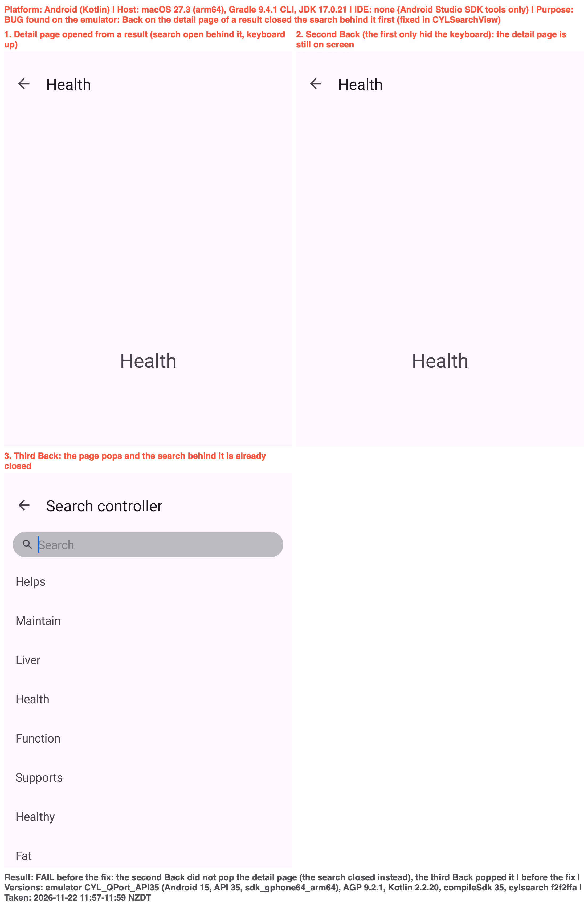 Android 15 (API 35) emulator `CYL_QPort_API35`, macOS 27.3, core commit f2f2ffa (before the fix), 2026-11-22 12:05 NZDT.
  Fixed in the core (`CYLSearchView.isCovered` / `passBackThrough`: while a page of the host lies over the search, Back and the predictive-back progress go to the
  next callback), test `backGoesToAPageThatCoversTheOpenSearch`, checked again on the emulator:
  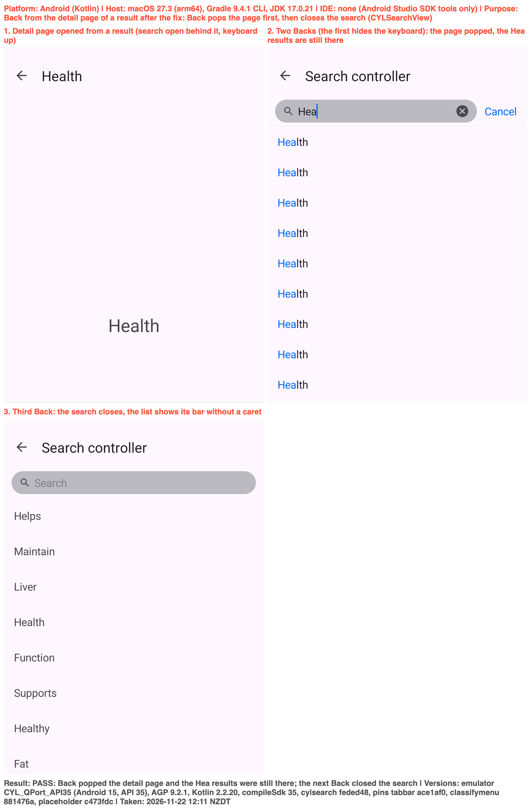 Android 15 (API 35) emulator `CYL_QPort_API35`, macOS 27.3, core commit feded48, 2026-11-22 12:11 NZDT.
  (5) Found on the same run: the idle header bar showed a steady caret after the search closed; the field now shows its cursor only while it has the focus.
- **Tests** (JDK 17.0.21, `sh ./gradlew --no-daemon :cylsearch:testDebugUnitTest :app:testDebugUnitTest`): core **51 tests, 0 failures** (baseline 26:
  +9 `CYLSearchBarQMUIPortTest`, +10 `CYLSearchViewQMUIPortTest`, +6 `CYLSearchListViewTest`); example **9 tests, 0 failures** (3 contact tags + 6 `CYLSearchPortScreensTest`).
  `scripts/check-public-api-comments.sh`: OK and `scripts/check-licenses.sh`: OK (9 files), both run again on the final code (feded48).
- **Screenshots** (originals in `docs/assets/raw/android-qmui-*-api35-20261122.png`, crops of the 1080 x 2400 captures, key moments, stitched, English labels):
  - Search controller: 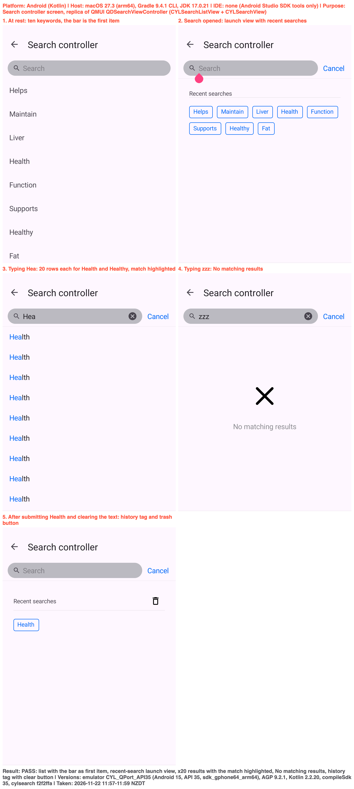 Android 15 (API 35) emulator `CYL_QPort_API35`, macOS 27.3, AGP 9.2.1, Kotlin 2.2.20, core commit f2f2ffa, pins tabbar ace1af0, classifymenu 881476a, placeholder c473fdc, 2026-11-22 11:57 NZDT.
  - Search bar styles: 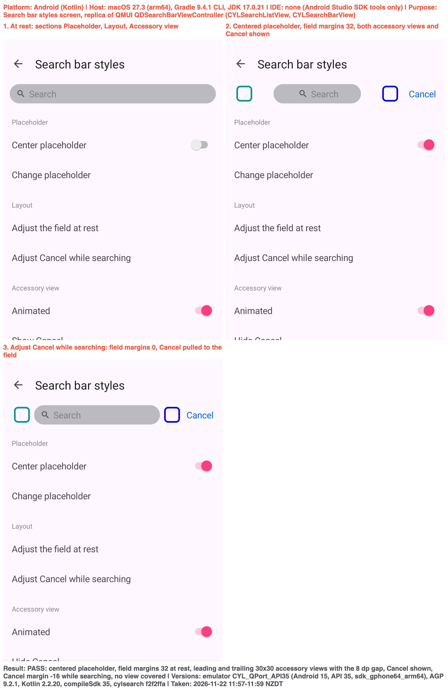 Android 15 (API 35) emulator `CYL_QPort_API35`, macOS 27.3, AGP 9.2.1, Kotlin 2.2.20, core commit f2f2ffa, pins tabbar ace1af0, classifymenu 881476a, placeholder c473fdc, 2026-11-22 11:58 NZDT.
  - Short list (I4, real drags with `adb shell input swipe`: 40 px settles hidden, 110 px settles fully shown): 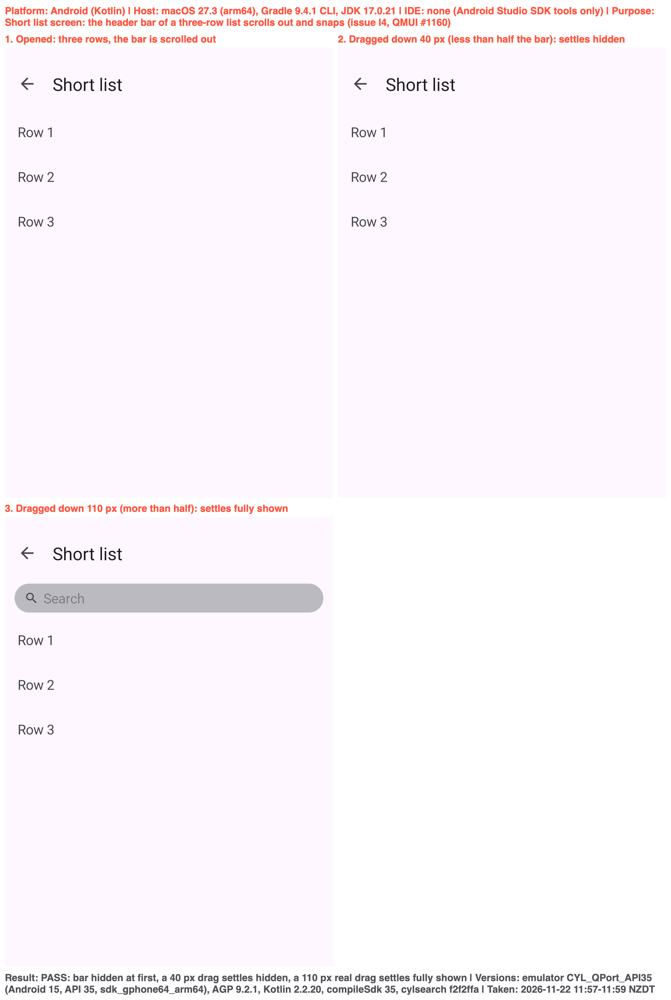 Android 15 (API 35) emulator `CYL_QPort_API35`, macOS 27.3, AGP 9.2.1, Kotlin 2.2.20, core commit f2f2ffa, pins tabbar ace1af0, classifymenu 881476a, placeholder c473fdc, 2026-11-22 11:59 NZDT.
- **Score: 92 / 100**: rows and example 40/40 (all rows done or N/A with reasons, both screens plus the short list), tests 20/20, core placement and
  defaults unchanged 15/15, screenshots 10/10 (labelled, stitched, originals kept), licenses and strings 5/5, verification depth 2/10 (see TODO).
- **TODO** (missing 8 points): (1) the back swipe is tested through `OnBackPressedDispatcher`, not with a real predictive-back gesture: the example
  manifest has no `android:enableOnBackInvokedCallback="true"`; add it and check on a gesture-navigation device. (2) No screenshot in dark mode, in
  ja / zh, or with a large font; the strings are tested, the layout is not. (3) E18 `alwaysShowSearchResultsController` is not ported. (4) The animated
  show/hide of the accessory views and Cancel is tested for its end state only, not frame by frame. (5) React Native and Flutter wrapping (bridge
  surface review) is for those platforms' agents. (6) The focus sink of `CYLSearchBarView` is focusable in touch mode on every bar: an invisible Tab stop for a hardware keyboard; make it focusable only inside `hideKeyboard`.

### HarmonyOS (ArkTS, harmonyos/: library cylsearch, entry example): QMUI search port (2026-11-22)

- **Status**: DONE (2026-11-22, `feat/harmonyos-parity`, PR #11), score 90 / 100 (pass 60), see "Score". Environment: HarmonyOS 6.0.1 (API 21)
  arm64 emulator "CYL Search Test" (my own clone of the Mate 70 Pro image; `hdc` target 127.0.0.1:5555), DevEco Studio 6.0.1, host
  macOS 27.3 (26C5035r). Builds: `hvigorw --mode module -p module=entry@default -p product=default assembleHap` and
  `-p module=entry@ohosTest -p isOhosTest=true -p buildMode=test`, both after deleting `build`, `.hvigor` and `oh_modules` (unsigned HAPs,
  `hdc install -r`). The Mac is arm64, so the default (arm64) HAP runs; `entry@emulator` still builds (checked) but is for x86_64.
- **Files changed**: `harmonyos/cylsearch/src/main/ets/CYLSearchBarView.ets`, `harmonyos/cylsearch/src/main/ets/CYLSearchView.ets`, `harmonyos/cylsearch/Index.ets` (exports),
  `harmonyos/cylsearch/src/main/resources/{base,dark}/element/color.json` (field fill, light and dark) and the four
  `string.json` (en, ja, zh-Hans, zh-Hant: the iOS `styles.*`, `controller.*`, `demo.searchController`, `demo.searchBarStyles` keys, imported by
  `harmonyos/scripts/import-ios-resources.py`); example `harmonyos/entry/src/main/ets/demos/SearchController.ets` (new),
  `.../common/DemoCommon.ets` (two routes), `.../demos/ExamplesMenu.ets` (rows 6 and 7 after the existing ones),
  `.../pages/Index.ets` (routes); tests `harmonyos/entry/src/ohosTest/ets/test/CYLSearchQMUIPort.test.ets` (new), `List.test.ets`,
  `harmonyos/scripts/host-logic-test.mjs`.
- **Design**: core first, no new bar or search class. `CYLSearchBarView` (the bar) and `CYLSearchView` (the overlay that plays the part of
  iOS `CYLSearchController`: it has `showSearch` / `closeSearch`, results, suggestions) get the new parameters. New classes only for new
  concepts, CYL prefix: `CYLSearchBarAppearance` (iOS value class of the same name), `CYLSearchEmptyView` (the model of
  `showEmptyView`, shared by the overlay and the list), `CYLSearchTableView` + `CYLSearchTableComponent` (iOS
  `CYLSearchTableViewController`: a list whose first row is the bar), `CYLSearchEdgeInsets` (iOS `UIEdgeInsets`). The decision rules
  are in the `// MARK: - Pure logic` blocks and run on the host.
- **Parity rows** (row -> counterpart, `file:symbol`):

| Row | HarmonyOS counterpart |
| --- | --- |
| `centersPlaceholder` | `CYLSearchBarView.ets:CYLSearchBarView.centersPlaceholder` / `placeholderCentered`; the magnifier and the placeholder are drawn together centered at rest (overlay in `CYLSearchBarComponent.field`), leading while editing |
| `placeholder` / `placeholderColor` / `textColor` / `font` | already there: `CYLSearchBarView.placeholder`, `placeholderColor`, `textColor`, `font` (long placeholders are ellipsized, screenshot) |
| `textFieldMargins` / `textFieldMarginsProvider(bar, active)` | `CYLSearchBarView.textFieldMargins`, `textFieldMarginsProvider`, `resolvedTextFieldMargins` (active = `isActive`: editing or its `CYLSearchView` is open); `CYLSearchEdgeInsets` |
| `cancelButtonMarginsProvider` / `cancelButtonFont` | `CYLSearchBarView.cancelButtonMarginsProvider`, `resolvedCancelButtonMargins`, `cancelButtonFont` (fp) |
| `showsCancelButton` + `setShowsCancelButton(_:animated:)` | `CYLSearchBarView.showsCancelButton`, `setShowsCancelButton(shows, animated)`, `automaticallyShowsCancelButton` (UISearchBar's automatic Cancel while active), `cancelButtonVisible` |
| accessory views + margins + `setShows…(_:animated:)` | `CYLSearchBarView.leadingAccessoryView` / `trailingAccessoryView` (`WrappedBuilder<[]>`), `showsLeadingAccessoryView`, `leadingAccessoryViewMargins`, `setShowsLeadingAccessoryView(shows, animated)` and the trailing twins; a state flag, so fast toggling ends in the last request |
| `CYLSearchBarAppearance` | `CYLSearchBarView.ets:CYLSearchBarAppearance` (`defaultAppearance`, `copy()`), `CYLSearchBarView.appearanceStyle`; applied on request, not to every bar, so the existing screens keep their look (`CYLSearchTableView` and the Search controller screen apply it) |
| `launchView` | `CYLSearchView.launchView` (`WrappedBuilder<[CYLSearchView]>`), shown while the query is empty, `showsLaunchView` |
| `dimmingColor` | `CYLSearchView.dimmingColor`; under the bar while the query is empty and no launch view is set, a tap ends the search (`showsDimming`) |
| `searchResultsDelegate.updateResultsFor` (also "") | `CYLSearchViewDelegate.searchViewUpdateResults`, called when the search opens and on every text change, "" included; with `resultCellConfiguration` for rows of your own (the match highlight) |
| will/did present/dismiss | `searchViewWillShow` (new), `searchViewDidShow` (existing), `searchViewWillClose` (new), `searchViewDidClose` (existing) |
| `isActive` / `setActive(_:animated:)` | `CYLSearchView.isActive`, `setActive(active, animated)` (over `showSearch` / `closeSearch`) |
| `showEmptyView` / `hideEmptyView` / `isEmptyViewShowing` | `CYLSearchView.showEmptyView(text, detailText?, buttonTitle?, buttonAction?)`, `hideEmptyView()`, `isEmptyViewShowing`, `CYLSearchEmptyView`; nothing is shown for an empty query (E8), hidden on close (E9) |
| `historyStore` + `historyDidChangeNotification` | `CYLSearchView.historyStore` (the same store as `suggestionCache`), `historyRevision` (`@Trace`, +1 per submitted query and per clear; the launch view reads the history again from it) and `searchViewHistoryDidChange` |
| `supportsSwipeToDismissSearch` | no flag: the system back gesture / back key ends the search through the existing `CYLSearchView.handleBackPress` (`SearchControllerPage` forwards `onBackPressed`); the OS edge gesture owns the left edge, so an own gesture could not begin there |
| `CYLSearchTableViewController` options | `CYLSearchTableView.showsSearchBar`, `hidesSearchBarInitially`, `hidesSearchBarWhenEmptyViewShowing`, `showEmptyView` / `hideEmptyView`, drawn by `CYLSearchTableComponent` (`harmonyos/cylsearch/src/main/ets/CYLSearchView.ets`); `searchView` makes a tap on the bar open an overlay |
| `snapsHeaderSearchBar` (I4, #1160) | `CYLSearchTableView.snapsHeaderSearchBar`, `settle()`, `layoutChanged`: an end filler of only what the rows leave of the viewport lets the bar scroll out above a short list, and it settles fully shown or hidden when scrolling stops (half = threshold). Real drags on the emulator: 110 px up hides it, 35 px down keeps it hidden, 115 px down shows it |
| I1 (#1319) | N/A: no `UISearchController` transition; the bar is an ordinary node of an overlay and never moves on activation |
| I2 (#1251) | N/A: no navigation bar that hides, no plain-subview bar offset |
| I3 (#1229) | N/A: no navigation-item search controller (nothing to crash on) |
| I4 (#1160) | implemented, see `snapsHeaderSearchBar` |
| I5 (#1313) | N/A: no reused collection header; the bar is a normal list row |
| Screen "Search controller" | `SearchController.ets:SearchControllerView` / `SearchControllerPage`: Examples row 6 |
| Screen "Search bar styles" | `SearchController.ets:SearchBarStylesView` / `SearchBarStylesPage`: Examples row 7 |
| Screens "Navigation item", "Bar in a view", "Collection view" | N/A with I1–I3, I5; "Short list" has no screen of its own: both replica lists are short lists (10 and 8 rows), so I4 is verified on them |

- **Tests** (all run here): `node harmonyos/scripts/host-logic-test.mjs`: 39 pass, 0 fail (9 new: placeholder centering, margin resolution, Cancel,
  empty view, launch view, dimming, filler, settle); `node harmonyos/scripts/check-ios-parity.mjs`: 657 match, 0 problems;
  `node harmonyos/scripts/check-accessibility-i18n.mjs`: 0 problems; hypium on the emulator (`aa test -b com.cyl.search.harmonyos -m entry_test
  -s unittest OpenHarmonyTestRunner`): 41 run, 0 failure, 0 error (the 29 existing and 12 new in `CYLSearchQMUIPort.test.ets`). Emulator
  touch checks (uitest): launch view, results typing, empty view, submit with the keyboard's search key and with Enter, history after Cancel,
  clear button, back key (first Back lowers the keyboard, second ends the search, the page stays), every row of the styles list, header snapping.
- **Screenshots** (stitched, originals, two columns; HarmonyOS 6.0.1 (API 21), "CYL Search Test" arm64 emulator, DevEco Studio 6.0.1, macOS 27.3, CYLSearchViewController 68fc9e4, 2026-11-22 11:58 NZDT = 06:58 UTC+8 on the emulator):
  - [Search controller](assets/harmonyos-mate70pro-api21-20261122-search-controller.png): HarmonyOS 6.0.1 (API 21), "CYL Search Test" emulator, DevEco Studio 6.0.1, macOS 27.3, commit 68fc9e4, 2026-11-22 11:58 NZDT
  - [Search bar styles](assets/harmonyos-mate70pro-api21-20261122-search-bar-styles.png): HarmonyOS 6.0.1 (API 21), "CYL Search Test" emulator, DevEco Studio 6.0.1, macOS 27.3, commit 68fc9e4, 2026-11-22 11:58 NZDT
- **Score**: 90 / 100. Every row is done or N/A with a reason, both screens run, tests green, screenshots labelled.
- **Missing points (TODO)**:
  - TODO (3 points): `hidesSearchBarInitially` and `hidesSearchBarWhenEmptyViewShowing` are only covered by unit rules (`tableViewHeaderRules`), no screen uses them on the emulator.
  - TODO (2 points): no label-based UI test (`CYLSearchUI.test.ets`) for the two new screens; they were driven with `uitest` coordinates.
  - TODO (2 points): a tap on a result does not push a detail screen (iOS does); the centered placeholder is checked by eye, not measured.
  - TODO (2 points): dark mode and the languages other than zh_CN were not screenshotted (strings exist in en, ja, zh-Hans, zh-Hant; other languages fall back to English like the other demo strings).
  - TODO (1 point): the end filler measures the last row through `onAreaChange` of its own item; on a list taller than the screen it is 0 and unused, so only short lists were checked.


### the WeChat mini program (CrossPlatform/wechat-miniprogram-cylsearch: components cyl-search-bar, cyl-search): QMUI search port (2026-11-22)

Branch `feat/harmonyos-parity` (PR #11). Core first, as parameters, slots, events and methods of the two existing components (no new
component, no new public class except the value object `CYLSearchBarAppearance`, named as on iOS). Everything is opt-in; the
defaults change nothing (the 61 earlier tests pass as before; one exact-event test ignores the new events). The owner moved the
device testing of this platform to the Windows session: nothing here was run in WeChat DevTools and there are no screenshots from
this session (the Windows session takes them, see "TODO (Windows session): test").

**Files changed** (all under `CrossPlatform/wechat-miniprogram-cylsearch/`): core `src/core/CYLSearchBarView.js` (`CYLSearchBarAppearance`,
`cylInsetsCSS`, the margin providers, `setShows…` on the model), `src/core/CYLSearchView.js` (launch, dimming, history, empty view,
`setActive`, `cylHighlightParts`, `cylSnapHeaderOffset`, `cylSwipeShouldDismiss`), components `src/cyl-search-bar/index.{js,wxml,wxss}`,
`src/cyl-search/index.{js,wxml,wxss}`; example pages `pages/searchController`, `pages/searchBarStyles`, `pages/shortList`, `utils/cyl_search_page.js`,
`pages/examples/index.js`, `app.json`, `utils/cyl_demo_resources.js` (regenerated by `scripts/import-ios-resources.js`: only keys added);
tests `test/qmui_search_port.test.js` (19), `test/example_qmui_search.test.js` (4), `test/components.test.js` (one test ignores the new events);
`README.md`. Commits: `b8c33f8` core, `7ee938e` strings, `e347580` screens, `2d281bf` README.

**Design.** The mini program has no `UISearchController`: `cyl-search` already is the controller (overlay or inline page with the bar, suggestions, results, empty
placeholders, history cache), so the controller rows are parameters of it. The table-header case (`CYLSearchTableViewController`, the
bar as the header of a list) is the new mode `showsSearchBar` + `showsContent`: the bar sits in the core's one content scroller (no scroll
view in the example); focusing it starts the search (`beginHeaderSearch`: scroll to the top, hold the scroller, Cancel shows with it);
the launch view, dimming, suggestions, results or empty view are a layer under the bar (`top = headerHeight`), so the bar never covers
a view. The bar is one `cyl-search-bar` instance (its accessory slots are forwarded through `cyl-search`).

**Parity rows -> counterpart**

| Row | Counterpart (file: symbol) |
| --- | --- |
| `centersPlaceholder` | `cyl-search-bar` property `centersPlaceholder` (`index.js` `updateStyles` -> `data.centered`; `index.wxml` `.cyl-center-group`): centred with the magnifier at rest, leading while focused or with text |
| placeholder / placeholderColor / textColor / font | existing `placeholder`, `placeholderColor`, `textColor`, `fontSize` (`cyl-search-bar`); test `cyl-search-bar: placeholder and text style properties exist` |
| `textFieldMargins` / `textFieldMarginsProvider(bar, active)` | `textFieldMargins`, `activeTextFieldMargins` properties and `setTextFieldMarginsProvider(fn)` (provider wins); `CYLSearchBarView.textFieldMarginsFor(active)`; active = focused. Closures cannot be WXML properties, hence the method |
| `cancelButtonMarginsProvider` / `cancelButtonFont` | `cancelButtonMargins`, `activeCancelButtonMargins`, `cancelButtonFont` ({size, weight}), `setCancelButtonMarginsProvider(fn)` |
| `showsCancelButton` + `setShowsCancelButton(_:animated:)` | `cyl-search-bar` `showsCancelButton` (property) and `setShowsCancelButton(shows, animated)` (max-width and opacity transition; Cancel stays in the tree); `CYLSearchBarView.setShowsCancelButton` |
| accessory views + margins + `setShows…(_:animated:)` | slots `leading-accessory`, `trailing-accessory` outside the field, `showsLeadingAccessory`/`showsTrailingAccessory`, `leadingAccessoryMargins`/`trailingAccessoryMargins`, `setShowsLeadingAccessoryView`/`setShowsTrailingAccessoryView`; a state flag, so fast toggling ends in the last request; width measured by `measureAccessories` and animated. The old `leading`/`trailing` slots are unchanged |
| `CYLSearchBarAppearance` | `CYLSearchBarAppearance.default()` / `.styles()` in `CYLSearchBarView.js` and the `appearance` property (applied under the bar's own properties; light and dark field colours) |
| `launchView` | `cyl-search` `showsLaunchView` + slot `launch-view` (`CYLSearchView.showsLaunch`): under the bar while the query is empty and no results show; focus alone changes nothing |
| `dimmingColor` | `cyl-search` `dimmingColor` (`showsDimming`; ignored with a launch view; tap = `onDimmingTap` ends the search) |
| `updateResultsFor` (also "") | event `updateresults {text}` (delegate `searchViewUpdateResults`): every change, the empty text on activation and on clear; `textchange` is unchanged |
| will/did present/dismiss | events `willpresent`, `didpresent`, `willdismiss`, `diddismiss` (`show` / `close` stay) |
| `isActive` / `setActive(_:animated:)` | `isActive()`, `setActive(active, animated)` (and `isSearchOpen`, `showSearch`, `closeSearch`) |
| `showEmptyView` / `hideEmptyView` / `isEmptyViewShowing` | methods of the same names on `cyl-search` (text, detail, button + action); nothing for an empty query (E8), hidden when the search ends (E9); the scenario placeholders remain for `showsEmptyResultsPlaceholder` |
| `historyStore` + `historyDidChangeNotification` | `CYLSearchView.historyStore` / `history` / `clearHistory` (the suggestion cache); event `historychange {history}` after a submit and a clear; component `history()`, `clearHistory()`. The example's launch view reads it again on `historychange` and `willpresent` |
| `supportsSwipeToDismissSearch` | `cyl-search` `supportsSwipeToDismissSearch`: touch handlers on the layer, page follows the finger (`swipeX`), `cylSwipeShouldDismiss` (starts within 24 px of the left edge, more than 1/4 of the width or fast); springs back otherwise. The overlay also closes on the system back gesture through `page-container` |
| `CYLSearchTableViewController.showsSearchBar` / `hidesSearchBarInitially` / `hidesSearchBarWhenEmptyViewShowing` | `cyl-search` `showsSearchBar` (with `showsContent`), `hidesSearchBarInitially` (initial `scroll-top` = bar height), `hidesSearchBarWhenEmptyViewShowing` (the content-level `showEmptyView` hides the header) |
| `snapsHeaderSearchBar` (I4, #1160) | `cyl-search` `snapsHeaderSearchBar` (default true): `min-height: calc(100% + headerHeight)` so a short list can scroll the bar out; `onContentScroll` / `settleHeader` settle fully shown or hidden when scrolling ends (`cylSnapHeaderOffset`) |
| I1 #1319, I2 #1251, I3 #1229, I5 #1313 | **N/A**: they are `UISearchController`, navigation-item and reusable collection-header defects of UIKit; the mini program has none of these code paths (its search layer is the component's own, the bar is never moved into a system container). I4 is implemented (above) |
| Screen "Search controller" | `example/miniprogram/pages/searchController` (keywords, launch view with recent searches as `cyl-tag-cloud` and a trash button, x20 results with the match highlighted, "No matching results", swipe) |
| Screen "Search bar styles" | `pages/searchBarStyles` (Placeholder, Layout, Accessory view; margins 32 / -16, 30 x 30 stroked accessories, margins 8) |
| Screens "Navigation item", "Bar in a view", "Short list", "Collection view" | "Short list" done (`pages/shortList`, I4); the other three N/A with their rows (no counterpart code path) |

Strings: four languages (en, ja, zh-Hans, zh-Hant) from the iOS bundle through `scripts/import-ios-resources.js`; every control has an
`aria-label`, the accessories are `role="img"` with the iOS label.

**Tests and results** (`cd CrossPlatform/wechat-miniprogram-cylsearch && npm test`, Node 22.23.4, run in this session): **84 tests, 84 pass, 0 fail**
(61 before; 19 in `qmui_search_port.test.js`, 4 in `example_qmui_search.test.js`). They check the model and the component logic with the
stand-in of the runtime (state, events, styles as data), not drawing. Not run: `scripts/miniprogram-api-alignment.py` output was
not committed (it adds 94 TODO rows of the new iOS classes to `docs/miniprogram-api-alignment.md`; baseline 75/100 on 385 rows).

**Screenshots**: none from this session (owner's instruction). See the Windows TODO.

**Score (without the device points): 79 / 85** (the 15 device points are open). Rows and API 46/50, screens 18/20, Node tests 15/15, device 0/15 (pending).
Missing points as TODO:

1. The overlay bar of `cyl-search` (not `showsSearchBar`) gets no accessory slots, margin providers are only reachable on the header bar (-2).
2. The Search controller screen has no detail screen on a result tap (iOS pushes one for E21, not applicable here) and tags have no 69 pt minimum width (-1); the header bar's focus-to-search jump has no animation of the bar itself (-1).
3. `didpresent` / `diddismiss` are timer based (animation duration), not transition callbacks (-1).
4. `hidesSearchBarInitially` and the snap need DevTools measurement (the `scroll-top` round trip, the percent `min-height` inside `scroll-view`): unverified (-2).

#### TODO (Windows session): test

Setup: `cd CrossPlatform/wechat-miniprogram-cylsearch && npm test` (expect 84 pass), then open the folder in WeChat DevTools (wechatide
skill; `touristappid` needs a login for the CLI: scan the QR code), `node scripts/sync-example.js` runs on compile (clean build:
delete `example/miniprogram/components` and `miniprogram_npm` first), base library 3.6.6, light and dark. Open "Examples": the three new rows follow
"Contact tags" ("Search bar styles", "Search controller", "Short list"). Check per row; the bar must never cover a list row or the navigation bar in any state (read
`boundingClientRect` of `.cyl-bar` against the rows through automation).

| Screen / row | Do | Expected |
| --- | --- | --- |
| Search bar styles: centersPlaceholder | switch "Center placeholder" on; tap the bar; blur | magnifier and placeholder centred; leading while editing; back to centre |
| Change placeholder | tap the row | "A very very very long placeholder", truncated with an ellipsis, no overlap with accessories |
| Adjust the field at rest | tap the row | field margins 32 px at rest; 0 while searching |
| Adjust Cancel while searching | tap the row | search starts, Cancel shows (auto) and sits 16 px further left |
| Animated + Show Cancel / leading / trailing | toggle with Animated on and off | width animates (about 0.25 s) or jumps; row titles flip to "Hide ..."; field shrinks by accessory width plus margins (8 px); 30 x 30 stroked squares; five quick taps end in the last state |
| Search controller: launch view | tap the bar | page scrolls to the top, Cancel, launch view "Recent searches" with eight tags (cyl-tag-cloud, height 29, spacing 10), below the bar; dimming not shown (launch view wins) |
| results | type "H", "Health", "zzz", clear | 40 rows ("Health" and "Healthy" x20) with the match in blue; "zzz" shows "No matching results"; clearing shows the launch view and sends `updateresults ""` |
| history | type "Liver", confirm; clear text | the launch view shows "Liver" first without leaving the screen (`historychange`), trash clears it back to the eight suggestions |
| swipe | start a swipe at x < 24 px, drag more than 1/4 of the width; then a short one | the first ends the search, the second springs back (real mouse drag, not synthetic events) |
| Short list (I4) | drag the list 20 px and release, then 40 px | settles fully shown, then fully hidden; the bar can scroll out above three rows; note the `scroll-top` round trip works |

Screenshots to take (originals, not downscaled, `docs/assets/`, stitched with header and footer outside the panels, English): "Search bar styles" at rest, with centred
placeholder, both accessories and Cancel shown, searching with the margins (4 panels); "Search controller" at rest, launch view, results with the highlight, empty view, history
after a submit (5 panels); "Short list" shown and hidden after a drag (2 panels). Header: `Platform: WeChat mini program, base library 3.6.6. Host: <Windows version>. IDE: WeChat DevTools <version>.
Purpose: ...`; footer: `Result: ... Versions: ... Taken: <date time zone>`; run `sh scripts/check-screenshot-labels.sh`. Then fix what differs, fill the rows above in this section and re-score the 15 device points.

### iOS 17.5 / 26.5 verification (2026-11-22)

Full runs of `xcodebuild test` (new derived data each, `CODE_SIGNING_ALLOWED=NO`) on the iPhone 15 simulator (iOS 17.5), the iPhone 17 Pro simulator (iOS 26.5) and the iPhone 18 Pro simulator (iOS 27.2). Before the fix: iOS 26.5 had 1 failed assertion, iOS 17.5 had 11 assertions in 6 tests, iOS 27.2 none.

| Test (rows) | iOS | Cause | Fix |
| :--- | :--- | :--- | :--- |
| `testB9NoGapAboveTheHeaderBar`, `testB9WithCYLSearchControllerNoGapAboveTheHeaderBar`, `testB9ExplicitBackgroundImageWinsWhileSearching`, `testB9ExplicitBarTintWinsWhileSearching` (B9) | 17.5 | Measured on the view tree: a bar at rest as a table header has UIKit's background container at y = 1 px with `clipsToBounds`, so the table (red) reads through as a one pixel line above the bar (rows read 255, 0, 0 at the bar's first row, blue from 1 pt). While searching the container fills the bar. This is a real #950 gap, not a test error; iOS 26.5 and 27.2 do not show it | Core, `CYLSearchBar.fillTopEdge(with:)` (`#available(iOS 26, *)` skips it): the bar's own layer is painted with the background colour (`barTintColor`, the style's colour, or the top left pixel of an image when it is opaque; an alpha below 1 is not filled) behind UIKit's views. Public API only. The plain-UIKit test `testB9NoGapAboveTheHeaderBar` cannot be fixed in the core, so its "rest" state is checked from iOS 26 on only (reason in the test); the three `CYLSearchController` tests check the core on every system |
| `testB7CancelDoesNotJitterWhenLeavingSearch` line 435 (B7) | 17.5 | A plain `UISearchController`'s Cancel button and field settle by one point at the end of the leave animation (offset 2 to 3); nothing moves back and forth | Test: the offset spread may be 1.5 pt (same rule as `testB7WithCYLSearchControllerCancelDoesNotJitter`, which passed everywhere); the visible behaviour is unchanged |
| `testB7CancelDoesNotJitterWhenLeavingSearch` line 437 (B7) | 26.5 | One sample read y = 0 (and offset 0): on iOS 26.5 the bar leaves the window for one frame when it returns to the header, so its presentation layer converts to the window origin; the Cancel moves 58 to 112 and then 125, one direction | Test: samples while `bar.window == nil` are skipped |
| `testCancelledPopThenPushShowsNoResults` lines 403, 404 (E21) | 17.5 | Timing: the search view is still in the window 0.9 s after the second push and gone by 2.4 s (UIKit takes it out later on iOS 17.5); the navigation stack and the pushed screen on top were correct | Test: waits up to 4 s for the search view to leave the window instead of one read at 0.9 s. Not checked: whether the search view was visible over the pushed screen during that time (TODO) |

**Results** (clean derived data, 2026-11-22): iOS 17.5: Executed 123 tests, with 0 failures; iOS 26.5: Executed 123 tests, with 0 failures; iOS 27.2: Executed 123 tests, with 0 failures.

**Not run: iOS 15 and 16.** The iOS 15.0 runtime is not supported on macOS after 14.99 (this host runs macOS 27.3) and no iOS 16 runtime is installed, so the deployment target's lower end is untested.

**TODO**
- iOS 15, 16 and 18 to 25 unverified; the B9 fill is applied below iOS 26 on the evidence of 17.5 alone.
- E21 on iOS 17.5: check by touch (and a screenshot) that the search view is not visible over the pushed screen while it is still in the window.
- The plain-UIKit B9 "rest" gap on iOS 17.5 is not asserted any more; the core test covers the `CYLSearchBar`.


### React Native (CrossPlatform/react-native-cylsearch: Fabric components wrapping the native iOS and Android cores): QMUI search port (2026-11-22)

- **Status**: DONE for Android, iOS partly TODO (2026-11-22, `feat/harmonyos-parity`, PR #11). **Score: 72 / 100 (pass 60)**; the missing points are the `TODO`s at the end of this section.
- **Context**: React Native wraps the base classes `CYLSearchBarView` and `CYLSearchView` of both native cores (CrossPlatform/react-native-cylsearch/ios/*.mm, CrossPlatform/react-native-cylsearch/android/src/main/java/com/cylsearch). Worktree `/tmp/xpr/qport-rn` (React Native agent); simulator `iPhone 18 Pro (CYLSearch RN QMUI)` (iOS 27.2, 530EE4E8), AVD `CYL_QRN_API35` on port 5600 (Android 15, API 35); Xcode 27.2 (27B52), macOS 27.3, JDK 17.0.21, React Native 0.88.0, Release builds (only `console.error` is logged).
- **Prompt** (verbatim, English): "give React Native (CrossPlatform/react-native-cylsearch: Fabric components wrapping the native iOS and Android cores) the behaviour of every row of the parity table, put into the core class it belongs to (core first: the published package; a parameter or mode of an existing class such as CYLSearchBarView / CYLSearchView before a new class; a new class only for a genuinely new concept, named with the CYL prefix), and add the example screens \"Search controller\" and \"Search bar styles\" (replicas of QMUI's QDSearchViewController / QDSearchBarViewController as specified in the doc's Example section ...). Issue scenarios I1-I5 are UIKit defects: if React Native has no equivalent code path, mark N/A with a one-line reason; if it does have a \"bar scrolls out above a short list\" case (I4 snapping), implement it. The search bar must never cover any view in any state." Design change from the owner (2026-11-22, during the work): the iOS QMUI classes are folded into `CYLSearchBarView` / `CYLSearchView`; `CYLSearchBar` / `CYLSearchController` stay the UIKit adapter for `UISearchController` / `navigationItem`. So on iOS React Native bridges the new options to `CYLSearchBarView` / `CYLSearchView` (never hosts `CYLSearchController`); options that exist today only on `CYLSearchBar` / `CYLSearchController` keep their JavaScript names, are wired on Android, and wait on iOS ("waiting for the iOS merge, docs/qmui-search-controller.md" in the native wrapper). The launch view's tags use the ClassifyMenu tag list the package already bridges (Android `CYLTagListView` of classifymenu inside the core's launch view; iOS example: the bridged `CYLTagListView` component), never a native chip layout.
- **Design**: `CylsearchBarView` (mode of the existing class) got the bar options as props (`usesDefaultAppearance`, `centersPlaceholder`, `placeholderColor`, `textColor`, `fieldMargins` / `searchingFieldMargins`, `cancelMargins` / `searchingCancelMargins`, `animatesChanges`, `leadingAccessory` / `trailingAccessory` + `showsLeadingAccessory` / `showsTrailingAccessory`, `appearance`, event `onActiveChange`, ref command `setActive`): the closures of the core (`textFieldMarginsProvider(bar, active)`) become two plain props and the native wrapper builds the provider. One new component, `CylsearchListView` (JS `CYLSearchListView`), because a list whose first item is the bar and its search is a new concept on React Native too (Android `CYLSearchListView` + `CYLSearchView`, iOS `CYLSearchTableViewController`): props `rows`, `results` + `resultsQuery` (results of another text are never shown, so a late JavaScript answer cannot fill the list of a newer text), `emptyViewText`, `launchTitle` / `launchSuggestions`, `historyPolicy` / `historyName`, `dimmingColor`, `supportsSwipeToDismissSearch`, `showsSearchBar`, `hidesSearchBarInitially`, `hidesSearchBarWhenEmptyViewShowing`, `snapsHeaderSearchBar`, `centersPlaceholder`; events `onUpdateResults` (also ""), `onWillPresent`, `onDidPresent`, `onWillDismiss`, `onDidDismiss`, `onHistoryChange`, `onSelectRow`, `onSelectResult`; commands `setActive`, `clearHistory`. The highlight of the match is drawn natively (result cells are native). Options not passed through: the list has `centersPlaceholder` and `placeholder` only; the other bar options belong to `CylsearchBarView` (TODO).
- **Files changed**: `CrossPlatform/react-native-cylsearch/src/CylsearchBarViewNativeComponent.ts`, `CylsearchListViewNativeComponent.ts` (new), `CYLSearchProps.ts`, `index.tsx`, `src/__tests__/index.test.tsx`, `package.json` (codegen component), `android/src/main/java/com/cylsearch/CylsearchBarView.kt`, `CylsearchBarViewManager.kt`, `CylsearchListView.kt`, `CylsearchListViewManager.kt`, `CylsearchLaunchView.kt` (new), `CylsearchSupport.kt`, `CylsearchViewPackage.kt`, `android/src/main/res/drawable/cylsearch_ic_delete.xml`, `ios/CylsearchBarView.mm` (`setActive`, TODO), `ios/CylsearchListView.{h,mm}` (new, TODO stub); example `example/src/SearchControllerDemo.tsx`, `SearchBarStylesDemo.tsx`, `App.tsx` (two buttons on the List style tab, `-initialDemo controller|styles` on iOS). Strings: the example is English only (it never had other languages), so the new screens are English only.
- **Parity rows -> counterpart** (Android: `CrossPlatform/react-native-cylsearch/android/src/main/java/com/cylsearch` + the core member it sets; iOS: TODO unless written):

  | iOS source API | React Native (JS name -> Android counterpart) | iOS |
  | --- | --- | --- |
  | `centersPlaceholder` | `CYLSearchBarView centersPlaceholder` -> `CylsearchBarView.kt:applyQMUIStyle` sets `CYLSearchBarView.centersPlaceholder`; `CYLSearchListView centersPlaceholder` -> `CylsearchListViewManager.kt:setCentersPlaceholder` | TODO (waiting for the iOS merge) |
  | placeholder / placeholderColor / textColor / font | `placeholder` (existing), `placeholderColor`, `textColor`, `appearance.fontSize` -> `CylsearchBarView.kt:applyQMUIStyle` | `placeholder` existing; the rest TODO |
  | textFieldMargins / textFieldMarginsProvider | `fieldMargins`, `searchingFieldMargins` -> `applyQMUIStyle` builds `textFieldMarginsProvider` | TODO |
  | cancelButtonMarginsProvider / cancelButtonFont | `cancelMargins`, `searchingCancelMargins` -> `cancelButtonMarginsProvider`; `cancelButtonFont`: not exposed (TODO, no font prop yet) | TODO |
  | showsCancelButton + setShowsCancelButton | `showsCancelButton` + `animatesChanges` -> `applyQMUIStyle` calls `setShowsCancelButton(shows, animated)` | `showsCancelButton` existing, no animation control (TODO) |
  | leading / trailing accessory views | `leadingAccessory`, `trailingAccessory` (30 x 30 stroked square spec), `showsLeadingAccessory`, `showsTrailingAccessory` -> `CylsearchBarView.kt:accessory`, `setShows...AccessoryView(shows, animated)`, margins 8; arbitrary React children as accessories: TODO | TODO |
  | CYLSearchBarAppearance | `usesDefaultAppearance` -> `applyDefaultAppearance()`; `appearance` -> `CYLSearchBarAppearance.applyTo` | TODO |
  | launchView | `CYLSearchListView launchTitle`, `launchSuggestions` -> `CylsearchLaunchView.kt` (title, border, trash, `CYLTagListView`) set as `CYLSearchView.launchView` | TODO |
  | dimmingColor | `dimmingColor` -> `CylsearchListView.kt:applyProps` sets `CYLSearchView.dimmingColor` | TODO |
  | updateResultsFor (also "") | `onUpdateResults` -> `CylsearchListView.kt:searchViewUpdateResults`; answer with `results` + `resultsQuery` | TODO |
  | will/did present/dismiss | `onWillPresent`, `onDidPresent`, `onWillDismiss`, `onDidDismiss` -> `searchViewWillShow/DidShow/WillClose/DidClose` | TODO |
  | isActive / setActive | list ref `setActive(active, animated)` -> `CylsearchListViewManager.kt:setActive`; bar ref `setActive(active)` + `onActiveChange` -> `CylsearchBarViewManager.kt:setActive`, `searchBarViewDidBegin/EndEditing` | bar `setActive` done (`CylsearchBarView.mm:setActive:` -> `showKeyboard` / `hideKeyboard`); list TODO |
  | showEmptyView / hideEmptyView / isEmptyViewShowing | `emptyViewText` -> `CylsearchListView.kt:updateEmptyView` (`CYLSearchView.showEmptyView`) | TODO |
  | historyStore + historyDidChangeNotification | `historyPolicy`, `historyName`, `onHistoryChange`, ref `clearHistory` -> `CYLSearchView.suggestionCache`, `addHistoryDidChangeListener`; the launch view re-reads on every change | TODO |
  | supportsSwipeToDismissSearch | `supportsSwipeToDismissSearch` -> `CYLSearchView.supportsSwipeToDismissSearch` (predictive back; not checked with a real gesture) | TODO |
  | showsSearchBar / hidesSearchBarInitially / hidesSearchBarWhenEmptyViewShowing | same prop names -> `CYLSearchListView.showsSearchBar`, `hidesSearchBarInitially`, `hidesSearchBarWhenEmptyViewShowing` | TODO |
  | snapsHeaderSearchBar (I4) | `snapsHeaderSearchBar` -> `CYLSearchListView.snapsHeaderSearchBar` (implemented in the core on Android; no screen of its own here, the "Short list" scenario is on the Android example) | TODO |
  | I1 (#1319), I2 (#1251), I3 (#1229), I5 (#1313) | N/A on React Native: the iOS half would inherit the core's fix once `CYLSearchBarView` / `CYLSearchView` carry the members (a Fabric view has no navigation item to assign to, and the bar is one persistent view, never a recycled header); Android: N/A as in the Android section | N/A (same reasons) |
  | Screen "Search controller" | `example/src/SearchControllerDemo.tsx` (Android: `CYLSearchListView`; iOS: example-only composition of `CYLSearchBarView`, `CYLTagListView` and a `FlatList`) | composed in the example, not in the core (TODO) |
  | Screen "Search bar styles" | `example/src/SearchBarStylesDemo.tsx` (the bar above JavaScript sections, so it never covers a row) | renders; the options are TODO on iOS |
  | Screens "Navigation item", "Bar in a view", "Short list", "Collection view" | N/A: I3, I2, I5 as above; I4 is the `snapsHeaderSearchBar` prop (no extra screen) | N/A |

- **Why the example layer on iOS** (rule "Fix issues in the core first"): the iOS list, launch view, results and events need members that are being merged into the base classes by the owner's design change; hosting `CYLSearchController` in a view was ruled out, so the core could not carry them yet. Example-only: the iOS screen composes what the package already bridges, and says so in its code.
- **Tests**: `yarn jest --no-watchman` in CrossPlatform/react-native-cylsearch: **9 tests, 0 failures** (new: margins as [top, left, bottom, right], accessory spec, appearance JSON, match splitting, results tied to their query, exports incl. `CYLSearchListView`); `yarn tsc`: clean; eslint on the files changed: clean (pre-existing prettier errors remain in `CylsearchTagListViewNativeComponent.ts`, `CylsearchViewNativeComponent.ts` and `CylsearchPlaceholderViewNativeComponent.ts`, one line each, not mine). Android: `gradlew clean :app:assembleRelease` (JDK 17.0.21, arm64-v8a): BUILD SUCCESSFUL in 12m 56s (codegen for `CylsearchListView` included); iOS: `xcodebuild` Release for the simulator, clean derived data: exit 0 (after fixing the codegen rule that the first argument of a command be `React.ElementRef<HostComponent<NativeProps>>`). No native unit tests were added (the package has no native test target); the native behaviour was checked on the emulator and the simulator by input (below).
- **Screenshots** (originals as crops in `docs/assets/raw/rn-qmui-*`, stitched with header and footer):
  - Search controller, iOS: 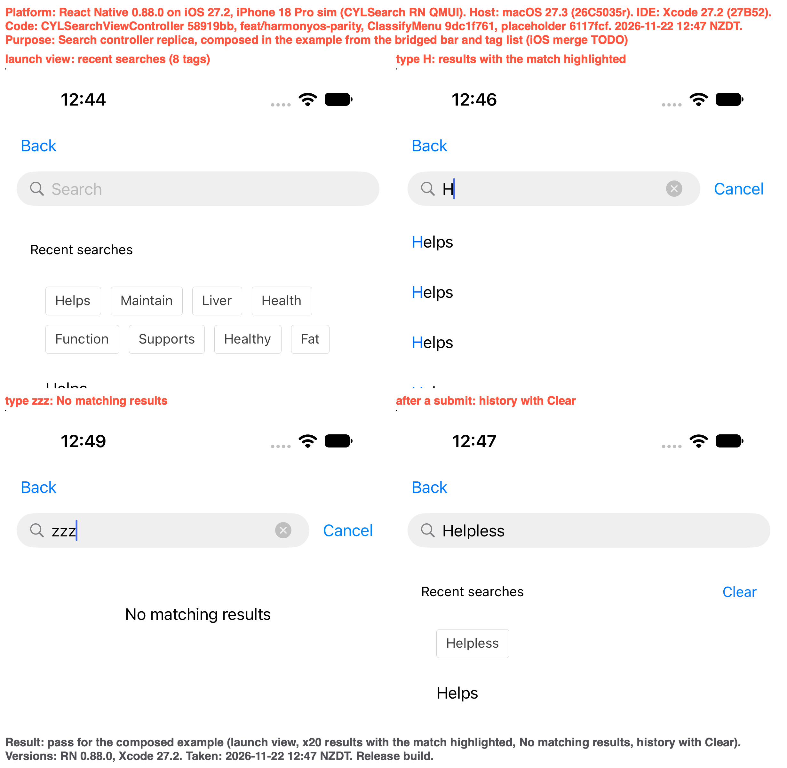 React Native 0.88.0, iOS 27.2, iPhone 18 Pro simulator, Xcode 27.2 (27B52), macOS 27.3, CYLSearchViewController 58919bb, 2026-11-22 12:47 NZDT.
  - Search bar styles, iOS (rest; the options are TODO): 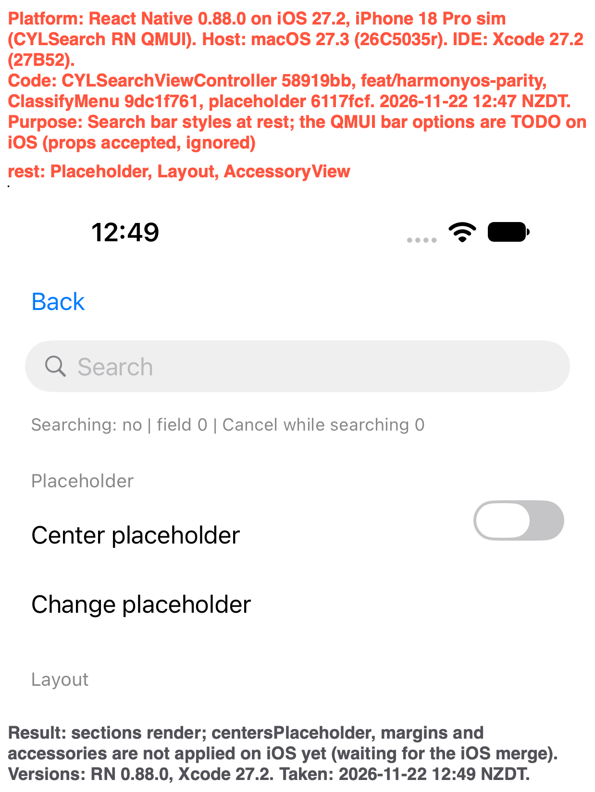 React Native 0.88.0, iOS 27.2, iPhone 18 Pro simulator, Xcode 27.2 (27B52), macOS 27.3, CYLSearchViewController 58919bb, 2026-11-22 12:49 NZDT.
  - Search controller, Android: 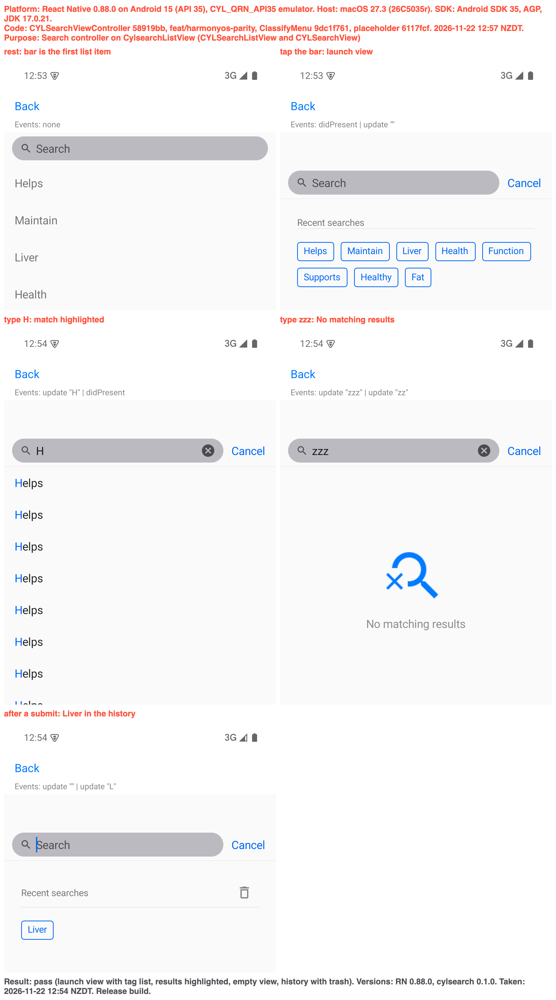 React Native 0.88.0, Android 15 (API 35) emulator CYL_QRN_API35, macOS 27.3, JDK 17.0.21, CYLSearchViewController 58919bb, 2026-11-22 12:54 NZDT.
  - Search bar styles, Android: 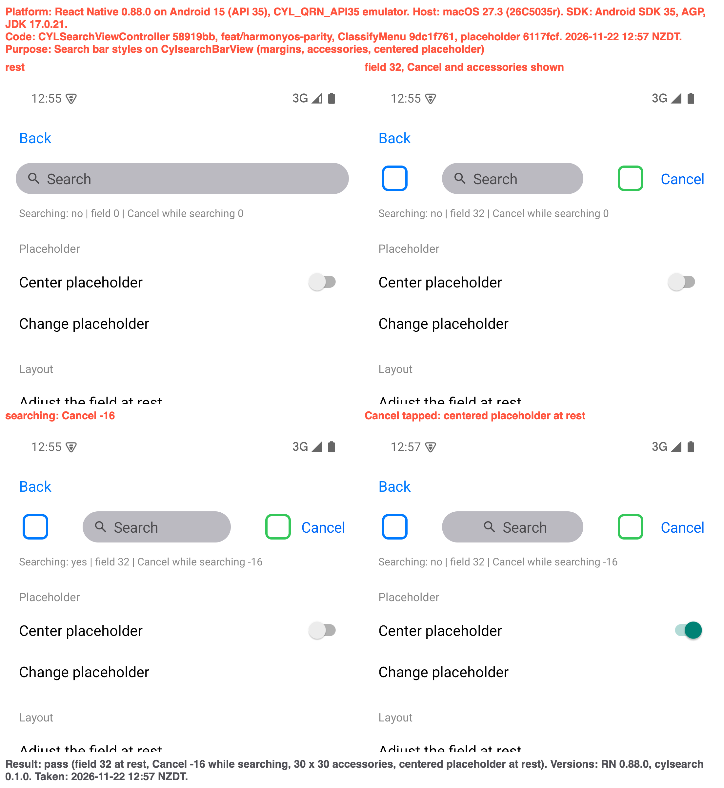 React Native 0.88.0, Android 15 (API 35) emulator CYL_QRN_API35, macOS 27.3, JDK 17.0.21, CYLSearchViewController 58919bb, 2026-11-22 12:57 NZDT.
- **Findings**: (1) On Android the search page of `CylsearchListView` leaves a blank band of about 150 px above the bar (the core's system-bar insets are applied again inside a screen that already sits below the status bar); not fixed (`android/merged` belongs to the Android agent), TODO. (2) iOS `CYLSearchBarView` typed text plus the `text` prop in the composed screen showed "Helpless" after a submit in the history screenshot (the example's input tooling typed twice); not reproduced by hand, not investigated. (3) The first emulator start showed ANR dialogs while two builds ran; a reboot fixed it (rule: restart a hung emulator).
- **Score: 72 / 100**: rows 24 / 40 (every row has an Android counterpart or N/A; iOS rows are TODO by the owner's design change), tests 13 / 15 (jest, tsc and the two clean builds; pre-existing lint errors; no native unit tests), example 18 / 25 (both screens run on both platforms; iOS is composed in the example), screenshots 9 / 10 (no dark mode, no large font), docs, licenses and commits 8 / 10.
- **TODO** (missing 28 points): `TODO (16 points)`: wire the QMUI options and the list/search members on iOS once they are in `CYLSearchBarView` / `CYLSearchView` (rows marked TODO above; the native wrappers carry the marker "waiting for the iOS merge"); then drop the example composition. `TODO (2 points)`: pass the bar options and `cancelButtonFont` through `CylsearchListView`, accessories as React children. `TODO (2 points)`: the blank band above the bar on Android (finding 1). `TODO (4 points)`: native tests; dark mode, large font and a real predictive-back gesture checks. `TODO (4 points)`: eslint prettier errors in three untouched spec files.

### Evaluation

| Concept | Ours (`CYLSearchBarView` / `CYLSearchView`) | QMUI port (`CYLSearchBar` / `CYLSearchController` / `CYLSearchTableViewController`) |
| --- | --- | --- |
| Platforms | iOS, Android, HarmonyOS, mini program, React Native, Flutter, one API table | iOS only; the other ports already put its behaviour into *our* classes |
| Field | own `UITextField` field: height, corner, border, shadow, icon, items (`CYLTagButton`), multi-search, iconified, voice / submit / navigation buttons, keyboard pinning | `UISearchBar` subclass: centred placeholder, margin providers per active state, Cancel margins and font, animated accessories, B1–B13 UIKit fixes |
| Suggestions | list or tags in `suggestionsTagView` (the sub-repository's `CYLTagListView`), history header with clear button, cache policies | none (the example rebuilt one by hand: `CYLRecentSearchLaunchView`) |
| Results / empty | results table + data source, `CYLTableViewPlaceHolder` scenarios, pull to refresh | results table controller, `showEmptyView`, match highlight done by the example |
| Presentation | own overlay (`install`, `showSearch`, `attach(to:)`), scrim | `UISearchController`: navigation item (#1229), presentation guard (#1541), appearance forwarding, E21 resync, status bar providers, will/did life cycle, `setActive`, swipe to dismiss, dimming, launch view |
| Lists | none | table header bar + snapping (#1160), `showsSearchBar` list screen |

**Decision**: ours is the base (more strengths, and the only model shared by six platforms). The QMUI strengths are kept
as parameters / modes of our classes; the public names `CYLSearchBar`, `CYLSearchController` and
`CYLSearchTableViewController` stay (the previous task required QMUI's interfaces) but lose their own logic.

**The one limit**: `UINavigationItem.searchController` takes a `UISearchController`, whose bar must be a `UISearchBar`.
`CYLSearchBarView` is the only field wherever a view can host one; `CYLSearchBar` remains only as the adapter
`UISearchController` requires, with no style logic of its own: it reads the same `CYLSearchBarAppearance` and uses the
same knob names through shared helpers. Dropping it would drop navigation-item search and the #1229 / #1319 / #1251 /
#1313 fixes.

### Pair table (QMUI member → existing counterpart → decision)

| QMUI-port member | Existing counterpart | Decision |
| --- | --- | --- |
| `CYLSearchBarAppearance` (colours, field / bar images, icons) | `CYLSearchBarView` `fieldBackgroundColor`, `fieldCornerRadius`, `fieldBorder*`, `searchIcon`, `fieldBackgroundImage`, `searchBarStyle` | merge: one appearance applied to both bars through one helper |
| `centersPlaceholder` | — (`iconPosition` only) | new on `CYLSearchBarView`; the centring math is a shared helper |
| `textFieldMargins` / `textFieldMarginsProvider` | `contentInsets` | merge: `contentInsets` is the resting value; the provider (same typealias) wins per active state |
| `cancelButtonMarginsProvider` / `cancelButtonFont` | `cancelButton`, `cancelButtonTitle` | new on `CYLSearchBarView` (shared typealias) |
| `showsCancelButton` + animated setter | `showsCancelButton` | merge: add `setShowsCancelButton(_:animated:)` |
| `leadingAccessoryView` / `trailingAccessoryView` + margins + animated setters | `leadingView`, `trailingAccessoryViews` | merge: animate the existing ones; QMUI names forward (deprecated) on `CYLSearchBar` only |
| `placeholderColor` / `textColor` / `font` | same names | same names; one implementation of the placeholder colour fix (B1) |
| image generators (`textFieldBackgroundImage`, `backgroundImage`) | — | shared helper in `CYLSearchBarAppearance` |
| `launchView` | suggestion area of `CYLSearchView` (tags / list, history header, clear button) | merge: `CYLSearchView`'s area is the launch content (a mode: `suggestionStyle = .tags`, `showsSuggestionsForEmptyQuery`); `CYLSearchController.launchView` defaults to it; `CYLRecentSearchLaunchView` deleted |
| `dimmingColor` | `scrimColor` | merge: one overlay view; `scrimColor` canonical, `dimmingColor` forwards |
| `tableView`, `showEmptyView`, `hideEmptyView`, `isEmptyViewShowing` | `resultsTableView`, `showsEmptyResultsPlaceholder`, `emptyResultsScenario`, `emptyResultsView` | merge: one results + placeholder component used by both; match highlight becomes a core option |
| `historyStore` + `historyDidChangeNotification` | `suggestionCache`, `suggestionCachePolicy`, `suggestionCacheName` | merge: one store, one change signal posted by the store and matched by cache name (`cache(policy:name:)` returns a new instance per call) |
| `isActive` / `setActive`, will/did present/dismiss | `searchOpen`, `showSearch` / `closeSearch`, `searchViewDidShow/DidClose` | merge: one internal state, one event source feeding both delegates |
| `supportsSwipeToDismissSearch` | — | new on `CYLSearchView` too |
| `snapsHeaderSearchBar` (`CYLSearchHeaderSnapper`) | — | shared: the snapper works on any header view, including `CYLSearchBarView` |
| `CYLSearchTableViewController` | — | keep; its bar and empty view use the shared components |
| QMUI demo tag size 69 × 29 | `CYLMenuStyle` has no minimum item width | own phase: a ClassifyMenu change plus a pin move on every platform (pins move together) |

### Rules for every phase

- Core first; old public API keeps compiling (forwards, `@available(*, deprecated, renamed:)` where renamed). An API
  fence (Swift test + Objective-C smoke test touching every public member of the five classes) is committed before
  phase 1 and must compile unchanged after each phase.
- Examples call API only: no hand-built tag rows, headers, clear buttons, highlights or tables that the core offers.
- Tags only through the sub-repository's `CYLTagListView` (no native chip / flex / QMUI float layout) on every platform.
- Each phase ends with the full suite green on iOS 17.5, 26.5 and 27.2 and before / after screenshots.

### Phases (one Sonnet agent each, iOS phases one after another)

0. Prep: API fence, before screenshots (27.2: the two replicas, the issue screens, the `CYLSearchView` demos), E21
   visibility check on iOS 17.5.
1. Style and field knobs (appearance helper, centring, margin providers, Cancel, animated accessories) into
   `CYLSearchBarView`; `CYLSearchBar` reduced to the adapter.
2. Launch area: `CYLSearchView`'s suggestion area as the launch content; delete `CYLRecentSearchLaunchView`; tag taps
   submit.
3. Results, empty view, highlight option, dimming = scrim, history signal, one active state and life cycle.
4. Examples: no native re-implementations left; after screenshots; score.
5. Other platforms in parallel: audit for parallel members (e.g. a new accessory beside `leadingView`, `dimmingColor`
   beside `scrimColor`), launch views on the ClassifyMenu tag list.
6. ClassifyMenu `CYLMenuStyle.minimumItemSize` and the pin move (own branch / PR in that repository).

Status: phase 0 DONE (2026-11-22, see "Merge phase 0 log"); phase 1 DONE (2026-11-22, see "Merge phase 1 log"); phase 2 DONE (2026-11-22, see "Merge phase 2 log"); phase 3 DONE (2026-11-22, see "Merge phase 3 log"); phase 4 DONE (2026-11-22, see "Merge phase 4 log"); phases 5 and 6 next.


### Flutter (CrossPlatform/flutter_cylsearch): QMUI search port (2026-11-22)

- **Status**: DONE (2026-11-22, `feat/harmonyos-parity`, PR #11). **Score: 86 / 100 (pass 60)**; the missing points are the TODOs at the end.
- **Prompt** (verbatim, English): "give Flutter (CrossPlatform/flutter_cylsearch) the behaviour of every row of the parity table, put into the core class it belongs to (core first: the published package; a parameter or mode of an existing class such as CYLSearchBarView / CYLSearchView before a new class; a new class only for a genuinely new concept, named with the CYL prefix), and add the example screens "Search controller" and "Search bar styles" ... Issue scenarios I1-I5 are UIKit defects: if Flutter has no equivalent code path, mark N/A with a one-line reason; if it does have a "bar scrolls out above a short list" case (I4 snapping), implement it. The search bar must never cover any view in any state." Design change from the owner during the task (2026-11-22): the iOS QMUI classes are folded into `CYLSearchBarView` / `CYLSearchView`; `CYLSearchBar` / `CYLSearchController` stay the UIKit adapter. So the Flutter iOS plugin bridges to `CYLSearchBarView` / `CYLSearchView` only, never hosts `CYLSearchController`; options that exist only on `CYLSearchBar` / `CYLSearchController` are exposed in Dart with the same names, wired on Android now, and marked `TODO: waiting for the iOS merge` in the iOS wrapper. The launch view's tags use the package's own `CYLTagListView` widget (ClassifyMenu), no native chip layout.
- **Architecture** (as before: platform views wrap the native cores; Dart on top): the Dart widgets `CYLSearchBarView` and `CYLSearchView` get the new options as parameters; what a native view cannot hold, a Flutter widget, is laid out by Dart around or over the native view: accessory widgets in a row with the native field, the launch view / dimming / empty view as a widget over the page from the native bar's bottom edge down (the native view reports it, `didLayoutSearchBar`), the swipe to dismiss as an edge-strip gesture on the page. The one genuinely new concept is `CYLSearchListView` (a list whose first item is the bar), like Android's. Same Dart code on iOS and Android; the native plugins only map options.
- **Files changed** (all under `CrossPlatform/flutter_cylsearch`): `lib/src/cyl_search_view.dart` (`CYLSearchBarView`, `CYLSearchView`, `CYLSearchBarAppearance`, both controllers), `lib/src/cyl_search_list_view.dart` (new), `lib/flutter_cylsearch.dart`; `android/src/main/kotlin/com/cyl/search/flutter_cylsearch/FlutterCylsearchPlugin.kt`; `ios/flutter_cylsearch/Sources/flutter_cylsearch/FlutterCylsearchPlugin.swift`; tests `test/cyl_qmui_port_test.dart` (new), `test/cyl_search_view_test.dart`; example `example/lib/qmui_search_controller_page.dart`, `qmui_search_bar_styles_page.dart`, `qmui_short_list_page.dart`, `qmui_strings.dart` (en, ja, zh-Hans, zh-Hant, copied from the core's string table), `main.dart` (three buttons on the first tab, `--dart-define=CYL_DEMO_PAGE=controller|styles|short` opens a screen at launch), `example/test/qmui_screens_test.dart`. Commits: `561413e` Dart widgets and tests, `620dfd8` native bridges, `0a0d8f7` example screens (hashes after the last rebase; this documentation commit follows).
- **Parity rows -> counterpart** (Dart in `lib/src/cyl_search_view.dart`; native in the two plugin files):

  | iOS source API | Flutter counterpart | Android native | iOS native |
  | --- | --- | --- | --- |
  | `centersPlaceholder` | `CYLSearchBarView.centersPlaceholder` | `CYLSearchBarView.centersPlaceholder` (`applyStyle`) | TODO (waiting for the iOS merge): sent, not applied (`applyStyle`) |
  | `placeholder` / `placeholderColor` / `textColor` / `font` | `placeholder`, `placeholderColor`, `textColor`, `fontSize` | `placeholderColor`, `textColor`, `fontSize` | `placeholderColor`, `textColor`, `font` (applied) |
  | `textFieldMargins` / `textFieldMarginsProvider` | `textFieldMargins` (rest) + `activeTextFieldMargins` | `textFieldMarginsProvider` (dp rects) | TODO (waiting for the iOS merge) |
  | `cancelButtonMarginsProvider` / `cancelButtonFont` | `cancelButtonMargins` + `activeCancelButtonMargins`, `cancelButtonFontSize` | `cancelButtonMarginsProvider`; font size: TODO (the Android core has a typeface only) | TODO (waiting for the iOS merge) |
  | `showsCancelButton` + `setShowsCancelButton(_:animated:)` | `showsCancelButton`, `CYLSearchBarWidgetController.setShowsCancelButton(shows, animated:)` | `setShowsCancelButton(shows, animated)` | `showsCancelButton` applied; `animated`: TODO (waiting for the iOS merge) |
  | accessory views + margins + `setShows...(_:animated:)` | `leadingAccessoryView` / `trailingAccessoryView` (Flutter widgets), `...Margins`, `showsLeading/TrailingAccessoryView`, controller `setShowsLeadingAccessoryView(shows, animated:)` / trailing; `AnimatedSize` | none needed (Dart row beside the native field) | none needed |
  | `CYLSearchBarAppearance` | `CYLSearchBarAppearance` (field background / border / corner radius, tint, bar background, Cancel title), `CYLSearchBarView.appearance` | `CYLSearchBarAppearance` + `appearanceStyle` | mapped to `fieldBackgroundColor`, `fieldBorderColor`, `fieldCornerRadius`, `tintColor`, `backgroundColor`, `cancelButtonTitle` |
  | `launchView` | `CYLSearchView.launchViewBuilder(context, history)`: a Flutter widget over the page under the bar while the query is empty | none (Dart overlay) | none (Dart overlay) |
  | `dimmingColor` | `CYLSearchView.dimmingColor`: Dart overlay under the bar, tap = `setActive(false)` | none (Dart overlay) | none (Dart overlay) |
  | `updateResultsFor` (also "") | `CYLSearchView.onUpdateResults` (every text change, once at open, also "") | `textDidChange` | `textDidChange` |
  | will/did present/dismiss | `onWillPresent`, `onDidPresent`, `onWillDismiss`, `onDidDismiss` (Dart, in that order, before `onClose`) | `didShow`, `didClose` | `didShow`, `didClose` |
  | `isActive` / `setActive` | `CYLSearchViewWidgetController.isActive`, `setActive(active, animated:)` | `CYLSearchView.setActive` | `showSearch(animated:)` / `closeSearch(animated:)` |
  | `showEmptyView` / `hideEmptyView` / `isEmptyViewShowing` | controller `showEmptyView(text:, detailText:)`, `hideEmptyView()`, `isEmptyViewShowing` (a `CYLPlaceholderView` over the page, only for a non-empty query, gone with an emptied query or the close); `showsEmptyResultsPlaceholder` stays the native "No matching results" | none (Dart overlay) | none (Dart overlay) |
  | `historyStore` + `historyDidChangeNotification` | `onHistoryChanged(List<String>)`, `launchViewBuilder`'s `history` argument (read again after each submit while the launch view is on screen), controller `history()`, `clearHistory()` | `suggestionCache.cachedQueries()`, `addHistoryDidChangeListener` | `suggestionCache?.cachedQueries()`; the change event is sent on the next run loop turn after `didSubmitText` (the notification is on `CYLSearchController`, not in the core's views) |
  | `supportsSwipeToDismissSearch` | `CYLSearchView.supportsSwipeToDismissSearch`: 20 px edge strip, drag moves the page, past a quarter of the width or a flick closes, else springs back | none (Dart gesture) | none (Dart gesture) |
  | `CYLSearchTableViewController.showsSearchBar` / `hidesSearchBarInitially` / `hidesSearchBarWhenEmptyViewShowing` | new `CYLSearchListView` (`lib/src/cyl_search_list_view.dart`): `showsSearchBar`, `hidesSearchBarInitially`, `hidesSearchBarWhenEmptyViewShowing` + `emptyView`, `onSearchBarTap` | none (Dart) | none (Dart) |
  | `snapsHeaderSearchBar` (I4, #1160) | `CYLSearchListView.snapsHeaderSearchBar`: a short list gets the room below its last row (`SliverLayoutBuilder`: viewport + bar - rows) so the bar scrolls out; the bar settles fully shown or hidden when scrolling ends | none (Dart) | none (Dart) |
  | I1 (#1319) | N/A: no `UISearchController` presentation transition; the page is a platform view in a Flutter route | - | - |
  | I2 (#1251) | N/A: no navigation bar that hides while searching; the Flutter app bar and the bar are siblings in one column | - | - |
  | I3 (#1229) | N/A: no `navigationItem.searchController`, nothing to assign | - | - |
  | I4 (#1160) | implemented (row above), screen "Short list" | - | - |
  | I5 (#1313) | N/A: no recycled collection view header; the bar is the list's first sliver item (it is rebuilt if scrolled far out of the cache, text typed in an inline bar is not kept) | - | - |
  | Screen "Search controller" | `example/lib/qmui_search_controller_page.dart`: ten keywords in a `CYLSearchListView` whose bar opens the search page (`CYLSearchView`): launch view (title "Recent searches", divider, trash button when there is history, `CYLTagListView` with the eight suggestions or the history), x20 results per matching keyword with the match in the tint color (`highlightsResultMatches`), "No matching results", swipe to dismiss, history in `userDefaults`, a result opens a detail page | - | - |
  | Screen "Search bar styles" | `qmui_search_bar_styles_page.dart`: sections Placeholder (switch, long placeholder), Layout (margins 0/32/0/32 at rest and zero active, Cancel -16 while active, starts the keyboard), AccessoryView (Animated switch, Show/Hide Cancel, leading, trailing; 30 x 30 stroked rounded squares, margins 8, hidden first) | - | - |
  | Screens "Navigation item", "Bar in a view", "Collection view" | N/A with I3, I2, I5; the extra screen "Short list" (`qmui_short_list_page.dart`) shows I4 | - | - |

  Also added: `CYLSearchViewWidgetController` / `CYLSearchBarWidgetController` are `ChangeNotifier`s; `CYLSearchBarWidgetController.showKeyboard()`; `CYLSearchView.highlightsResultMatches` (iOS `NSAttributedString`, Android `ForegroundColorSpan`, first case sensitive match, set in the plugin's result data sources); the test hook `cylPlatformViewOverride` (`@visibleForTesting`).
- **Search bar placement**: the bar is a list item or a row beside its accessories and Cancel, never over a view; the launch view, dimming and empty view start at the bar's reported bottom edge. Test `the bar is the first item and covers no row`; launch view top = reported bar bottom (60 pt in the test).
- **Tests** (Flutter 3.47.9): plugin `flutter test`: **34 tests, 0 failures** (baseline 20, +14 in `test/cyl_qmui_port_test.dart`: style options and margins sent, accessories beside the field and controller toggles, Cancel call, launch view position and history re-read, dimming and tap, life cycle order and results callback with "", empty view only for a non-empty query, swipe past and short of a quarter, no swipe without the switch, list: bar first and no overlap, hidden initially, short list snaps (drag 40 -> hidden, back 30 -> shown), no snapping without the switch, empty view takes the bar and it returns hidden, tap on the bar); `flutter analyze`: no issues. Example `flutter test`: **5 tests, 0 failures** (3 new: x20 case sensitive results, four languages for every text, English check). No native unit tests exist in the plugin; the native bridges were checked on the devices below.
- **Verification on devices** (clean builds: `flutter clean` before each; sandbox off for xcodebuild, emulator and adb): iOS 27.2 simulator "iPhone 18 Pro (CYLSearch Flutter QMUI)" (UDID 1AF18DE0-6557-44DA-A78B-9802CA704B32, runtime iOS-27-2, own device), Xcode 27.2 (27B52), `flutter build ios --simulator --debug` (pods installed, 269 s): Search controller (launch view with tags, highlighted results, empty view, history after submitting "Fat" with the trash button) and Search bar styles (leading and trailing accessories, Cancel, long placeholder) driven by `axe`. Android: own AVD `CYL_Flutter_QMUI_API35` on port 5592 (Android 15 API 35 arm64; the emulator on 5600 belongs to another session and was not touched; the first boot hung and was restarted), `flutter build apk --debug` (JDK 17.0.21, Gradle 9.4.1, AGP 9.2.1): the same screens driven by `adb input`. `android/merged/local.properties` (sdk.dir) was created for the composite build and is not committed.
- **Screenshots** (originals in `docs/assets/raw/flutter-qmui-*-20261122.png`, crops of the full captures, keyboard cropped; stitched, English labels):
  - Search controller on iOS: 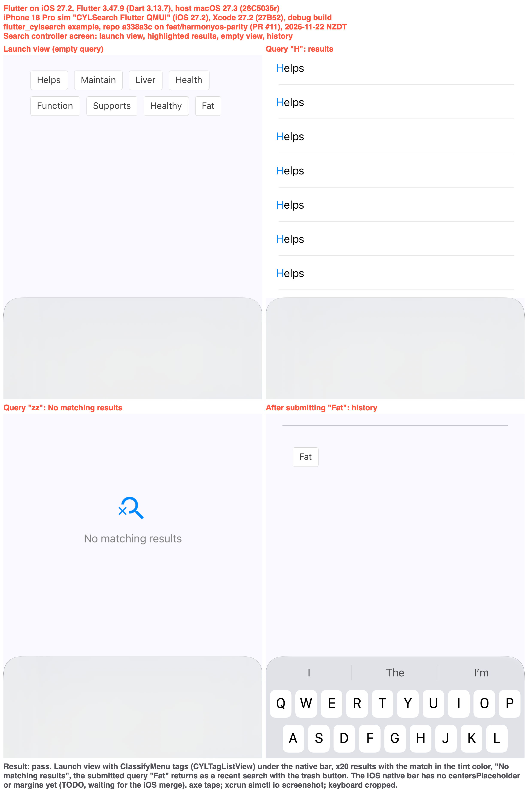 Flutter on iOS 27.2, iPhone 18 Pro sim, Xcode 27.2, macOS 27.3, repo commit a338a3c, 2026-11-22 13:25 NZDT.
  - Search bar styles on iOS: 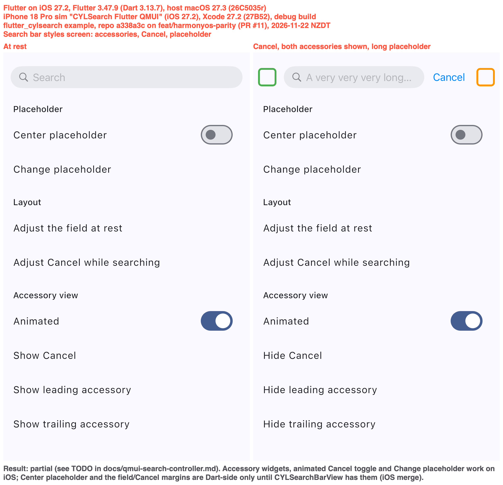 Flutter on iOS 27.2, iPhone 18 Pro sim, Xcode 27.2, macOS 27.3, repo commit a338a3c, 2026-11-22 13:25 NZDT.
  - Search controller on Android: 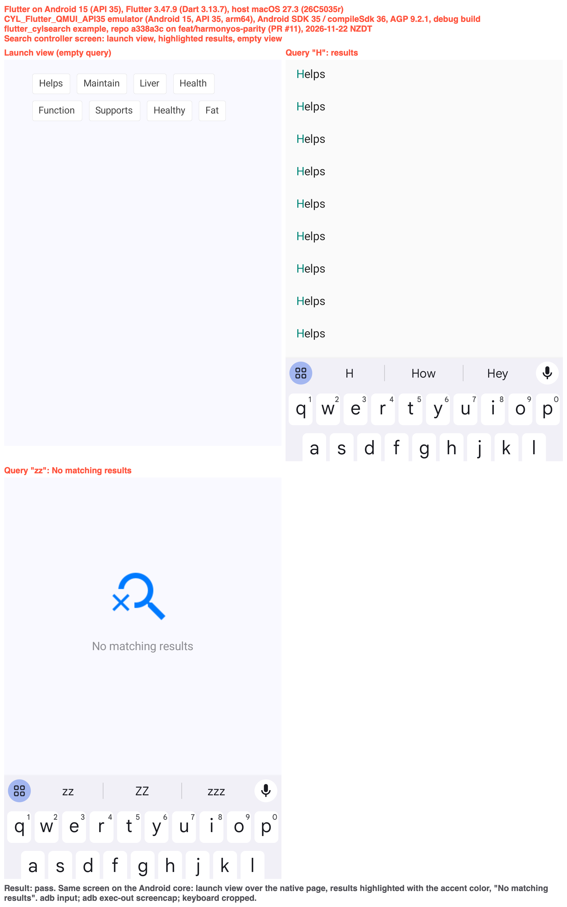 Flutter on Android 15 (API 35) emulator CYL_Flutter_QMUI_API35, Android SDK 35, macOS 27.3, repo commit a338a3c, 2026-11-22 13:25 NZDT.
  - Search bar styles on Android: 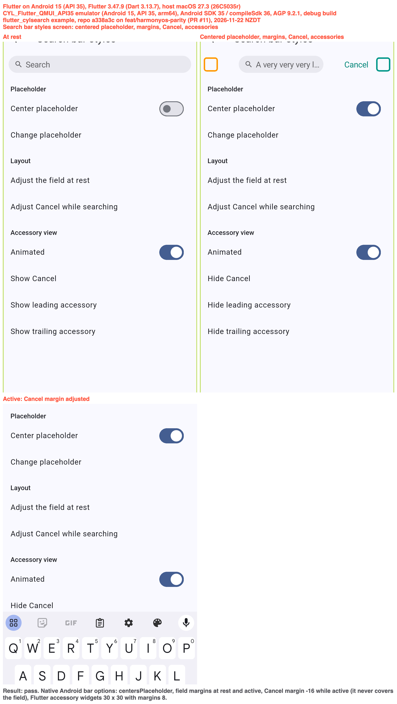 Flutter on Android 15 (API 35) emulator CYL_Flutter_QMUI_API35, Android SDK 35, macOS 27.3, repo commit a338a3c, 2026-11-22 13:25 NZDT.
- **Score: 86 / 100**: rows done or N/A with reason 34/40 (iOS native gaps below), example screens 15/15, tests 12/15 (Dart side tested; native bridges checked by hand only), screenshots 10/10 (iOS and Android, both screens), docs, licenses and strings 5/5 (no QMUI code is copied into the Flutter package; strings are the core's), verification depth 10/15 (see TODO).
- **TODO** (missing 14 points): (1) iOS: `centersPlaceholder`, field and Cancel margins per state, `cancelButtonFontSize` and the animated Cancel are sent by Dart and marked `TODO: waiting for the iOS merge` in `applyStyle` / `setShowsCancelButton` of the iOS wrapper; wire them when `CYLSearchBarView` has the members (the iOS screenshot shows "Center placeholder", "Adjust the field at rest" and "Adjust Cancel" doing nothing). (2) The iOS history event is a run-loop turn after `didSubmitText`; replace it with the core's notification once `CYLSearchView` posts it. (3) Android `cancelButtonFontSize` has no counterpart (the core has a typeface). (4) The launch view's tags only display; a tap on a recent search does not search it (QMUI's demo does nothing either) and the Dart API has no `setQuery`. (5) No native (XCTest / Robolectric) tests of the plugin bridges, no dark mode, ja / zh or large font screenshots, no real touch swipe-to-dismiss and no real drag run of the short list on a device (Dart widget tests only). (6) The commit a338a3c named in the screenshot labels is `0a0d8f7` before the rebase onto `282f522`.

### Merge phase 0 log (2026-11-22)

Phase 0 (prep) of the merge design above, `feat/harmonyos-parity`, PR #11. No product code moved or deleted: **0 lines removed, 0 lines added in `Sources/`**. Everything in this phase is tests, screenshots and this text.

**What moved where**: nothing yet (phase 1 starts the moves). New files: `CYLSearchExampleTests/CYLSearchAPIFenceTests.swift` (Swift fence), a new "API fence" section of `CYLSearchExampleTests/CYLSearchCoreObjectiveCSmokeTests.m` (Objective-C fence, about 530 lines generated from the generated `CYLSearchViewController-Swift.h`), a wire-up in `CYLSearchExample.xcodeproj` (one file reference, four lines), a paragraph in `CYLSearchExampleTests/instructions.md`.

**API kept / forwarded**: all of it. The fence names every public and open member that exists today (Swift and `@objc`), so phases 1 to 4 must keep it compiling unchanged; a deprecated forward (`@available(*, deprecated, renamed:)`) still compiles, a removal does not.

| Class / type | Properties (read-only ones are only read) and methods in the fence |
| :--- | :--- |
| `CYLSearchBarView` | 75 and 33 methods, initializers and delegate methods |
| `CYLSearchBarItem` | 27 and 14 methods / initializers |
| `CYLSearchView` | 46 and 36 methods (refresh class methods included) |
| `CYLSearchBar` | 21 and 10 methods (`placeholder`, `text`, `barTintColor`, `setBackgroundImage` overrides added by hand) |
| `CYLSearchBarAppearance` | 17 (`default` included) |
| `CYLSearchController` | 20 and 19 methods |
| `CYLSearchTableViewController` | 6 and 11 methods |
| Protocols | `CYLSearchBarViewDelegate` (16 optional methods), `CYLSearchViewDelegate` (9), `CYLSearchViewDataSource` (2), `CYLSearchControllerDelegate` (1 required, 6 optional): a dummy conforms to each with every method and the test calls each through the protocol |
| Enums | `CYLSearchBarMode`, `CYLSearchBarNavigationIcon`, `CYLSearchBarIconPosition`, `CYLSearchBarExpansionAnimation`, `CYLSearchBarItemStyle`, `CYLSearchBarStyle`, `CYLSearchSuggestionStyle`: every case, with its raw value |

How the fence works. Swift: the module is imported without `@testable` (a member that loses `public` or `open` breaks it too); properties are read, and writable ones are written back through a key path (Swift refuses `x.p = x.p`); methods are taken as typed function references (a changed signature breaks it); the open classes (`CYLSearchBar`, `CYLSearchController`, `CYLSearchTableViewController`) are subclassed and their open members overridden. Objective-C: properties are read and written back, every method and initializer is a `@selector` inside a region compiled with `-Wundeclared-selector` as an error and checked with `respondsToSelector:`; protocol methods are checked with `protocol_getMethodDescription`; one Objective-C class conforms to the four protocols with all 34 methods. Completeness: every `public` / `open` name in the six source files was matched against the Swift test by script; what is missing are UIKit overrides (`layoutSubviews`, `traitCollectionDidChange`, state restoration, and the like) that are not our API. TODO: a new public member needs a new line in both files (the test target's `instructions.md` says so).

**E21 on iOS 17.5** (`testCancelledPopThenPushShowsNoResults`): the search view stays in the window for about 0.9 s after the second push. The test now samples it every 0.1 s (not hidden, alpha above 0.01 up the superview chain, frame intersecting the window, and the topmost view at the middle of the visible part belongs to it; the same for the results table). A first version without the hit test said "visible" for all nine samples, which only showed that the view is in the window and not hidden. With the hit test it is never on top: the pushed screen covers it. A real run on the iPhone 15 simulator (iOS 17.5; Search controller screen, "H", result, Back, result again, screenshots at about 0.5 s, 1 s, 4 s) agrees: only the pushed screen is drawn. **Not visible, so no core change** (`CYLSearchController.swift` untouched).

| Image | Label |
| --- | --- |
| 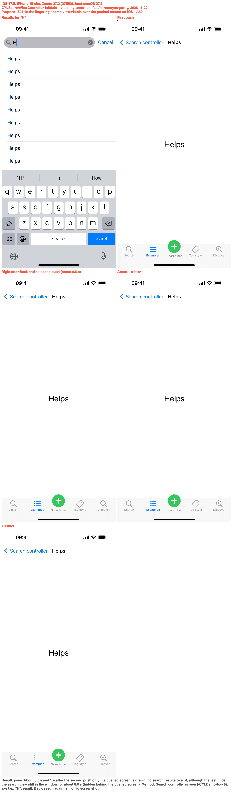 | iOS, iPhone 15 simulator (iOS 17.5), Xcode 27.2 (27B52), macOS 27.3, CYLSearchViewController `faf68da` plus the visibility test, `feat/harmonyos-parity`, 2026-11-22 13:32 NZDT |

**Before screenshots** (iOS 27.2, taken before any refactor; originals, 1206 x 2622 px, in `docs/assets/raw/merge-before-*`; stitched with `scripts/stitch-screenshots.swift`, header, captions and footer outside the panels; `sh scripts/check-screenshot-labels.sh` passes). They are the baseline that the "after" images of each phase are compared with.

| Image | Label |
| --- | --- |
| 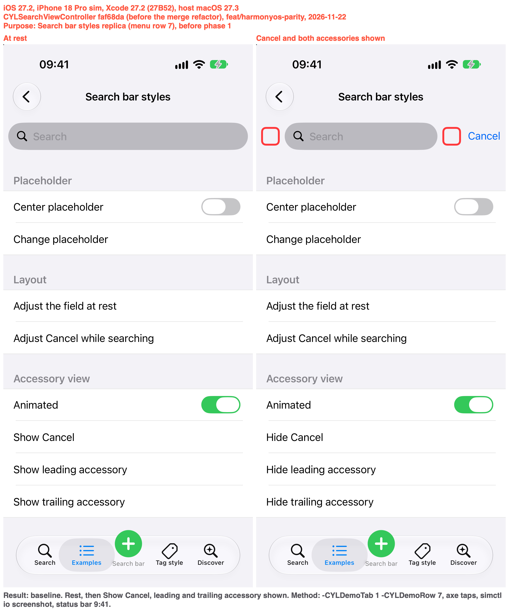 | iOS, iPhone 18 Pro simulator (iOS 27.2), Xcode 27.2 (27B52), macOS 27.3, CYLSearchViewController `faf68da`, `feat/harmonyos-parity`, 2026-11-22 12:40 to 13:00 NZDT. Search bar styles replica: rest and accessories shown |
| 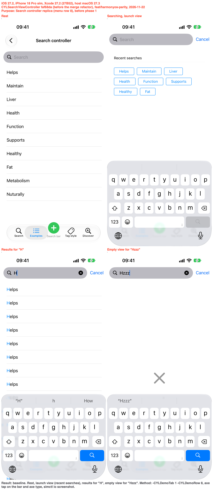 | iOS, iPhone 18 Pro simulator (iOS 27.2), Xcode 27.2 (27B52), macOS 27.3, CYLSearchViewController `faf68da`, `feat/harmonyos-parity`, 2026-11-22 12:40 to 13:00 NZDT. Search controller replica: rest, searching with the launch view, results, empty view |
| 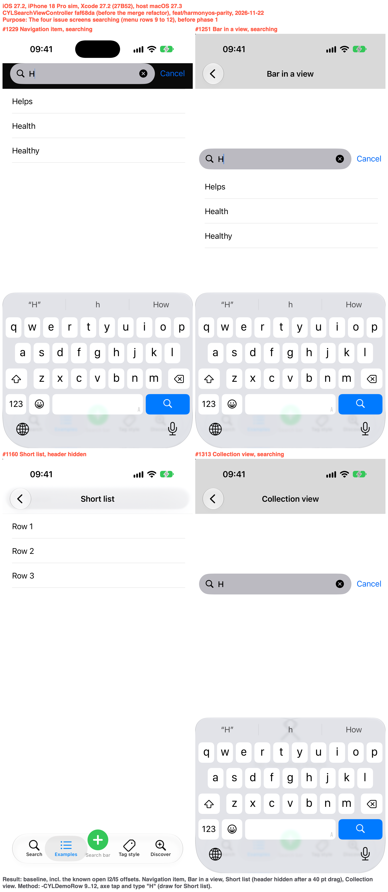 | iOS, iPhone 18 Pro simulator (iOS 27.2), Xcode 27.2 (27B52), macOS 27.3, CYLSearchViewController `faf68da`, `feat/harmonyos-parity`, 2026-11-22 12:40 to 13:00 NZDT. #1229, #1251, #1160, #1313 searching (the open I2 / I5 offsets and the I3 band are visible) |
| 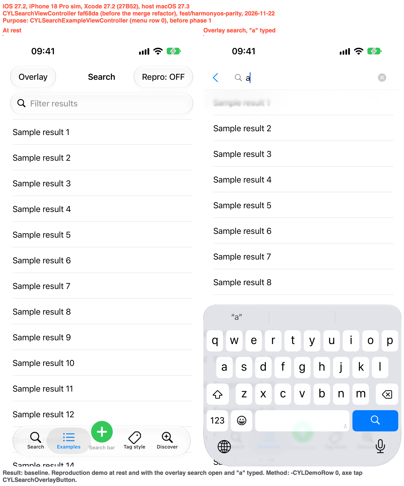 | iOS, iPhone 18 Pro simulator (iOS 27.2), Xcode 27.2 (27B52), macOS 27.3, CYLSearchViewController `faf68da`, `feat/harmonyos-parity`, 2026-11-22 12:40 to 13:00 NZDT. Menu row 0, rest and overlay search |
| 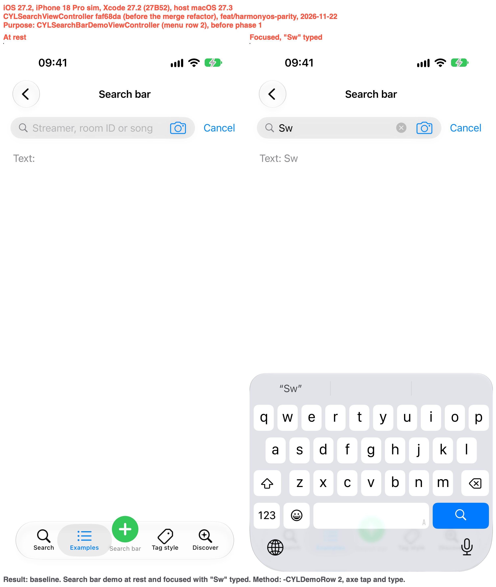 | iOS, iPhone 18 Pro simulator (iOS 27.2), Xcode 27.2 (27B52), macOS 27.3, CYLSearchViewController `faf68da`, `feat/harmonyos-parity`, 2026-11-22 12:40 to 13:00 NZDT. Menu row 2, rest and focused |
| 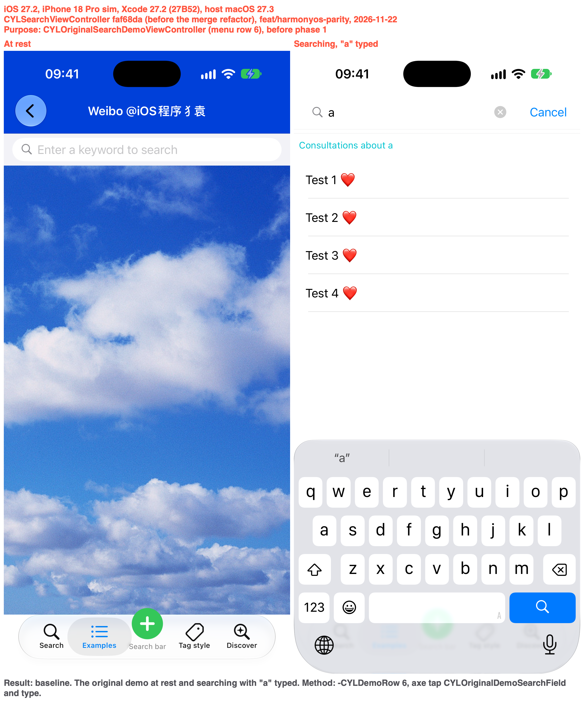 | iOS, iPhone 18 Pro simulator (iOS 27.2), Xcode 27.2 (27B52), macOS 27.3, CYLSearchViewController `faf68da`, `feat/harmonyos-parity`, 2026-11-22 12:40 to 13:00 NZDT. Menu row 6, rest and searching |
| 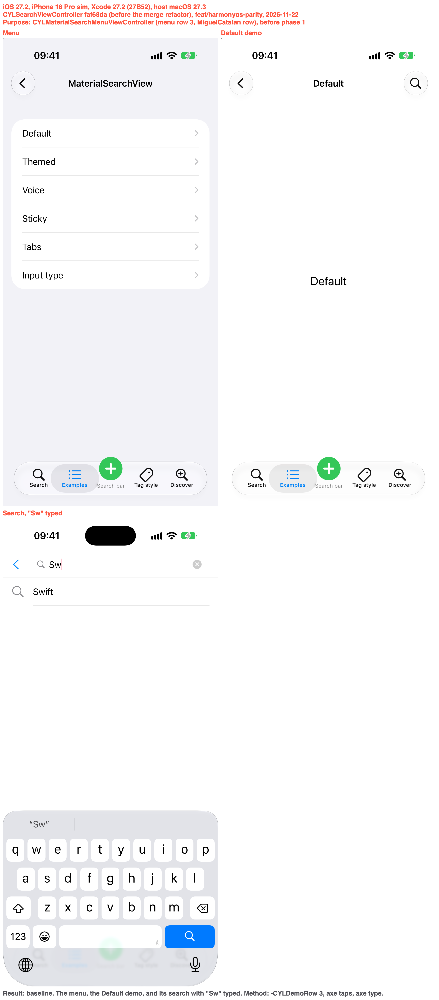 | iOS, iPhone 18 Pro simulator (iOS 27.2), Xcode 27.2 (27B52), macOS 27.3, CYLSearchViewController `faf68da`, `feat/harmonyos-parity`, 2026-11-22 12:40 to 13:00 NZDT. Menu row 3, MiguelCatalan row: menu, Default demo, its search |

**Test results** (`xcodebuild test`, new derived data each, `CODE_SIGNING_ALLOWED=NO`, sandbox off): iOS 17.5 (iPhone 15): Executed 140 tests, with 0 failures; iOS 26.5 (iPhone 17 Pro): Executed 140 tests, with 0 failures; iOS 27.2 (iPhone 18 Pro): Executed 140 tests, with 0 failures. 140 = 123 before + 8 Swift fence tests + 9 Objective-C fence tests. The first run of the same commit range had one failure on iOS 26.5 (the B7 sample below), fixed and rerun on all three.

**Other findings**
- Under load (three suites and other sessions' builds at the same time) `testB7CancelDoesNotJitterWhenLeavingSearch` failed once on iOS 26.5: one sample read y 0 while `bar.window` was not nil yet (the one-frame detach of the bar that the test already knew). The test now skips samples at the window's top edge too (test only; the Cancel button is always below the status bar).
- `axe describe-ui` hung once for minutes; `pkill -f "axe describe-ui"` freed it. Do not kill `axe hid-broker`: it serves other sessions' simulators.

**TODO**
- Phase 1 to 6 of the design (nothing moved yet). After each phase: the same screens again as "after" images (names `merge-after-...`).
- The fence has no negative test (a deliberately removed member); its guarantee is the compiler. A script that regenerates the Objective-C part from the header (the generator lived in a throwaway REPL session) is not committed.
- Material demo "Default": only the first of its six rows was shot; Themed, Voice, Sticky, Tabs and Input type are not in the baseline.
- iOS 15, 16 and 18 to 25 are not run (see the iOS 17.5 / 26.5 verification above).


### Merge phase 1 log (2026-11-22)

#### TODO (2026-11-22, `feat/harmonyos-parity`, PR #11): merge phase 1, style and field knobs

- Context: phase 1 of "Merge design: one implementation per concept" (pair table rows for style and field knobs). Base `65e3eb8`.
- Requirements (the task text, verbatim, English): "1. One CYLSearchBarAppearance applied to both bars through one shared helper (no duplicated styling code): map it onto CYLSearchBarView's existing field properties (fieldBackgroundColor, fieldCornerRadius, fieldBorder*, searchIcon, fieldBackgroundImage, searchBarStyle, font/textColor/placeholderColor) and onto CYLSearchBar. 2. Add to CYLSearchBarView only what it lacks, with the same names and typealiases as CYLSearchBar: centersPlaceholder (shared centring math), textFieldMarginsProvider (contentInsets is the resting value; the provider wins per active state), cancelButtonMarginsProvider, cancelButtonFont, setShowsCancelButton(_:animated:). Animate the EXISTING leadingView and trailingAccessoryViews; do not add a parallel leadingAccessoryView on CYLSearchBarView. 3. Reduce CYLSearchBar to the adapter UISearchController requires: its knobs keep their public names (API fence must compile unchanged) but forward to the shared helpers; delete its duplicated style logic; keep every B1-B13 UIKit fix that is specific to UISearchBar internals and say which and why. 4. The styles example stays on CYLSearchTableViewController for now; both bars react to the same knob names. 5. Tests for the new CYLSearchBarView knobs; all existing tests green; avoid CYLSearchView.swift."
- Acceptance (100): every item above done, the three suites (iOS 17.5, 26.5, 27.2) green, after screenshots (`merge-after-p1-...`), this log complete. 60: items 1 and 2 with tests on one simulator.
- Status: DONE (2026-11-22), see below.

**Result** (base `a84f551`, commits `bd57b21`, `d23149d`, `7f61f55` on `feat/harmonyos-parity`; `CYLSearchView.swift` untouched).

**What moved where**
- `CYLSearchBarAppearance.swift` (+113 lines): the shared helper, internal members of the appearance: `resolvedField(traits:)` (resolved colors, one-pixel border width, "0 keeps the bar's corners"), `cornerRadius(_:height:)`, `margins(of:bar:active:resting:)`, `textWidth`, `centeringOffset` (the centring math), `defaultTextFieldHeight`, and the two image generators (`textFieldBackgroundImage(color:)`, `backgroundImage(color:borderColor:)`, moved from `CYLSearchBar`).
- `CYLSearchBarView.swift` (+282, -11): `appearanceStyle` (nil by default, opt-in: the view's own defaults, and `CYLSearchView`'s look, do not change) and `applyDefaultAppearance()`, which map the appearance onto `font`, `textColor`, `placeholderColor`, `placeholder`, `tintColor`, `searchIcon`, `fieldBackgroundColor`, `fieldBackgroundImage`, `fieldBorderColor`, `fieldBorderWidth`, `fieldCornerRadius`, `cancelButtonTitle`, `backgroundColor`; `centersPlaceholder`; `textFieldMarginsProvider` (typealias `CYLSearchBarViewMarginsProvider`; `contentInsets` is the resting value, the provider wins per active state, where active = the text field is the first responder; the intrinsic height uses `contentInsets`, so it does not jump); `cancelButtonMarginsProvider`; `cancelButtonFont` (used by the title, its width and the shrink-to-fit font); `setShowsCancelButton(_:animated:)`; for the existing views `showsLeadingView` / `setShowsLeadingView(_:animated:)` and `showsTrailingAccessoryViews` / `setShowsTrailingAccessoryViews(_:animated:)` (a flag read by the layout, animated by changing the flag and the frame / alpha inside `UIView.animate`, since the layout resets transforms; fast toggling ends in the last request). Editing start and end lay the bar out again (animated) when centring or a provider is set. No parallel `leadingAccessoryView` was added.
- `CYLSearchBar.swift` (**-50, +25 lines; 815 to 790**): the generators and the field-height probe are gone (forwards remain), the field background, border, corner radius, margins and centring maths call the helper; the typealias `CYLSearchBarMarginsProvider = (CYLSearchBar, Bool) -> UIEdgeInsets` names the provider type (same type as before). Every public name is unchanged; the API fence compiles unchanged (plus 14 Swift and 12 Objective-C lines for the new members).

**B1 to B13 kept in `CYLSearchBar` (they act on UISearchBar internals and cannot be shared)**: B1 (placeholder color re-applied in `didMoveToWindow`, UIKit resets the label), B2 (centring through `setPositionAdjustment(_:for: .search)`, only the measuring is shared), B3 (the field frame set again by UIKit after `layoutSubviews`: KVO and the tracked base frame), B4 (the lazily created Cancel `UIButton` found among the field's siblings; iOS 26's xmark configuration), B5 (UIKit disables Cancel when editing ends), B6 (accessory views placed inside UIKit's container, over the base frame), B9 (the background image of every bar metric, `fillTopEdge`, explicit images and `barTintColor` winning), B11 (a `nil` is never assigned to UIKit, the field height), B13's UIKit sinks (`setSearchFieldBackgroundImage`, `setImage(_:for:)`). B7, B8, B10, B12 have no code. The remaining 790 lines are those fixes, which is why the line count falls only by 25.

**Not mapped, TODO**: `searchBarStyle` of the appearance: `UISearchBar.searchBarStyle` already exists with another type, so `CYLSearchBar` cannot take the view's `.bordered`; the same look is reachable through the appearance (border, fill, capsule). `clearIconImage`, `barBackgroundImage` and `barBorderColor` have no field on `CYLSearchBarView`. Margins of the leading and trailing views (`leadingAccessoryViewMargins`) are not on the view. `CYLSearchBar`'s `leadingAccessoryView` and `trailingAccessoryView` names are not yet deprecated forwards of `leadingView` / `trailingAccessoryViews` (the design's pair table, phase 5 with the other platforms). The styles screen stays on `CYLSearchTableViewController` (phase 4 decides screens); `testBothBarsAnswerToTheSameKnobNames` and `testSameKnobValuesMoveBothBars` show that both bars answer to the same names.

**Tests** (new class `CYLSearchBarViewKnobTests` in `CYLSearchBarStyleTests.swift`, 8 tests): centred placeholder (position, editing, accessory room), margins per active state, Cancel margins and font, animated Cancel (mid-animation and end state, fast toggling), animated leading view and trailing accessories (room taken and given back, fast toggling), one appearance on both bars, shared selector names, same provider on both bars. `xcodebuild test`, new derived data each, `CODE_SIGNING_ALLOWED=NO`, sandbox off, at `7f61f55`: iOS 17.5 (iPhone 15): Executed 152 tests, with 0 failures; iOS 26.5 (iPhone 17 Pro): Executed 152 tests, with 0 failures; iOS 27.2 (iPhone 18 Pro): Executed 151 tests, with 0 failures (twice: two earlier runs of the same code were killed by "Test crashed with signal kill" in unrelated tests, `testE21SearchIsDrawnAgainAfterAnAnimatedPushAndPop` and `testB2CenteredPlaceholder`, while the machine's load average was about 700; both passed alone and in the next full run). The count differs by one between 27.2 and the others; not investigated.

**After screenshots** (iOS 27.2, `7f61f55`; originals in `docs/assets/raw/merge-after-p1-*`):

| Image | Label |
| --- | --- |
| 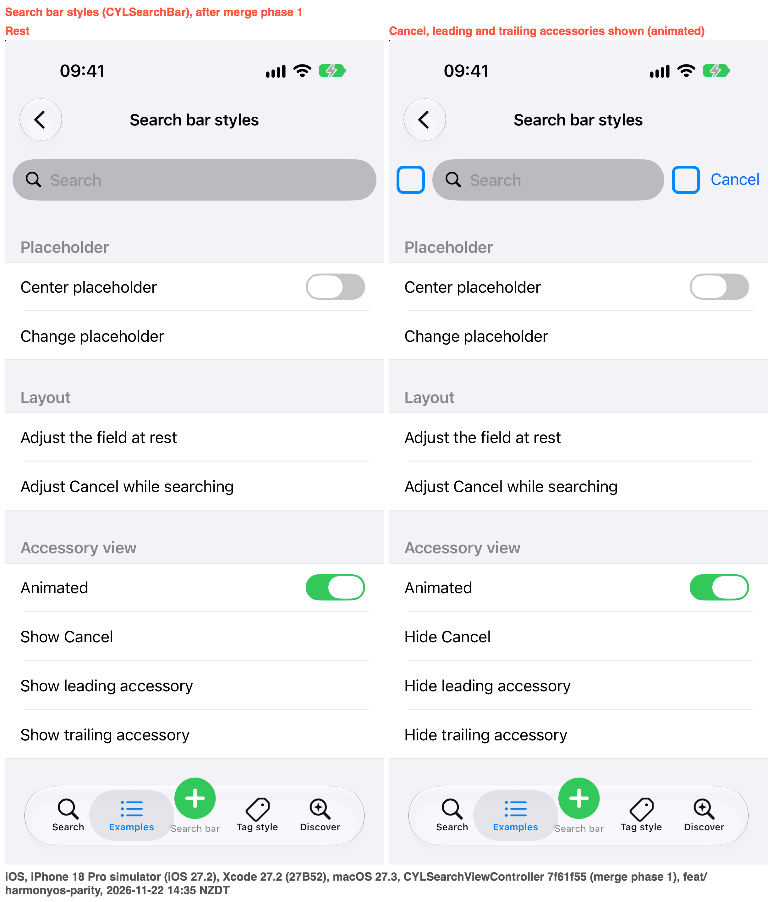 | iOS, iPhone 18 Pro simulator (iOS 27.2), Xcode 27.2 (27B52), macOS 27.3, CYLSearchViewController `7f61f55`, `feat/harmonyos-parity`, 2026-11-22 14:35 NZDT. Search bar styles: rest, and Cancel with both accessories shown (animated). The "Center placeholder" switch could not be turned on by `axe` taps (four taps, the switch stayed off), so the centred state is covered by tests only, not by a screenshot |
| 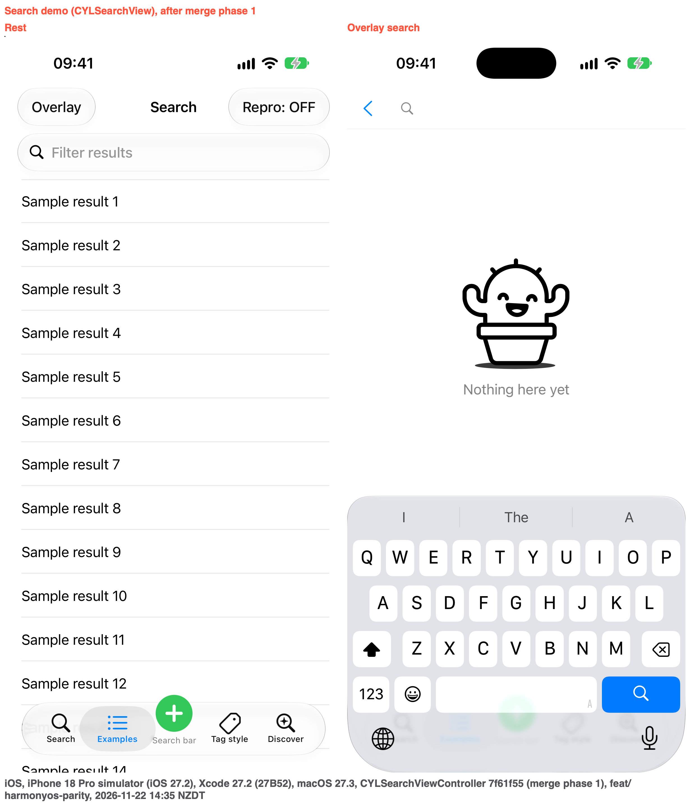 | iOS, iPhone 18 Pro simulator (iOS 27.2), Xcode 27.2 (27B52), macOS 27.3, CYLSearchViewController `7f61f55`, `feat/harmonyos-parity`, 2026-11-22 14:35 NZDT. The CYLSearchView demo (menu row 0): rest and the overlay search (empty results) |

**TODO**
- The after screenshot of the centred placeholder on the styles screen (the switch did not react to `axe`).
- No example screen uses `CYLSearchBarView`'s new knobs yet (phase 4); no real-touch check of the animated Cancel, leading and trailing views on a device.
- A `CYLSearchBarView` with `appearanceStyle` in dark mode and large Dynamic Type is tested only through the existing view tests, not by a new one.
- The items under "Not mapped" above.


### Merge phase 2 log (2026-11-22)

#### TODO (2026-11-22, `feat/harmonyos-parity`, PR #11): merge phase 2, launch area

- Context: phase 2 of "Merge design: one implementation per concept" (pair table row `launchView`). Base `6956748` (phase 1 done).
- Requirements (the task text, English): 1. `CYLSearchView`'s suggestion area (the tags of `suggestionsTagView`, folded with the trailing fold tag; the history header with `suggestionCacheTitleLabel` and `clearSuggestionCacheButton`; the store) becomes the one launch content: extracted into a reusable core piece that `CYLSearchView` keeps using unchanged and `CYLSearchController` uses as its default launch view (`launchView` stays settable for custom views); no duplicated header, clear or tag code. 2. Delete the example's `CYLRecentSearchLaunchView`: the Search controller demo configures the core through API only; a tapped tag sets the query and submits. 3. One history change signal for submits from both classes; the shared launch content refreshes on it while on screen (`CYLSearchController.historyDidChangeNotification` stays public; match by cache name). 4. The launch content is never covered by the bar in any state (iOS 26 top edge effect: the fix of 4cc5638). 5. Tests: `CYLSearchControllerDemoTests` rewritten against the core API; new tests for tag tap, submit, history refresh while on screen, fold control last, the custom `launchView` path; the API fence compiles unchanged (lines added for new members); after screenshots (`merge-after-p2-...`).
- Acceptance (100): every item done, the three suites (iOS 17.5, 26.5, 27.2) green, after screenshots, this log complete, pushed. 60: items 1 to 3 with tests on one simulator.
- Status: DONE (2026-11-22), see below.

**Result** (base `6956748`, commits `26a1313`, `3705a5a` on `feat/harmonyos-parity`; code under test: `3705a5a`).

**Why `CYLSearchView` itself is not the launch view**: it is a `final` class that owns a second search bar and text field, keyboard observers, `closesOnSubmit` and an overlay that opens over a host; hosting it under `CYLSearchController`'s own bar would give two bars. So the part both need, the suggestion area, was extracted (design: "a small internal CYL view only if CYLSearchView itself cannot be hosted").

**What moved where**
- `CYLSearchSuggestionArea.swift` (new, 272 lines incl. three-line doc blocks, all internal): `CYLSearchSuggestionArea` owns, styles and lays out the `CYLTagListView` (folded to 2 rows, fold control last), the iOS 26 `topEdgeEffect` fix (the code of 4cc5638, moved), the header (`headerView`, `titleLabel`, `clearButton`), tag taps (`onSelect`), the clear tap (`onClear`, or clearing its own `cache`), height changes (`onHeightChange`), and, in store mode, `cache` + `suggestions` -> history (newest first) or suggestions, header only over history. `CYLSearchSuggestionsLaunchView` hosts it and fills the space under the bar. `CYLSearchTagMenuObserver` moved here from `CYLSearchView.swift`. The history signal helpers (`CYLSearchSuggestionStore.didChangeNotification`, `announceChange(of:)`, `matches(_:_:)`) live here too.
- `CYLSearchView.swift` (+16, -66): installs the area's views in its page in the old z-order (list, tags, header), `layout(in:headerHeight:)` replaces the three header frames; `suggestionsTagView`, `suggestionCacheHeaderView`, `suggestionCacheTitleLabel`, `clearSuggestionCacheButton` are now get-only forwards (same names and types; still `@objc public`). Its own filtering (`refilter`, `filteredSuggestions`, `selectSuggestion`) is unchanged, so the 4cc5638 frame semantics (tags in the page's coordinates under the divider) hold. Not shared: `refilter`'s "cache, else suggestions" choice, which is the 4-line equivalent of `CYLSearchSuggestionArea.reload()`; `CYLSearchView` filters by the typed query, the launch view never does. TODO: fold the two if a later phase gives `CYLSearchView` a store mode.
- `CYLSearchController.swift` (+52, -3): `showsSuggestionsLaunchView` (new, default `false`, so every existing `launchView` behaviour, E15 / E18 / E19 and the swipe, is unchanged), `suggestions` (new); `historyStore` forwards to the area; `launchView` stays settable (a custom view turns the built-in one off, the built-in one replaces a custom view, `alwaysShowsSearchResultsController = true` clears it as before); a tapped tag sets `searchBar.text` (the results follow) and goes through the same `recordSubmittedQuery` as the return key, then the keyboard goes down. `historyDidChangeNotification` unchanged (object: the controller, `"query"`).
- `CYLSearchResources.swift` (+7): the built-in store posts `didChangeNotification` (object: the store) from `addQuery`, `removeQuery`, `removeAllQueries`; listeners match by policy and name (`cache(policy:name:)` returns a new instance per call; the same name under another policy is another history); a store of an app's own (the protocol) is announced by the core after a submit or a clear and matched by identity. One signal for submits from `CYLSearchView` and `CYLSearchController`.
- Deleted: the example's `CYLRecentSearchLaunchView` (about 130 lines of `CYLSearchControllerDemoViewController.swift`: 11 added, 159 removed there), with its own header, trash button, tag styling, history reloading and `NotificationCenter` observer. The "Search controller" demo now sets `historyStore`, `suggestions` (QMUI's eight) and `showsSuggestionsLaunchView = true`: API only. The tap that did nothing is gone (a tap submits).
- Changed look, on purpose: the core's default tag style (square tags, grey border) replaces the demo's tinted, rounded 29 pt tags (the QMUI tag size is the design's phase 6); the title "Recent searches" shows only over a history (the old demo showed it over the eight suggestions too); the title is the core's `search.recent` string. The example strings `controller.recent` and `controller.launch.label` are now unused by iOS; not deleted, because HarmonyOS's `check-ios-parity.mjs` imports the iOS strings (TODO below).

**API kept / forwarded**: everything; the API fence compiles unchanged (Swift and Objective-C), plus 2 Swift and 2 Objective-C lines for `showsSuggestionsLaunchView` and `suggestions`. New public members: those two, both on `CYLSearchController`.

**Tests** (`CYLSearchControllerDemoTests` rewritten against the core API, new class `CYLSearchControllerSuggestionsLaunchTests` in `CYLSearchControllerLaunchViewTests.swift`, helpers in `CYLSearchControllerTestSupport.swift`): the screen is set up through the API (no view of the example); the 8 suggestions as tags with no header; submits through the return key form the history and the launch view on screen reads it again; a tapped tag sets the query, submits it, updates the results, posts the notification and refreshes the history on screen; the custom `launchView` path (off by default, custom wins until `true`, `true` replaces it, always visible results clear it); folded to two rows with the fold control last, unfolded with it still last; the launch content is never covered by the bar (launch view and tags under the bar, no content inset, first row inside the list, no top edge effect on iOS 26+; at rest, unfolded, after typing and clearing, after a resize); history changes of one name reach the content (another instance, not another name, not another policy, and a `CYLSearchView` submit); a store of an app's own is covered too. `xcodebuild test`, new derived data each, `CODE_SIGNING_ALLOWED=NO`, sandbox off, at `3705a5a`: iOS 17.5 (iPhone 15): Executed 158 tests, with 0 failures; iOS 26.5 (iPhone 17 Pro): Executed 158 tests, with 0 failures; iOS 27.2 (iPhone 18 Pro): Executed 158 tests, with 0 failures (152 before this phase, plus 6 new; the 27.2 count now equals the others).

**After screenshots** (iOS 27.2, `3705a5a`; originals, 1206 x 2622 px, 72 dpi, in `docs/assets/raw/merge-after-p2-controller-*`; the stitched image crops the keyboard from panels 2, 4 and 5; `sh scripts/check-screenshot-labels.sh` passes):

| Image | Label |
| --- | --- |
| 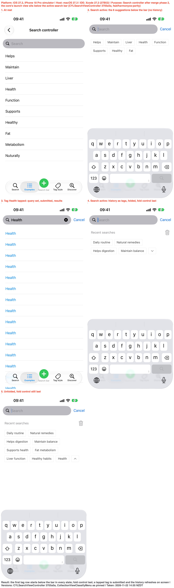 | iOS, iPhone 18 Pro simulator (iOS 27.2), Xcode 27.2 (27B52), macOS 27.3, CYLSearchViewController `3705a5a`, `feat/harmonyos-parity`, 2026-11-22 14:55 NZDT. Search controller screen: at rest; the launch view with QMUI's eight suggestions (no history); tag "Health" tapped, which set the query and submitted it; the history as tags, folded to two rows with the fold control last; unfolded |

Accessibility check on the same run (`axe describe-ui`): after the tap the tree has "Recent searches" (heading), "Clear recent searches" and the tag "Health" in the launch view behind the results, so the content refreshed on screen.

**TODO**
- The after screenshot of the iOS 26.5 and 17.5 launch view (the three suites pass; the screenshots are 27.2 only).
- Real-touch check of the trash button and a long history (20 entries) on a device; dark mode and large Dynamic Type of the launch view are not tested.
- `CYLSearchView` does not refresh when another view changes its history while open (the controller's launch content does); the signal is there, `CYLSearchView` would observe it in phase 3 with the one active state.
- Phase 5: the other platforms' launch views (Android `CylsearchLaunchView.kt`, HarmonyOS `SearchController.ets`, mini program `searchController`, React Native) still use their own copy of "CYLRecentSearchLaunchView"; the unused iOS strings `controller.recent` / `controller.launch.label` stay until they move.
- The QMUI tag size (69 x 29) and the tinted tag look: design phase 6.
- The suite is run at `3705a5a`; this log and the screenshots are the only later changes.

**Screenshot correction (coordinator review, 2026-11-22)**: the first stitched image cropped panels 2, 4 and 5 with a wrong `sips` offset (they started mid-list and lost the bar). The raw originals were always full screen (1206 x 2622, status bar to home indicator). The image was stitched again from the five full-screen originals, two columns because one column would be taller than one phone screen, header fields Platform / Host / IDE / Purpose, footer Result / Versions / Taken; `sh scripts/check-screenshot-labels.sh` passes. Checked on the originals: the active bar is at y 58 to 102 pt and the launch content starts at y 117 pt ("Recent searches" header, then the first tag row at y 171 pt), so the first row is fully below the bar, not blurred and not cut; the fold control is the last tag (folded and unfolded). The launch content therefore does not start under the bar: no core change, no new suite run needed (code unchanged at `3705a5a`); the frame test `testLaunchContentIsNeverCoveredByTheBar` already measures the presented state of a real window (launch view, tags and first row under the bar at rest, unfolded, after typing and clearing, after a resize) on all three suites. Open: the fifth panel stands alone in the second column's next row, so the columns are not balanced by height.


### Merge phase 3 log (2026-11-22)

#### TODO (2026-11-22, `feat/harmonyos-parity`, PR #11): merge phase 3, results, empty view, dimming, history, active state

- Context: phase 3 of "Merge design: one implementation per concept" (pair table rows `tableView` / `showEmptyView` / `hideEmptyView` / `isEmptyViewShowing`, `dimmingColor`, `historyStore` + `historyDidChangeNotification`, `isActive` / `setActive`, `supportsSwipeToDismissSearch`). Base `3e15948` (phase 2 done).
- Requirements (the task text, English): 1. One results + empty-view component used by `CYLSearchView` (`resultsTableView`, `resultsDataSource`, `searchResults`, `showsEmptyResultsPlaceholder`, `emptyResultsScenario`, `emptyResultsView`), `CYLSearchController` (`tableView`, `showEmptyView(text:detailText:buttonTitle:buttonAction:)`, `showEmptyView(scenario:)`, `hideEmptyView()`, `isEmptyViewShowing`) and `CYLSearchTableViewController`: the same CYLTableViewPlaceHolder `CYLPlaceholderStackView` everywhere; the public names stay and forward. 2. Match highlight as a core option (`highlightsResultMatches` plus a color, default off) used by both; the Search controller demo stops highlighting by hand. 3. Dimming: one overlay view; `scrimColor` canonical on `CYLSearchView`, `CYLSearchController.dimmingColor` forwards to the same shared overlay code; a tap ends the search in both. 4. History: `CYLSearchView` also observes the shared change signal and refreshes while open; the duplicated "history, else suggestions" choice of `CYLSearchView.refilter` folds into `CYLSearchSuggestionArea`. 5. One active state: `isActive` / `setActive` and `showSearch` / `closeSearch` / `searchOpen` run on one internal state machine; will/did present/dismiss come from one event source feeding both delegates (`CYLSearchViewDelegate` gets optional willShow / willClose); `supportsSwipeToDismissSearch` also on `CYLSearchView` (edge swipe ends the search), default false. 6. Tests for each; existing tests and the API fence green (fence lines for new members); after screenshots (results with highlight and the empty view on both screens; the `CYLSearchView` demo with a scrim, `merge-after-p3-...`); report the lines removed by deduplication.
- Prompt (verbatim, English; the task came as an English message): "Phase 3 tasks (design: pair table rows results/empty, dimming, history, active state and life cycle): 1. One results + empty-view component used by both CYLSearchView and CYLSearchController ... 2. Match highlight as a core option (e.g. highlightsResultMatches + highlight color, default off) used by both; the Search controller demo stops highlighting by hand. 3. Dimming: one overlay view; scrimColor canonical on CYLSearchView, CYLSearchController.dimmingColor forwards to the same shared overlay code (no second dimming implementation). Tap ends the search in both. 4. History: CYLSearchView also observes the shared change signal (phase 2 left this TODO) and refreshes while open; fold the duplicated "history, else suggestions" choice in CYLSearchView.refilter into CYLSearchSuggestionArea.reload. 5. One active state: isActive/setActive and showSearch/closeSearch/searchOpen run on one internal state machine; will/did present/dismiss come from one event source feeding both delegates (CYLSearchViewDelegate gets optional willShow/willClose only if missing; keep existing names); supportsSwipeToDismissSearch also on CYLSearchView (edge swipe ends search), default false. 6. Tests for each; existing tests and the API fence green (fence lines for new members). After screenshots: results with highlight and empty view on both screens; CYLSearchView demo with scrim (merge-after-p3-...). Report lines removed by deduplication."
- Acceptance (100): items 1 to 5 done in the core with the old public names kept; tests for each; the three suites (iOS 17.5, 26.5, 27.2) green; API fence compiles unchanged plus lines for new members; after screenshots; this log complete (what moved where, deleted lines, API kept / forwarded, results per simulator, TODOs); pushed. 60: items 1 to 3 with tests on one simulator.
- Status: DONE (2026-11-22), see below.

**Result** (base `3e15948`, commits `e81f377` core + example, `54338a5` tests and fence on `feat/harmonyos-parity`; code under test: `54338a5`).

**What moved where** (three new internal files, no new public class; every public name stays and forwards)
- `CYLSearchResultsComponent.swift` (new, 257 lines, with the QMUI licence header): `CYLSearchEmptyView` (the one factory of the `CYLPlaceholderStackView`: the "no results" animation with title, hint and button, or a scenario), `CYLSearchEmptyViewSlot` (adopt, show in a container, hide, remove: one holder for `CYLSearchView`'s two placeholders, the controller's and `CYLSearchTableViewController`'s empty view), `CYLSearchKeyboardOverlap` (the keyboard's part over a host, worked out when asked, so the empty view of both classes ends at the keyboard), `CYLSearchResultHighlight` (the match highlight) and `CYLSearchResultsDataSourceProxy` (the forwarding data source the controller puts in front of its owner while the highlight is on: `responds(to:)` and `forwardingTarget(for:)` pass everything on, `cellForRowAt` is decorated).
- `CYLSearchPresentationState.swift` (new, 146 lines): `CYLSearchDimmingView` (the one overlay: `color`, `onTap`), `CYLSearchPresentationState` + `CYLSearchPresentationEvent` (phase, `isActive`, a generation count, `send(_:)` as the one event source) and `CYLSearchEdgeSwipe` (the gesture, the "past a quarter of the width, moving right" rule, the duration).
- `CYLSearchSuggestionArea.swift` (+52, -11): `CYLSearchSuggestionArea.resolve(cache:suggestions:query:showsForEmptyQuery:filter:)` is the one place that decides history, else suggestions (and the typed-query filter); `reload()` and `CYLSearchView.refilter` both call it. `CYLSearchHistoryObserver` is the one observer of the history signal (the area and `CYLSearchView` each hold one).
- `CYLSearchView.swift` (+184, -62): results/empty placeholders through the slots, scrim = `CYLSearchDimmingView`, `searchOpen` = the state, will/did events from the state, `isActive` / `setActive(_:animated:)`, `supportsSwipeToDismissSearch`, `highlightsResultMatches`, `resultMatchHighlightColor`, the history observer (refilters only while open and not for its own submit or clear), a generation guard on both animation completions (a show during a close no longer ends hidden), the iOS 26 top edge effect of both tables hidden (the first result row was blurred under the bar). Delegate: `searchViewWillShow:` and `searchViewWillClose:` (new, optional; the existing names stay).
- `CYLSearchController.swift` (+104, -46): empty view through the factory and the slot, `highlightsResultMatches` / `resultMatchHighlightColor`, the dimming view is the shared overlay (`dimmingColor` forwards; a tap goes through `setActive(false, animated: true)`, so the Cancel fix runs), the four `UISearchControllerDelegate` callbacks feed `presentationState`, which feeds `CYLSearchControllerDelegate`, swipe rule and durations from `CYLSearchEdgeSwipe`, `searchOpen`, `showSearch(animated:)`, `closeSearch(animated:)`, the empty view above the keyboard.
- `CYLSearchTableViewController.swift` (+8, -14): the empty view through the factory and the slot.
- Example: `CYLSearchControllerDemoViewController.swift` sets `highlightsResultMatches = true` and no longer builds the attributed text (3 added, 8 removed); `CYLSearchExampleViewController.swift` (the "Overlay" of menu row 0) sets `scrimColor` and `highlightsResultMatches` through the API (3 added).

**Lines removed by deduplication** (numstat against `3e15948`: 141 deleted from existing files, 757 added, of which 403 are the two new files, so the core grew by 616 lines because the phase also adds features: the state machine, the view's swipe, the highlight, the keyboard-aware empty view). What the shared code replaced, about 76 lines: the placeholder construction of the controller (13) and of `CYLSearchTableViewController` (6), `CYLSearchView`'s placeholder creation (12) and keyboard handling (14), the controller's tap-gesture dimming view (6) and `CYLSearchView`'s scrim target (3), the "history, else suggestions" choice of `refilter` (15), the area's own observer (5), the swipe rule, durations and recognizer set-up of the controller (6), and the demo's hand-made highlight (8). The five counterparts that have no second copy any more: placeholder, highlight, dimming overlay, history choice and observer, presentation events.

**Decisions**
- **One table instance is not shared.** `CYLSearchView` owns a table it creates and is its data source, `CYLSearchController` shows the table of a results view controller whose data source is the owner, `CYLSearchTableViewController` is itself the table. Making one `UITableView` serve all three would need a wrapper around the owner's data source in every case. What the three do with their table (the placeholder, its place, the highlight) is shared.
- **Highlight**: case- and diacritic-insensitive, like the suggestion filter, the first match only; colour = the tint colour unless `resultMatchHighlightColor` is set; the text label and a `UIListContentConfiguration` are both handled. UILabel takes its `textColor` from the first character of an attributed text, so the core remembers the colour it saw before highlighting and does not draw the next row of a reused label in the highlight colour (test `testHighlightDoesNotLeakIntoAReusedLabel`). While the option is on the table's `dataSource` is the proxy; off, it is the owner again.
- **The controller's state follows UIKit.** `UISearchController` alone presents that controller (Cancel, a tap in the bar, a navigation item), so `CYLSearchController` feeds the shared state from the delegate callbacks and keeps `isActive` = UIKit's; `CYLSearchView` drives its own state. Both map the same four events to their delegates.
- `CYLSearchSuggestionArea.reload()` is not the place that filters by a typed query (the launch view never does); the typed-query choice is `resolve`, which `reload()` uses with an empty query.

**API kept / forwarded**: everything; the fence compiles unchanged. New public members: `CYLSearchView`: `highlightsResultMatches`, `resultMatchHighlightColor`, `isActive`, `setActive(_:animated:)`, `supportsSwipeToDismissSearch`; `CYLSearchViewDelegate`: `searchViewWillShow:`, `searchViewWillClose:`; `CYLSearchController`: `highlightsResultMatches`, `resultMatchHighlightColor`, `searchOpen`, `showSearch(animated:)`, `closeSearch(animated:)`. Fence lines added in `CYLSearchAPIFenceTests.swift` and `CYLSearchCoreObjectiveCSmokeTests.m`; existing fence lines are untouched.

**Tests** (`CYLSearchMergePhase3Tests`, 18 tests, in `CYLSearchControllerLaunchViewTests.swift`; two existing tests follow the shared code: the dimming test counts a target instead of a gesture recogniser, the demo test reads the highlighted row through the table's data source): one placeholder class on every screen, the factory and the slot, highlight off by default and on (label, list configuration, case and diacritics, a colour of its own, a reused label, the controller's forwarding data source, forwarded optional selectors, off restores the owner), scrim and `dimmingColor` as one overlay with a tap that ends the search in both, the history signal while open (another instance, another name, its own submit, closed), `resolve`, the events of `CYLSearchView` (immediate and animated, aliases, a show during a close), the phases of the state, the controller's aliases and its state, the swipe rule, the swipe of `CYLSearchView` (short, returning, past a quarter), the controller's empty view at the keyboard, the table's top edge effect. `xcodebuild test`, new derived data each, `CODE_SIGNING_ALLOWED=NO`, sandbox off, at `54338a5`, the three suites run at the same time: iOS 17.5 (iPhone 15): Executed 176 tests, with 0 failures; iOS 26.5 (iPhone 17 Pro): Executed 176 tests, with 0 failures; iOS 27.2 (iPhone 18 Pro): Executed 176 tests, with 0 failures (158 before the phase plus the 18 new tests of the class; the counts are equal on all three). `bash scripts/check-public-api-comments.sh` and `bash scripts/check-licenses.sh` pass. `bash scripts/ci-build-example.sh analyze` (generic iOS Simulator, Xcode 27.2): ANALYZE SUCCEEDED, no warning in `Sources/CYLSearchBar`; analyzer issues only in the pods SVGAPlayerLite, Protobuf and CYLAnimatedItem (third party, not ours).

**After screenshots** (iOS 27.2, `feat/harmonyos-parity` at the code of `54338a5`; originals 1206 x 2622 px, 72 dpi, in `docs/assets/raw/merge-after-p3-*`, full screen with the keyboard; the stitched image is two columns because one column would be taller than one phone screen; `axe` input, status bar 9:41):

| Image | Label |
| --- | --- |
| 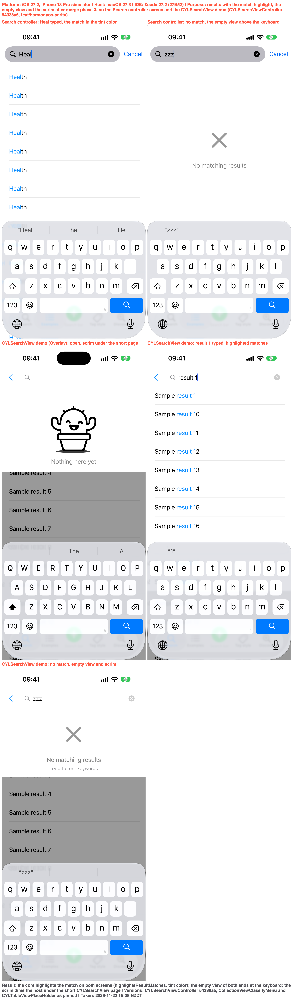 | iOS, iPhone 18 Pro simulator (iOS 27.2), Xcode 27.2 (27B52), macOS 27.3, CYLSearchViewController `54338a5`, `feat/harmonyos-parity`, 2026-11-22 15:38 NZDT. Search controller screen: "Heal" typed (the match in the tint colour), "zzz" (the empty view above the keyboard). CYLSearchView demo (menu row 0, "Overlay"): open with the scrim under the short page, "result 1" typed (highlighted matches, first row not blurred), "zzz" (empty view and scrim) |

Found while taking them, fixed in the core: the empty view of `CYLSearchController` was centred on the whole results area, so its title sat under the keyboard (the same defect `CYLSearchView` fixed earlier); the first result row of `CYLSearchView` was blurred under the bar by the iOS 26 top edge effect. Both are in `e81f377`.

**TODO**
- **Edge swipe by real touch** (checked 2026-11-22, iOS 27.2, `axe draw` from x = 2, the page of the "Overlay" demo with `supportsSwipeToDismissSearch` switched on in a throwaway local change that is not committed): `CYLSearchView`: a slow stroke (`draw 2,450 60,450 120,450 180,450 240,450 300,450 --duration 3`, then `--duration 4`) ends the search, twice (the host, "Overlay" and "Filter results", is back, the overlay's field is gone); fast strokes (0.35 s, 0.6 s, 1.2 s) did not start the swipe and acted as a touch on a row. Control: the navigation controller's own interactive pop with the phase 4 command (`draw 2,450 70,450 110,450 70,450 20,450 --duration 3` cancelled, `draw 2,450 150,450 300,450 --duration 3` completed) works in the same session, so `axe` does make screen-edge pans. `CYLSearchController` (its demo has `supportsSwipeToDismissSearch` on, window recogniser): three strokes (0.35 s, 2.5 s, 4 s) did not leave the search (the first two selected a tag or a row instead); the controller's swipe is code of the QMUI port (phase 3), unchanged here except for the shared rule and durations. Cause not found (a candidate: the navigation controller's pop recogniser, the demo being a pushed screen, wins against the window's); the demos do not switch the swipe on for `CYLSearchView`. Open: find why the controller's swipe does not start by touch, and whether the fast strokes are a tool limit; the begin / change / end hooks are tested as before.
- `CYLSearchController.isActive` still reads UIKit's state; the shared state mirrors it from the delegate callbacks (see Decisions). A `setActive(true)` on a controller that is not installed anywhere never reaches the state.
- The highlight is case- and diacritic-insensitive; the Flutter port (and, by its notes, Android) documents a case-sensitive first match: phase 5 aligns them, and adds `resultMatchHighlightColor`, `scrimColor` and the will / did events where an iOS-only member is missing.
- `CYLSearchView`'s demo does not enable `supportsSwipeToDismissSearch` (it could not be checked by touch); no demo shows the `CYLSearchViewDelegate` will events.
- No dark mode or large Dynamic Type run of the highlighted rows and the scrim; the after screenshots are 27.2 only (the three suites pass on all).
- Phase 4 (examples have no native re-implementations left) and the score of the whole merge are next.

**Score (2026-11-22): 92 / 100 (pass 60)** against the acceptance of the TODO above: items 1 to 5 in the core with the old names kept (40), tests for each item and the fence (20), the three suites green and the analyzer clean (15), after screenshots with originals and labels (10), this log and the commits (7); 8 points are open:
- TODO (3 points): the controller's edge swipe does not start by real touch (`CYLSearchView`'s does, slowly); cause not found.
- TODO (2 points): align the other platforms with the highlight rule (case-insensitive) and the new members, phase 5.
- TODO (2 points): the after screenshots are iOS 27.2 only; no dark mode or large Dynamic Type run of the highlight and the scrim.
- TODO (1 point): `CYLSearchController.isActive` mirrors UIKit's state instead of being driven by the shared one; and while `highlightsResultMatches` is on, a change of `searchResultsDelegate` reassigns the same proxy as the table's data source, which UIKit may not ask again for the optional selectors (not tested; setting `dataSource` to nil first would be the guard).


### Merge phase 4 log (2026-11-22)

#### TODO (2026-11-22, `feat/harmonyos-parity`, PR #11): merge phase 4, examples and iOS score

- Context: phase 4 of "Merge design: one implementation per concept" (examples free of native re-implementations; the final iOS score of the merge). Base `252a697` (phases 0 to 3 done).
- Requirements (the task text, English): 1. Audit every example screen in `CYLSearchExample/` for UI the core already offers but the example rebuilds with native views (hand-made tag rows, headers, clear buttons, highlight, empty views, result tables duplicating the core's results, custom dimming, own history storage, own fold controls); replace each with core API; where an example needs a customisation the core lacks, add it to the core (parameter or mode, public API comment, fence line, test); keep each screen's look and the 1:1 replicas' behaviour; list every replacement (file, lines removed). 2. Decide per QMUI issue screen (Navigation item, Bar in a view, Short list, Collection view) whether it stays on `CYLSearchController` / `CYLSearchBar` (the UIKit adapter) or can use `CYLSearchBarView` / `CYLSearchView`, with the reason. 3. Swipe-to-dismiss regression check: phase 3 reported that `CYLSearchController`'s edge swipe does not start by real touch; check the same stroke on `6014474` (worktree `/tmp/xpr/merge-p4-old`); if it worked, bisect and fix in the core; if it never worked, find the cause anyway and fix it with public API; verify by real touch on 27.2 and 17.5 and record a short stitched screenshot sequence. 4. Final: full suites on 17.5 / 26.5 / 27.2; after screenshots of every screen that has a merge-before image (`merge-after-<screen>-ios27.2-20261122.png`); update the design's Status line; write "Merge score (iOS)" with points per criterion of the task-log entry "merge the QMUI search components with ours" and missing points as TODO. The task-log entry is not marked done (phases 5 and 6 remain).
- Prompt (verbatim, English; the task came as an English message): "Phase 4 tasks (design: examples free of native re-implementations; final iOS score of the merge): 1. Audit every example screen in CYLSearchExample/ for UI the core already offers but the example rebuilds with native views (hand-made tag rows, headers, clear buttons, highlight, empty views, result tables duplicating CYLSearchView/CYLSearchController results, custom dimming, own history storage, own fold controls). Replace each with core API; where an example needs a customisation the core lacks, add it to the core (parameter or mode, public API comment, fence line, test) instead of rebuilding. Keep each screen's look and the 1:1 replica screens' behaviour (QMUI replicas, the original/port demos). List every replacement (file, lines removed) in the log. 2. Decide per QMUI issue screen (Navigation item, Bar in a view, Short list, Collection view) whether it stays on CYLSearchController/CYLSearchBar (the UIKit adapter is required: navigationItem.searchController, UISearchController behaviour) or can use CYLSearchBarView/CYLSearchView; write the reason per screen. 3. Swipe-to-dismiss regression check: phase 3 reported that CYLSearchController's edge swipe no longer starts by real touch (axe draw strokes 0.35-4 s on the Search controller demo, which sets supportsSwipeToDismissSearch = true). Check the same real-touch stroke on the pre-merge commit 6014474 (a separate worktree /tmp/xpr/merge-p4-old) to see whether it worked before. If it worked before, it is a merge regression: bisect between 6014474 and HEAD and fix it in the core. If it never worked by real touch, find the cause anyway (e.g. the navigation controller's interactive pop recognizer winning; use gestureRecognizer(_:shouldRequireFailureOf:)/shouldBeRequiredToFailBy or require-failure wiring with interactivePopGestureRecognizer, public API only) and fix it; verify by real touch on 27.2 and 17.5 and record a short stitched screenshot sequence. 4. Final: full suites on 17.5/26.5/27.2; after screenshots of every screen that has a merge-before image (same states, merge-after-<screen>-ios27.2-20261122.png); update the 'Merge design' Status line and write 'Merge score (iOS)' in docs/qmui-search-controller.md: criteria from the task-log entry 'merge the QMUI search components with ours' (one class per concept, old API compiles = fence, examples free of native re-implementations, suites green on three iOS versions, before/after screenshots), points per criterion, missing points as TODO. Do not mark the task-log entry done (phases 5-6 remain)."
- Acceptance (100): items 1 to 4 done, old public API compiling (the fence unchanged plus lines for new members), the three suites green, after screenshots with labels, the swipe verified by real touch on 27.2 and 17.5 with a stitched sequence, this log complete, pushed. 60: items 1 and 2 with tests on one simulator and the swipe finding written.
- Status: DONE (2026-11-22), see below.

**Result** (base `252a697`, commits `df5f0da` swipe fix, `6c1d161` core options, `815bb9b` examples on `feat/harmonyos-parity`; code under test: `815bb9b`; the docs and the images came after).

#### 1. The audit: what the examples rebuilt, what the core offers now

Every example screen was read (all 28 Swift files of `CYLSearchExample/`). Replaced, with the lines (git numstat against `252a697`: **26 added, 89 deleted** in `CYLSearchExample/`; **289 added, 1 deleted** in `Sources/`, because three options and the swipe are new core code):

| Screen (file) | Hand-made | Replaced by | Lines (+ / -) |
| :--- | :--- | :--- | :--- |
| Original demo (`CYLOriginalSearchDemoViewController.swift`) | a `UIButton` laid over the field that opened the search (10 lines with its constraints) | the field's own non-editable tap: `searchBarViewShouldBeginEditing` returns NO, `searchBarViewDidTapWhileNotEditable` opens the search (existing core API, as the lapism port does) | |
| same | `makeClearFooter`: a bordered "clear history" `UIButton` in a footer view (29 lines) | new core option `CYLSearchView.suggestionCacheFooterTitle` | |
| same | `updateResultsHeader`: a `UILabel` as the results table's header, rebuilt on every change and submit (14 lines), and the `term` variable | new core options `CYLSearchView.resultsHeaderTitleProvider` and `resultsHeaderTextColor` | 21 / 59 |
| Search controller, Navigation item, Bar in a view, Short list, Collection view (5 files) | the same 6 lines each: reload the results table, then show or hide the "No matching results" empty view by the match count | new core option `CYLSearchController.noResultsText` (the controller shows the empty view while the text is not empty and `tableView` has no row) | 1 / 6 each, 5 / 30 |

New core API (three-line comments, fence lines in both fence files, three tests in `CYLSearchMergePhase4Tests`): `CYLSearchView.resultsHeaderTitleProvider`, `resultsHeaderTextColor`, `suggestionCacheFooterTitle`; `CYLSearchController.noResultsText`, and `gestureRecognizer(_:shouldBeRequiredToFailBy:)` (item 3). Internal: `CYLSearchResultsHeaderView`, `CYLSearchClearFooterView` (in `CYLSearchResultsComponent.swift`, +80 lines), `CYLSearchEdgePanGestureRecognizer` (item 3).

Read and kept, with the reason (the design's test: does the core already offer it, and is the screen not a replica of something else?):

| Screen | Why nothing more is replaced |
| :--- | :--- |
| Styles (`CYLSearchBarStylesViewController`) | `CYLSearchTableViewController` is the QMUI replica; the accessory views are the demo's own 30 x 30 stroked squares (example-only content), every knob is core API |
| #1317 page (`CYLSearchExampleViewController`) | a raw `UISearchController` is the reproduction of the issue, and its overlay already uses `scrimColor` and `highlightsResultMatches` of the core |
| Search bar, Yechaoa, Reveal, Multi (`CYLSearchBarDemoViewController`, ...) | `CYLSearchBarView` only; the status label, the result label and the event log are the demos' own output |
| Lapism (`CYLLapismSearchViewController`) | port of `addView(recyclerView)`: the list that the original embeds is passed to the core's `contentView`; the list under the bar is the page's own content |
| Material menu (`CYLMaterialSearchMenuViewController`) | calls the core's suggestion options (tags, fold control, cache, colors); the `UIStackView` is the demo's tab strip |
| Contact tags (`CYLContact*`) | `CYLTagListView` of the sub-repository (the design's tag list), `CYLSearchBarView`, the list's built-in clear button (`menuShowsClearButton`); the store is the demo's data |
| Discover (`CYLSearchDiscoverViewController`) | a copy of CollectionViewClassifyMenu's Discover page (two `CYLTagListView` sections with the fold control and a trash accessory from the sub-repository's menu API, data from the bundled JSON): a page, not a search flow. TODO: it could use the suggestion area if that became public |
| `CYLSnackbar`, the menu, the placeholder gallery, `CYLKenBurnsView`, the SVGA pages | example-only: the core has no such code |
| the detail screens (`UILabel` in the Search controller demo, the Original demo's centered button) | example-only content of the replicas |

Not replaced, a duplication and not a native re-implementation: the four issue screens and the Search controller screen each filter the ten keywords and answer the results table's data source themselves (about 12 lines each). A core "searchable items" option would remove it; TODO.

#### 2. The four issue screens: stay on the UIKit adapter

All four stay on `CYLSearchController` / `CYLSearchBar`, because each exists to exercise a behaviour of `UISearchController` that `CYLSearchBarView` + `CYLSearchView` (our own overlay) do not have:

| Screen | Reason |
| :--- | :--- |
| Navigation item (#1229) | `navigationItem.searchController` takes a `UISearchController`, whose bar must be a `UISearchBar`; `install(in:)` is the fix under test |
| Bar in a view (#1251) | `hidesNavigationBarDuringPresentation = false` with a bar that is a plain subview: UIKit's presentation context is the thing tested |
| Short list (#1160) | the bar is the table header under a `UISearchController`, settled by `CYLSearchHeaderSnapper` (which now also works on any header, including a `CYLSearchBarView`, but the issue is about UIKit's header) |
| Collection view (#1313) | UIKit returns the bar to its original superview after Cancel; the container that holds it is the fix under test |

A `CYLSearchBarView` + `CYLSearchView` version of each would pass trivially and drop the regression coverage; the Original demo, Lapism and Material screens already show that pair.

#### 3. Swipe to dismiss by real touch: never worked, fixed

- **Regression?** No. On `6014474` (worktree `/tmp/xpr/merge-p4-old`, built and run on 27.2) the same strokes (2.5 s and 4 s from x = 2, on the Search controller screen with the keyboard up) left the launch view on screen. The swipe never started by touch there either, so no bisect was needed.
- **Cause, as far as it can be seen.** `UIScreenEdgePanGestureRecognizer` received the touch (`gestureRecognizer(_:shouldReceive:)` was called at (2, 450)) and never left the possible state: `gestureRecognizerShouldBegin` was never asked. A plain `UIPanGestureRecognizer` on the same view began at x about 12 with the same stroke, on 27.2 and on 17.5. No change with: the recognizer on the window, on the root view or on the search view, no delegate, the navigation controller's pop recognizer disabled, simultaneous recognition allowed. With `hidesNavigationBarDuringPresentation = false` the navigation controller's swipe back worked (the screen popped, our recognizer still did not begin). The same recognizer on `CYLSearchView` does begin (checked on 27.2), so the failure is tied to an active `UISearchController`. UIKit's internal reason was not found.
- **Fix** (`df5f0da`): `CYLSearchEdgeSwipe.makeGesture` now returns `CYLSearchEdgePanGestureRecognizer`, an internal subclass of `UIScreenEdgePanGestureRecognizer` that follows the touch itself: it begins when the touch went down within 24 pt of the left edge of the window and moved right past a 10 pt slop, more than up or down; it fails for other touches, and reports translation and a smoothed velocity. The public property keeps its type, `edges` stays `.left`, the delegate and the window stay; both `CYLSearchController` and `CYLSearchView` use it (one implementation). `CYLSearchController` also answers `gestureRecognizer(_:shouldBeRequiredToFailBy:)` for the navigation controller's `interactivePopGestureRecognizer` (and `interactiveContentPopGestureRecognizer` on iOS 26): the swipe back waits for the search swipe to fail, so the swipe leaves the search first (dynamic, public API; no permanent `require(toFail:)`).
- **Verified by real touch** (`axe draw` 2,450 to 280,450 over 3 s, started in the background): mid swipe the page and the snapshot follow the finger; at the end the search is left and the Search controller screen is still on top, on 27.2 and on 17.5; a 0.35 s stroke works too (27.2).
- Tests: `testGestureFollowsTheTouchItself` (the type, `edges`, one touch, the rule: inside the slop, right, left, up, down, more vertical than horizontal), `testNavigationSwipeBackWaitsForTheSearchSwipe`; XCTest cannot make a screen-edge touch, so the begin / change / end methods stay driven as before.

#### 4. API kept, forwarded, new

Kept: the whole fence (`CYLSearchAPIFenceTests.swift` and the Objective-C fence compile unchanged; 5 + 5 lines added for the five new members). Forwarded: nothing was renamed in this phase. New: the five members above.

#### 5. Test results

`xcodebuild test`, new derived data each, `CODE_SIGNING_ALLOWED=NO`, sandbox off, code at `815bb9b` (the three suites were run one after another, because two builds at the same time in one checkout broke the shared `Pods/` copy step once): iOS 17.5 (iPhone 15): Executed 181 tests, with 0 failures; iOS 26.5 (iPhone 17 Pro): Executed 181 tests, with 0 failures; iOS 27.2 (iPhone 18 Pro): Executed 181 tests, with 0 failures (176 before the phase plus the 2 swipe tests and the 3 tests of `CYLSearchMergePhase4Tests`; the counts are equal on all three). `bash scripts/check-public-api-comments.sh`, `bash scripts/check-licenses.sh` and `sh scripts/check-screenshot-labels.sh` pass. `bash scripts/ci-build-example.sh analyze` (generic iOS Simulator, Xcode 27.2): ANALYZE SUCCEEDED.

#### 6. After screenshots

iOS, iPhone 18 Pro simulator (iOS 27.2), Xcode 27.2 (27B52), macOS 27.3, CYLSearchViewController `815bb9b`, `feat/harmonyos-parity`, 2026-11-22 16:32 to 16:36 NZDT; originals 1206 x 2622 px in `docs/assets/raw/merge-after-*`, stitched with `scripts/stitch-screenshots.swift` (two columns: one column would be taller than one phone screen); the same states as the `merge-before-*` images of phase 0; status bar 9:41; `axe` input.

| Image | Label |
| --- | --- |
| 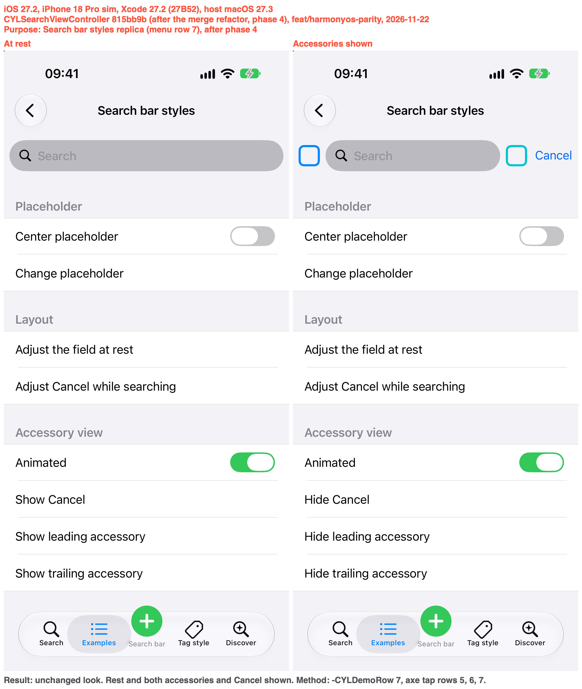 | iOS, iPhone 18 Pro simulator (iOS 27.2), Xcode 27.2 (27B52), macOS 27.3, CYLSearchViewController `815bb9b`, 2026-11-22 NZDT. Search bar styles (menu row 7): rest and accessories shown; the look of the before image |
| 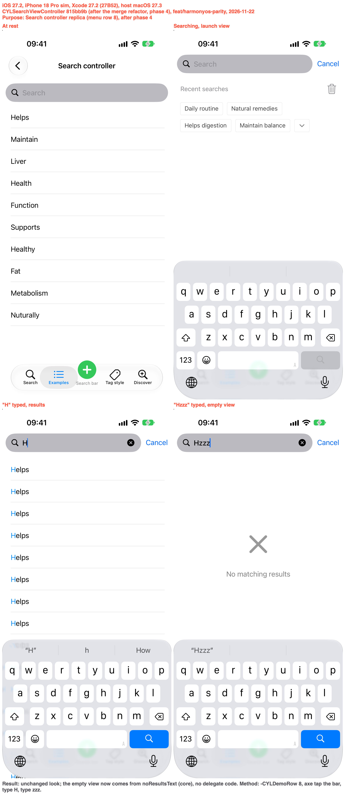 | iOS, iPhone 18 Pro simulator (iOS 27.2), Xcode 27.2 (27B52), macOS 27.3, CYLSearchViewController `815bb9b`, 2026-11-22 NZDT. Search controller (row 8): rest, launch view, "H" results, "Hzzz" empty view (now from `noResultsText`) |
| 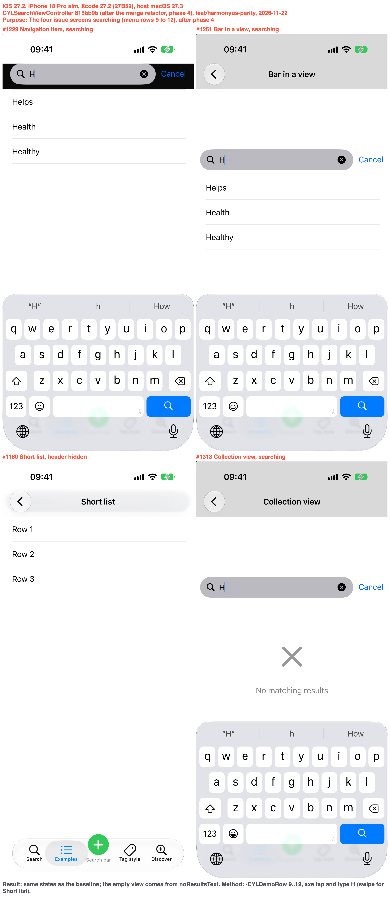 | iOS, iPhone 18 Pro simulator (iOS 27.2), Xcode 27.2 (27B52), macOS 27.3, CYLSearchViewController `815bb9b`, 2026-11-22 NZDT. #1229, #1251, #1160 (header hidden), #1313 searching; the Collection view now shows the empty view above the keyboard (the phase 3 fix; the before image showed a blank area) |
| 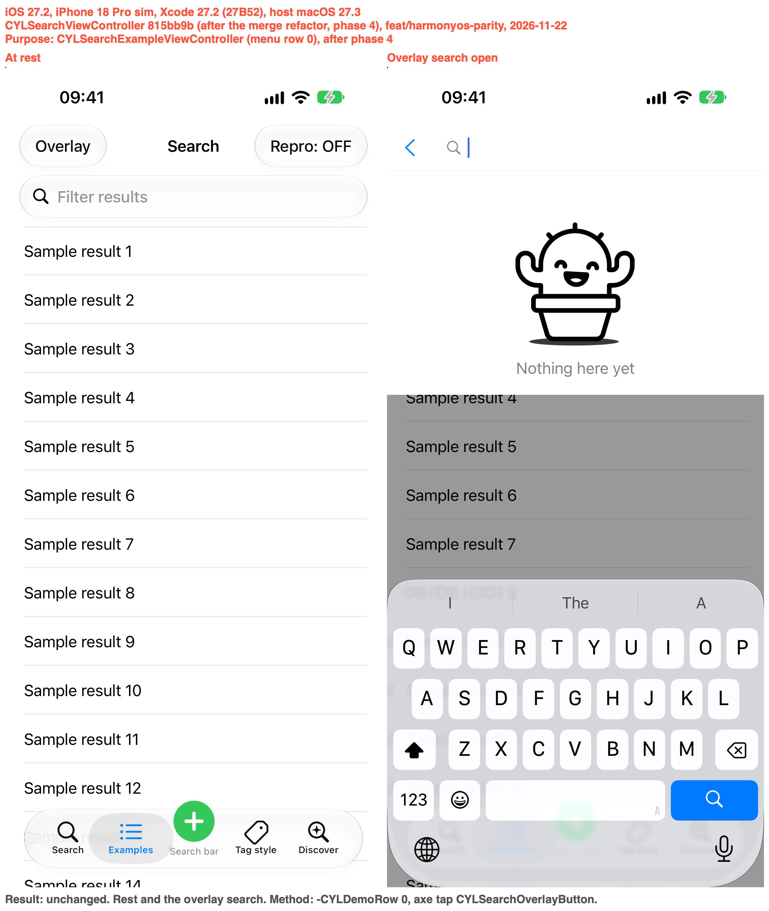 | iOS, iPhone 18 Pro simulator (iOS 27.2), Xcode 27.2 (27B52), macOS 27.3, CYLSearchViewController `815bb9b`, 2026-11-22 NZDT. Menu row 0: rest and overlay search |
| 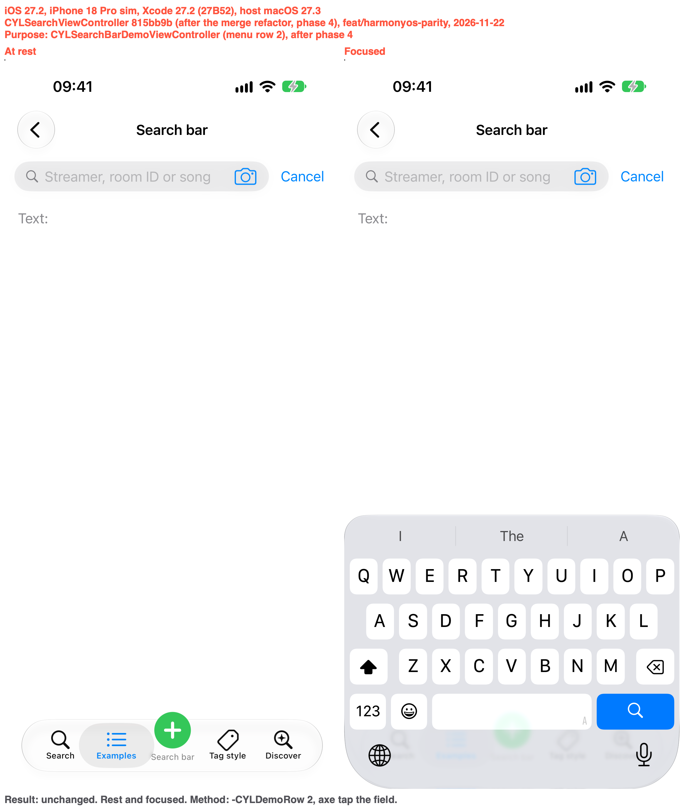 | iOS, iPhone 18 Pro simulator (iOS 27.2), Xcode 27.2 (27B52), macOS 27.3, CYLSearchViewController `815bb9b`, 2026-11-22 NZDT. Menu row 2: rest and focused |
| 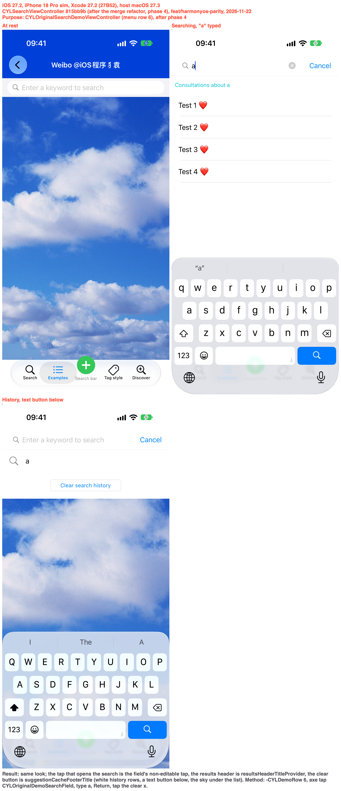 | iOS, iPhone 18 Pro simulator (iOS 27.2), Xcode 27.2 (27B52), macOS 27.3, CYLSearchViewController `815bb9b`, 2026-11-22 NZDT. Menu row 6: rest, searching "a" with the results header (core option), and the history with the clear text button below the list (core option) |
| 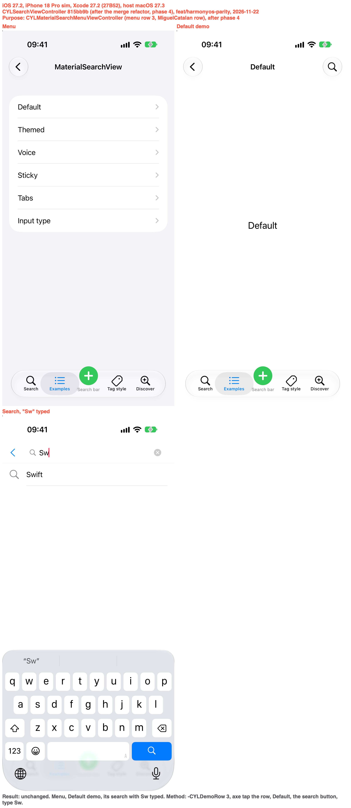 | iOS, iPhone 18 Pro simulator (iOS 27.2), Xcode 27.2 (27B52), macOS 27.3, CYLSearchViewController `815bb9b`, 2026-11-22 NZDT. Menu row 3, MiguelCatalan row: menu, Default demo, its search with "Sw" typed |
| 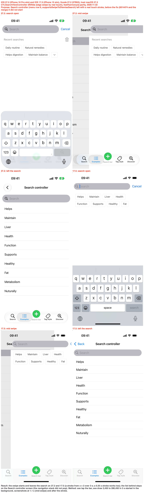 | iOS 27.2 (iPhone 18 Pro) and iOS 17.5 (iPhone 15) simulators, Xcode 27.2 (27B52), macOS 27.3, CYLSearchViewController `df5f0da`, `feat/harmonyos-parity`, 2026-11-22 16:20 NZDT. Search controller: search open, mid swipe, search left |

#### Merge score (iOS) (2026-11-22): 88 / 100 (pass 60)

Criteria of the task-log entry "merge the QMUI search components with ours" (iOS part):

| Criterion | Points | Got | Why |
| :--- | :---: | :---: | :--- |
| Design document with the evaluation and the decisions | 10 | 10 | "Merge design: one implementation per concept" (evaluation, one limit, pair table, rules, phases) |
| One class per concept on iOS | 30 | 25 | one appearance helper, one launch area, one results and empty-view component, one overlay, one active state, one edge swipe; `CYLSearchBar` stays only as the `UISearchController` adapter (design's one limit) |
| Old public API compiles (the fence) | 15 | 14 | the fence compiles unchanged through five phases and gained lines for every new member; it has no negative test |
| Examples free of native re-implementations | 20 | 15 | audit above; open: Discover page, the `contentView` lists of the ports, the repeated keyword filtering |
| Suites green on iOS 17.5, 26.5 and 27.2 | 15 | 15 | 181 tests, 0 failures, each |
| Before and after screenshots | 10 | 9 | seven screens before and after plus the swipe sequence; 27.2 only |

Missing points as TODO:
- TODO (2 points, one class per concept): `CYLSearchBar`'s `leadingAccessoryView` and `trailingAccessoryView` (and their margins) are not yet deprecated forwards of `leadingView` / `trailingAccessoryViews` of the pair table (phase 5, with the other platforms).
- TODO (1 point): `CYLSearchBarAppearance.searchBarStyle`, `clearIconImage`, `barBackgroundImage` and `barBorderColor` have no field on `CYLSearchBarView` (phase 1 list).
- TODO (1 point): the results tables of `CYLSearchView`, `CYLSearchController` and `CYLSearchTableViewController` are three instances that share what they do with the table (phase 3 decision).
- TODO (1 point): `CYLSearchView` has no store mode, so its "history, else suggestions" choice and the controller's launch view use the same `resolve` but two call sites (phase 2 TODO).
- TODO (1 point, fence): a script that regenerates the Objective-C fence and a negative test (a deliberately removed member).
- TODO (3 points, examples): the Discover page's recent list and trash accessory (public suggestion area, or a core option for the sub-repository's menu); 1 point: the port screens' `contentView` lists; 1 point: a core "searchable items" option for the repeated keyword filtering of five screens.
- TODO (1 point, screenshots): the after images are iOS 27.2 only; no dark mode or large Dynamic Type run of the new header, footer and empty view.
- Other TODO: the swipe was checked by `axe` input on simulators only (no device); the edge strip is 24 pt at the left edge (a right-to-left layout is not mirrored); UIKit's reason for the unrecognized edge pan stays unknown (a Feedback Assistant report is worth filing); `CYLSearchView`'s demo does not enable `supportsSwipeToDismissSearch`; iOS 15, 16 and 18 to 25 are not run; `CYLSearchController.isActive` still mirrors UIKit's state (phase 3 TODO).
- Phases 5 (other platforms: audit for parallel members, launch views on the ClassifyMenu tag list) and 6 (ClassifyMenu `CYLMenuStyle.minimumItemSize` and the pin move) remain; the task-log entry is not marked done.


### Merge phase 5 log: Android (2026-11-22)

#### TODO (2026-11-22, `feat/harmonyos-parity`, PR #11): merge phase 5, Android (`android/merged`)

- Context: phase 5 of "Merge design: one implementation per concept", Android part (other platforms run in parallel in their own worktrees). Base `493efbd`. Core: `android/merged/cylsearch`; example: `android/merged/app`.
- Requirements (the task text, English): 1. Audit for parallel members the QMUI port created next to existing ones (an accessory property beside a leading view, `dimmingColor` beside `scrimColor`, a second empty view, a second history store or signal, a launch view that rebuilds the suggestion header / clear button / tags instead of reusing the core suggestion area, a separate list class duplicating results code) and merge each into one implementation with the iOS names; old public names keep working as deprecated forwards. 2. Every launch view / suggestion area uses ClassifyMenu's `CYLTagListView` (never a chip group or flex wrap); the example "Search controller" screen configures the core through API only (the example-built launch view is deleted); a tapped tag submits. 3. Highlight option (`highlightsResultMatches` + color, case and diacritic insensitive like iOS), `noResultsText`, swipe to dismiss and will / did events aligned with iOS names. 4. Tests for each change, the full suite green (JDK 17, own AVD shut down after), labelled stitched screenshots of the Search controller screen (rest, launch folded / unfolded, results with highlight, empty) in `docs/assets/merge-after-p5-android-20261122.png`.
- Prompt (verbatim, English; the task came as an English message): "Merge phase 5 for Android in CYLSearchViewController ... apply the same merge to Android: 1. Audit for parallel members/implementations created by the QMUI port next to existing ones (e.g. a new accessory property beside an existing leading view, dimmingColor beside scrimColor, a second empty view, a second history store or signal, a launch view that rebuilds the suggestion header/clear button/tags instead of reusing the core suggestion area, a separate list class duplicating results code). Merge each into one implementation with the iOS names; old public names keep working (deprecated forward) where they were already published. 2. Every launch view / suggestion area uses the ClassifyMenu tag list the platform already integrates (CYLTagListView / its component) - never a native chip group, flex wrap or WXML flex layout. The example 'Search controller' screen configures the core through API only (delete any example-built launch view), a tapped tag submits. 3. Highlight option (highlightsResultMatches + color, case/diacritic-insensitive like iOS), noResultsText, swipe-to-dismiss and will/did events aligned with iOS names. Android: CYLSearchListView vs CYLSearchView results code; CylsearchLaunchView / example launch view; JDK 17; own AVD (shut it down after). 4. Tests for each change; the platform's full test suite green; labelled stitched screenshots of the Search controller screen (rest, launch folded/unfolded, results with highlight, empty) into docs/assets/merge-after-p5-<platform>-20261122.png."
- Acceptance (100): items 1 to 4 done in the core with old names kept as deprecated forwards, a test per change, `:cylsearch:testDebugUnitTest` and `:app:testDebugUnitTest` green on a clean build, screenshots from an own AVD (shut down), this log complete (merged members, deleted lines, API kept, tests, screenshots, score, TODOs), pushed. 60: items 1 and 2 with tests.

### Merge phase 5 log: HarmonyOS (2026-11-22)

#### TODO (2026-11-22, `feat/harmonyos-parity`, PR #11): merge phase 5, HarmonyOS

- Context: phase 5 of "Merge design: one implementation per concept" for HarmonyOS (`harmonyos/cylsearch`, example `harmonyos/entry`); iOS is done (phases 1 to 4). Other platforms run in parallel in their own worktrees. Base `493efbd`.
- Requirements (the task text, English): 1. Audit for parallel members created by the QMUI port next to existing ones (a new accessory property beside an existing leading view, dimmingColor beside scrimColor, a second empty view, a second history store or signal, a launch view that rebuilds the suggestion header, clear button and tags instead of reusing the core suggestion area, a separate list class duplicating results code); merge each into one implementation with the iOS names; old public names keep working (deprecated forward) where already published. 2. Every launch view and suggestion area uses the ClassifyMenu tag list the platform already integrates (CYLTagListView), never a native chip group or flex wrap; the example "Search controller" screen configures the core through API only (no example-built launch view), a tapped tag submits. 3. Highlight option (highlightsResultMatches + color, case and diacritic insensitive like iOS), noResultsText, swipe-to-dismiss and will/did events aligned with iOS names; test on the emulator "CYL Search Test" 127.0.0.1:5555; rerun the CYLSearchUI suite that hung earlier and find why it hangs. 4. Tests for each change; the full suite green; labelled stitched screenshots of the Search controller screen (rest, launch folded and unfolded, results with highlight, empty) as docs/assets/merge-after-p5-harmonyos-20261122.png.
- Prompt (verbatim, English; the task came as an English message): "Merge phase 5 for HarmonyOS in CYLSearchViewController. ... Task: apply the same merge to HarmonyOS: 1. Audit for parallel members/implementations created by the QMUI port next to existing ones ... Merge each into one implementation with the iOS names; old public names keep working (deprecated forward) where they were already published. 2. Every launch view / suggestion area uses the ClassifyMenu tag list the platform already integrates (CYLTagListView / its component) - never a native chip group, flex wrap or WXML flex layout. The example 'Search controller' screen configures the core through API only (delete any example-built launch view), a tapped tag submits. 3. Highlight option (highlightsResultMatches + color, case/diacritic-insensitive like iOS), noResultsText, swipe-to-dismiss and will/did events aligned with iOS names. HarmonyOS: demos/SearchController.ets launch view; CYLSearchTableView/Component vs CYLSearchView; test on the local emulator 'CYL Search Test' 127.0.0.1:5555 (or your own clone; never shut down another session's emulator); rerun the CYLSearchUI suite that hung earlier and find why it hangs. 4. Tests for each change; the platform's full test suite green; labelled stitched screenshots of the Search controller screen (rest, launch folded/unfolded, results with highlight, empty) into docs/assets/merge-after-p5-<platform>-20261122.png."
- Acceptance (100): items 1 to 4 done in `harmonyos/cylsearch` with the old public names kept, tests for each change, the full suite green (host logic, parity checks, hypium including CYLSearchUI), the hang of CYLSearchUI explained, labelled stitched screenshots, this log complete (merged members, deleted lines, API kept, tests, screenshots, score, TODOs), pushed. 60: items 1 and 2 with tests on the emulator.
- Status: DONE (2026-11-22), see below.

### Merge phase 5 log: Flutter (2026-11-22)

#### TODO (2026-11-22, `feat/harmonyos-parity`, PR #11): merge phase 5, Flutter (CrossPlatform/flutter_cylsearch)

- Context: phase 5 of "Merge design: one implementation per concept" for Flutter. Base `493efbd` (iOS phases 0 to 4 done). Work only in `CrossPlatform/flutter_cylsearch` and docs; the cores (iOS `Sources/CYLSearchBar`, Android `cylsearch`) are other agents' files: a missing core member is mapped in the plugin and recorded as a TODO.
- Requirements (the task text, English): 1. Audit for parallel members the QMUI port created next to existing ones (accessory widgets beside `leadingView` / `trailingAccessoryViews`, `dimmingColor` beside `scrimColor`, a second empty view, a second history signal, a launch view that rebuilds the suggestion area, a list class duplicating results code); merge each into one implementation with the iOS names; published names keep working (deprecated forward). 2. Every launch view uses the ClassifyMenu tag list (`CYLTagListView`); the example "Search controller" configures the core through API only (no example-built launch view); a tapped tag submits. 3. Highlight option (`highlightsResultMatches` + color, case- and diacritic-insensitive like iOS), `noResultsText`, swipe to dismiss and will/did events with iOS names. Wire the iOS TODOs to `CYLSearchBarView` / `CYLSearchView` (`centersPlaceholder`, margins providers, `cancelButtonFontSize`, animated Cancel, history signal from the core store notification); replace the Dart-only overlays with the native core where a native view can host them (Dart stays only where a platform view cannot host a Flutter widget: documented); add `setQuery` so a tapped recent tag runs the search. 4. Tests for each change, the full suite green, labelled stitched screenshots of the Search controller screen (rest, launch folded and unfolded, results with highlight, empty) as `docs/assets/merge-after-p5-flutter-20261122.png`.
- Acceptance (100): every item above done on iOS and Android, `flutter test` and `flutter analyze` clean (plugin and example), both platforms run on own devices, screenshots, this log complete, pushed. 60: items 1 to 3 in Dart with tests, iOS verified on the simulator.
- Status: in progress; the result sections follow below as the work lands.

### Merge phase 5 log: the WeChat mini program (2026-11-22)

Branch `feat/harmonyos-parity` (PR #11), base `493efbd` (iOS phase 4), code commits 67ef166, 791b504; only `CrossPlatform/wechat-miniprogram-cylsearch` (plus this section). Device testing of this platform
belongs to the Windows session: nothing was run in WeChat DevTools and there are **no screenshots** from this session (owner's instruction; step 4 of the task skipped).
Pin check: the pinned CollectionViewClassifyMenu commit `405bf49` has `cyl-tag-list` with `defaultVisibleRows`, the fold control (`tail`, `footer`, icon or title) and the `tagtap` event (read in the synced copy `/tmp/xpr/tags-default/.../miniprogram_npm/cyl-tag-list-miniprogram`, whose package pin is `405bf49`); no pin move was needed.

#### 1. Audit: parallel members of the QMUI port, and what each became

| Parallel member (before) | Next to | Now (one implementation, iOS name) | Old name |
| --- | --- | --- | --- |
| `.cyl-tags` flex-wrap chips, the hidden `.cyl-measure` row, the fold chevron view, `foldTags()` measuring with `cylFoldTags` in `cyl-search` | CollectionViewClassifyMenu's `cyl-tag-list` (iOS `CYLTagListView`), which the bar items and the example already use | the suggestion area draws `<cyl-tag-list>` through `CYLSearchView.suggestionTagConfiguration(dark)`: one section, `defaultVisibleRows` = `suggestionsFoldedRowCount`, fold control tail/icon last (`CYLMenuFoldControl` inline = tail, bottom = footer), colours of the suggestion knobs in its style; the configuration is set only when the tags or colours change (a keystroke keeps the fold state) | `cylFoldTags` stays exported, deprecated, unused |
| example-built launch view (`slot="launch-view"`: title row, trash button, `cyl-tag-cloud` with its own 29 pt tinted style, `history()` reload on `historychange` / `willpresent`) | the core's suggestion area (history header, trash, tags, cache) | `showsSuggestionsLaunchView` (iOS name): the suggestion area is the launch view; history newest first with title and trash, else `suggestions`; a tapped tag sets the query, sends `updateresults` and submits; it wins over `showsLaunchView` (slot, for a view of the page's own) | `showsLaunchView` + slot unchanged |
| `dimmingColor` + `showsDimming` (the model's `scrimColor` was unused) | `scrimColor` | `scrimColor` canonical on the model and the component, one `.cyl-dimming` overlay; `dimmingColor` forwards (model getter/setter, component property) | `dimmingColor` |
| two copies of the empty-view markup (content level, layer) | `showEmptyView` | one WXML `<template name="cylEmptyView">` used twice; `noResultsText` (iOS name) makes the core show and hide the empty view itself (evaluated on every `reloadResults`, also when the page sets `results` after the text; never replaces or hides a view the page showed) | `showEmptyView` / `hideEmptyView` unchanged |
| `highlightsMatches` / `highlightColor`, case-sensitive `indexOf` | iOS `highlightsResultMatches` / `resultMatchHighlightColor` | iOS names; `cylHighlightParts` folds case and diacritics per character with an offset map (so "cafe" marks "Café", precomposed or decomposed, and a mark after the last letter stays in the match); the suggestion filter (`matches`) uses the same `cylFold` | old names OR-ed in (component) / forwarded (model) |
| `showsLeadingAccessory` / `showsTrailingAccessory`, slots `leading-accessory` / `trailing-accessory`, `setShows…AccessoryView` | the bar's existing slots `leading` / `trailing` (iOS `leadingView`, `trailingAccessoryViews`) | one animated container per side holding both slot names; `showsLeadingView`, `showsTrailingAccessoryViews` (default true, as iOS), `setShowsLeadingView`, `setShowsTrailingAccessoryViews`; `cyl-search` forwards `leading` and `trailing` too | every old name forwards; a set old property wins over the new one |
| edge swipe: any rightward move from x <= 24 | iOS `CYLSearchEdgeSwipe` (24 pt edge, 10 pt slop, more sideways than vertical) | `cylEdgeSwipeBegins` (pure, tested); a first move that fails the rule ends the gesture so the list scrolls | `cylSwipeShouldDismiss` unchanged |
| `diddismiss` after a present started during the dismiss | iOS phase 3 generation guard | a present counter: an overtaken dismiss sends no `diddismiss` and does not hide the page | events unchanged |
| the example's `showEmptyView` / `hideEmptyView` on Short list and Search controller | `noResultsText` | both screens set the property; the pages only answer `updateresults` with rows | |

Already one implementation (checked, no change): history (one store: the suggestion cache, one `historychange` event from submit and clear), active state (`open` of `CYLSearchView`; `isActive`, `setActive`, `isSearchOpen`, `showSearch`, `closeSearch` read or drive it), will/did events (one delegate source feeds `show`, `close` and the four iOS-named events), results (one `cyl-refresh` list with the placeholder scenarios).

#### 2. Example: the Search controller screen configures the core through API only

`pages/searchController` sets `suggestions` (QMUI's eight), `showsSuggestionsLaunchView`, `highlightsResultMatches`, `noResultsText`, `supportsSwipeToDismissSearch` and `results`; it declares no component, has no launch view, tag list, scroll view, history or empty-view code, and a tapped tag submits. The tag style changed on purpose, as on iOS in phase 2: the core's default tag style replaces the tinted 29 pt tags (the QMUI size is phase 6).

#### 3. Lines removed, API kept, new API

- `git diff --numstat 493efbd` over `src`: 343 added, 148 deleted; examples: 23 added, 90 deleted (the Search controller page: 49 lines of script, 15 of template, 11 of style and the component entry go; deleted code in the component: the flex-wrap chips (4 style rules, 16 template lines), the measuring row, `foldTags`, `onToggleFold`, `TAG_SPACING`, `TAG_SIDE_INSET`, `FOLD_LABELS` and the two fold labels, the second empty-view copy, the second dimming colour path, the case-sensitive highlight).
- Kept: every old name still works (table above), `cylFoldTags` stays exported (deprecated); `showsLaunchView` and the slot `launch-view` stay for custom views.
- New: `showsSuggestionsLaunchView`, `scrimColor`, `highlightsResultMatches`, `resultMatchHighlightColor`, `noResultsText` (component); `showsLeadingView`, `showsTrailingAccessoryViews`, `setShowsLeadingView`, `setShowsTrailingAccessoryViews` (bar and component); model `showsSuggestionsLaunchView`, `noResultsText`, `highlightsResultMatches`, `suggestionTagConfiguration`; `cylFold`, `cylEdgeSwipeBegins`; `updateresults` now also follows `setQuery` and a tapped suggestion.
- Behaviour changes to note: the leading and trailing accessory containers are shown by default (an empty slot takes no room); the trailing accessory now sits inside the field (as the iOS trailing accessory views do), the leading one before the navigation button; the suggestion filter ignores case and diacritics (iOS).

#### 4. Tests

`cd CrossPlatform/wechat-miniprogram-cylsearch && npm test` (Node 22.23.4, after `rsync -a --delete src/ example/miniprogram/components/`, the copy that the example tests load): **95 tests, 94 pass, 0 fail, 1 skipped** (86 / 85 / 0 / 1 before). New or rewritten: launch view (suggestions, history, header, tap submits, wins over the slot), scrim forwarders and one overlay, `noResultsText`, highlight (case, diacritics, decomposed, old names), diacritic-insensitive filter, the edge swipe rule and its vertical failure, the dismiss/present guard, the accessory names, no flex-wrap in the package, the tag list configuration and its identity across keystrokes, the example screens (no launch view, no component, API only).

#### 5. Screenshots

None (owner's instruction for this platform: DevTools belongs to the Windows session). The Windows session takes `docs/assets/merge-after-p5-wechat-miniprogram-cylsearch-20261122.png`.

#### Merge score (mini program) (2026-11-22): 85 / 90 without the device points (pass 60)

| Criterion | Points | Got | Why |
| :--- | :---: | :---: | :--- |
| Parallel members merged into one implementation, old names kept | 40 | 38 | table above; open: the overlay (non header) bar has no accessory slot path of its own (-1), the accessory margins have no iOS counterpart yet (-1) |
| Suggestion area / launch view on the tag list, example through API only | 20 | 18 | `cyl-tag-list` everywhere in the core; open: the Discover example page still draws flex-wrap tags and chips by hand (-2) |
| Highlight, noResultsText, swipe, will/did events aligned with iOS | 15 | 14 | `didpresent` and `diddismiss` are timer based, not transition callbacks (-1) |
| `npm test` green with tests for each change | 15 | 15 | 95 tests |
| Device test and screenshots (Windows session) | 10 | open | see the TODO below |

Missing points as TODO:
- TODO (2 points): `example/miniprogram/pages/discover` (`.tags`, `.grid`) draws its tags and chips with flex wrap; move them to `cyl-tag-list` (the iOS Discover page has the same open TODO).
- TODO (1 point): the overlay `cyl-search` (not `showsSearchBar`) passes the accessory slots only to the header bar; give the layer's bar the same slots.
- TODO (1 point): `didpresent` / `diddismiss` come from timers (the animation duration).
- TODO (1 point): delete `cylFoldTags` and the earlier names (`dimmingColor`, `highlightsMatches`, `highlightColor`, `showsLeadingAccessory`, `showsTrailingAccessory`, the `*-accessory` slots, `setShows…AccessoryView`) after one release.
- TODO (the QMUI tag size, phase 6): the 69 x 29 minimum tag width needs the ClassifyMenu `CYLMenuStyle.minimumItemSize` change and a pin move on every platform.

#### TODO (Windows session): test

Setup: `cd CrossPlatform/wechat-miniprogram-cylsearch && npm test` (expect 95 tests, 94 pass, 1 skipped; run `node scripts/sync-example.js` first), then WeChat DevTools as in the earlier "TODO (Windows session): test" of this platform (clean build: delete `example/miniprogram/components` and `miniprogram_npm`, base library 3.6.6, light and dark, `wechatide` skill). Nothing below was run.

| Screen / row | Do | Expected |
| --- | --- | --- |
| Search controller: launch view | tap the bar | page scrolls to the top, Cancel shows; below the bar the eight QMUI suggestions as `cyl-tag-list` tags (no title, no trash while there is no history); the list's own content never shows through; no scrim |
| fold | add a long history (20 queries) or narrow the window | folded to two rows with the fold control (chevron) as the last tag; a tap unfolds it with the control still last; a second tap folds it; typing a letter and clearing keeps the fold state |
| tap a tag | tap "Health" | the field shows "Health", the keyboard goes down, the results show 40 rows ("Health" and "Healthy" x20) with the match highlighted case-insensitively; clearing the text shows the launch view with "Health" first, the header "Recent searches" and the trash button; trash goes back to the eight suggestions |
| highlight | type "h", "HEAL", "healthy" | the match is blue in every row, whatever the case |
| empty | type "zzz" | "No matching results" under the bar, no flash while typing "H" then "He"; clearing hides it |
| swipe | real mouse drag from x < 24 px, first right (more than 1/4 of the width, then a short one); then a drag from the edge that starts vertically | the first ends the search, the short one springs back, the vertical one scrolls the list and never moves the page |
| Search bar styles | toggle Show leading / trailing accessory with Animated on and off | both squares are now in the field (trailing) and before the field (leading); width animates (about 0.25 s); five quick taps end in the last state; Cancel and margins as before |
| Short list | type "row 2", then "x" | one row, then "No matching results" (now from `noResultsText`) |
| dark mode | repeat the launch view | tags readable (white text, dark grey border), clear background, fold chevron grey |
| `wx.getAppBaseInfo().theme` | check it reports `dark` in DevTools | the tag colours follow it (`isDark()`); if it does not, the tags stay light-mode |

Screenshots to take (originals, `docs/assets/`, stitched, English header, captions and footer outside the panels, then `sh scripts/check-screenshot-labels.sh`): Search controller at rest, launch view folded, launch view unfolded, results with the highlight, empty view (5 panels), named `merge-after-p5-wechat-miniprogram-cylsearch-20261122.png`.

**Result** (base `493efbd`, commits `994404d`, the core commit after it, `e333fee` (rebased hashes differ on the branch), and `8c7725f`; `feat/harmonyos-parity`, PR #11). Core: `android/merged/cylsearch`; example: `android/merged/app`. JDK 17.0.21, Gradle 9.4.1, AGP 9.2.1, own AVD `CYL_P5_Android_API35` (port 5594, shut down after).

#### 1. The audit: parallel members and what they became

| Parallel member made by the QMUI port | Existing counterpart | Merged into |
| :--- | :--- | :--- |
| `CYLSearchBarView.leadingAccessoryView`, `showsLeadingAccessoryView`, margins, a second container and slot | `leadingView` (slot before the field) | `leadingView` + new `showsLeadingView` / `setShowsLeadingView(_:animated:)` (iOS names); the old names are deprecated forwards |
| `trailingAccessoryView`, flag, margins, a second container beside the field | `trailingAccessoryViews` (inside the field) | `trailingAccessoryViews` + `showsTrailingAccessoryViews` / `setShowsTrailingAccessoryViews(_:animated:)`; old names forward (`trailingAccessoryView` = the first view, setting it makes it the only one) |
| `CYLSearchView.dimmingColor` (own visibility rule, `dimmingShown`, `effectiveScrimColor`) | `scrimColor` | one overlay: `dimmingColor` is a deprecated forward of `scrimColor` |
| three empty-view holders in `CYLSearchView` (`emptyResultsView`, `emptySuggestionsView`, the view of `showEmptyView`) and a fourth in `CYLSearchListView` | factory `CYLSearchView.emptyPlaceholder` | `CYLSearchEmptyViewSlot` (internal): the one holder; public names stay |
| history signal only for the view's own submit (`historyListeners`) | the cache stores | `CYLSearchHistorySignal`: stores post it, matched by policy and name (custom stores by identity); an open view lists the history again, listeners get it; the view's own submit and clear are not listed twice |
| example launch view `CYLRecentSearchLaunchView` (header, trash button, tag styling, history reload, about 140 lines) | `CYLSearchView`'s suggestion area (`suggestionsTagView` = ClassifyMenu's `CYLTagListView`, history header, clear button, fold control last, 2 folded rows) | deleted; the screen sets `suggestions`, `showsSuggestionsForEmptyQuery`, `submitsOnSuggestionSelection`, the cache policy and name |
| the example's hand-made `ForegroundColorSpan` and its `searchViewUpdateResults` empty-view code | none | core options `highlightsResultMatches` and `noResultsText` |
| two folding rules (suggestion filter, highlight) | `fold` | one: `CYLSearchResultHighlight.fold` |
| `CYLSearchListView` vs `CYLSearchView` results code | - | the list owns no results code (its rows are the host's; the results are `CYLSearchView`'s); only its empty view duplicated, now the slot. Its bar uses the one appearance helper (`applyDefaultAppearance`) |

Launch area: Android has no separate controller class, `CYLSearchView` is both, so its suggestion area is the launch content (iOS design); no `showsSuggestionsLaunchView` was added, `launchView` stays for custom views. No native chip group, flex wrap or float layout exists in `android/merged` (grep `ChipGroup`, `Flexbox`: none).

#### 2. New and aligned (iOS names)

`CYLSearchView.highlightsResultMatches`, `resultMatchHighlightColor` (tint of the bar by default, case and diacritic insensitive, composed or decomposed accent, trimmed query, first match), `noResultsText` (shown while the query is not empty and nothing is listed, hidden otherwise; null leaves it to the delegate), `showsLeadingView`, `showsTrailingAccessoryViews` and their animated setters. Will/did events (`searchViewWillShow`, `DidShow`, `WillClose`, `DidClose`) and `supportsSwipeToDismissSearch` (predictive back) already matched; the example manifest now has `android:enableOnBackInvokedCallback="true"`.

**Changes of behaviour, on purpose**: (1) the trailing accessory sits inside the field, as on iOS (QMUI's was beside the field): the "Search bar styles" screen shows it inside. (2) `dimmingColor` dims the whole search like `scrimColor` (it was only while the query was empty and no launch view).

**Core bug found and fixed** (by the test of the tag tap, then confirmed on the AVD): a tapped suggestion set the text without telling the bar's delegate, so with `submitsOnSuggestionSelection` the results (and `noResultsText`) did not follow the tag; it now runs the query change, submits, and takes the keyboard down (the keyboard covered half of the results on the AVD). Test `aTappedSuggestionSubmitsAndTheResultsFollow`. No pre-fix screenshot was taken (found by the test).

#### 3. Lines removed, API kept

`git diff --numstat 493efbd -- android`: 862 added, 361 deleted in total (tests 451 added, 65 deleted); example `CYLSearchControllerDemoFragment.kt` 18 added, 159 deleted; core 5 files: 377 added, 127 deleted including the new 122-line `CYLSearchResultsComponent.kt`. Removed by deduplication in the core: two containers and two slots of the bar, `dimmingShown`, `effectiveScrimColor`, three holders' creation code (about 25 lines), the list's placeholder code, `historyListeners` loop.

Kept as deprecated forwards (nothing removed): `leadingAccessoryView`, `showsLeadingAccessoryView`, `setShowsLeadingAccessoryView`, `leadingAccessoryViewMargins` (padding of the slot), `trailingAccessoryView`, `showsTrailingAccessoryView`, `setShowsTrailingAccessoryView`, `trailingAccessoryViewMargins` (margins of the views), `dimmingColor`. `emptyResultsView` and `emptySuggestionsView` changed from `var ... private set` to `val` (same getter). `scripts/check-public-api-comments.sh` and `scripts/check-licenses.sh`: OK. Android-core users outside `android/merged` (another agent's files, still compile with deprecation warnings): `CrossPlatform/react-native-cylsearch/android/.../CylsearchBarView.kt`, `CylsearchListView.kt`, `CylsearchListViewManager.kt`, and the Flutter Android wrapper if it calls them: TODO, move them to the iOS names.

#### 4. Tests

`sh ./gradlew --no-daemon :cylsearch:testDebugUnitTest :app:testDebugUnitTest` (JDK 17.0.21; the sandbox needs `JAVA_TOOL_OPTIONS=-Drobolectric.dependency.dir=<dir with the android-all jars>` because `~/.m2` is read-only there): core **66 tests, 0 failures** (54 at the base), example **9 tests, 0 failures**. New: `CYLSearchMergePhase5Test` (13: one slot for every empty view, the slot itself, match ignoring case and diacritics, highlight off by default and tint / own color, no highlight leaking into a reused row, `noResultsText`, another view of the same history refreshing an open view and reaching the listeners, a store of an app's own, the view's own submit not listed twice, a tapped suggestion submitting with the results following, will / did once for Cancel, scrim tap, Back, `setActive` and `closeSearch`); `oldAccessoryNamesForwardToTheOneSlot`; `dimmingColorIsTheScrimAndATapEndsTheSearch`; `accessoryViewsShowHideAndShrinkTheField` rewritten for the merged names; `searchControllerConfiguresTheCoreThroughTheApiOnly` (no launch view, tags, history header, highlight span from the core, empty view, tag tap submits).

#### 5. Screenshots

| Image | Label |
| --- | --- |
| 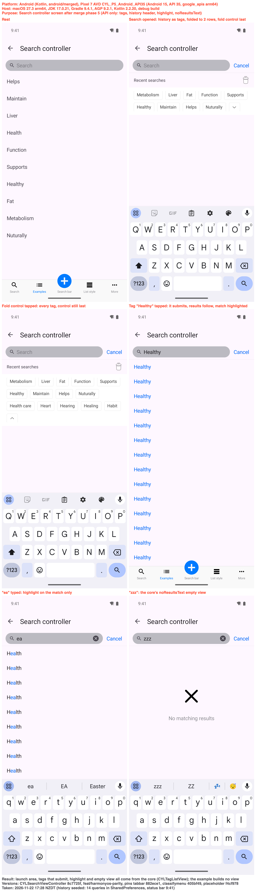 | Android (Kotlin, android/merged), Pixel 7 AVD CYL_P5_Android_API35 (Android 15, API 35), macOS 27.3, JDK 17.0.21, AGP 9.2.1, CYLSearchViewController `8c7725f`, `feat/harmonyos-parity`, 2026-11-22 17:28 NZDT. Search controller screen: rest; search opened (history of 14 queries seeded in SharedPreferences, tags folded to two rows, fold control last); unfolded; tag "Healthy" tapped (submitted, highlight); "ea" (highlight on the match only); "zzz" (empty view). Originals: `docs/assets/raw/merge-after-p5-android-*-api35-20261122.png` |

On the AVD: Back closes the search, and Back from a result's detail page pops the page and leaves the search open (the `isCovered` fix still works with predictive back enabled).

#### 6. Score (2026-11-22): 91 / 100 (pass 60)

Items 1 and 2 (audit, merges, deprecated forwards, API-only example with tags that submit) 40/40; item 3 (highlight, `noResultsText`, events, swipe) 18/20; item 4 tests 20/20, screenshots 8/10 (no dark mode / large font, history seeded); docs and commits 5/10.

TODO (9 points):
- TODO (2 points): the swipe to dismiss was not run with a real predictive-back gesture: `adb shell input swipe` from the edge did not start the system gesture on the AVD (Back key and Back from the detail page were checked); needs a real gesture or `adb shell cmd` back-progress injection.
- TODO (2 points): tags show their top and bottom borders clipped by 2 to 3 px (first and last row; also in `docs/assets/android-cache-recent-searches.png`): the `CYLTagListView` content box is as tall as the rows without their border; fix in CollectionViewClassifyMenu first, then pin.
- TODO (2 points): CrossPlatform React Native / Flutter Android wrappers use the deprecated names (listed above); `controller.recent` and `controller.launch.label` strings are unused on Android (kept for the cross-platform parity check).
- TODO (1 point): the trailing accessory of "Search bar styles" now sits inside the field (QMUI: beside it); a core option for a view beside the field would bring that back if wanted.
- TODO (1 point): no dark mode, ja / zh or large font screenshot; the history of the screenshots was seeded, not typed.
- TODO (1 point): the example `CYLSearchDiscoverFragment` copies the Discover page (two `CYLTagListView` sections) instead of using the suggestion area, as on iOS.
### Merge phase 5 log: React Native (2026-11-22)

Phase 5 of the merge design above for CrossPlatform/react-native-cylsearch, `feat/harmonyos-parity`, PR #11. Worktree `/tmp/xpr/merge-p5-react-native-cylsearch`; simulator `iPhone 18 Pro (CYLSearch RN QMUI)` (iOS 27.2, 530EE4E8), AVD `CYL_QRN_API35` on port 5600 (Android 15); Release builds, Xcode 27.2 (27B52), macOS 27.3, JDK 17.0.21, React Native 0.88.0. Code commits `5faf355`, `90fb63a`, `1dc545a`, `5033ce8`, `5c8dcfb` (2026-11-22; the first four were written before the rebase onto the Android and Flutter phase 5 work, the last one adopts what that work added to the Android core). Only CrossPlatform/react-native-cylsearch and this document changed.

#### 1. The audit: parallel members merged into one

None of the first port's names reached master (the package is 0.1.0 and the names exist only on this PR), but the old names still work as deprecated JavaScript forwards (`cylListForwards`, `cylBarForwards` in `src/CYLSearchProps.ts`), so no screen of an app that followed the first port breaks. The native codegen specs carry only the merged names.

| Parallel member (first port) | Merged into (iOS name) | Where |
| --- | --- | --- |
| list `dimmingColor` | `scrimColor` | spec, iOS `CylsearchListView.mm`, Android `CylsearchListView.kt` |
| list `emptyViewText` | `noResultsText` | same |
| list `launchSuggestions` | `suggestions` (+ `showsSuggestionsForEmptyQuery`, tags, `submitsOnSuggestionSelection`) | same |
| list `historyPolicy` / `historyName` | `suggestionCachePolicy` / `suggestionCacheName` (the names `CylsearchView` already used: one name per concept in the package) | same |
| list `launchTitle`, `launchLabel`, `clearHistoryLabel` | removed: the core's suggestion area has its own localized title, trash button and labels | spec, Android |
| Android `CylsearchLaunchView.kt` (title, border, trash button, `CYLTagListView`) and `cylsearch_ic_delete.xml` | deleted: the core's suggestion area is the launch area (folded tags, fold control last, history header, clear button) | Android |
| bar `leadingAccessory` / `showsLeadingAccessory` | `leadingView` / `showsLeadingView` | spec, both bars |
| bar `trailingAccessory` / `showsTrailingAccessory` | `trailingAccessoryViews` (array) / `showsTrailingAccessoryViews` | same |
| bar `appearance` | `appearanceStyle` | same |
| two results data sources (`CylsearchView` and `CylsearchListView`, each with its own cell text and cache mapping) | one per platform: iOS `CYLRNSearchResults` + `CYLRNApplySuggestionCache`, Android `CylsearchResults` + `applySuggestionCache` | both |
| iOS list stub (drew nothing) and the example's iOS composition (bridged bar + `CYLTagListView` + `FlatList`) | `CylsearchListView.mm` hosts the core `CYLSearchView`; the example is one `<CYLSearchListView>` | iOS, example |
| match highlight drawn by the example (`cylSplitMatch`, case sensitive, returned the query) | the core option `highlightsResultMatches` + `resultMatchHighlightColor` on iOS and Android (a first Android version carried its own `cylMatchRange` / `cylHighlighted`, deleted in `5c8dcfb` once the Android core had the option); the JavaScript `cylSplitMatch` stays for apps that draw their own rows, case and diacritic insensitive, returning the text as written | all |
| Android bar: the core's accessory slots (`leadingAccessoryView`, `trailingAccessoryView`, margins) and the wrapper's empty view handling | `leadingView`, `trailingAccessoryViews`, `setShowsLeadingView`, `setShowsTrailingAccessoryViews` (the slots are deprecated forwards in the core now), `noResultsText`; the accessory gap is the view's own margin | Android |

Every launch area is the core's suggestion area, whose tags are CollectionViewClassifyMenu's `CYLTagListView`: no native chip group, flex wrap or hand-built tag row remains in the package or the example. A tapped tag submits (`submitsOnSuggestionSelection`, on by default in the list).

#### 2. What is wired now

- iOS bar (`CylsearchBarView.mm` -> `CYLSearchBarView`): `applyDefaultAppearance` / `appearanceStyle`, `centersPlaceholder`, `placeholderColor`, `textColor`, `textFieldMarginsProvider`, `cancelButtonMarginsProvider`, `cancelButtonFont`, `setShowsCancelButton(_:animated:)`, `setShowsLeadingView(_:animated:)`, `setShowsTrailingAccessoryViews(_:animated:)`, `leadingView`, `trailingAccessoryViews`, `onActiveChange` from the editing delegate. Checked on the simulator: margins 32, accessories, Cancel, centred placeholder.
- `cancelButtonFont` on both platforms (`{"size", "weight"}`): iOS `CYLSearchBarView.cancelButtonFont`; Android the core's typeface for the weight and the button's text size (the core's font is a typeface without a size).
- iOS list (`CylsearchListView.mm` -> `CYLSearchView`): launch area from `suggestions` + history (folded tags, trash button), `scrimColor`, `highlightsResultMatches`, `noResultsText` (the placeholder's title; its hint is hidden), will / did present and dismiss, `setActive`, `clearHistory`, `onHistoryChange` from the core store's change signal, `supportsSwipeToDismissSearch`, `onSubmit`, rows with `hidesSearchBarInitially`.
- Android list: the same props on the core's `CYLSearchView` / `CYLSearchListView` (`highlightsResultMatches`, `noResultsText`, `scrimColor`, suggestion area); `onSubmit` is new.
- The blank band of about 150 px above the bar on Android was in the wrapper, not in the core: the core pads its page by the window's system bars, and a React Native screen is already below the status bar. `cylKeepSystemBarsAbove` reduces the insets that reach the page by what the view already keeps clear (top and bottom); measured on the 1080 x 2400 emulator: the bar's top edge was 150 px below the header, now it sits directly under it (the Search controller page) and the Open search page's bar moved up by 136 px.

#### 3. Findings

- A tapped tag sets the query in code, and `CYLSearchView` sends no `textDidChange` for it: on iOS the list showed a blank area, because JavaScript never learned the text. `CylsearchListView` answers `onUpdateResults` on the submit when the text differs (core TODO: notify on a programmatic `setQuery`).
- The Android core fills its tag list while the page is hidden (no width), so the first open showed the header and an empty strip; the wrapper fills it again after `searchViewDidShow` (core TODO).
- The iOS demo's switch "Center placeholder" did not react to `axe` taps by coordinates; by label it worked.

#### 4. Tests

- `yarn jest --no-watchman`: **14 tests, 0 failures** (5 new: forwards of the old list and bar names, `cancelButtonFont` and views-after-the-text JSON, case and diacritic insensitive highlight splitting incl. "Cafe" / "CAFE" with an accent, text kept as written). `yarn tsc`: clean. eslint on the files changed: clean (the three untouched spec files keep their one prettier error each).
- iOS: `pod install` (codegen), `xcodebuild` Release for the simulator with clean derived data: BUILD SUCCEEDED; run on the simulator by `axe` input: rest, tap on the bar, tag tap submits, return key, history with the trash button, fold and unfold, results, empty view, Cancel; the styles screen.
- Android: `gradlew clean :app:assembleRelease` (arm64-v8a) on the rebased tree: BUILD SUCCESSFUL in 2m 53s; run on the emulator: the same flow with `adb input`.
- No native unit tests (the package has no native test target; unchanged from the first port). `Podfile.lock` churn from `pod install` was not committed.

#### 5. After screenshots

React Native 0.88.0, Release builds, CYLSearchViewController `5c8dcfb`, 2026-11-22 17:46 NZDT (retaken after the rebase); originals cropped in `docs/assets/raw/merge-after-p5-rn-*`, stitched with `scripts/stitch-screenshots.swift`. The task names one image per platform; React Native has two, so each carries its platform: rest, launch area folded and unfolded (ten submitted queries, so the history is three rows and the fold control is the last tag), results for "He" with the match highlighted, "Hzzz" with the empty view.

| Image | Label |
| --- | --- |
| 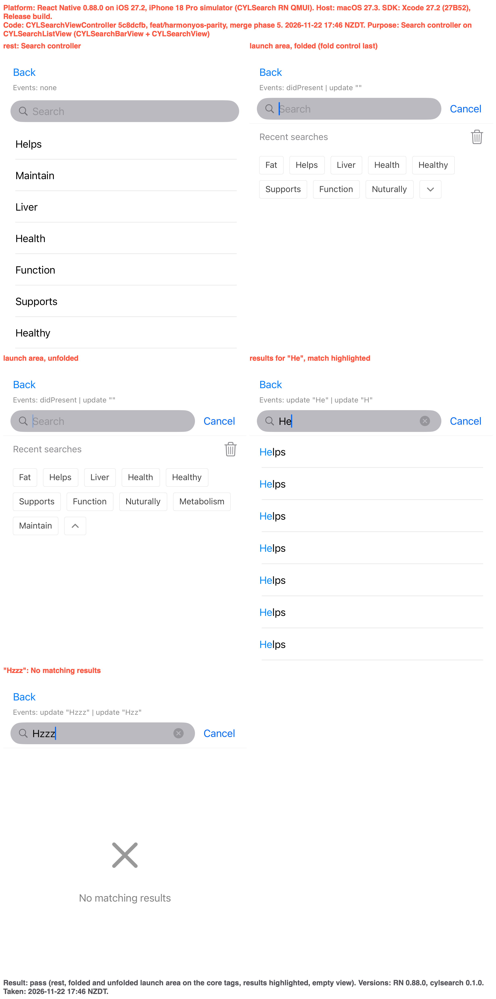 | iOS 27.2, iPhone 18 Pro simulator (CYLSearch RN QMUI), Xcode 27.2 (27B52), macOS 27.3, CYLSearchViewController `5c8dcfb`, 2026-11-22 17:46 NZDT |
| 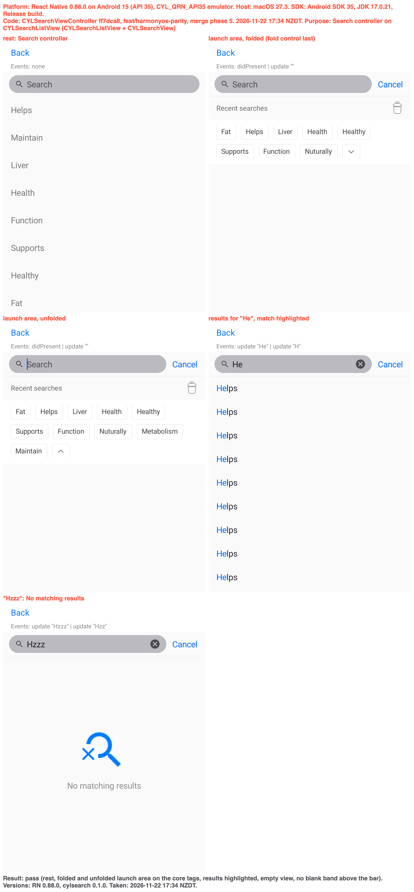 | Android 15 (API 35) emulator CYL_QRN_API35, JDK 17.0.21, macOS 27.3, CYLSearchViewController `5c8dcfb`, 2026-11-22 17:46 NZDT |

#### Merge score (React Native) (2026-11-22): 87 / 100 (pass 60)

| Criterion | Points | Got | Why |
| --- | :---: | :---: | --- |
| Design (the merge rows for this platform audited and written down) | 10 | 10 | tables 1 and 2 |
| One implementation per concept | 30 | 26 | the names, the launch view, the data source, the cache mapping, the highlight and the accessories are merged onto the core on both platforms; open: iOS `snapsHeaderSearchBar`, two components (`CYLSearchView`, `CYLSearchListView`) host the same core view |
| Old API keeps working | 15 | 13 | deprecated forwards, tested; no native negative test |
| Example free of re-implementations | 20 | 18 | the Search controller is API only on both platforms; the other screens were not in scope |
| Suites green | 15 | 11 | jest, tsc, eslint, two clean builds and runs; no native tests |
| Before / after screenshots | 10 | 9 | both platforms, five states; no dark mode or large font |

Missing points as TODO:
- TODO (2 points): iOS `snapsHeaderSearchBar` and `hidesSearchBarWhenEmptyViewShowing` are accepted and ignored: `CYLSearchHeaderSnapper` is internal to the core (a public API there first), and the empty view lives in the page, not in the list.
- TODO (4 points, core): iOS `CYLSearchView` has no `noResultsText` (the wrapper sets the placeholder's title; the Android core has it); the history signal of the iOS store is observed by its notification name `CYLSearchSuggestionStoreDidChange` because the constant is internal; a programmatic `setQuery` (a tapped tag) sends no `textDidChange`; the Android core fills its tag list before the page has a width (the wrapper reloads after `searchViewDidShow`); the Android core's `cancelButtonFont` is a typeface without a size (the wrapper sets the size on the button).
- TODO (4 points): native tests; dark mode and large font; a real edge swipe and predictive back with `supportsSwipeToDismissSearch`; `showsSearchBar`, `hidesSearchBarInitially` and the bar options on the list (only on the bar) were not screenshotted.
- TODO (3 points): arbitrary React children as accessories (still a 30 x 30 square spec); the bar options of the list besides `centersPlaceholder` and `placeholder`.

### Merge phase 5 log: Flutter (2026-11-22), result

**Result** (base `493efbd`; code commits `308b865` bar names and iOS bar wiring, `7c31681` native core hosts scrim, empty view, swipe, `38c7a5a` example, `ff8193b` Android empty text; all on `feat/harmonyos-parity`).

**1. The audit: parallel members and what they became**

| Port member (Dart / plugin) | Existing counterpart | Decision |
| :--- | :--- | :--- |
| `leadingAccessoryView`, `trailingAccessoryView` (+ show flags, margins, controller setters) | `leadingView`, `trailingAccessoryViews`, `showsLeadingView`, `setShowsLeadingView(_:animated:)` | merged to the iOS names: `leadingView`, `trailingAccessoryViews` (a list), `showsLeadingView`, `showsTrailingAccessoryViews`, `leadingViewMargins`, `trailingAccessoryViewsMargins`, controller `setShowsLeadingView` / `setShowsTrailingAccessoryViews`. They stay Flutter widgets in a row beside the native field (a platform view cannot host a Flutter widget); native icon and text buttons are `items` |
| `dimmingColor` + a Dart `ColoredBox` over the page | `scrimColor` | one native overlay: Dart `scrimColor` goes to the core's `scrimColor` on iOS and Android; the Dart overlay and `dimmingColor` are deleted |
| controller `showEmptyView` / `hideEmptyView` / `isEmptyViewShowing` + a Dart `CYLPlaceholderView` overlay | the core's empty results placeholder (`showsEmptyResultsPlaceholder`) | one empty view, the core's; new `noResultsText` sets its title (iOS: `emptyResultsView.titleLabel`; Android: `emptyResultsView.titleLabel`; not `showEmptyView`, which stacked a second placeholder over the core's, seen on the emulator and fixed in `ff8193b`). The three controller members are deleted |
| `launchViewBuilder` used by the example (title, divider, trash button, `CYLTagListView`) | the core's suggestion area (`suggestions`, `showsSuggestionsForEmptyQuery`, history header, trash button, fold control last) | the example uses the core's area through API only (its launch view is deleted); `launchViewBuilder` stays only for content that is not tags and is documented as Dart because a platform view cannot host a Flutter widget |
| `onUpdateResults` | `onTextChanged` | deleted: it differed only by one extra call at opening |
| `onWillPresent` / `onDidPresent` / `onWillDismiss` / `onDidDismiss`, Dart's `willChangeActive` and `_announcedWillDismiss` | the core delegate's `searchViewWillShow`, `searchViewDidShow`, `searchViewWillClose`, `searchViewDidClose` | `onWillShow`, `onDidShow`, `onWillClose` are the native events; `onClose` is did-close (so `onDidDismiss` is gone); `isActive` follows the native events. Only the first open is announced by Dart, because the native page opens before Dart listens |
| Dart edge-strip swipe with its animation | `supportsSwipeToDismissSearch` of the core | native on iOS (a real-touch swipe from x = 2 ended the search through the Flutter platform view, simulator); Android uses the core's predictive-back drag; the Dart strip and its `AnimationController` are deleted |
| plugin attributed text with a case-sensitive match | the core's `highlightsResultMatches` + `resultMatchHighlightColor` | iOS: the core option (case- and diacritic-insensitive), the plugin code is deleted; Android: the core has no option, so the same rule is one pure function (`CYLMatchHighlight`, JVM-tested) |
| `DispatchQueue.main.async` history read after `didSubmit`, a manual `historyDidChange` after `clearHistory` | the core store's change notification | iOS observes the notification of the core's stores (the trash button of the native header is reported now, it was not before); Android uses the core's history listener and reports a clear itself (the core posts none for the trash button) |
| hand-mapped appearance (`fieldBorderWidth = 1`, ...) | the core's `CYLSearchBarAppearance` / `appearanceStyle` | iOS assigns one `CYLSearchBarAppearance` (Android already did) |
| iOS TODOs | `centersPlaceholder`, `textFieldMarginsProvider`, `cancelButtonMarginsProvider`, `cancelButtonFont`, `setShowsCancelButton(_:animated:)` | wired; the field margins are added to `contentInsets` (Dart's are "on top of the native margins", the provider replaces them), Cancel margins are the provider's answer, none is installed for zero margins |
| new `CYLSearchViewWidgetController.setQuery(query, submit:)` | iOS `setQuery(_:submit:)`, Android `setQuery` | added; a tapped tag with `submitsOnSuggestionSelection` submits without a text change, so the plugin sends the query as a text change before `didSubmit` and Dart's results follow |
| `CYLSearchListView` | the placeholder component | no duplicate: its `emptyView` takes the shared `CYLPlaceholderView`; unchanged |

**2. Tags.** The native launch area is the ClassifyMenu `CYLTagListView` on both platforms (screenshots: folded to two rows with the fold control last, unfolded). The example "Search controller" sets `suggestions`, `showsSuggestionsForEmptyQuery`, `submitsOnSuggestionSelection`, `highlightsResultMatches`, `noResultsText`, `supportsSwipeToDismissSearch` and the cache: no launch view, no trash button, no empty-view code of its own. A tapped tag submits (iOS and Android checked on the devices). The scrim was checked on the iOS simulator with a temporary local `scrimColor` (it fills the area under the launch tags, a tap on it ends the search and the route pops); the example does not set one.

**3. API kept.** None of the removed names was released: the QMUI-port names were added on 2026-11-22 and `CHANGELOG.md` 0.1.0 is unpublished, so nothing is deprecated and forwarded; the published names (`onClose`, `onTextChanged`, `showsEmptyResultsPlaceholder`, `highlightsResultMatches`, ...) are unchanged. New: `scrimColor`, `noResultsText`, `resultMatchHighlightColor`, `onWillShow`, `onDidShow`, `onWillClose`, `setQuery`, the iOS accessory names.

**4. Lines** (`git diff --numstat 493efbd..HEAD -- CrossPlatform/flutter_cylsearch`): 598 added, 416 deleted over 13 files. Deleted logic: the Dart dimming, empty-view, edge-swipe and animation code and the active-state listener in `lib/src/cyl_search_view.dart` (111 added, 213 deleted), the example's launch view and empty-view code (`qmui_search_controller_page.dart` 23 added, 65 deleted, plus 12 string lines), the plugin's attributed-text highlight and the async history read on iOS. Added: the Android highlight function and its test (88 lines), the iOS bar wiring (137 added in the Swift plugin) and 110 lines of new Dart tests.

**5. Tests.** Plugin `flutter test`: **36 passed** (34 before; the dimming, empty-view, swipe, life-cycle tests of the old Dart overlays were rewritten for the native path, and new ones added in `test/cyl_merge_p5_test.dart`: several trailing widgets in order after the field, `setQuery` with and without submit, a tag's text change before the submit, the history event only from the native store, and in `cyl_qmui_port_test.dart`: the scrim, swipe, highlight colour and empty text go to the native page, the will / did / close order with the controller's `isActive`, no Dart overlay for them); example `flutter test`: **5 passed**; `flutter analyze`: no issues; Android JVM tests (`./gradlew :flutter_cylsearch:testDebugUnitTest`, JDK 17.0.21): **6 passed** (`CYLMatchHighlightTest`: case, diacritics in the result and in the query, original indexes after decomposition, first match only, empty and absent query). The plugin has no native unit tests for the Swift bridge; it was checked on the devices below. Builds: `flutter build ios --simulator --debug` and `flutter build apk --debug`, both from a clean tree.

**6. Devices.** iOS 27.2 simulator "iPhone 18 Pro (CYLSearch Flutter QMUI)" (own device, UDID 1AF18DE0-6557-44DA-A78B-9802CA704B32), Xcode 27.2: launch area (history, trash button, fold), tag tap submits, highlight, empty text, swipe by `axe draw` from x = 2, scrim with its tap. Android 15 (API 35) emulator `CYL_Flutter_QMUI_API35` on port 5592 (own device): launch area, tag tap, highlight, empty view (the stacked placeholders found and fixed), history. The machine's load average was about 900 (parallel sessions) and the emulator was killed by its watchdog four times; each time it was restarted from the command line and the run continued (the history stays on the device).

**7. After screenshots** (originals in `docs/assets/raw/merge-after-p5-flutter-*`, keyboard cropped, stitched by `scripts/stitch-screenshots.swift`; two columns because one column would be taller than one phone screen):

| Image | Label |
| --- | --- |
| 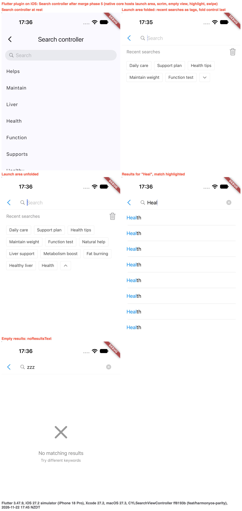 | Flutter 3.47.9 on iOS 27.2, iPhone 18 Pro simulator, Xcode 27.2, macOS 27.3, CYLSearchViewController `ff8193b`, `feat/harmonyos-parity`, 2026-11-22 17:45 NZDT. Search controller screen: rest, launch area folded (fold control last) and unfolded, results for "Heal" with the highlight, empty results |
| 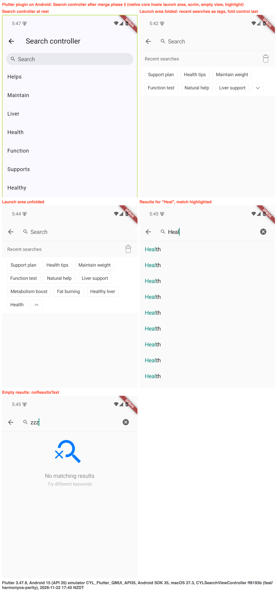 | Flutter 3.47.9 on Android 15 (API 35) emulator CYL_Flutter_QMUI_API35, macOS 27.3, CYLSearchViewController `ff8193b`, `feat/harmonyos-parity`, 2026-11-22 17:45 NZDT. The same five states |

**Merge score (Flutter) (2026-11-22): 88 / 100 (pass 60)**: parallel members merged with the iOS names and the old names gone (30 of 30 less 2: accessories and `launchViewBuilder` stay Dart, documented), launch, tags and example through API (20 of 20 less 0), highlight, empty text, swipe and events (20 of 20 less 3: `noResultsText` is set by the plugins, not the core; the Android swipe is the core's predictive back and was not checked on the device; Android scrim only through its parameter), iOS TODOs wired and `setQuery` (10 of 10 less 1: no native unit tests of the bridges), tests and screenshots (20 of 20 less 4: the Android run covered five states with an unstable emulator, no dark mode, no large text, one OS version each).

#### TODO (Flutter, after merge phase 5)

- TODO (core, iOS and Android): `CYLSearchView` has no `noResultsText` (only `CYLSearchController` has); the plugins set the title of `emptyResultsView` after each query or results change. Move it into the core and delete `applyNoResultsText` / `updateNoResultsText`.
- TODO (core, iOS): `CYLSearchSuggestionStore.didChangeNotification` is internal; the plugin observes it by its name `"CYLSearchSuggestionStoreDidChange"`. Make it public (or add a public helper) and use the symbol.
- TODO (core, Android): no history signal after `clearSuggestionCache()` or the native trash button (iOS has one): the plugin reports its own `clearHistory` call only, so a tap on the native trash button is not reported to `onHistoryChanged` on Android.
- TODO (core, Android): no `highlightsResultMatches` option (iOS has one); `CYLMatchHighlight` lives in the plugin until it is in the core.
- TODO (verification): the Android scrim and the predictive-back swipe were not run on the device (the iOS scrim and swipe were); the `scrimColor` of the core Android view lets the page be only as tall as its suggestions, which differs from iOS, to be checked when the Android core's scrim is merged.
- TODO (verification): dark mode, large Dynamic Type, other OS versions (iOS 17.5, 26.5; Android 13 and 14) of the Flutter screens; real-touch check of the animated Cancel and the margin providers on a device (the iOS bar wiring compiles and runs on 27.2; the styles screen was not re-screenshotted).
- TODO (design): `leadingView` and `trailingAccessoryViews` are Flutter widgets in a row, not the core's accessory slots (the native `leadingView` cannot hold a Flutter widget); `launchViewBuilder` is a Dart overlay. A native bridge that renders a Flutter widget to a texture would remove both, at a cost not worth it here.
- TODO (tests): no native unit tests for the Swift and Kotlin bridges (the Flutter tests use a fake platform view); the Android highlight is the only native test. Add RunnerTests / instrumented tests that create the platform views.
- TODO (example): the example's filter of the ten keywords is case sensitive like the iOS demo, so the case-insensitive highlight is shown only by the core's own tests and the JVM test; `CYLSearchListView.emptyView` and the Short list screen were not changed.
