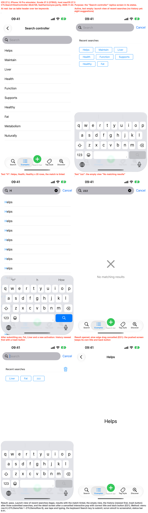
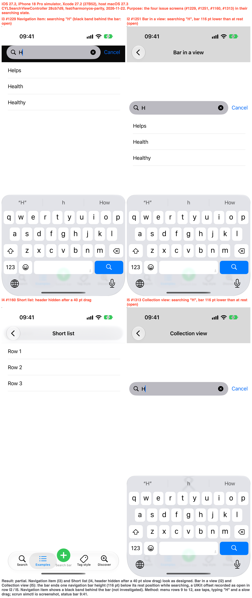
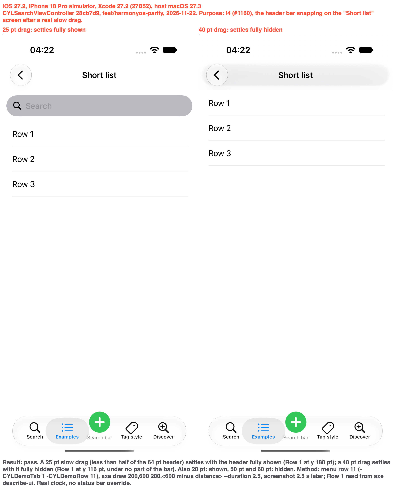

# QMUISearchBar and QMUISearchController in CYLSearchBar (Swift)

Design and task record for bringing QMUI_iOS's `QMUISearchBar` and `QMUISearchController` (and the
`UISearchBar+QMUI` / `UISearchController+QMUI` categories they rely on) into this repository's Swift core
(`Sources/CYLSearchBar`), with CYL names, and their example into `CYLSearchExample`.

## DONE (2026-11-21, `feat/harmonyos-parity`, PR #11): port QMUISearchBar / QMUISearchController to Swift

- **Context**: source: `Vibe-Coding-Projects/QMUI_iOS-fixed` (fork of Tencent/QMUI_iOS, imported in `792c9dda`),
  files `QMUIKit/QMUIComponents/QMUISearchBar.{h,m}`, `QMUISearchController.{h,m}` and their dependencies
  `QMUIKit/UIKitExtensions/UISearchBar+QMUI.{h,m}`, `UISearchController+QMUI.{h,m}`. Our current search code:
  `Sources/CYLSearchBar/CYLSearchBarView.swift` (a custom `UIView` bar), `CYLSearchView.swift` (a custom overlay
  with suggestions and results), `CYLSearchResources.swift` (history), plus the legacy Objective-C app files
  `CYLSearchViewController/Class/CYLSearchBar` (a `UISearchBar` subclass) and
  `Class/Controller/CYLSearchController` (a hand-made search page). The owner chose to commit on PR #11's branch
  (asked 2026-11-21: three open PRs otherwise). Design by this session (with the advisor); code by Sonnet agents,
  one per phase, reviewed and tested here between phases. Clone: `/tmp/xpr/csvc-qmui`.
- **Requirements**:
  1. Design document in `docs/` (this file), then the code written by the default Sonnet model.
  2. Rename to this project's naming rules first (`CYL` prefix, `cyl_` for category members), then Swift.
  3. Merge into the project: into a fitting existing class, else as a new class; and merge our fitting code into the
     new class, so that QMUI's design and interfaces are available here.
  4. Replicate QMUI's search bar example in `CYLSearchExample`.
  5. Read QMUI's comments closely: keep its design reasoning and every edge case it handles (the QMUI classes are
     proven in production; our current code is a draft and less robust).
- **Prompt (verbatim)**: "advisor 请参考 下面几个searchbar实现， 进行设计， 设计文档放docs中， 并交给默认sonnet模型进行代码实现。 该实现与我们 的searchbar高度相似， 先改为 合适的类命名规范， 再转为Swift， 再merge到我们的项目中， 找到合适的类合并。 如果没有合适的类就单独放项目中，并将我们项目中合适的代码也按照这个新加入的类进行合并， 保证可以将下面的类的设计， 以及接口引入我们的项目。 并将下面项目中对应的searchbar 的exmaple 也复刻进我的的Example中， 并详细阅读下面代码中注释， 注意他说明的设计思路， 以及边界场景处理，下面几个类是经过实际项目的验证的， 我们现有代码仅仅是草稿， 总体没有下面的代码更健壮。 /Volumes/obsidian/chenyilong/chenyilong/Vibe-Coding-Projects/QMUI_iOS-fixed/QMUIKit/QMUIComponents/QMUISearchBar.h /Volumes/obsidian/chenyilong/chenyilong/Vibe-Coding-Projects/QMUI_iOS-fixed/QMUIKit/QMUIComponents/QMUISearchBar.m /Volumes/obsidian/chenyilong/chenyilong/Vibe-Coding-Projects/QMUI_iOS-fixed/QMUIKit/QMUIComponents/QMUISearchController.h /Volumes/obsidian/chenyilong/chenyilong/Vibe-Coding-Projects/QMUI_iOS-fixed/QMUIKit/QMUIComponents/QMUISearchController.m"
- **Prompt (English)**: "Advisor, use the search bar implementations below as the reference for a design; put the design
  document in docs and hand the implementation to the default Sonnet model. It is very similar to our search bar: first
  rename to suitable class naming rules, then convert to Swift, then merge into our project, finding the fitting classes
  to merge with. If no class fits, add it to the project on its own, and merge the fitting code of our project into the
  new class, so that the design and interfaces of the classes below come into our project. Also replicate the
  corresponding search bar example of that project into our Example. Read the comments in the code below in detail:
  note the design reasoning they explain and the handling of edge cases; these classes are proven in real projects,
  our existing code is only a draft and overall less robust than theirs." (followed by the four file paths above)
- **Requirements (added 2026-11-21, second message)**: the implementation follows QMUI_iOS-fixed
  `docs/issue-tracker.md` and handles the search issues [#1319](https://github.com/Tencent/QMUI_iOS/issues/1319),
  [#1251](https://github.com/Tencent/QMUI_iOS/issues/1251), [#1229](https://github.com/Tencent/QMUI_iOS/issues/1229),
  [#1313](https://github.com/Tencent/QMUI_iOS/issues/1313), [#1160](https://github.com/Tencent/QMUI_iOS/issues/1160) and
  the `issues1160-TestSearchBar` project. Prompt (verbatim): "默认模型在代码实现过程中， 要参考 /Volumes/obsidian/chenyilong/chenyilong/Vibe-Coding-Projects/QMUI_iOS-fixed/docs/issue-tracker.md  注意实现过程中， 考虑里面的searchbar相关的issue https://github.com/Tencent/QMUI_iOS/issues/1319 https://github.com/Tencent/QMUI_iOS/issues/1251  https://github.com/Tencent/QMUI_iOS/issues/1229  https://github.com/Tencent/QMUI_iOS/issues/1313 https://github.com/Tencent/QMUI_iOS/issues/1160 /Volumes/obsidian/chenyilong/chenyilong/Vibe-Coding-Projects/QMUI_iOS-fixed/issues1160-TestSearchBar". English: "While the default model implements the code, it must refer to issue-tracker.md and take the search bar issues in it into account: #1319, #1251, #1229, #1313, #1160, and the issues1160-TestSearchBar project."
- **Status** (2026-11-22): design written (below); **phase 1 done** (`1ffabb0` core, `96ad416` example and tests; suite: 62 tests, 0 failures on iOS 27.2): `CYLSearchBar`, `CYLSearchBarAppearance`, the "Search bar styles" screen, rows B1 to B13 and E23; **phase 2 done** (`a9f59e6` core, `1f33609` example and tests; suite: 101 tests, 0 failures on iOS 27.2): `CYLSearchController`, `CYLSearchControllerDelegate`, the "Search controller" screen, rows E1 to E22 (E21 checked, open for a touch run); **phase 3 done** (`611ada8`, `1c95bbe`, `a9f927e`, `41a8747`; suite: 119 tests, 0 failures on iOS 27.2): `CYLSearchTableViewController`, header snapping, the explicit background fix, the four issue screens (menu rows 10 to 13) and `CYLSearchIssueScenarioTests`, rows I1 to I5, B9, B10; E21 checked by touch (not reproduced); phase 4 next. Phase 1 to 3 notes are in "Phase 1 log" to "Phase 3 log" below. **Phase 4 done** (2026-11-22; `6351389`, `28cb7d9`, `72c45bf` and the documentation commit; suite: 122 tests, 0 failures on iOS 27.2): E21 reproduced with a plain `UISearchController` (a UIKit bug, a public-API workaround in the core), I4 checked with real drags, the merge table, licenses, screenshots and the score. **Result: 94 / 100 (pass 60)**, see "Score" and "Remaining TODO" at the end.

## DONE (2026-11-22, `feat/harmonyos-parity`, PR #11): phase 3 of the QMUI search port

- **Context**: phases 1 and 2 are done (up to `02fbad8`; 101 tests, 0 failures on iOS 27.2). This phase: `CYLSearchTableViewController`
  (the replacement of `QMUICommonTableViewController (Search)`), the owner's issues I1 to I5 with their screens and tests, the
  core bug of phase 2 (a hand-set background image or `barTintColor` is not drawn while searching, row B9), and the real check of E21.
- **Requirements** (the phase 3 scope as given, English original):
  1. `Sources/CYLSearchBar/CYLSearchTableViewController.swift`: `showsSearchBar` (creating / removing the `CYLSearchController` and the
     header bar only once the view is loaded; setting it before `viewDidLoad` waits for `viewDidLoad`), `searchController`,
     `searchBar`, `hidesSearchBarWhenEmptyViewShowing` (removes the header while an empty view shows and puts it back
     hidden-initially after, #128 "force" behaviour), `setUpSearchBar()` hook, clears results selection in `viewWillAppear` unless
     `allowsMultipleSelection`, default empty `updateResults`. Move the Styles screen onto it.
  2. The owner's issues I1 to I5, each with its example screen (menu rows "Navigation item" I3, "Bar in a view" I2, "Short list" I4,
     "Collection view" I5; I1 is checked on the Search controller screen) and its test (class `CYLSearchIssueScenarioTests`). I4
     (#1160, also B10 / #1207): finish `installSearchBar(asHeaderOf:)`: estimated row / header / footer heights 0, enough bottom inset
     that the header can scroll out even with 3 rows, snap fully shown / hidden at the end of dragging, without stealing the
     table's delegate. I3 (#1229): `install(in:)` keeps the wrapper alive (associated with the contents view controller), the test
     proves no crash plus delegate callbacks. Add every new bar to `testSearchBarsCoverNoView`.
  3. Core bug from phase 2: a hand-set `setBackgroundImage(_:for:barMetrics:)` or `barTintColor` on a `CYLSearchBar` does not draw
     while searching; an explicit call wins over `appearanceStyle`; with a test; update row B9.
  4. E21 (#680) real check on the iOS 27.2 simulator (results showing, push, start an interactive pop, cancel it halfway, push
     again; look for search results flashing). Port a public-API fix only if it reproduces; write the result and method in row E21.
  Not in this phase: phase 4 (merge table, licenses, screenshots, final score).
- **Prompt**: "You are implementing PHASE 3 of the design in docs/qmui-search-controller.md ... PHASE 3 SCOPE 1. ...
  `CYLSearchTableViewController.swift` ... 2. The owner's issues I1-I5 ... 3. Core bug from phase 2 ... 4. E21 (#680) real check ...
  Update the doc rows (I1-I5, B9, B10, E21), the Status line, and a Phase 3 log. Do not do phase 4." (the scope items are quoted in
  Requirements above).
- **Status**: DONE (2026-11-22): `611ada8` explicit background, `1c95bbe` core, `a9f927e` example and tests, `41a8747` E21 push; 119 tests, 0 failures. See "Phase 3 log".

## Sources read (2026-11-21)

| Source | Where | Notes |
| --- | --- | --- |
| `QMUISearchBar.{h,m}` (20 + 40 lines) | QMUI_iOS-fixed `792c9dda`, `QMUIKit/QMUIComponents/` | A `UISearchBar` subclass that only calls `qmui_styledAsQMUISearchBar`. |
| `QMUISearchController.{h,m}` (168 + 537) | same | Wrapper view controller around `UISearchController`, its results table, launch view, empty view, swipe to dismiss, the #1541 leak fixes, `QMUICommonTableViewController (Search)`. |
| `UISearchBar+QMUI.{h,m}` (116 + 951) | `QMUIKit/UIKitExtensions/` | Styling (placeholder / text / font / margins / cancel button / accessory views) and the table-header bug fixes (#233, #830, #950, #1207, #1473, iOS 13/14 layout). |
| `UISearchController+QMUI.{h,m}` (42 + 279) | same | `alwaysShowSearchResultsController`, `forwardAppearanceMethodsFromPresentingController`, `dimmingColor`, `launchView`, `searchBarMaxY`, the #680 transition fix. |
| `QDSearchViewController.m`, `QDSearchBarViewController.m` | [QMUI/QMUIDemo_iOS](https://github.com/QMUI/QMUIDemo_iOS) `018ca3a3`, `qmuidemo/Modules/Demos/UIKit/` (not in the vault; read from GitHub) | The two demo screens to replicate (below). |
| `docs/issue-tracker.md`, `docs/issue-answers.md` | QMUI_iOS-fixed | Search issues the owner named: #1160, #1229, #1251, #1313, #1319; also #128, #233, #680, #830, #950, #1207, #1473, #1541 from the source comments. |
| `issues1160-TestSearchBar/` | QMUI_iOS-fixed | Only an empty Xcode template (`ViewController.m` has an empty `viewDidLoad`): the #1160 scenario is rebuilt here from the issue text. |

## Decisions

1. **Target**: this repository's core, `Sources/CYLSearchBar` (pod `CYLSearchViewController`, module
   `CYLSearchViewController`). Commits on `feat/harmonyos-parity` (PR #11), as the owner chose.
2. **No existing class fits a merge.** `CYLSearchBarView` is a custom `UIView` field (not a `UISearchBar`), and
   `CYLSearchView` is a custom overlay (not a `UISearchController`). QMUI's classes wrap UIKit's own search controller,
   so they come in as **new classes**, and our fitting code is merged into them (table below). `CYLSearchBarView` and
   `CYLSearchView` keep their API; they are not folded into the new classes.
3. **Names** (`CYL` prefix; Swift names without underscores, Objective-C names through `@objc(...)`):

   | QMUI | CYL (Swift / Objective-C) | File |
   | --- | --- | --- |
   | `QMUISearchBar` | `CYLSearchBar` (`UISearchBar` subclass) | `Sources/CYLSearchBar/CYLSearchBar.swift` |
   | `UISearchBar (QMUI)` members | members of `CYLSearchBar` (no category: the subclass can override `layoutSubviews`, so no swizzling) plus `CYLSearchBarAppearance` (the style values QMUI took from its configuration table) | same file + `CYLSearchBarAppearance.swift` |
   | `QMUISearchController` | `CYLSearchController` (`UIViewController` wrapper, same shape as QMUI's) | `CYLSearchController.swift` |
   | `UISearchController (QMUI)` members | members of `CYLSearchController`, implemented in a private `UISearchController` subclass (`CYLSystemSearchController`) that it owns | same file |
   | `QMUISearchControllerDelegate` | `CYLSearchControllerDelegate` (`@objc`, `UITableViewDataSource & UITableViewDelegate`) | same file |
   | `QMUISearchResultsTableViewController` | `CYLSearchResultsTableViewController` (internal) | same file |
   | `QMUICommonTableViewController (Search)` | `CYLSearchTableViewController` (`UITableViewController` subclass with `showsSearchBar`, `searchController`, `searchBar`, `hidesSearchBarWhenEmptyViewShowing`) | `CYLSearchTableViewController.swift` |
   | `QMUIEmptyView` | `CYLTableViewPlaceHolder` (already a dependency, `CYLPlaceholderScenario` as in `CYLSearchView`) | — |

   The legacy Objective-C `CYLSearchViewController/Class/CYLSearchBar` and `Class/Controller/CYLSearchController` are
   **not compiled** by any target (`CYLSearchExample.xcodeproj` has no reference to `CYLSearchViewController/Class`),
   so the names are free in the module. Their behaviour is merged (below) and the files stay untouched as history.
4. **iOS 15 floor, no private API, no global swizzling.** QMUI hooks private classes and selectors
   (`_UISearchControllerView`, `UIDimmingView`, `_updateVisibilityOfSearchResultsForSearchBar:`,
   `_updateInsetsForTableView:`, `_UISearchBarLayout`, `_modalSourceViewController`) and swizzles
   `UIViewController` / `UINavigationController` globally. Each one is replaced by public API, by an override in
   our own subclass, or dropped with a reason and a test (table below). `beginIgnoringInteractionEvents` becomes
   `window.isUserInteractionEnabled = false`; the delegate window becomes the contents view controller's
   `view.window` (scene-based apps). Code only for iOS 8–12 is dropped.
5. **License**: every ported file starts with Tencent's MIT notice (as in the source) followed by "Ported to Swift for
   CYLSearchViewController, 2026"; the port is added to `docs/licenses.md` and the pod's third-party notices
   (`AGENTS.md` "Licenses in published packages").

## Public API (Swift; every member `@objc`, three-line `/** */` comment, `scripts/check-public-api-comments.sh`)

```swift
@objc(CYLSearchBar) open class CYLSearchBar: UISearchBar {
    /** Applies CYLSearchBarAppearance.default (the merged default style). Called from both initializers. */
    @objc open func applyDefaultAppearance()
    @objc public var appearanceStyle: CYLSearchBarAppearance            // font, colors, field / bar background images, icons
    @objc public var usedAsTableHeaderView: Bool                        // QMUI qmui_usedAsTableHeaderView (default false)
    @objc public var centersPlaceholder: Bool                           // qmui_centerPlaceholder
    @objc public var placeholderColor: UIColor?
    @objc public var textColor: UIColor?
    @objc public var font: UIFont?                                      // text and placeholder
    @objc public var textFieldMargins: UIEdgeInsets                      // on top of UIKit's own (10, 8, 10, 8)
    @objc public var textFieldMarginsProvider: ((CYLSearchBar, Bool) -> UIEdgeInsets)?   // wins over textFieldMargins
    @objc public var cancelButton: UIButton? { get }                     // nil until UIKit creates it
    @objc public var cancelButtonFont: UIFont?
    @objc public var cancelButtonMarginsProvider: ((CYLSearchBar, Bool) -> UIEdgeInsets)?
    @objc public var alwaysEnablesCancelButton: Bool                     // default true; only without a UISearchController
    @objc public var backgroundView: UIView? { get }
    @objc public var segmentedControl: UISegmentedControl? { get }
    @objc public var leadingAccessoryView: UIView?                       // QMUI left accessory
    @objc public var showsLeadingAccessoryView: Bool
    @objc public func setShowsLeadingAccessoryView(_ shows: Bool, animated: Bool)
    @objc public var leadingAccessoryViewMargins: UIEdgeInsets
    @objc public var trailingAccessoryView: UIView?                      // QMUI right accessory
    @objc public var showsTrailingAccessoryView: Bool
    @objc public func setShowsTrailingAccessoryView(_ shows: Bool, animated: Bool)
    @objc public var trailingAccessoryViewMargins: UIEdgeInsets
    @objc public weak var searchController: UISearchController? { get }  // qmui_searchController
    @objc public static func textFieldBackgroundImage(color: UIColor?) -> UIImage?
    @objc public static func backgroundImage(color: UIColor?, borderColor: UIColor?) -> UIImage?
}

@objc(CYLSearchControllerDelegate) public protocol CYLSearchControllerDelegate: UITableViewDataSource, UITableViewDelegate {
    /** Called on every text change, also with "" (first activation, all text deleted, the clear button), as UIKit does. */
    @objc(searchController:updateResultsForSearchString:)
    func searchController(_ searchController: CYLSearchController, updateResultsFor searchString: String)
    @objc optional func willPresentSearchController(_ searchController: CYLSearchController)
    @objc optional func didPresentSearchController(_ searchController: CYLSearchController)
    @objc optional func willDismissSearchController(_ searchController: CYLSearchController)
    @objc optional func didDismissSearchController(_ searchController: CYLSearchController)
    @objc optional func searchController(_ searchController: CYLSearchController, didLoadSearchResultsTableView tableView: UITableView)
    @objc optional func searchController(_ searchController: CYLSearchController, willShowEmptyView emptyView: UIView)
}

@objc(CYLSearchController) open class CYLSearchController: UIViewController, UISearchResultsUpdating, UISearchControllerDelegate {
    @objc public init(contentsViewController: UIViewController, resultsViewController: UIViewController)   // designated
    @objc public convenience init(contentsViewController: UIViewController, resultsTableViewStyle: UITableView.Style)
    @objc public convenience init(contentsViewController: UIViewController)
    @objc public weak var searchResultsDelegate: CYLSearchControllerDelegate?
    @objc public var searchController: UISearchController { get }       // for navigationItem.searchController (#1229)
    @objc public var searchResultsController: UIViewController? { get }
    @objc public var searchBar: CYLSearchBar { get }
    @objc public var tableView: UITableView? { get }
    @objc public var launchView: UIView?
    @objc public var dimmingColor: UIColor?
    @objc public var isActive: Bool
    @objc public func setActive(_ active: Bool, animated: Bool)
    @objc public var hidesNavigationBarDuringPresentation: Bool          // default true
    @objc public var alwaysShowsSearchResultsController: Bool            // UISearchController.showsSearchResultsController (public, iOS 13)
    @objc public var forwardsAppearanceFromContentsViewController: Bool
    @objc public var supportsSwipeToDismissSearch: Bool                  // default false
    @objc public var swipeGestureRecognizer: UIScreenEdgePanGestureRecognizer? { get }
    @objc public var searchBarMaxY: CGFloat { get }                      // in searchController.view coordinates
    @objc public var prefersStatusBarHiddenProvider: (() -> Bool)?
    @objc public var preferredStatusBarStyleProvider: (() -> UIStatusBarStyle)?
    @objc public func showEmptyView(text: String?, detailText: String?, buttonTitle: String?, buttonAction: (() -> Void)?)
    @objc public func showEmptyView(scenario: CYLPlaceholderScenario)
    @objc public func hideEmptyView()
    @objc public var isEmptyViewShowing: Bool { get }
    /** Installs the bar as the table's header (sets usedAsTableHeaderView and the #1160 / #1473 handling). */
    @objc public func installSearchBar(asHeaderOf tableView: UITableView)
    /** Installs the system controller on a navigation item (#1229: the wrapper itself is not a UISearchController). */
    @objc public func install(in navigationItem: UINavigationItem)
    /** Phase 3: whether a header bar scrolls out above a short list and settles fully shown / hidden (default true). */
    @objc public var snapsHeaderSearchBar: Bool
}

/** Phase 3: QMUICommonTableViewController (Search). */
@objc(CYLSearchTableViewController) open class CYLSearchTableViewController: UITableViewController, CYLSearchControllerDelegate {
    @objc public var showsSearchBar: Bool                       // default false; acts once the view is loaded
    @objc public private(set) var searchController: CYLSearchController?
    @objc public private(set) var searchBar: CYLSearchBar?
    @objc public var hidesSearchBarWhenEmptyViewShowing: Bool   // default false
    @objc public var hidesSearchBarInitially: Bool              // default false; QMUI shouldHideTableHeaderViewInitial
    @objc open func setUpSearchBar()                            // QMUI initSearchController (after the bar exists, before it is the header)
    @objc(searchController:updateResultsForSearchString:) open func searchController(_:updateResultsFor:)   // empty
    @objc public func showEmptyView(text: String?, detailText: String?)
    @objc public func showEmptyView(scenario: CYLPlaceholderScenario)
    @objc public func hideEmptyView()
    @objc public var isEmptyViewShowing: Bool { get }
}
```

## Edge cases: every QMUI comment, its Swift approach, its test

Tests are XCTest classes in `CYLSearchExampleTests`, one class per feature (`CYLSearchBarStyleTests`,
`CYLSearchControllerLifecycleTests`, `CYLSearchControllerLaunchViewTests`, `CYLSearchControllerSwipeTests`,
`CYLSearchIssueScenarioTests`); Swift files if the target builds Swift, otherwise Objective-C (the target's
existing file is `CYLSearchExampleTests.m`). A row is done when its test passes.

| # | QMUI behaviour / comment | Swift approach | Test |
| --- | --- | --- | --- |
| E1 | `definesPresentationContext = YES` on the contents VC: the bar does not stay on the navigation bar after pushing from the results; the results table's top inset fits the bar | same, in the designated initializer | push from results: the bar is not in the pushed screen's window hierarchy; results `contentInset.top` ≥ `searchBarMaxY` — **Done: a9f59e6, 1f33609, test `testE1PresentationContextAndResultsInsetFitTheBar` (CYLSearchControllerLifecycleTests). With the automatic adjustment off, UIKit's own inset left the first rows under the bar on iOS 27.2 (first row at y 18, bar bottom 117), so `CYLSearchResultsTableViewController` sets the top inset from the bar's bottom edge (the safe area for a bar that is not in a window)** |
| E2 | #1541 (a): popped (`popToRootViewController`) while searching leaks; QMUI swizzles `didMoveToParentViewController:` globally | an invisible child view controller (`CYLSearchPresentationGuard`) added to the contents VC; when it disappears and the contents VC is no longer in any window's view-controller hierarchy, dismiss the system search controller without animation. No swizzling | `testPopToRootWhileSearchingReleasesContents`: weak reference to the contents VC and the wrapper is nil after the pop — **Done: a9f59e6, 1f33609, test `testE2PopToRootWhileSearchingReleasesContents`. Measured on iOS 27.2 with the guard switched off: contents and wrapper leak; with it they are released** |
| E3 | #1541 (b): `window.rootViewController = x` while searching leaks; QMUI overrides `-[UINavigationController dealloc]` in a category | the same guard (its view leaves the window) | `testReplacingRootWhileSearchingReleasesContents` — **Done: a9f59e6, 1f33609, test `testE3ReplacingRootWhileSearchingReleasesContents` (leaks without the guard on iOS 27.2, released with it); `testGuardDoesNotDismissWhileTheContentsAreCovered` checks that a push from the results does not trigger it, `testGuardKeepsTheSearchUnderAFullScreenModal` that a full-screen modal over the root (which takes the root's view out of the window) does not either: the contents count as alive when the top of their ancestors is the root view controller of the window the guard was last in** |
| E4 | iOS 15 changed `obscuresBackgroundDuringPresentation` to NO; QMUI sets YES | same | default is `true`; `false` with `launchView` or `alwaysShowsSearchResultsController` — **Done: a9f59e6, test `testE4ObscuringDefaultAndSwitches`** |
| E5 | `loadViewIfNeeded` of the system controller in `viewDidLoad`, else dealloc loads its view and warns | same | create and release a wrapper without showing it: no "load the view while deallocating" log, weak ref nil — **Done: a9f59e6, test `testE5SystemViewIsLoadedWithTheWrapper` (the system view is loaded with the wrapper's, an unshown wrapper and its system controller are released; the "load the view while deallocating" log itself cannot be read from XCTest)** |
| E6 | `setActive(false, animated: false)` leaves the Cancel button shown (UIKit bug); QMUI hides it and restores `automaticallyShowsCancelButton` in the next `willPresent` | same (`hasSetShowsCancelButton` flag) | `testDeactivateWithoutAnimationHidesCancel` and the next activation shows Cancel again — **Done: a9f59e6, test `testE6DeactivateWithoutAnimationHidesCancel`. The bug reproduces on iOS 27.2: with a plain `UISearchController`, Cancel is still shown after `isActive = false` without animation** |
| E7 | #1473: results table `contentInsetAdjustmentBehavior = .never` and `keyboardDismissMode = .onDrag` | same in `CYLSearchResultsTableViewController` | push from results and back: results `contentInset` unchanged — **Done: a9f59e6, test `testE7ResultsTableKeepsItsInsetAcrossPushAndBack`** |
| E8 | the empty view is not shown while the text is empty (it would sit on the dimming view) | `showEmptyView` returns early when `searchBar.text` is empty | activate with empty text and call `showEmptyView`: nothing added — **Done: a9f59e6, test `testE8EmptyViewIsNotShownForEmptyText`** |
| E9 | the empty view is laid out again in the results' `viewDidLayoutSubviews`; hidden on dismiss | same | rotate / resize while shown: frame fills the results view; dismissed: hidden — **Done: a9f59e6, test `testE9EmptyViewIsLaidOutAgainAndHiddenOnDismiss` (the empty view starts under the bar and fills the results; resized window)** |
| E10 | `updateResults` also receives "" | forward `searchBar.text ?? ""` | clear button → delegate gets "" — **Done: a9f59e6, test `testE10UpdateResultsAlsoReceivesEmptyText`** |
| E11 | swipe: the gesture lives on the window, so it only begins when the touch is inside the search view | `gestureRecognizerShouldBegin` checks `view.isDescendant(of: searchController.view)` | a gesture starting outside does not begin — **Done: a9f59e6, test `testE11GestureBeginsOnlyInsideTheSearchView` (CYLSearchControllerSwipeTests); the decision is `swipeMayBegin(from:)`, which `gestureRecognizerShouldBegin` calls with the hit-tested view; XCTest cannot start a screen edge touch** |
| E12 | swipe: snapshot of the window behind, mask alpha follows the finger, >¼ width and rightward velocity dismisses, else springs back; interaction off during the animations | same; `window.isUserInteractionEnabled` instead of `beginIgnoringInteractionEvents` | simulate states: completes, cancels, interaction restored in both — **Done: a9f59e6, tests `testE12SwipeCompletesAndRestoresInteraction`, `testE12SwipeCancelsAndRestoresInteraction`; driven through the methods the recognizer calls (`swipeBegan`, `swipeChanged`, `swipeEnded`), not through a touch** |
| E13 | swipe: after completing, the snapshot moves on top of the window to hide the dismissal flicker, removed 0.15 s later | same | snapshot removed and gesture removed from the window after dismissal — **Done: a9f59e6, test `testE13SnapshotCoversTheWindowThenIsRemoved`. The update UIKit sends with "" while the search is left would have removed the snapshot cover at once, so clearing the snapshot on empty text is skipped while the swipe dismisses** |
| E14 | swipe: start a swipe, cancel it, tap ×: the snapshot behind must go too; cancel button dismissal after a cancelled swipe shows no snapshot | `resetSnapshot` on empty text, `cleanSnapshot` in `willDismiss` unless dismissed by swipe | both sequences leave no snapshot in the window — **Done: a9f59e6, tests `testE14ClearingTextAfterACancelledSwipeRemovesTheSnapshot`, `testE14CancelAfterACancelledSwipeLeavesNoSnapshot`** |
| E15 | launchView fills everything below the bar; shown while the text is empty; re-laid out in `viewDidLayoutSubviews` (animated with the transaction's duration) | `CYLSystemSearchController` overrides `viewWillAppear` / `viewDidLayoutSubviews`; frame = results superview bounds minus `searchBarMaxY` | launch view frame below the bar on activation and after rotation; hidden when text is entered — **Done: a9f59e6, tests `testE15LaunchViewFillsTheSpaceUnderTheBar`, `testLaunchViewSetAfterTheViewIsLoadedIsAdded` (CYLSearchControllerLaunchViewTests); the launch view stays behind the results, which are hidden while the text is empty and shown with text** |
| E16 | `searchBarMaxY` reads the private `_UISearchBarContainerView` | `searchBar.convert(searchBar.bounds, to: searchController.view).maxY` | equals the bar's bottom in the search view — **Done: a9f59e6, test `testE16SearchBarMaxYIsTheBarsBottomInTheSearchView`** |
| E17 | `setActive(true, animated: false)` lays out the system controller but not the results: QMUI calls `setNeedsLayout` on the results view | same in the subclass's `viewDidLayoutSubviews` | activate without animation: results laid out with the right `searchBarMaxY` — **Done: a9f59e6, test `testE17ActivateWithoutAnimationLaysTheResultsOut`** |
| E18 | `alwaysShowSearchResultsController` via a private selector; mutually exclusive with launchView and obscuring | public `showsSearchResultsController = true`; clears `launchView`, `obscures… = false`; turning it off restores obscuring only if it was used | results visible on activation with empty text — **Done: a9f59e6, test `testE18AlwaysShowsSearchResultsController` (CYLSearchControllerLaunchViewTests)** |
| E19 | `dimmingColor` via private `UIDimmingView` | our own dimming view in the search view (behind the results, above the contents), shown while the text is empty, tap = cancel; `obscures… = false` while set; ignored when `launchView` is set | color of the view under the bar equals `dimmingColor`; tap cancels — **Done: a9f59e6, test `testE19DimmingViewColorPlacementAndTap` (CYLSearchControllerLaunchViewTests); the tap is the recognizer's action `dimmingViewTapped`** |
| E20 | `forwardAppearanceMethodsFromPresentingController` swizzles every `UIViewController` | the guard child receives its parent's appearance calls and forwards `begin/endAppearanceTransition` to the active system controller | push from contents while searching (navigation bar hidden case): results controller gets `viewWillDisappear` / `viewDidAppear` on return — **Done: a9f59e6, test `testE20ForwardedAppearanceReachesTheResultsController`. On iOS 27.2 UIKit forwards nothing by itself (option off: no calls on the results controller); on: viewWillDisappear / viewDidDisappear after a push, viewWillAppear / viewDidAppear after the pop** |
| E21 | #680: `_UISearchControllerView didMoveToWindow` removes a transition view when a half-cancelled pop gesture is followed by a push | **check on iOS 26 / 27 first**: interactive pop cancelled then push; port only if the results flash during the push, with the test | `testCancelledPopThenPushShowsNoResults` (kept as a passing regression test if not reproducible, with the note) — **Checked, not reproduced programmatically; not ported. `testCancelledPopThenPushShowsNoResults` (CYLSearchControllerLifecycleTests) runs the closest sequence XCTest can (push, pop and push again, with animation) and passes: no search view over the pushed screen. The real trigger, a cancelled interactive pop (a touch), was not run on iOS 27.2: open** **Phase 3 touch run (2026-11-22, iOS 27.2, iPhone 18 Pro simulator, `axe` HID input + `simctl io recordVideo`, frames read with ffmpeg): the Search controller screen now pushes a detail screen on a result (example change); with "H" typed and results showing: push, a slow edge drag to 90 pt and back to 4 pt (`axe draw`, 3 s, pop cancelled, the pushed screen stays), Back, push again. The second push shows the results sliding under the new screen as normal, no results of the search flashing: not reproduced, nothing ported. Test `testE21SearchIsDrawnAgainAfterAnAnimatedPushAndPop` (41a8747) keeps the animated push / pop. Separate finding, not fixed: a slow interactive pop that completes (edge drag 3 s, `axe draw 2,450 70,450 110,450 70,450 20,450`) returned to a blank "Search controller" page (no bar, no list) while `isActive` was still true; a fast swipe (0.4 s) and the Back button restore the search. It also happens with the presentation guard and swipe-to-dismiss switched off, so it is not those; not checked against a plain `UISearchController`; open for the owner** **Phase 4 (2026-11-22, iOS 27.2): reproduced with a plain `UISearchController` and corrected. The "blank page" is the pushed screen: the pop was cancelled (`interactionChanged cancelled=true`), the navigation controller's top is the pushed screen, but the navigation bar draws the contents' title and a back button to the screen before (a stale bar) over a blank pushed screen; the back button pops correctly. A throwaway plain screen (`UISearchController` as the header, results table, a pushed screen; removed afterwards) did the same with the same drag (`axe draw 2,450 70,450 110,450 70,450 20,450 --duration 3`, twice), so it is a UIKit bug and not ours. A straight 3 s drag that completes shows no problem. Public-API workaround, tried on the plain screen first: hiding and showing the navigation bar again (`setNavigationBarHidden` twice, no animation, hidden state kept) after the cancelled pop puts "Helps" and the right back title back; `setViewControllers` with the same array did not. Done in `6351389`: the presentation guard calls `contentsWillAppear()` at the start of an interactive transition while the search is presented, registers the transition coordinator's completion, and on `isCancelled` runs `resynchronizeNavigationBar()`. Test `testE21NavigationBarIsSynchronizedAgainOnlyWhileSearching` (the repair itself: two changes of `isHidden`, the hidden state kept, nothing without a search); XCTest cannot drag from the edge, so the real trigger was run by touch: with the fix the same drag leaves "Helps" and "Search controller". Evidence: `qmui-search-e21-cancelled-pop-ios27.2-20261122.png`. Done** |
| E22 | status bar blocks are forwarded to the system controller and `setNeedsStatusBarAppearanceUpdate` in will present / dismiss | `prefersStatusBarHiddenProvider`, `preferredStatusBarStyleProvider` on both | the system controller's `preferredStatusBarStyle` follows the provider — **Done: a9f59e6, test `testE22StatusBarProvidersReachTheSystemController`** |
| E23 | `searchBar.frame` empty → `sizeToFit` | same | width > 0, height > 0 right after init — **Done: 1ffabb0, test `testEmptyFrameIsSizedOnInit` (an empty frame gives 402 x 64 on iOS 27)** |
| B1 | #830: the placeholder color is reset when the bar moves to a window | `didMoveToWindow` re-applies placeholder color / font (`searchTextField.attributedPlaceholder`) | color still set after adding to a window — **Done: 1ffabb0, test `testB1PlaceholderColorSurvivesWindowAndPlaceholderChange` (reads the visible placeholder label; also after a changed placeholder and a second window)** |
| B2 | centred placeholder (search icon + placeholder centred while not editing); widths can be negative mid-animation, use `bounds.size.width` | the public `UISearchBar.setPositionAdjustment(_:for: .search)`, computed in `layoutSubviews` from the placeholder width, reset to `.zero` while editing | icon centred at rest, leading while editing, no negative widths — **Done: 1ffabb0, test `testB2CenteredPlaceholder` (icon and text centered within 3 pt, leading while editing or typing, a zero width skipped). The icon's place is measured with no adjustment first (iOS 27: left inset 12, not QMUI's 6), because UIKit sets the field's frame again after `layoutSubviews`** |
| B3 | text field margins on top of UIKit's (10, 8, 10, 8); a per-active-state block wins | adjust `searchTextField.frame` in `layoutSubviews` after `super` | frames for both states — **Done: 1ffabb0, tests `testB3TextFieldMargins`, `testMarginsSurviveUIKitRelayouts` (applied once, never twice, after Cancel animations, width changes, editing)** |
| B4 | cancel button font / margins; the button is created lazily | find the `UIButton` among the bar's descendants after `super.layoutSubviews` (no private keys); apply font and margins | font applied once the button exists — **Done: 1ffabb0, test `testB4CancelButtonFontAndMargins`. iOS 26 and later draw Cancel as an xmark `UIButton.Configuration` with no title, so the font has no visible effect there (applied to the title label and the configuration's text attributes); the localized title is the button's accessibility label. Objective-C name `cyl_cancelButton` because `UISearchBar` answers `cancelButton` itself (test `testNoSelectorOverridesAPrivateUISearchBarMethod`)** |
| B5 | `alwaysEnablesCancelButton` (no search controller): UIKit disables Cancel when the keyboard goes down | re-enable in `layoutSubviews` / `resignFirstResponder` when `searchController == nil` | Cancel enabled after editing ends — **Done: 1ffabb0, test `testB5AlwaysEnablesCancelButton` (reproduced: UIKit disables Cancel at rest and after editing; KVO on `isEnabled`)** |
| B6 | leading / trailing accessory views: `sizeToFit`, vertical centre with the field, 8 pt gap, show / hide animated with a guard against fast toggling (state flag, not `isHidden`) | same | toggling twice quickly ends in the requested state; field shrinks by the accessory width + gap — **Done: 1ffabb0, test `testB6AccessoryViews` (field gives up width + margins, centered on the field, fast toggling ends in the last request, replacing a view removes the old one)** |
| B7 | iOS 13: Cancel jitters when leaving search as a table header with `showsCancelButton` already on | **check on iOS 26 / 27**; port only if it reproduces | frame sequence of Cancel while deactivating — **Checked, not reproduced on iOS 27.2 (dropped, test kept): `testB7CancelDoesNotJitterWhenLeavingSearch` samples the Cancel button and the field on the presentation layer every 30 ms while a header bar leaves search (`automaticallyShowsCancelButton = false`, `showsCancelButton = true`): Cancel stays level with the field and moves one way. Plain `UISearchController`; rerun with `CYLSearchController` in phase 2**. Rerun with `CYLSearchController` (phase 2): **`testB7WithCYLSearchControllerCancelDoesNotJitter` passes: Cancel moves one way and stays level with the field; the offset settles by 1 pt at the end (6 to 7)** |
| B8 | #233: as a table header on iOS 11 the bar's y is too high while searching; iOS 13 iPad negative y | **check**; if it does not reproduce on iOS 15+ drop, with the test kept | `testTableHeaderBarFrameWhileSearching` — **Checked, not reproduced on iOS 27.2 (dropped, test kept): `testTableHeaderBarFrameWhileSearching` samples the presentation layer: the active bar sits at the status bar's bottom (y 54), never negative while dismissing, and ends under the navigation bar**. Rerun with `CYLSearchController` (phase 2): **`testB8WithCYLSearchControllerHeaderBarFrame` passes (below the status bar, never negative)** |
| B9 | #950: 1 px gap above the bar as a table header | **check**; port the background extension only if the gap is measured | pixel row above the bar has the bar's color — **Checked, not reproduced on iOS 27.2 (dropped, test kept): `testB9NoGapAboveTheHeaderBar` reads window pixels through an sRGB RGBA context (control pixel: the table's red reads 255, 0, 0) at the bar's first two rows, at rest and while searching: blue, no red**. Rerun with `CYLSearchController` (phase 2): **`testB9WithCYLSearchControllerNoGapAboveTheHeaderBar` passes with the bar background set through `appearanceStyle.barBackgroundColor`. A background image set by hand with `setBackgroundImage` on a `CYLSearchBar` (or `barTintColor`) did not show while searching: the table behind read through (red, dimmed); not isolated, use the appearance** — **Phase 3 (611ada8): a hand-set image or `barTintColor` now wins. Cause: the appearance was applied again when the bar first laid out in a window (the trait re-apply), and an image set for `.default` alone is not the one UIKit asks for while searching. `CYLSearchBar` overrides `setBackgroundImage(_:for:barMetrics:)` and `barTintColor`: an explicit image is kept and drawn for the other metrics, a tint becomes the background colour (with the style's border), a nil hands the background back to `appearanceStyle`; tests `testB9ExplicitBackgroundImageWinsWhileSearching`, `testB9NilBackgroundImageHandsBackToTheAppearance`, `testB9ExplicitBarTintWinsWhileSearching` (pixel reads at rest and searching)** |
| B10 | #1207: as a header with short content the bar can become invisible | covered with #1160 (I4) | — — **Not done here: phase 3 (I4, the "Short list" scenario)** **Phase 3: Done: 1c95bbe, a9f927e, test `testI4ShortListHeaderSettlesFullyShownOrHidden` (see I4). On iOS 27.2 the bar is never invisible: plain UIKit already pads the content size of a short list so that the header can scroll out (control test `testI4ControlPlainTableOnThisSystem`: content 780 for three rows, largest offset = hidden offset)** |
| B11 | iOS 14 beta font change breaks the field height; active height 56 forced | drop (beta-only / iOS 11-era); test that changing `font` keeps the field height | field height unchanged after font change — **Dropped (beta-only iOS 14 behaviour; the 56 pt active height is QMUI's own choice): test `testB11FontChangeKeepsFieldHeight` keeps the check. Done: 1ffabb0. One related fix: with a `nil` font, text color, search icon and clear icon assigned to UIKit the field was 62 pt tall on iOS 27 (which of the four causes it was not isolated), so a `nil` value is never assigned to UIKit** |
| B12 | index bar (A–Z) moves a header search bar; private `_updateInsetsForTableView:` | drop the switch (private); document | — — **Dropped (needs the private `_updateInsetsForTableView:`): the bar offers no index bar switch, test `testB12IndexBarSwitchIsNotOffered`** |
| B13 | `qmui_styledAsQMUISearchBar`: font, colors, search / clear icons, tint, field background image and border, bar background image with a bottom border (background image instead of `barTintColor` so the border colour can change) | `applyDefaultAppearance()` from `CYLSearchBarAppearance.default`; merged legacy `CYLSearchBar` defaults (below) | every appearance value lands on the bar — **Done: 1ffabb0, tests `testB13DefaultAppearanceLandsOnTheBar`, `testB13EveryAppearanceValueLandsOnTheBar`, `testB13ImageGenerators`, `testB13DarkModeDrawsTheFieldColorAgain`** |

## The owner's issues (QMUI_iOS-fixed `docs/issue-tracker.md`)

| # | Issue | What the port does | Example scenario | Test |
| --- | --- | --- | --- | --- |
| I1 | [#1319](https://github.com/Tencent/QMUI_iOS/issues/1319) the bar jumps on activation (a plain `UISearchController` too) | E1 `definesPresentationContext`; the examples set `edgesForExtendedLayout` / `extendedLayoutIncludesOpaqueBars` consistently and document it | the main replica screen | bar's frame in the window: no vertical jump > 0.5 pt between the last frame before and the first frame after activation when `hidesNavigationBarDuringPresentation = false` **Done: a9f927e, test `testI1BarDoesNotJumpOnActivation` (CYLSearchIssueScenarioTests): with `hidesNavigationBarDuringPresentation = false` every display-link frame of the animated activation is within 0.5 pt of the start, and the bar is back after Cancel** |
| I2 | [#1251](https://github.com/Tencent/QMUI_iOS/issues/1251) bar added as a plain subview is misplaced when the navigation bar hides | doc + example: plain subview with `hidesNavigationBarDuringPresentation = false` (UIKit only animates a header or a navigation-item bar) | "Bar in a view" screen | bar stays inside the safe area and covers no view while searching (`testSearchBarsCoverNoView`) **Done: a9f927e, screen "Bar in a view" (menu row 10), test `testI2PlainSubviewBarStaysInTheSafeArea`; added to `testSearchBarsCoverNoView`. Finding: with `hidesNavigationBarDuringPresentation = false` alone UIKit still moved the bar to y 0 (under the navigation bar) while searching on iOS 27.2: the screen also removes `.top` from `edgesForExtendedLayout` (the same fix as I1 / #1319), then the bar does not move** **Phase 4 (real tap run on iOS 27.2, 2026-11-22): the test did not catch two defects. (1) The bar was 0 pt wide while searching (UIKit moves the bar into its own container and drops the Auto Layout constraints to the screen's view): fixed in `28cb7d9` with a width constraint that names no other view; the test now checks the width. (2) UIKit places that container at the bar's y plus the safe area top of the presentation, so the bar ends 116 pt (one navigation bar height) below its rest position; with the view extended under the navigation bar it was 116 pt too low as well (measured, frames and constraints alike). Not fixed: a plain subview bar is the case UIKit does not animate (QMUI's answer to #1251 is the same: use a header or a navigation item). The test pins the measured offset, so a change in UIKit shows. Row stays open for the offset: screenshot in "Screenshots"** |
| I3 | [#1229](https://github.com/Tencent/QMUI_iOS/issues/1229) assigning the wrapper to `navigationItem.searchController` crashes | `install(in:)` assigns `searchController` (the system one), keeps `usedAsTableHeaderView = false`; the wrapper is retained by the contents VC (associated or a stored property in the example) | "Navigation item" screen | install, activate, type, cancel: no crash, delegate gets the text **Done: 1c95bbe, a9f927e, screen "Navigation item" (menu row 9), test `testI3NavigationItemInstallSurvivesASearch`: `install(in:)` now associates the wrapper with the contents view controller; the screen holds only a weak reference; activate, type four texts, Cancel: no crash, the delegate got every text, and wrapper and screen are released afterwards. The bar is `.stacked` (on iOS 26 and later an iPhone floats it at the bottom over the list)** **Phase 4 screenshot (iOS 27.2): while searching, a black band shows behind the bar where the navigation bar was; not investigated (listed in "Remaining TODO")** |
| I4 | [#1160](https://github.com/Tencent/QMUI_iOS/issues/1160) the header bar does not snap under the navigation bar when content is short (UIKit bug; QMUI's answer: no estimated heights, avoid the four header/footer methods) | `installSearchBar(asHeaderOf:)` sets `estimatedRowHeight = 0` (and section header/footer estimates) and keeps enough bottom inset that the header can scroll out of sight; on end of dragging it snaps fully shown / hidden | "Short list" screen with 3 rows (rebuilds `issues1160-TestSearchBar`, which is empty) | scroll half the header away and release: ends fully hidden or fully shown **Done: 1c95bbe, a9f927e, screen "Short list" (menu row 11, `CYLSearchTableViewController`), tests `testI4ShortListHeaderSettlesFullyShownOrHidden`, `testI4BottomInsetFillsWhatUIKitDoesNotPad`, `testI4ControlPlainTableOnThisSystem`. `installSearchBar(asHeaderOf:)` sets the three estimated heights to 0, a retained `CYLSearchHeaderSnapper` adds only the bottom inset the header needs (KVO of `contentSize` and `bounds`; what it added is taken out of every sum; the owner's own inset is the base), and settles the header fully shown / hidden when the drag ends. The end of the drag comes from a target on the table's pan gesture recognizer (state `.ended`, release velocity, rest offset projected with `decelerationRate`; only a rest offset inside the header band is settled), so the table's delegate is not replaced or wrapped; XCTest cannot drag, so the test drives the same `settle(velocityY:)`. `snapsHeaderSearchBar` turns it off. On iOS 27.2 UIKit pads the content size of a short list itself (plain control: three rows, content 780, the header can be hidden), so the inset is a fallback for systems that do not, tested with a table whose content size is forced short; the snapping itself is the new behaviour. Not run with a real drag** **Phase 4 real drag (iOS 27.2 simulator, axe `draw 200,600 200,<600 - d> --duration 2.5`, Row 1 read from `axe describe-ui` 2.5 s after the release): d = 20 and 25 pt settle fully shown (Row 1 at y 180), d = 40, 50 and 60 pt settle fully hidden (Row 1 at y 116); the header is 64 pt, so the threshold is 32 pt. A first run right after launch ended shown for 60 pt (the table was not laid out yet) and was repeated. Evidence: `qmui-search-i4-short-list-drag-ios27.2-20261122.png`. Done, checked by touch** |
| I5 | [#1313](https://github.com/Tencent/QMUI_iOS/issues/1313) bar in a collection view header jitters after cancel | doc + example: the bar lives in a container we own above the collection view (or `install(in:)`), never in a reusable view | "Collection view" screen | after cancel the bar's frame is the same as before activation **Done: a9f927e, screen "Collection view" (menu row 12), test `testI5BarInContainerReturnsToItsFrameAfterCancel` (two rounds of activate, type, Cancel: the same window frame and the container is the bar's superview again). The container (`CYLSearchBarContainerView`) lays the bar out in `layoutSubviews`** **Phase 4 screenshot (iOS 27.2): while searching, the bar sits 116 pt below its rest position, the same UIKit offset as row I2 (the test only compares the frame after Cancel); open with I2** |

## Merging our code into the new classes

| Our code | Goes into | How |
| --- | --- | --- |
| legacy `CYLSearchBar.m` defaults: field background RGB(187,186,193), tint RGB(0,104,248), placeholder "搜索", no bar background, Cancel title "取消" | `CYLSearchBarAppearance.default` | as defaults; placeholder and Cancel title localized through the core's string table (as `CYLSearchBarView` does) |
| `CYLSearchResources` search history (newest first, no duplicates, saved) | the example's launch view (recent searches) and an optional `CYLSearchController.historyStore` hook | reuse, no copy |
| `CYLSearchView` empty results placeholder (`CYLTableViewPlaceHolder`, `CYLPlaceholderScenario`) | `CYLSearchController.showEmptyView` | same placeholder component and scenarios |
| `CYLTagListView` (CollectionViewClassifyMenu, already a dependency) | the replica of `QDRecentSearchView` (QMUI's `QMUIFloatLayoutView` of ghost buttons) | tags instead of buttons |
| the search-bar placement rule (`AGENTS.md`, `testSearchBarsCoverNoView`) | every new screen | add each new bar to the test |

### Merge table status (phase 4, 2026-11-22)

| Our code | Status |
| --- | --- |
| legacy `CYLSearchBar.m` defaults | **Done: phase 1, `1ffabb0`**, tests `testB13DefaultAppearanceLandsOnTheBar`, `testB13EveryAppearanceValueLandsOnTheBar`: RGB(187,186,193) field, tint RGB(0,104,248), localized placeholder and Cancel title |
| `CYLSearchResources` search history | **Done: `6351389`**, tests `testHistoryStoreReceivesTheSubmittedQueries` (core), `testSubmittedSearchesFormTheHistoryOfTheLaunchView` (example), `testSearchControllerFromObjectiveC`. The history store is the existing `CYLSearchSuggestionStore` of `CYLSearchView` (database, `NSUserDefaults` or file; newest first, no duplicates), not a copy: `CYLSearchResources.suggestionCache(policy:name:)` (`suggestionCacheWithPolicy:name:`) makes it, `CYLSearchController.historyStore` (`CYLSearchSuggestionCache`, nil by default) receives the query of the keyboard's return key (`.primaryActionTriggered` of `searchTextField`, public API, trimmed, blank ignored). The Search controller screen sets one (`userDefaults`, name `CYLSearchControllerDemo`) and its launch view lists it as tags, newest first, with a trash button that clears it; with no history it shows QMUI's eight suggestions. The launch view reads the history when it enters the window (each activation), not while it stays on screen |
| `CYLSearchView` empty placeholder | **Done: phase 2, `a9f59e6`**, `showEmptyView(text:...)` / `showEmptyView(scenario:)` use `CYLTableViewPlaceHolder` (`CYLPlaceholderScenario`); tests E8, E9 |
| `CYLTagListView` | **Done: phase 2, `1f33609`**, `CYLRecentSearchLaunchView` (tags of height 29, spacing 10); test `testLaunchViewHoldsTheRecentSearchesAsTags` |
| the placement rule | **Done**: every new bar is in `testSearchBarsCoverNoView` (styles, controller at rest and searching with results and the empty view, navigation item, bar in a view, short list, collection view) |
| `CYLSearchBarView`, `CYLSearchView`, the #1317 page | **Unchanged since `2ecf2ef`**: `git diff 2ecf2ef..HEAD` is empty for `Sources/CYLSearchBar/CYLSearchBarView.swift`, `CYLSearchView.swift` and `CYLSearchExample/CYLSearchExampleViewController.swift`; their tests live in the Swift files converted from the old `CYLSearchExampleTests.m` (PR #13; `CYLSearchExampleSearchTests`, `CYLSearchExampleSearchBarTests`, `CYLSearchExampleParityTests` and the others), and all 122 tests pass |

## Example (`CYLSearchExample`)

New rows in `CYLSearchDemoMenuViewController` (localized through `cylDemoText`):

1. **Search controller** — replica of `QDSearchViewController`: table of the 10 keywords (Helps, Maintain, Liver,
   Health, Function, Supports, Healthy, Fat, Metabolism, Nuturally), `CYLSearchController(contentsViewController:)`,
   `supportsSwipeToDismissSearch = true`, launch view = recent searches (title "Recent searches" with a bottom border,
   26 pt padding plus safe area, 20 pt gap, tags 69 × 29 minimum, 10 pt spacing, the 8 suggestions), bar as the table
   header (`installSearchBar(asHeaderOf:)`), results = matching keywords × 20 rows with the match highlighted in the
   tint color, empty view "No matching results" when nothing matches.
2. **Search bar styles** — replica of `QDSearchBarViewController` (`CYLSearchTableViewController` with
   `showsSearchBar = true`): sections Placeholder (switch "Center placeholder"; row "Change placeholder" → "A very very
   very long placeholder"), Layout (row "Adjust the field at rest" → margins (0, 32, 0, 32) at rest, 0 when active;
   row "Adjust Cancel while searching" → (0, −16, 0, 0) when active, and activates search), AccessoryView (switch
   "Animated"; rows "Show / Hide Cancel", "Show / Hide leading accessory", "Show / Hide trailing accessory"; accessories
   are 30 × 30 stroked rounded squares, margins 8, hidden at first).
3. **Issue scenarios**: "Navigation item" (I3), "Bar in a view" (I2), "Short list" (I4), "Collection view" (I5).

Every screen: English and Chinese strings, Dynamic Type, dark mode, the bar never covers a view.

## Phases (each by a Sonnet agent; reviewed, tested and pushed here before the next)

1. `CYLSearchBar` + `CYLSearchBarAppearance` (rows B1–B13), Objective-C visibility test, the "Search bar styles" screen.
2. `CYLSearchController` + `CYLSearchResultsTableViewController` + guard (rows E1–E23), the "Search controller" screen.
3. `CYLSearchTableViewController`, the issue scenarios I1–I5 and their screens.
4. Merge table above, docs (`docs/search-api-comparison.md` / `docs/search-bar-view.md` cross-links), licenses, final score.

## Acceptance (100; pass 60)

| Criterion | Points |
| --- | --- |
| Classes and API as above, `@objc` names, Objective-C visibility test, public API comments check passes | 15 |
| Edge-case rows E1–E23 and B1–B13: each implemented (or dropped with the written reason) and its test passing | 30 |
| Issue rows I1–I5: scenario screen and passing test each | 15 |
| Example: both QMUI demo screens replicated, all new screens in `testSearchBarsCoverNoView` | 15 |
| Merge table done; `CYLSearchBarView` / `CYLSearchView` / #1317 page unchanged and their tests still pass | 10 |
| Whole iOS suite green on a clean build; labeled screenshots of the two replica screens in `docs/assets/` | 10 |
| License notices, this document's status and score updated | 5 |

## Phase 1 log (2026-11-22, `feat/harmonyos-parity`, PR #11)

Commits: `1ffabb0` (`Sources/CYLSearchBar/CYLSearchBar.swift`, `CYLSearchBarAppearance.swift`), `96ad416` (the example screen, strings, tests). Suite on iOS 27.2: 62 tests, 0 failures (baseline before the phase: 36 on the old base; the Swift test conversion of PR #13 was merged meanwhile); `scripts/check-public-api-comments.sh` passes.

- **Done**: Public API of the design (`CYLSearchBar`, `CYLSearchBarAppearance`; the Objective-C test `testSearchBarFromObjectiveC` in `CYLSearchCoreObjectiveCSmokeTests.m`, since PR #13 deleted `CYLSearchExampleTests.m`); rows E23, B1 to B6, B13; rows B7 to B9 checked (not reproduced) and B11, B12 dropped with a check; B10 is phase 3.
- **Example**: row "Search bar styles" (index 7 of the examples menu; `CYLSearchBarStylesViewController` on `CYLSearchBarHostTableViewController`, the stand-in of `CYLSearchTableViewController`: same names `searchBar`, `showsSearchBar`, so phase 3 swaps the superclass). Sections and texts as QDSearchBarViewController: Placeholder ("Center placeholder" switch, "Change placeholder" to "A very very very long placeholder"), Layout ("Adjust the field at rest" margins (0, 32, 0, 32) at rest and zero when active, "Adjust Cancel while searching" margins (0, -16, 0, 0) when active, and starts editing), AccessoryView ("Animated" switch, "Show / Hide Cancel", "Show / Hide leading accessory", "Show / Hide trailing accessory"; 30 x 30 stroked rounded squares, margins 8, hidden first). English, Chinese (Simplified and Traditional) and Japanese strings (`styles.*`, `demo.searchBarStyles`) are in the core's string table like the other `demo.*` keys. Without a search controller (phase 2) the screen shows Cancel by hand while editing.
- **Added to `testSearchBarsCoverNoView`** (`CYLSearchExampleSearchBarTests.swift`): the screen's bar at both text sizes, at rest and while editing, with Cancel and both accessory views shown.
- **Findings that shaped the code**:
  1. `UISearchBar` answers the private selectors `cancelButton` and `setCancelButton:`; a Swift `@objc` member of that name would silently override them. Objective-C name `cyl_cancelButton`; the test compares every own method of `CYLSearchBar` with its superclass chain.
  2. On iOS 27 the hierarchy is bar, a wrapper view, then the background view and `_UISearchBarSearchContainerView` (field, Cancel button; no Auto Layout, frames only). The field is 44 pt high (QMUI assumed 36); the default field height is measured once for the image generator. Icon left inset 12.
  3. UIKit sets the field and Cancel frames again after `layoutSubviews` (QMUI hooks `setFrame:` for this), so `CYLSearchBar` keeps KVO on both frames and tracks the last frame it set, to tell UIKit's frame from its own: margins are applied to UIKit's frame once, never twice.
  4. Assigning `nil` for the font, the text color, the search icon and the clear icon to the `UISearchBar` together made the field 62 pt tall (seen on iOS 27.2; which of the four does it was not isolated): the bar assigns them only when set, and restores defaults only after an earlier value.
  5. The legacy `CYLSearchBar` put RGB 187, 186, 193 on the bar's `backgroundColor` (a grey bar behind a white field); the design puts it on the field and leaves the bar background empty. Light mode only: dark mode uses RGB 58, 58, 60 and the generated images are drawn again when the interface style changes.
  6. `qmui_searchController` has no public source; `searchController` is `public internal(set) weak` for `CYLSearchController` (phase 2) to set. `usedAsTableHeaderView` is a stored flag read by phases 2 and 3 (#1160, #1473): B7 to B9 need no fix on iOS 27.
- **Phase 3 note**: `CYLSearchBarStylesViewController` configures its bar in an overridable `setUpSearchBar()` hook of its base class (QMUI's `initSearchController`); `CYLSearchTableViewController` must provide a hook with that name, or the base-class swap breaks the screen.
- **Verified only on iOS 27.2** (simulator, Xcode 27.2): behaviour on iOS 15 to 26 is untested. Possible differences: KVO on `UIView.frame` of UIKit's own views (not documented as KVO-compliant, works on 27.2), a titled Cancel button instead of the xmark, a 36 pt field instead of 44 pt, the results of B5 and B7 to B9.
- **Not done in phase 1 (for later phases or the owner)**: E1 to E22 (phase 2), I1 to I5 and B10 (phase 3), merge table, licenses (the Tencent notice for the port in `docs/licenses.md` and the pod's notices), screenshots, score (phase 4). `AGENTS.md`, "Mini program example: a 1:1 copy of the iOS example": the new screen needs a mini program twin in a follow-up.

## Phase 2 log (2026-11-22, `feat/harmonyos-parity`, PR #11)

Commits: `a9f59e6` (`Sources/CYLSearchBar/CYLSearchController.swift`), `1f33609` (the "Search controller" screen, strings, tests), the guard fix for a full-screen modal in the commit after them. Suite on a clean build with `sh scripts/unit-tests.sh "CYL ClassifyMenu TODO"`: Executed 101 tests, with 0 failures (62 before the phase, 39 new); `scripts/check-public-api-comments.sh` passes.

- **Done**: `CYLSearchControllerDelegate`, `CYLSearchController`, the internal `CYLSearchResultsTableViewController`, the internal `CYLSystemSearchController` (a `UISearchController` subclass whose `searchBar` is the `CYLSearchBar`; UIKit sets itself as the bar's delegate and calls the updater through it, checked on iOS 27.2), the invisible `CYLSearchPresentationGuard` child view controller; rows E1 to E22 (E21: see its row); B7 to B9 rerun with `CYLSearchController`; `installSearchBar(asHeaderOf:)` and `install(in:)` in their simple form (the wrapper is kept alive by an associated object on the table view / the navigation item; `install(in:)` is `installInNavigationItem:` in Objective-C). Not done here (phase 3): the #1160 snapping and the issue screens.
- **Example**: row "Search controller" (index 8 of the examples menu; `CYLSearchControllerDemoViewController` and `CYLRecentSearchLaunchView`): the ten keywords, the bar as the table header, swipe to dismiss on, launch view with the title "Recent searches" (bottom border, 26 pt padding plus safe area, 20 pt gap) and the eight suggestions as `CYLTagListView` tags (height 29, spacing 10; no 69 pt minimum width: CYLMenuStyle has none), results of twenty rows per match with the match in the tint color, empty view "No matching results". English, Chinese (Simplified and Traditional) and Japanese strings (`demo.searchController`, `controller.*`). Added to `testSearchBarsCoverNoView` at rest and while searching at both text sizes, with results ("H") and the empty view ("zzz"); the Objective-C smoke test `testSearchControllerFromObjectiveC` creates a controller, sets delegate, launch view, dimming color and calls `setActive:animated:`.
- **Findings that shaped the code**:
  1. Overriding `searchBar` of `UISearchController` in a Swift subclass works on iOS 27.2: UIKit reads the property, the bar gets its delegate and text updates reach `updateSearchResults(for:)`.
  2. #1541 leaks on iOS 27.2 for both paths (`popToRootViewController`, replaced root) without the guard; with the guard contents, wrapper and system controller are released. The guard asks "is the contents view controller in any window?" by walking `parent` / `presentingViewController` to a view in a window, so a push from the results (the contents are only covered) does not dismiss. A full-screen modal over the root removes the root's view from the window too; a first version of the guard dismissed the search there, so the walk also accepts a top that is the root view controller of the window the guard was last in (found in review, test added).
  3. UIKit forwards no appearance calls from the contents to the results controller on iOS 27.2 (E20), so the option is not a no-op.
  4. The results table: with `contentInsetAdjustmentBehavior = .never` (#1473) UIKit's inset left rows under the bar, so the inset is set from the bar's bottom edge. In the navigation-item case on iOS 26 and later the field is at the bottom of the screen and the safe area is used.
  5. The results table's frame spans the whole screen (UIKit); `CYLViewsCoveredByView` counts it as covered by the bar, so the cover test leaves the table out and checks that the first row and the empty view start under the bar.
  6. A background image set by hand with `setBackgroundImage` on a `CYLSearchBar` was not drawn while searching (row B9); use `appearanceStyle`. Not isolated; a phase 1 area.
- **Verified only on iOS 27.2** (simulator, Xcode 27.2). Behaviour on iOS 15 to 26 is untested: the private view structure the code avoids (results view's superview, bar container) was only observed on 27.2; the bar's Cancel xmark, bottom search placement for navigation items (iOS 26+) and the field height differ per version.
- **Not done / for the owner**: E21 on a touch run (cancel an interactive pop, then push; `cyl-verify` real pointer input) and a screenshot of the new screen (phase 4: labeled originals in `docs/assets/`); the mini program twin of the new screen (`AGENTS.md`, "Mini program example"); `docs/licenses.md` entry for the ported file (phase 4); `Podfile.lock` is not committed (`pod install` rewrites it: it was out of date with the Podfile, which pins newer CollectionViewClassifyMenu and CYLTableViewPlaceHolder commits, before the phase).

## Phase 3 log (2026-11-22, `feat/harmonyos-parity`, PR #11)

- **Commits**: `611ada8` explicit bar background (B9), `1c95bbe` `CYLSearchTableViewController` + `CYLSearchHeaderSnapper` + `install(in:)` retention + overlay top edge, `a9f927e` issue screens, tests and strings, `41a8747` E21 push on the Search controller screen. Suite: 119 tests, 0 failures (iOS 27.2); `check-public-api-comments.sh` passes.
- **Files**: core `Sources/CYLSearchBar/CYLSearchTableViewController.swift`, `CYLSearchHeaderSnapper.swift` (internal), `CYLSearchBar.swift`, `CYLSearchController.swift`; example `CYLSearchNavigationItemDemoViewController`, `CYLSearchBarInViewDemoViewController`, `CYLSearchShortListDemoViewController`, `CYLSearchCollectionViewDemoViewController` (menu rows 10 to 13), the Styles screen now on `CYLSearchTableViewController` (`CYLSearchBarHostTableViewController` removed); tests `CYLSearchIssueScenarioTests`, `CYLSearchTableViewControllerTests`, B9 tests in `CYLSearchControllerLifecycleTests`, the four bars in `testSearchBarsCoverNoView`, `testSearchTableViewControllerFromObjectiveC`.
- **Findings that shaped the code**:
  1. A bar owned by a `UISearchController` has no `delegate` of its own (it reads nil): the Styles screen no longer assigns one, a test checks it is never reassigned.
  2. A bar in a navigation item stays in the navigation bar while searching, and the presentation (its dimming view and `_UISearchControllerView`) reaches under it. The launch, dimming and empty views started at y 0 there, under the navigation bar; they now start at the safe area (`topEdge(in:)`).
  3. A plain-subview or container bar needs `edgesForExtendedLayout` without `.top`, else UIKit puts it at y 0 while searching, even with `hidesNavigationBarDuringPresentation = false`.
  4. iOS 26 and later float a navigation-item bar at the bottom of an iPhone, over the list: the screen uses `.stacked` and turns toolbar integration off, as the results screen does.
  5. iOS 27.2 pads the content size of a short list by itself, so the #1160 inset is a fallback there; the settle at the end of a drag is the added behaviour.
- **Verified only on iOS 27.2.** The header settling was driven through its `settle(velocityY:)` entry (XCTest cannot drag) and not with a real drag on "Short list".
- **Not done / for the owner**: the blank page after a slow completed interactive pop with the search active (row E21, open); a real-drag check of the header settling; screenshots and the rest of phase 4 (merge table, licenses, final score); the mini program twin of the new screens; `Podfile.lock` not committed.

## Phase 4 log (2026-11-22, `feat/harmonyos-parity`, PR #11)

- **Commits**: `6351389` (E21 workaround, `historyStore`, `CYLSearchResources.suggestionCache`, the example's history, tests), `28cb7d9` ("Bar in a view" width, test), `72c45bf` (licenses, cross links), and the documentation and screenshots commit that holds this text. Suite on a clean build with `sh scripts/unit-tests.sh "CYL ClassifyMenu TODO"`: Executed 122 tests, with 0 failures (119 before the phase, 3 new: `testE21NavigationBarIsSynchronizedAgainOnlyWhileSearching`, `testHistoryStoreReceivesTheSubmittedQueries`, `testSubmittedSearchesFormTheHistoryOfTheLaunchView`; the width check joined `testI2PlainSubviewBarStaysInTheSafeArea`, the Objective-C smoke test gained the history hook). `bash scripts/check-public-api-comments.sh`, `bash scripts/check-licenses.sh` ("Licenses: OK (9 files)") pass.
- **Files**: core `Sources/CYLSearchBar/CYLSearchController.swift`, `CYLSearchResources.swift`; example `CYLSearchControllerDemoViewController.swift` (history, trash button, a keyword on the pushed screen), `CYLSearchBarInViewDemoViewController.swift`; tests `CYLSearchControllerLifecycleTests`, `CYLSearchControllerDemoTests`, `CYLSearchIssueScenarioTests`, `CYLSearchCoreObjectiveCSmokeTests.m`; licenses `Resources/CYLSearchViewController.bundle/LICENSE.QMUI`, `NOTICE`, `scripts/check-licenses.sh`, `docs/licenses.md`; cross links in `docs/search-api-comparison.md` and `docs/search-bar-view.md`; the screenshots below and their inputs in `docs/assets/raw/`.
- **Findings that shaped the code**:
  1. The "blank page after a slow completed pop" of phase 3 was a misreading: the pop was cancelled and the pushed screen (blank in the demo) was on top under a stale navigation bar. Plain UIKit does the same (row E21).
  2. A throwaway screen is the right control: the same drag, the same state, no wrapper in the way.
  3. Touch runs found what the XCTest of phase 3 did not: the 0 pt wide bar of "Bar in a view", and the 116 pt offset of the bar of a plain subview or a container while searching (rows I2, I5). A unit test that samples frames needs a width check and the absolute position, not only "did not move".
  4. `axe draw` needs a settled screen: a drag started right after launch (table not laid out) gave a wrong result once; wait 5 s after launch, 2.5 s after a drag.
  5. A return key does reach `searchTextField` as `.primaryActionTriggered` under `UISearchController`, while the bar's own delegate is not available (phase 3 finding 1); that is how the history gets its queries.
- **Verified only on iOS 27.2** (iPhone 18 Pro simulator, Xcode 27.2, macOS 27.3). The `axe` and screenshot runs used a status bar override (9:41) except for the E21 "before" panels and the I4 panels.

## Screenshots (phase 4)

Originals (cropped to nothing, 1206 x 2622 px, 72 dpi) are in `docs/assets/raw/`; the images below are stitched with `scripts/stitch-screenshots.swift` (header, captions, footer outside the panels, as AGENTS.md asks).

| Image | Label |
| --- | --- |
|  | iOS, iPhone 18 Pro simulator (iOS 27.2), Xcode 27.2 (27B52), macOS 27.3 (26C5035r), CYLSearchViewController `28cb7d9`, `feat/harmonyos-parity`, 2026-11-22 04:30 to 04:39 NZDT. Replica of QDSearchBarViewController |
|  | iOS, iPhone 18 Pro simulator (iOS 27.2), Xcode 27.2 (27B52), macOS 27.3 (26C5035r), CYLSearchViewController `28cb7d9`, `feat/harmonyos-parity`, 2026-11-22 04:30 to 04:39 NZDT. Replica of QDSearchViewController in its states |
|  | iOS, iPhone 18 Pro simulator (iOS 27.2), Xcode 27.2 (27B52), macOS 27.3 (26C5035r), CYLSearchViewController `28cb7d9`, `feat/harmonyos-parity`, 2026-11-22 04:30 to 04:39 NZDT. Rows I2 to I5; shows the open findings |
|  | iOS, iPhone 18 Pro simulator (iOS 27.2), Xcode 27.2 (27B52), macOS 27.3 (26C5035r), CYLSearchViewController `28cb7d9` (fix in `6351389`), `feat/harmonyos-parity`, 2026-11-22 04:11 to 04:32 NZDT |
|  | iOS, iPhone 18 Pro simulator (iOS 27.2), Xcode 27.2 (27B52), macOS 27.3 (26C5035r), CYLSearchViewController `6351389`, `feat/harmonyos-parity`, 2026-11-22 04:19 to 04:22 NZDT |

## Score (2026-11-22): 94 / 100 (pass 60)

| Criterion | Points | Got | Why not all |
| --- | --- | --- | --- |
| Classes and API as above, `@objc` names, Objective-C visibility test, public API comments check passes | 15 | 15 | every name of the "Public API" block exists in the sources (checked by script); `testSearchBarFromObjectiveC`, `testSearchControllerFromObjectiveC`, `testSearchTableViewControllerFromObjectiveC`; `check-public-api-comments.sh` passes. Two additions beyond the design: `historyStore`, `CYLSearchResources.suggestionCache(policy:name:)` |
| Edge-case rows E1 to E23 and B1 to B13: implemented (or dropped with the written reason) and test passing | 30 | 29 | -1: E21's real trigger (a cancelled interactive pop) cannot be started from XCTest, so the test covers the repair, and the gesture was verified by touch and screenshot only. B11 and B12 are dropped with a reason and a test, E6/E20 and others were measured on iOS 27.2 only |
| Issue rows I1 to I5: scenario screen and passing test each | 15 | 11 | -2 I2: the screen's bar was 0 pt wide while searching (fixed) and ends 116 pt below its rest position (UIKit, open; the test pins it); -1 I5: same offset, the test only compares the frame after Cancel; -1 I3: a black band shows behind the bar while searching on iOS 27.2 (not investigated). I1 and I4 are fully done (I4 by real drags) |
| Example: both QMUI demo screens replicated, every new screen in `testSearchBarsCoverNoView` | 15 | 14 | -1: the recent searches are tags without QMUI's 69 pt minimum width (`CYLMenuStyle` has none) and a tap on a tag does nothing, as in the demo's static view; both screens, all menu rows and all bars are covered by the test |
| Merge table done; `CYLSearchBarView` / `CYLSearchView` / #1317 page unchanged and their tests still pass | 10 | 10 | all rows done (above); the three files are unchanged since `2ecf2ef`; 122 tests pass |
| Whole iOS suite green on a clean build; labeled screenshots of the two replica screens in `docs/assets/` | 10 | 10 | Executed 122 tests, with 0 failures; the screenshots above, labeled, `check-screenshot-labels.sh` |
| License notices, this document's status and score updated | 5 | 5 | `LICENSE.QMUI`, `NOTICE`, `docs/licenses.md`, `check-licenses.sh`; this document |
| **Total** | **100** | **94** | |

## Remaining TODO

1. **iOS 15 to 26 unverified.** Everything ran on iOS 27.2 (Xcode 27.2). Likely differences: the Cancel xmark, 36 pt versus 44 pt field height, KVO on UIKit's own frames, the bottom placement of a navigation item bar on iOS 26 and later, the views UIKit builds for the presentation. Run `sh scripts/unit-tests.sh` on an iOS 15, 17 and 26 simulator and compare the rows B1 to B9, E1 to E21.
2. **Rows I2 and I5: the 116 pt offset** of the bar while searching (a plain subview or a container: UIKit puts its container at the bar's y plus the presentation's safe area top). Options to try: compensate in `willPresentSearchController` (hidden bar at y minus the safe area top) or recommend the navigation item / header for this case in the docs; then make the tests compare the absolute position.
3. **Row I3: the black band** behind the bar while searching in the navigation item screen (iOS 27.2). Find out whether it is the navigation bar's background during the hide animation or a defect of the example.
4. **The mini program twin of the new screens** (AGENTS.md, "Mini program example: a 1:1 copy of the iOS example"): "Search bar styles", "Search controller" and the four issue screens have no mini program, Android, HarmonyOS, React Native or Flutter counterpart yet (the port is Swift for iOS).
5. **E21 on iOS 15 to 26**: the stale navigation bar and the workaround were seen on iOS 27.2 only; check with the same `axe draw`.
6. **The history launch view** reads the store when it enters the window; it is not refreshed while it stays on screen (a submit followed by clearing the text shows the old tags until the next activation).
7. `Podfile.lock` is not committed (`pod install` rewrites it; the lock is older than the Podfile's pins).


## Other platforms: parity table (2026-11-22, `feat/harmonyos-parity`, PR #11)

Task: `docs/task-log.md`, "the open items of the QMUI search port". Each platform ports the behaviour of the iOS classes
into the class it belongs to (`instructions.md`: a parameter or a mode of an existing class first, a new class only for a
new concept). The issue scenarios I1–I5 are UIKit defects (`UISearchController` and table header offsets, a navigation
item crash); a platform without that UIKit code path marks them N/A with that reason instead of a screen. Counterpart
cells say TODO until the platform's agent reports the file and test.

| iOS source API | Description | Android (Kotlin) | HarmonyOS (ArkTS) | Mini program | React Native | Flutter |
| --- | --- | --- | --- | --- | --- | --- |
| `CYLSearchBar.centersPlaceholder` | placeholder centred at rest, leading while editing | TODO | TODO | TODO | TODO | TODO |
| `placeholder` / `placeholderColor` / `textColor` / `font` | text and placeholder style | TODO | TODO | TODO | TODO | TODO |
| `textFieldMargins` / `textFieldMarginsProvider(bar, active)` | field margins at rest and while searching | TODO | TODO | TODO | TODO | TODO |
| `cancelButtonMarginsProvider(bar, active)` / `cancelButtonFont` | Cancel position and font | TODO | TODO | TODO | TODO | TODO |
| `showsCancelButton` + `setShowsCancelButton(_:animated:)` | Cancel shown or hidden, animated | TODO | TODO | TODO | TODO | TODO |
| `leadingAccessoryView` / `trailingAccessoryView` + margins + `setShows…(_:animated:)` | views beside the field, animated | TODO | TODO | TODO | TODO | TODO |
| `CYLSearchBarAppearance` | merged default style (colours, field background, icons) | TODO | TODO | TODO | TODO | TODO |
| `CYLSearchController.launchView` | own view under the bar while the query is empty | TODO | TODO | TODO | TODO | TODO |
| `dimmingColor` | own dimming under the bar, tap ends the search | TODO | TODO | TODO | TODO | TODO |
| `searchResultsDelegate.updateResultsFor` (also "") | results callback on every text change | TODO | TODO | TODO | TODO | TODO |
| will/did present/dismiss callbacks | presentation life cycle | TODO | TODO | TODO | TODO | TODO |
| `isActive` / `setActive(_:animated:)` | start or end the search from code | TODO | TODO | TODO | TODO | TODO |
| `showEmptyView(text:…)` / `hideEmptyView()` / `isEmptyViewShowing` | "No matching results" in the results | TODO | TODO | TODO | TODO | TODO |
| `historyStore` + `historyDidChangeNotification` | submitted queries kept; the launch view reads them again while on screen | TODO | TODO | TODO | TODO | TODO |
| `supportsSwipeToDismissSearch` | edge swipe ends the search | TODO | TODO | TODO | TODO | TODO |
| `CYLSearchTableViewController.showsSearchBar` / `hidesSearchBarInitially` / `hidesSearchBarWhenEmptyViewShowing` | list screen with a built-in bar | TODO | TODO | TODO | TODO | TODO |
| `snapsHeaderSearchBar` (I4, #1160) | a header bar above a short list settles fully shown or hidden | TODO | TODO | TODO | TODO | TODO |
| I1–I3, I5 (#1319, #1251, #1229, #1313) | UIKit defects | TODO (N/A?) | TODO (N/A?) | TODO (N/A?) | TODO (N/A?) | TODO (N/A?) |
| Screen "Search controller" | replica of `QDSearchViewController` (keywords, launch view, ×20 results, highlight, empty view, history) | TODO | TODO | TODO | TODO | TODO |
| Screen "Search bar styles" | replica of `QDSearchBarViewController` (Placeholder, Layout, AccessoryView sections) | TODO | TODO | TODO | TODO | TODO |
| Screens "Navigation item", "Bar in a view", "Short list", "Collection view" | issue scenarios | TODO | TODO | TODO | TODO | TODO |

Order: Android, HarmonyOS and the mini program first (native cores); React Native and Flutter after, since they wrap the
native iOS and Android cores. Score per platform: 100 = every row done or N/A with the reason, both replica screens,
a test or labelled screenshot per screen, the platform's checks green.


### Android (Kotlin, android/merged: core module cylsearch, example app): QMUI search port (2026-11-22)

- **Status**: TODO (started 2026-11-22, `feat/harmonyos-parity`, PR #11). Task: port every parity row above into the Android
  core (`CYLSearchBarView`, `CYLSearchView`, a list view with a built-in bar), add the example screens "Search controller"
  and "Search bar styles" to `CYLSearchDemoMenuFragment`, Robolectric tests, labelled screenshots on an own AVD.
- **Acceptance**: every row has a counterpart (file:symbol) or N/A with a reason; `:cylsearch:testDebugUnitTest` and
  `:app:testDebugUnitTest` green on a clean build; both replica screens screenshotted (`docs/assets/`, labelled); the bar never
  covers a view in any state; strings in en, ja, zh-Hans, zh-Hant; this section filled with files, rows, tests, screenshots, score.
- **Environment**: JDK 17.0.21 (`/Users/chenyilong/develop/jdk/jdk-17.0.21+9`; JDK 21 and 25 break Robolectric), Gradle 9.4.1 wrapper
  (`sh ./gradlew`, the wrapper is not executable in git), Android SDK `~/Library/Android/sdk`, own AVD.
