# Screenshots without a caption elsewhere

These screenshots were committed without a Markdown line that shows them. Each line gives its platform, date and commit (the commit that added the file); device, OS and SDK are only what the file name says.

- 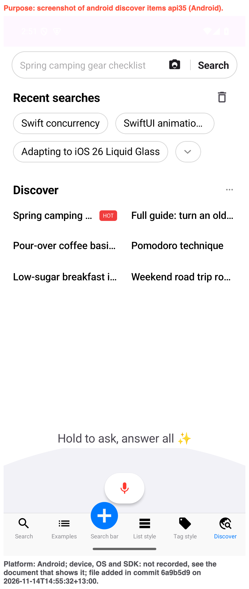 android discover items api35 (Android; device, OS and SDK as in the file name, not otherwise recorded); commit 6a9b5d9, 2026-11-14 14:55 +13:00.
- 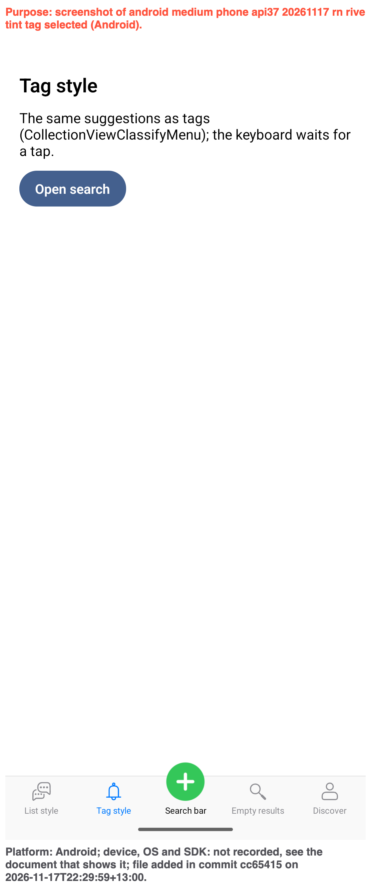 android medium phone api37 20261117 rn rive tint tag selected (Android; device, OS and SDK as in the file name, not otherwise recorded); commit cc65415, 2026-11-17 22:29 +13:00.
- 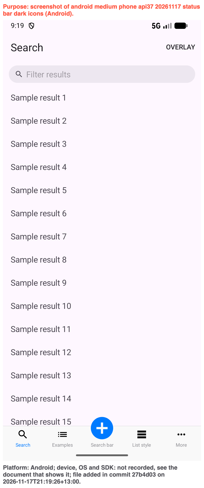 android medium phone api37 20261117 status bar dark icons (Android; device, OS and SDK as in the file name, not otherwise recorded); commit 27b4d03, 2026-11-17 21:19 +13:00.
- 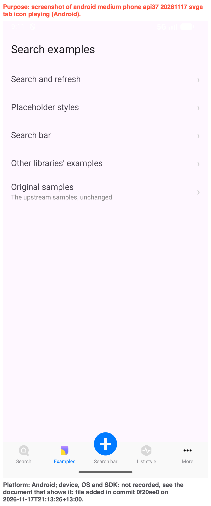 android medium phone api37 20261117 svga tab icon playing (Android; device, OS and SDK as in the file name, not otherwise recorded); commit 0f20ae0, 2026-11-17 21:13 +13:00.
- 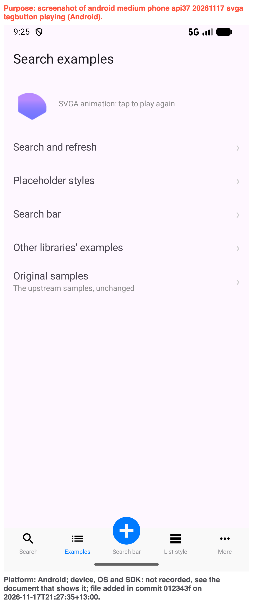 android medium phone api37 20261117 svga tagbutton playing (Android; device, OS and SDK as in the file name, not otherwise recorded); commit 012343f, 2026-11-17 21:27 +13:00.
- 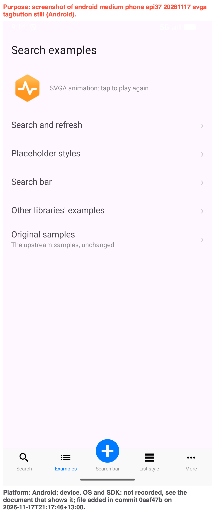 android medium phone api37 20261117 svga tagbutton still (Android; device, OS and SDK as in the file name, not otherwise recorded); commit 0aaf47b, 2026-11-17 21:17 +13:00.
- 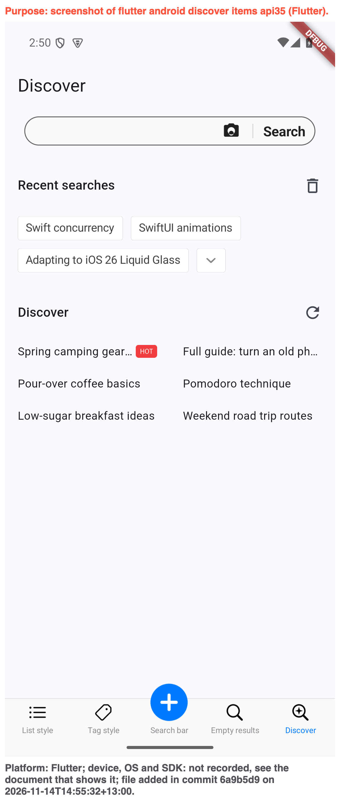 flutter android discover items api35 (Flutter on Android; device, OS and SDK as in the file name, not otherwise recorded); commit 6a9b5d9, 2026-11-14 14:55 +13:00.
- 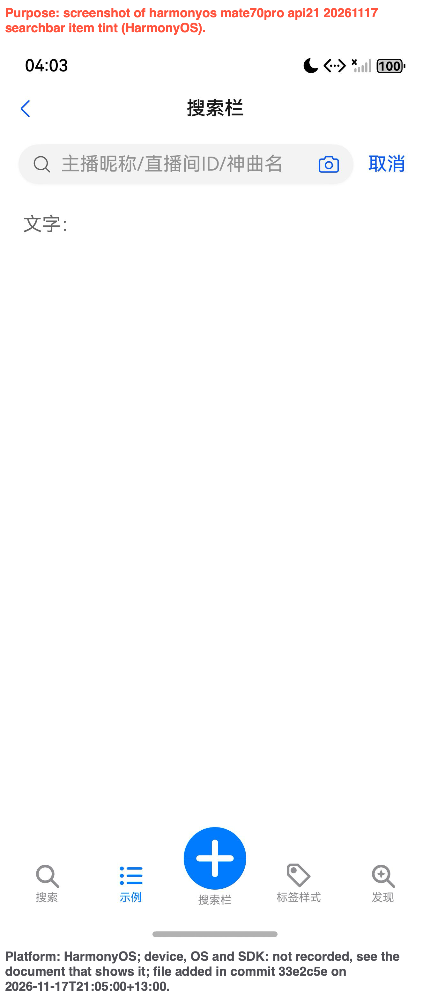 harmonyos mate70pro api21 20261117 searchbar item tint (HarmonyOS; device, OS and SDK as in the file name, not otherwise recorded); commit aa40cef, 2026-11-23 11:24 +13:00.
- 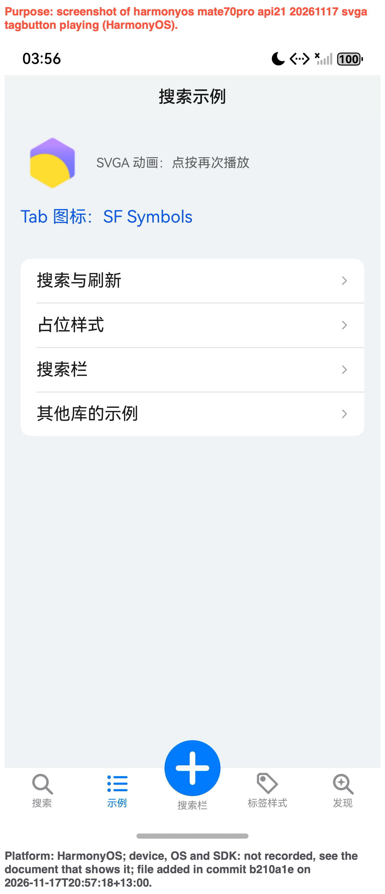 harmonyos mate70pro api21 20261117 svga tagbutton playing (HarmonyOS; device, OS and SDK as in the file name, not otherwise recorded); commit aa40cef, 2026-11-23 11:24 +13:00.
- 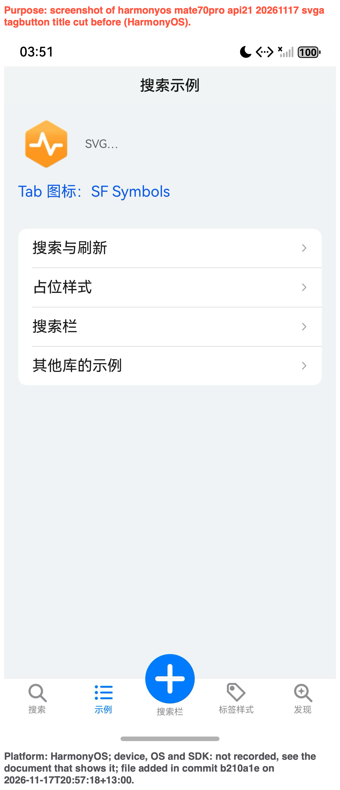 harmonyos mate70pro api21 20261117 svga tagbutton title cut before (HarmonyOS; device, OS and SDK as in the file name, not otherwise recorded); commit aa40cef, 2026-11-23 11:24 +13:00.
-  miniprogram devtools 20261117 svga tagbutton no icon (WeChat mini program (DevTools); device, OS and SDK as in the file name, not otherwise recorded); commit aa40cef, 2026-11-23 11:24 +13:00.
- 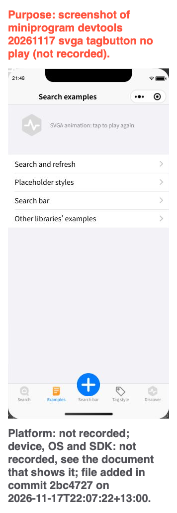 miniprogram devtools 20261117 svga tagbutton no play (WeChat mini program (DevTools); device, OS and SDK as in the file name, not otherwise recorded); commit aa40cef, 2026-11-23 11:24 +13:00.
- 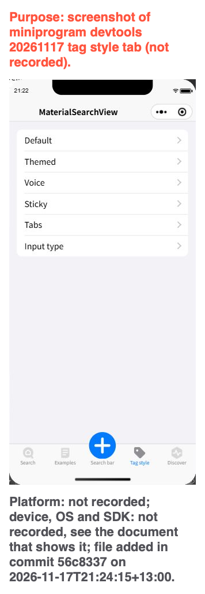 miniprogram devtools 20261117 tag style tab (WeChat mini program (DevTools); device, OS and SDK as in the file name, not otherwise recorded); commit aa40cef, 2026-11-23 11:24 +13:00.
- 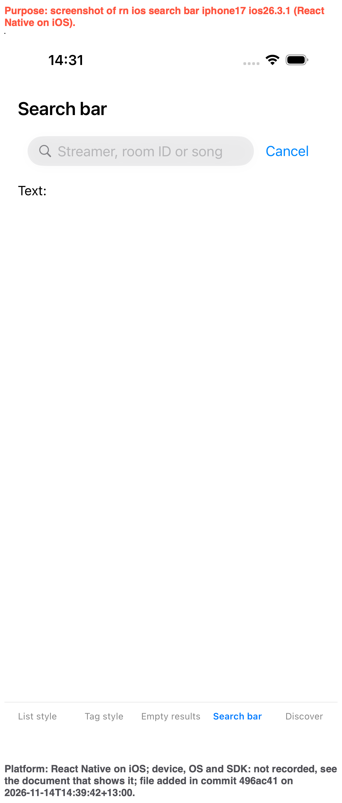 rn ios search bar iphone17 ios26.3.1 (React Native on iOS; device, OS and SDK as in the file name, not otherwise recorded); commit 496ac41, 2026-11-14 14:39 +13:00.
