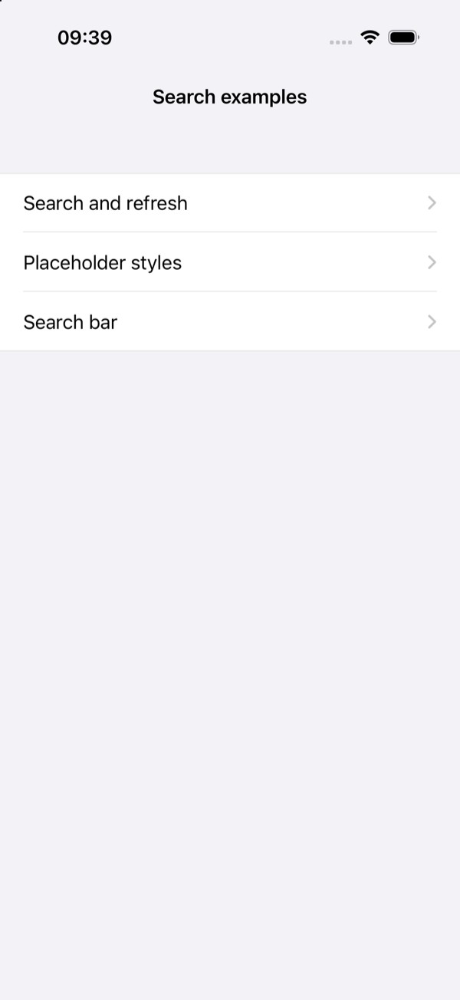
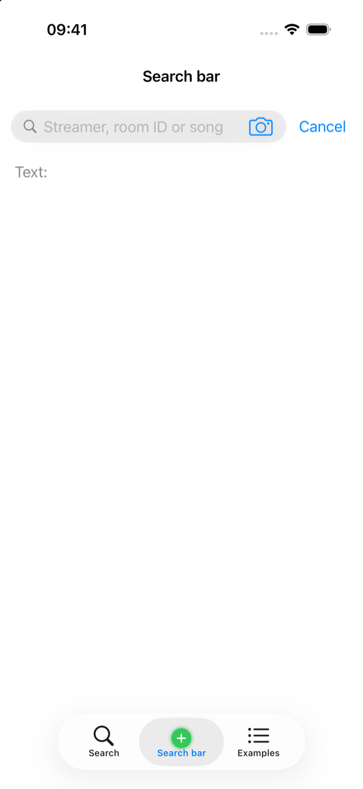
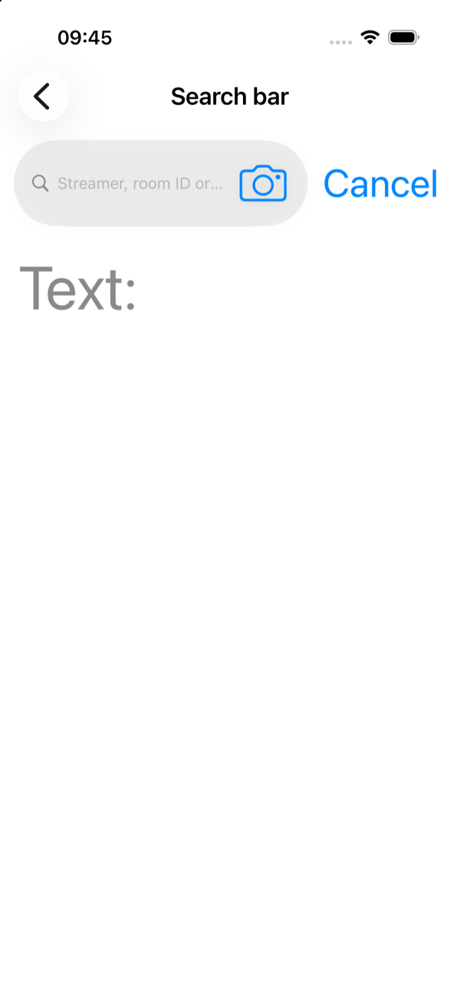
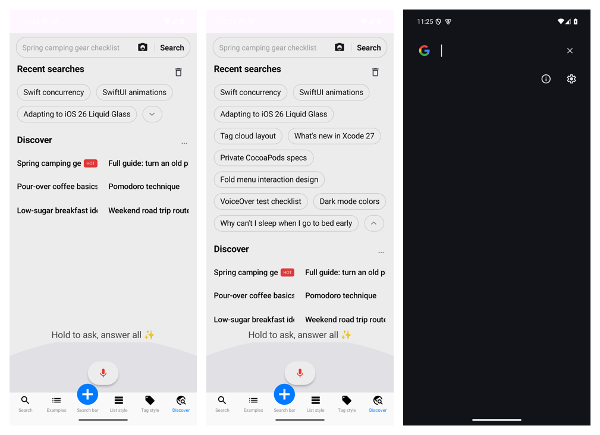
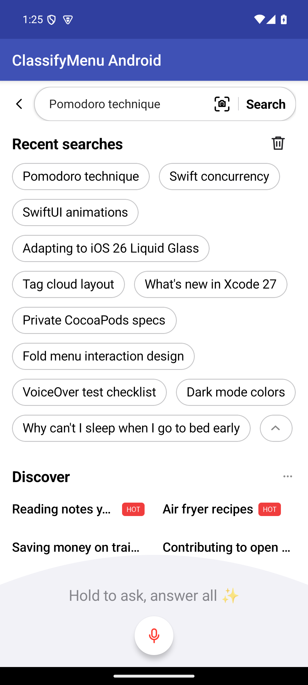
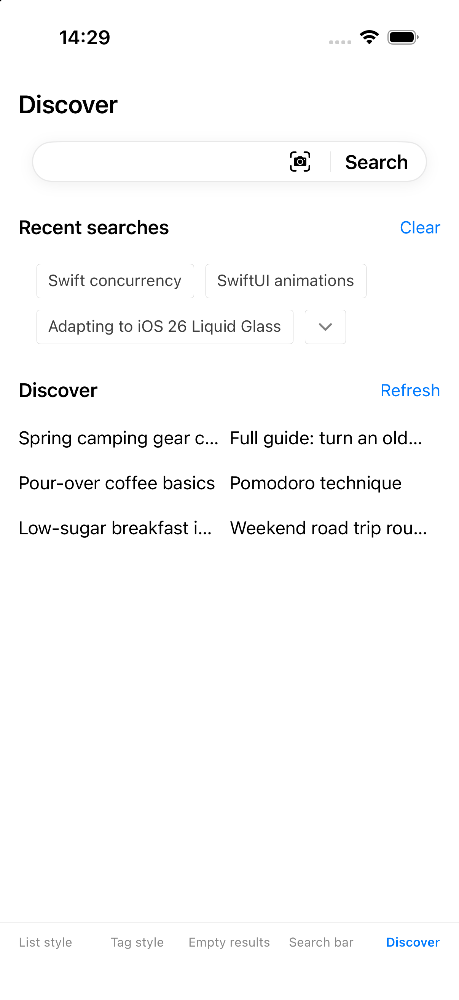

# CYLSearchBarView

## Summary

`CYLSearchBarView` is a configurable search bar for hosts that need more than
`UISearchBar`: a rounded field with a magnifier, text and clear button, host
views inside the field after the text (a camera, a "Search" button), a view
before the field (a back button), and an optional localized Cancel button.
CollectionViewClassifyMenu's examples use it for every search box.

## Completed

- Public API: text, placeholder, font, colors; field height, insets, corner
  radius (negative is a capsule), border, shadow and magnifier; trailing
  accessory views, a leading view, the Cancel button and its title.
- `CYLSearchBarViewDelegate`: begin and end editing, text changes, the Search
  key and Cancel.
- `search.cancel` in English, Simplified and Traditional Chinese and Japanese.
- `testSearchBarViewLayoutStyleAndEvents`: layout, style and events.
- Accessibility: the field is read as "Search" (`search.field`, four
  languages) even after the placeholder disappears; the magnifier is
  decorative; the default font follows Dynamic Type (hosts pass a
  `UIFontMetrics` font for a custom one); the field grows
  past `fieldHeight` when the scaled text needs it, and the bar remeasures when
  the text size changes. `testSearchBarViewSupportsVoiceOverAndDynamicType`.
- Large text: at the largest sizes the text keeps at least 40% of the bar.
  The Cancel title is drawn smaller (down to half size, at most 30% of the
  bar) and trailing accessory views are scaled as a whole (down to a quarter)
  before the text field shrinks. VoiceOver and the large content viewer
  (long press at accessibility sizes) still read the whole Cancel title.
- Placeholder at large sizes (2026-11-12): UITextField's own placeholder shrank
  to a quarter of the font size (53 pt text, 14 pt placeholder) when it did not
  fit. The bar now draws it in `placeholderLabel` at the text's font size, cut
  off with an ellipsis; the text field keeps the placeholder in a clear color
  for VoiceOver.
- Demo row: "Search bar" (`demo.searchBar`, four languages) in
  `CYLSearchDemoMenuViewController` shows the bar with a camera accessory and
  Cancel, and prints the text and the Search key below it. Launch with
  `-CYLDemoRow 2` to open it directly (used for the screenshots).
- Public header comments are three-line `/*!` blocks
  (`scripts/check-public-api-comments.sh` passes).
- Tests: `testSearchBarDemoRow` (row, localized title in four languages,
  events, camera label) and the large-text case in
  `testSearchBarViewSupportsVoiceOverAndDynamicType`. All 15 example tests
  pass (Xcode 27.2, iPhone 17 Pro simulator, iOS 26.1).

## Screenshots

iPhone 17 Pro simulator, 2026-11-12, top to bottom: the demo menu, the bar in
English, in Simplified Chinese, and in English at the largest accessibility
text size.

## Verification

- Status: 100/100 for the scope above: the bar is shown, localized and
  tested in this repository's example and in CollectionViewClassifyMenu's.
- Constraints: the bar does not manage a results controller; hosts connect
  `searchBarView:textDidChange:` to `CYLSearchResultsViewController` or their
  own list. It is unreleased, so the API has no compatibility promise yet.
- Checked on the simulator by launching the app at the default and the
  largest text size. VoiceOver labels are checked in unit tests; no session
  with VoiceOver running on a device has been recorded.

## TODO (2026-11-12): the results screen's search bar overlaps its view on "iPhone Duo"

- Found while verifying [tag-view-suggestions.md](tag-view-suggestions.md): `scripts/unit-tests.sh` without a device
  name picked the first available iPhone simulator, "iPhone Duo" (`CC15DBDB-…`, new in this Xcode). There
  `testSearchBarNeverCoversTheViewControllersView` and `testSearchBarsCoverNoView` fail for the Issue #1317 results
  screen: the view starts at y = 112 while the navigation bar with the stacked search bar ends at 121.5 (search bar
  frame `{{0, 68}, {402, 54}}`, view `{{0, 112}, {402, 762}}`), with `hidesSearchBarWhenScrolling` both NO and YES.
  The same 19 tests pass on iPhone 17 (iOS 26.3).
- Not yet known: whether this is the device's layout (a different navigation bar height) or a timing difference in
  the test; the screen's code did not change.
- Requirement (AGENTS.md, "Search bar placement"): a search bar never covers a view, on every device.
- Also: `scripts/unit-tests.sh` should prefer a fixed device (as CI does) so local runs are comparable.
- Status: `TODO`.

## TODO (2026-11-13): Mimicking the tab bar's FlatDesign item-appending API: refactoring how search bar elements are arranged

- Context: the Flutter Discover page's search bar (first screenshot, left two pictures) lacks what the Android reference
  has (second screenshot): the field's border and the spacing between its elements (the camera icon, the divider and
  the Search button sit inside one bordered capsule in the reference; they are loose in the Flutter page). Today
  `CYLSearchBarView` offers fixed buttons (`navigationButton`, `voiceButton`, `submitButton`, `iconButton`,
  `cancelButton`) and `trailingAccessoryViews` (any views after the field), and each example assembles the camera,
  divider and Search button itself, so they look different on each platform.

  

  

- Requirements:
  1. Fix it in the core first: a fixed style as an enum value; the field on the left is the permanent component; the
     icon, the divider and the camera and Search buttons on the right are items appended to the bar.
  2. Design it after CYLTabBarController's API, especially how the FlatDesign tab bar appends tab bar items
     (`CYLFlatDesignTabBar`, `CYLFlatDesignTabBarItem`, `CYLFlatDesignTabBarButton`): every element is its own view
     component; the app only appends items; each item exposes parameters (icon, action and other events) to the
     examples.
  3. A table: left, the FlatDesign tab bar item API; right, the search bar item API, `TODO` by default. Look for
     existing classes before adding new ones. Each matched API replaces its row's `TODO`; no `TODO` left is 100. Score
     after each new API, until 100.
  4. The core does the work; the examples call it to prove the API extends; when an example needs more, extend the
     core. Every platform, core and examples.
- Prompt (verbatim): "导航栏里面的几个元素的组合样式，有问题。边框，元素间距，明显缺失，请对比两者区别。优先使用core层面代码修改，封装为固定样式的枚举值，左侧输入框，作为永久保留组件，右侧icon 加分隔符加 拍照与搜索按钮，作为新的 item追加。按照cyltabbarcontroller 的api 设计。尤其是扁平样式的tabbar 如何追加tabbaritem 。封装每个元素为一个视图组件。 只需要追加item即可。 同时暴露参数 比如包含 icon action等事件给example层调用。写入合适文档，章节标题为模仿tababr 扁平风格item追加api风格，重构 search bar 元素排列组合方式。将search bar内所有元素看作是独立元素类比tababr 扁平风格item。并制作表格。左侧为tababr 扁平风格item的API，右侧为search bar item 封装api，默认填 TODO ，你可能需要新建类或者优先先查看有没有现存就有的。每匹配一个api，就更新该api到第二列为对应行 移除TODO。这个表格没有TODO 可以看作满分。新建api后总是打分，循环往复一直到满分。 该操作重点适用于core核心层面的代码。example 层负责调用以验证该api扩展性。example层实现中 如有必要更新core用来适配，扩展api。该规则适用于所有平台 core层面 和 example 层面。"
- Prompt (English): "The combined style of the elements in the navigation bar is wrong: the border and the spacing
  between elements are clearly missing; compare the two. Fix it in the core first, wrapped as fixed-style enum values:
  the input field on the left is a permanent component; on the right, the icon, a divider, and the camera and search
  buttons are appended as new items. Follow CYLTabBarController's API design, especially how the FlatDesign tab bar
  appends tab bar items. Wrap each element as a view component; only appending items is needed. Expose parameters,
  such as the icon and action events, to the example layer. Write it into a suitable document with the section title
  'Mimicking the tab bar's FlatDesign item-appending API: refactoring how search bar elements are arranged'. Treat
  every element in the search bar as an independent element, like a FlatDesign tab bar item, and make a table: left,
  the FlatDesign tab bar item API; right, the search bar item API, TODO by default. You may need new classes, but look
  for existing ones first. For each matched API, put it in the second column of its row and remove the TODO. No TODO
  in the table is a full score. Score after every new API, and repeat until 100. This applies mainly to the core; the
  examples call it to verify that the API extends; if an example needs it, update the core to adapt and extend the
  API. The rule applies to every platform, core and examples."
- Score: 0 / 58 rows matched, score 0/100.
- Score (2026-11-14): 58 / 58 rows, no `TODO`: 53 rows matched by an API, 5 rows `N/A` with the reason in the cell
  (`respectsVerticalStatusBarSafeArea`, `context`, `-hasPlusChildViewController`, `layoutCentered`, `lottieURL`);
  score 100/100 for the iOS and Android cores. iOS↔Android API alignment (`android/merged/scripts/api-alignment.py`):
  394 rows, 100/100.

| FlatDesign tab bar item API | What it does | Search bar item API (iOS names; Android below) |
| :--- | :--- | :--- |
| **protocol `CYLFlatDesignTabBarDelegate`** | the bar reports item events | **protocol `CYLSearchBarViewDelegate`** (existing) |
| `-tabBar:didSelectItem:` | an item was tapped | `-searchBarView:didSelectItem:` |
| **class `CYLFlatDesignTabBar`** | the bar that lays its items out | **class `CYLSearchBarView`** (existing) |
| `delegate` | receives item events | `delegate` (existing) |
| `items` | the items, in order | `items` |
| `tabBarItems` | the item views | `itemViews` |
| `-addItemWithTitle:tabBarItemImage:tabBarItemSelectedImage:index:` | appends (or inserts at `index`) an item | `-addItemWithStyle:title:image:index:handler:`, `-addItem:`, `-insertItem:atIndex:`, `-removeItem:`, `-removeAllItems` |
| `selectedItem` | the selected item | `selectedItem` (an `isSelectable` item that is on) |
| `selectedIndex` | its index | `selectedIndex` |
| `tabBarButtons` | the item views, read only | `itemViews` (read only) |
| `standardAppearance` | the bar appearance | `searchBarStyle` (enum `CYLSearchBarStyle`: `.plain`, `.bordered`) |
| `tintColor` | the tint of every item | `itemTintColor` |
| `barTintColor` | the bar background color | `fieldBackgroundColor` (existing) |
| `backgroundImage` | the bar background image | `fieldBackgroundImage` |
| `shadowImage` | the bar border (shadow) image | `fieldBorderColor`, `fieldBorderWidth`, `fieldShadowOpacity` (existing) |
| `useLayoutSafeAreaInsets` | lay out inside the safe area | `contentInsets` (existing) |
| `respectsVerticalStatusBarSafeArea` | the vertical safe area | N/A: the host places the bar (title view, header); the bar has no status bar of its own |
| `context` | separates several bars | N/A: one bar per view; items keep `itemAccessibilityIdentifier` to tell them apart |
| `-hasPlusButton` | a special item exists | `-hasItemOfStyle:` |
| `-hasPlusChildViewController` | the special item has a page | N/A: items open no pages; `handler` decides what a tap does |
| **class `CYLFlatDesignTabBarItem`** | one item: model, independent of its view | **class `CYLSearchBarItem`** |
| `-initWithTitle:image:` | an item with a title and an icon | `-initWithTitle:image:`; `+iconItemWithImage:title:handler:`, `+textItemWithTitle:handler:`, `+dividerItem` |
| `-initWithTitle:image:selectedImage:` | plus a selected icon | `-initWithTitle:image:selectedImage:` |
| `-initWithTitle:image:selectedImage:index:` | plus its position | `-initWithStyle:title:image:` (the index is given to `-insertItem:atIndex:`) |
| `tabBarButton` | the item's view | `itemView` |
| `enabled` | enabled or not | `isEnabled` |
| `index` | position in the bar | `index` (`NSNotFound` outside a bar) |
| `title` | text | `title` |
| `image` | icon | `image` |
| `selectedImage` | selected icon | `selectedImage` |
| `childViewController` | what the item opens | `handler` |
| `badgeValue` | badge text | `badgeValue` (empty string: a dot) |
| `badgeColor` | badge color | `badgeColor` |
| `cylflatdesign_tabBarController` | the owning controller | `searchBarView` (weak) |
| `titlePositionAdjustment` | title offset | `titlePositionAdjustment` |
| `standardAppearance` (item) | item appearance | `style` (enum `CYLSearchBarItemStyle`: `.icon`, `.divider`, `.text`) |
| `-setTitleTextAttributes:forState:` | title attributes per state | `-setTitleTextAttributes:forState:` |
| `-titleTextAttributesForState:` | reads them | `-titleTextAttributesForState:` |
| `-setBadgeTextAttributes:forState:` | badge text attributes per state | `-setBadgeTextAttributes:forState:` |
| `-badgeTextAttributesForState:` | reads them | `-badgeTextAttributesForState:` |
| `badgeSize` | badge size | `badgeSize` |
| `badgeContentInset` | badge padding | `badgeContentInsets` |
| `badgePositionAdjustment` | badge offset | `badgePositionAdjustment` |
| `imagePositionAdjustment` | icon offset | `imagePositionAdjustment` |
| `layoutCentered` | centered layout | N/A: an item is centered in its own frame; the bar lays items out after the text |
| `backgroundColor` | item background | `backgroundColor` |
| `selectedBackgroundColor` | selected item background | `selectedBackgroundColor` |
| `imageInsets` | icon insets | `contentInsets` |
| `lottieURL` | animated icon URL | N/A: the core loads no network resources; pass the frames as `animatedImage` |
| `lottieFilePath` | animated icon file | `animatedImage` |
| `lottieSizeValue` | animated icon size | `imageSize` |
| `-actualBadgeSuperView` | where the badge is drawn | `-actualBadgeSuperView` |
| **class `CYLFlatDesignTabBarButton`** | the item's view (a control) | **class `CYLSearchBarItemView`** (a `UIControl`) |
| `-initWithTabBarItem:` | the view for an item | `-initWithItem:` |
| `tabBarItem` | its item | `item` |
| `imageView` | its icon view | `imageView` |
| `titleLabel` | its title label | `titleLabel` |
| `-actualBadgeSuperView` (button) | where the badge is drawn | `-actualBadgeSuperView` |

- Android (`cylsearch`, `CYLSearchBarItem.kt`): the same names, with these Kotlin forms: enum cases in PascalCase
  (`CYLSearchBarItemStyle.Icon`, `.Divider`, `.Text`; `CYLSearchBarStyle.Plain`, `.Bordered`); text attributes are
  `CYLSearchBarItemTextAttributes(color, sizeSp, typeface)` per `CYLSearchBarItemState` (`Normal`, `Selected`,
  `Disabled`); sizes in dp (`imageSize: SizeF?`, `badgeSize`), insets and offsets as `FloatArray`s; `index` and
  `selectedIndex` are -1 when absent; the view is `itemView(context)` (created on first use) and `itemView` once
  created; `delegate.searchBarViewDidSelectItem(bar, item)`.
- Usage (both platforms): `bar.searchBarStyle = .bordered`, then `addItem(iconItem(camera))`, `addItem(divider())`,
  `addItem(textItem("Search"))`. The examples' Discover pages (iOS `CYLSearchDiscoverViewController`, Android
  `CYLSearchDiscoverFragment`) now build their camera, divider and Search button this way instead of hand-made views
  in `trailingAccessoryViews`.
- Tests: iOS `testSearchBarItemsAreAppendedLikeFlatDesignTabBarItems`, Android `CYLSearchBarItemTest` (order,
  index, layout after the text and inside the field, 36 pt/dp camera, divider hidden from VoiceOver/TalkBack, delegate
  then handler, disabled and selectable items, badge, text attributes, tint, bordered style, removal).
- Cross-platform (2026-11-14): the core builds an item from plain values for the wrappers (iOS
  `+[CYLSearchBarItem itemWithDictionary:]`, Android `CYLSearchBarItem.fromMap(context, map)`: `style`, `title`,
  `image` (`camera`, `mic`, `search`, `back` drawn by the core, else an app image), `accessibilityIdentifier`,
  `isEnabled`, `isSelectable`, `isSelected`, `badgeValue`); the Android core gained `cyl_search_ic_camera`.
  - Flutter (`flutter_cylsearch`): `CYLSearchBarView(searchBarStyle:, showsSearchIcon:, items:, onItemSelected:)` with
    `CYLSearchBarItem.icon(...)`, `.text(...)`, `.divider()` and `onTap`; the native views rebuild items only when
    Dart sends other ones and report taps as `didSelectItem` (index, selected). The example's Discover page now puts
    the camera, divider and Search inside the bordered bar (the reported bug: they sat loose outside the field). Dart
    tests 8/8, `flutter analyze` clean.
  - React Native (`react-native-cylsearch`): `<CYLSearchBarView searchBarStyle="bordered" showsSearchIcon={false}
    items={[{ style: 'icon', image: 'camera', ... }, { style: 'divider' }, { style: 'text', ... }]} onItemSelect>`;
    the Fabric prop is `itemsJSON` (one string, the same on both platforms), the event `onItemSelect`. The example's
    Discover demo uses it. `tsc` clean.
- Open: running the Flutter and React Native examples on devices and the screenshots of every example (the host's
  load average stays around 900; the simulator and emulator do not answer reliably).
- Verified (2026-11-14, `7d254d6`): iOS tests 26/26 (iPhone 17 simulator, iOS 26.3.1, Xcode beta), Android unit
  tests 16/16 (JDK 17, Robolectric SDK 34), the Android example, the Flutter example APK and the React Native release
  APK build, Flutter Dart tests 8/8, React Native `tsc` clean.
- Screenshot (React Native on iOS, the core items through the Fabric view; originals in `assets/`):

  

- Status: `IN PROGRESS` (2026-11-14): the cores, the wrappers, all Discover examples and their tests done; the React
  Native iOS Discover page shows the items (screenshot above); the native iOS, Android and Flutter examples' screenshots
  open (the host's load average stays around 900).

