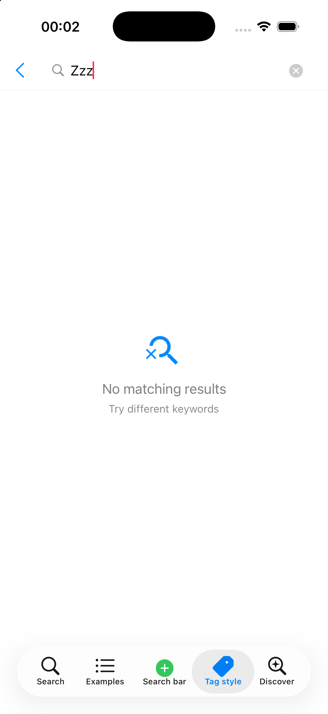
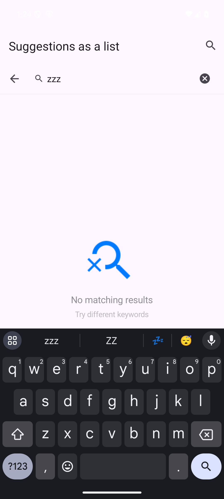

# Sub-repositories

Sibling projects in the same local folder that this library uses. Rules: `AGENTS.md`, "Sub-repositories"; skill
`cyl-sub-repositories`.

| Sub-repository | What it adds | Status |
|:---|:---|:---|
| CollectionViewClassifyMenu | Suggestions as tags (`CYLSearchSuggestionStyle`) | Android done (`eb3590e`); iOS `TODO` ([tag-view-suggestions.md](tag-view-suggestions.md)) |
| CYLTableViewPlaceHolder | The empty-content placeholder when a search has no results | iOS and Android done; other platforms `TODO` (below) |

## TODO (2026-11-12): CYLTableViewPlaceHolder as a sub-repository, empty search results on every platform

- Context:
  - The requirements for CollectionViewClassifyMenu as a sub-repository ([tag-view-suggestions.md](tag-view-suggestions.md))
    are written into `AGENTS.md`, `instructions.md` and the skills as general sub-repository rules (2026-11-12),
    with this requirement appended.
  - iOS today: the example already shows an empty state through CYLTableViewPlaceHolder
    (`CYLSearchExampleViewController`: `cyl_reloadData`, `makePlaceHolderView` returning a
    `CYLSearchPlaceholderView`), but the Podfile uses `pod 'CYLTableViewPlaceHolder', :path =>
    '../CYLTableViewPlaceHolder'`, a local path the rule forbids in a commit, and the core does not offer the empty
    state as an option.
  - Android today: `android/merged` shows `CYLSearchPlaceholderView` itself in the search example; CYLTableViewPlaceHolder
    has no Android library yet (its `docs/Android-Port.md` is a TODO), so the Android part waits for it or adds it
    there first (the rule: add the missing interface in the sub-repository, push, then pin).
  - Newest CYLTableViewPlaceHolder commit on any branch when this was logged: `47a4ed7` (branch `ci-screenshots`).
  - React Native, Flutter, HarmonyOS and mini programs: no version of this library yet (the cross-platform TODO in
    [android-and-cross-platform.md](android-and-cross-platform.md)); each gets this requirement when it is built.
- Requirements:
  1. Integrate CYLTableViewPlaceHolder as a sub-repository under every CollectionViewClassifyMenu requirement:
     iOS through its root podspec as a sub-dependency at the newest commit (no local path in a commit), other
     platforms by commit; the feature in the core through an enum or a parameter; missing interfaces added in
     CYLTableViewPlaceHolder, pushed, then pinned here; the example shows it and passes only data, styles and taps.
  2. When a search has no results (the content is empty), show CYLTableViewPlaceHolder's empty-content placeholder
     style.
  3. The same on every platform: iOS, Android, React Native, Flutter, HarmonyOS, mini programs.
  4. Screenshots per platform, labeled per AGENTS.md; mark this TODO done.
- Prompt (verbatim): "在instructions 相关文件，以及skills相关文件中找到 对CollectionViewClassifyMenu 作为子仓库的相关描述，全英文在后面追加以下内容，按照CollectionViewClassifyMenu 作为子仓库 的所有要求，集成CYLTableViewPlaceHolder 作为子仓库。对  CYLTableViewPlaceHolder 的要求是 搜索内容为空时展示 内容为空的 CYLTableViewPlaceHolder  样式。该要求同样适用于 所有平台包括iOS Android react native flutter 鸿蒙 小程序。 标注TODO continue"
- Prompt (English): "In the instruction files and the skill files, find the description of CollectionViewClassifyMenu as
  a sub-repository and append, in English: following all the requirements for CollectionViewClassifyMenu as a
  sub-repository, integrate CYLTableViewPlaceHolder as a sub-repository. The requirement for CYLTableViewPlaceHolder:
  when the search content is empty, show CYLTableViewPlaceHolder's empty-content style. This also applies to every
  platform: iOS, Android, React Native, Flutter, HarmonyOS and mini programs. Mark it TODO. Continue."
- Progress:
  - Rules written (2026-11-12): no instruction or skill file described CollectionViewClassifyMenu as a sub-repository
    yet (only this repository's docs did), so a "Sub-repositories" section now states the CollectionViewClassifyMenu
    requirements and appends the CYLTableViewPlaceHolder requirement: `AGENTS.md`, `instructions.md`, the new
    `cyl-sub-repositories` skill, and pointers in `cyl-xcode-compat`, `cyl-api-map` and `cyl-new-project`.
  - Found while editing the skills: commits `1416a3e` and `2db1bd6` had replaced the contents of all seven `cyl-*`
    skills with the section they meant to append (cyl-docs and cyl-verify lost about 90 and 120 lines, the others
    their whole body). Restored from their last intact versions (`db9991a`, `1416a3e`) with those sections appended.
  - Order: after the open tasks logged before it (the iOS tag-view TODO, the raised plus button rule, the
    HarmonyOS / Flutter / React Native TODO).
- Progress, iOS: DONE (2026-11-13, [`5bb0b58`](https://github.com/ChenYilong/CYLSearchViewController/commit/5bb0b58)).
  - Dependency: `s.dependency 'CYLTableViewPlaceHolder/Core'` in the podspec; the Podfile pins its newest commit
    `a049422` (branch `feat/smartrefresh-parity`) by `:git` + `:commit`, no local path. `scripts/pod-lint.sh` checks
    it out with CollectionViewClassifyMenu; `pod lib lint` passes.
  - Core option: `CYLSearchView.showsEmptyResultsPlaceholder` (off by default, so existing apps keep their behavior)
    and `emptyResultsScenario` (`CYLPlaceholderScenarioNoSearchResults` by default: icon, "No matching results", "Try
    different keywords"; `CYLPlaceholderScenarioNoContent` gives the plain empty state). While a non-empty query
    matches no suggestion, CYLTableViewPlaceHolder's `CYLPlaceholderStackView` for that scenario shows under the
    search bar (`emptyResultsView`), in the list and the tag style; a match, an empty query or a submitted query hides
    it. Choice recorded: "内容为空的样式" was read as the library's empty search results scenario; the scenario is a
    parameter, so the plain "no content" state is one line away.
  - The results screen (`CYLSearchExampleViewController`, Issue #1317) already shows its empty state through
    CYLTableViewPlaceHolder (`cyl_reloadData`); it now comes from the pinned commit instead of the local path.
  - Example: the MaterialSearchView samples (the list ports and the Tag style tab) turn it on.
  - Test: `testEmptyResultsShowTheCYLTableViewPlaceHolderPlaceholder` (off by default; shown for no match in both
    styles; hidden for a match and an empty query; the scenario parameter). 20/20 pass on iPhone 17.
  - Screenshot (original): the Tag style tab's Default sample, "zzz" typed.

    

    | Field | Value |
    |:---|:---|
    | Platform | iOS |
    | Host | macOS 27.3 (26C5035r), Xcode 27.2 (27B5028f) |
    | Simulator | iPhone 17, iOS 26.3 |
    | SDK | iOS SDK 27.2, deployment target iOS 15.0 |
    | Repository | [`5bb0b58`](https://github.com/ChenYilong/CYLSearchViewController/commit/5bb0b58) on `feat/swift-core`; CYLTableViewPlaceHolder `a049422` |
    | Taken | 2026-11-13 00:02 NZDT |
- Progress, Android: DONE (2026-11-13, [`062a1a3`](https://github.com/ChenYilong/CYLSearchViewController/commit/062a1a3)).
  - CYLTableViewPlaceHolder had no Android code, so its first Android module was added there (sub-repository rule):
    `android/placeholder` (Kotlin, `com.cyl.placeholder`) with `CYLPlaceholderScenario` and
    `CYLPlaceholderStackView(context, scenario, actions)` for the empty category (NoContent, NoSearchResults,
    EmptyCart, NoOrders, NoFavorites, NoMessages, NoNotifications), images and strings imported from its iOS bundle
    in seven languages, 4 tests;
    [ChenYilong/CYLTableViewPlaceHolder#27](https://github.com/ChenYilong/CYLTableViewPlaceHolder/pull/27), commit
    `8e23581`. Animations and the other categories stay `TODO` in its `docs/Android-Port.md`.
  - Pinned here (`cyl.placeholder.commit`), built from source like the other sub-repositories.
  - `CYLSearchView.showsEmptyResultsPlaceholder` / `emptyResultsScenario` / `emptyResultsView` in Kotlin, the same
    behavior as iOS; the MaterialSearchView samples and the List / Tag style tabs turn it on.
  - Tests: 10/10 `cylsearch` (new empty-results test); the API table now has 302 rows, score 100.
  - Screenshots (originals), top to bottom: List style tab and Tag style tab, "zzz" typed.

    

    

    | Field | Value |
    |:---|:---|
    | Platform | Android (Kotlin, `android/merged`) |
    | Host | macOS 27.3 (26C5035r), JDK 17.0.21, Gradle 9.3.1, AGP 8.7.3, Kotlin 2.0.21 |
    | Emulator | `CYL_API35_arm64`, Android 15 (API 35), arm64-v8a |
    | SDK | compileSdk / targetSdk 35, minSdk 23 |
    | Repository | [`062a1a3`](https://github.com/ChenYilong/CYLSearchViewController/commit/062a1a3); CYLTableViewPlaceHolder `8e23581` |
    | Taken | 2026-11-13 00:4x NZDT |
- Next: React Native, Flutter, HarmonyOS and mini programs, when those versions of this library exist (the
  cross-platform TODO in [android-and-cross-platform.md](android-and-cross-platform.md)).
- Flutter and React Native: DONE (2026-11-13 and 2026-11-14). Both wrap the native cores, so they get the same
  placeholder: `showsEmptyResultsPlaceholder` and `emptyResultsScenario` on Flutter's `CYLSearchView` widget and on
  React Native's `CYLSearchView`; each example has an Empty results demo. Pin: CYLTableViewPlaceHolder `bdd78c7` on
  every platform.
- Status: `TODO` (iOS, Android, Flutter and React Native done; HarmonyOS and mini programs open: no version of this
  library exists on them yet, see [android-and-cross-platform.md](android-and-cross-platform.md)).
