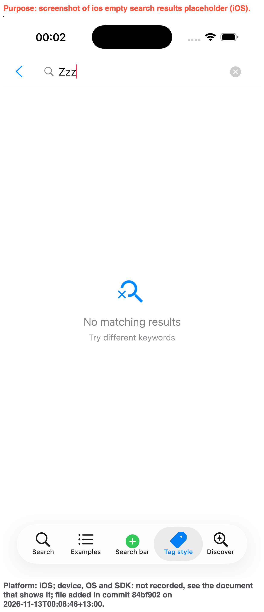

# Sub-repositories

Sibling projects in the same local folder that this library uses. Rules: `AGENTS.md`, "Sub-repositories"; skill
`cyl-sub-repositories`.

| Sub-repository | What it adds | Status |
|:---|:---|:---|
| CollectionViewClassifyMenu | Suggestions as tags (`CYLSearchSuggestionStyle`); `CYLTagButton`, which draws every search bar item and the example's SVGA demo | Tags: Android done (`eb3590e`); iOS `TODO` ([tag-view-suggestions.md](tag-view-suggestions.md)). `CYLTagButton`: every platform, pinned at `71562ca` on HarmonyOS (`harmonyos/oh-package.json5` `collectionViewClassifyMenuCommit`, `harmonyos/vendor/classifymenu`, with CYLTabBarController's `cylanimateditem` in `harmonyos/vendor/cylanimateditem`) and the mini program (`package.json` `collectionViewClassifyMenuCommit`) ([animated-icon-component.md](animated-icon-component.md)) |
| CYLTableViewPlaceHolder | The placeholder sub-dependency: the empty-content placeholder (`CYLPlaceholderView` scenarios shown by `CYLSearchView`) when a search has no results, and the pull-to-refresh header inside `CYLSearchView`'s refresh API; pinned at `62e40c0` (its newest commit, on `CYLAnimatedItem`) on every platform | Done on iOS, Android, HarmonyOS, the mini program, React Native and Flutter ([search-core-merge.md](search-core-merge.md)) |

## DONE (2026-11-16; TODO 2026-11-12): CYLTableViewPlaceHolder as a sub-repository, empty search results on every platform (iOS, Android, Flutter, React Native, mini programs; HarmonyOS through `cylplaceholder`, run on the Mate 70 Pro emulator: the empty placeholder in `harmonyos-search-empty-cache-emulator-unsigned.jpeg`, touches checked 2026-11-16)

- Context:
  - The requirements for CollectionViewClassifyMenu as a sub-repository ([tag-view-suggestions.md](tag-view-suggestions.md))
    are written into `AGENTS.md`, `instructions.md` and the skills as general sub-repository rules (2026-11-12),
    with this requirement appended.
  - iOS today: the example already shows an empty state through CYLTableViewPlaceHolder
    (`CYLSearchExampleViewController`: `cyl_reloadData`, `makePlaceHolderView` returning a
    `CYLSearchPlaceholderView`), but the Podfile uses `pod 'CYLTableViewPlaceHolder', :path =>
    '../CYLTableViewPlaceHolder'`, a local path the rule forbids in a commit, and the core does not offer the empty
    state as an option.
  - Android today: `android/merged` shows `CYLSearchPlaceholderView` itself in the search example; CYLTableViewPlaceHolder
    has no Android library yet (its `docs/Android-Port.md` is a TODO), so the Android part waits for it or adds it
    there first (the rule: add the missing interface in the sub-repository, push, then pin).
  - Newest CYLTableViewPlaceHolder commit on any branch when this was logged: `47a4ed7` (branch `ci-screenshots`).
  - React Native, Flutter, HarmonyOS and mini programs: no version of this library yet (the cross-platform TODO in
    [android-and-cross-platform.md](android-and-cross-platform.md)); each gets this requirement when it is built.
- Requirements:
  1. Integrate CYLTableViewPlaceHolder as a sub-repository under every CollectionViewClassifyMenu requirement:
     iOS through its root podspec as a sub-dependency at the newest commit (no local path in a commit), other
     platforms by commit; the feature in the core through an enum or a parameter; missing interfaces added in
     CYLTableViewPlaceHolder, pushed, then pinned here; the example shows it and passes only data, styles and taps.
  2. When a search has no results (the content is empty), show CYLTableViewPlaceHolder's empty-content placeholder
     style.
  3. The same on every platform: iOS, Android, React Native, Flutter, HarmonyOS, mini programs.
  4. Screenshots per platform, labeled per AGENTS.md; mark this TODO done.
- Prompt (verbatim): "在instructions 相关文件，以及skills相关文件中找到 对CollectionViewClassifyMenu 作为子仓库的相关描述，全英文在后面追加以下内容，按照CollectionViewClassifyMenu 作为子仓库 的所有要求，集成CYLTableViewPlaceHolder 作为子仓库。对  CYLTableViewPlaceHolder 的要求是 搜索内容为空时展示 内容为空的 CYLTableViewPlaceHolder  样式。该要求同样适用于 所有平台包括iOS Android react native flutter 鸿蒙 小程序。 标注TODO continue"
- Prompt (English): "In the instruction files and the skill files, find the description of CollectionViewClassifyMenu as
  a sub-repository and append, in English: following all the requirements for CollectionViewClassifyMenu as a
  sub-repository, integrate CYLTableViewPlaceHolder as a sub-repository. The requirement for CYLTableViewPlaceHolder:
  when the search content is empty, show CYLTableViewPlaceHolder's empty-content style. This also applies to every
  platform: iOS, Android, React Native, Flutter, HarmonyOS and mini programs. Mark it TODO. Continue."
- Progress:
  - Rules written (2026-11-12): no instruction or skill file described CollectionViewClassifyMenu as a sub-repository
    yet (only this repository's docs did), so a "Sub-repositories" section now states the CollectionViewClassifyMenu
    requirements and appends the CYLTableViewPlaceHolder requirement: `AGENTS.md`, `instructions.md`, the new
    `cyl-sub-repositories` skill, and pointers in `cyl-xcode-compat`, `cyl-api-map` and `cyl-new-project`.
  - Found while editing the skills: commits `1416a3e` and `2db1bd6` had replaced the contents of all seven `cyl-*`
    skills with the section they meant to append (cyl-docs and cyl-verify lost about 90 and 120 lines, the others
    their whole body). Restored from their last intact versions (`db9991a`, `1416a3e`) with those sections appended.
  - Order: after the open tasks logged before it (the iOS tag-view TODO, the raised plus button rule, the
    HarmonyOS / Flutter / React Native TODO).
- Progress, iOS: DONE (2026-11-13, [`5bb0b58`](https://github.com/ChenYilong/CYLSearchViewController/commit/5bb0b58)).
  - Dependency: `s.dependency 'CYLTableViewPlaceHolder/Core'` in the podspec; the Podfile pins its newest commit
    `a049422` (branch `feat/smartrefresh-parity`) by `:git` + `:commit`, no local path. `scripts/pod-lint.sh` checks
    it out with CollectionViewClassifyMenu; `pod lib lint` passes.
  - Core option: `CYLSearchView.showsEmptyResultsPlaceholder` (off by default, so existing apps keep their behavior)
    and `emptyResultsScenario` (`CYLPlaceholderScenarioNoSearchResults` by default: icon, "No matching results", "Try
    different keywords"; `CYLPlaceholderScenarioNoContent` gives the plain empty state). While a non-empty query
    matches no suggestion, CYLTableViewPlaceHolder's `CYLPlaceholderStackView` for that scenario shows under the
    search bar (`emptyResultsView`), in the list and the tag style; a match, an empty query or a submitted query hides
    it. Choice recorded: "内容为空的样式" was read as the library's empty search results scenario; the scenario is a
    parameter, so the plain "no content" state is one line away.
  - The results screen (`CYLSearchExampleViewController`, Issue #1317) already shows its empty state through
    CYLTableViewPlaceHolder (`cyl_reloadData`); it now comes from the pinned commit instead of the local path.
  - Example: the MaterialSearchView samples (the list ports and the Tag style tab) turn it on.
  - Test: `testEmptyResultsShowTheCYLTableViewPlaceHolderPlaceholder` (off by default; shown for no match in both
    styles; hidden for a match and an empty query; the scenario parameter). 20/20 pass on iPhone 17.
  - Screenshot (original): the Tag style tab's Default sample, "zzz" typed.

    

    | Field | Value |
    |:---|:---|
    | Platform | iOS |
    | Host | macOS 27.3 (26C5035r), Xcode 27.2 (27B5028f) |
    | Simulator | iPhone 17, iOS 26.3 |
    | SDK | iOS SDK 27.2, deployment target iOS 15.0 |
    | Repository | [`5bb0b58`](https://github.com/ChenYilong/CYLSearchViewController/commit/5bb0b58) on `feat/swift-core`; CYLTableViewPlaceHolder `a049422` |
    | Taken | 2026-11-13 00:02 NZDT |
- Progress, Android: DONE (2026-11-13, [`062a1a3`](https://github.com/ChenYilong/CYLSearchViewController/commit/062a1a3)).
  - CYLTableViewPlaceHolder had no Android code, so its first Android module was added there (sub-repository rule):
    `android/placeholder` (Kotlin, `com.cyl.placeholder`) with `CYLPlaceholderScenario` and
    `CYLPlaceholderStackView(context, scenario, actions)` for the empty category (NoContent, NoSearchResults,
    EmptyCart, NoOrders, NoFavorites, NoMessages, NoNotifications), images and strings imported from its iOS bundle
    in seven languages, 4 tests;
    [ChenYilong/CYLTableViewPlaceHolder#27](https://github.com/ChenYilong/CYLTableViewPlaceHolder/pull/27), commit
    `8e23581`. Animations and the other categories stay `TODO` in its `docs/Android-Port.md`.
  - Pinned here (`cyl.placeholder.commit`), built from source like the other sub-repositories.
  - `CYLSearchView.showsEmptyResultsPlaceholder` / `emptyResultsScenario` / `emptyResultsView` in Kotlin, the same
    behavior as iOS; the MaterialSearchView samples and the List / Tag style tabs turn it on.
  - Tests: 10/10 `cylsearch` (new empty-results test); the API table now has 302 rows, score 100.
  - Screenshots (originals), top to bottom: List style tab and Tag style tab, "zzz" typed.

    

    

    | Field | Value |
    |:---|:---|
    | Platform | Android (Kotlin, `android/merged`) |
    | Host | macOS 27.3 (26C5035r), JDK 17.0.21, Gradle 9.3.1, AGP 8.7.3, Kotlin 2.0.21 |
    | Emulator | `CYL_API35_arm64`, Android 15 (API 35), arm64-v8a |
    | SDK | compileSdk / targetSdk 35, minSdk 23 |
    | Repository | [`062a1a3`](https://github.com/ChenYilong/CYLSearchViewController/commit/062a1a3); CYLTableViewPlaceHolder `8e23581` |
    | Taken | 2026-11-13 00:4x NZDT |
- Next: React Native, Flutter, HarmonyOS and mini programs, when those versions of this library exist (the
  cross-platform TODO in [android-and-cross-platform.md](android-and-cross-platform.md)).
- Flutter and React Native: DONE (2026-11-13 and 2026-11-14). Both wrap the native cores, so they get the same
  placeholder: `showsEmptyResultsPlaceholder` and `emptyResultsScenario` on Flutter's `CYLSearchView` widget and on
  React Native's `CYLSearchView`; each example has an Empty results demo. Pin: CYLTableViewPlaceHolder `bdd78c7` on
  every platform.
- HarmonyOS: the library has `CYLSearchPlaceholderView` with 40 styles as system symbols and the empty-cache and
  empty-results placeholders (`harmonyos/cylsearch`); it does not use CYLTableViewPlaceHolder (no HarmonyOS version of
  it exists). Mini programs: the search page has text placeholders only.
- HarmonyOS (2026-11-16): the example uses both sub-repositories' HarmonyOS libraries, installed into the git-ignored
  `harmonyos/vendor` by `harmonyos/scripts/sync-sub-repositories.py` at the commits in `harmonyos/oh-package.json5`:
  CYLTableViewPlaceHolder `cylplaceholder` at `5bcbdb5` (the newest commit on any branch,
  `feat/android-refresh-port-followup`) for CYLRefreshNormalHeader; CYLTabBarController `cyltabbar` at `ebaed17`
  (`feat/cross-platform-components`, the newest commit on any branch; it contains `ea5b989` and `3ddb96c`, and adds the
  badge centring of its issue #25, 2026-11-16: SVGA tab icons, the badge, icon and
  plus title fixes of `127b8ae8` and `16a19bbf`, the badge border width of PR #805 and the demo translations;
  Scorecard 3 rows 1 to 4, 12 and 13). Before: `94eb7b1`. Their
  minimum is API 21, so the example's `compatibleSdkVersion` is 6.0.1(21).
- Status: `TODO` (iOS, Android, Flutter and React Native done; HarmonyOS uses CYLTableViewPlaceHolder's `cylplaceholder` library
  (above) and compiles, not run yet; mini programs done, see below).
- Progress (2026-11-15): mini programs DONE: the empty results and the empty cache of `cyl-search` play
  CYLTableViewPlaceHolder's `CYLPlaceholderNoResults.json` / `CYLPlaceholderNoDrafts.json` (with their licenses) through
  CYLTabBarController's `cyl-lottie`; screenshot in [miniprogram-api-alignment.md](miniprogram-api-alignment.md).
  Update (2026-11-15, the example as on iOS): CYLTableViewPlaceHolder's mini program package is now the sub-repository
  (`cyl-placeholder-miniprogram`, pinned at `8ee7013` in `package.json`, synced by `scripts/sync-example.js`):
  `cyl-search` has iOS's `emptyResultsScenario` (`NoSearchResults`) and `emptySuggestionsScenario` (`NoContent`), drawn
  by its abstract node `cyl-empty-view`; the example passes `<cyl-placeholder scenario>`, static as iOS
  `CYLPlaceholderStackView`. The Lottie paths are gone. Android
  animated too (`docs/core-todo.md`, CYLTableViewPlaceHolder `6d8b264`). Left: HarmonyOS on the emulator (no signing needed, rule 2026-11-16; waits for the emulator instance, Scorecard 2 rows
  7 to 9 in [harmonyos-cross-platform.md](harmonyos-cross-platform.md)).

## DONE (2026-11-19; TODO 2026-11-17): continue the TODOs, unreleased components by commit

- **Context**: branch `feat/harmonyos-parity` (PR #11). Open items from the CYLAnimatedItem migration
  (`docs/animated-icon-component.md`): CYLTableViewPlaceHolder still pinned at `f488e2f`, before its own move to
  `CYLAnimatedItem`; HarmonyOS and the mini program wait for the component upstream; ClassifyMenu's Android
  `CYLIndexPathButton`, `CYLRightImageButton` and `CYLMultipleFilterHeaderView` are not on `CYLTagButton`.
- **Requirements**: continue fixing the TODOs; import components that are not released yet by commit; do not let
  anything block progress.
- **Prompt (verbatim)**: "continue fix todo还没发布的组件尝试使用commit方式导入。不要阻碍进度"
- **Prompt (English)**: "Continue fixing the TODOs. Try to import components that are not released yet by commit. Do not
  block progress."
- **CYLTableViewPlaceHolder `8dc39c3` pinned (2026-11-19)**, the head of `feat/android-refresh-port-followup` (PR #31): its
  `CYLPlaceholderView` now builds on CYLTabBarController's `CYLAnimatedItem` on every platform (iOS `f0320c8`, Android
  `933ba13`, mini program `bfeb678`, HarmonyOS `0847ffe` + `d54eef1`). It needs CYLTabBarController `4f73209c` or newer;
  our `b376c278` is 18 commits ahead. HarmonyOS keeps one `cylanimateditem`: `cylplaceholder` takes `file:../cylanimateditem`,
  which our vendor layout already provides. The iOS `Lottie` subspec still exists. Checked on Windows: mini program
  `npm test` 52 of 52 and the placeholder catalog and a placeholder page in DevTools with 0 console lines
  ([assets/miniprogram-devtools-20261119-placeholder-at-8dc39c3.png](assets/miniprogram-devtools-20261119-placeholder-at-8dc39c3.png), WeChat DevTools base library 3.6.6, Windows 11, CYLTableViewPlaceHolder 8dc39c3, 2026-11-19 10:02 +13:00,
  2026-11-19 10:02 +13:00); HarmonyOS ohosTest 29 of 29; Android build + unit tests; React Native and Flutter Android
  build. Found: `android/merged`'s pinned checkout hung for 28 minutes in `git checkout` (one checkout; on
  Windows the `git` launcher starts `git.exe` as its child), most likely while the partial clone downloaded its blobs with
  OneDrive syncing the folder; a manual checkout then took 1 s. Fixed in `settings.gradle.kts`: every git step has a
  10-minute limit and one retry, and runs with `core.longpaths=true`.
  iOS DONE (2026-11-19, macOS session): `pod install` for the root, Flutter and React Native apps (all three
  `Podfile.lock` files at `8dc39c3`, subspecs Core, Lottie, LottieSwift); clean builds of the three apps; each shows the
  empty-results placeholder with its icon on the iPhone 18 Pro simulator (iOS 27.2, Xcode 27.2): native the no-results
  icon, Flutter the magnifier, React Native the looping Lottie magnifier
  ([assets/ios-iphone18pro-20261119-placeholder-icons-at-8dc39c3.png](assets/ios-iphone18pro-20261119-placeholder-icons-at-8dc39c3.png)).
  Seen, not changed: native and React Native center the placeholder in the whole list, so the open keyboard covers
  its subtitle (Flutter places it above the keyboard).
  Commit: `de35153` (its message wrongly repeats "Rive tab icons on Android
  checked in Flutter and RN"; the content is this pin; `82a24ba` has the same mistake for the guide re-read closure).
- **Status**: started. CYLTableViewPlaceHolder → its newest commit `62e40c0` (branch
  `feat/android-refresh-port-followup`, on `CYLAnimatedItem`); HarmonyOS and mini program component requested from the
  CYLTabBarController session (no upstream code at any commit yet).
- **CYLTableViewPlaceHolder `62e40c0` pinned**: every platform (Podfiles, Gradle, ohpm, mini program `package.json`,
  React Native and Flutter Podfiles). Checked before pinning: the iOS API this core uses is unchanged
  (`CYLPlaceholderStackView(scenario:actions:)`, `CYLPlaceholderScenario`, `CYLRefreshNormalHeader`, `cyl_header`);
  its `Core` depends on `CYLAnimatedItem/Core` and its `Lottie` subspec on `CYLAnimatedItem/LottieSwift`, which the
  Podfiles already name by commit. Android: its `:placeholder-lottie` module is gone (the Lottie animator lives in
  CYLTabBarController's `:cylanimateditem`, already included and substituted), so the build no longer includes it and the
  app adds `libs.lottie` instead. Not compiled here (no Xcode, Android SDK or DevEco): CI is the check.

- **CollectionViewClassifyMenu `43ec09ce` and CYLTabBarController `5744917d` pinned together (2026-11-19)**, on every
  platform (Podfiles, Flutter pubspec, mini program package.json, HarmonyOS oh-package.json5, android/merged
  gradle.properties; RN's vendor copy fetched at `5744917`): `43ec09ce` (feat/harmony) has every platform at `5744917d`
  and contains the tag list renaming, item ids, header clear button, image folder bundle and icon spacing
  (`990cf115`, `cea04255`, `7d84d709`, `d58c4e6f`). CYLTableViewPlaceHolder stays at `d19120f`. iOS: pod install for the
  native, Flutter and React Native apps; 35 tests pass; Flutter and React Native iOS build. Android, HarmonyOS and the
  mini program: asked of the Windows session (CollectionViewClassifyMenu's own HarmonyOS HAP was not fully built there,
  disk full; host tests 71 of 71).

- **CollectionViewClassifyMenu `3af1b7cd` and CYLTableViewPlaceHolder `e984868` (2026-11-19)**, both at CYLTabBarController
  `5744917d`, pinned on every platform: `3af1b7cd` sizes the editing icons to their glyphs (even spacing);
  `e984868` is CYLTableViewPlaceHolder's newest, on the same tab bar commit. iOS: pod install for the three apps; 35 tests
  pass; Flutter and React Native iOS build.
  Windows (2026-11-19): Android `:cylsearch:testDebugUnitTest :app:assembleDebug` passes (neither commit changes
  Android code); HarmonyOS full `assembleHap` (app and test HAP) builds and the device tests pass 29/29 on the Mate 70 Pro
  emulator; the mini program syncs both commits (its animated item at `5744917d`) and passes 52/52. The earlier pins
  `986ab82`, `5a72ac9` and `49d1f38` were checked the same way.
- **CollectionViewClassifyMenu `46c861fc` with CYLTabBarController `f88d67a8` (2026-11-19, Windows)**, on Android, HarmonyOS
  and the mini program; CYLTableViewPlaceHolder stays `b18b617`. `46c861fc` adds the mini program's renaming, item ids and
  clear button and bundles `f88d67a8` everywhere. Android tests, the HarmonyOS build and the mini program tests (52/52)
  pass. iOS, Flutter and React Native: for the macOS session. Correction: these three pin changes went out inside
  `9e0ff66` ("feat(harmonyos): editing bar core and contact tags resources"), because the separate pin commit was refused by
  the message check (`build` is not an allowed type) and its staged files were committed with the next one; pushed history
  is not rewritten. Before that: `1a3a31dc` / `c9a94212` / `98c847a6` (918a7fa, 2fee101) and CYLTableViewPlaceHolder `b18b617`
  (0f00440), each checked the same way.
  **Correction (2026-11-19, Windows)**: the HarmonyOS builds and device tests reported for the pins above and for `49d1f38`,
  `5a72ac9` and `dfdd83b` ran on a stale copy: the mirror copy (`robocopy ... /MIR` from Git Bash) was turned into
  `C:/Program Files/Git/MIR` by Git Bash's path conversion and failed silently, so the build at `C:cylbuildharmonyos` kept
  old sources. Android and mini program results stand (they build in place). Rechecked with a working copy (PowerShell):
  at CollectionViewClassifyMenu `357478ba` (its revert of `97b87b7b` on top of the iOS pin `7a18be8a`), CYLTabBarController
  `f88d67a8` and CYLTableViewPlaceHolder `b18b617`, both HAPs build and the device tests pass 29/29; the copy's exit code is
  now checked. `357478ba` is pinned on Android, HarmonyOS and the mini program in the commit that adds the HarmonyOS contact
  tags example.
- **CollectionViewClassifyMenu `c966c527` with CYLTabBarController `9a4ad95e` (2026-11-19, Windows)**, on Android, HarmonyOS
  and the mini program (iOS: the macOS session at `ab7d0265` + `9a4ad95e`; `c966c527` is `ab7d0265` plus the HarmonyOS rename
  tap fix `7e683567`). Android tests pass; HarmonyOS (verified copy) builds both HAPs and passes 29/29 device tests; the mini
  program passes 52/52.
- **CollectionViewClassifyMenu `96feb35d` then `272f569a` (2026-11-19, Windows)**, on Android, HarmonyOS and the mini program:
  mini program only (cyl-tag-cloud folding, then the fold chevron drawn as an icon sized from the tag font), same
  CYLTabBarController `9a4ad95e`. Mini program 57/57; the contact tags editor folds My Tags with a full-size chevron in DevTools.
- **CollectionViewClassifyMenu `542a0094` with CYLTabBarController `74f0b4cd` (2026-11-19, Windows)**, on Android, HarmonyOS
  and the mini program (iOS, the Flutter pubspec and the React Native Podfile: the macOS session). `74f0b4cd` brings the iOS
  tab-tap fix `3ddb2868`; the ClassifyMenu API is unchanged. Android tests pass (0 failures) and the APK builds with
  `.cyl-deps` at both commits; HarmonyOS builds both HAPs (verified copy; the emulator was off, so no device run this time);
  the mini program passes 57/57.
- **CollectionViewClassifyMenu `c43eebcd` (2026-11-19, Windows)**, on Android, HarmonyOS and the mini program, so every platform
  names the commit the macOS session pins on iOS. `c43eebcd` is `542a0094` plus iOS Podfiles, `Package.swift` and docs only
  (`git diff --stat 542a0094 c43eebcd`): the Android, HarmonyOS and mini program code is the same, so the checks above stand; the
  mini program passes 57/57 again after the sync.
- **CollectionViewClassifyMenu `a32ab9e7` (2026-11-19, Windows)**, on Android, HarmonyOS and the mini program: the
  `cyl-tag-cloud` fix for the cross and pencil that did not respond to a touch tap (`mut-bind:touchstart` in place of
  `catchtouchstart`). Only the mini program's template, tests and docs change from `c43eebcd`; CYLTabBarController stays
  `74f0b4cd`. Mini program 57/57; the touch tap deletes and renames in DevTools.
- **CollectionViewClassifyMenu `cf5d9f7e` (2026-11-19, Windows)**, on Android, HarmonyOS and the mini program, matching the
  iOS pin (the word picker on iOS). From `a32ab9e7` it changes iOS files, docs and one mini program string
  (`CYLMenuSpaceCharacter` in `core-tables.js`); nothing on Android or HarmonyOS. CYLTabBarController stays `74f0b4cd`.
  Mini program 57/57 after the sync.
- **CollectionViewClassifyMenu `2ec3d90e` (2026-11-19, Windows)**, on Android and HarmonyOS (the mini program by the macOS
  session): the word picker ports and the drag that holds scrolling. Android tests pass and the APK builds; HarmonyOS builds
  three HAPs with `vendor/classifymenu` at `2ec3d90e`. Correction: the HarmonyOS sync had been failing since its caches in
  `%LOCALAPPDATA%Tempcyl-harmony-*.git` were emptied by the Temp clean-up (the folders stayed, so the script did not
  recreate them); they are rebuilt now. The HarmonyOS checks at `a32ab9e7` and `cf5d9f7e` claimed no change and ran no
  sync; `2ec3d90e` is the first HarmonyOS build with the new vendor code.
