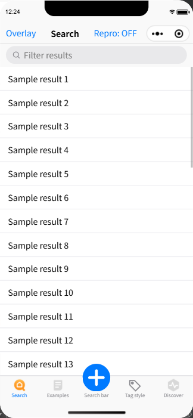

# SVGA tab icons in the examples

## IN PROGRESS (TODO 2026-11-16): SVGA tab icons from CYLTabBarController, every platform that has them

- Context: a CYLTabBarController session reported (2026-11-16) that CYLTabBarController supports SVGA tab icons on
  iOS, Android, React Native, Flutter and the WeChat mini program (`feat/cross-platform-components`, from `8e834c1`;
  newest commit when this started: `c72323f`). HarmonyOS has no animated tab icons there yet. This project had no
  SVGA task before; the user asked to go ahead.
- Prompt (verbatim): "continue" (after the question whether to add SVGA tab icons to the examples).
- Prompt (English): "Continue": add the SVGA tab icons.
- How to use them (CYLTabBarController `docs/Cross-Platform-Components.md`, "SVGA tab icons in your app"):
  tab attributes `CYLTabBarSVGAFilePath` (or `CYLTabBarSVGAURL`), `CYLTabBarSVGASize` (`{32, 32}`), dark
  `CYLTabBarSVGADarkFilePath` / `CYLTabBarSVGADarkURL`; sample icons in
  `Example-SwiftUI-Rive/AnimatedApp/SVGAAssets` (Apache-2.0, `NOTICE.md`).
  - Mini program: package `CrossPlatform/svga-miniprogram` (component `cyl-svga`), `generic:cyl-svga-view="cyl-svga"`
    on `<cyl-tab-bar>`, package copies named `*.svga.bin`. Masks (`matteKey`) and SVGA audio not supported.
  - iOS: `pod 'CYLTabBarController/SVGA'`, `pod 'SVGAPlayer', :modular_headers => true`,
    `pod 'Protobuf', :modular_headers => true`; `.svga` files in the app bundle.
  - Android: `com.github.yyued:SVGAPlayer-Android:2.6.1` from JitPack; `tools:replace="android:allowBackup,android:label"`;
    `.svga` files in the assets.
  - React Native / Flutter: the packages pass SVGA through; the app adds the player as on iOS and Android.
- Rules: the dependency is pinned to the newest CYLTabBarController commit on any branch
  (`scripts/latest-cyl-commit.sh`); the tab icons still come from the configuration (AGENTS.md, "CYLTabBarController");
  every tab keeps a localized title and a screen-reader label (AGENTS.md, "Accessibility, localization and UI
  automation by label").

## Scorecard

Full score: every row `DONE` with evidence, or `TODO: N/A` with a reason. Score = rows not `TODO` / rows × 100.

| # | Platform | Status | Evidence |
| :--- | :--- | :--- | :--- |
| 1 | WeChat mini program | DONE | Search, Examples and Discover play `tab_search`, `tab_list`, `tab_activity` (`*.svga.bin`, 30 x 30) through `cyl-svga`; Tag style keeps its tag symbol (no tag icon among the samples). `cylTabBarControllerCommit` `c72323f`; `scripts/sync-example.js` installs `cyl-svga-miniprogram`; tests 34 of 34 (`test/svga-tab-icons.test.js` decodes every icon with cyl-svga's decoder); shown in WeChat DevTools (screenshot below) |
| 2 | Android | TODO | |
| 3 | iOS | TODO | |
| 4 | React Native | TODO | |
| 5 | Flutter | TODO | |
| 6 | HarmonyOS | TODO: N/A on HarmonyOS | Reason: CYLTabBarController's ArkTS tab bar (`cyltabbar`) has no animated tab icons, so no SVGA (CYLTabBarController `c72323f`, "TODO: SVGA tab icons on HarmonyOS"). Replace with `DONE` when it ships them |

Score: 33/100 (1 of 6 rows DONE, 1 `TODO: N/A on HarmonyOS`; TODO left 4).

## Screenshots

- WeChat mini program, WeChat DevTools 2.02.2609250 (base library 3.6.6, simulator iPhone, original 324×701), Windows 11
  Pro 10.0.22631, CYLSearchViewController branch `feat/harmonyos-parity` with CYLTabBarController `c72323f`,
  2026-11-16 12:24 NZDT (UTC+13:00): the Search tab selected; Search, Examples and Discover show their SVGA icons, Tag
  style its symbol.

  
