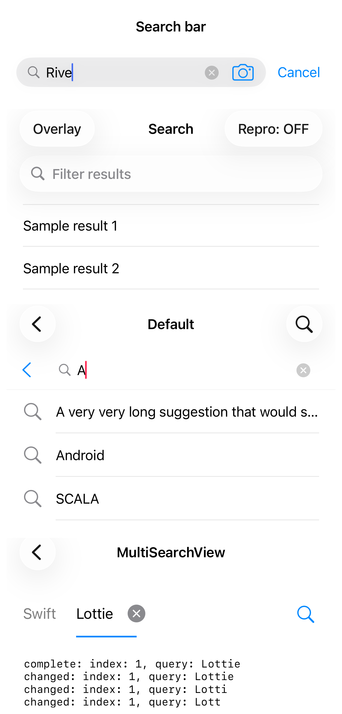
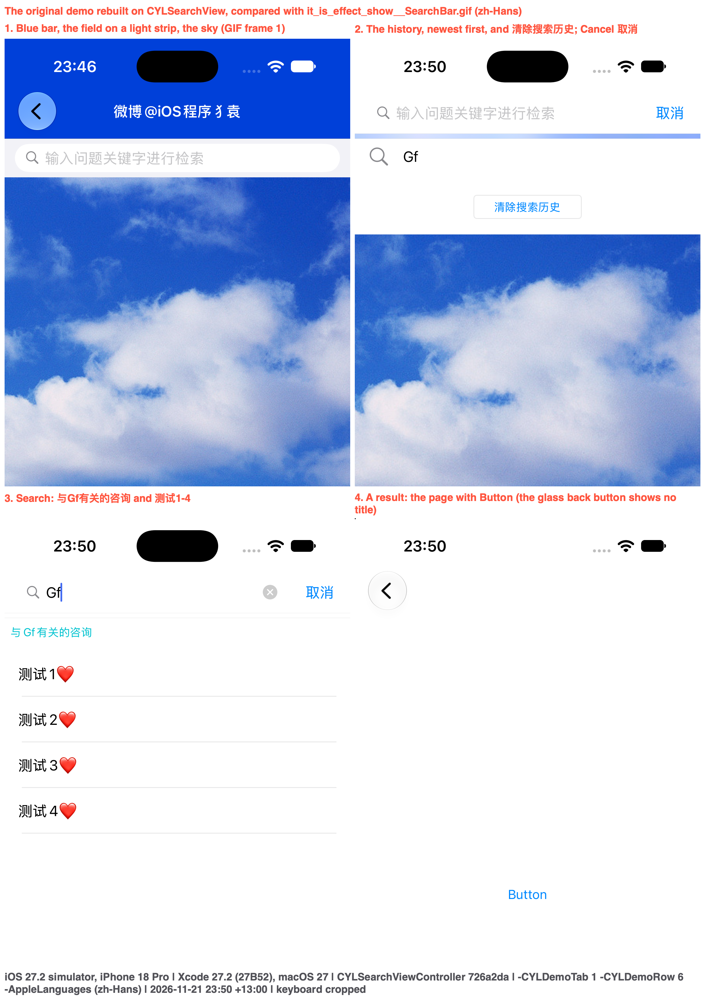

# Swift Migration of the Core

This document is the record of the translation of the iOS core from Objective-C to Swift, with a score after every
commit. The core is all Swift: `Sources/CYLSearchBar/` (`docs/search-core-merge.md`). The class names in the log
below are those of the time.

## DONE (2026-11-12): translate the core to Swift, with a Swift coding standard

- Context: the core of CYLSearchViewController is Objective-C (`Sources/CYLSearchViewController/*.h` and `*.m`:
  `CYLSearchBarView`, `CYLSearchController`, `CYLSearchPlaceholderView`, `CYLSearchResources`,
  `CYLSearchResultsViewController`, and the new `CYLSearchView` / `CYLMultiSearchView` from the search API parity
  task in `docs/search-api-comparison.md`). The pod is built with `use_frameworks!`, and the example
  (`CYLSearchExample/`) is Objective-C. Logged on branch `feat/search-api-parity` while the search API parity
  task was in progress.
- Requirements:
  1. iOS only. The focus is the core code of this project; third-party libraries are out of scope.
  2. First create a Swift coding standard document, then update the instruction files (`AGENTS.md`,
     `instructions.md`, folder `instructions.md`) and the skills to refer to it. All in English.
  3. If ready-made Swift skills exist online, copy and install them into this project (`.agents/skills`).
  4. Following the Swift coding standard and the Swift skills, translate all core code to Swift.
  5. Do not change the example layer unless it is necessary.
  6. Record the translation progress in this document.
  7. Scoring: the measure is that no Objective-C code is left in the core. Code that cannot be written in Swift
     counts as translated when it is kept compatible with Swift through macros or keywords (for example
     `NS_SWIFT_NAME`, `NS_REFINED_FOR_SWIFT`). No Objective-C code left = 100/100.
  8. Score after every commit and check whether it is 100; continue until it is.
- Prompt (verbatim): "将下面的任务找一个合适的文档，标注 TODO：全英文写入：注意本操作仅仅设计iOS端，重点修改 本项目的Core核心层面代码。 不涉及第三方库，首先创建swift编码规范文档，更新instructions和skills相关文档。如果网络有现成的swift skills请直接复制安装到本项目中，按照swift编码规范以及swift相关skilla，将Core 核心层面代码全部转录为Swift代码，如果无必要不要修改example层代码。在该文档中记录swift翻译进度。以项目中不存在objc代码为准，如果无法翻译为swift以宏定义 关键字形式 进行兼容swift的也可以算作翻译成功。不存在objc代码为满分，每提交一次就打一次分。每提交一次检查是否满分。一直到满分为止。"
- Prompt (English): "Put the following task in a suitable document and mark it TODO, written fully in English: note
  that this work concerns iOS only and focuses on changing this project's core code. Third-party libraries are not
  involved. First create a Swift coding standard document and update the instruction and skill documents. If
  ready-made Swift skills exist online, copy and install them into this project. Following the Swift coding
  standard and the Swift skills, translate all core code into Swift; do not change the example layer unless
  necessary. Record the Swift translation progress in this document. The measure is that no Objective-C code
  exists in the project; code that cannot be translated to Swift but is made Swift-compatible through macros or
  keywords also counts as translated. No Objective-C code = full marks. Score after every commit, check after
  every commit whether it is full marks, and continue until it is."
- Result: 100/100. `Sources/CYLSearchViewController/` holds only Swift (7 files, one per type); the podspec builds
  `*.swift` with `swift_version` 5.0. Every class, protocol, enum and selector keeps its Objective-C name through
  `@objc(...)`, so the Objective-C example and the Objective-C tests compile unchanged except for imports
  (`CYLSearchViewController-Swift.h`). Verified on Xcode 27.2 (macOS 27.3, iPhone 17 simulator, iOS 26.1): 19/19
  tests, clean build with 0 warnings, `pod lib lint` passes, `scripts/check-public-api-comments.sh` (now also Swift)
  passes, the app runs (search tab, the Swift `CYLSearchBarView` on the plus page reports typed text). CI's "Fail
  on warnings in Sources/" step now also matches Swift files. Bug found and fixed on the way: the lapism port's
  `searchBarViewDidTapWhileNotEditable:` did not match the protocol. Branch `feat/swift-core`, PR #8.
- Plan: 1) `docs/swift-coding-standard.md`; 2) install ready-made Swift skills from GitHub (pinned commits, with
  their licenses) into `.agents/skills`; 3) update `AGENTS.md`, `instructions.md` and the `cyl-*` skills; 4)
  translate one type per commit, smallest first, keeping every Objective-C selector through `@objc(...)` so the
  Objective-C example and tests keep compiling; 5) score after every commit.

## Progress

| Commit | Objective-C files left in `Sources/` | Score |
|:---|:---|:---|
| `db9991a` (standard and skills) | 14 files, 2838 lines | 0/100 |
| CYLSearchResources → Swift | 12 files, 2757 lines | 3/100 |
| CYLSearchPlaceholderView → Swift | 10 files, 2533 lines | 10/100 |
| CYLSearchResultsViewController, CYLSearchController → Swift | 6 files, 2241 lines | 21/100 |
| CYLMultiSearchView → Swift | 4 files, 1713 lines | 39/100 |
| CYLSearchView → Swift (+ a 2-line umbrella header while CYLSearchBarView is Objective-C) | 3 files, 1043 lines | 63/100 |
| CYLSearchBarView → Swift; umbrella header removed | 0 files, 0 lines | **100/100** |

Score = Objective-C lines removed from `Sources/` / 2838 (the Objective-C lines when the migration started) × 100,
rounded down. 100 = no `.h` or `.m` file left in `Sources/`.

Example changes that were necessary: `CYLSearchExampleViewController` (an Objective-C subclass of
`CYLSearchResultsViewController`) moved to Swift, because Objective-C cannot subclass a Swift class. It and its
data source are `public` so the Objective-C app files and tests reach them through `CYLSearchExample-Swift.h`; the
test target finds that header through `$(CONFIGURATION_TEMP_DIR)/CYLSearchExample.build/DerivedSources`.

## Screenshots

The all-Swift core in the example app, key details stacked top to bottom (the same image as `README.md`).

| Field | Value |
|:---|:---|
| Platform | iOS |
| Host | macOS 27.3 (26C5035r), Xcode 27.2 (27B52) |
| Simulator | iPhone 17, iOS 26.1 |
| SDK | iOS SDK 27.2, Swift 5 language mode, deployment target iOS 15.0 |
| Repository | [`9735f79`](https://github.com/ChenYilong/CYLSearchViewController/commit/9735f79) on `feat/swift-core` |
| Taken | 2026-11-12 16:14–16:17 NZDT |

## Rule (2026-11-13): example build errors are fixed in the examples; the Swift core carries no burden

When an Objective-C to Swift change of the core breaks an example's build, fix the example: example code has the lowest weight of all code here. Change any example code as needed; never keep a core API, overload, shim or deprecated alias only because an example uses it, and never lower the Swift core's quality (naming, types, optionality, access control) to fit an example. Compatibility matters only for callers outside the examples (published API users). The Swift coding standard (docs/swift-coding-standard.md) decides.

## DONE (2026-11-13): write the rule above into the docs, instructions and skills

- Context: the Objective-C core became Swift (this document); examples sometimes stop compiling after a core change.
- Requirements: append the rule, in English, to the Swift migration documents, the instructions and the skills.
- Prompt (verbatim): "在文档中找到objc迁移swift相关文档，包含docs instructions skils 相关文档。全英文更新，追加规则：更新example 编译错误，规则为优先改example层代码，所有example权重为最低，无须example修改的考虑兼容性。任意修改example代码，全力保障core核心层代码没有包袱，负担。不要因为example层的用法而降低core swif代码质量。以swift编码规范为准。continue continue"
- Prompt (English): "Find the Objective-C to Swift migration documents, including docs, instructions and skills. Update
  them in English and append this rule: for example build errors, change the example code first; all examples have the
  lowest weight, and compatibility need not be kept for the examples' sake. Change any example code, and do everything
  to keep the core free of baggage and burden. Do not lower the Swift core's code quality because of how an example
  uses it. The Swift coding standard decides."
- Result: appended to this file, `docs/swift-coding-standard.md`, `AGENTS.md`, `instructions.md` and the `cyl-*`
  skills that mention the Swift migration (additions only).

## DONE (2026-11-21; TODO 2026-11-20): continue the Swift migration: this repository's example app, legacy demo app and tests

- **Branch**: `feat/harmonyos-parity`. Owner: the macOS session (iOS, platform rule).
- **Prompt (verbatim)**: "continue swift migration", answered "Both" to "which Swift migration: CYLSearchViewController
  example + tests, CYLTabBarController core, or both" (the core of this repository is already 100/100, above).
  (English: continue the Swift migration: this repository's example and tests, and CYLTabBarController's core, which
  its own session (Mac-CYLTabBarController文件夹) carries on; this session relays and re-pins it.)
- **Scope (Objective-C left, 2026-11-20, 4,139 lines)**: the example app `CYLSearchExample/` (5 `.m`, about 480 lines),
  the legacy Issue #1317 demo app `CYLSearchViewController/` (about 1,100 lines), `CYLSearchViewControllerTests` (47) and
  `CYLSearchExampleTests` (1,918, which reach Swift internals through `performSelector`). Not migrated: the React Native
  bridges (`CrossPlatform/react-native-cylsearch/ios/*.mm`: Fabric needs Objective-C++).
- **Rules**: Swift first (the vault's rule); example code has the lowest weight (fix examples, never bend the core);
  `objectVersion = 46` and explicit file references stay; keep the Objective-C API checks that matter (a small
  Objective-C smoke test of the public API stays, as CYLTableViewPlaceHolder did); score after each commit
  (Objective-C lines left / 4,139).
- **Plan**: (1) example app; (2) legacy demo app; (3) `CYLSearchViewControllerTests`; (4) `CYLSearchExampleTests`,
  with an Objective-C smoke test of the core's public API kept.
- **Progress**:

| Step | Objective-C lines left (of 4,139) | Score |
|:---|:---|:---|
| 0: logged | 4,139 | 0/100 |
| 1: example app (`main.m`, app and scene delegate, `CYLSearchBarDemoViewController`, `CYLSearchDemoMenuViewController` with the placeholder gallery and the SVGA header) → Swift; the three classes the tests use are `public` (the app has no bridging header) | 3,618 | 12/100 |
| 2: the legacy demo app `CYLSearchViewController/` replaced by the Swift `CYLOriginalSearchDemoViewController` (checked against the GIF on the simulator) and removed (`726a2da`) | 2,057 | 50/100 |
| 3: `CYLSearchViewControllerTests` (the legacy app's empty test target, in no Xcode target) removed with it (`726a2da`) | 2,010 | 51/100 |
| 4: `CYLSearchExampleTests.m` (2,010 lines) → six Swift files (`CYLSearchExampleTestSupport.swift` and five `XCTestCase` subclasses, 2,097 lines), with `CYLSearchCoreObjectiveCSmokeTests.m` (59 lines, 3 tests) kept by the plan | 59 (the smoke test, kept on purpose) | 100/100 |

  Step 1 notes: the `performSelector` / `NSClassFromString` detours to Swift classes are plain calls now; cells keep
  `textLabel` / `imageView` (a first pass with cell content configurations left `textLabel` empty and failed
  `testSearchBarDemoRow`); Swift names found on the way: `CYLTabBarPageRegistry.shared` and `register(_:forPageIdentifier:)`,
  `CYLTabBarController(configurationFile:)`. iOS 35 of 35.
- **Step 2 decision (2026-11-20, from the user)**: the legacy demo app `CYLSearchViewController/` is in no Xcode target (0
  references in `CYLSearchExample.xcodeproj`; unchanged since 2015). Prompt (verbatim, answering "leave it / delete it /
  migrate it unverified"): "使用我们封装好的组件库改造，通过pods引用实现同等效果，如果实现不了，改造core代码新增接口，实现效果以readme描述以及截图为准。并实现swift完全迁移。"
  (English: rebuild it with our packaged component library through the pods to get the same effect; if that cannot be
  done, change the core code and add an interface; the effect is whatever the README describes and shows in its
  screenshot (`CYLSearchViewController/it_is_effect_show__SearchBar.gif`); and finish the Swift migration completely.)
  - **Target effect (the GIF)**: a blue bar titled "微博@iOS程序犭袁"; below it a search field (placeholder "输入问题关键字进行检索")
    over a Ken Burns sky (`clouds-1.png`); tapping it opens the search: the history (newest first) with a text button
    "清除搜索历史" below it, the sky still showing under the list above the keyboard, Cancel "取消"; Search pushes the results
    ("与Gf有关的咨询" header; rows "测试1❤️" … "测试4❤️") and the term enters the history; a row opens a page with a centred "Button"
    and a back item "返回".
  - **Plan**: a Swift page in the example built on `CYLSearchView` (suggestions cache = the history, `contentView` = the Ken
    Burns sky, results table = the results) and a Swift `CYLKenBurnsView`; the one thing the core lacks is the history's
    text clear button below the list (it has a trash icon in a header): a core option for the clear button's
    placement and title (iOS first; the other platforms' rows in `core-todo.md`). When the page matches the GIF, the
    legacy Objective-C files in `CYLSearchViewController/` and `CYLSearchViewControllerTests/` are replaced by it
    (the Issue #1317 repro page already lives in the example as `CYLSearchExampleViewController`).
- **Step 2 progress (2026-11-20)**: the demo is rebuilt in Swift on the core and listed as the menu's seventh row:
  `CYLOriginalSearchDemoViewController` (`CYLSearchView`: history = suggestions cache in the user defaults, `contentView` =
  the Ken Burns sky, results table = the results, a "clear search history" text button as the suggestions table's footer),
  `CYLKenBurnsView` (Swift), `CYLOriginalDemo.bundle` (`clouds-1.png`, strings in en, ja, zh-Hans, zh-Hant). Core change:
  `CYLSearchView.showsSuggestionCacheHeader` (default true; false takes the title-and-trash header away). Test
  `testOriginalDemoRebuiltOnTheCore`; iOS 36 of 36. Left for step 2: compare the running page with the GIF frame by frame
  (screenshots on the simulator), the other platforms' row for `showsSuggestionCacheHeader` in `core-todo.md` (DONE
  2026-11-21, Windows: Android, HarmonyOS, the mini program, Flutter and React Native, `efb3b78`), then
  delete the legacy Objective-C files in `CYLSearchViewController/` and `CYLSearchViewControllerTests/` (score at that point).
- **Step 2 and 3 done (2026-11-21, macOS session, `726a2da`, iPhone 18 Pro simulator, iOS 27.2, Xcode 27.2)**: the running page
  compared with the GIF state by state (zh-Hans). Fixed on the way, in the example: the field sat on a black strip in a dark
  field (now `systemGroupedBackground` behind a `secondarySystemGroupedBackground` field, white in light mode, as the GIF);
  the search showed a back arrow and no Cancel (now `showsCancelButton` with "取消" and `navigationIcon = .none`); the
  history rows were transparent over the sky (now white rows through `suggestionCellConfiguration`; the sky shows only
  below the list). Same as the GIF: the blue bar and its title, the placeholder, the history newest first with
  "清除搜索历史" below it, the results header "与Gf有关的咨询" with "测试1❤️" to "测试4❤️", the result page with its centred
  "Button". Different by platform: the iOS 26 Liquid Glass back button shows a chevron without the "返回" title (the title is
  still set). `testOriginalDemoRebuiltOnTheCore` now also submits a term and checks the results, the header, the history row
  (white) and the clear button. Then the legacy app (`AppDelegate`, `main.m`, `Class/`, `Base.lproj`, `Info.plist`: 1,653
  Objective-C lines in no target) and `CYLSearchViewControllerTests/` (47) were removed; `CYLSearchViewController/` keeps
  the app's `Images.xcassets`, `CYLLaunchScreen.storyboard` and the GIF. 37 of 37 tests pass.
  
  (iOS 27.2 simulator, iPhone 18 Pro, Xcode 27.2 27B52, macOS 27, CYLSearchViewController `726a2da`, 2026-11-21 23:50 +13:00.)
- **Step 4 done (2026-11-21, macOS session)**: the 37 tests are Swift, one `XCTestCase` per area on a shared base class
  (`CYLSearchExampleTestCase`, the suggestion cache reset of the old `setUp`): search view and placeholders (10), search bar,
  demo rows, tab bar and covers (8), parity, suggestions, multiple mode and ports (6), contact tags and editing bar (6),
  cache, focus, tag suggestions and items (7). `@testable import CYLSearchExample` replaces the `performSelector` /
  `NSClassFromString` detours; 12 KVC or selector calls stay, each on a private member (`toggleManaging`, the core's
  internal `maximumCount` and a private `item`), with a comment. Assertions kept one for one (a nil check became
  `XCTUnwrap` where the test cannot go on without the value; pointer comparisons became `XCTAssertIdentical`).
  `CYLSearchCoreObjectiveCSmokeTests.m` calls `CYLSearchBarView`, `CYLSearchView` and `CYLSearchResources` from Objective-C.
  40 of 40 tests pass (37 Swift, 3 Objective-C; iPhone 18 Pro simulator, iOS 27.2, Xcode 27.2).
- **Status**: DONE (2026-11-21). Score: 100/100. Objective-C left on purpose: the 59-line smoke test, and the React Native
  bridges (`CrossPlatform/react-native-cylsearch/ios/*.mm`, Objective-C++ for Fabric), out of scope from the start.
