# Tag View Suggestions (CollectionViewClassifyMenu)

Suggestions under the search bar shown as a list (table view) or as tags (collection view, from
CollectionViewClassifyMenu).

## DONE (2026-11-12): CollectionViewClassifyMenu as a dependency and a tag-view suggestion style

- Context: CollectionViewClassifyMenu is a sibling project in the same vault folder
  (`../CollectionViewClassifyMenu`) with a podspec at its root. `CYLSearchView` lists suggestions in
  `suggestionsTableView` today.
- Requirements:
  1. iOS: make CollectionViewClassifyMenu a sub-dependency of this pod through its root podspec; depend on its
     newest commit (which may not be on its main branch), or on the local path while developing, but commit only the
     commit-based dependency.
  2. Add support in the core with an enum or a parameter that chooses how suggestions appear under the search bar:
     a table view or a collection view (tags). Change the core first; add an interface to CollectionViewClassifyMenu
     only when needed, commit it there, then update this repository's commit dependency.
  3. Show the styles in the example: an empty tab item named "tagview style" shows the existing examples' suggestions
     with different parameters in the new style.
- Prompt (verbatim): "在iOS端 将CollectionViewClassifyMenu 也就是本项目在本地 本机环境的同一个文件夹目录下的项目，文件夹就叫CollectionViewClassifyMenu 通过根目录的.spec 文件制作成本仓库的子依赖库。你可以通过查找CollectionViewClassifyMen的最新commit地址进行依赖，最新commit可能不在main分支。也可以通过本地路径依赖，选择一个方便你开发的方式集成，但commit前要移除本地依赖形式，采用commit依赖。为iOS端加入CollectionViewClassifyMen 支持，采用枚举形式，或者参数形式，指定 效果，效果类似搜索框下端具体是tableview还是collectionview。优先采用修改core核心代码的方式实现，如有必要也可以前往CollectionViewClassifyMen新增接口，帮CollectionViewClassifyMen提交后更新本仓库commit依赖继续开发。在本项目example中展示以上提到的不同样式。将现在已有的example展示，寻找一个空的tabbaritem项，命名为tagview样式，展示现有样式的不同参数设置后的新搜索备选项展示形式。"
- Prompt (English): "On iOS, make CollectionViewClassifyMenu (the project in the same local folder, named
  CollectionViewClassifyMenu) a sub-dependency of this repository through its root .spec file. Depend on its newest
  commit (maybe not on main) or on the local path, whichever is convenient while developing, but remove the local
  form before committing and use the commit form. Add CollectionViewClassifyMenu support on iOS with an enum or a
  parameter that chooses the effect, i.e. whether the area under the search bar is a table view or a collection
  view. Prefer changing the core; if needed, add interfaces to CollectionViewClassifyMenu, commit there, then update
  this repository's commit dependency and continue. Show the styles in the example: find an empty tab item, name it
  tagview style, and show the existing examples' new suggestion presentation with different parameters."
- Status: DONE (2026-11-12, [`e1a771a`](https://github.com/ChenYilong/CYLSearchViewController/commit/e1a771a)); see
  the iOS progress of the tag-style demos TODO below.

## DONE (2026-11-12): Android: the suggestion demo in two tabs, list style and tag style

- Context: `android/merged` (see [android-and-cross-platform.md](android-and-cross-platform.md)) runs the
  MaterialSearchView sample from its "Material" tab. Its suggestions are a list under the search bar (screenshot).
  CollectionViewClassifyMenu has an Android port (`../CollectionViewClassifyMenu/android/merged`, modules `library`
  and `example`) whose tag views give the tag style. This is the Android side of the iOS TODO above.
- Requirements:
  1. Copy the suggestion demo. Show it in two of CYLTabBarController's tab items in `android/merged/app`.
  2. Tab "list style": the current list of suggestions (MaterialSearchView, unchanged).
  3. Tab "tag style": the same suggestions shown as tags with CollectionViewClassifyMenu's Android library. Depend on
     it by its newest commit, like CYLTabBarController (local path only while developing).
  4. Prefer a style option in the library (`cylsearch` / MaterialSearchView) over code in the example; the example
     passes only data, style parameters and click handling.
  5. Screenshots of both tabs in this document, labeled per AGENTS.md, then mark this TODO DONE.
- Screenshot of the current list style (the demo to copy). Android 15 emulator `CYL_API35_arm64` (API 35, arm64),
  host macOS 27.3 (26C5035r), compileSdk 35, CYLSearchViewController commit `d459b91`, 2026-11-12 18:19 NZDT.
  Left: typing "a" lists the suggestions; right: tapping "Android" fills the query.

  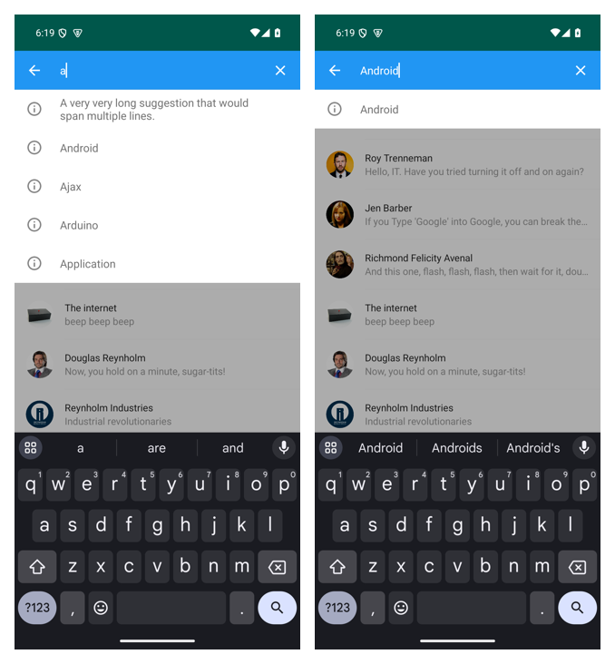

  Full-size original of the left state: [android-merged-suggestions-list-original.png](assets/android-merged-suggestions-list-original.png).
- Prompt (verbatim): "该演示，复制一份，使用cyltabbarcontroller不同items管理，演示搜索备选项内容，一个item使用现在的样式，一个item 使用使用新的新的collectionview 也就是tagview 也就是 CollectionViewClassifyMenu提供的样式展示。写入文档中 标注todo附带截图。continue"
- Prompt (English): "Copy this demo and manage it with different CYLTabBarController items to show the search
  suggestions: one item uses the current style, the other the new collection view, i.e. the tag view, the style
  CollectionViewClassifyMenu provides. Write it into the docs marked TODO with screenshots. Continue."
- Status: DONE (2026-11-12, [`ffac758`](https://github.com/ChenYilong/CYLSearchViewController/commit/ffac758)).
  - Library, not example: `CYLSearchView.suggestionStyle` (`CYLSearchSuggestionStyle.List` / `Tags`) in
    `cylsearch`; `Tags` shows the filtered suggestions in `suggestionsTagView`, CollectionViewClassifyMenu's
    `CYLTagListView`, and a tapped tag works like a tapped row (fills the query, `searchViewDidSelectSuggestion`,
    submits when `submitsOnSuggestionSelection`).
  - Dependency: CollectionViewClassifyMenu's Android library at its newest commit `eb3590e` (branch
    `feat/android-kotlin`), checked out by `android/merged/settings.gradle.kts` (`cyl.classifymenu.commit`), like
    CYLTabBarController; `-Pcyl.classifymenu.dir` only for local development.
  - Example: the "List style" and "Tag style" tabs of the app (`CYLSuggestionStyleFragment`) pass only the
    suggestions and the style; the toolbar's search action opens the search.
  - Verified on the emulator: typing "a" lists 14 suggestions in both styles; tapping the "Android" tag sets the
    query to "Android"; no crash.
  - Screenshots (originals), from top to bottom: list style, tag style, tag style after tapping "Android".

    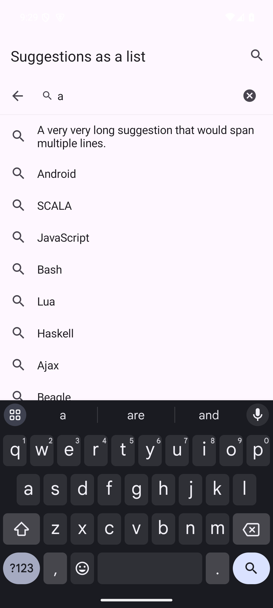

    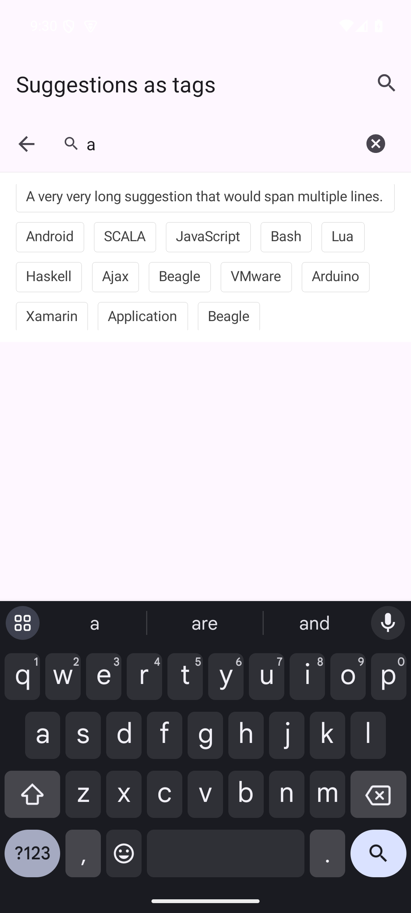

    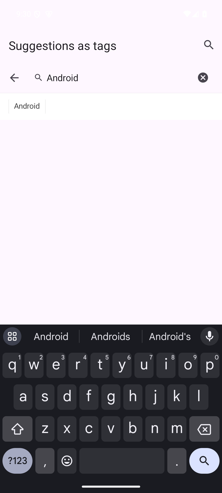

| Field | Value |
|:---|:---|
| Platform | Android (Kotlin, `android/merged`) |
| Host | macOS 27.3 (26C5035r), JDK 17.0.21, Gradle 9.3.1, AGP 8.7.3, Kotlin 2.0.21 |
| Emulator | `CYL_API35_arm64`, Android 15 (API 35), arm64-v8a, 1080 × 2400 |
| SDK | compileSdk / targetSdk 35, minSdk 23 |
| Repository | [`ffac758`](https://github.com/ChenYilong/CYLSearchViewController/commit/ffac758) on `feat/swift-core`; CYLTabBarController `f410fa7`, CollectionViewClassifyMenu `eb3590e` |
| Taken | 2026-11-12 21:30–21:40 NZDT |
  - The iOS side is the TODO above (still open, in order).

## TODO (2026-11-12): tag-style suggestion demos copied from CollectionViewClassifyMenu, iOS first

- Context: refines the iOS TODO at the top of this document. CollectionViewClassifyMenu already implements tag
  pages (the user's screenshots below): a search page with "Recent searches" tags (a fold button at the end of the
  second row, a trash button), a two-column "Discover" list with a "hot" badge, the camera and Search buttons in the
  field, and a voice button at the bottom; and a tag editor with a search field and tag sections. Android has
  `CYLSearchView.suggestionStyle` (List / Tags) and the List style / Tag style tabs.
- Requirements:
  1. Add demos that show the search suggestions as tags; copy what CollectionViewClassifyMenu already implements
     (the screenshots show the effect).
  2. Use the new style property (`suggestionStyle`) and the new dependency layout: CollectionViewClassifyMenu as a
     sub-dependency (`docs/sub-repositories.md`).
  3. In the example, the different demo pages are told apart by the empty tab items of CYLTabBarController (new tab
     items with no content yet).
  4. iOS first; then Android and the cross-platform versions (React Native, Flutter) with the same requirements.
- Screenshots (the user's), top to bottom: the discover search page; its states in four languages; the tag editor.

  

  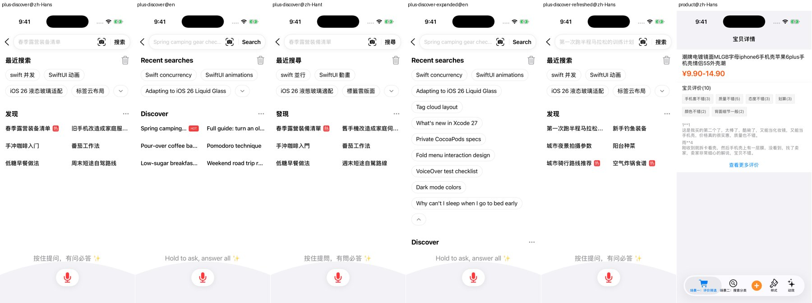

  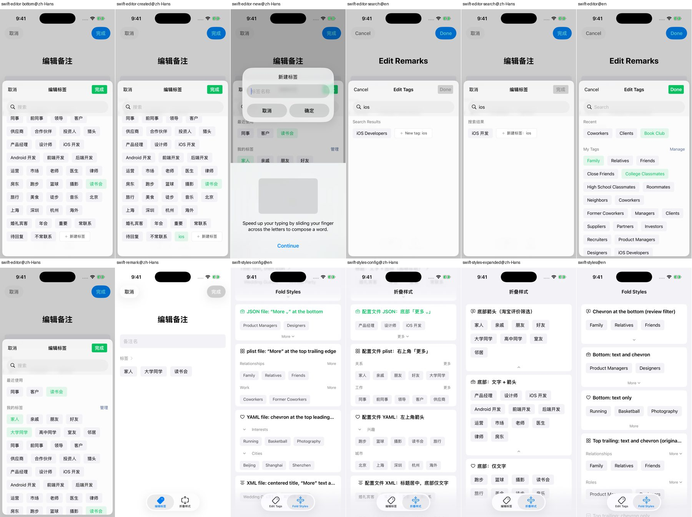

- Prompt (verbatim): "新增tag 形式展示备选搜索内容的样式demo，你可以直接从CollectionViewClassifyMenu文件夹  中复制已经实现的内容，具体代码效果见截图，使用我们的新建的样式属性，以及新组织的 依赖关系 使用 CollectionViewClassifyMenu作为子依赖。进行代码改造。使用example中cyltabbarcontroller中的 空的没有内容的tabbaritem进行区分上面的不同演示页面。先实现iOS端展示，然后再 按照相同要求执行其他平台比如android和跨端平台rn flutter。continue"
- Prompt (English): "Add a style demo that shows the candidate search content as tags. You can copy what is already
  implemented in the CollectionViewClassifyMenu folder (see the screenshots for the effect), use our new style
  property and the newly organized dependency, with CollectionViewClassifyMenu as a sub-dependency, and rework the
  code. Use the empty tab items of the example's CYLTabBarController to tell the demo pages apart. Implement iOS
  first, then the other platforms, Android and the cross-platform React Native and Flutter, with the same
  requirements. Continue."
- Progress, iOS: DONE (2026-11-12, [`e1a771a`](https://github.com/ChenYilong/CYLSearchViewController/commit/e1a771a)).
  - Core: `CYLSearchView.suggestionStyle` (`CYLSearchSuggestionStyle.list` / `.tags`) and `suggestionsTagView`
    (CollectionViewClassifyMenu's `CYLTagListView`), the same option as Android; a tapped tag fills the query and is
    reported like a row.
  - Sub-dependency: `s.dependency 'CollectionViewClassifyMenu'` in the podspec; the Podfile pins its newest commit
    `e550a01` (`:git` + `:commit`). Its podspec makes it a static framework, so the app links pods as static
    frameworks (`use_frameworks! :linkage => :static`); `scripts/pod-lint.sh` checks the pinned commit out into
    `build/lint-specs/` and lints with `--include-podspecs` and `--use-static-frameworks` (it is not on trunk).
    `pod lib lint` passes.
  - Example: two new tab items in `CYLTabBarConfiguration.json`, titles in four languages: "Tag style"
    (MaterialSearchView's six samples, the same suggestions and parameters as the list ports, shown as tags) and
    "Discover" (`CYLSearchDiscoverViewController` and its data, copied from CollectionViewClassifyMenu's
    `CYLMenuExample` at `e550a01`, its strings in an example-level `CYLSearchDiscover.bundle`; the back button shows
    only when the page is pushed).
  - Tests: 19/19 pass on iPhone 17 (tab bar with five pages and every tab key; the Discover search bar covers no
    view at the default and the largest text size).
  - Known: the "✨" after the Discover hint shows as a box on the freshly booted simulator (its emoji font); the
    source is the same as CollectionViewClassifyMenu's.
  - Screenshots (originals), top to bottom: the Tag style tab; its Default sample after typing "a"; the Discover tab.

    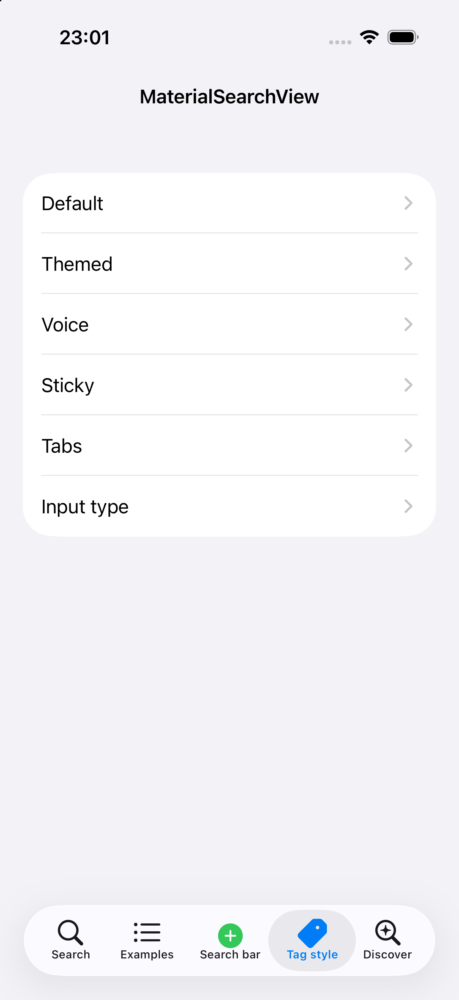

    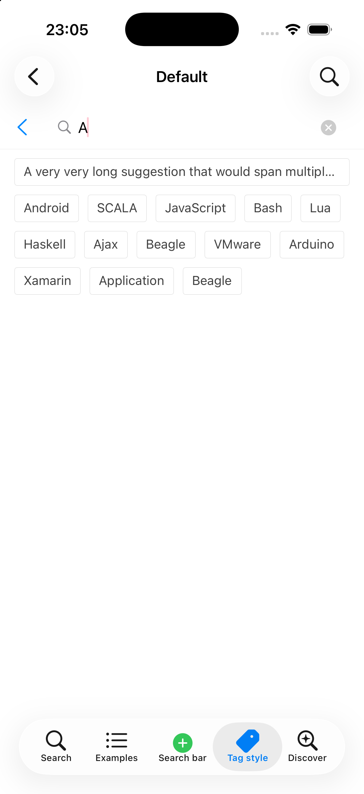

    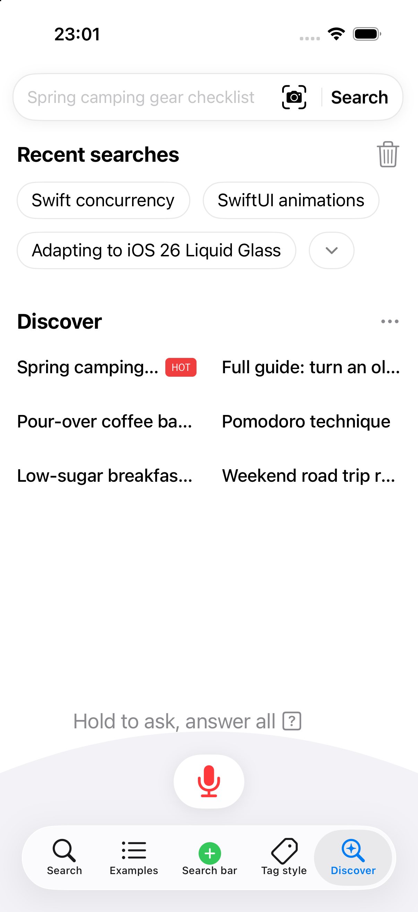

| Field | Value |
|:---|:---|
| Platform | iOS (Swift core, Swift / Objective-C example) |
| Host | macOS 27.3 (26C5035r), Xcode 27.2 (27B5028f) |
| Simulator | iPhone 17, iOS 26.3 |
| SDK | iOS SDK 27.2, Swift 5 language mode, deployment target iOS 15.0 |
| Repository | [`e1a771a`](https://github.com/ChenYilong/CYLSearchViewController/commit/e1a771a) on `feat/swift-core`; CollectionViewClassifyMenu `e550a01` |
| Taken | 2026-11-12 23:01–23:05 NZDT |
- Progress, Android: DONE (2026-11-12, [`0c8e306`](https://github.com/ChenYilong/CYLSearchViewController/commit/0c8e306)).
  - The tag style was already there (`CYLSearchView.suggestionStyle`, the List style / Tag style tabs).
  - New Discover tab: `CYLSearchDiscoverFragment`, a Kotlin port of the iOS page with CollectionViewClassifyMenu's
    Android `CYLTagListView` (inline fold chevron, two-column grid, More button, section accessory), the same data
    and hot images (`assets/CYLSearchDiscover.bundle`) and texts in four languages. CollectionViewClassifyMenu is now
    pinned to `e550a01` on Android too.
  - Library fix found here: `CYLSearchBarView` keeps an accessory view's own size (a 1 dp divider filled the field).
  - Verified on the emulator: Recent searches expand to every search, a tapped tag fills the query, More shows other
    topics; no crash. Not a difference to keep: long titles are cut by the cell's edge; see the bug TODO below.
  - Screenshots (originals), top to bottom: the Discover tab; Recent searches expanded; Discover after More (cropped).

    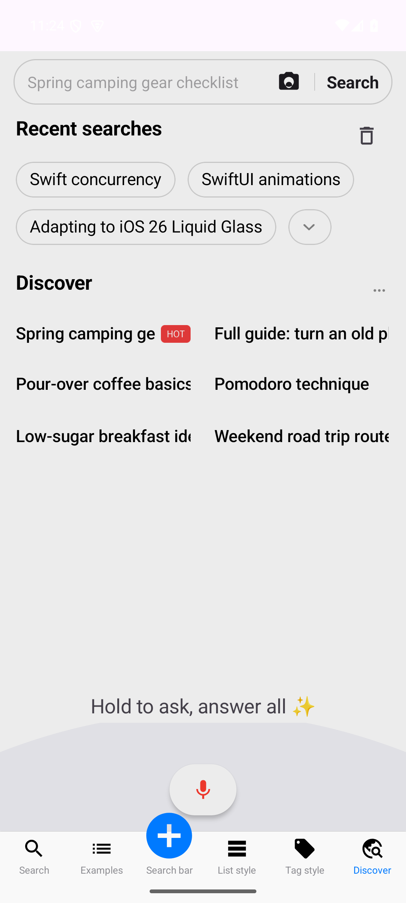

    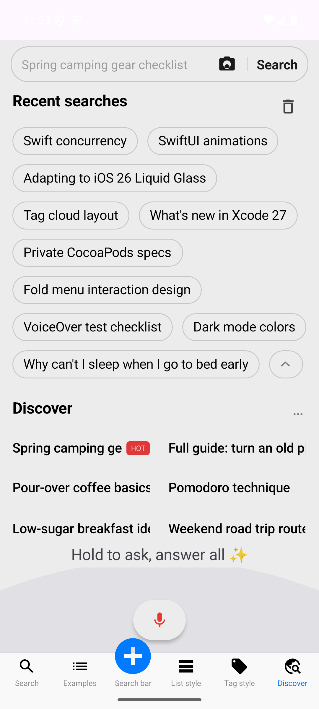

    

| Field | Value |
|:---|:---|
| Platform | Android (Kotlin, `android/merged`) |
| Host | macOS 27.3 (26C5035r), JDK 17.0.21, Gradle 9.3.1, AGP 8.7.3, Kotlin 2.0.21 |
| Emulator | `CYL_API35_arm64`, Android 15 (API 35), arm64-v8a, 1080 × 2400 |
| SDK | compileSdk / targetSdk 35, minSdk 23 |
| Repository | [`0c8e306`](https://github.com/ChenYilong/CYLSearchViewController/commit/0c8e306) on `feat/swift-core`; CollectionViewClassifyMenu `e550a01` |
| Taken | 2026-11-12 23:24–23:27 NZDT |
- Next: React Native and Flutter. Neither version of this library exists yet; they are built by the cross-platform
  TODO in [android-and-cross-platform.md](android-and-cross-platform.md) (Flutter first), and get the tag style and
  the Discover page there.
- Status: `TODO` (iOS and Android done; React Native and Flutter open).

## DONE (2026-11-12): Android tag cells cut their text at the cell edge

- Context: the Android Discover tab (`CYLSearchDiscoverFragment`, CollectionViewClassifyMenu's Android
  `CYLTagListView` with `CYLMenuStyle.gridStyleWithNumberOfItemsPerRow(2)`, pinned at `e550a01`). Long topic titles
  ("Switching your cat's food", "Saving money on train tickets", "Designers' favorite palettes") run to the cell's edge
  and are cut mid-letter. On iOS the same grid keeps a gap and ends a long title with "…". I first wrote this off as a
  difference of the library; the user disagreed: it is a bug.
- Requirements:
  1. Keep a gap between the text and the cell's edge (the cell's content insets / margin, as on iOS).
  2. A title that does not fit ends with an ellipsis ("…"), on one line.
  3. Where the cut comes from CollectionViewClassifyMenu's Android tag layout (`CYLTagButton` / grid cell
     measuring), fix it there, push it, then update `cyl.classifymenu.commit` here (AGENTS.md, "Sub-repositories");
     check the other tag cells too (Recent searches, the Tag style tab).
  4. Screenshots after the fix, labeled; mark this TODO done.
- Screenshot (the user's):

  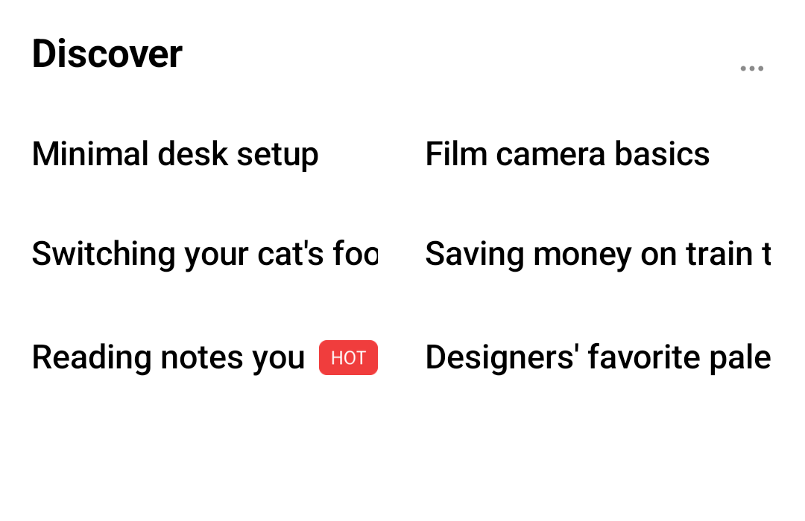

- Prompt (verbatim): "No  I don't think so. Android tests pass (9/9). The alignment table has grown to 299 rows (the new iOS suggestionStyle API), all aligned. Regenerating it and writing the Android progress with screenshots: tag cell text are cut by boundary of cell , it should got gap between text and boundary of cell, if text is too long it should show text end with ... please mark this bug as TODO in docs files related."
- Status: DONE (2026-11-12, [`74b75a6`](https://github.com/ChenYilong/CYLSearchViewController/commit/74b75a6)).
  - Cause, in CollectionViewClassifyMenu's Android `CYLTagButton`: its children were measured with an `UNSPECIFIED`
    width, so the title `TextView` kept a text layout as wide as the whole title; the narrower frame then clipped it
    and `ellipsize = END` never applied.
  - Fix there (sub-repository rule): `place()` measures each child at its frame before laying it out; every tag cell
    uses it.
  - Core, not example: the user asked again (2026-11-12, "请在core层面修复该问题，不要在example修复！" — "fix it in the core, not
    in the example"). The fix is in CollectionViewClassifyMenu's core library (`CYLTagButton`, used by every tag cell);
    no example code changed for it (`CYLSearchDiscoverFragment` is untouched by `74b75a6` / `f972416`). [ChenYilong/CollectionViewClassifyMenu#17](https://github.com/ChenYilong/CollectionViewClassifyMenu/pull/17),
    commit `f972416`, with `CYLTagTitleEllipsisTest` (fails without the fix) and its 30 library tests passing.
  - Pinned here to `f972416` on Android and iOS; Android builds from the pinned checkout, iOS 19/19, `pod lib lint`
    passes.
  - After (cropped, Android 15 emulator `CYL_API35_arm64`, API 35, host macOS 27.3, built from
    [`74b75a6`](https://github.com/ChenYilong/CYLSearchViewController/commit/74b75a6)'s pin, 2026-11-12 23:5x NZDT): long titles
    end with "…" inside the cell, with a gap before the next column.

    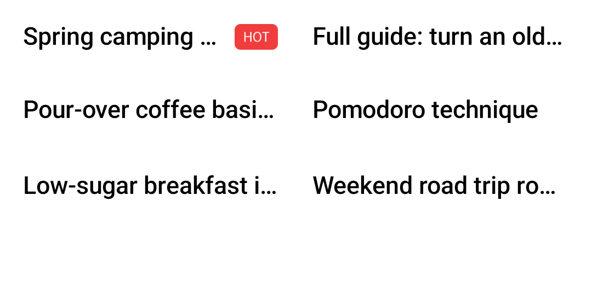
