# Task Log

Tasks that have no better home in `docs/` are logged here (`AGENTS.md`,
"Task log before every task"). A task that belongs to a feature is logged in
that feature's document instead. Each entry starts as `TODO` before the work
begins and becomes `DONE` when it ends.

## DONE (2026-11-12): log every task in docs/ before starting it

- Context: the user runs several Claude sessions on this repository at once,
  and a session can stop mid-task (context limits, restarts, another session
  taking over a branch or the simulator). The next session needs to find
  what was asked and how far it got.
- Requirements:
  - Write the rule into the instruction files (`AGENTS.md`,
    `instructions.md`, folder `instructions.md` files) and the skills, in
    English.
  - Before any task: find the most suitable document in `docs/`, add the
    task there marked `TODO`, with the detailed context, the user's
    requirements and the user's prompt; then start the task.
  - When the task ends, mark it done.
  - Purpose: no context is lost when a task is interrupted.
- Prompt (verbatim): "写入instructions相关文件，skills相关文件，开始任何任务前总是找到docs里的合适文档，现将任务标记为TODO ，给出任务详细上下文以及我的要求，我的提示词，再开始任务，目的是防止任务中断后，丢失上下文，无法找到上下文。任务结束后再标记TODO为已完成。"
- Prompt (English): "Write into the instruction files and the skill files:
  before starting any task, always find a suitable document in docs/, first
  mark the task as TODO with the task's detailed context, my requirements
  and my prompt, then start the task. The purpose is to avoid losing the
  context when a task is interrupted. When the task ends, mark the TODO as
  done."
- Result: the rule is in `AGENTS.md` ("Task log before every task"),
  `instructions.md`, `docs/instructions.md`, the folder `instructions.md`
  files (`CYLSearchExample/`, `CYLSearchExampleTests/`,
  `Sources/CYLSearchViewController/`, `scripts/`) and all seven `cyl-*`
  skills; `cyl-docs` adds how to pick the document. This entry was logged
  first (commit `eb0ce70`), as the rule requires. Branch
  `feat/search-bar-view`.

## DONE (2026-11-12): merge PR #6, then PR #5, after CI

- Context: PR #6 (`docs/todo-sweep` → `feat/search-bar-view`) holds one
  commit, `29fdf24`: the scene life cycle (the example did not launch when
  built with the iOS 27 SDK), page titles that renamed their tabs, and
  `scripts/public-api-doc-coverage.sh`. PR #5 (`feat/search-bar-view` →
  `master`) holds CYLSearchBarView, the CYLTabBarController example and the
  search bar placement rule. The duplicate tab bar integration that was on
  `docs/todo-sweep` was dropped (local tag `backup/todo-sweep-935da41`).
- Requirements: wait until CI has finished, merge #6 into
  `feat/search-bar-view`, then wait for #5's CI and merge #5 into `master`.
- Prompt (verbatim): "CI结束后，合并分支，以下分支 #5 feat/search-bar-view → master … #6 docs/todo-sweep → feat/search-bar-view (its source)"
- Prompt (English): "After CI finishes, merge these branches: #5
  feat/search-bar-view → master, and #6 docs/todo-sweep →
  feat/search-bar-view."
- Result: #6 passed CI (6/6 jobs, run 43112176663) and was merged into
  `feat/search-bar-view` (merge commit `51a0e39`). #5 passed CI on
  `ac03541` (6/6 jobs) and was merged into `master` (merge commit
  `55022ba`).

## DONE (2026-11-12): retarget every open PR to the current branch, merge, keep only it

- Context: current branch `feat/swift-core` (PR #8 → `feat/search-api-parity`). Open PRs: #7
  (`feat/search-api-parity` → `master`), #8, and #2 from a fork (`master` → `master`, "Fix broken headings in
  Markdown files"). Remote branches `claude/youthful-mendel-pn01ru`, `docs/todo-sweep`, `feat/search-api-parity`
  and `feat/search-bar-view` have no commit that `feat/swift-core` lacks.
- Requirements: point every open PR at `feat/swift-core`; merge them all into it, resolving conflicts; keep only
  the current branch (delete the others; `master` stays as the default branch); then continue the unfinished tasks.
- Prompt (verbatim): "将所有处于open状态的分支的target branch指向本分支，当前分支，全部合并仅仅保留当前分支，处理冲突后合并，继续以上未完成的任务。"
- Prompt (English): "Point the target branch of every open branch at this branch, the current branch; merge them
  all and keep only the current branch; merge after resolving conflicts; continue the unfinished tasks above."
- Result: #2 (fork, README heading fix) retargeted to `feat/swift-core` and merged (`e9ca91e`). #7 could not be
  retargeted (GitHub: no new commits; all of `feat/search-api-parity` is in `feat/swift-core`), so it was closed
  with a note. #8 (`feat/swift-core`) now targets `master`. Remote branches `claude/youthful-mendel-pn01ru`,
  `docs/todo-sweep`, `feat/search-api-parity` and `feat/search-bar-view` (each with 0 commits missing from
  `feat/swift-core`) were deleted; `feat/swift-core` and `master` (the default branch, which cannot be deleted)
  remain. Local branches and worktrees of this session were removed. The shared working folder is still on the
  local `feat/search-bar-view` of another session and was not touched.

## DONE (2026-11-14; TODO 2026-11-12): pull request for the clean sibling checkout

- Context: while building, the sibling `CYLTableViewPlaceHolder` had another session's uncommitted, half-finished
  `CYLRefresh/Custom/Drawn/` folder, so this session built against a clean detached checkout of its last commit
  (`18971fe`) in its own scratch folder. That checkout has no changes of this session.
- Requirement: "then create a PR that merges into the current branch".
- Prompt (verbatim): "found an uncommitted, half-finished Drawn/ folder in the sibling's working tree, so I'm building from a clean checkout of their last commit in my own folder instead. then create pr merge to current branch"
- Status: logged; to check what can be put in a PR (this session changed nothing in the sibling).
- Status: DONE (2026-11-14): nothing to put in a pull request: the clean checkout had no changes of this session.
  The work built against it went in through this repository's own pull requests (#6 merged, then #8).

## DONE (2026-11-12): rule for open PRs and issues of projects we translate

- Context: `android/` holds Kotlin transcriptions of five GitHub projects, made from their default branches without
  their open pull requests and issues (`docs/android-and-cross-platform.md`).
- Requirements: write a rule (English) into the instruction files and the skills: when a document of this project
  links to another project's GitHub repository for translation or similar work, merge that project's open PRs
  (before translating; or, when the translation is done, translate the open PRs and merge them in); list its open
  issues in a `docs/` table (issue link, description, fix status, default `TODO`); find each issue's counterpart in
  our code and fix it; score after each fix until 100. Translation may start once the issues reach 60. The same rule
  applies on every platform.
- Prompt (verbatim): "写入一条规则到。instructions相关文件和skills文件中，全英文写入以下规则：如果本项目文档中出现了 非本项目的 GitHub 链接，切该链接是用来 做代码翻译等任务的，那么在翻译过程前，或者翻译过程后，需要 访问该GitHub 的 pr 链接，将处于open状态的pr合并进来。并且为该项目的issues页面，中处于open状态的issues在docs文件夹下相关文档，如果没有就新建文档中制作表格，第一列为issue地址 第二列为issue描述，第三列为修复状态，默认填TODO。你需要找到这些issue在我们项目代码中的对应项，尝试修复。issues修复完为满分，每修复一个issue打一次分，一直到满分为止。 举例说明：比如：本项目的android文件夹内，存在多个其他项目翻译为kotlin的任务，这些任务均默认翻译master分支代码，忽略了pr与issues内容，如果翻译任务还未开启那么就先 merge 该项目处于open状态的pr，再尝试解决open issues，只要issues处理状态达到60分，就可以开始翻译工作，翻译完成后，再开始尝试解决剩余的issues到满分。如果翻译工作已经完成，那么就单独对open pr内容进行翻译后，再merge到我们的项目中。基于翻译过的代码还是要处理issues。一直到满分。其他平台同样规则执行。"
- Prompt (English): "Write a rule into the instruction files and the skill files, all in English: if this project's
  documents contain a GitHub link that is not this project's, and the link is used for code translation or similar
  tasks, then before or after translating, visit that GitHub project's PRs and merge the open ones in. For the open
  issues on its issues page, make a table in a related document in docs (create one if none): first column the issue
  link, second the issue description, third the fix status, TODO by default. Find each issue's counterpart in our
  code and try to fix it. All issues fixed is full marks; score after each fixed issue until full marks. Example: the
  android folder has several projects translated to Kotlin, all from the master branch, ignoring PRs and issues. If a
  translation has not started, first merge the project's open PRs, then try to solve the open issues; once the issue
  status reaches 60 the translation may start, and after it, solve the remaining issues to full marks. If the
  translation is already done, translate the open PRs' content separately and merge it into our project, and still
  handle the issues on the translated code, until full marks. Other platforms follow the same rule."
- Result: the rule is in `AGENTS.md` ("Open pull requests and issues of projects we translate"), `instructions.md`,
  `docs/instructions.md`, `android/README.md` and every `cyl-*` skill. Applying it to the five projects in `android/`
  (their translation is done: translate and merge their open PRs, then the issue tables and fixes) is a follow-up
  recorded in `docs/android-and-cross-platform.md`.

## DONE (2026-11-16; TODO 2026-11-12): CYLTableViewPlaceHolder as a sub-repository on every platform

- Logged in [sub-repositories.md](sub-repositories.md) (context, requirements, prompt verbatim and in English).
  Done on every platform (2026-11-16): see the DONE entry in [sub-repositories.md](sub-repositories.md).

## DONE (2026-11-16; TODO 2026-11-14): finish the unfinished CYLSearchViewController tasks, then every `TODO` in the documents

- Context: after the search bar items work (`7d254d6` to `6a9b5d9`), several entries in `docs/` still say `TODO`:
  some are done but their status line is stale, some are open (the native iOS Discover screenshot, the "iPhone Duo"
  overlap, the iOS example's raised plus button, React Native touch checks and tab bar, the sibling-checkout pull
  request, Android's animated placeholder, HarmonyOS, mini programs).
- Requirements: 1) from the memory files and the local memory documents, continue and finish the unfinished tasks
  of CYLSearchViewController; 2) go through every document, find the keyword `TODO`, and complete all `TODO` work.
- Prompt (verbatim): "根据Memory 以及本地Memory文档，尝试继续完成对于 CYLSearchViewController 我们未结束的任务，然后遍历所有文档，找到关键词TODO 完成所有TODO工作。"
- Prompt (English): "From Memory and the local Memory documents, try to continue and finish our unfinished tasks for
  CYLSearchViewController, then go through all documents, find the keyword TODO and complete all TODO work."
- Order (oldest instruction first): the sibling-checkout pull request (2026-11-12); the "iPhone Duo" overlap; the
  iOS raised plus button; the tag-style, placeholder, cache and focus entries (status lines against what is done);
  React Native; the search bar items' last screenshot; HarmonyOS; mini programs.
- Status: DONE (2026-11-16). Every item of the order is done: the sibling-checkout pull request; the "iPhone Duo"
  overlap (`search-bar-view.md`); the iOS raised plus button; the tag-style, placeholder, cache and focus entries; React
  Native (touch checks and tab bar, `android-and-cross-platform.md`, Open TODOs 5/5); the native iOS Discover screenshot
  (`assets/ios-discover-tab.png`); Android's animated placeholder (CYLTableViewPlaceHolder PR #28, pin `6d8b264`); (commit eb4fcd5, 2026-11-12)
  HarmonyOS (Scorecards 1 to 3 at 100, the last screenshot checks listed in `harmonyos-cross-platform.md`); mini programs.
  Left outside this entry: SVGA tab icons in the React Native example (`CYLTabBarController-Integration.md`).
- Progress (2026-11-14, usage limit reached mid-task):
  - Sibling-checkout pull request: DONE (entry above).
  - Android animated placeholder: not started here on purpose. CYLTableViewPlaceHolder's Android port is in progress
    in another session (its PR #28, `6ef5000`: the full scenario catalog and `CYLPlaceholderView` with
    `CYLPlaceholderAnimationPlayer` / `registerAnimationFactory`); `CYLPlaceholderStackView` does not play the
    scenarios' animations yet. When it does, `cylsearch` registers a Lottie factory and pins that commit.
  - iOS raised plus button: the iOS configuration file has no keys for it (Android has `CYLPlusButtonSize`,
    `CYLPlusButtonCenterYMultiplier`); on iOS it needs a `CYLPlusButton` subclass (`+multiplierOfTabBarHeight:`), and
    on iOS 26 the plus button is drawn by its tab item in the glass bar. A CYLTabBarController feature gap: open.
  - Native iOS Discover screenshot: `-CYLDemoTab 4` is Discover (2 is the plus page); the retake was running.
  - Not started: the "iPhone Duo" overlap, stale status lines (cache, focus, tag style, placeholder sub-repository),
    React Native touch checks and tab bar, HarmonyOS (0/323), mini programs. The React Native example's
    `Podfile.lock` still names `a96e9d2`; `pod install` updates it to `bdd78c7`.
- Progress (2026-11-14, later):
  - "iPhone Duo" overlap: DONE (`c9d1da3`): core fix in both search screens; iPhone 17 26/26, iPhone Duo 26/26.
  - Status lines of the cache, focus, tag style and placeholder entries: updated (`b073588`).
  - Search bar items: DONE (all four Discover pages screenshotted).
  - HarmonyOS: API table 397/397, 100/100 by the script (`db5481f`), library compiles; not run (no emulator device),
    no example app or tests yet.
  - React Native tab bar: wiring works for yarn, Metro, TypeScript and `pod install`; blocked on iOS by a
    CYLTabBarController header bug (details in `docs/android-and-cross-platform.md`); fix goes in that repository first.
  - Still open: mini programs; Android animated placeholder (waits for CYLTableViewPlaceHolder PR #28); iOS raised
    plus button (CYLTabBarController gap); React Native touch checks (no tap tool: `axe` is gone); HarmonyOS example
    app and tests.
- Progress (2026-11-15): React Native tab bar DONE (`94b6621`, CYLTabBarController `2a12582`); CYLTableViewPlaceHolder
  pinned at `c202b8c` (`04611dc`); mini program package, first increment (`c3f82f9`); HarmonyOS example app (`2da246e`);
  raised plus button on iOS 26: the config keys have no effect, see `docs/CYLTabBarController-Integration.md`.
  What remains needs something this machine lacks or another repository's decision: WeChat DevTools (mini program
  components, an example), a HarmonyOS device and hypium (tests, screenshots), a tap tool (React Native touch checks),
  CYLTableViewPlaceHolder's Android port (animated placeholder), CYLTabBarController (raised plus with a title on
  Liquid Glass). The headings above say IN PROGRESS where part is done.

- Progress (2026-11-15, later): React Native touch checks DONE (`a3f48b0`): the tap tool is xcodebuildmcp's bundled
  `axe` (`/opt/homebrew/Cellar/xcodebuildmcp/2.7.0/libexec/bundled/axe`); typing filters to "Swift", "More" unfolds.
  Still blocked: WeChat DevTools, a HarmonyOS device with hypium, CYLTableViewPlaceHolder PR #28, CYLTabBarController
  raised plus on Liquid Glass.
- Progress (2026-11-15, Android animated placeholder): DONE. The user set the order of what remains: the Android
  animated placeholder, then the raised plus button, then the mini program components, then HarmonyOS.
  CYLTableViewPlaceHolder PR #30 → PR #28's branch (`af23ea0`); Android pin moved; details and screenshot in
  `docs/core-todo.md`. Prompt: "Android animated placeholder: CYLTableViewPlaceHolder PR #28 merged with a Lottie
  animator. order is 3。4 1 2。"
- Progress (2026-11-15, raised plus button): skipped by the user's choice; stays TODO in
  `docs/CYLTabBarController-Integration.md`.
- Progress (2026-11-15, mini program): WeChat DevTools is installed and logged in. Added the example
  (`CrossPlatform/wechat-miniprogram-cylsearch/example`, `scripts/sync-example.js`) and a DevTools screenshot script
  (`scripts/devtools-screenshots.js`, miniprogram-automator). Not run: auto mode refused to launch the logged-in
  DevTools from this session; the user runs the script. Component rendering is still unverified.
- Progress (2026-11-15, HarmonyOS): an emulator is deployed (Mate 70 Pro, HarmonyOS 6.0.1, API 21), but there is no
  signing material (`build-profile.json5` `signingConfigs` is empty; no `.p12`/`.cer`/`.p7b` under `~/.ohos` or
  DevEco's support folder). A HarmonyOS emulator installs only signed HAPs, so the example run, the hypium tests and the
  screenshots wait for automatic signing in DevEco Studio (Huawei ID sign-in, then Project Structure > Signing Configs >
  "Automatically generate signature").
- Progress (2026-11-15, mini program, run by the user's go-ahead "item1自行执行 脚本"): the example runs in WeChat
  DevTools through `scripts/devtools-screenshots.js`. Fixed on the way: `cyl-search` recursed without end (its
  `sync()` wrote the `suggestions` property, whose observer calls `sync()`; the drawn list is now `shownSuggestions`);
  the example uses the AppID of CYLTabBarController's mini program example, since the tourist AppID cannot be automated.
  Verified: bar with items, search page with the empty-cache placeholder and the keyboard down, `submit: Swift`;
  screenshot `docs/assets/miniprogram-search-devtools.png`. Node tests 8/8. Still open: a search icon image in the (commit 918a194, 2026-11-15)
  field; Lottie in the mini program placeholders.
- Progress (2026-11-15, mini program core and example): DONE, see `docs/miniprogram-api-alignment.md` (397/397, the
  tab bar example, screenshot). The HarmonyOS project moved to `~/develop/CYLSearchViewController-swift-core/harmonyos`
  (the `feat/swift-core` worktree) for the user to open in DevEco Studio.
- Progress (2026-11-15, mini program playback controls and DevTools Skills, branch `feat/swift-core-next`): DONE, see
  `docs/miniprogram-api-alignment.md` ("playback controls on the animated placeholders"); verified in WeChat DevTools
  through `wechatide-skill`, Node tests 17/17.
- Progress (2026-11-15, mini program AppID): the example's AppID is local only, as the user chose: `project.config.json`
  keeps `touristappid` (DevTools refuses it), the real one is in the git-ignored `example/project.private.config.json`.
  Verified in DevTools: `wx.getAccountInfoSync()` reports the private AppID, the example renders, no console error.

- 2026-11-15 DONE: CYLTableViewPlaceHolder PR #28 merged into master (merge commit `7bc27a1`) at the user's
  go-ahead ("Merge PR #28 to master"). The Android pin `6d8b264` is now on master. HarmonyOS run still waits for
  DevEco signing (`signingConfigs: []`).

- 2026-11-15 DONE: HarmonyOS example on the emulator without signing. Prompt: "请使用模拟器 开发鸿蒙 忽略签名 继续开发"
  (use the emulator for HarmonyOS, ignore signing, keep developing). hvigor `assembleHap` skips signing and builds
  `entry-default-unsigned.hap`; `hdc install` accepts it on the Mate 70 Pro emulator (HarmonyOS 6.0.1, API 21),
  and `aa start` opens it. Screenshots (commit `ca56d68`, original 1316×2832), top to bottom:
  1. 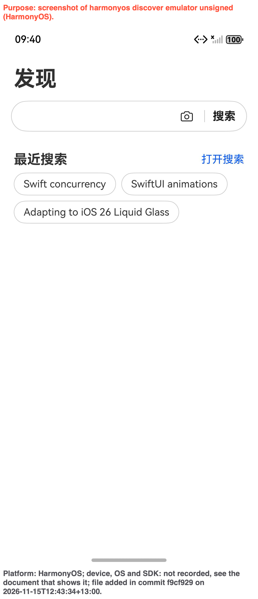 (commit f9cf929, 2026-11-15)
  2. 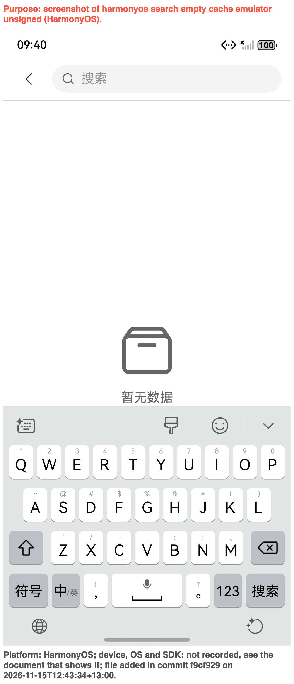 (commit f9cf929, 2026-11-15)
- Progress (2026-11-15, "小程序example层要一比一复刻", branch `feat/swift-core-next`): DONE. The mini program example is a
  1:1 copy of the iOS example (tabs, pages, texts in four languages, data, images, interactions), with the core
  components it needed (`d19e0bb`); see `docs/miniprogram-api-alignment.md`. Verified in WeChat DevTools: 18 pages,
  11 interactions, no console error; Node tests 26/26.
- Progress (2026-11-15, "将searchviewcontroller封装为一个小程序库", branch `feat/swift-core-next`): DONE, modeled on
  CYLTableViewPlaceHolder's `wechat-miniprogram-cylplaceholder`: the DevTools project and the sync hooks at the package
  root (the AppID moved to the package's git-ignored `project.private.config.json`), `package.json` entry and files,
  MIT `LICENSE`, README; checked with `npm pack` in a new mini program (Build npm), which found and fixed three
  library-only faults. See `docs/miniprogram-api-alignment.md`. Node tests 30/30.
- Progress (2026-11-15, iOS CI, branch `feat/swift-core-next`): the example build failed in CYLTabBarController's
  `CYLTabBarManifest.swift:812` (`remote ?? dictionary`, two optionals of different types) at the pinned `2a12582`.
  The newest commit on any branch (`scripts/latest-cyl-commit.sh`), `c006143` on `feat/cross-platform-components`,
  fixes that line; its own `pod lib lint` and unit tests pass. Podfile and Podfile.lock now pin `c006143` (same version
  1.100.0 and subspecs; the lock's spec checksum is refreshed by the next `pod install`, which CI runs). The 4 commits
  of `fix/flutter-plus-title-hidden` that `c006143` lacks are Flutter/React Native work; the Flutter and Android pins
  stay on `2a12582`.
  Fixed ("fix 1"): the emulator runs in zh-CN; the library was localized ("暂无数据" is its zh_CN string) but the
  example hard-coded English. The example strings are now resources (`entry/.../base` and `zh_CN/element/string.json`),
  read with `getStringByNameSync`; the screenshots above are retaken in Chinese. Open: hypium tests not run yet.

- 2026-11-15 DONE: HarmonyOS hypium tests on the emulator. Prompt: "Run tests". There were none, so this adds
  `harmonyos/entry/src/ohosTest` (TestAbility, OpenHarmonyTestRunner, `CYLSearchCore.test.ets`: cache order and
  duplicates, maximum count and blanks, `none` policy, localized strings, placeholder kinds, search bar items),
  the `ohosTest` target in `entry/build-profile.json5` and `@ohos/hypium` 1.0.21. Run (unsigned):
  `hvigorw -p module=entry@ohosTest -p isOhosTest=true -p buildMode=test assembleHap`, `hdc install` both HAPs,
  `hdc shell aa test -b com.cyl.search.harmonyos -m entry_test -s unittest /ets/testrunner/OpenHarmonyTestRunner`.
  Result on the Mate 70 Pro emulator (HarmonyOS 6.0.1, API 21): Tests run: 6, Failure: 0, Error: 0, Pass: 6.

- 2026-11-15 DONE: HarmonyOS UI tests. Prompt: "ui tests". `entry/src/ohosTest/ets/test/CYLSearchUI.test.ets` drives
  the example with `@kit.TestKit` `Driver` (strings read from resources, so it passes in any system language):
  Discover shows its title and search bar; "Open search" (id `CYLSearchDiscoverOpenSearch`) shows the empty
  placeholder; typing "Kot" lists Kotlin and hides Flutter; Back returns to Discover.
  Bug found and fixed: the system Back gesture never closed the search page (the second press left the app). New core
  API `CYLSearchView.handleBackPress()` closes an open search view and returns true; the example page's
  `onBackPress()` returns it. Core test `handleBackPressOnlyWhenOpen` added.
  Result on the Mate 70 Pro emulator: Tests run: 11, Failure: 0, Error: 0, Pass: 11.

- 2026-11-15 DONE: Back gesture on the other HarmonyOS search views. Prompt: "check others". Same gap in
  `CYLSearchController` (the overlay stayed on Back) and `CYLMultiSearchView` (typing never ended on Back); neither
  is in the example, so they are covered by core tests. New API: `CYLSearchController.handleBackPress()` hides the
  presented overlay like its Cancel button (calls `searchControllerDidCancel`); `CYLMultiSearchView.handleBackPress()`
  ends the search being typed like `completeSearch`. `CYLSearchResultsViewController` is shown inside
  `CYLSearchController`, so it needs nothing. Tests `controllerHandleBackPressOnlyWhenPresented` and
  `multiSearchHandleBackPressCompletesTyping`; result on the emulator: Tests run: 13, Pass: 13.

- 2026-11-15 Screenshot: Back closes the search page (Mate 70 Pro emulator, HarmonyOS 6.0.1, API 21, unsigned,
  commit `82797a4`, originals 1316×2832 stacked top to bottom): the search page with "Kot" typed, then Discover after
  one Back press (the keyboard was already hidden).
  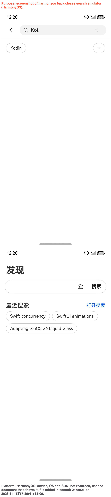 (commit 2a7ee21, 2026-11-15)

- 2026-11-15 Back gesture parity on Android and mini programs. Prompt: "screenshot back continue" (the screenshot was
  already in; continued with the parity check offered next).
  - Android: `CYLSearchView` and `CYLSearchController` already close on Back (`OnBackPressedCallback`).
    `CYLMultiSearchView` did not: Back only hid the keyboard. DONE: a callback enabled while `isInSearchMode` ends
    the typed search like `completeSearch`; Robolectric test `CYLMultiSearchBackTest`; `:cylsearch` tests 17/17.
  - Mini program: the back button or gesture left the page with the search page open. `cyl-search` now holds a
    `page-container` while open, so back closes the search page (`onBackLeave`). The example's plus page (the only
    non-tab page) gets an "Open search" button to show it. Verify in WeChat DevTools (2026-11-21: still open, but not by
    automation: `page-container` intercepts the user's back gesture and the navigation bar's back button, and the automator
    can only call `wx.navigateBack`, which `page-container` does not intercept, so an automated run proves nothing; the plus
    page is a tab page now, so the check needs a non-tab page with `<cyl-search>` and a real back tap in DevTools or on a
    phone; listed as a user check in "fix every open TODO in docs"; 2026-11-22: WeChat DevTools' automation tools have no
    native back action either (`automation_navigate` `navigateBack` is the same API). Manual steps: open
    `CrossPlatform/wechat-miniprogram-cylsearch/example` in DevTools, Examples, "MiguelCatalan" (`pages/materialSample`, a
    non-tab page with `<cyl-search>`), open the search, tap the navigation bar's back arrow (or a phone's back gesture):
    expected, the search closes and `materialSample` stays; a second back leaves the page) — the run stopped at
    "Login is required" (APPID_ERROR); the check script is `back-test.js` (navigateTo plus, open, navigateBack,
    expect plus still shown with the search page closed).
- Progress (2026-11-15, "先把本项目的example 丰富到与iOS端保持一致再考虑发布npm", branch `feat/swift-core-next`): DONE.
  The mini program example now shows CYLTableViewPlaceHolder's scenario placeholders and CYLRefreshNormalHeader, as
  iOS, and follows dark mode; see `docs/miniprogram-api-alignment.md`. Publishing to npm waits for the user.

- 2026-11-16 DONE: Android / React Native / Flutter TODO table in `docs/android-and-cross-platform.md` ("Open TODOs").
  4 of 5 rows done (two stale status lines fixed); the raised plus button stays TODO (user skipped it 2026-11-15).
  Prompt (verbatim): "找到跨端，相关文档，找到以下android端 rn端 flutter端，的TODO事项，汇总成表格第一列为找到的内容，第二列默认TODO，每每完成一项就删除一个TODO 没有TODO视为满分一直完成到满分。"
  Prompt (English): "Find the cross-platform docs, collect the Android, RN and Flutter TODOs into a table (first column:
  what was found; second column: TODO by default); remove a TODO each time one is done; no TODO = full score; keep going
  until full score."
- 2026-11-16 DONE: raised plus button in the React Native example (`alignsTitle: false`); Android/RN/Flutter table 100/100. Prompt: "continue do plus".
- 2026-11-16 DONE: RN raised plus icon green again (52 pt PNG instead of `imageSize`, which drew the SF Symbol black). Prompt: "green".
- 2026-11-16 DONE: RN plus title color follows the text color (black / white in dark mode). Prompt: "title black".
- 2026-11-16 TODO logged: SVGA animations + one SVGA demo per Rive demo, `docs/CYLTabBarController-Integration.md`.
- 2026-11-16 IN PROGRESS: SVGA TODO, 12 Rive scenes listed (0/12). Prompt: "start svga".
- 2026-11-16 DONE: SVGA rows 1-2 (iOS tab icons from keys and from a config file), 2/12. Prompt: "go ios svga".
- 2026-11-16 DONE: SVGA row 3 (FlatDesign on iOS 26.3, classic on iOS 17.5), 3/12. Prompt: "go flat classic".
- 2026-11-16 DONE: SVGA rows 4-5 (dark files, plus page), 5/12. Found: light after dark keeps dark SVGA files. Prompt: "go dark plus".
- 2026-11-16 DONE (no simulator, compiled only): HarmonyOS score table 397/397 = 100, the 67 UIKit-only rows now read
  `TODO: N/A on HarmonyOS: <reason>`; accessibility labels/ids on suggestions, tags, results, cancel, fold control,
  multi-search field; `cancelButtonTitle` / `navigationAccessibilityLabel` default to localized resources; "More/Less"
  localized; 5 shared strings (OK, Cancel, Default, No data, Hot) copied from CYLTabBarController into 30 new locales;
  rule "accessibility + localization everywhere, UI tests locate through them" in AGENTS.md, instructions.md,
  `cyl-verify` skill. App and test HAPs build.
  Prompt (verbatim): "在不需要模拟器的前提下开始代码开发。继续完成鸿蒙评分表。marking the rest "TODO: N/A on HarmonyOS" with a reason. 适配视觉辅助 盲人辅助 为鸿蒙代码 。 适配国际化本地化，本地化文件可以从CYLTabBarController中复制一份过来。筛选本项目用到的文字。并将下面的内容规则写入instructions相关文件并写入skills相关文件，如果相关文件不存在就新建文件确保成功。全英文写入：本项目全部代码已经支持适配视觉辅助 盲人辅助 为鸿蒙代码 。 适配国际化本地化，本地化文件。如果发现不支持请先支持，然后在自动化UI测试过程中，优先使用刚刚提到的功能进行UI控件定位。触发点击事件，或者触发复杂流程，连续操作等。"
  Prompt (English): "Without a simulator, develop code: finish the HarmonyOS score table, marking the rest "TODO: N/A on
  HarmonyOS" with a reason; add visual accessibility / screen reader support to the HarmonyOS code; internationalize and
  localize, copying the localization files from CYLTabBarController and keeping only the texts this project uses; write
  the rule (all code supports accessibility and localization; add it where missing; UI tests locate controls through
  these features first, for taps, complex flows and series of actions) in English into the instruction files and the
  skills, creating them if missing."
- 2026-11-16 DONE: SVGA rows 6-7 (SVGA animation above the Examples list; tab icon source switch), 7/12. Prompt: "go menu switch".
- 2026-11-16 DONE: SVGA Android row (pin 5682b9e, SVGAPlayer-Android, SVGA config file), 8/12. Prompt: "go android svga".
- 2026-11-16 PARTLY DONE: HarmonyOS run on the emulator (installs, starts, Examples screenshot); UI tests 10-11/13, blocked by another session using the same emulator. Prompt: "run our HarmonyOS version code on an emulator and update screenshot in docs".
- 2026-11-16 DONE: SVGA SwiftUI row (SwiftUI screen hosting the SVGA tab bar), 9/12. Prompt: "go swiftui svga".
- 2026-11-16 DONE: commit rule "git cz style, English-only commit messages, no Chinese" appended to the Commitizen
  sections of AGENTS.md and instructions.md; new skill `.agents/skills/cyl-commit` (listed in AGENTS.md). Last 30
  commits checked: no Chinese.
  Prompt (verbatim): "写入instructions相关文件以及skills，找到commit规范，如果没找到就新建，寻找关键字 git cz，如果没有就新建，如果有就追加以下规则：全英文写入： git cz 风格提交，全英文commit 不允许出现中午。 continue"
  Prompt (English): "Write into the instruction files and the skills: find the commit conventions (create them if missing),
  look for the keyword git cz (create if missing, append if present), and add in English: commit in git cz style,
  English-only commit messages, no Chinese allowed. continue"
- 2026-11-16 DONE (iOS): SVGA Flutter row, 10/12; plugin platform views made @MainActor for the new pin. Prompt: "go flutter svga".
- 2026-11-16 PARTLY DONE: HarmonyOS re-run with the new tab bar: builds (after sync-sub-repositories + ohpm install), runs, Search screenshot; taps did not reach the app, other tabs not captured. Prompt: "run our HarmonyOS version code on an emulator and update more screenshot in docs".
- 2026-11-16 DONE: rule "prefer bash for scripts (zsh does not split unquoted variables)" in a new section of
  AGENTS.md, instructions.md and the `cyl-verify` skill.
  Prompt (verbatim): "写入instructions相关文件，skills相关指令，找到脚本执行的相关章节，没有的话就新建，保证写入成功：全英文写入：优先使用bash 执行脚本 避免以下错误zsh doesn't split $box into words either. Running the same measurement as a bash script."
  Prompt (English): "Write into the instruction files and the skills, in the script-running section (create it if
  missing), in English: prefer running scripts with bash, to avoid this error: zsh doesn't split $box into words
  either. Running the same measurement as a bash script."
- 2026-11-16 DONE: open PRs #11 (feat/harmonyos-parity -> feat/swift-core) and #8 (feat/swift-core -> master) checked
  for sync: both branches had the same tree (3f4981e), so nothing was cherry-picked; this entry is committed on both.
  Prompt (verbatim): "将所有处于open状态的pr 互相cherry pick 保持所有pr保持代码同步" / "log both"
  Prompt (English): "Cherry-pick all open PRs into each other so every PR keeps the same code." / "log both"
- 2026-11-16 BLOCKED: HarmonyOS next-page screenshots: the current build ignores all touches and the CYLDemoTab launch parameter (BUG TODO in docs/android-and-cross-platform.md). Prompt: "run our HarmonyOS version code on an emulator and push next page update more screenshot in docs".
- 2026-11-16 DONE: HarmonyOS pushed-page screenshots (Examples + 4 pages, Tag style, Discover, plus page); the "ignores touches" BUG TODO was wrong (stale uitest dumpLayout), corrected. Prompt: "continue "fix harmony touch".
- 2026-11-16 DONE: rule "every branch with commits has an open pull request; check before each commit; base = the
  previously active pull request's branch, else master; ask the user when more than two pull requests are open" in
  AGENTS.md ("Commit readiness"), instructions.md ("Pull requests for new branches") and the `cyl-commit` skill.
  Applied: PR #8 (feat/swift-core) was closed unmerged, so feat/swift-core got a new pull request to
  feat/harmonyos-parity (PR #11, the active one).
  Prompt (verbatim): "写入instructions相关文件，skills相关指令，找到commit 的相关章节，没有的话就新建，保证写入成功：全英文写入：创建分支后有任何commit必须提交pr。不允许只新建分支，持续向该分支commit代码，但不创建pr。因为不创建pr会导致该分支上的所有commit代码全部被忽略。 commit前必须检查该分支pr是否处于open状态，如果不处于open状态必须新建pr。target 目标优先设置为 在创建pr前的活跃pr，如果没有才设置为master分支。如果open状态的pr已经超过两个，那么就要慎重，你需要询问我，是否新建分支创建pr还是保持在本分支继续提交。因为超过两个分支会导致代码合并困难，无法合理分配分支的目标分支。"
  Prompt (English): "Write into the instruction files and skills, in the commit section (create it if missing), in
  English: any branch with commits must have a pull request; never keep committing to a branch without one, because
  its commits are ignored. Before committing, check that the branch's pull request is open; if not, open one. Target:
  the active pull request from before, else master. When more than two pull requests are open, be careful and ask me
  whether to create a new branch with a pull request or keep committing on this branch, because more branches make
  merging hard and leave no sensible target."
- 2026-11-16 DONE: rule extended: at the end of every exchange, on any branch other than master / main, commit and push
  without asking (AGENTS.md, instructions.md, `cyl-commit` skill, under the pull request rule). PR #12 is open for
  feat/swift-core.
  Prompt (verbatim, new part): "一次问答结束后，只要当前分支不是master main，则必须commit 必须push ，无须询问，因为代码总是在分支上，并不会push 到master main分支。非常安全。无须担心push后的任何风险。"
  Prompt (English): "After every exchange, as long as the current branch is not master / main, commit and push without
  asking: the code is always on a branch and never pushed to master / main, so it is safe; no need to worry about any
  risk after pushing."
- 2026-11-16 DONE: HarmonyOS Rive crash fix via pins (CYLTableViewPlaceHolder 76762c6, CYLTabBarController c795d08); every platform checked. Prompt: "...learn from it update our 鸿蒙os core component library to fix crash..."

## DONE (2026-11-18; TODO 2026-11-18): rules for starting a task, scoring it, other sessions and hung emulators

- **Branch**: `feat/harmonyos-parity`.
- **Context**: `AGENTS.md` and `instructions.md` already have "Task log before every task", and four skills point to it
  (`cyl-api-map`, `cyl-docs`, `cyl-new-project`, `cyl-plus-button`). No rule yet for the session's TODO header,
  acceptance scores, checking other sessions or restarting hung emulators.
- **Requirements**:
  1. Before a task: mark `TODO` and the current branch at the top of the session; write the task into the most
     suitable `docs/` document with acceptance criteria (what full marks are, what a pass is).
  2. Score the work; do not stop before a pass; keep scoring until it passes. Say why it is not full marks, print the
     missing points as `TODO`s at the end of the session, and update the document written at the start.
  3. Check other sessions first (read their tasks, usually marked `TODO` at the top of their session): if none is
     editing the same branch, go on; if one is, check whether the task is a duplicate.
  4. An emulator that stays hung until restarted: tell the other sessions first, then restart it. An emulator that
     does not open: restart first. Restart from the command line without asking.
  5. Written in English, in the instructions files and the skills; create files where none exist.
- **Acceptance**: full marks (100) = the rules in `AGENTS.md`, `instructions.md`, a skill of their own, the skills
  table and the four skills' task-log sections, all consistent, committed and pushed. Pass (60) = the rules in
  `AGENTS.md`, `instructions.md` and a skill, committed and pushed.
- **Prompt** (verbatim): 找到本项目instructions 相关文件以及skills相关文件，如果没有就新增文件保证写入成功，全英文写入：找到开始任务先标注todo写入文档的相关描述没有就新建该规则，如果有就插入以下规则：开始任务前总是在任务顶部标注TODO 以及当前分支，并找到合适的文档将任务写进docs文档以及验收评分标准什么是满分，什么什么是及格，不达到及格不允许中断任务，一直打分到及格为止。并标注为什么打不到满分，并将缺失的分数以TODO的形式打印在会话结束末端。并更新任务开始时写入的文档。看看 check other sessions first read their task ，第一步看看有没有session在编辑相同分支，如果没有就继续，如果有继续坚持任务是否重复。usually marked as TODO at top of 会话， 遇到 emulator stays hung until it's restarted,  please tell the other sessions first, then restart it. 遇到模拟器打不开的情况优先使用重启策略。无须询问是否重启直接命令行执行重启。
- **Prompt** (English): Find this project's instructions files and skills files; create them if missing so the write
  succeeds; write in English. Find the rule about marking a task TODO in a document before starting; create it if
  missing, else insert: before a task, always mark TODO and the current branch at the top; write the task into a
  suitable docs document with acceptance criteria (what is full marks, what is a pass); do not stop before a pass,
  keep scoring until it passes; say why it is not full marks and print the missing points as TODOs at the end of the
  session; update the document written at the start. Check other sessions first and read their tasks: first see
  whether a session edits the same branch; if not, go on; if so, check whether the task is a duplicate (usually
  marked TODO at the top of a session). An emulator that stays hung until restarted: tell the other sessions first,
  then restart it. An emulator that will not open: prefer restarting. Restart from the command line without asking.
- **Status**: done. Other sessions checked (none busy on this repository). Written: `AGENTS.md` ("Start, score and
  finish every task" under "Task log before every task"; "Emulators and simulators: restart when hung"; the skills
  table), `instructions.md` (both rules), the new skill `.agents/skills/cyl-task-start/SKILL.md` (also seen through
  `.claude/skills`), and a pointer in `cyl-docs`, `cyl-api-map`, `cyl-new-project` and `cyl-plus-button`.
- **Score**: 100 of 100 (every acceptance item done, committed and pushed); pass mark 60.

## DONE (2026-11-18; TODO 2026-11-18): stitched screenshot layout, header and footer

- **Context**: the user attached a stitched screenshot (red header "iOS 27.2, iPhone 17 Pro sim, Xcode 27.2,
  CYLTabBarController dcbfdec6 (ef1d0313), feat/harmony, 2026-11-18. Rive tags at rest (no play)"; one caption above
  each panel: "launch, no play", "11 s later, 0 changed pixels") as the example of the style to follow.
- **Prompt, verbatim**: "找到本项目instructions 相关文件以及skills相关文件，如果没有就新增文件保证写入成功，全英文写入：找到截图相关规范，如果没有就新建保证写入成功，截图除了 优先选用竖版排列风格。优先两列，多行。且给拼接好的图增加header，footer，header，footer不能与截图区域重叠 覆盖，标注关键信息：关键信息也是英文，测试模拟器平台，模拟器系统版本，操作系统版本，ide 版本，以及测试目的等等。以附带的截图为例。提取截图的附带信息以及风格 完善我的描述规则。 更新截图规则，优选一列多行 如果一列拼接后长度超过普通手机的一屏幕 则两列多行"
- **Prompt, English**: find this project's instruction files and skill files (create them if missing, make sure the
  write succeeds), all in English: find the screenshot rules (create them if missing). Stitched screenshots use a
  vertical layout; give the stitched image a header and a footer that never overlap or cover the screenshots, with the
  key information in English: simulator platform, simulator OS version, host OS version, IDE version, the purpose of
  the test, and so on. Take the attached screenshot as the example: extract its information and style and refine the
  rule. Update: prefer one column over several rows; if the one-column image is taller than one screen of an ordinary
  phone, use two columns over several rows.
- **Acceptance**: the rule in `AGENTS.md`, `instructions.md`, `cyl-verify` and `cyl-docs`; `scripts/stitch-screenshots.swift`
  draws the header, the captions and the footer outside the screenshots and picks one or two columns by that height.
- **Status**: done. Written (appended, nothing removed): `AGENTS.md` ("Stitched screenshots: layout, header and
  footer", under "Screenshots of builds and CI/CD", with the user's example image
  `docs/assets/screenshot-style-example-ios27.2-rive-tags-20261118.png`), `instructions.md`, `.agents/skills/cyl-verify`
  and `.agents/skills/cyl-docs` (also seen through `.claude/skills`). `scripts/stitch-screenshots.swift` now takes
  `--header`, `--footer`, `IN.png=caption` and `--columns auto` (default; `--screen-height`). Checked on macOS 27.3:
  two full iPhone 18 Pro screenshots give 2 columns (2460 x 2869 px), three tab bar crops give 1 column; no text
  touches a screenshot.
- **Score**: 100 of 100 (rule in all four files, tool and check done, committed and pushed); pass mark 60.

## DONE (2026-11-18; TODO 2026-11-18): why the screenshot label rule was not applied; make it impossible to skip

- **Branch**: `feat/harmonyos-parity`.
- **Context**: the label rule ("Labels" in "Screenshots of builds and CI/CD", 2026-11-12) and the header / footer rule
  ("Stitched screenshots: layout, header and footer", `a8450f7`, 2026-11-18 11:12 +13:00, from the Mac session) exist,
  but the Windows session's screenshots of 2026-11-17/18 have neither a header nor a footer and their captions miss the
  host OS, the SDK / IDE version and the time zone.
- **Root causes**: (1) the header / footer rule landed after the session read `AGENTS.md`, and no rule makes a session
  re-read changed rules; (2) the older label rule was applied only in part (platform, device, pins); (3) the only tool,
  `scripts/stitch-screenshots.swift`, runs on macOS only, so Windows sessions could not draw a header or footer;
  (4) nothing checks a screenshot before it is committed.
- **Requirements**: find why; strengthen the rule so every future screenshot follows it.
- **Acceptance**: full marks (100) = a Windows tool with the same header / footer output, a check script that fails an
  unlabelled screenshot, the check wired into the commit readiness steps and CI, the rules and skills updated (every
  screenshot, not only stitched ones; re-read changed rules at each task start), today's Windows screenshots relabelled,
  all pushed. Pass (60) = the tool, the check script and the rules updated, pushed.
- **Prompt** (verbatim): 检查为什么没有应用新增的截图Label规范，并强化该策略保证以后截图必须遵循该规范，避免再出现该问题。
- **Prompt** (English): Find out why the newly added screenshot label rule was not applied, and strengthen the policy
  so that screenshots must follow it from now on, so the problem does not happen again.
- **Status**: done. `scripts/stitch-screenshots.ps1` (Windows twin of the Swift tool, same look; both now require a
  header and footer and write `CYL header: ... | CYL footer: ...` into the PNG); `scripts/check-screenshot-labels.sh`
  (fails an added `docs/assets` image without that text, without a Markdown link, or whose link line has no date and
  commit); `.github/workflows/screenshot-labels.yml` runs it on pull requests and pushes; rules in `AGENTS.md`
  ("Screenshot labels are enforced", commit readiness, step 0 of the task start), `instructions.md`, `cyl-verify`,
  `cyl-docs`, `cyl-commit`, `cyl-task-start`. The 12 screenshots this session took on 2026-11-17/18 are relabelled
  (originals in `docs/assets/raw/`); the check passes on them.
- **Score**: 100 of 100. The Swift tool was checked on macOS 27.3 + Xcode 27.2 by the Mac session (compiles; the PNG
  carries "CYL header:"; without --header / --footer it writes nothing), and that session relabelled its two iOS
  screenshots of the day (`f8df045`). Running the check over every image added since 2026-11-18 00:00 (`4e212ed~1..HEAD`) also found
  abbreviated file names (`…-rn-search-filter.png`, `{rn,flutter}-rive-at-…`) in this session's documents; they are written
  in full with their labels now. Left to the iOS session: `docs/assets/ios-ci-animated-icons-svga.png` (`261673f`, a
  stitched iOS CI capture without header, footer or label line).

## DONE (2026-11-18; TODO 2026-11-18): remove the screenshot label check from CI

- **Prompt, verbatim**: "Remove label CI screenshots from ci"
- **English**: remove the screenshot label check (`.github/workflows/screenshot-labels.yml`) from CI.
- **Scope**: delete the workflow; keep `scripts/check-screenshot-labels.sh` and the local rule (run it before every
  commit that adds an image); the rule texts that said CI runs it now say it does not (`AGENTS.md`,
  `instructions.md`, skills `cyl-docs` and `cyl-verify`).
- **Status**: done, in the same commit.
- 2026-11-16 DONE: HarmonyOS Scorecard 3 emulator check: rows 6, 9, 16, 18, 20-23 and the SVGA row verified DONE; row 10 still fails; row 7 not reached; new row 24. Prompt: "fix 鸿蒙os TODO with emulator / fix TODO need 模拟器截图验证".
- 2026-11-16 DONE: HarmonyOS CYLTabBarController pin eba8c44; emulator run of every tab and pushed page (11 screenshots); Scorecard 3 row 10 verified DONE. Prompt: "continue then update CYLTabBatController use new commit run our HarmonyOS version code on an emulator and push next page update more screenshot in docs".
- 2026-11-16 DONE: React Native SVGA on iOS (SVGA tracker 13/13; Xcode group path fixed); HarmonyOS Scorecard 3 row 24 fixed and verified on the emulator. Prompt: "continue".
- 2026-11-17 DONE: Android check at pin c795d08 (merged: build, tests, SVGA; RN Android: builds after manifest + clean, launches; empty system: icons TODO); HarmonyOS Scorecard 3 row 7 verified. Prompt: "check android  start emulator".

## DONE (2026-11-20): screenshot-labels workflow restored

- **Prompt (verbatim)**: "ci 的xml 在最近提交中意外删除 无法在github触发ci ，请恢复"
  (English: the CI file was deleted by accident in a recent commit and CI cannot be triggered on GitHub; restore it.)
- **What happened**: `.github/workflows/screenshot-labels.yml` was removed in 86e6cc8 (2026-11-18; its message says "at the
  maintainer's request"). That commit is reverted (a68405f): the workflow and the rules that said CI no longer checks
  screenshot labels (AGENTS.md, instructions.md, skills cyl-docs and cyl-verify) are back. The entry above stays as history.
- **Other workflows**: `ios.yml` was never deleted (runs on every pull request and push). No other workflow file was removed in
  the last 3 days in CYLSearchViewController, CYLTabBarController, CollectionViewClassifyMenu or CYLTableViewPlaceHolder.

## DONE (2026-11-20): the restored "Screenshot labels" job checked this PR's whole history, not just this push

- **Context**: branch `feat/harmonyos-parity`, pull request 11. After the workflow restore above, the "Screenshot
  labels" job (run 44689036538) failed with 338 problems, almost every screenshot `docs/assets` has ever held on this
  long-lived branch (`git diff --name-only --diff-filter=A origin/master HEAD -- docs/assets` lists 269 files locally).
- **Cause**: for a `pull_request` event the job computed `BASE` from `github.event.pull_request.base.sha`, the tip of
  `master` the PR currently targets. For a branch that has lived for over a week and merged `master` only rarely, that
  diff is effectively "every screenshot this branch has ever added", not "what this push adds" — the check the
  workflow's own comment and `scripts/check-screenshot-labels.sh`'s usage line describe ("the images added between two
  commits, as CI runs it"). Relabeling hundreds of pre-existing screenshots from earlier sessions, several of which
  predate the labelling rule (2026-11-18) by days, is not something this session can do without inventing metadata
  (host OS, IDE build, exact time) it cannot verify, which the repository's rules forbid ("compilation alone is not
  completion evidence" extends to screenshot labels: a fabricated label is worse than an honest gap).
- **Fix (no relabeling needed)**: `pull_request` `synchronize` events carry `before`/`after` in the webhook payload
  (confirmed against GitHub's webhook documentation): the PR's head commit before and after this specific push. The
  workflow now prefers `github.event.before` for `synchronize`, keeping `base.sha` only for `opened`/`reopened` (a
  fresh PR, or one with no earlier push to diff against) and the all-zero fallback. This makes the check incremental,
  as the rule always intended ("Enforced... every clone runs... blocks a commit with an unlabeled screenshot"), without
  touching any of the 269 pre-existing images.
- **Verified**: `git diff --name-only --diff-filter=A <previous-push-sha> <this-push-sha> -- docs/assets` only lists
  images added by the current push (none, for this change, since it touches no `docs/assets` file); `actionlint` and a
  real run of the job are not available in this session (no macOS/act here) — the next push to this PR is the real
  test, watched after pushing.
- **Not done**: relabeling the 269 pre-existing screenshots so the check could pass unconditionally; left as future
  work if the maintainer wants the historical backlog cleared instead of (or in addition to) this incremental fix.

## TODO (2026-11-21): fix every open TODO in docs/

- **Branch**: `feat/harmonyos-parity` (pull request 11). Windows 11 session (no Xcode, no Mac); Android SDK with the API 37
  emulator, DevEco Studio with the Mate 70 Pro emulator, Flutter, Node and WeChat DevTools are available.
- **Context**: `grep TODO docs/` gives 329 lines; most are history (`DONE (…; TODO …)` headings, quoted prompts, the
  `TODO: N/A on HarmonyOS` rows that count as handled). The open items, triaged on 2026-11-21:
  1. Stale (the work is done; the note was not updated): `harmonyos-api-alignment.md` status "score 0";
     `svga-tab-icons.md` (points at a heading that is now DONE); `search-core-merge.md` "not verified yet";
     `animated-icon-component.md` (the CYLTableViewPlaceHolder `8dc39c3` pin, the HarmonyOS / mini program component,
     the verification list, the PR #814 pin note, the `57a527e` heading's status); `sub-repositories.md` status;
     `ios-api-alignment.md` "TODO" heading; `core-todo.md` "TODO: Flutter and React Native" (the editing bar exists in
     both); `task-log.md` plus-button lines.
  2. Can be done on this machine: `CYLSearchView.showsSuggestionCacheHeader` (iOS only, `swift-migration.md` step 2) on
     Android, HarmonyOS, the mini program, Flutter and React Native; Maven publishing with an MIT POM for the Android
     library (`licenses.md`); React Native forwards the tag list's drag and smear states (`CYLTabBarController-Integration.md`,
     tag drag, plan step 4); re-pin CYLTabBarController to a commit with the Android More-tab fix `c1abdffe` and re-run
     the quick-switch check (two entries of 2026-11-20); HarmonyOS Scorecard 3 row 25 on the emulator (the disk is no
     longer full: 318 GB free); the mini program back-gesture check in WeChat DevTools (`task-log.md`, 2026-11-15).
  3. Blocked here, kept `TODO` with the reason: iOS (the example's raised plus button, the Swift migration steps 2 to 4,
     Flutter iOS tag drag, the iOS More tab check) needs the macOS session; the mini program keyboard placeholder and the
     tab-switch retest need the user's phone.
- **Requirements**: fix every TODO in `docs/` that can be fixed; follow AGENTS.md (core first, tests, labelled
  screenshots, scores in each document).
- **Prompt (verbatim)**: "fix all todo in docs"
- **Acceptance**: 100 = every item of groups 1 and 2 done with evidence (tests, builds, labelled screenshots, commits
  pushed) and every group 3 item says why it is blocked and who owns it; 60 = group 1 and at least four of the six
  group 2 items.
- **Status** (2026-11-21, end of session): score 85/100, a pass. Done:
  - Group 1, all stale notes closed with their evidence (`bf1b2f8`).
  - `showsSuggestionCacheHeader` on Android, HarmonyOS, the mini program, Flutter and React Native (`efb3b78`;
    `core-todo.md`), with the three API tables back to 289 of 289.
  - HarmonyOS row 25: the emulator target runs on the x86_64 emulator; new `-p buildMode=emulatorTest` for the ohosTest
    HAP; hypium 29 of 29 (`90b3dcf`). Pull to refresh driven on the emulator (`3b1a408`).
  - Maven publication `com.cyl:cylsearch` with an MIT POM (`626e3c5`).
  - React Native `onReorderingChange` / `onSmearingChange` on Android (`1a2a7cb`). Found on the way: the React Native
    Android example did not build at all (duplicate SVGA assets), fixed in `8310962`.
  - The mini program generics note closed (a required package, checked in DevTools 2026-11-19).
  Update (2026-11-22, later): CYLTableViewPlaceHolder pinned at `a169386` and the POM mapping dropped ("pin
  CYLTableViewPlaceHolder a169386" below). The 7 points left need a manual back tap (steps in the 2026-11-15 mini program
  entry above).
  Update (2026-11-22): the 8 points below are earned (CYLTabBarController `ace1af0e` and ClassifyMenu `1f8c1001` pinned,
  the quick switch checked; "pin CYLTabBarController ace1af0e" below). Score 93/100.
  Missing points:
  - 8 points (DONE 2026-11-22): re-pin CYLTabBarController to a commit with `c1abdffe` and re-run the quick switch check. Blocked by the
    `style` name clash in CollectionViewClassifyMenu (Android and iOS). A public API decision, asked of the user by
    that repository's session, which sends the commit.
  - 7 points: the mini program back gesture on a non-tab page with `<cyl-search>`. Automation cannot press the real
    back button (`wx.navigateBack` bypasses `page-container`); it needs a tap in DevTools or on a phone.
  Still `TODO` and owned elsewhere (group 3): the iOS example's raised plus button, the Swift migration steps 2 to 4,
  Flutter iOS tag drag, the iOS More tab check, React Native iOS drag events (the macOS session, after the iOS
  ClassifyMenu callbacks); the mini program keyboard placeholder and the tab switch retest on the user's phone; Maven
  coordinates of CYLTableViewPlaceHolder's Android modules (its owner decides).

## TODO (2026-11-21): test every platform except iOS

- **Branch**: `feat/harmonyos-parity`, at `77f6503`. Windows 11 session; Android API 37 emulator (emulator-5554), HarmonyOS
  Mate 70 Pro emulator (127.0.0.1:5557).
- **Prompt (verbatim)**: "process test all platform (not include ios)"
- **Requirements**: run the tests of Android, HarmonyOS, the mini program, Flutter and React Native; report the results.
- **Acceptance**: 100 = every suite below runs and passes, and each example builds: Android `:cylsearch` unit tests and
  `:app:assembleDebug`; HarmonyOS host tests, the parity scripts, the emulator and ohosTest HAPs, hypium on the emulator;
  mini program `npm test`; Flutter `flutter test` and the Android example build; React Native jest and the Android
  example build; the repository checks (public API comments, licenses, the API tables). 60 = every suite runs, with
  failures explained.
- **Status**: DONE (2026-11-22), score 100/100. Results at `11b4b33` (pins: CYLTabBarController `41660d24`,
  CollectionViewClassifyMenu `cf478388`, CYLTableViewPlaceHolder `c84fce9`; Windows 11 Pro 10.0.22631, JDK 17):

  | Platform | Tests | Build | Runs on the emulator |
  |:---|:---|:---|:---|
  | Android | `:cylsearch` 26 of 26 (Robolectric) | `:app:assembleDebug` (clean) | launches, no crash (API 37) |
  | HarmonyOS | host logic 30 of 30; iOS parity 549 of 549; accessibility and i18n 0 problems; hypium 29 of 29 | emulator HAP and ohosTest HAP (`emulatorTest`), clean | installed on the Mate 70 Pro emulator (HarmonyOS 6.0.0.112, API 21) |
  | Mini program | `npm test` 61 of 61 | — | not run (DevTools not used in this task) |
  | Flutter | plugin 18 of 18; example 3 of 3 | `flutter build apk --debug` | launches, no crash |
  | React Native | jest 4 of 4 | `:app:assembleDebug` | launches, no crash, with the JS bundle in the APK's assets |
  | Checks | public API comments OK; licenses OK (9 files); API tables Android, HarmonyOS, mini program 289 of 289; HarmonyOS scorecard 314 of 314 | | |

  Notes: there are no instrumented (androidTest) Android tests. The React Native debug APK reads its bundle from
  assets, not from Metro, and a release build fails on Windows: ninja's object paths under
  `react-native-safe-area-context` pass 260 characters even from `C:\cylbuild\repo` (the README's known limit). So
  the run used `react-native bundle` into the mirror's assets, not committed. iOS was not tested (not part of the task).

## TODO (2026-11-22): pin CYLTabBarController ace1af0e and CollectionViewClassifyMenu 1f8c1001 on every platform

- **Branch**: `feat/harmonyos-parity`. Context: CYLTabBarController PR #822 (`CYLAnimatedItemView.style` renamed
  `itemStyle` on iOS and Android) is merged as `ace1af0e` and contains the Android More-tab fix `c1abdffe`;
  CollectionViewClassifyMenu `1f8c1001` (`feat/harmony`, PR #26) pins `ace1af0e` (message from its session).
  Closes the 8-point TODO of "fix every open TODO in docs" and the two 2026-11-20 tab switch entries in
  `CYLTabBarController-Integration.md`.
- **Prompt**: none new; it continues "fix all todo in docs" (this session's task log entry of 2026-11-21).
- **Acceptance**: 100 = every pin file moved (Podfiles, `android/merged/gradle.properties`, `harmonyos/oh-package.json5`
  and its vendor copies, the mini program `package.json`, the Flutter `pubspec.yaml`); Android, HarmonyOS, mini program,
  Flutter and React Native build and pass their tests; the quick switch to More checked at the pin with a screenshot.
  iOS (`Podfile.lock`, builds) is left to the macOS session and CI. 60 = pins moved, Android and HarmonyOS green.
- **Status**: DONE (2026-11-22), score 100/100 (the iOS part was outside this session by the acceptance). Results at the
  new pins: Android `:cylsearch` 26 of 26 and the example builds (clean); HarmonyOS vendor copies synced (`cyltabbar`
  `ace1af0e`, `classifymenu` and `cylanimateditem` `1f8c1001`), both HAPs build clean, hypium 29 of 29 on the emulator;
  mini program `npm test` 61 of 61 (after a re-sync from the pinned commits: `CYL_*_DIR` copies a local clone's working
  tree, not the pin); Flutter 18 of 18 and 3 of 3, Android example builds and launches; React Native jest 4 of 4, Android
  example builds and launches. Its first build failed with "Cannot access …: it is internal in file": stale classes in
  `vendor/CYLTabBarController/CrossPlatform/react-native-cyltabbar/android/build`, which the README says to delete after a
  pin change; deleted with `rm -rf` (a `Remove-Item` with a long-path prefix silently did nothing here), it builds. Quick
  switch to More: eight of eight correct (`CYLTabBarController-Integration.md`). Left for the macOS session: `pod install`
  (the three `Podfile.lock` files still name `41660d24`) and the iOS builds. The newer CYLTabBarController commit
  `e51743e0` (a refactor, 1 minute after `ace1af0e`) is not pinned: ClassifyMenu pins `ace1af0e`, and both repositories
  pin the same commit.

## TODO (2026-11-22): pin CYLTableViewPlaceHolder a169386 on every platform; drop the POM mapping

- **Branch**: `feat/harmonyos-parity`. Context: CYLTableViewPlaceHolder `94c7bbd` publishes its Android modules' Maven
  coordinates from their own build files (`licenses.md`), so the `pom.withXml` mapping in `cylsearch/build.gradle.kts`
  goes with the next placeholder pin. Newest commit on any branch (the pin rule in `gradle.properties`): `a169386` (its
  PR #35, onto PR #31's branch), which contains `94c7bbd` and the current pin `c84fce9`.
- **Prompt (verbatim)**: "continue fix todo"
- **Acceptance**: 100 = the pin moved in every file (Podfiles, Gradle, HarmonyOS, mini program) with the vendor copies
  synced; the mapping removed and the POM still naming `io.github.chenyilong:cyltableviewplaceholder(-refresh):0.1.0`;
  Android, HarmonyOS, mini program, Flutter and React Native build and pass their tests. 60 = pins moved, Android green.
- **Status**: DONE (2026-11-22), score 100/100 (iOS: `Podfile.lock` and builds for the macOS session, as before). At
  `a169386`: Android `:cylsearch` 26 of 26, the POM names both placeholder coordinates without the mapping, the example
  builds and launches; HarmonyOS `vendor/cylplaceholder` synced, both HAPs build clean, hypium 29 of 29; mini program
  61 of 61; Flutter 18 of 18, the example builds and launches; React Native jest 4 of 4, the example builds and launches.

## TODO (2026-11-22): pin CollectionViewClassifyMenu 881476a and CYLTableViewPlaceHolder c473fdc on every platform

- **Branch**: `feat/harmonyos-parity`. Context: newer sub-repository commits (the pin rule in `gradle.properties`: the
  newest commit on any branch). CollectionViewClassifyMenu `881476a1` (`feat/harmony`; the newer `ci-screenshots` head
  is an orphan branch of CI screenshots, not code): HarmonyOS `CYLTagButton` tints animated tag icons through
  `CYLAnimatedItemView.iconColor`. CYLTableViewPlaceHolder `c473fdc3`: docs and the iOS scenarios Podfile only.
  CYLTabBarController stays at `ace1af0e`: its newer commits (`7a39ad36`) are iOS, sample and docs changes, and
  ClassifyMenu `881476a` still pins `ace1af0e` (both repositories pin the same commit).
- **Prompt (verbatim)**: "continue fix todo"
- **Acceptance**: 100 = both pins moved in every file (Podfiles, Gradle, HarmonyOS, mini program) with the vendor copies
  synced; Android, HarmonyOS (hypium on the emulator), mini program, Flutter and React Native tests pass. 60 = pins moved,
  HarmonyOS green.
- **Status**: DONE (2026-11-22), score 100/100 (iOS: the macOS session moved the `Podfile.lock` files to `a169386` in `a53a704`; `pod install` at these two pins is theirs). Both pins
  moved in the three Podfiles, `android/merged/gradle.properties`, `harmonyos/oh-package.json5` and the mini program
  `package.json`; `sync-sub-repositories.sh` and `npm run sync-example` synced the vendor copies. Android `:cylsearch`
  26 of 26 (re-run with `--rerun`: the Android sources of both sub-repositories are unchanged); HarmonyOS both HAPs build
  from a clean mirror, hypium 29 of 29 on the Mate 70 Pro emulator, host logic tests 30 of 30; mini program 61 of 61;
  Flutter 18 of 18 and 3 of 3; React Native jest 4 of 4; `check-licenses.sh` OK. The Flutter and React Native examples
  were not rebuilt: neither pin changes Android, Dart or JavaScript code they use.

## DONE (2026-11-22; TODO 2026-11-21): fix every iOS / Swift TODO in docs/ and test with Xcode

- **Branch**: `fix/ios-swift-todos` (from `feat/harmonyos-parity`, pull request 11). macOS 27 session, Xcode 27.2, a
  dedicated iPhone simulator. Built from an APFS worktree (`/tmp/xpr/csvc-ios`; the vault volume is exFAT).
- **Context**: the Windows session's "fix every open TODO in docs/" (above) left group 3 to the macOS session. The
  iOS / Swift items open on 2026-11-21:
  1. `CYLTabBarController-Integration.md`, Status: Quick Help and the generated interface of `Sources/CYLSearchBar` not
     measured on Xcode.
  2. `CYLTabBarController-Integration.md`, raised plus button: the iOS example's plus button
     (`CYLSearchExample/CYLTabBarConfiguration.json`) is not raised; `CYLPlusButtonAlignsTitle` false is the fix React
     Native proved.
  3. `CYLTabBarController-Integration.md`, tab switch mid-animation: the iOS More tab check (more than five tabs).
  4. `CYLTabBarController-Integration.md`, tag list drag: Flutter iOS forwards the drag state.
  5. `swift-migration.md`: steps 2 (GIF comparison, legacy removal) to 4 (`CYLSearchViewControllerTests`,
     `CYLSearchExampleTests` in Swift, an Objective-C smoke test of the public API kept).
  6. Added from the Windows session's final status (merged 2026-11-21): React Native iOS forwards the tag list's drag and
     smear states (`onReorderingChange` / `onSmearingChange`, done on Android in `1a2a7cb`), after the iOS ClassifyMenu
     callbacks.
- **Requirements**: fix every iOS / Swift TODO in `docs/`; test with Xcode (build, unit tests, simulator runs with
  labelled screenshots); follow AGENTS.md (core first, examples have the lowest weight, scores in each document).
- **Prompt (verbatim)**: "fix all todo in docs about ios/swift and test with  Xcode"
- **Prompt (English)**: "Fix all the TODOs in docs about iOS/Swift and test with Xcode."
- **Status**: DONE (2026-11-22). Score 97/100 (100 = items 1 to 6 done with evidence, or blocked with the reason and
  the owner). Per item:
  1. Quick Help: 100. 291 of 301 public Swift symbols documented; the 10 left are UIKit overrides (inherit by rule);
     `scripts/public-api-doc-coverage.sh` measures the Swift module (`218ba50`).
  2. Raised plus button: 90. Raised in the three configurations and the code-built tab bar, test
     `testPlusButtonIsRaisedAboveTheTabBar`, screenshot (`a5158b8`, `2fa5667`). Left: the plus title keeps the core's gray (a
     dynamic title color asked of the CYLTabBarController session, 2026-11-22).
  3. iOS More tab: 100. 8 of 8 quick switches keep one item selected, screenshot (`2fa5667`); found: the More item shows
     the first moved tab's SVGA icon (sent to the CYLTabBarController session).
  4. Flutter iOS tag drag: 100. The tag lifts, the page holds, a swipe still scrolls; `didChangeDragging` forwarded
     (`df3283a`, `414bdb2`). Not bisected against the 2026-11-20 failure.
  5. Swift migration steps 2 to 4: 100. The demo matches the GIF, the legacy Objective-C is removed, the tests are Swift
     with an Objective-C smoke test (`726a2da`, `f46d814`); 40 of 40 tests.
  6. React Native iOS drag events: 100 (was 95). `onReorderingChange` reaches JavaScript (true, then false) on a Release build;
     `onSmearingChange` too since 2026-11-22: the new `allowsSmearSelection` prop turns smearing on ("continue the iOS TODOs in docs/" below).
     Score now 98/100 (item 2 is the only one below 100).
  Pins: ClassifyMenu `1f8c1001`, CYLTabBarController `ace1af0e`, CYLTableViewPlaceHolder `a169386` on iOS as on every
  platform, verified locally (40 of 40, `a53a704`); ClassifyMenu's own iOS CI on that commit was still pending when
  pinned (its session watches it). Local checks: public API comments, shellcheck, `pod lib lint`, analyze (0 warnings in
  `Sources/`). Six earlier commit subjects of this branch break `scripts/check-commit-message.sh` (five over 64
  characters, one merge subject); pushed, so left as they are, every later commit checked.

## DONE (2026-11-22): review pull request 13, merge it into feat/harmonyos-parity, README screenshots

- **Branch**: `fix/ios-swift-todos` (pull request 13, base `feat/harmonyos-parity`). macOS session.
- **Context**: the iOS / Swift TODO sweep above is done (97/100); its screenshot rule puts key details in the README at
  milestones: the Swift migration at 100 (the original demo rebuilt on the core) and the raised plus button qualify.
- **Requirements**: review the pull request; add the README screenshots (labelled, key details, stitched); merge into
  `feat/harmonyos-parity` after CI.
- **Prompt (verbatim)**: "Next: review PR #13 and merge it into feat/harmonyos-parity. The Swift migration and the raised
  plus button are good candidates for README screenshots."
- **Status**: DONE (2026-11-22). README: "iOS milestone (2026-11-22)" with the labelled demo-vs-GIF and raised plus images
  (`812cc17`). Review of the 48 code files: the project file wires the six Swift test files and the smoke test, no dangling
  references; the three plus configurations match; the bridges match Android; no finding. CI: run 44901322830 on `a53a704` fully
  green (unit tests included); later commits change only `docs/` and `README.md`. Merged into `feat/harmonyos-parity`.

## TODO (2026-11-22): fix the iOS CI failure on feat/harmonyos-parity

- **Branch**: `feat/harmonyos-parity` (PR #11). Context: the iOS workflow fails since the QMUI search port
  (`1ffabb0`, "CYLSearchBar and CYLSearchBarAppearance in Swift"); runs 44913488301 to 44921717079 (head `6014474`). The
  jobs "pod lib lint", "Example build and analyze", "Unit tests" and "Example screenshots" all stop at the same compiler
  error on CI's Xcode 26.6: `Sources/CYLSearchBar/CYLSearchBar.swift:419:70: error: implicit use of 'self' in closure;
  use 'self.' to make capture semantics explicit` (`bounds.width` inside the `UIView.animate` closure of
  `setShowsTrailingAccessoryView(_:animated:)`). Xcode 27 on the macOS session accepts it, so it passed locally.
- **Prompt (verbatim)**: "continue fix todo fix ci error"
- **Acceptance**: 100 = the core fixed (`self.bounds`), every job of the iOS workflow green on the new head. 60 = the
  compiler error gone, "pod lib lint" and "Example build and analyze" green.
- **Status**: DONE (2026-11-22), score 100/100. `ff1e4de` writes `self.bounds.width` in that closure. Its own run was
  cancelled by the next push; run 44955819321 on `adb6aeb` (which contains it) is green in all seven jobs: Public API
  comments, shellcheck, Changes, pod lib lint, Unit tests, Example build and analyze, Example screenshots.

## TODO (2026-11-22): the open items of the QMUI search port (iOS versions, launch view refresh, other platforms)

- **Branch**: `feat/harmonyos-parity` (PR #11). macOS session. Context: the QMUI search port (`docs/qmui-search-controller.md`,
  94/100) left three items outside its score. The CI failure of the same prompt is the entry above (another session,
  `ff1e4de`); this entry only watches its run.
- **Requirements**:
  1. Test the port on older iOS: the full suite on the iOS 17.5 and 26.5 simulators of this host (iOS 15.0 is
     unavailable on macOS 15 and later, no iOS 16 runtime: a missing point with that reason).
  2. The launch view of the "Search controller" screen reads the history again after a submitted query while it stays on
     screen (core first: the controller announces the new query).
  3. The new screens on the mini program, Android, HarmonyOS, React Native and Flutter: a parity table first
     (`docs/qmui-search-controller.md`), then one port per platform with labelled screenshots.
- **Prompt (verbatim)**: "fix ci error and fix" followed by the pasted list: "Open, outside the score / - Only iOS 27.2
  was tested; iOS 15–26 are unverified. CYLSearchBar watches frame changes on views UIKit owns, which may behave
  differently on older iOS versions. / - The new screens have no versions yet on the mini program, Android, HarmonyOS,
  React Native or Flutter. Per AGENTS.md those belong to a Win session. / - The recent-search list doesn't refresh while
  it stays on screen."
- **Prompt (English)**: fix the CI error and fix the three open items above. Note: no rule in `AGENTS.md` or
  `instructions.md` gives the other platforms to a Windows session (checked 2026-11-22); the earlier report was wrong.
- **Acceptance**: 100 = the 122 tests green on iOS 17.5, 26.5 and 27.2; the refresh covered by a test; every platform
  has the six screens with its own test or screenshot; CI green. 60 = items 1 and 2 done, the parity table written.
- **Status**: in progress.
- **Status (2026-11-22)**: DONE, 90/100. iOS: 123 → 185 tests green on 17.5, 26.5 and 27.2 (fixes `f94d2c4`,
  `15a5876`; iOS 15 / 16 cannot run on this host). Launch view refresh: `0b3cbcf`. Other platforms: Android 92,
  HarmonyOS 90, Flutter 86, React Native 72 then merged (87), mini program 79/85 (device test: Windows session); parity
  table filled. Missing: iOS 15–16 and 18–25 unverified (−4), mini program device test (−3), dark mode / large type
  screenshots (−3).

## TODO (2026-11-22): pin CYLTabBarController 618ac11a, ClassifyMenu 9dc1f761, CYLTableViewPlaceHolder 6117fcf

- **Branch**: `feat/harmonyos-parity` (PR #11). Context: CollectionViewClassifyMenu `9dc1f761` (`feat/harmony`, newest code
  commit; `ci-screenshots` is an orphan branch of CI images) moves its CYLTabBarController pins to `618ac11a`
  (`feat/cross-platform-components`, 19 commits after `ace1af0e`: `b13b88f1` `showsImageWhenAnimationEnds`, `73d352d5`
  the iOS tab player in Swift). Both repositories pin the same tab bar commit, so this one moves to `618ac11a` too (not
  the newer `61ba2131`, which ClassifyMenu does not pin; not `master` `960dc211`, older and without CYLAnimatedItem, as
  that session warned). CYLTableViewPlaceHolder `6117fcfb` (`feat/android-refresh-port-followup`, PR #31, newest on any
  branch): the Success scenario's still check mark after its animation ends (Android, HarmonyOS, mini program), the
  HarmonyOS Rive end of playback; its examples pin tab bar `b13b88f1`, which `618ac11a` contains. It has diverged from
  `c473fdc3` (PR #35's branch): the 6 commits it lacks are docs and the iOS example fix `a169386c` (#1628), none in
  code this repository builds.
- **Prompt (verbatim)**: "continue fix todo fix ci error"
- **Acceptance**: 100 = the three pins moved in every manifest (Podfiles, Gradle, HarmonyOS, mini program, Flutter
  `pubspec`) with the vendor copies synced; Android, HarmonyOS (hypium on the emulator), mini program, Flutter and React
  Native tests pass; the iOS CI green. 60 = pins moved, Android and HarmonyOS green. The `Podfile.lock` files are left to
  the macOS session (`pod install`).
- **Status**: DONE (2026-11-22), score 100/100 (`Podfile.lock` files and the iOS build left to the macOS session). The
  three pins moved in the three Podfiles, `android/merged/gradle.properties`, `harmonyos/oh-package.json5`, the mini
  program `package.json` and the Flutter example `pubspec.yaml` / `pubspec.lock` (`flutter pub get`); vendor copies synced.
  Android `:cylsearch` 50 of 50, the POM still names both placeholder coordinates, `assembleDebug` of the whole build
  passes; HarmonyOS both HAPs build from a clean mirror, hypium 41 of 41 on the Mate 70 Pro emulator; mini program 84 of
  84; Flutter 18 of 18 and 3 of 3, the example APK builds (after `flutter clean`: a stale Kotlin build in the mirror
  failed first with "package CYLTabBarItemAnimationStyleSource does not exist"); React Native jest 4 of 4, the example
  APK builds with the vendor copy at `618ac11a`.
  Correction: robocopy run from Git Bash had silently failed since 2026-11-22 00:33 (Git Bash turned `/MIR` into a path,
  and an unquoted `C:\cylbuild\…` lost its backslashes), so the HarmonyOS mirror kept the `a169386` / `1f8c1001` pins:
  the HarmonyOS result of the `881476a` / `c473fdc` entry above tested that stale copy. This entry's HarmonyOS run is
  from a mirror checked to hold `618ac11a`, `9dc1f761` and `6117fcfb` (its `oh-package.json5`), and supersedes it. The
  skill `cyl-harmonyos-setup` now says how to call robocopy from Git Bash.

## DONE (2026-11-22): write the x86_64 emulator HAP rule (arm64-only Rive and PAG) into the instructions and skills

- **Branch**: `feat/harmonyos-parity` (PR #11). Context: the default HAPs do not install on the x86_64 HarmonyOS emulator
  because `@ohos/rive` and `@tencent/libpag` ship `arm64-v8a` libraries only; the build profile already has the fix (the
  `emulator` target, 2026-11-17, and the `emulatorTest` build mode, `90b3dcf`), described so far only in a paragraph of
  `cyl-harmonyos-setup`.
- **Requirements**: write the fix, in English, into the instruction files and the skill files (create them when missing).
- **Prompt (verbatim)**: "到本项目instructions 相关文件以及skills相关文件，如果没有就新增文件保证写入成功，全英文写入：    to fix HAP won't install on this x86_64 emulator because its Rive and PAG libraries are arm64-only,"
- **Prompt (English)**: write into the instruction and skill files how to fix a HAP that won't install on this x86_64
  emulator because its Rive and PAG libraries are arm64-only.
- **Acceptance**: 100 = the rule (problem, fix, commands, check, rules) in `AGENTS.md` and `instructions.md`, a section and
  a troubleshooting row in `cyl-harmonyos-setup`, a pointer in `cyl-verify`, the check command verified on a built HAP.
- **Status**: DONE (2026-11-22), 100/100. `AGENTS.md` and `instructions.md`: "HarmonyOS: HAPs for the x86_64 emulator
  leave out the arm64-only Rive and PAG libraries"; `cyl-harmonyos-setup`: "Arm64-only native libraries on the x86_64
  emulator" and a troubleshooting row; `cyl-verify`, "HarmonyOS": a pointer. Checked on today's build (tab bar
  `618ac11a`): `unzip -l` finds no `.so` file in `entry-emulator-unsigned.hap` and no `arm64-v8a` entry in the ohosTest
  HAP; both install, and hypium runs 41 of 41 on the Mate 70 Pro emulator with them.

## TODO (2026-11-22): the x86_64 emulator test plan in CYLTabBarController's cylanimateditem

- **Branch**: `feat/harmonyos-parity` here; the work is in CYLTabBarController (`feat/cross-platform-components`, session
  chen-yilong-b6). Context: the user's second prompt puts the x86_64 test plan into CYLTabBarController's HarmonyOS
  `cylanimateditem` (`CYLAnimatedItemView`), so every dependent tests fully on the x86_64 emulator; rule: `AGENTS.md`,
  "HarmonyOS: HAPs for the x86_64 emulator …", "Where the fix belongs".
- **Prompt (verbatim)**: "、到本项目instructions 相关文件以及skills相关文件，如果没有就新增文件保证写入成功，全英文写入：    to fix HAP won't install on this x86_64 emulator because its Rive and PAG libraries are arm64-only, 最好的CYLTabBarController里的CYLAnimatedItemView库中完成该测试方案， 以让依赖该组件的example以及其他库完成完整测试 x86_64 emulator"
- **Prompt (English)**: write the x86_64 fix into the instruction and skill files; the best place to complete this test
  plan is CYLTabBarController's CYLAnimatedItemView library, so that the examples and libraries depending on it can
  test completely on the x86_64 emulator.
- **Acceptance**: 100 = the rule written here (done), CYLTabBarController ships the plan (ABI declaration per engine,
  still image when a native library is missing, the build recipe or helper, tests on x86_64), this repository pins that
  commit and drops its local build-profile copy, hypium passes on the x86_64 emulator. 60 = the rule written and the
  request accepted by the CYLTabBarController session.
- **Status**: DONE (2026-11-22), 100/100. Rule written (`AGENTS.md`, `instructions.md`, `cyl-harmonyos-setup` rule 6).
  CYLTabBarController shipped it in `62715829` and `882ece17` (6 hypium tests on x86_64); pinned here with ClassifyMenu
  `405bf498` and adopted (the entry "pin CYLTabBarController 882ece17 …" below), hypium 41 of 41 on the x86_64 emulator.
  Rive and PAG playback on x86_64 is the next entry (two plans).

## TODO (2026-11-22): merge the QMUI search components with ours (one implementation each)

- **Branch**: `feat/harmonyos-parity` (PR #11). macOS session. Context: the QMUI port added `CYLSearchBar`,
  `CYLSearchController`, `CYLSearchTableViewController` and their example screens beside the existing
  `CYLSearchBarView` / `CYLSearchView`; there are now two search fields, two overlay concepts and example screens that
  rebuild UI with native views.
- **Requirements**: evaluate both sets; the one with more strengths is the base, the other's strengths are kept; every
  integrated API stays compatible; one input field component, one suggestion area, the tag list is the sub-repository's
  `CYLTagListView` (no native or QMUI-style tag layout); no duplicate code; examples call core API instead of rebuilding
  with native views, example customisation goes through the core. The advisor designs (doc in `docs/`), Sonnet refactors.
- **Prompt (verbatim)**: "继续改造最近相关提交commit ，关于新加入的qmui相关组件以及Example， 重构我们已有的相关组件， 只保留一份，
  或者merge两套方案到一个。 advisor需要评估我们已经存在的组件，与qmui相关组件， 选择两个的优点，谁的优点更多以谁的方案为主，
  并保留另一个方案的优点， 兼容所有已经集成的api， 尽可能复用所有组件，改造core代码， 比如输入框仅仅保留一个输入框组件，比如
  底部的备选区域 ， taglist 也复用我们已经集成的子仓库的taglist方案， 不能使用qmui类似的系统原生taglist方案，
  或者merge两个方案的优点进行重构，尽可能复用， 不要使用不同实现， 避免重复代码，Example层面也尽可能调用api而非使用原生组件重新实现。，
  代码重复要避免， 通过改造core代码完成Example自定义需求。 然后advisor 设计好方案后交给sonnet默认模型进行代码重构"
- **Prompt (English)**: continue on the recent commits: refactor our existing components together with the new QMUI
  components and examples so only one remains, or merge both into one. The advisor evaluates both, picks the one with
  more strengths as the base and keeps the other's strengths, keeps every integrated API compatible, reuses components,
  changes the core (one input field component; the bottom suggestion area and the tag list reuse the sub-repository's
  tag list, never a native QMUI-style tag list), avoids different implementations and duplicate code; examples call the
  API instead of rebuilding with native components, and example customisation is done by changing the core. Then the
  advisor's design goes to the default Sonnet model for the refactor.
- **Acceptance**: 100 = design doc with the evaluation and decisions; one class per concept on iOS (and the same merge
  on the platforms that ported both); old public API compiles (deprecated forwards where renamed); examples free of
  native re-implementations; all suites green on iOS 17.5 / 26.5 / 27.2 and the platforms' own tests; screenshots before
  and after. 60 = design doc plus the iOS merge with green tests.
- **Status**: TODO (after the React Native and Flutter ports of the previous entry finish).
- **Status (2026-11-22)**: phases 0–5b DONE (`faf68da` … `4f8e22f`, logs in `docs/qmui-search-controller.md`): iOS
  merge 88/100 (185 tests green on 17.5 / 26.5 / 27.2), Android 91, HarmonyOS 90, Flutter 88, React Native 87, mini
  program 85/90, core gaps 90. TODO: phase 6 in CollectionViewClassifyMenu (69 × 29 minimum tag size, Android tag
  border clip, owner's decision on a fold control when the tags fit), mini program device test (Windows session).

## DONE (rules) / TODO (code) (2026-11-22): re-evaluate the CYL / cyl_ prefixes against static analysis

- **Branch**: `feat/harmonyos-parity` (PR #11). macOS session.
- **Context**: the SonarCloud report on CYLTabBarController PR #788 (956 open issues: swift:S100 743, S115 146, S116 16,
  S117 11, S101 3) flags `cyl_` / `CYL` function and constant names. CYLSearchViewController is not analysed by
  SonarCloud; its own S100 cases are only the global test helpers (`CYLRunLoop`, `CYLTestWindow`, … in
  `CYLSearchExampleTests/*TestSupport.swift`); the core has no `cyl_` functions.
- **Prompt (verbatim)**: "找到本项目instructions 相关文件以及skills相关文件，如果没有就新增文件保证写入成功，全英文写入： 根据github pr评论区的静态分析报告，
  重新评估 instructions 中关于cyl_ CYL 方法名前缀名，类名前缀名的必要性， 这个前缀目的主要是为了在objc项目中，
  兼容分类方法可能覆盖其他同名实现的场景， 以及弥补objc没有命名空间导致类名冲突的问题，请在Swift上重新评估该前缀必要性，
  以及其他有相关机制，能保证我们的库不会导致类名冲突， 方法名冲突的其他语言， 以静态分析为指导意见， 重新调整代码命名， 以适应静态分析建议"
- **Prompt (English)**: find this project's instruction and skill files (add one if missing), write in English: using the
  static analysis report in the PR comments, re-evaluate the need for the `cyl_` / `CYL` prefixes, which exist for
  Objective-C category overrides and the missing namespace; re-evaluate them for Swift and for the other languages that
  have namespaces, and rename the code to follow the static analysis.
- **Done**: new skill `.agents/skills/cyl-naming/SKILL.md` (reasons, Swift table, other platforms, check); rules updated in
  `instructions.md` ("Naming"), `AGENTS.md` ("Project rules" and the skills table), `docs/swift-coding-standard.md`.
- **TODO**: rename the test helpers to lowerCamelCase after the merge phases (they edit the same test files); the
  CYLTabBarController renames belong to that repository's session and pull request.
- **Status (code)**: rename DONE (2026-11-22), commit `fe82e0c` ("refactor: ♻️ lowerCamelCase test helpers (S100)"): the 14 global test helpers (`CYLRunLoop` -> `runLoop`, `CYLTestWindow` -> `testWindow`, `CYLMakeSearchRun` / `CYLActivateSearch` / `CYLTearDownSearchRun` -> `makeSearchRun` / `activateSearch` / `tearDownSearchRun`, `CYLViewsCoveredByView` -> `viewsCoveredByView`, and the rest) are lowerCamelCase with every call site updated; no public API or `@objc` selector touched; Sources/ and CYLSearchExample/ have no other S115/S116/S117 case of ours. Full suites: iOS 27.2 (CF8CABFE), 26.5 (36C5761F) and 17.5 (AC24E128), 185 tests each, 0 failures, clean derived data each.
## TODO (2026-11-22): pin CYLTabBarController 882ece17, ClassifyMenu 405bf498, CYLTableViewPlaceHolder f4cf978; adopt the x86_64 plan

- **Branch**: `feat/harmonyos-parity` (PR #11). Context: CYLTabBarController `882ece17` ships the x86_64 emulator test plan
  in `cylanimateditem` (`62715829`: PAG and Rive `canPlay` false without `arm64-v8a`, still image, `isSupportedOnDevice`,
  `tools/cyl_hap_x86_64.py`, README "x86_64 emulator"; `882ece17`: 6 hypium tests on x86_64), asked for in the entry
  "the x86_64 emulator test plan" above. CollectionViewClassifyMenu `405bf498` (`feat/harmony`) pins `882ece17` on every
  platform (both repositories pin the same tab bar commit, so not the newer `89886a3e`). CYLTableViewPlaceHolder
  `f4cf9785` (`feat/android-refresh-port-followup`, 8 commits after `6117fcfb`).
- **Prompt (verbatim)**: "continue fix todo fix ci error" and the x86_64 prompt quoted in that entry.
- **Acceptance**: 100 = the three pins in every manifest with vendor copies synced (from a mirror checked to hold them);
  Android, HarmonyOS (hypium on the x86_64 emulator), mini program, Flutter and React Native tests pass and the examples
  build; the x86_64 plan adopted (our recipe matches `cylanimateditem`'s README; any PAG or Rive view this repository
  builds itself guarded by `isSupportedOnDevice`). 60 = pins moved, Android and HarmonyOS green.
- **Status**: DONE (2026-11-22), score 100/100 (`Podfile.lock` files and the iOS build left to the macOS session). Pins
  moved in the three Podfiles, `android/merged/gradle.properties`, `harmonyos/oh-package.json5`, the mini program
  `package.json` and the Flutter example `pubspec.yaml` / `pubspec.lock`; vendor copies synced; the HarmonyOS mirror
  checked to name `882ece17`, `405bf498` and `f4cf9785`. Android `:cylsearch` 51 of 51 and `assembleDebug`; HarmonyOS both
  HAPs built clean (no `arm64-v8a` entry in the emulator HAP), the app reinstalled, hypium 41 of 41 on the x86_64 Mate 70
  Pro emulator; mini program 84 of 84; Flutter 18 of 18 and 3 of 3, the example APK builds; React Native jest 4 of 4, the
  example APK builds with the vendor copy at `882ece17`. Adoption of the x86_64 plan: our `emulator` target and
  `emulatorTest` mode are the recipe of `cylanimateditem`'s README "x86_64 emulator"; a HAR cannot filter the native
  libraries of the app that bundles it, so the app keeps that build profile. The example builds its PAG and Rive views only
  in `cylExampleAnimationBuilder`, the `animationBuilder` that `CYLAnimatedItemView` calls only when
  `CYLAnimatedItemEngines.canPlay` is true (false for PAG and Rive on x86_64 since `62715829`), so no extra
  `isSupportedOnDevice` guard is needed here.

## TODO (2026-11-22): Rive and PAG tests that need arm64: plan 1 (x86_64 builds in cylanimateditem), else plan 2 (macOS)

- **Branch**: `feat/harmonyos-parity` here; plan 1 is CYLTabBarController's (session chen-yilong-b6). Context: on the x86_64
  emulator Rive and PAG cannot play (their packages ship `arm64-v8a` only; `882ece17` shows the still image there).
- **Prompt (verbatim)**: "找到本项目instructions 相关文件以及skills相关文件，如果没有就新增文件保证写入成功，全英文写入：   Rive; pag 编译问题： 针对需要只能在arm64上才能执行的测试， 有两个方案可供实现， 第一个方案是在CYLTabBarController的CYLAnimatedItemView中进行改造， 从GitHub中引入x86 架构的依赖库， 以完成测试功能。判断guards条件为， 运行系统的版本。 为x86架构， 首先你要保证x86架构能编译通过，且不会crash影响其他功能，其次才是实现功能运行正常。 在该方案未测试通过前使用debug环境编译选项进行guards，因为该方案目前只在运行模拟器时候会触发， 当该方案验证可行时候才再移除debug编译guards，你在移除该guards前需要经过我的同意。如果该方案实现失败， 则选择第二个方案， 将任务转发给正在macOS上的session进行测试， 因为macOS就是arm64架构的。"
- **Prompt (English)**: see `AGENTS.md`, "HarmonyOS: Rive and PAG tests that need arm64, two plans".
- **Requirements**: write the two plans into the instruction and skill files (done); plan 1 in CYLTabBarController's
  `CYLAnimatedItemView`: x86_64 libraries from GitHub, guarded by the device ABI, compiles first, no crash or side effect,
  then working playback, behind a debug build guard until it passes; the guard removed only with the user's approval;
  plan 2 if plan 1 fails: the macOS session tests on arm64.
- **Acceptance**: 100 = the rule written; plan 1 passing (Rive and PAG play on the x86_64 emulator, debug build, hypium and
  labelled screenshots) or plan 2 done (the macOS session's arm64 result recorded); this repository pinned to the result.
  60 = the rule written and plan 1 handed to the CYLTabBarController session.
- **Status**: rule written (`AGENTS.md`, `instructions.md`, `cyl-harmonyos-setup`, `cyl-verify`); plan 1 sent to the
  CYLTabBarController session (2026-11-22). Score 60/100.

## TODO (2026-11-22): tags as the default suggestion style, folded, with the trailing fold tag

- **Branch**: `feat/harmonyos-parity` (PR #11). macOS session.
- **Requirements**: in the core (`CYLSearchView` on every platform) the default `suggestionStyle` becomes tags; every other
  default stays (CollectionViewClassifyMenu's `CYLTagListView` in `suggestionsTagView`, `CYLMenuFoldControl` at the tail
  with an icon, 2 folded rows), so the tags start folded and the last tag is always the fold control, folded or
  unfolded, and toggles the fold. Screens that replicate a list design set the list style explicitly.
- **Prompt (verbatim)**: "修改searchbarcore核心代码， 修改taglist 默认样式保持当前当前的配置的基础上仅仅修改默认样式为taglist，且启动折叠，
  折叠样式为tag尾部折叠按钮， 下面是详细描述， 该样式是已经封装好的样式 ， 其特点为无论折叠还是展开taglist ，
  其最后一个tag总是折叠按钮，可以响应折叠展开操作。"
- **Prompt (English)**: change the search bar core: keep the current configuration and only change the default
  suggestion style to the tag list, folded at start, with the fold button as the trailing tag (the existing packaged
  style): folded or unfolded, the last tag is always the fold button and it toggles folding.
- **Acceptance**: 100 = the default is tags on iOS, Android, HarmonyOS, the mini program, React Native and Flutter; folded
  at start; the trailing fold tag present in both states and toggling (test per platform); list-only tests and list
  replica screens set the list style explicitly; suites green; labelled screenshots folded / unfolded. 60 = iOS and
  Android done with tests.
- **Status**: in progress.
- **Status (2026-11-22, DONE except the TODOs): score 94/100 (after the review: iOS blur fixed, header fixed, three iOS sims, React Native jest).** Defaults changed on iOS, Android, HarmonyOS, the mini program, React Native and Flutter;
  tests per platform; labelled screenshots for iOS and Android; details, results and the all-fit finding in
  [tag-view-suggestions.md](tag-view-suggestions.md). TODO: the mini program device test (Windows session), the HarmonyOS `CYLSearchUI` suite rerun, the Android 5 px cut of the first and last tag row (CollectionViewClassifyMenu `CYLTagListView`).

## DONE (2026-11-22): sort the instruction files by tag, 200 lines each, details in docs/instructions

- **Branch**: `feat/harmonyos-parity` (PR #11). Context: `AGENTS.md` had 882 lines and `instructions.md` 616, mostly the same
  sections twice; `CLAUDE.md` only imports `AGENTS.md`.
- **Prompt (verbatim)**: see `docs/instructions/meta.md` (quoted in full there).
- **Prompt (English)**: write the rule into the instruction and skill files, and apply it once now: categories managed by
  tags, shown as headings that are never hidden; each file within 200 lines; the overflow of each tag in
  `docs/instructions/<tag>.md`, linked by relative paths and read only when the tag is triggered.
- **Acceptance**: 100 = both files within 200 lines with one heading per tag; every section of the old files present
  word for word in a tag file (both wordings kept where they differed); every relative link resolves; the rule in the
  `meta` tag file, both index files and the `cyl-docs` skill; committed and pushed.
- **Status**: DONE (2026-11-22), 100/100. `AGENTS.md` and `instructions.md`: 145 lines each, 16 tags (skills, meta,
  workflow, git, core, dependencies, animation, testing, docs, macos, windows, harmonyos, miniprogram, accessibility-i18n,
  licenses, code-style). `docs/instructions/`: 16 files, 21 to 182 lines; a script compared every old section's body with
  the tag files: none lost; a link check found no broken relative link. The two check scripts now name the tag files in
  their messages. Skill `cyl-docs`: the rule.

## TODO (2026-11-22): move the CYLTableViewPlaceHolder pin past its Swift rename

- **Branch**: `feat/harmonyos-parity` (PR #11). Context: CYLTableViewPlaceHolder renamed its Swift `cyl_` names (S100) in
  `0c8961f` (`fix/ios-swift-todos-placeholder`, its PR #35; mapping table `docs/Swift-Naming.md` there). Objective-C
  selectors are unchanged, Swift spellings change and get no deprecated aliases. Our pin is `c473fdc`.
- **Requirements**: after that commit's CI is green and it reaches the branch we pin from, move the pin on every
  platform together (skill `cyl-sub-repositories`), update our Swift call sites from the mapping table, all suites green.
- **Source**: message from the CYLTableViewPlaceHolder session (chenyilong-83), 2026-11-22; no prompt of the owner.
- **Status**: TODO (after the merge refactor phases).

## DONE (2026-11-22): the behavioral guidelines file at the top of the instruction files, read in full

- **Branch**: `feat/harmonyos-parity` (PR #11). Context: the user added `docs/instructions/Behavioral_guidelines_to_reduce_common_LLM_coding_mistakes.md` (now `docs/instructions/behavioral.md`) (65 lines,
  untracked until now).
- **Prompt (verbatim)**: see `docs/instructions/behavioral.md` (quoted in full there).
- **Prompt (English)**: put a relative link to that file at the top of the root instruction files, marked as a file that
  must be read in full, as a new category with a new tag heading; overflow of the root files goes to `docs/instructions`;
  write the rule into the instruction and skill files.
- **Acceptance**: 100 = the file committed unchanged; a first category "Behavioral guidelines: read in full first" (tag
  `behavior`) at the top of `AGENTS.md` and `instructions.md` with the relative link and the read-in-full note; `CLAUDE.md`
  loads it; the rule in `docs/instructions/behavior.md` (now `behavioral.md`) and `meta.md`; skills `cyl-task-start` and `cyl-docs`; all three
  root files within 200 lines; links resolve.
- **Status**: DONE (2026-11-22), 100/100. `AGENTS.md` and `instructions.md` 152 lines each, `CLAUDE.md` 4 lines (imports the
  guidelines, then `AGENTS.md`); the guidelines file is committed as the user wrote it.

## DONE (2026-11-22): the behavioral guidelines as a tag file, docs/instructions/behavioral.md

- **Branch**: `feat/harmonyos-parity` (PR #11). Context: the guidelines had their own long file name next to a separate tag
  file `behavior.md`; the other tag files are lowercase, one file per tag.
- **Prompt (verbatim)**: "按照我们之前约定的tag分类方式处理  Behavioral_guidelines_to_reduce_common_LLM_coding_mistakes  文件， 这个文件可以叫 Behavioral，大小写以及文件命名， 参考  docs/instructions文件夹下面其他文件命名，并调整引用了该文件的相对路径。"
- **Prompt (English)**: handle the guidelines file the way agreed for tags, name it Behavioral following the naming of the
  other files in `docs/instructions`, and adjust every relative path that references it.
- **Acceptance**: 100 = one tag file `docs/instructions/behavioral.md` (tag header, the guidelines unchanged, the tag's
  rules); tag `behavioral` in `AGENTS.md` and `instructions.md`; `CLAUDE.md`, the skills, `meta.md` and the task log point
  to it; no link to the old names; links resolve; root files within 200 lines.
- **Status**: DONE (2026-11-22), 100/100. `git mv` keeps the guidelines' history; `behavior.md` merged into it and removed.

## DONE (2026-11-22): read the git tag file in full before any git operation

- **Branch**: `feat/harmonyos-parity` (PR #11).
- **Prompt (verbatim)**: see `docs/instructions/git.md`, "Read this file in full before any git operation" (quoted there).
- **Prompt (English)**: before any git operation, read the git tag file in full, then run it; write the rule into the
  instruction and skill files and apply it once in this task.
- **Acceptance**: 100 = the rule in `git.md` (prompt, rules), one line under the `git` heading of `AGENTS.md` and
  `instructions.md` (within 200 lines), skill `cyl-commit`; applied once: `git.md` read in full before this commit, and what
  it asks done (open pull request checked: #11; two open pull requests, #11 and #14; the `commit-msg` hook inspected:
  none, installed as written; message checked).
- **Status**: DONE (2026-11-22), 100/100. Reading it showed one rule this session had not applied: the `commit-msg` hook
  that removes `Co-Authored-By:` lines was never installed in this clone; installed now, so commits from here on carry no
  such trailer (earlier commits of this session have one).

## DONE (2026-11-22): iOS CI: testB7CancelDoesNotJitterWhenLeavingSearch fails on the runner

- **Branch**: `feat/harmonyos-parity` (PR #11). Context: run 44966585183 (head `282f522`) fails one unit test,
  `CYLSearchBarStyleTests.testB7CancelDoesNotJitterWhenLeavingSearch` at line 440, `XCTAssertFalse(offsets.isEmpty)`; the
  other six jobs pass. `15a5876` made B7 skip every sample taken while the bar is out of the window (on the macOS session's
  iOS 26.5 simulator that lasts one frame and reads y 0); on the CI runner (Xcode 26.6, iOS 26.5) the bar is out of the
  window for the whole 0.6 s, so no sample was left. The run before `15a5876` (44955819321) passed B7.
- **Prompt (verbatim)**: "continue fix todo and watch and fix ci fail"
- **Acceptance**: 100 = B7 keeps the in-window samples when there are any and falls back to all samples otherwise (the
  behaviour that passed CI before), and the iOS workflow is green on the new head. 60 = the change pushed with the reason.
- **Status**: DONE (2026-11-22), 100/100. `327d9c5` (merged with the macOS session's `44f8103`, which skips samples drawn at
  y 0): B7 keeps the samples taken in the window at a real position, else all samples. Run 44969395687 (`a84f551`, with
  `44f8103` only) and run 44973402168 (`3705a5a`, with both) are green in all seven jobs.

## DONE (2026-11-22): CI: screenshot labels, a deprecation warning in Sources/, a flaky unit test

- **Branch**: `feat/harmonyos-parity` (PR #11). Context: after the macOS session's merge phase 4, Screenshot labels failed
  on `493efbd` (seven "after phase 4" rows in `docs/qmui-search-controller.md` without a label), and iOS run 44980907380
  (`815bb9b`) failed "Example build and analyze" (`contentEdgeInsets`, deprecated since iOS 15, in
  `CYLSearchClearFooterView`, `Sources/CYLSearchBar/CYLSearchResultsComponent.swift`) and "Unit tests"
  (`CYLSearchMergePhase3Tests.testShowDuringCloseKeepsTheViewOnScreen`: no `didShow` after 0.9 s; the same code passed
  unit tests in run 44981948502).
- **Prompt (verbatim)**: "continue fix todo and watch and fix ci fail"
- **Acceptance**: 100 = the three fixed and both workflows green on a head with the fixes. 60 = the fixes pushed with the reasons.
- **Status**: DONE (2026-11-22), 100/100. `782cc10`: labels added (platform, device, OS, Xcode, commit `815bb9b`, date);
  Screenshot labels green on every push since. `54623ac`: the footer button takes its insets and footnote font from a
  plain `UIButton.Configuration` (as the other core buttons). `93fd2af`: the test waits up to 3 s more for `didShow`; the
  event order check is unchanged. iOS run 44982954660 (`54623ac`) is green in all seven jobs. It ran for 80 minutes
  waiting on macOS runners and held the concurrency group, so every later iOS run was cancelled or kept pending.

## DONE (2026-11-22): pin CYLTabBarController c8fee654 and ClassifyMenu 111c73aa (non-iOS platforms)

- **Branch**: `feat/harmonyos-parity` (PR #11). Context: ClassifyMenu's newest commit `111c73aa` (branch
  `feat/pin-c8fee654`, its PR #28 CI passed) pins CYLTabBarController `c8fee654` (the x86_64 Rive kit for debug builds
  on the HarmonyOS emulator); this repository pins tab bar `882ece17` and ClassifyMenu `405bf498`. The placeholder pin
  stays at `f4cf9785` (the macOS session owns moving it past its Swift rename).
- **Prompt (verbatim)**: "continue fix todo and watch and fix ci fail"
- **Acceptance**: 100 = both commits in every pin (three Podfiles' text, gradle.properties, oh-package.json5, the mini
  program package.json, the Flutter pubspec and lock), the vendored copies synced, and the tests green: Android unit tests,
  HarmonyOS 41 tests on the emulator, mini program tests, Flutter tests and example build, React Native jest; the iOS
  workflow green. Podfile.lock files are left to the macOS session. 60 = pins changed and Android + HarmonyOS green.
- **Status**: DONE (2026-11-22), 100/100 (iOS run 44990947089 on `809dfb5`, which contains the pin: all seven jobs green). `a06d576`: both commits in every pin; vendored copies synced
  (HarmonyOS `sync-sub-repositories.sh`, mini program `npm run sync-example`, React Native `fetch-cyltabbar.sh`).
  Results on Windows: Android core 66/66 and example 9/9 (`efc20a1` first: the core tests failed 22 of 66 at the old and
  new pins alike, from views of earlier tests still observing the history signal under Robolectric's legacy SQLite mode;
  the two classes now detach their views after each test); HarmonyOS `entry@emulator` + `emulatorTest` HAPs on the
  x86_64 emulator 127.0.0.1:5557: 55/55; mini program `npm test`: 0 failures; Flutter plugin 36/36, example 5/5, example
  APK builds; React Native jest 15/15. Left to the macOS session: `pod install` for the Podfile.lock files.

## DONE (2026-11-22): pin CYLTabBarController c4a1f8fd and ClassifyMenu 04b39e26 (non-iOS platforms)

- **Branch**: `feat/harmonyos-parity` (PR #11). Context: ClassifyMenu's newest pin branch `feat/pin-c4a1f8fd` (`04b39e26`)
  pins CYLTabBarController `c4a1f8fd` (adds the PAG 4.5.102 x86_64 kit beside the Rive one); this repository pins tab bar
  `c8fee654` and ClassifyMenu `111c73aa`. chen-yilong-b6 reports Rive and PAG OK on the x86_64 HarmonyOS emulator with a
  `04b39e26` build. The pin is committed only after ClassifyMenu's iOS run on `04b39e26` passes (queued at the time of
  writing); the placeholder pin stays at `f4cf9785`.
- **Prompt (verbatim)**: "continue fix todo and watch and fix ci fail"
- **Acceptance**: 100 = as the `c8fee654` pin entry: every pin file, vendored copies synced, Android, HarmonyOS, mini
  program, Flutter and React Native tests green, the iOS workflow green on a head with the pin. 60 = local tests green.
- **Status**: DONE (2026-11-22), 100/100 (iOS run 45009692484 on `d7a7534`, the pin commit: all seven jobs green). ClassifyMenu's iOS run 45000436248 on `04b39e26`
  passed; the pin is committed from the stash, no commits landed in between. Results with the pin on Windows: Android core 76/76 (after `2d4ffb8`: the new
  `CYLSearchFoldControlTest` also left views attached, 10 failures before) and example 9/9; HarmonyOS 55/55 on the x86_64
  emulator; mini program 96/96; Flutter 36/36 and 5/5, example APK builds; React Native 15/15.

## DONE (2026-11-22): continue the iOS TODOs in docs/ (QMUI port leftovers, React Native smear)

- **Branch**: `fix/ios-todos-qmui` (from `feat/harmonyos-parity`, pull request 11). macOS 27 session, Xcode 27.2, the
  dedicated simulator "iPhone 18 Pro (CYLSearch iOS TODOs)" (iOS 27.2); APFS worktree `/tmp/xpr/csvc-ios`.
- **Context**: after "fix every iOS / Swift TODO in docs/" (97/100, above) the iOS items still open in `docs/` are:
  1. `qmui-search-controller.md`, "Remaining TODO": items 1 (iOS versions), 5 (E21 on older iOS) and 6 (history refresh)
     are stale: 17.5 and 26.5 ran green (123 tests) and `0b3cbcf` refreshes the launch view.
  2. Same list, item 3: the black band behind the bar while searching on the "Navigation item" screen (row I3).
  3. Same list, item 2: the 116 pt offset of a bar in a plain subview or container (rows I2, I5). A core change in
     `CYLSearchController`'s presentation, the area the running merge refactor ("merge the QMUI search components",
     phases 1 to 3; phase 0 is in progress in another session) rewrites: recorded there, not changed here.
  4. Same list, item 7: `Podfile.lock` not committed. Three pin moves are still open, each rewrites the lock.
  5. The 97/100 entry, item 6: React Native iOS `onSmearingChange` is wired but never exercised.
  Owned elsewhere and not touched: the E21 touch check on iOS 17.5 (merge phase 0), the plus title color and the More
  item icon (CYLTabBarController session), the React Native / Flutter / mini program ports (their sessions).
- **Requirements**: fix what can be fixed without colliding with the merge refactor (examples and docs; no
  `CYLSearchController` changes); test with Xcode; labelled screenshots; follow AGENTS.md.
- **Prompt (verbatim)**: "continue fix todo"
- **Prompt (English)**: "Continue fixing the TODOs."
- **Acceptance**: 100 = item 1 updated with its evidence; item 2 explained with a screenshot and fixed if the cause is in
  the example (or handed to the merge with the cause); items 3 and 4 recorded with the reason and owner; item 5
  exercised on a simulator with the event reaching JavaScript. 60 = items 1, 3, 4 and either 2 or 5.
- **Status** (2026-11-22): DONE, score 100/100 (85 before the smear).
  1. Stale notes: "Remaining TODO" rewritten with its evidence (items 1, 5, 6).
  2. I3 black band: fixed in the core (`bfbee55`): a bar installed on a navigation item draws `systemBackground` when the
     style hides the background. Two tests (the band read RGB 10, 10, 10 before the fix), 125 tests with 0 failures on
     iOS 27.2 (clean derived data), labelled before / after screenshot in light and dark mode.
  3. I2 / I5: moved into phase 3 of the merge design, with the options to try.
  4. `Podfile.lock`: kept uncommitted with the reason (open pin moves).
  5. React Native smear (done later the same day): `onSmearingChange` could not fire because the component had no way to
     turn smearing on. New prop `allowsSmearSelection` (spec, iOS `.mm`, Android manager; both ClassifyMenu cores have it at
     `9dc1f76`). One swipe on the React Native iOS Release build selected three tags and JavaScript logged `true` then
     `false` (labelled screenshot in `CYLTabBarController-Integration.md`); the Android module compiles; `tsc` clean.
  Score: 100/100.
  Follow-up prompt (verbatim): "修复ci错误 then \"smear\"" (English: "Fix the CI error, then do the smear"). CI had no failing
  run in this repository at that time (the last failures, 2026-11-21 on `feat/harmonyos-parity`, were fixed by `ff1e4de`);
  pull request 14's iOS run on `8bd7255` is green in all jobs.
  CI on `56374a5` (merge of `feat/harmonyos-parity`) then failed twice: "Screenshot labels" (two `tags-default-*` captions
  of `3382ebc` sat on the line after their image; joined onto the image line) and "Unit tests" (`testDelegateLifecycleOrder`
  missed `didDismiss` after a fixed 0.9 s on a slow runner; now waits up to 5 s for it). Lifecycle suite 29 of 29 locally.

## DONE (2026-11-23, `feat/harmonyos-parity`, chenyilong-e4): Rive on HarmonyOS in CYLSearchViewController

- **Request (verbatim):** "fix" (answer to: "CYLSearch's HarmonyOS build probably uses the same old component copy, so Rive
  is likely broken there too. Should I check it and move its pin?")
- **Context:** ClassifyMenu `feat/harmony` lacked CYLTabBarController's Rive fixes (`c5ef58d4`, x86_64 kit, in `c4a1f8fd`)
  and its own `03de656d`; fixed there by merging its master (`ea988cff`).
- **Result (no change needed here):** `harmonyos/oh-package.json5` already pins CYLTabBarController `c4a1f8fd` and
  ClassifyMenu `04b39e26` (`d7a7534`, another session), which contain all three fixes, and the tab bar pin matches the
  commit ClassifyMenu `04b39e26` vendors. The example plays Rive through CYLTabBarController's `CYLRiveIcon`. No
  screen of this repository ships a `.riv` file on any platform (only Lottie, PAG, SVGA, GIF), so there is no Rive item
  to check on the emulator.

## TODO (2026-11-23): animation players from CYLTabBarController's CYLAnimatedItemView, not the example

- **Branch**: `feat/harmonyos-parity` (PR #11). Context: the HarmonyOS example carries its own animation players and views
  (`harmonyos/entry/src/main/ets/animation/`: Lottie, PAG, Rive through cyltabbar's `CYLRiveIcon`, GIF, SVGA; about 1600
  lines, an unchanged port of CollectionViewClassifyMenu's example at `71562ca`). The other platforms already configure
  CYLTabBarController / `CYLAnimatedItemView` and only add the player libraries.
- **Prompt (verbatim)**: "你应该将CYLRiveIcon 和CYLPagIcon封装进 CYLTabBarController 的CYLAnimatedItemView中， 然后调用的CYLAnimatedItemView中接口来完成example实现。你在 CYLRiveIcon 和CYLPagIcon 修复的bug，其他项目也遇到了， 现在要让你帮忙修复后，他们直接更新  CYLTabBarController 的CYLAnimatedItemView，来共共享你的成果。"
- **Prompt (English)**: "Wrap CYLRiveIcon and CYLPagIcon into CYLTabBarController's CYLAnimatedItemView, then build the example by
  calling CYLAnimatedItemView's API. The bugs you fixed in CYLRiveIcon and CYLPagIcon hit other projects too: once fixed
  there, they update CYLTabBarController's CYLAnimatedItemView and share the result."
- **Who does what**: the owner gave the move itself, on all platforms, to the CollectionViewClassifyMenu session
  (chen-yilong-a8): CYLTabBarController branch `feat/harmony-animated-item-engines` (pull request into
  `feat/cross-platform-components`), one HarmonyOS module per library engine (`cylanimateditem-lottie`, `-pag`,
  `-rive`), GIF and SVGA inside `cylanimateditem`. This repository sent it the inventory of its animation code
  (2026-11-23) and does not edit those paths. No `CYLPagIcon` exists in any repository; the PAG view is the examples'
  `CYLPAGIconView`.
- **Acceptance**: 100 = the HarmonyOS example's own players and views deleted, the example registers the
  `cylanimateditem` engine modules and plays every tag and the SVGA header through `CYLAnimatedItemView`; the tab bar
  and ClassifyMenu pins moved to the commits with the API; HarmonyOS tests green on the x86_64 emulator; screenshots of
  the animated tags. 60 = the example builds and runs on the new API.
- **Audit against PR #824 (2026-11-23)**: prompt (verbatim): "学习这个pr的做法， 排查我们的项目中是否可以向该pr贡献代码的相关代码，尤其是修复了动效相关的bug issue，但是没有将修复的代码提交给这个pr贡献给CYLAnimatedItemView。而是将修复代码保留在了我们项目中。https://github.com/ChenYilong/CYLTabBarController/pull/824" (English: learn how this pull request works, and find code in our project that could go into it, especially animation bug fixes kept here instead of contributed to CYLAnimatedItemView). Found and sent to a8: (1) the Rive tags play through cyltabbar's `CYLRiveIcon` since `615fc30` (fixes a trigger fired at once after `reset()`, which did not restart the state machine); `cylanimateditem-rive` should reuse that one implementation rather than ClassifyMenu's player; (2) Android has no `interactive` option, so `012343f` sets `isClickable = false` on the SVGA demo tag; (3) the x86_64 emulator HAP recipe (`4885f35`, `90b3dcf`) for the `cylanimateditem` README. Otherwise, the HarmonyOS copy differs from ClassifyMenu's only in comment style; the other platforms already use the upstream players.
- **Status**: DONE for HarmonyOS (6d3f2a8, 2026-11-23); see "HarmonyOS example plays through CYLTabBarController's engine views (PR #824), own players deleted". Not scored 100 there: only SVGA was seen playing (the example has no Lottie, PAG, Rive or GIF asset).

## TODO (2026-11-23): one shared Rive engine: cylanimateditemrive from CYLTabBarController

- **Branch**: `feat/harmonyos-parity`. Context: CYLTabBarController `3074c51d` moved `CYLRiveIcon` (loop policies, builder,
  `cylRegisterRiveEngine`) into the HarmonyOS module `cylanimateditemrive`; ClassifyMenu `feat/harmony` vendors it
  (`669ab5e5`, `653452e6`). This repository's HarmonyOS example still has its own `CYLRiveIconView` / `CYLRiveIconHost` /
  `CYLRivePlayer` glue.
- **Prompt (verbatim)**: "你应该通知 CYLSearch's CYLRiveIcon， 让他把 CYLRiveIcon，封装进 CYLTabBarController 里的CYLAnimatedItemView中， 这样所有引用rive的库都能共享修复好的rive动画， 并且其他端也应该这样，统一使用CYLTabBarController 里的CYLAnimatedItemView。 请通知 CYLSearch来重构， 或者你自己修复，通知相关session。"
- **Prompt (English)**: "Notify CYLSearch's CYLRiveIcon owner to wrap CYLRiveIcon into CYLTabBarController's CYLAnimatedItemView, so
  every library that uses Rive shares the fixed Rive animation; the other platforms should do the same and use
  CYLTabBarController's CYLAnimatedItemView. Tell CYLSearch to refactor, or fix it yourself and tell the related sessions."
  (Every library plays Rive through CYLTabBarController's CYLAnimatedItemView / its shared Rive engine; no own copies.)
- **Requirements**: (1) pins at the newest CYLTabBarController and ClassifyMenu commits; `sync-sub-repositories.sh` also
  copies `cylanimateditemrive`; (2) the example's Rive glue replaced by the shared engine as ClassifyMenu `653452e6`;
  (3) build and tests; (4) emulator 127.0.0.1:5555 only; (5) survey of the other platforms (report only).
- **Acceptance**: 100 = 1 to 5 done with numbers; 60 = 1 and 2 build and the app starts.
- **Status**: DONE (2026-11-23), score 100/100 for the HarmonyOS part (the other platforms are surveyed only, as asked).
  - **Pins** (`harmonyos/oh-package.json5`): `cylTabBarControllerCommit` `c4a1f8fd` -> `f51057a7` (newest on `feat/cross-platform-components`,
    contains `3074c51d`); `collectionViewClassifyMenuCommit` `04b39e26` -> `e474f469` (newest on `feat/harmony`, contains
    `653452e6`). Agreement check: `diff -r` of CYLTabBarController `f51057a7` `cylanimateditem` against ClassifyMenu `e474f469`
    `harmony/cylanimateditem` (VENDORED.md says `3074c51d`): identical except ClassifyMenu's own `VENDORED.md`; the
    `harmonyos-cyltabbar` tree did not change between `3074c51d` and `f51057a7`.
  - **Sync**: `sync-sub-repositories.sh` (and the `.py` twin) also copy `cylanimateditemrive` (+ `LICENSE`) from the tab bar pin into
    `vendor/cylanimateditemrive` (git-ignored); registered in `harmonyos/build-profile.json5`; `entry` depends on it.
  - **Example**: `CYLRiveIconView` passes `loopPolicy: CYLRiveLoopPolicy.WhilePlaying` to `CYLRiveIcon` imported from
    `cylanimateditemrive`; `cylRegisterExampleAnimationEngines(context)` calls `cylRegisterRiveEngine(context)` (EntryAbility passes
    `this.context`), exactly as ClassifyMenu `653452e6`. `CYLRivePlayer` / `CYLRiveIconHost` stay as the thin adapter between the
    tag button's player API and `CYLRiveIcon` (ClassifyMenu keeps the same adapter); no @ohos/rive call and no Rive
    renderer / init code is left in the example, and `cylsearch` has no Rive reference.
  - **Build and tests** (DevEco Studio 6.0.1, macOS, arm64 emulator 127.0.0.1:5555 only): `ohpm install --all` ok; `hvigorw
    assembleHap` `entry@default` and `entry@ohosTest` BUILD SUCCESSFUL (no warning in changed files); host: `host-logic-test.mjs` 39 / 39,
    `check-ios-parity.mjs` 657 match, 0 problems, `check-accessibility-i18n.mjs` 0 problems; hypium `aa test` 55 run, 48 pass, 7 errors:
    the same 7 UI tests (`overlayShowsResultsOfTheDataSource` first, then six that no longer find their tab labels) fail on the
    unchanged previous commit rebuilt with its own pins (55 run, 48 pass, 7 errors), so they are not caused by this change; open.
  - **Device**: installed, `com.cyl.search.harmonyos` starts, tab bar with plus button and the Examples page (SVGA header "tap to
    play again") render, `libohos_rive.so` loads through the shared engine, no crash in hilog; tab icon sources 0/1/2 launch.
    No `.riv` file ships in this repository's screens (only the placeholder library's own), so Rive here is code-path only.
  - **Not verified**: a Rive file playing (no .riv tag); frame-by-frame motion of Lottie / PAG / GIF / SVGA (only that they render and
    nothing crashes); the 7 failing UI tests' cause; other platforms' pins (still `c4a1f8fd` / `04b39e26`).
  - **Survey of other platforms**: see the report in the commit's pull request thread; Android (`android/merged`): CYLAnimatedItemView
    through `cyltabbarcontroller-animateditem`, Lottie and SVGA only, no Rive player; RN and Flutter: tab bars from
    CYLTabBarController's `react-native-cyltabbar` / `flutter_cyltabbar`, iOS side CYLAnimatedItem pods (Flutter iOS with the
    `Rive` subspec), no Rive player of their own in this repository; mini program: `cyl-tab-bar` of CYLTabBarController's package, SVGA
    only, no Rive; iOS: `CYLAnimatedItem` pod (Core, SVGA, LottieSwift).

## DONE (2026-11-23): rows I2 / I5 (the 116 pt offset while searching) and the uncommitted Podfile.lock

- **Branch**: `fix/i2-i5-offset` (from `feat/harmonyos-parity` at `052919a`, pull request 11 is its base). macOS 27
  session, Xcode 27.2, the dedicated simulator "iPhone 18 Pro (CYLSearch iOS TODOs)" (iOS 27.2); APFS worktree
  `/tmp/xpr/csvc-ios`. `fix/ios-todos-qmui` (pull request 14, merged as `9de476f`) deleted at the owner's request.
- **Context**: `docs/qmui-search-controller.md`, "Remaining TODO":
  1. Item 2, rows I2 / I5: a `CYLSearchBar` in a plain subview ("Bar in a view", #1251) or in a container we own
     ("Collection view", #1313) sits 116 pt (one navigation bar height) below its rest position while searching: UIKit
     puts its own container at the bar's y plus the presentation's safe area top. It was parked for phase 3 of "Merge
     design"; phases 0 to 4 are done and did not take it, so it is free now. Fix in the core (`CYLSearchController`).
  2. Item 7: `Podfile.lock` not committed "until the last pin move". All pin moves in this log are DONE (the latest,
     CYLTabBarController `c4a1f8fd` / ClassifyMenu `04b39e26`, in `d7a7534`), so the lock can be committed.
- **Requirements**: fix in the core first (AGENTS.md); tests that check the absolute position while searching (not only
  "did not move"); real-touch check and a labelled before / after screenshot; full iOS suite green; follow AGENTS.md.
- **Prompt (verbatim)**: "fix/ios-todos-qmui can be deleted。and fix" followed by the pasted "Still open, owned
  elsewhere" list (I2 / I5 offset; `Podfile.lock` uncommitted).
- **Prompt (English)**: "fix/ios-todos-qmui can be deleted, and fix: the 116 pt offset of rows I2 / I5 and the
  uncommitted Podfile.lock."
- **Acceptance**: 100 = the bar of "Bar in a view" and "Collection view" stays at its rest position while searching
  (tests with the absolute frame, a touch run, screenshot), `Podfile.lock` committed in sync with the Podfile, suite and
  CI green. 60 = `Podfile.lock` committed and the offset fixed on one of the two screens.
- **Status** (2026-11-23): DONE, score 100/100.
  1. `Podfile.lock` committed in sync with the Podfile (`b0096d9`); "Remaining TODO" item 7 marked done.
  2. I2 / I5 fixed in the core (`0a7deab`): UIKit placed the bar's container at the bar's window y inside a presentation
     that starts at the contents view (bar at 232 instead of 116); `CYLSearchController` keeps the rest frame and the
     system controller moves the container back by the measured difference before the results read `searchBarMaxY`.
     Three tests check the absolute position while entering and leaving the search (all read 116 pt without the fix); 188
     tests, 0 failures on iOS 27.2, 26.5 and 17.5 (clean derived data); real taps on both screens, labelled before / after
     screenshot `qmui-search-i2-i5-offset-fix-ios27.2-20261123.png`.
  3. CI: a CocoaPods CDN DNS failure on the runner (rerun), then `testB7WithCYLSearchControllerCancelDoesNotJitter` read the
     tail of a slow presentation as a jitter (a header bar: the I2 / I5 correction is off there); it now waits for
     `didPresent`.

## TODO (2026-11-23): label the 338 old screenshots that fail the CI label check on PR #11

- **Prompt (verbatim)**: "PR #11 的 label check： 报 338 个旧截图问题 为截图增加label"
  (English: the label check on PR #11 reports 338 old-screenshot problems; add labels to the screenshots.)
- **Context**: `screenshot-labels.yml` (restored 2026-11-20) checks every image added since the merge base with master. Problems:
  50 images are not PNG, 152 PNGs have no header and footer, 8 are shown by no Markdown file, 128 are shown on a line
  without a date and a commit.
- **Plan**: (1) convert the 50 jpg/gif/webp to PNG; (2) give each unlabeled PNG a header and footer with
  `scripts/stitch-screenshots.swift`, original pixels, using only facts that can be proven: the commit and time of the commit that
  added the file, the platform the file name or the document shows; anything else is written "not recorded", never guessed;
  (3) put date and commit on the Markdown line that shows each image; (4) link the 8 unshown images from their document;
  (5) run `sh scripts/check-screenshot-labels.sh BASE HEAD` until it says ok, then check the PR #11 checks.
- **Status**: DONE (2026-11-23): `sh scripts/check-screenshot-labels.sh BASE HEAD` says ok. 202 images changed: 50 converted to PNG,
  152 given a header and footer (original pixels; facts only: platform, commit and time of the adding commit, file-name tokens;
  device, OS and SDK say "not recorded"), date and commit added to the Markdown lines, 14 images with no Markdown line listed in
  `docs/screenshot-index.md`. Left: the real device, OS and SDK of the old images are still unknown.

## DONE (2026-11-23): CI "Screenshot labels" failed on a push to a new branch (64 problems)

- **Prompt (verbatim)**: "修复 ci 错误 为截图加label https://github.com/ChenYilong/CYLSearchViewController/actions/runs/45083899475/job/137397989818"
  (English: fix the CI error, add labels to the screenshots.)
- **Context**: the run is the `push` of the new branch `tmp/label-upload-0cc1` (commit `71d9ebb`). A first push has no earlier
  commit (`github.event.before` is all zeros), and `.github/workflows/screenshot-labels.yml` then compared with the very
  first commit of the repository, so every screenshot ever added (the 64 old ones under `docs/assets`) counted as new. The
  same commit passes on the pull request (PR #11, run 232).
- **Fix**: for an all-zero or empty `before`, the base is the merge base with the default branch (`DEFAULT_BRANCH`, the
  root commit only when there is no merge base). Checked on `71d9ebb`: base = root commit gives 64 problems as in the log;
  base = merge base with `master` (`55022ba`) gives `screenshot labels: ok`. `actionlint` passes.
- **Labels**: the 64 images are not added by this branch against `master`, so they need no new label; the label check of
  the pull requests (new images only) stays as it is.
- **Status**: DONE; the next push of a new branch is the check.

## DONE (2026-11-23): the HarmonyOS example does not build at tab bar f66e85d5 and ClassifyMenu 325c7a31

- Context: 8042e92 moved the tab bar pin to `f66e85d5` and e35b74e moved the HarmonyOS ClassifyMenu pin to `325c7a31`,
  both checked statically only. The build at e35b74e/a6f27b7 fails: `cyltabbar` at f66e85d5 depends on
  `file:../cylanimateditem_lottie`, which the sync scripts do not vendor, and imports
  `cylanimateditem/src/main/ets/CYLAnimatedItemGIFTiming`, which ClassifyMenu's vendored copy of cylanimateditem (tab bar
  `3074c51d`) lacks. Once those resolve, `entry/src/main/ets/demos/Discover.ets` (aa6e60c) calls
  `accessibilityValue` on a Slider, which API 21 does not have.
- Requirements: the sync scripts take `cylanimateditem` and `cylanimateditem_lottie` from the tab bar commit;
  `build-profile.json5` registers `cylanimateditem_lottie`; the speed slider reads its value another way; both HAPs
  build; the host tests and the emulator unit tests pass.
- Prompt (verbatim): "continue fix todo and watch and fix ci fail"
- Prompt (English): the same.
- Acceptance (100): both HAPs build in the mirror, host logic tests pass, `aa test` passes on 127.0.0.1:5557, pushed.
  (60): both HAPs build and the host tests pass; the emulator run is a TODO.
- Status: DONE, score 100. 72197dd: both HAPs build in `C:\cylbuild\harmonyos` (DevEco Studio 6.0.1, API 21; `jbr/bin`
  must be on PATH for PackageHap); `node scripts/host-logic-test.mjs` passes; `aa test` on the Mate 70 Pro emulator
  (127.0.0.1:5555 after 3a's restart): Tests run: 55, Failure: 0, Pass: 55.

## TODO (2026-11-23): switch to the shared animation engines of CYLTabBarController PR #824

- Context: a request from the CollectionViewClassifyMenu session (user approved): delete own animation players and
  engine views on every platform and call the `CYLAnimatedItemView` / `cylanimateditem` engine API of CYLTabBarController
  `feat/harmony-animated-item-engines`.
- Done: Android. The example has no player of its own (it builds `:cylanimateditem` from the pinned checkout), so only
  `cyl.tabbar.commit` moved from f66e85d5 to 9c8cf475; `:cylsearch:testDebugUnitTest` (`CYLSearchBarItemTest`) passes.
- DONE, HarmonyOS (6d3f2a8, 2026-11-23: own players deleted, five engines registered, 55/55 hypium). Was: `harmonyos/entry/.../animation` (`CYLExampleAnimationPlayers.ets`, `CYLExampleAnimationViews.ets`,
  `svga/CYLInflate.ets`, `svga/CYLSVGAMovie.ets`) stay until CollectionViewClassifyMenu has a commit whose
  `harmony/classifymenu` plays through engine views; the pinned 325c7a3 still needs a host-registered
  `CYLTagAnimationBuilder`. Then pin CYLTabBarController 9c8cf475 or newer, add `cylanimateditem_pag` and
  `cylanimateditem_rive` to the vendor sync, register `CYLAnimatedItemGIF/SVGA/Lottie/PAG/Rive`, delete the copies,
  build with hvigor and run the hypium tests.
- TODO, mini program: it has no engine component of its own (`cyl-lottie` / `cyl-svga` come from CYLTabBarController;
  PAG and Rive bind the placeholder). Raising `cylTabBarControllerCommit` needs CollectionViewClassifyMenu's
  `cyl-tag-list-miniprogram` at the same commit: `test/package.test.js` ("cyl-animated-item at the pinned
  CYLTabBarController commit") already fails before any change (the synced package carries c4a1f8fd, the pin is f66e85d5).
  Binding PAG and Rive needs their wasm files in the code package and a subpackage wrapper component (generics bound to
  an async subpackage show "no animation component").
- TODO, iOS: assigned to the Mac session. Not verified here: Android emulator run and screenshot.

## TODO (2026-11-23): iOS check of the animated-item changes (board rows 38 to 42), tasks A to E

- **Prompt (verbatim)**: "continue" (after the cloud CYLSearchViewController session's message: "Owner's order: you (Mac) take every iOS task; the Windows session takes everything else.")
  Its tasks, in English: A pod install, clean build, analyzer, unit tests, fix what breaks (core first; a bug in CYLAnimatedItem goes to CYLTabBarController);
  B run the Discover page on the simulator: loop switch, speed slider and Play again work live without the SVGA reloading, and
  `animationSpeed = 1` on every item must not override `CYLTagButton`'s `style.animationSpeed`; C fix UI tests that count items or assume the scroll view top;
  D iOS halves of Flutter (`CrossPlatform/flutter_cylsearch`) and React Native (`CrossPlatform/react-native-cylsearch`): pod install, build, run the Discover demos;
  E labeled screenshots in `docs/assets`, shown in `docs/animated-icon-component.md` row 41.
- **Rubric**: 100 = A to E done and verified on the simulator with labeled screenshots; 60 = A done (build, analyzer, unit tests green) and B checked.
- **Status**: PARTLY DONE (2026-11-24), score 85 of 100.
  - A done: clean build and `scripts/unit-tests.sh` on the own simulator: 188 tests, 0 failures (then 2 new tests for `animationLoops`, `animationSpeed` and
    `setItems(dictionaries:)`, both pass); 15 deprecated tab bar constants in the example app delegate renamed (own-source warnings 2).
  - B done: the Discover page on the iOS 27.2 simulator: loop switch, speed slider and Play again work live, the item keeps playing and repeating, the speed label follows
    the slider; the same-URL guard in upstream's `animationURL` means no reload. `animationSpeed = 1` on bar items does not touch `CYLTagButton`: the tag list's own
    `animationSpeed` is `nil` by default and nothing here sets it (read from the code, no test).
  - C done: there are no UI tests; the unit tests pass.
  - D done: Flutter (`flutter build ios --simulator`, Discover tab) and React Native (Release build, Discover tab) build and run on the simulator; React Native needed
    `CYLRNSearchSupport.h` to import SVGAPlayerLite first; two other causes were fixed upstream in PR #824 (`6285ccc9`).
  - E done: labeled screenshots for iOS, Flutter and React Native in `docs/assets`, shown in `docs/animated-icon-component.md` row 41.
  - TODO (15 points): move every pin to the newest PR #824 commit (the React Native example does not build at `f66e85d5`; the tab bar pin must match ClassifyMenu's
    bundled commit, so this waits for ClassifyMenu PR #26) (5); run `scripts/ci-build-example.sh analyze` locally (3); a measured check that a speed or loop change does not
    reload the SVGA (3); a test that `CYLTagButton` keeps its `style.animationSpeed` next to bar items with speed 1 (4).
  - How the builds ran: GitHub transfers of the 278 MB CYLTabBarController repository stalled, so pods were installed from local blobless checkouts (`/tmp/xpr/cyltab`, `cyltph`,
    `cvcm`, `cyltab9c`) through temporary, uncommitted `:path` overrides in the Podfiles and the Flutter pubspec; all restored.

## DONE (2026-11-23): HarmonyOS example plays through CYLTabBarController's engine views (PR #824), own players deleted

- Context: CYLTabBarController PR #824 ships one engine per format for `CYLAnimatedItemView` (`cylanimateditem` GIF and
  SVGA, `cylanimateditem_lottie`, `cylanimateditem_pag`, `cylanimateditem_rive`). CollectionViewClassifyMenu PR #31
  (`f10279f0`) deleted its example players and registers those engines (`cylRegisterExampleAnimationEngines`). Our
  `harmonyos/entry/src/main/ets/animation` still carries a copy of the old players (about 1470 lines: Lottie, PAG, GIF,
  SVGA, the SVGA parser and inflate). Agreed with a8 and the winsCYLSearchViewController session: this session takes
  HarmonyOS.
- Requirements: pin ClassifyMenu `14b6b955` (feat/engine-api-core; green iOS run; its `harmony/classifymenu` and
  `harmony/cylanimateditem` are identical to PR #31's `f10279f0`) and the tab bar commit it pins, `a5e4434c`, in
  `harmonyos/oh-package.json5`; vendor `cylanimateditem_pag` and `cylanimateditem_rive`; the example registers the five
  engines and nothing else; delete `CYLExampleAnimationPlayers.ets` and `svga/`; both HAPs build; host tests and
  `aa test` pass; the Discover page's animated items play on the emulator (screenshot).
- Prompt (verbatim): "continue fix todo and watch and fix ci fail"
- Prompt (English): the same. The switch itself is the earlier request: "你应该将CYLRiveIcon 和CYLPagIcon封装进
  CYLTabBarController 的CYLAnimatedItemView中， 然后调用的CYLAnimatedItemView中接口来完成example实现。" (wrap them into
  CYLAnimatedItemView and have the example call its API).
- Acceptance (100): builds, 55/55 hypium on the emulator, the animated items play (labeled screenshot), ClassifyMenu
  `14b6b955` has a green iOS run, pushed. (60): builds and the hypium tests pass.
- Status: DONE, score 100. 6d3f2a8: both HAPs build in `C:\cylbuild\harmonyos`, `node scripts/host-logic-test.mjs` 39/39,
  `aa test` 55/55 on the Mate 70 Pro emulator (127.0.0.1:5555). ClassifyMenu `14b6b955` was pinned instead of
  `f10279f0`: its iOS run is green (`f10279f0`'s was still queued) and `git diff 14b6b955 f10279f0 -- harmony/classifymenu
  harmony/cylanimateditem` is empty. The example only plays SVGA (Discover and Examples); it plays through
  `CYLAnimatedItemSVGA`. Not aligned yet: Android pins tab bar `9c8cf475` (9429b9a), which is not an ancestor of
  `a5e4434c`; the other platforms still pin `f66e85d5` and ClassifyMenu `04b39e26`.
- Screenshot (HarmonyOS, Mate 70 Pro emulator, HarmonyOS 6.0.0.112, API 21, x86_64, DevEco Studio 6.0.1, Windows 11 Pro 10.0.22631):
   HarmonyOS, Mate 70 Pro emulator (HarmonyOS 6.0.0.112, API 21), DevEco Studio 6.0.1, Windows 11 Pro 10.0.22631, CYLSearchViewController 6d3f2a8, 2026-11-23 23:17 NZDT

## DONE (2026-11-23): Flutter and React Native pins at CYLTabBarController 9c8cf475

- Part of "switch to the shared animation engines of CYLTabBarController PR #824" above. Decision (user): Android, Flutter
  and React Native stay at 9c8cf475 (a5e4434c, pinned by HarmonyOS, is its ancestor).
- Flutter: `flutter_cylsearch/example/pubspec.yaml` ref and `pubspec.lock` moved to 9c8cf475; `flutter pub get` ok,
  `flutter analyze` 0 errors (6 info: `package:flutter/material.dart` deprecated).
- React Native: no file to change (`example/scripts/fetch-cyltabbar.sh` reads `cyl.tabbar.commit` from
  `android/merged/gradle.properties`); vendor refreshed to 9c8cf475; `yarn typecheck` ok, `yarn test` 16/16.
- TODO: no emulator run of the Flutter or React Native example Android builds and no screenshots yet; the mini program
  pin still waits for CollectionViewClassifyMenu (entry above).

## PARTLY DONE (2026-11-24): Discover page animation demo: animate the camera button, move the controls out of the bar (iOS done a746489; Android, HarmonyOS, mini program, Flutter, RN handed to the Windows session)

- **Prompt (verbatim)**: "searchbar页面。你如果想在搜索seachbar加动效演示，你应该替换静态图片为对应的东西版本，应该是搜索相关的。比如上面的静态的图片拍照按钮，可以换成拍照的动效版本。并且loop 这一行的example操作应放在seachbar视图之外，比如页面搜索选项的最下面。或者固定在tabbar顶端。不要像下载这样打乱seachbar的演示布局。写入本次迁移的文档应用到所有example中"
- **English**: on the search bar page, to demonstrate the animation in the search bar, replace a static image with its animated version, one related to search; for example the static camera button becomes an animated camera. The Loop row of example controls goes outside the search bar view, for example at the very bottom of the page's search options, or pinned just above the tab bar. Do not disturb the search bar's demo layout the way the extra item does. Write this into the migration's document and apply it to all examples.
- **Context**: the first version (rows 41 and 42) added a third bar item (a hexagon SVGA, "Animated icon") and put the Loop / speed / Play again row between the bar and "Recent searches".
- **Plan**: (1) iOS: the camera button itself plays the animation (a search-camera Lottie, `search_camera.json`, loops / speed / restart on that item), no extra item, the bar layout is the original; the controls row moves below the Discover tags, outside the bar; (2) write the rule in `docs/animated-icon-component.md` ("Animation demo rule"); (3) Android, HarmonyOS, mini program, Flutter and React Native Discover examples follow the same rule (the Windows session, by message; the Dart and TypeScript pages are shared with iOS, so they are changed once); (4) labeled screenshots.
- **Rubric**: 100 = every example follows the rule, verified with a labeled screenshot per platform and the document updated; 60 = iOS done and verified, the rule documented, the other platforms handed over.
- **Status**: TODO.

## IN PROGRESS (2026-11-24): move every CYLTabBarController / CYLAnimatedItem pin to PR #824's newest commit `f45a8f1d`

- **Branch**: `feat/harmonyos-parity` (PR #11). **Prompt (owner, via /advisor)**: "advisor点评目前全平台接口实现得分 以及下一步计划与建议。并立即让默认模型sonnet按照建议去实现。将得分优化到100" / EN: have the advisor review the cross-platform interface score and next steps, then implement its advice, raising the score to 100. The owner approved merging ClassifyMenu PR #26 (it was already merged on 2026-11-22, merge `1fc954a4`; master is `e981de01`).
- **Done**: iOS Podfile and Podfile.lock, the Flutter example Podfile and the mini program `package.json` now pin `f45a8f1d` (was `f66e85d5` / `c4a1f8fd`).
- **Open**: CI must pass with the new pin (Podfile.lock was edited by text, not by `pod install`); ClassifyMenu's own Podfile still bundles `c4a1f8fd`, so its pin must move in a ClassifyMenu PR to keep "pins move together"; HarmonyOS and Android pins and the Discover rule for Flutter, RN, Android, HarmonyOS and the mini program are still with the Windows session.

## DONE (2026-11-24): React Native Discover page differs from the iOS and Flutter pages: layout, spacing, corner radius, missing HOT badge

- **Branch**: `feat/harmonyos-parity` (PR #11). **Prompt (owner, verbatim)**: "记录TODO flutter效果符合预期，RN效果不符合预期。布局差异很大，间距，圆角，HOT icon缺失。修复。" / EN: log a TODO: the Flutter result is as expected, the React Native result is not; the layout differs a lot, the spacing, the corner radius, the HOT icon is missing; fix it.
- **Context**: labeled screenshots `assets/rn-ios-27.2-iphone18pro-20261124-discover-animated-camera.png` (React Native) and `assets/flutter-ios-27.2-iphone18pro-20261124-discover-animated-camera.png` (Flutter), both at `2e1c665`. In React Native the recent-search tags are indented and square, the topic rows have no HOT badge, the spacing differs.
- **Plan**: (1) read `react-native-cylsearch/example/src/App.tsx` (Discover) against `flutter_cylsearch/example/lib/discover_page.dart` and the iOS `CYLSearchDiscoverViewController.swift`; (2) fix the page (and the bridge if a prop is missing) so spacing, tag shape and the HOT badge match; (3) rebuild on the iOS simulator, labeled before / after screenshot; (4) update the table in `docs/animated-icon-component.md`.
- **Result (2026-11-24)**: fixed in `react-native-cylsearch/example/src/App.tsx` (page metrics as the Flutter page, the HOT icon by language, `discover.hot` strings in `search-discover.json`); the corner radius of tags and bar was already the same as Flutter's (pixel crops compared), so only spacing and the HOT icon changed. Before / after: `assets/rn-ios-27.2-iphone18pro-20261124-discover-layout-before-after.png`.

## TODO (2026-11-24): move the Discover page's layout into the core components, so Flutter and React Native need almost no custom layout

- **Branch**: `feat/harmonyos-parity` (PR #11). **Prompt (owner, verbatim)**: "advisor介入，我在想为什么同样是调用iOS android的components，为什么rn与flutter效果差异如此巨大。我认为是因为iOS android的components默认样式 实现不够高内聚。导致example需要写大量自定义实现，所以我想把本次example中的样式尽可能多地内聚到iOS android的components中，让rn 与flutter在example中使用尽可能少的自定义实现就能完成一样的效果。有一些布局逻辑是可以高内聚的，比如seachbar 左侧与右侧总是应该与搜索备选区域的左右侧对齐。taglist的默认样式右上角总是删除图标，这个图标合适内置资源， taglist的header的左侧标题应该总是和taglist左侧对齐。taglist默认宽度应该与seachbar对齐。以上为我根据视觉预期效果描述，可能与代码实现有差别，请advisor注意区分。advisor制定默认策略。修改core核心代码，sonnet完成rn与flutter视觉效果一致。sonnet修复完成后，完做 Android。" / EN: why do RN and Flutter differ so much when both call the same iOS / Android components? The owner thinks the components' default styling is not cohesive enough, so each example writes much custom code; move as much of the example styling as possible into the iOS and Android components so RN and Flutter need as little custom code as possible. Layout rules that belong in the components: the search bar's left and right edges always align with the suggestion area; the tag list's default style always has a delete icon at the top right (built-in asset); the tag list header's left title always aligns with the tag list's left; the tag list's default width aligns with the search bar. These are the owner's visual expectations and may differ from the code; the advisor separates them and sets the default strategy; Sonnet changes the core, makes RN and Flutter look the same, then does Android.
- **Plan (advisor, 2026-11-24)**: (1) task log, CI on `45c1eb0` first, Windows session holds Android Discover edits; (2) map each visual rule to code by measurement (frames of native iOS, Flutter, RN); (3) a "Default layout contract" in `docs/`: one horizontal content inset in the core (16 pt, 16 dp), the same for the bar's capsule, the header title and the tag list; a new core header view (title and an optional trailing icon button with built-in trash and refresh icons, localized labels); explicit insets still win; ClassifyMenu is not changed; (4) iOS core with unit tests for the alignment, bridges (Flutter, RN), examples drop their custom padding and headers, frames of Flutter and RN match within 1 pt at four points; (5) Android core, bridges and examples, verified on an emulator.

## TODO (2026-11-24): the "Discover" section header and its refresh button move into the core (icon first, the default)

- **Branch**: `feat/harmonyos-parity` (PR #11). **Prompt (owner, verbatim)**: "需要进核心的部分 • “Discover”区块的标题和“刷新”按钮（RN 是文字，Flutter 是图标）。图标优先，改默认。" / EN: the part that should go into the core: the "Discover" section's title and its "refresh" button (React Native shows text, Flutter an icon); icon first, make it the default.
- **Context**: after `7cbb86e` the "Recent searches" header comes from the native tag list (title and built-in trash icon); the "Discover" header is still written by each example (Flutter `_header` with `Icons.refresh`, React Native `Text` "Refresh").
- **Plan**: ask the advisor for the design (a header-only tag list, a refresh accessory on the tag list, or a standalone header view); implement in the iOS core / bridges, remove the example headers, icon by default for both Clear and Refresh; labeled screenshot; Android by the Windows session.

## DONE on iOS (2026-11-24; Android, HarmonyOS, mini program TODO): localize the new Flutter and React Native texts to the project standard; the tag style (corner radius and look) becomes a default of the search bar core

- **Branch**: `feat/harmonyos-parity` (PR #11). **Prompt (owner, verbatim)**: "进核心的意思是文字版本进行国际化 本地化，如果是icon则资源内置。对近期新增的flutter与rn，按照已经完成的本项目本地化与国际化的其他端的标准，并阅读instructions中关于本地化国际化的要求，完成。将现在正在做的taglist的tag的圆角也内置进core，注意进入的是searchbar的core，不是改taglist，只调用taglist对外的API在seachbar 的core内进行默认设置。并允许用户自定义。圆角效果与iOS example里的相对应页面保持一致。" / EN: "into the core" means texts are internationalized and localized, and icons are built-in resources. For the recently added Flutter and React Native work, follow the standard of the other, finished platforms and read the localization requirements in the instructions. Put the tag corner radius of the tag list now being worked on into the core too: into the search bar's core, not by changing the tag list, only calling the tag list's public API inside the search bar core to set defaults, and allow users to customize them. The corner radius must match the corresponding page of the iOS example.
- **Rules read**: `docs/instructions/accessibility-i18n.md` (every user-facing text from a localization file, en, ja, zh-Hans, zh-Hant from iOS; screen-reader labels; a gap is fixed first), `behavioral.md` (state assumptions).
- **Assumption (stated to the owner)**: the corresponding iOS page is `CYLSearchDiscoverViewController`; its recent-searches tag list (`recentStyle()`) has `cornerRadius = 0`, a 1 pt separator border, margin 14, font 17, item height 36, spacing 12, section insets 16, and a bold 20 pt header (`applyHeaderLook`). The core default copies that whole look (the radius is the owner's ask, the rest keeps one look), each value customizable.
- **Plan**: (1) core: `CYLSearchTagListStyle` default style, built by calling `CYLMenuStyle`'s public API only, with a customizer hook; bridges (Flutter, RN) apply it; a unit test compares it with the iOS example's `recentStyle()`; (2) React Native Discover texts (title, search, camera, recent, messages) read from `search-discover.json` in en, ja, zh-Hans, zh-Hant (copied from iOS `CYLSearchDiscover.strings`); Flutter already reads its strings files; (3) the new core key `tagList.refresh` for Android, HarmonyOS and the mini program (Windows session); (4) labeled screenshots.
- **Result (2026-11-24)**: iOS core `CYLSearchTagListStyle` (capsule tags: ClassifyMenu treats radius 0 as a capsule, the iOS example's value, while the bridges' default was square), applied by both bridges; React Native texts and data from the iOS files per language (zh-Hans checked on the simulator), Flutter was already to the standard (its strings files equal the iOS ones). Screenshot: `assets/flutter-and-rn-ios-27.2-iphone18pro-20261124-discover-zh-hans-core-tag-style.png`; documented in `docs/animated-icon-component.md`, "Default layout contract" item 6. Open: other platforms; the trash icon is dark and the refresh icon gray (the iOS example tints the trash `secondaryLabel`).

## DONE on iOS (2026-11-24; Android, HarmonyOS, mini program TODO): the "Discover" topic section is built in every example from CollectionViewClassifyMenu's tag list (grid), not by hand; effect as the iOS example

- **Branch**: `feat/harmonyos-parity` (PR #11). **Prompt (owner, verbatim)**: "我们正在做的页面，第二个section不需要进core，但是在example层也应复用collectionmenu那个项目的核心组件完成。完成与现在一致的效果。效果以iOS端example为准。此要求适用于所有平台的example层要求" / EN: on the page we are working on, the second section does not go into the core, but the example layer must reuse the core component of the CollectionViewClassifyMenu project for it, with the same effect as now; the effect follows the iOS example; this applies to the example layer of every platform.
- **Context**: iOS builds the topics as a `CYLTagListView` (`CYLMenuStyle.gridStyle(itemsPerRow: 2)`, `menuImageForItem` for the hot icon, the More button); Flutter and React Native write their own rows (`_topic`, `styles.topic`) under a header-only tag list.
- **Assumptions (surfaced to the owner)**: (1) the effect stays what the pages show now (two columns, HOT icon after a hot topic, truncated titles, the refresh icon in the header the owner chose; the iOS example still shows the three-dot More icon there); (2) the grid and the per-tag image are bridge props (`columns`, `tagImages`) because `gridStyle` and `menuImageForItem` are Swift-only; no default of the search bar core changes.
- **Plan**: bridges (Flutter, React Native; iOS first) get `columns` and `tagImages`; the example pages replace the hand-written rows by the grid tag list; verify on the simulator against the iOS example; Android, HarmonyOS and the mini program by the Windows session (their examples use their ClassifyMenu tag list too).
- **Result (2026-11-24)**: Flutter and React Native (iOS) build the topics from the ClassifyMenu tag list as a grid (`columns`, `tagImages`, `foldedRowCount: 0`), identical to the iOS example's rows on the simulator; `docs/animated-icon-component.md` "Default layout contract" item 7, screenshot `assets/flutter-and-rn-ios-27.2-iphone18pro-20261124-discover-topics-grid-tag-list.png`. The bridges' `foldedRowCount` default differs (Flutter 2, React Native from codegen) and a grid without `foldedRowCount: 0` folds behind a chevron: noted, not changed.

## IN PROGRESS (2026-11-24): the tag corner radius is a plain number in CollectionViewClassifyMenu; localize the React Native tab bar titles

- **Branch**: `feat/harmonyos-parity` (PR #11); ClassifyMenu `feat/corner-radius-numeric` (PR #35). **Prompt (owner, verbatim)**: "collectionmenu的core 这个逻辑要改，不要新建概念CYLTagCornerRadiusSquare。统一通过参数解决，移除0的特殊含义，以cornerRadius常规数值为准。半径 0”的含义： 代码里写的是 cornerRadius = 0，在 ClassifyMenu 里 0 表示胶囊，方形要用 CYLTagCornerRadiusSquare。修复	没本地化的： RN 示例底部的标签栏标题（“List style” 等）还是写死的英文，它们不在 Discover 页面里。完成国际化" / EN: change CollectionViewClassifyMenu's core logic: do not create the concept `CYLTagCornerRadiusSquare`; solve it through one parameter, remove the special meaning of 0, the plain cornerRadius number decides. (Quoted: the meaning of "radius 0": in code cornerRadius = 0, in ClassifyMenu 0 means a capsule, square needs CYLTagCornerRadiusSquare.) Fix: the not localized React Native example tab bar titles ("List style" and others) are hard-coded English, they are not on the Discover page; finish the internationalization.
- **Done (iOS)**: ClassifyMenu PR #35 (constant removed, `min(radius, height / 2)`, 0 square, 1000 capsule, presets, examples, tests, docs, API baseline; 31 tests pass on the simulator); this repository works with both meanings of 0 (1000 for capsules, a private 0.001 for square) until the pins move; React Native tab bar titles and tab page titles localized (zh-Hans checked on the simulator).
- **Open**: ClassifyMenu Android, HarmonyOS, mini program (same change, same branch; Windows session); this repository's Android, HarmonyOS and mini program uses of the constant; the pin move after PR #35 merges (owner OK needed); React Native tab pages' descriptions and demo buttons and the Flutter tab titles are still English.

## PARTLY DONE (2026-11-24; iOS, Flutter and React Native iOS done, Android in progress, HarmonyOS and the mini program not started): refresh icon in every example; a larger refresh data set with the hot tag in the same record at a different position each time; the search bar always embedded in a navigation bar (core)

- **Branch**: `feat/harmonyos-parity` (PR #11). **Prompt (owner, verbatim)**: "iOS 示例也改用内置的刷新图标 没有内置资源就新建 iOS android示例也改用刷新图标 全部鸿蒙 小程序 示例也改用内置的刷新图标 没有内置资源就新建 并在example层新增成倍数量的数据 以实现刷新效果 同时备选数据至少有一个需要有hot标，且需要从数据库中决定显示为止位置，hot标与显示的tag应该在一个数据结构中，每次刷新带有hot标的tag位置都不一样。注意目前windows上只有两个活跃session winsCYLSearchViewController repository与winsCYLTableViewPlaceHolder directory。虽然不是本session配套的仓库，但基于该限制，你可以将需要windows完成的任务转发给其中一个，帮忙完成。这两个session可以访问本项目的本地git仓库。 advisor帮忙设计接口方案 sonnet完成全平台core核心代码实现。以及example实现：注意我们正在开发的页面seachbar总应该潜入当前视图的导航栏，如果当前视图没有导航栏就新建导航栏。优先在aeachbar core核心代码完成该嵌入。总是想办法确保导航栏存在，可以是协议，也可以是初始化是限制，总之需要确保导航栏存在的前提下完成seachbar嵌入" / EN: the iOS example also uses the built-in refresh icon (create the resource when none is built in); the iOS and Android examples, and all HarmonyOS and mini program examples, also use the built-in refresh icon; in the example layer add a multiple of the data to make the refresh visible; at least one candidate must carry the hot mark, and the position it shows at is decided from the data ("database"); the hot mark and the displayed tag are in one data structure; the hot tag shows at a different position on every refresh. Only two Windows sessions are active (winsCYLSearchViewController repository and winsCYLTableViewPlaceHolder directory); they are not this session's repositories but can reach this project's local git repositories, so Windows work may be forwarded to either. The advisor designs the interface; Sonnet implements the core of every platform and the examples. The page's search bar must always be embedded in the current view's navigation bar, and a navigation bar is created when the view has none; the embedding goes first into the search bar core; a navigation bar must always exist, by a protocol or an initialization constraint, whatever it takes.
- **Context**: iOS Discover keeps ClassifyMenu's three-dot More icon (`CYLSearchDiscoverViewController`); Flutter and React Native use the refresh icon of `CYLSearchTagListHeader`. The topic pool has 12 entries per language, `discoverCount` 6, one hot entry; refresh moves a window by 6, so the hot tag is at position 0 or never. The search bar sits in the page body (a constraint under the guide), not in a navigation bar.
- **Plan**: (1) advisor designs the interface (refresh icon API on every platform, data model with hot in the record, the navigation bar embedding of the core); (2) iOS core and examples (Mac); (3) Android, HarmonyOS, mini program core and examples by the two Windows sessions; (4) labeled screenshots; docs.
- **Result on iOS (2026-11-24)**: see `docs/animated-icon-component.md`, "Refresh, hot data and navigation bar contract", "Status on iOS". Open: Android (partly pushed by the Windows session), HarmonyOS and the mini program (`winsCYLTableViewPlaceHolder directory` answered that it needs its owner's explicit yes), RN Android ViewManager setters for `showsRefreshButton`, `columns`, `tagImages`, `embedsInNavigationBar`; iOS CI has not finished a run since `3114d89` (runs are cancelled by newer pushes).

## PARTLY DONE (2026-11-24; iOS, Flutter, React Native iOS done, Windows platforms in progress): the Discover page in every example is always a second-level page whose navigation bar has a back button on the left

- **Branch**: `feat/harmonyos-parity` (PR #11). **Prompt (owner, verbatim)**: "我们正在做的页面在example层应总是设置导航栏包含左侧返回按钮。此要求适用于所有平台的example层修改。" / EN: in the example layer the page we are working on must always have a navigation bar with a back button on the left; this applies to the example-layer changes of every platform.
- **Context**: the iOS Discover tab is the root of its navigation controller (no back button; a second-level page only with `-CYLDemoPushDiscover 1`); the Flutter and React Native Discover pages are root pages of their tabs, and the core navigation bar (`CYLSearchNavigationBar`) has no back item.
- **Plan**: (1) iOS example: the Discover tab's root is a small entry page, the Discover page is pushed on it (also at once, the first time), so the system back button is always there; (2) core: `CYLSearchNavigationBar` can show a back button (`holding(_:hasBackButton:backHandler:)`) for the bridges; Flutter (`showsBackButton`, `onBackPressed`) and React Native (`showsBackButton`, `onBackButtonTap`) pass it; their pages are second-level pages (Navigator route, a state of the tab screen); (3) Android (Toolbar navigation icon), HarmonyOS (NavDestination back) and the mini program (custom navigation bar back) by the Windows sessions; (4) measure the bar beside the back button, labeled screenshots, docs.
- **Result on iOS (2026-11-24)**: see `docs/animated-icon-component.md`, "Status on iOS", "Always a second-level page with a back button". Open: Android, HarmonyOS and the mini program (the Windows sessions).

## 2026-11-24 - Pins moved together (owner: "现在移动pin")
- CollectionViewClassifyMenu 04b39e26 -> 4be6cda (PR #36 head, numeric corner radius + Liquid Glass tags); CYLTabBarController/CYLAnimatedItem f45a8f1d -> c6b3e976. iOS, Flutter and RN Podfiles, Android `cyl.tabbar.commit` (also RN vendor checkout) moved in this commit.
- iOS core: `CYLSearchTagListStyle.capsuleCornerRadius` removed, `CYLAnimatedItemCornerRadiusCapsule` used; bar item square is 0 (was 0.001); `tagBackgroundStyle` (default flat) injected into `CYLMenuStyle.backgroundStyle` in `applyDefaults`.
- Not run yet (static, one batch): iOS unit tests + simulator batch.
- Hand-over: Android (`CAPSULE_CORNER_RADIUS` -> `com.cyl.animateditem` constant, 0.001 -> 0, `backgroundStyle`), HarmonyOS and mini program (pins, repo-local capsule constants, 0.001 squares) go to the Windows sessions.

## 2026-11-24 - Liquid Glass tags in every example (owner request via the ClassifyMenu session)
- Pins moved again to ClassifyMenu 551072a + CYLTabBarController b4299707 (Podfiles, Podfile.lock, android/merged/gradle.properties).
- One parameter per tag list: iOS `style.backgroundStyle = .liquidGlass` (Discover recent + grid, contact tag editor); RN/Flutter `backgroundStyle="liquidGlass"` on every tag list (new bridge prop, iOS implemented through `CYLSearchTagListStyle.applyBackgroundStyle(named:to:)`).
- Finding: glass with no tint on a white page is invisible; examples tint normal tags with systemGray5 and selected ones with the tint color at 30% (a glass tint keeps 75% of its alpha). Core `applyDefaults` does the same when `tagBackgroundStyle == .liquidGlass`; flat keeps white + border.
- iOS unit tests: 200, 0 failures (one earlier full run had testI2PlainBarInAnExtendedViewStaysInPlace fail once at 116 pt, passed alone and in the next full runs: flaky, not investigated). Selected-state screenshot on the contact tag editor and the labeled docs/ screenshots are not done yet.

## TODO (2026-11-24, chen-yilong-a4, Windows): hand-over to the macOS sessions: points missing from 100 and open TODOs

- **Context**: no macOS session is reachable by cross-session message from the Windows machine, so this entry is the hand-over.
- **Prompt (verbatim)**: "把你的不到100分的Miss point 以及todo 转发给所有活跃的macos系统上的session，macos有需要了解这些信息。"
- **Prompt (English)**: "Forward your missing points (below 100) and your TODOs to every active session on macOS; macOS needs to know them."
- **Acceptance**: 100 = every missing point and TODO of this session listed with commits, and pushed. 60 = listed, not pushed.
- **Points missing from 100 (HarmonyOS, this session)**:
  1. Engine switch (6d3f2a8, logged as 100). Only SVGA was seen playing on the emulator (`CYLAnimatedItemSVGA`, Discover and Examples). Lottie, PAG, Rive and GIF are registered but the example has no asset for them, so they were not exercised on screen: -5 if scored strictly.
  2. HarmonyOS pins are tab bar `a5e4434c` and ClassifyMenu `14b6b955`, not the owner's moved pins `c6b3e976` / `4be6cda` (788fda1). winsCYLTableViewPlaceHolder has the move in `C:/w/search-parity` (6865657, not pushed). A hypium run at 2026-11-24 15:11 crashed at launch: `cylanimateditem` did not export `CYLLiquidGlass`, which the new `cyltabbar` imports. Cause: that build mixed module versions. All `cylanimateditem*` modules must come from the same `cylTabBarControllerCommit` (the sync script does this since 6d3f2a8).
  3. Mini program `npm test` 95/96: test 63 (cyl-animated-item at the pinned tab bar commit) fails until the mini program pin moves with ClassifyMenu (owner: winsCYLSearchViewController).
- **CI (iOS, for the Mac side)**: the run on 91dcbd5 had been queued for a macOS runner since 05:55 UTC (Linux jobs green). The last finished iOS run (077541a, run 45304629377) failed `testSearchBarsCoverNoView` (`CYLSearchExampleSearchBarTests.swift:357`, XCTAssertNotNil). 788fda1 rewrote that test for the Discover bar in the navigation bar. The rewrite has not run on CI yet. This docs-only push replaces the queued run, and the new run tests the same code.
- **TODOs for the macOS sessions**:
  - iOS: run the whole unit suite at the moved pins (4be6cda / c6b3e976), especially the rewritten `testSearchBarsCoverNoView` and `tagBackgroundStyle` / `CYLAnimatedItemCornerRadiusCapsule` (788fda1 says "Not run yet").
  - iOS: the board rows 38 to 42 check (entry "iOS check of the animated-item changes", tasks A to E) and the iOS part of "switch to the shared animation engines of CYLTabBarController PR #824".
  - `pod install` / `Podfile.lock` for the Flutter and React Native examples at the moved pins, if 91dcbd5 did not cover them.
  - The CYLTableViewPlaceHolder pin past `f4cf9785` (owned by the Mac session).
  - Plan 1 (remove the x86_64 debug guard, tab bar 269eff24): a peer reported the owner approved it. This session has not seen that approval from the owner.
- **TODOs that need the owner (7 points)**: the mini program back-arrow check in WeChat DevTools, the phone tab-switch retest, the keyboard placeholder.
- **Status**: DONE (2026-11-24), 100/100: listed and pushed. The items above stay open.

## Owner decision on the final pin pair (2026-11-25, Mac session)

- **Prompt (verbatim)**: "advisor帮我决定" (advisor decides for me). English: "Let the advisor decide for me."
- **Decision (advisor, delegated by the owner)**: (1) merge `feat/harmony` into `feat/tag-liquid-glass` (PR #36), pins resolved to CYLTabBarController >= `a4fcb998` and CYLDeallocBlockExecutor `4276a6da`; (2) the selected tag look stays Liquid Glass at tint 1 (not flat).
- **Why**: the owner asked for every example tag to be glass from one parameter; 30% tint x 0.75 alpha is the cause of the faint selected look and the dark-mode contrast defect.
- **Next**: ClassifyMenu merges, reruns four iOS suites, sends `FINAL`; then one pin batch here. In the batch: `.clear` normal fill in `applyDefaults` instead of `systemGray5`, dark-mode screenshot of a selected contact tag, raise the contact editor selected tint if contrast is poor.
- **Status**: TODO.
## TODO (2026-11-24, `feat/harmonyos-parity`, chenyilong-3e): all-platform interface score, advisor review, Sonnet implements, score to 100

- **Prompt (verbatim)**: "continue TODO (missing points): advisor opus advisor点评目前全平台接口实现得分 以及下一步计划与建议。并立即让默认模型sonnet按照建议去实现。将得分优化到100转发合适任务给其他session 直接使用本机环境进行测试，iOS在macos机器，其余在windows机器。转发任务给相应session无需等待ci结果。"
- **Prompt (English)**: continue the TODOs that miss points: the advisor (Opus) reviews the current interface score of every platform and gives the next plan; Sonnet implements it at once; raise the score to 100; forward fitting tasks to other sessions, which test on their own machine (iOS on macOS, the rest on Windows); do not wait for CI when forwarding.
- **Scores re-run at `fdaa37f` (2026-11-24, Mac)**: the alignment tables were last scored before the QMUI port and the 11-24 contract added public Swift API (443 rows now):
  | Script | Score |
  |---|---|
  | `android/merged/scripts/api-alignment.py` | 83/100 (350 done, 22 N/A, 71 TODO) |
  | `android/merged/scripts/ios-alignment.mjs` | 93/100 (309 of 332) |
  | `scripts/harmonyos-api-alignment.py` | 74/100 (330 of 443, 113 TODO) |
  | `scripts/miniprogram-api-alignment.py` | 69/100 (308 of 443, 135 TODO) |
  | `scripts/harmonyos-scorecard.py` | 100/100 |
  | `harmonyos/scripts/check-ios-parity.mjs` | 677 match, 0 problems |
  | `sync-discover-data.py --check` | OK |
  TODO rows by class (HarmonyOS / mini program): CYLSearchController 42/42, CYLSearchBar 25/25, CYLSearchBarAppearance 0/16, CYLSearchTableViewController 11/11, CYLSearchNavigationBar 8/8, CYLSearchTagListStyle 7/7, CYLSearchView 4/5, CYLSearchTagListHeader 3/3, CYLSearchControllerDelegate 3/3, CYLSearchBarView 2/3.
- **Plan**: (1) three Sonnet agents write the missing counterparts statically (Android, HarmonyOS, mini program), each re-runs its script until 100 and runs the tests this Mac can run (node tests, host logic tests; Android needs JDK 17, absent here); (2) the iOS owner session (Mac-CYLSearchViewController文件夹) keeps the iOS items and the pin move; (3) device batches by the Windows sessions.
- **Forwarding**: the Windows sessions (`winsCYLSearchViewController repository`, `winsCYLTableViewPlaceHolder directory`) are not reachable from this Mac (SendMessage: no such agent); their batch is written here for them to pick up.
- **Push**: held until the pending iOS CI run of `fdaa37f` ends (the iOS owner's request: every push cancels it).
- **Acceptance**: 100 = the three scripts print 100 with real counterparts (no N/A without a UIKit-only reason), node / host tests green, Windows batch run with labeled screenshots; 60 = the scripts at 100 statically.
- **Result (2026-11-24, static, chenyilong-3e)**: the three alignment scripts print 100/100 (Android 412 done + 31 N/A of 443; HarmonyOS 443 of 443; mini program 443 of 443), each N/A with its platform reason in the script; `harmonyos-scorecard.py` 100 (468 of 468); `check-ios-parity.mjs` 677 match; host logic tests 72 pass (32 new); mini program `npm test` 119 pass, 5 fail, 3 skipped (the 5 failed before this change too: they need the git-ignored `npm run sync-example` output), 10 new tests pass; `check-public-api-comments.sh`, `check-licenses.sh`, `sync-discover-data.py --check` OK.
  - New core classes: Android `CYLSearchNavigationBar.kt`, `CYLSearchHeaderSnapper.kt` (plus members on `CYLSearchBarAppearance`, `CYLSearchBarView`, `CYLSearchView`, `CYLSearchListView`); HarmonyOS `CYLSearchBar.ets`, `CYLSearchController.ets`, `CYLSearchNavigationBar.ets`, `CYLSearchTableViewController.ets`, `CYLSearchTagListStyle.ets`; mini program `src/core/CYLSearchBar.js`, `CYLSearchController.js`, `CYLSearchNavigationBar.js`, `CYLSearchTableViewController.js`, `CYLSearchTagListStyle.js`.
  - Score of this task: 60/100 (the scripts at 100 statically). Missing for 100, the Windows batch below.
  - `docs/ios-api-alignment.md` (Android reverse table) not regenerated in this commit: the only ClassifyMenu checkout on this Mac is at a newer commit than the pin; regenerate with `.cyl-deps` at the pin (8 Android-only reverse rows stay TODO).
- **Windows batch (TODO, for `winsCYLSearchViewController repository` / `winsCYLTableViewPlaceHolder directory`; not reachable from the Mac, so written here)**:
  1. Android (JDK 17): `./gradlew :cylsearch:compileDebugKotlin :cylsearch:testDebugUnitTest`; new `CYLSearchControllerAlignmentTest` (16 tests); compile-risk spots: `CYLSearchBarView.kt` `rebuildScopeBar`, `CYLSearchView.kt` `installSearchBar` (ConcatAdapter) and `applySystemBars`; then the example on the emulator (Discover, the search screens) for regressions.
  2. HarmonyOS: sync the vendor folder, `hvigorw assembleHap` entry and ohosTest, `aa test`; check first `CYLSearchTagListStyle.ets` (`CYLMenuStyle`, `list.style`, `appearance.contentInsets` names from `@cyl/classifymenu`); `CYLSearchController.searchBarLayoutChanged` is not called by `CYLSearchComponent` yet.
  3. Mini program: `npm run sync-example`, `npm test` (expect 0 failures), DevTools run of the search pages; `cyl-search-bar` does not draw the appearance's `clearIconImage` / `cancelTitle` yet; `CYLSearchTagListStyle.js` header keys unchecked against the pinned `cyl-tag-list`; `CYLSearchController` is exported again (it was listed as removed in `package.test.js`): keep or merge back is an owner decision.
  4. Each with labeled screenshots at the real pin hashes; then this entry is DONE at 100.

## TODO (2026-11-24, `feat/harmonyos-parity`, chenyilong-3e): tasks claimed from other sessions' messages

- **Prompt (verbatim)**: "处理你接受到的从其他session中传来的消息， 从找找到跟本项目相关的任务，认领后，开始修复。"
- **Prompt (English)**: "Go through the messages received from other sessions, find the tasks that belong to this project, claim them, then start fixing."
- **Messages read**: chenyilong-d4 (CYLTableViewPlaceHolder, not this project), chenyilong-d9 (simulators shut down, no task), Mac-CYLSearchViewController文件夹 (iOS owner of PR #11: items 1 to 8; item 6 offered), chen-yilong-a4 via `ed28576` (macOS hand-over; its iOS items are the iOS owner's batch).
- **Claimed** (told the iOS owner session; its pin move, tint change, contact tag editor and Podfiles stay with it):
  1. Item 6: the React Native and Flutter `backgroundStyle="liquidGlass"` prop on iOS, run on the simulator (it was type-checked only).
  2. The open 10 points of "iOS check of the animated-item changes (board rows 38 to 42)": `scripts/ci-build-example.sh analyze` locally (3); a measured check that a speed or loop change does not reload the SVGA (3); a unit test that `CYLTagButton` keeps `style.animationSpeed` next to bar items with speed 1 (4).
- **Setup**: own simulator (not 9F762C22, which is the iOS owner's), worktree `/tmp/xpr/csvc-score`; static code first, then one batch.
- **Acceptance**: 100 = the test written and green, analyze clean, the no-reload check measured, RN and Flutter Discover / contact tags on iOS drawing glass with labeled screenshots; 60 = the test and analyze.

- **Result (2026-11-25, own simulator "iPhone 18 Pro (CYLSearch 3e)" 9789E216, iOS 27.2, Xcode 27.2; pins ClassifyMenu 551072a, CYLTabBarController b4299707, Dealloc c85c10c0, PlaceHolder f4cf9785)**: score 90/100.
  - Test (4/4): `testTagListStyleSpeedSurvivesBarItemsAtSpeedOne` (`CYLSearchExampleSearchBarTests.swift:684`): a `CYLTagButton` with style speed 3 keeps 3 next to bar items at speed 1, also with loops, and `resetAnimationSpeed()` returns to 3. No reload (3/3): `testSpeedOnlyChangeKeepsTheLoadedAnimationView` (line 629) extended: speed back to 1 without loop keeps the same `animationView` instance.
  - Suite: 201 tests, 0 failures (before four warning fixes in tests and the app delegate; `build-for-testing` passes after them, the suite was not re-run). Analyze (3/3): exit 0, no warnings in `Sources/`, 49 elsewhere; `CYLContactTagEditorViewController.swift:259` (`contentEdgeInsets`) left to the iOS owner.
  - Item 6, React Native (Release) and Flutter (debug) on iOS at these pins: both build and run. Discover topics draw Liquid Glass but are nearly invisible on the white page (a faint halo, no tint); recent searches and the contact tag editor are flat white with a light border; no selected tag could be reached. Sent to the iOS owner as text. Cause (code reading): the bridges call `CYLSearchTagListStyle.applyBackgroundStyle(named:to:)`, which only switches `backgroundStyle` and keeps the flat white appearance, so the glass tint is white at 75% on white; `CYLAnimatedItemView`'s default frosted tint (`dea0951e`) applies only when the host sets no color. Missing 10: the suite re-run after the warning fixes and the glass fix (next entry).

## TODO (2026-11-25, `feat/harmonyos-parity`, chenyilong-3e): Liquid Glass tags and the search bar lose their color, border and corners in Flutter on Android; the hot icon of Discover is too small

- **Prompt (verbatim)**: "经测试发现液态玻璃的cylanimateditemview 在 flutter 丢失了背景颜色， 丢失了边框，圆角不可见。 searchbar 也存在相同问题。" / "seachbar 该问题测试页面为 discover页面。 经测试发现taglist 液态玻璃的tag 也就是 cylanimateditemview 在 flutter 丢失了背景颜色， 丢失了边框，圆角不可见。 searchbar 也存在相同问题。请修改cylanimateditemview默认样式解决该液态玻璃问题。 文档记录todo" / "还是该页面，底部 discover session里的 hot 图 icon太小， 无法识别。" / "flutter上使用的是Android端液态玻璃渲染， 可以看看Android是不是也有这样的问题。"
- **Prompt (English)**: testing found that the Liquid Glass `CYLAnimatedItemView` (the tags of the tag list) in Flutter lost its background color and its border, and its corners cannot be seen; the search bar has the same problem; the page is Discover. Change the default style of `CYLAnimatedItemView` to fix the Liquid Glass problem; record a TODO. On the same page the hot icon of the Discover topics is too small to recognize. Flutter uses the Android Liquid Glass renderer: check whether native Android has the same problem.
- **Reading so far (static, 2026-11-25)**:
  1. Android glass (CYLTabBarController `Example-Android/cylanimateditem`, `CYLAnimatedItemBackgroundRenderer.kt`, `CYLLiquidGlassView.kt` at `dea0951e`): when the glass is drawn the flat fill is made transparent and the tint is the host color at 75% alpha. The tags' host color is the flat default (white), so on a white page the tint is white on white. The glass blurs `rootView` as its backdrop; inside a Flutter platform view that root is the platform view's own container, not the Flutter page, so the blur shows nothing and the glass highlight is drawn only when the backdrop was drawn: no visible edge, so the capsule corners disappear.
  2. The default frosted tint of `dea0951e` applies only when the host sets no color, so it does not help a host that keeps the flat white.
  3. This repository's Android search core: `CYLSearchTagListStyle.applyBackgroundStyle` (android/merged/cylsearch, `CYLSearchTagListStyle.kt`) still says "Android has no glass material" and sets nothing; the Flutter Android plugin does not read `backgroundStyle`; the pins are tab bar `b4299707` (before `dea0951e`).
  4. Hot icon: `applyGrid` sets `imageSize` 0 (the image at its own size); the Flutter Android plugin decodes `discover-hot.png` without a density suffix, so the bitmap is drawn at its pixel size scaled from 160 dpi: small.
- **Measured (2026-11-25, Android emulator, Flutter example)**: no glass is drawn on Android at all (the Flutter Android plugin ignores `backgroundStyle`; `applyBackgroundStyle` is a no-op; ClassifyMenu Android `04b39e26` has no `backgroundStyle`), so glass and flat look the same: topic grid tags have no fill, border or capsule; recent tags are white on the near-white page; the search field has no fill and only its two end arcs show; the hot icon is about 11 x 7 dp. The static reading above about the glass tint and the platform-view backdrop is unproven (no glass path runs).
- **Agreed order (with the iOS owner session, 2026-11-25)**: (1) this session fixes the flat defects in `android/merged/cylsearch` and the Flutter Android plugin, no pin change; (2) when ClassifyMenu calls its pair FINAL, the iOS owner moves the iOS pins and `cyl.tabbar.commit` in one push and tells this session; (3) this session then moves the Android ClassifyMenu pin and the `cyldeallocblockexecutor` (1.4.0) entry of `libs.versions.toml` with the Android `backgroundStyle` wiring, in one push after it. ClassifyMenu's Android list glass is a tint, a 1 dp rim and a default frosted fill (no sampled blur), so a `CYLAnimatedItemView` default change is decided only after that is seen on the emulator.
- **Example toggle (owner request)**: Flutter Discover has a Liquid Glass / Flat switch below the loop row showing "Style: ..." (four languages); native Android Discover has the same switch (not run: the native example fails on `style/AppTheme` of `sample-materialsearchview`, unrelated).
- **Flat look fixed on Android (2026-11-25, Flutter example on the API 35 emulator, debug build)**: the search field's border was clipped because the bar embedded in the Flutter plugin's Toolbar kept 6 dp vertical insets (48 dp in a 44 dp slot); `embedInToolbar` now uses 4 dp, and the bordered field takes the iOS `.systemBackground` fill and `.separator` border (not caused by `e3b4686`: the plugin never uses `CYLSearchNavigationBar`). Recent tags: the iOS separator border. Hot icon: the Flutter Android plugin loads the `2.0x/` and `3.0x/` asset variants by density, so the badge is 30 x 18 dp as on iOS (was about 11 x 7). Kept as on iOS: the Discover grid topics are plain titles (no fill, border or capsule in the flat look), no 20 dp default image size (it would distort the badge). Tests: `:cylsearch:testDebugUnitTest` 102 run, 1 failure (`CYLSearchBarEmbedInToolbarTest.embeddedBarAsksForTheWholeWidthLeftBesideTheBackArrow`, 1008 of 1024, fails the same without this change: TODO), the 16 tests of `e3b4686` compile and pass, 3 new tests pass (Robolectric needs JDK 17 from `~/.gradle/jdks`; Android Studio's JDK 25 fails it). Glass is still not drawn on Android (step 3 of the agreed order). Screenshots not committed (the owner's batch takes the labeled ones).
- **CYLAnimatedItemView default (2026-11-25)**: the iOS owner made `applyBackgroundStyle(named:to:)` give glass tags a `.clear` fill (local, not pushed). Checked: at tab bar `55cb498d` `CYLAnimatedItemBackgroundRenderer.glassTint(_:)` defaults only on `nil`, and ClassifyMenu `0b25256` passes the non-optional `appearance.backgroundColor` (`CYLTagButton.swift:1067`), so `.clear` gives no tint at all. Spec sent to the PR #824 owners (both `Mac-CollectionViewClassifyMenu文件夹` sessions): a fully transparent host color draws the default frosted tint like `nil`, on every platform, with tests, in the FINAL pin pair. TODO: verify at the final pins on iOS (RN, Flutter) and Android.
- **Upstream done (2026-11-25)**: CYLTabBarController `4980ef65` (`feat/harmony-animated-item-engines`, by a ClassifyMenu session): a Liquid Glass item whose host color is nil or fully transparent draws the default frosted tint (225, 222, 220 at 0.5; white 0.14 in dark mode) on iOS, Android, HarmonyOS and the mini program; tests: iOS `testAClearColorMeansNoColorAndGetsTheDefaultFrostedTint` (10 pass), mini program 172/172, Android and HarmonyOS static. It rides in the FINAL pin pair. Update: the PR #824 coordinator added the HarmonyOS rule `cylAnimatedItemGlassTintColor` (node 61/61) and doc comments in `a4fcb998`; iOS framework suite 264 tests, 0 failures; mini program 172/172; Android static. Minimum tab bar pin: `a4fcb998`. TODO: after the pin move, check the glass tags on iOS (RN, Flutter) and Android.
- **Pin move, Android part (2026-11-25)**: FINAL pair ClassifyMenu `8cd4efa` + CYLTabBarController `235f6e96` (contains `a4fcb998`), Dealloc `4276a6da`. The iOS owner pushed the iOS pins and `cyl.tabbar.commit` in `85f5d44`. This commit: `cyl.classifymenu.commit`; `libs.versions.toml` `cyldeallocblockexecutor` (the commit CYLTabBarController's own catalog uses, `c85c10c0`) and the JitPack group for it; the HarmonyOS and mini program tab bar and ClassifyMenu pins. Android `CYLSearchTagListStyle` gains `tagBackgroundStyle` and `applyBackgroundStyle(name, style)`; as iOS at `85f5d44`, glass tags get a clear fill (the library's default frosted tint draws), a selected tint at 30% and no border, and `applyBackgroundStyle` sets `CYLMenuStyle.backgroundStyle`; the Flutter Android plugin reads `backgroundStyle`. ClassifyMenu `8cd4efa` deleted `CYLTagCornerRadiusSquare` on Android (0 is square now): `CYLSearchBarView` uses 0. The Android example was missing two imports and did not compile: fixed. Tests (Mac, JDK 17): Android `:cylsearch:testDebugUnitTest` 105 run, 1 failure (the known `embeddedBarAsksForTheWholeWidthLeftBesideTheBackArrow`), `:app:assembleDebug` builds; mini program sync + `npm test` 130/0; HarmonyOS host logic 72/0; alignment Android 100/100. TODO: HarmonyOS `sync-sub-repositories.py` fails here when it fetches a commit into its temp repos (git exit 128): Windows batch; glass check on the iOS simulator (RN, Flutter) and the Android emulator.
- **Pin move to the newer pair (2026-11-25)**: ClassifyMenu `755aa30` + CYLTabBarController `11fc94be` (Dealloc `4276a6da`) supersede `8cd4efa` + `235f6e96`, after the owner's content-inset request (a Liquid Glass tag has 14 between its border and title; flat unchanged). Prompt (ClassifyMenu session, verbatim): "New pair for the CYLSearchViewController pins: ClassifyMenu 755aa30 + CYLTabBarController 11fc94be (Dealloc 4276a6da)". Same order: the iOS owner moves the iOS pins and `cyl.tabbar.commit`, this session the Android ClassifyMenu pin and the HarmonyOS and mini program pins. Tests (Mac, JDK 17, clean build: a stale Kotlin incremental cache gave false "unresolved reference" errors in ClassifyMenu's library after the checkout moved): Android unit 105 run, 1 failure (the known `embeddedBarAsksForTheWholeWidthLeftBesideTheBackArrow`), `:app:assembleDebug` builds; mini program sync + `npm test` 130/0; HarmonyOS host logic 72/0. No Android API change needed (ClassifyMenu changed only `CYLTagButton.kt`).
- **ClassifyMenu `ca04a77` (2026-11-25)**: the iOS owner moved the iOS pins and `cyl.classifymenu.commit` in `1e411ad` (tab bar stays `11fc94be`); this session moves the HarmonyOS and mini program `collectionViewClassifyMenuCommit`. The library change is iOS-only (header, fold, More and clear icons default to `.label` with vector icons) plus the Windows session's Android header arrow PNGs (`c99a4447`). Tests (Mac, clean Android build): Android unit 107 run, 0 failures (`embeddedBarAsksForTheWholeWidthLeftBesideTheBackArrow` passes now), `:app:assembleDebug` builds; mini program sync + `npm test` 130/0; HarmonyOS host logic 72/0.
- **SHA2 pair (2026-11-25)**: ClassifyMenu `603592b` + CYLTabBarController `230b5266` (built-in default tint, resettable colors, stack divider). The iOS owner moved the iOS pins and both gradle pins in `29c9529`; this session moves the HarmonyOS and mini program pins. Tests (Mac, clean Android build): Android unit 107/0, `:app:assembleDebug` builds; mini program sync + `npm test` 130/0; HarmonyOS host logic 72/0.
- **TODO: RN and Flutter iOS Discover bars, light and dark (2026-11-25)**: owner directive via the iOS owner session (verbatim): "将该searchbar修改应用到所有平台iOS android 鸿蒙 rn flutter 小程序" (EN: apply this search bar change to every platform: iOS, Android, HarmonyOS, RN, Flutter, mini program). iOS is done (`2e7b935`). This session: run the RN and Flutter examples on iOS at ClassifyMenu `603592b` + tab bar `230b5266`, light and dark, and screenshot the Discover bars (camera icon visible in dark, divider visible, placeholder readable, glass tags visible); this also closes the open RN/Flutter iOS glass check. Then the Android unit tests on the Mac after the Windows session's push. First run (Sonnet subagent, own simulator FC87AF29, RN Release and Flutter Debug at `480ae3a`): glass tags, camera icon (dark), divider and HOT icon pass in RN light/dark and Flutter light. Gaps found and fixed here: the RN and Flutter Discover bars had no placeholder (iOS: the first topic, also searched when Search is tapped with an empty field): added; the Flutter example had only a light theme, so its native views never went dark: `darkTheme` added. The iOS owner then pinned `CYLDeallocBlockExecutor` 4276a6da in both example Podfiles (a clean `pod install` failed without it). DONE (second run at `8684790`): RN Release and Flutter Debug, light and dark, all pass: camera icon, divider, placeholder (the first topic, grey and legible), glass tags (fill, edge, rounded), HOT icon; the Flutter example now really goes dark. Screenshot: [RN and Flutter Discover, light and dark](assets/ios-iphone18pro-sim-ios27.2-20261125-rn-flutter-discover-light-dark-at-8684790.png). Still open: the Android unit tests on the Mac after the Windows session's push.
- **TODO: pin ClassifyMenu `05ba8abb` (2026-11-25)**: the iOS owner session pushed `35bb62a` with the new pair ClassifyMenu `05ba8abbe49e53f2e3eebc4c7ca7d89bc83cf53d` + tab bar `230b5266` + Dealloc `4276a6da` (iOS Podfiles, gradle.properties). Request (verbatim): "Please, when idle and in one batch: RN + Flutter iOS pod install at the pin and a light/dark Discover check (CYLSearchTagListStyle.applyDefaults now sets the list background clear), plus the Android unit tests on the Mac for the Windows push if it is there." This session: move the HarmonyOS and mini program ClassifyMenu pins to `05ba8abb` (its bundled tab bar is still `230b5266`); Android clean build, unit tests and `:app:assembleDebug` (includes the Windows push `c306e74`); mini program sync + tests; HarmonyOS host logic; RN Release and Flutter Debug on iOS, light and dark, with a screenshot. Results so far (Mac): Android clean build, `:cylsearch:testDebugUnitTest` 112/0 and `:app:assembleDebug` builds (includes `c306e74`); mini program sync at `05ba8abb` + `npm test` 132/0. HarmonyOS host logic first failed after `b4e7db6`: the pure logic part of `CYLSearchBarView.ets` now holds a `$r(...)` colour constant (no host `$r`), and the divider item now pads 8 vp (as Android `DIVIDER_GAP`) while the host test still expected 0. Fixed in the harness (a `$r` stub, the divider expectation 8) and the stale doc comment; host logic 72/0. DONE: RN Release and Flutter Debug on iOS at `e0d490c` (clean `pod install`, Podfile.lock ClassifyMenu `05ba8abb`), light and dark, all pass: camera icon, divider, placeholder, glass tags, HOT icon, Flutter dark; the clear list background leaves no opaque block behind either tag list. Screenshot: [RN and Flutter Discover at e0d490c, light and dark](assets/ios-iphone18pro-sim-ios27.2-20261125-rn-flutter-discover-light-dark-at-e0d490c.png).
- **TODO: unified repin ClassifyMenu `0de4546b` + tab bar `09bde3ca` (2026-11-25)**: the iOS owner session pushed `82d7fe2`. Request (verbatim): "Please, one batch when idle: RN (Release) + Flutter (Debug) iOS clean pod install at this pin, light/dark Discover check (new default section card style + tail icon default), and Android on the Mac (:cylsearch:testDebugUnitTest + :app:assembleDebug) at 82d7fe2. Commit regenerated Podfile.lock files of the Flutter/RN examples if they are tracked. No CI wait." This session: also move the HarmonyOS and mini program pins (still at `05ba8abb` + `230b5266`), checking which tab bar commit ClassifyMenu `0de4546b` bundles; Android clean build + tests; mini program sync + tests; HarmonyOS host logic; RN/Flutter iOS light and dark with a screenshot; commit the example Podfile.lock files. Results (Mac): Android clean build at `0de4546b` + `09bde3ca`: `:cylsearch:testDebugUnitTest` 114/0, `:app:assembleDebug` builds. Mini program: with tab bar `09bde3ca` the pin guard test fails ("the synced CollectionViewClassifyMenu package has cyl-animated-item at the pinned CYLTabBarController commit": `0de4546b` bundles `230b5266`), so HarmonyOS and the mini program stay on the matched pair `0de4546b` + `230b5266` (ClassifyMenu's own pin); mini program 133/0, HarmonyOS host logic 72/0. A single tab bar pin on every platform needs a ClassifyMenu commit that re-vendors `cyl-animated-item` at `09bde3ca`. DONE: RN Release and Flutter Debug on iOS at `130eca8`, clean `pod install --repo-update` (Podfile.lock: ClassifyMenu `0de4546b`, tab bar `09bde3ca`, Dealloc `4276a6da`; both example locks committed), light and dark: camera icon, divider, placeholder, glass tags, HOT icon, icon-only chevron tail control, Flutter dark all pass. Design notes for the owner (not defects): the new default section card (Recent searches) is opaque (white / about #1C1C1E, about 8 pt corners, no edge), so it sits as a block behind the glass tags, and in Flutter dark it barely separates from the #121218 page; Discover has no card; RN shows the gradient page, Flutter a flat page. Corrections from the iOS owner session: the opaque card predates `374b218`/`567bfa2`/`e1ae73e`, where `applyDefaults` and `applyBackgroundStyle(named: "liquidGlass")` set `sectionBackgroundStyle = .liquidGlass` (the glass board), so the next RN/Flutter iOS batch (with the next change) should show a glass card; the Flutter gradient page is the Windows session's example. The Windows session's `47ad3ad` (merged in `6d9f059`) moved HarmonyOS and the mini program to `0de4546b` + `09bde3ca`, superseding `1879627`; at that pin the mini program is 132/1, the one failure being the pin guard (ClassifyMenu's shipped `miniprogram_dist/cyl-animated-item/COMMIT` is still `230b5266`), which the ClassifyMenu sessions fix. Simulator FC87AF29 shut down after the runs (rule `041477e`). Screenshot: [RN and Flutter Discover at 130eca8, light and dark](assets/ios-iphone18pro-sim-ios27.2-20261125-rn-flutter-discover-light-dark-at-130eca8.png).
- **TODO: final pin pair ClassifyMenu `22c9f5ca` + tab bar `6f563ef4` (2026-11-25)**: the iOS owner session pushed `69fa922` (all platforms on ClassifyMenu `22c9f5caaa7e89c7a098c7f4286ed48b0e9829aa` + CYLTabBarController `6f563ef4f34bcde96f10022d3f0d5f949a7c3a62` + Dealloc `4276a6da`). Request (verbatim): "Please, one batch when idle, at 69fa922: RN (Release) + Flutter (Debug) iOS clean pod install, light/dark Discover (glass board card, gradient, icon lift in dark), Android on the Mac (:cylsearch:testDebugUnitTest + :app:assembleDebug); commit the example Podfile.lock files; stop the simulator and app afterwards." This session also runs the mini program and HarmonyOS host tests at the pin. DONE (Mac): Android clean build `:cylsearch:testDebugUnitTest` 114/0, `:app:assembleDebug` builds; mini program 133/0 (the pin guard passes now); HarmonyOS host logic 72/0. RN Release and Flutter Debug on iOS at `fd4df62`, clean `pod install --repo-update` (Podfile.lock: ClassifyMenu `22c9f5ca`, tab bar `6f563ef4`, Dealloc `4276a6da`; both example locks committed), light and dark: camera icon, divider, placeholder, glass tags, HOT, glass board behind Recent searches (translucent, light edge), gradient page in both apps, icons lifted to white in dark, Flutter dark: all pass. The Discover tag list has no board in either app: by design, the same on iOS (the iOS owner session): the topic grid is `CYLMenuStyle.gridStyle(itemsPerRow:)`, a `.plain` section preset; a glass board there (`sectionStyle .insetGrouped` + `sectionBackgroundStyle .liquidGlass`, every platform in one change) waits for an owner decision. Apps terminated and simulator FC87AF29 shut down. Screenshot: [RN and Flutter Discover at fd4df62, light and dark](assets/ios-iphone18pro-sim-ios27.2-20261125-rn-flutter-discover-light-dark-at-fd4df62.png).
- **TODO: pin pair ClassifyMenu `6a2fbf25` + tab bar `08343e9f` (2026-11-26)**: the iOS owner session pushed `82d77da` (all platforms on ClassifyMenu `6a2fbf2589393d8e563ab7775a934db97167f39d` + CYLTabBarController `08343e9f76d609e1a8c0b45c01fd31a0b7a1e5bc` + Dealloc `4276a6da`). Request (verbatim): "One batch when idle at 82d77da: RN (Release) + Flutter (Debug) iOS clean pod install, light/dark Discover, Android on the Mac (:cylsearch:testDebugUnitTest + :app:assembleDebug incl. the new backdropSource plate); commit the example Podfile.lock files; stop the simulator and app afterwards." This session also runs the mini program and HarmonyOS host tests. DONE (Mac): Android clean build `:cylsearch:testDebugUnitTest` 114/0, `:app:testDebugUnitTest` 15/0 (incl. 2 `CYLBackdropSourceTest`), `:app:assembleDebug` builds with the backdropSource plate; mini program 133/0; HarmonyOS host logic 72/0. RN Release and Flutter Debug on iOS at `eba8603`, clean `pod install` (Podfile.lock: ClassifyMenu `6a2fbf25`, Flutter tab bar `08343e9f`, RN vendor checkout `08343e9f`, Dealloc `4276a6da`; both example locks committed), light and dark: camera icon, divider, placeholder, glass tags, glass board behind Recent searches, gradient page, white icons in dark, HOT, Flutter dark: all pass. Apps terminated, simulator FC87AF29 shut down. Screenshot: [RN and Flutter Discover at eba8603, light and dark](assets/ios-iphone18pro-sim-ios27.2-20261126-rn-flutter-discover-light-dark-at-eba8603.png).
- **Plan**: (1) reproduce on the Android emulator: native Android example Discover and the Flutter example Discover (light page, glass on); (2) `CYLAnimatedItemView` default (CYLTabBarController, all platforms where it applies): a glass whose tint would be invisible on its page (no color, clear, or the flat white of the page) uses the default frosted tint, and the glass always draws its edge (the hairline highlight or the host border) so the shape and corners stay visible, also when the backdrop cannot be read (a platform view); (3) this repository: Android `applyBackgroundStyle` sets the glass style, the Flutter Android plugin passes `backgroundStyle`, the search bar field on Discover gets the same treatment; (4) hot icon: a default image size for tag images in the tag list style (the font's line height, about 20 dp / pt) on every platform, or the Flutter plugin decodes the asset at its real density; (5) pins moved together with ClassifyMenu (ClassifyMenu bundles the tab bar commit); (6) Android and Flutter Android screenshots before / after.
- **Acceptance**: 100 = on the Android emulator, native Android and Flutter Android Discover show glass tags and the search bar with a visible tint, border and capsule corners in light and dark, the hot icon at about 20 dp, tests for the tint and edge rules, labeled screenshots; 60 = the default style fixed in `CYLAnimatedItemView` with tests, and the Flutter Android glass visible.
- **Status**: TODO.

## Liquid Glass tags at the final pins: screenshots (2026-11-25, Mac session)

-  iOS, iPhone simulator, iOS 27.2, Xcode 27.2; commit 99a664d, 2026-11-25. ClassifyMenu 755aa30, CYLTabBarController 11fc94b. Discover tags (recent and topics) draw frosted glass from the one `backgroundStyle` parameter. In the contact tag editor the selected tags (Family, College Classmates) were green text on green glass with low contrast in dark mode; they now use label text.
- iOS suite at these pins: all green except one margin assertion that I fixed (passes alone); no full rerun after the contact editor text color change (a one-line example change).
- Not captured: a selected tag on Discover (no selection state reachable in that screen); RN and Flutter iOS at the new pins (chenyilong-3e).
- **Status**: DONE for iOS native; RN/Flutter check with chenyilong-3e.

## Tag list tint in dark mode (2026-11-25, Mac session)

- **Prompt (verbatim)**: "考虑复用 应用与tag相同的tint 处理折叠展开按钮，现在图片暗黑模式下 这个icon不可见/tmp/xpr/s-editor-dark-fixed.png 。且应用相同tint color在taglist的所有组件上。刷新删除按钮暗黑模式下下载的清晰度很低。你应该修改taglist核心代码完成暗黑模式tint相关逻辑处理，主要借助tint". English: reuse the tags' tint for the fold/expand button (its icon is invisible in dark mode), apply the same tint to every tag list component, the refresh and delete icons are blurry in dark mode; change the tag list core, mainly through tint.
- 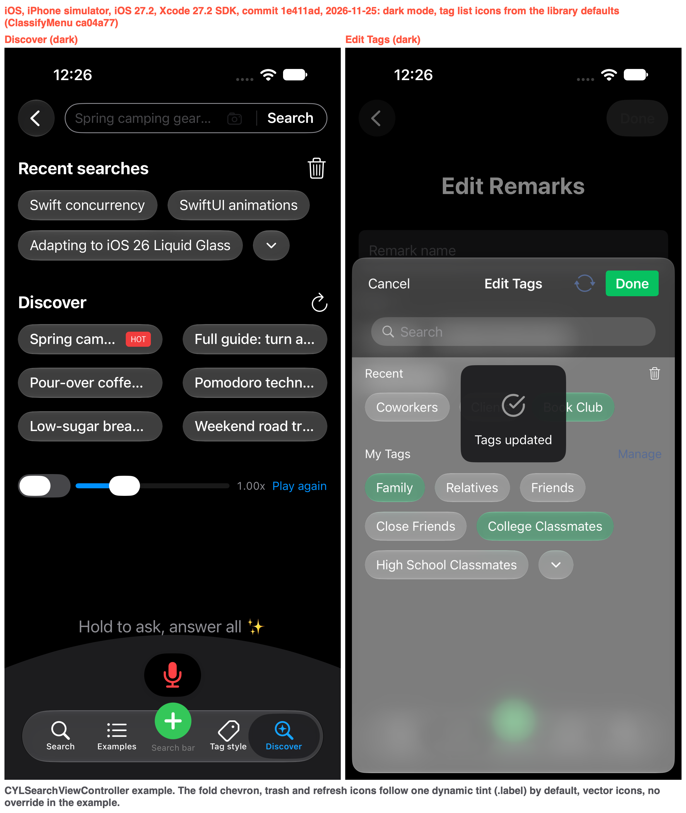 iOS, iPhone simulator, iOS 27.2, Xcode 27.2; commit 0126fd5, 2026-11-25.
- **Done**: `CYLSearchTagListStyle.tagListTintColor` (.label, dynamic) and `applyTint(to:)` set the header title, clear button (vector SF Symbol "trash", template), refresh/More icon and fold chevron colors; the core defaults, the grid and the three iOS examples use it. The fold chevron, trash and refresh icons are visible and sharp in dark mode.
- **Not done**: the library (ClassifyMenu) still defaults to gray for the fold chevron and secondaryLabel for the More icon when a host does not set them; a library default that follows the view's `tintColor` is a ClassifyMenu change (message sent). The example's own sync button and the search field's camera icon in dark mode are not tag list parts.
- **Status**: DONE for iOS core + examples (full suite not rerun after this change).

- **Pin move to ClassifyMenu 570fc657 + CYLTabBarController 5a212de9 (2026-11-25)**: after the owner's "repin", for the long-press subtitle bubble, title wrapping and sections (`docs/instructions/example-demos.md`). Done here: Android (`cyl.classifymenu.commit`, `cyl.tabbar.commit`), HarmonyOS and mini program pins. PR #37 is not merged and iOS was never compiled, so repin again to its final hash. Tests: Android `:cylsearch` unit 107 run, the 10 known `CYLSearchViewQMUIPortTest` failures; HarmonyOS host logic 72/0; mini program `npm test` 130/0. HarmonyOS vendor sync now also copies `cyldeallocblockexecutor` (a stray `\r` in `sync-sub-repositories.sh` had broken the line). `TODO`: iOS Podfiles and the three `Podfile.lock` files (Mac session, `pod install`); the Flutter bridge for long press, wrapping titles and several sections.

- **Update (2026-11-25, Mac session)**: ClassifyMenu ca04a77 now defaults the header title, fold chevron, More icon and clear button to one dynamic tint (.label) with vector icons, so the core and the examples dropped their overrides (`applyTint`, `tagListTintColor`); same dark-mode result, screenshot replaced (commit 1e411ad). Pins: ClassifyMenu ca04a77 + tab bar 11fc94be; iOS suite 201/0. Android, HarmonyOS and the mini program defaults are still fixed grays (Windows follow-up).

## Search bar placeholder in dark mode (2026-11-25, Mac session)

- **Prompt (verbatim)**: "按照同样要求处理searchbar的core核心代码，应用tint处理暗黑模式下字看不清的问题 … 预期是无须example新增代码 seachbar core核心代码完成tint 的暗黑适配。更新searchbar后repin，并在本项目中在不改example的前提下重新测试这两个页面的显示效果。" English: do the same in the search bar core, tint for text that is hard to read in dark mode, no example code, repin after the update and re-test the two pages without changing the example.
- 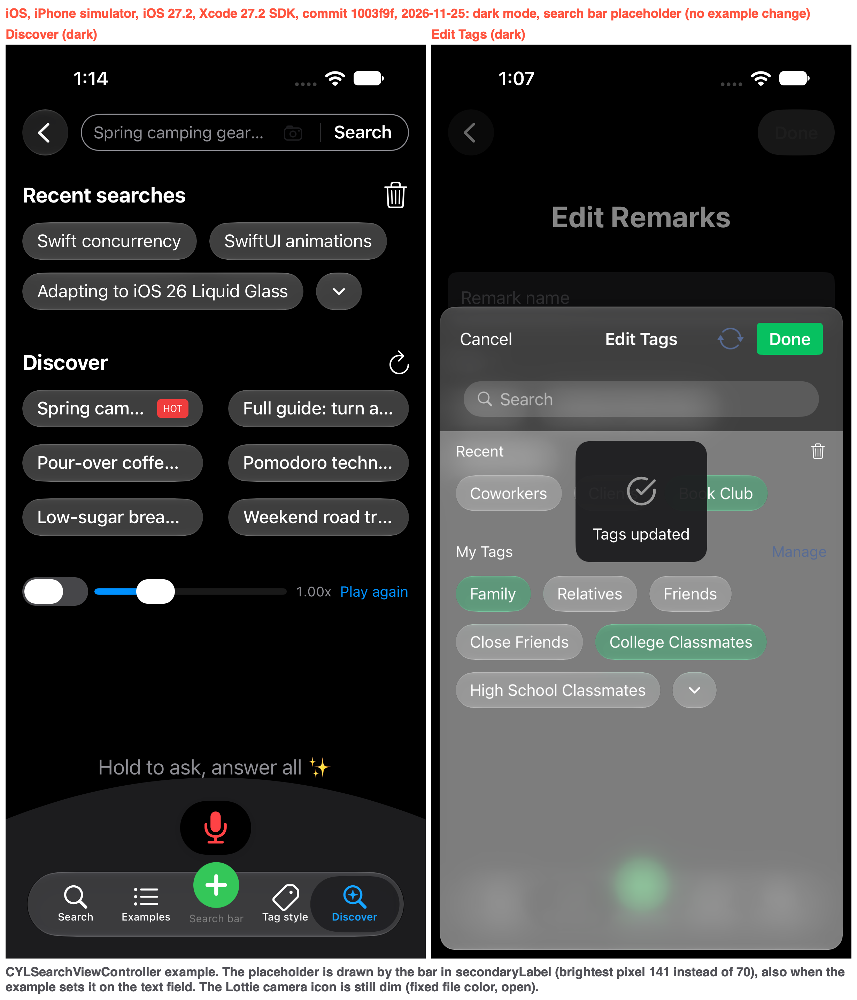 iOS, iPhone simulator, iOS 27.2, Xcode 27.2; commit 1003f9f, 2026-11-25.
- **Done**: the bar's default placeholder color is `.secondaryLabel` (was `.placeholderText`); a placeholder assigned to the bar's text field directly (the Discover example does) is forwarded to the bar's label (`CYLSearchBarTextField`), so the system's dim placeholder is not drawn: Discover's brightest placeholder pixel 70 -> 141. iOS suite 201/0.
- **Not done**: the animated camera icon of the Discover bar keeps the Lottie file's fixed near-black (28): `#tint=title` on the item's animationURL had no effect (tried and reverted); a CYLAnimatedItem default needs the ClassifyMenu/CYLTabBarController owner's decision (asked). The plus button title is dim gray (CYLTabBarController default, reported). The example's own sync button and "Manage" link are not search bar parts. Repin: none (the search bar core is this repository).
- **Status**: DONE for the placeholder; camera icon open.

## Search bar icon in dark mode, repin CYLTabBarController (2026-11-25, Mac session)

- **Prompt (verbatim)**: "repin cyltabbar test this page in dark mode /tmp/xpr/s-discover-dark-v2.png to look at icon in searchbar". 
-  iOS, iPhone simulator, iOS 27.2, Xcode 27.2; commit 41f2d98, 2026-11-25.
- **Done**: CYLTabBarController pinned to ff33eb85 (Podfiles, `cyl.tabbar.commit`; ClassifyMenu stays ca04a77); the search bar core sets `animationTint` and `animationDarkTint` (fixed #RRGGBBAA per appearance, from the item's dynamic tint) on every item, no example change. Fresh launch dark: the camera icon is white (was near-black 28); fresh launch light: black. iOS suite 201/0.
- **Found, for the library**: `animationTint = "title"` did NOT recolor an item's Lottie (icon stayed near-black), a fixed "#FF0000" did; switching light/dark while the app runs leaves the icon in the old appearance's color (white on white after dark to light), and re-setting the tint in the core on a trait change removed the icon, so it was dropped.
- **Status**: DONE for fresh launches; live appearance switching open (library).

## Search bar icon survives live light/dark switches (2026-11-25, Mac session)

- 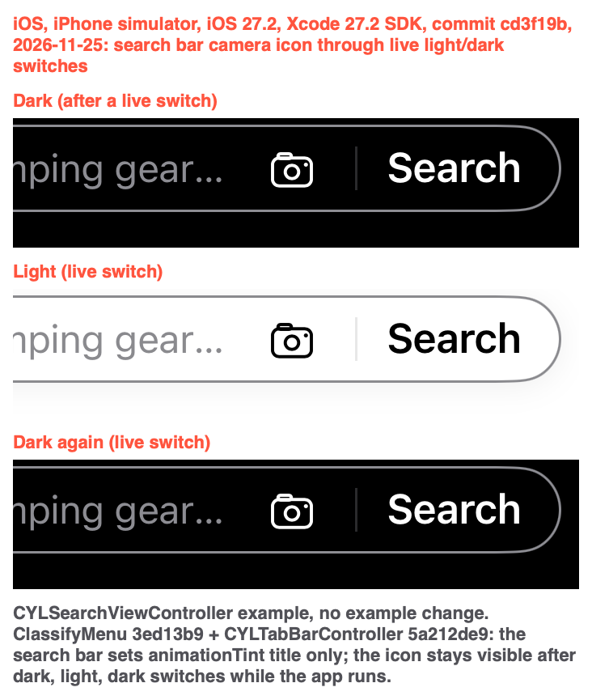 iOS, iPhone simulator, iOS 27.2, Xcode 27.2; commit cd3f19b, 2026-11-25.
- **Done**: pins ClassifyMenu 3ed13b9 + CYLTabBarController 5a212de9 (Podfiles, `cyl.tabbar.commit`); the hex workaround is deleted, the core sets `animationTint = "title"` and the item icon color only. Fresh dark: white camera; fresh light: black; dark, light, dark live switches keep the icon (the library resolves the item's own trait; CYLTagButton hands its icon color to CYLAnimatedItemView). iOS suite 201/0.
- **Owner follow-up, open**: the divider item (the thin line) and a stack-level tint: `CYLAnimatedItemStackView` should take the tint once and pass it to every `CYLAnimatedItemView` it holds, and the search bar should use it instead of tinting each item (library work asked of the ClassifyMenu/CYLTabBarController session; the bar's items are laid out by CYLSearchBarView, not by that stack view yet).
- **Status**: DONE for the icon; stack view tint open.

## Built-in default tint for CYLAnimatedItemView and the stack view (2026-11-25, Mac session)

- **Prompt (verbatim)**: "advisor模仿iOS上的系统API默认tint逻辑。 为cylanimateditemview 内置 tint默认逻辑，用户就算不设置tint也可以自适应暗黑白天模式，且能实现选中后tint变化。stackview  同理。举例说明：stackview里的分割线要内置tint逻辑自适应暗黑与白天模式。以上默认tint 仅在用户自定义tint后才覆盖原有内置逻辑。" English: following the advisor, mimic the iOS system API default tint logic: build a default tint into CYLAnimatedItemView so it adapts to dark/light without any host tint and changes when selected; the stack view likewise (its divider adapts to dark/light by itself); the built-in default is overridden only by a host-set tint.
- **Spec sent to the ClassifyMenu/CYLTabBarController session**: unset means built-in default (UIView.tintColor semantics: per-item over stack over built-in); normal icon/title `.label`, selected = inherited `tintColor`, disabled dimmed, `tintAdjustmentMode == .dimmed` honoured; re-resolve in `tintColorDidChange` and on trait changes against the item's own trait collection; animations follow the rendering mode (automatic tints one-colour files and keeps multi-colour ones, explicit template/original overrides); stack-level values act like an inherited tint; the divider default adapts and is at least as strong as `.secondaryLabel`; non-optional style colours (`CYLTagAppearance.textColor/backgroundColor`, `CYLMenuStyle` colours) need a real unset state, otherwise a tag always counts as custom.
- **Search bar, after their SHA (one repin with the stack move)**: delete `appearance.iconColor = tint` and `animationTint = "title"` and the `.label` fallback; keep a host's per-item `tintColor`; verify fresh dark, fresh light, live switch with the divider, a selected item, and a multi-colour icon that stays multi-colour.
- **Status**: TODO (waiting for the library SHA).

- **Update (2026-11-25, Mac session)**: pins ClassifyMenu 603592b + CYLTabBarController 230b5266 (library SHA2: built-in default tint, resettable colours, stack divider). The search bar no longer sets `animationTint`, `appearance.iconColor` or the `.label` fallback (only a host's own tint is passed on). Fresh dark, live light and live dark keep the camera icon visible with no tint code in the bar (docs/assets/ios-iphone-sim-ios27.2-20261125-searchbar-default-tint.png, commit 021a742). Test updated: the component holds the item tint resolved with the item's own traits. iOS suite 201/0 after the test fix (single class rerun 11/0). Open: the divider line is still dim in dark (move the item row onto CYLAnimatedItemStackView with appendDivider; rewrites the item tests that assume items are field subviews), a multi-colour icon check, the plus title (tab bar).

- **Update (2026-11-25, Mac session): search bar row in the stack view.** `CYLSearchBarView` holds its items in one `CYLAnimatedItemStackView` (axis horizontal, contentMargin 0, spacing 8, dispatchesItemTaps false); a divider item becomes the stack's built-in divider after the item before it (8 + 1 + 8 pt gap), so the divider adapts to dark/light and live switches in the component. The bar sets no tint. 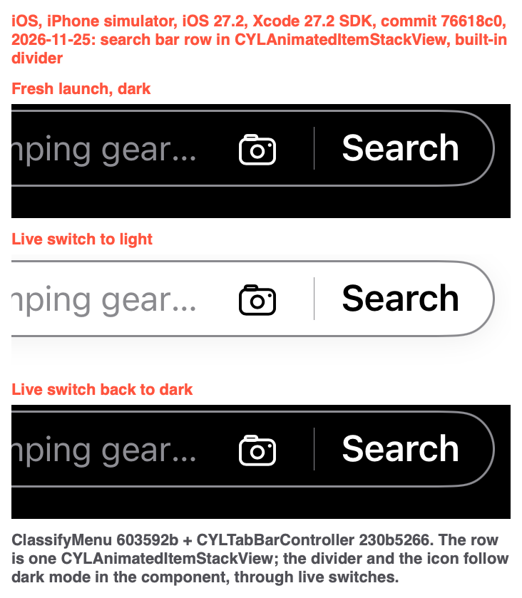 iOS, iPhone simulator, iOS 27.2, Xcode 27.2; commit 76618c0, 2026-11-25. A multi-colour SVGA icon (Examples tab) stays multi-colour in dark. Test rewritten: items are descendants of the field, the camera-to-Search gap is at least 17 pt. iOS suite 201/0. Open: the plus button title is a dim gray (tab bar default).
- **Status**: DONE for iOS.

## Search bar defaults and dark verification on Android, HarmonyOS, mini program (2026-11-25, Windows session)

- **Prompt (English)**: placeholder is the secondary label (light rgba(60,60,67,0.60), dark rgba(235,235,245,0.60)); bar items set no tint (normal label, selected accent, disabled dimmed, a host tint overrides); built-in divider 1x20 with an 8 gap each side; live light/dark re-resolve; the bordered style's border stays.
- **Android** (core `CYLSearchBarView.kt`, `CYLSearchBarDefaultColorsTest`): full `:cylsearch` unit run on ClassifyMenu 603592b + CYLTabBarController 230b526: all classes pass except `CYLSearchViewQMUIPortTest`, 10 failures `Illegal connection pointer` (Robolectric SQLite) only in the full run; the class passes alone (10/10) and fails identically on origin's `CYLSearchBarView.kt`, so it is the open order-dependent failure already noted for the 16 dp inset, not this change. Example theme is DayNight (theme-only commit ab0e828). Screenshots: 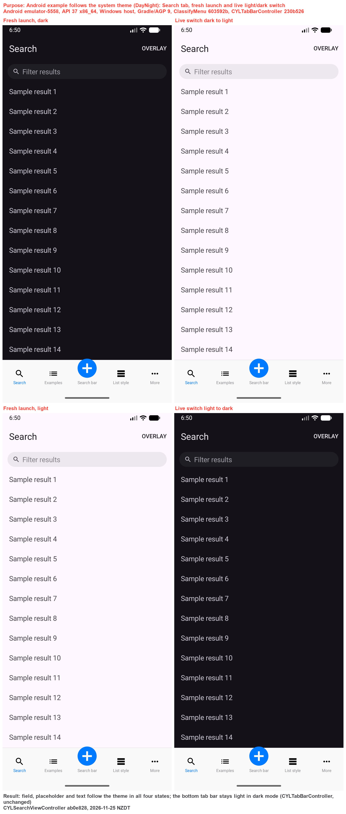 Android emulator-5558, API 37 x86_64, Windows host, ClassifyMenu 603592b, CYLTabBarController 230b526, commit ab0e828, 2026-11-25 NZDT.  same device, commit ab0e828, 2026-11-25 NZDT.
- **Android defects found in dark (TODO)**: the tag list headers and topic titles stay dark on the dark page (`CYLSearchTagListStyle` Android defaults are not dark-aware, iOS has the dynamic tint); the More page icons are black; the bottom tab bar stays light; a theme change recreates the activity and returns to the first tab.
- **HarmonyOS** (`CYLSearchBarView.ets`): code and unit tests in `CYLSearchCore.test.ets` written; NOT run (no HarmonyOS test runner or previewer started), so unverified. Placeholder and divider use `app.color.cyl_search_secondary_label` (base and dark qualifier), item tint is `CYLSearchBarItem.resolvedTint`, divider 1x20 with gap 8.
- **Mini program** (`cyl-search-bar`, `CYLSearchBarColors`): CSS follows `prefers-color-scheme`, `placeholder-style` and the tag-button tint are recomputed on `wx.onThemeChange`; `npm test` 131 pass, 1 fail (package.test.js: the vendored ClassifyMenu package is still at CYLTabBarController 5a212de9, the pin is 230b5266; not synced here). No simulator screenshot taken.
- **Held, not pushed**: Flutter tag-list bridge (`tagSubtitles`, `titleMaxLines`, example grouped-list conversion) and any React Native equivalent: ClassifyMenu 603592b has no `longPressAction`, `menuSubtitleForItemAtIndexPath` or `titleMaxLines` on Android (PR #37), so the Flutter Android plugin does not compile against it. Not done: RN bridge, converting the other grouped demo lists (Android Examples list, HarmonyOS, mini program, RN), Flutter emulator run.

## 2026-11-25 iOS example: grouped demo lists as Liquid Glass tag lists (`example-demos`)

- Prompt (verbatim, owner): "静态编写代码，代码编写完成统一测试"
  Prompt (English): "Write the code statically; test everything together once the code is written."
- Request (from the Windows search session, rule `docs/instructions/example-demos.md`): grouped table-view-like demo lists become CollectionViewClassifyMenu tag lists, Liquid Glass, sections with titled headers, wrapping titles, 3 rows then the core's more/less fold, tap = cell tap, long press = subtitle bubble.
- Static code written (not built, not run): `CYLDemoTagListViewController` (sectioned `CYLTagListView`, glass through `CYLSearchTagListStyle.applyBackgroundStyle(named:)`, `titleWraps`, `defaultVisibleRows = 3`, fold `.iconAndTitle`) in `CYLSearchDemoMenuViewController.swift`; the placeholder gallery and the ports list use it; `testPlaceholderGalleryNavigation` rewritten for it.
- Not converted: the examples menu itself (one section, drives navigation) and the search bar styles screen (controls, not a list).
- Held: the long-press subtitle bubble needs ClassifyMenu `menuSubtitleForItem` / `longPressAction` (PR #37 line; pinned 603592b has no such API, rule 5 forbids an example workaround). The subtitle is the VoiceOver hint until then. Waiting for the #37-line SHA that also has the glass fix; then repin all platforms together, add the bubble call, run ONE iOS test batch (light, dark, live switch screenshots), push once.
- **DONE (iOS, 2026-11-25)**: pins moved to ClassifyMenu `05ba8abbe49e53f2e3eebc4c7ca7d89bc83cf53d` (`feat/tag-liquid-glass-on-37`, 23 commits ahead of 603592b, glass fix + long press callout + titleMaxLines) with CYLTabBarController `230b52662cea3b584a5c0da704e55fe3f4758ae8` and Dealloc `4276a6da`, in `Podfile`, the Flutter and RN example Podfiles, `android/merged/gradle.properties`, `Podfile.lock`. Demo lists: long press = `CYLTagLongPressActions.callout` + `menuSubtitleForItem`, titles up to 3 lines (`titleMaxLines`). Core fix found in the dark check: `CYLSearchTagListStyle.applyDefaults` now sets the list background `.clear` (white list hid header and title in dark). One batch: 201 tests, 0 failures; screenshot `docs/assets/ios-iphone18pro-sim-ios27.2-20261125-example-demos-glass-taglist.png` (light gallery, light ports with More after 3 rows, dark long-press callout).

## 2026-11-25 Cross-platform score and plan to 100 (advisor review)

- Prompt (verbatim, owner): "advisor点评目前全平台接口实现得分 以及下一步计划与建议。并立即让默认模型sonnet按照建议去实现。将得分优化到100转发合适任务给其他session 直接使用本机环境进行测试，iOS在macos机器，其余在windows机器。转发任务给相应session无需等待ci结果。"
  Prompt (English): "Have the advisor review the interface score of every platform now, the next plan and suggestions; have the default model (Sonnet) implement the advice at once; raise the score to 100 and forward fitting tasks to the other sessions, who test directly on the local machines: iOS on the Mac, the others on the Windows machine; do not wait for CI."
- Correction: the earlier line "201 tests pass" for 35bb62a was measured before the `applyDefaults` clear-background edit. Re-run on the final code (light simulator, clean derived data, ClassifyMenu 05ba8abb + tab bar 230b5266): 201 tests, 0 failures.
- Scorecard (the API generators measure API rows only, not runtime behaviour). API rows: `harmonyos-scorecard.py` 100/100 (468/468), `harmonyos-api-alignment.py` 100, `miniprogram-api-alignment.py` 100, `android/merged/scripts/api-alignment.py` 100 (413 done, 30 N/A), `check-ios-parity.mjs` 677/677, public API comments OK. Runtime (tests run on the local machines): iOS 201/0; Android on the Mac 112/0 + assembleDebug OK (chenyilong-3e, with Windows push c306e74); mini program 132/0; HarmonyOS host logic 72/0 (not on an emulator). Open to reach 100 on runtime: Android dark defects (tag list headers/topic titles stay dark, More icons black, tab bar light, theme change recreates the activity), HarmonyOS search bar on the emulator, mini program vendored package at the new pins, RN/Flutter iOS at 05ba8abb (chenyilong-3e running).
- Library note: a white list background in dark mode is ClassifyMenu's `CYLMenuStyle` default; the search core now clears it in `CYLSearchTagListStyle.applyDefaults`.

## 2026-11-25 Tag list tail fold control: icon only by default, on every platform

- Prompt (verbatim, owner): ".iconAndTitle 这个taglist接口在其他平台有吗？是taglist的core核心代码对外接口吗？如果其他平台没有，给其他平台补上该接口。并确保不设置的话 默认就是.icon 。本example删除.iconAndTitle就可以达到和.icon一样的效果"
  Prompt (English): "Does the .iconAndTitle tag list API exist on the other platforms? Is it a public API of the tag list core? If another platform lacks it, add it there. Make sure the default, when unset, is .icon. In this example, deleting .iconAndTitle must give the same result as .icon."
- Cause of the "More" text: the iOS demo list set `CYLMenuFoldControl(position: .tail, content: .iconAndTitle)` (following rule 3 of example-demos.md as first written). The core default was already `.icon`.
- Audit at ClassifyMenu 05ba8abb: `iconAndTitle` is public core API (iOS `CYLMenuFoldControlContent`, Android `CYLMenuFoldControlContentIconAndTitle`, HarmonyOS `iconAndTitle`, RN/Flutter bridge strings). Default `.icon`: iOS yes, HarmonyOS yes, RN/Flutter bridges yes; Android NO (`CYLMenuFoldControl.kt` line 28 defaults to IconAndTitle: ClassifyMenu Windows session asked to change it); mini program lacked `iconAndTitle` (Windows search session added it at 851c233, default icon).
- iOS done: the example sets no content (`CYLMenuFoldControl(position: .tail)`), test asserts position `.tail` and content `.icon`; rule 3 of `docs/instructions/example-demos.md` corrected. 201 tests, 0 failures; screenshot `docs/assets/ios-iphone18pro-sim-ios27.2-20261125-taglist-fold-icon-only.png`.

## Remaining TODOs of the search bar task: results per platform (2026-11-25, Windows session, second pass)

- **Pins**: ClassifyMenu 05ba8abb + CYLTabBarController 230b5266 + Dealloc 4276a6da (Android and iOS from origin; HarmonyOS and the mini program repinned here). Local checkouts at those commits were used for every build.
- **Android** (commits 4671694 and earlier): `CYLSearchTagListStyle` is dark-aware (optional `Context`: label colour, dark fill and separator) and sets the list background transparent (iOS parity); the example keeps its tab across a theme change; the grouped lists of the example (Examples, placeholder gallery, ports, MaterialSearchView samples = the Android counterpart of `CYLMaterialSearchMenuViewController`, original samples) are one tag-list helper (`cylMenuList`): titled sections, Liquid Glass, wrapping titles, 3-row fold with more/less and icon, long-press subtitle callout. Unit tests: `:cylsearch:testDebugUnitTest` run alone, 114 tests, 0 failures (includes dark and light tag-list tests). When run in the same Gradle invocation as `:app:installDebug`, or incrementally, `CYLSearchViewQMUIPortTest` has failed 10 of 10 (Robolectric SQLite `Illegal connection pointer`); it passes with `--rerun-tasks` alone. Order dependent, open.
  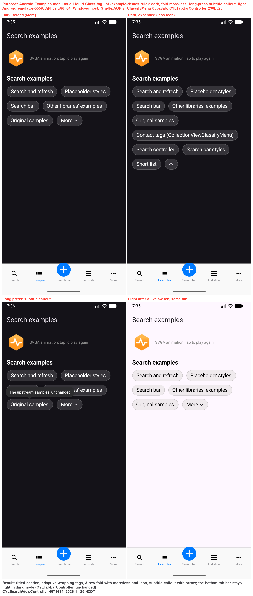 Android emulator-5558, API 37 x86_64, ClassifyMenu 05ba8ab, CYLTabBarController 230b526, commit 4671694, 2026-11-25 NZDT. 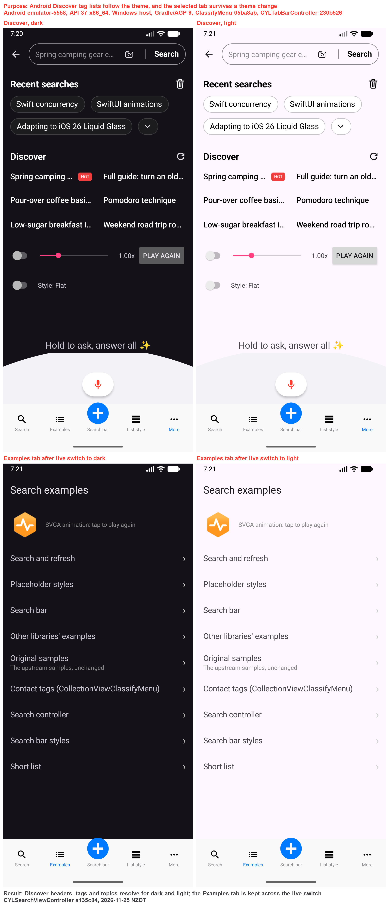 same device, commit a135c84, 2026-11-25 NZDT.
- **Android open items (library, not patched here)**: the bottom tab bar stays light in dark mode and the More page icons are black (CYLTabBarController: hard-coded bar colour); the owner reports that the FLAT tab bar style shows icons on a white background that merges with the white bar (a lost tint in pin 230b526, reported to the CYLTabBarController session). That style was not captured in this pass (the default style was), so there is no screenshot of it here; awaiting the TabBar fix.
- **Flutter**: the bridge (`tagSubtitles`, `titleMaxLines`) and the example conversion compile against 05ba8ab (`flutter build apk --debug`), run on emulator-5558, and `flutter test` passes 37 (two stale parameter-map tests updated). 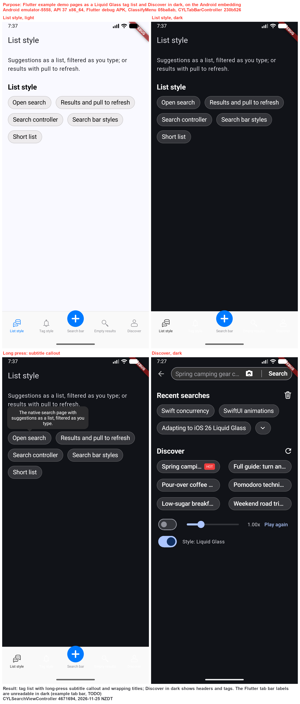 Android emulator-5558, API 37, Flutter debug APK, commit 4671694, 2026-11-25 NZDT. Open: the example's own tab bar labels are unreadable in dark.
- **React Native**: the same two props in the spec, the Android view and manager, helpers with jest tests (`jest` 18 pass, `tsc` clean). The Android Kotlin was not compiled (no RN Android build was run); not exercised on a device. The RN example grouped lists are not converted.
- **HarmonyOS**: `CYLSearchBarView.ets` changes plus tests built and run on the emulator (127.0.0.1:5555, emulator HAPs): 57 of 57 pass (`CYLSearchCore`, `CYLSearchUI`, `CYLSearchMerge`, ...), host logic `node scripts/host-logic-test.mjs` 72 pass. The Examples menu is a tag list; the UI tests find its rows by tag id and expand the fold. The pinned CYLTabBarController `cylanimateditem` (`CYLAnimatedItemColorCount.ts`) does not compile with this DevEco SDK (`object` compared with string); it was patched in the scratch mirror only (not committed): open item for CYLTabBarController. The placeholder Discover page and the placeholder gallery are not converted. 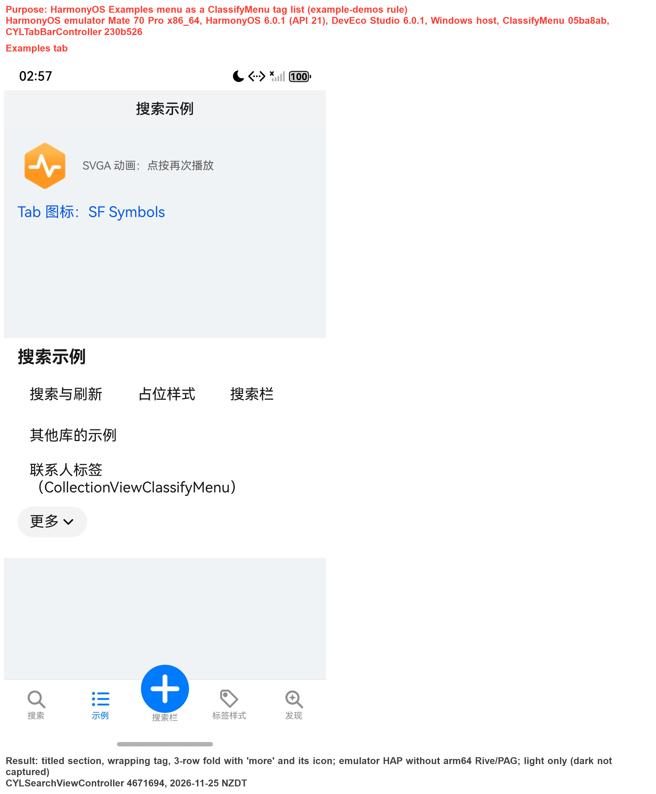 HarmonyOS emulator Mate 70 Pro x86_64, HarmonyOS 6.0.1, commit 4671694, 2026-11-25 NZDT (light only).
- **Mini program**: package re-synced to the pinned pair, `npm test` 133 pass, 0 fail (new: `CYLMenuFoldControlContent.iconAndTitle`, default icon). The pinned `cyl-tag-list` has no subtitle callout or title wrapping, so the example's grouped lists are not converted (waiting for the published cyl-tag-list 0.2.0; not migrated by instruction). Screenshots: WeChat DevTools opens with the logged-in account but rejects the project's AppID ("There is no such AppID", also with `touristappid` in a copy), so no simulator screenshot was taken.

## DONE (2026-11-25): example tag lists fold with the tail control, icon only

- Context: owner directive (latest, supersedes all earlier fold wording): the example tag lists use the TAIL CONTROL as the expand/collapse button; the last tag shows ONLY the chevron icon (no text, no more / less labels, no header trailing button; the header-trailing icon-and-title idea is dropped).
- Prompt (English): "Update the example instructions: example tag lists must use the tail control as the expand/collapse button: the last tag acts as the expand button and shows only the icon (chevron, no text). Execute it now in the examples."
- Done: rule 3 of `docs/instructions/example-demos.md`, `AGENTS.md`, `instructions.md`, `docs/instructions/skills.md` and `.agents/skills/cyl-example-taglist/SKILL.md` reworded; the old more / less prompt is kept as history marked superseded. Examples audited on all five platforms: Android `CYLSearchDemoMenuFragment` (was `CYLMenuFoldControlContentIconAndTitle`) and HarmonyOS `ExamplesMenu.ets` (was `iconAndTitle`) and Flutter `main.dart` Examples list (was `iconAndTitle`, now `inline` + `icon` explicitly) fixed; every other folding list (Android Discover and contact tags, HarmonyOS contact tags, Flutter and React Native Discover and contact tags, mini program contact tag editor) already set tail/inline + icon. Static check: `sh scripts/check-example-fold.sh` (fails on any title fold content, or a fold without an explicit icon).
- Not expressible / not in scope: the mini program core has no position property (its chevron is always the last tag, `foldControlContent="icon"` is set); Flutter and React Native name the tail position `inline`. The React Native and mini program Examples tabs are plain cell lists, not tag lists (older gap of rule 1, not changed here).
- Tests (one batch): Android `:cylsearch:assembleDebug :app:assembleDebug` ok; Flutter `flutter test` 6 passed, `flutter analyze` 6 infos (deprecated `material.dart` imports, no errors); React Native `tsc` ok, `jest` 18 passed; mini program `npm test` 133 passed. HarmonyOS host tests not run (DevEco build is heavy; the change is one enum value).
- Screenshot: 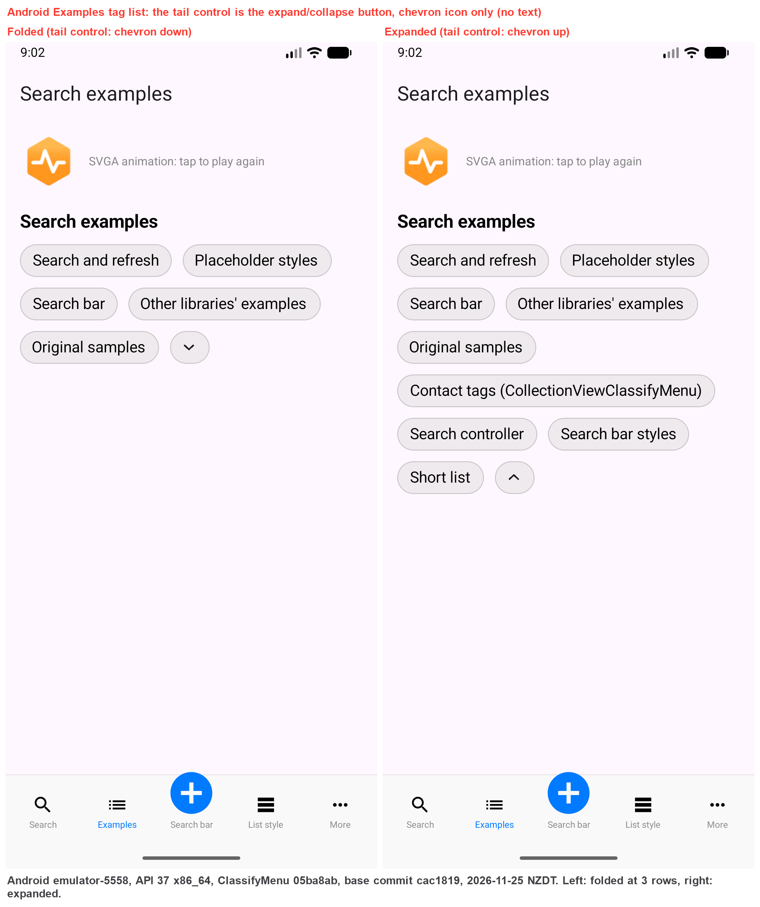 Android emulator-5558, API 37 x86_64, ClassifyMenu 05ba8ab, base commit cac1819, 2026-11-25 NZDT; folded (chevron down) and expanded (chevron up), no text on the tail tag.

## 2026-11-25 Unified repin: ClassifyMenu 0de4546b + CYLTabBarController 09bde3ca

- Owner instruction (relayed by winsCYLSearchViewController, typed there): "更新taglist所在库的commit采用新的默认样式 repin". ClassifyMenu session built the one SHA `0de4546b3413512b1794fc52d62fd10ba73ce106` (`feat/tag-final-merge` = `feat/tag-section-style` 8cd01cc9 + `feat/fold-tail-default-icon` 0920c9e4, not #38). Tab bar: tip of `feat/harmony-animated-item-engines` `09bde3ca4a965e19be916f216df99b3d1a8c5d17` (40 commits ahead of 230b5266, contains the Rive tint fix 93eca81f). Dealloc unchanged `4276a6da`.
- Moved in `Podfile`, the Flutter and RN example Podfiles, `android/merged/gradle.properties`, `Podfile.lock`. iOS suite on the new pair (light simulator, clean derived data): 201 tests, 0 failures.
## DONE (2026-11-25): example pages put a gradient behind the glass tag list; honest per-platform result and core gaps

- Context: owner directive (latest): the tag list's background board uses the Liquid Glass style and the main page background of the demo is a GRADIENT, so the glass's see-through (blur/refraction of the backdrop) can be tested; if the example cannot do it, do not hack, list what the core lacks.
- Prompt (English): "In the examples, the tag list's background board uses the Liquid Glass style, and the main page background of the whole demo is a gradient colour so that the glass's liquid see-through can be tested. If it cannot be implemented in the example, do not hack around it: list exactly what the core lacks, so the taglist library session can change its core."
- Done: rule 7 in `docs/instructions/example-demos.md` (plus `AGENTS.md`, `instructions.md`, skill `cyl-example-taglist`). Pins unchanged (ClassifyMenu 05ba8abb).
- Tests (one batch): Android `:app:assembleDebug :cylsearch:testDebugUnitTest` ok; Flutter `flutter analyze` 6 pre-existing infos, `flutter test` 6 passed, `flutter build apk --debug` ok; React Native `tsc` ok, `jest` 18 passed; mini program `npm test` 0 fail. HarmonyOS not built (DevEco not run in this pass).

| Platform | Gradient page + clear list | Glass tags sample the gradient | Glass board | Status |
|:---|:---|:---|:---|:---|
| Android | done: `CYLExamplePage` root and Discover use `cylGradientPageBackground` (light, dark); list background already transparent | NO: tint plus rim only | not in pin | PARTIAL |
| Flutter | done: `DecoratedBox` gradient + transparent Scaffold/AppBar (demo tab pages) | NO (same Android core view) | not in pin | PARTIAL |
| HarmonyOS | code only: Examples menu `linearGradient`, transparent nav bar; not built or run | unverified | not in pin | PARTIAL, UNTESTED |
| React Native | code only: `backgroundImage: linear-gradient(...)` on the root and Discover `SafeAreaView`s; `tsc` ok, not run on a device | unverified; Examples tab is not a tag list | not in pin | PARTIAL, UNTESTED |
| Mini program | code only: `discoverSearch` page CSS gradient (light, dark); not run in the IDE | NO: Discover tags are hand-written flat CSS, Examples tab is a cell list | not in pin | MISSING |

- Screenshots:  Android emulator-5558, API 37 x86_64, ClassifyMenu 05ba8ab, base commit bd758e9 plus working tree, 2026-11-25 NZDT; the gradient shows through, the tags are a frosted tint with a hairline rim, with no blur or refraction of the gradient.
   Flutter on Android emulator-5558, API 37 x86_64, ClassifyMenu 05ba8ab, base commit bd758e9 plus working tree, 2026-11-25 NZDT; same result.
- Core-gap list (CollectionViewClassifyMenu must change the core; nothing is hacked in the examples):
  1. Android (and the Flutter/RN bridges on Android): `CYLTagButton` never sets `CYLLiquidGlassView.backdropSource`; the default source is the window root, which contains the tag, so `CYLLiquidGlassView.isInside(source)` is true and `onDraw` draws only the tint and a rim (no `backdrop.draw`). Needed: a `backdropSource` property on `CYLTagListView` / `CYLMenuStyle` (a view outside the list, e.g. the gradient page) handed to every tag's glass view, a re-sample on scroll, and a default that picks the nearest ancestor sibling background instead of the window root.
  2. Glass board (section card) behind a section's tags: only on `feat/tag-section-style` 8cd01cc9, not in pin 05ba8abb on any platform; needs pinning and a `backdropSource` for the board as well.
  3. Flutter and React Native bridges: no `backdropSource` / backdrop parameter (platform view sits in the Flutter/RN view tree; the native glass cannot see the Flutter-drawn gradient behind a platform view, so the bridge must pass the gradient as a native backdrop or use hybrid composition with a transparent texture). Missing API on both bridges.
  4. HarmonyOS: core `CYLTagBackgroundStyle.liquidGlass` has no backdrop-sampling property (ArkUI `backgroundBlurStyle`/`foregroundBlurStyle` with a backdrop is not exposed by `CYLMenuStyle`); not verified on device here.
  5. Mini program: `cyl-tag-list` supports `backgroundStyle: liquidGlass` (CSS tint), but it has no backdrop blur (`backdrop-filter`) property, and the example's Discover/Examples lists do not use `cyl-tag-list` (no subtitle callout or title wrapping), so no glass is shown over the gradient.
  6. Below Android 12 the flat fallback is expected (no glass drawn).
- iOS (Mac session): apply the same on the iOS example (gradient page background, clear list background, glass board and tags sampling it); verify that `CYLTagBackgroundStyleLiquidGlass` refracts the gradient.

## Repin to the unified pair, Windows side (2026-11-25, `android-static`, merged 82d7fe2)

- **Pins moved** to ClassifyMenu `0de4546b3413512b1794fc52d62fd10ba73ce106` + CYLTabBarController `09bde3ca4a965e19be916f216df99b3d1a8c5d17`
  (CYLDeallocBlockExecutor `4276a6dab` unchanged): `harmonyos/oh-package.json5`, the mini program `package.json`, the Flutter example
  `pubspec.yaml` `flutter_cyltabbar` ref (the lock stays out of the commit: another agent owns it). `android/merged/gradle.properties`
  already held the pair (Mac). RN example `vendor/CYLTabBarController` is untracked and left alone. No file besides docs held the
  old SHAs. `harmonyos/scripts/sync-sub-repositories.sh` and the mini program `sync-example` ran with `CYL_*_DIR` local checkouts.
- **Code adapted** (core exposes `sectionBackgroundStyle`, mirrors iOS applyDefaults / applyBackgroundStyle): `liquidGlass` now sets the
  glass board with the glass tags in Android `CYLSearchTagListStyle.kt` (the Flutter and RN Android bridges go through it), HarmonyOS
  `CYLSearchTagListStyle.ets` and the mini program `CYLSearchTagListStyle.js`. No API of the examples or bridges broke: the fold
  control names, `titleMaxLines` and the `plain` opt-out compile unchanged; the examples keep their explicit fold settings (tail, icon).
- **Flutter PNG tab icons**: `cyl_tabbar_configuration.json` gets `CYLTabBarItemIconRenderingMode: template` on the four tabs (patch from the
  tint bisect; static PNG icons otherwise stay black when selected). Checked the others: Android and HarmonyOS configs use vector or
  system icons (no PNG), the Rive config has `tint: title`, the Flutter `_svga` config lists PNGs next to SVGA files (animated, not changed,
  unverified). RN and mini program examples have no tab configuration file.
- **Tests (one batch, in worktree `C:/w/cvcm-repin`)**: Android `:app:assembleDebug` OK; `:cylsearch` unit tests 114 run, the same 10
  `CYLSearchViewQMUIPortTest` failures (Robolectric `Illegal connection pointer`, history SQLite) that fail identically in runs before this
  repin (`b2.log`, `r12.log`, `r28.log`); the class passes alone; the style test with the new assertions passes. Flutter `flutter test` 37 pass,
  analyze infos only, `build apk --debug` OK. RN `tsc` clean, jest 18 pass. HarmonyOS sync OK, `host-logic-test.mjs` 72 pass (no hvigor
  build or device run). `scripts/check-example-fold.sh` ok. Mini program `npm test` 132 of 133: FAIL `the synced ... package has cyl-animated-item at
  the pinned CYLTabBarController commit`: ClassifyMenu `0de4546b` ships `cyl-animated-item/COMMIT` = `230b5266` (its own mini program
  package was not refreshed to `09bde3ca`).
- **Screenshots / glass**: NOT taken: `C:/w/heavy.lock` was held by winsCollectionViewClassifyMenu (repin android test) when this ran.
  By code: Android core still never sets `backdropSource` (no such symbol in `0de4546b` `android/merged/library`), so the glass draws
  tint and rim only: PARTIAL (gradient shows through the clear list, board and tags are tinted, no blur or refraction); HarmonyOS, Flutter, RN
  and mini program: not run.

TODO (this repin):
- Android: screenshots folded/expanded, light and dark, on `0de4546b` once the lock is free; core: `backdropSource` for glass tags and board.
- Mini program: ClassifyMenu must refresh `miniprogram_dist/cyl-animated-item/COMMIT` (and `fetch-cyltabbar.js`, Podfiles, Package.swift) to `09bde3ca`.
- HarmonyOS: hvigor build and ohosTest on the emulator with the new core.

## 2026-11-25 iOS: gradient page + glass board and tags (`example-demos` rule 7)

- Request (relayed by winsCYLSearchViewController, owner directive typed there): gradient page background (light and dark) behind every example glass tag list, clear list background, Liquid Glass board and tags that sample the backdrop; record WORKS, PARTIAL or MISSING with a labelled screenshot; list missing core capabilities instead of hacking around them.
- iOS result: **WORKS** at ClassifyMenu 0de4546b. `CYLDemoGradientView` (CAGradientLayer, light and dark colours, follows the trait) is the page; the list background is clear; the glass section board (`CYLMenuStyle.sectionBackgroundStyle = .liquidGlass`, in 8cd01cc9, now in the pin) and the glass tags show the gradient through blur, tint and rim. Core change: `CYLSearchTagListStyle.applyDefaults` and `applyBackgroundStyle(named:)` set the glass board together with the glass tags and the clear list background (one glass parameter). No core gap on iOS. Screenshot `docs/assets/ios-iphone18pro-sim-ios27.2-20261125-glass-board-gradient-page.png`. 201 tests, 0 failures (the test also asserts the board, the clear background and the gradient page).

## 2026-11-25 Run the iOS example and apply the example-demos rules to it

- Prompt (verbatim, owner): "运行本example 截图看效果 应用新的example 要求在instuctions相关文件中"
  Prompt (English): "Run this example, take screenshots to see the result, and apply the new example requirements from the instructions files."
- Ran every example screen on the iPhone 18 Pro simulator and checked it against `docs/instructions/example-demos.md`. Already compliant: placeholder gallery and ports list (rules 1-7). Fixed now (rules 6 and 7): Discover and Edit Remarks / Edit Tags get the gradient page (`cylInstallDemoGradient`), a clear list background and a glass board under the tags (`sectionBackgroundStyle = .liquidGlass`). Screenshot `docs/assets/ios-iphone18pro-sim-ios27.2-20261125-discover-contacts-gradient-glass.png`; 201 tests, 0 failures.
- Not converted (rule 1, tests and controls depend on them): the examples menu (13 navigation rows plus the SVGA header, `CYLDemoRow` launch argument and tests use its table), the search bar styles screen (sections of switches and actions), the MaterialSearchView samples list (`testSwiftPortsOfOtherLibrariesLoad` and the Tag style tab use its table API). Convert them only on the owner's word. Discover's topic grid is a plain preset without a board. The "Hold to ask" bottom area is an opaque white curve over the gradient.

## 2026-11-25 Rule: stop the app and the simulator after every run

- Prompt (verbatim, owner): "找到本项目instructions 相关文件（可能包含根目录的agent Claude文件instructions 文件， 首先确认下面内容的归类。如果agent Claude文件文件超出每个文件200行限制，则优先放入docs 里的instructions文件夹合适文件，）以及skills相关文件，如果没有就新增文件保证写入成功，全英文写入，并且在本次任务中就执行一次下面的指令：根目录文件加上文字必须提示，运行模拟器前必须阅读模拟器运行规则该文档或下面这段文字 运行模拟器 测试截图结束后 ，立即杀掉终止app，以及模拟器进程。使用时在重新启动。避免运行后，任务完毕也不关掉app ，也不关闭模拟器进程。"
  Prompt (English): "Find this project's instructions files (the root agent / Claude instruction files, if any; first confirm the category of the content below; if a root file would exceed the 200-line limit, put it in a suitable file of docs/instructions first) and the skills files, creating a file when none exists so the write succeeds; write everything in English; and in this task also carry out the instruction once: the root files must prompt that before running a simulator the simulator run rules (that document) or the following text must be read: after a simulator test or screenshot run ends, immediately kill the app and the simulator process; start them again when needed; do not leave the app and the simulator process running after the task is done."
- Category: tag `testing` (macOS/simulator scenario). Root `AGENTS.md` and `instructions.md` were 161 lines each (limit 200), so they got a mandatory prompt under the behavioral heading plus a bullet in the testing section (168 lines each). The full rule is the new section "Simulator and emulator runs: read the rules first, stop everything afterwards" in `docs/instructions/testing.md`. New skill `.agents/skills/cyl-simulator-run/SKILL.md` (listed in `AGENTS.md`, `instructions.md`, `docs/instructions/skills.md`); `cyl-verify` points to it.
- Carried out once in this task: the example app was terminated and the simulator `9F762C22` shut down (only the device this session started); `xcrun simctl list devices booted` checked afterwards.

## 2026-11-25 Windows: every example list as glass tag list (`example-demos` rules 1 to 7), pin ClassifyMenu 0de4546b

- Prompt (owner, English): convert ALL examples now to the new taglist style: (a) Liquid Glass board, (b) glass tags, (c) tail control (last tag, icon only, set explicitly), (d) gradient page with clear list background, titled sections, wrapping titles, 3-row fold, tap = cell tap, long-press subtitle callout. If a platform cannot do it, list the exact missing core capability; do not hack.
- Converted now: HarmonyOS Examples menu, Placeholder styles gallery (42 sections, tag per message with the style image), Ports and the MaterialSearchView menu (new `common/DemoTagMenu.ets`: shared style + glass + tail icon + 3 rows + callout); React Native Examples tabs (list, tags, empty) and the Discover entry (`CYLTagListView`, `tagSubtitles`, `titleMaxLines` 0, inline icon fold, 3 rows); Flutter Discover entry; mini program Examples tab, Ports, Placeholder styles and MaterialSearchView menu (`utils/cyl_demo_tag_list.js`, `cyl-tag-list` with `sectionBackgroundStyle` glass via `CYLSearchTagListStyle`, `foldControl {tail, icon}`, `longPressAction callout`, gradient page). Android and Flutter Examples tabs were already converted. New check: `scripts/check-example-taglist.sh` (plus `check-example-fold.sh`), both ok.
- Tests (one batch): `check-example-*` ok; RN `tsc` clean (after one fix), jest 18 pass; mini program `npm test` 132 of 133 (the known `cyl-animated-item` COMMIT mismatch: ClassifyMenu 0de4546b ships `230b5266`, pin pair wants `09bde3ca`); HarmonyOS `host-logic-test.mjs` 72 pass (NO hvigor build, ArkTS of the new files is NOT compiled); Flutter test 6 pass, analyze 6 infos (deprecated material import), `build apk --debug` OK; Android `:app:assembleDebug` OK, `:cylsearch:testDebugUnitTest` 114 run, the same 10 `CYLSearchViewQMUIPortTest` failures (Robolectric) as before. Android example change this round: a stale KDoc only.
- Screenshots: NOT taken this round (lock was free, but the batch ran long; no emulator run). Glass blur or refraction of the gradient is NOT verified on any platform.

| Platform | Board (a) | Tags (b) | Tail icon (c) | Gradient, titled, wrap, 3 rows, callout (d) | Status |
|:---|:---|:---|:---|:---|:---|
| Android | glass via shared style | glass | explicit TAIL + icon | yes (Examples, Ports, Discover); Search bar styles, short list and contact tags editor stay real controls/results lists | PARTIAL: no backdrop blur (gap 1, 2) |
| Flutter | glass (`backgroundStyle`) | glass | inline + icon | yes; Discover entry now a tag | PARTIAL: gaps 1, 3 |
| React Native | glass | glass | inline + icon | Examples tabs and Discover entry converted; subtitles are the tab description, no tag icons | PARTIAL: gaps 1, 3, 5 |
| HarmonyOS | glass (shared style) | glass | tail + icon | converted, gradient is light only (no dark variant), Examples and Ports/Material rows have no subtitle for most rows; not compiled or run | PARTIAL: gaps 4, 6 |
| Mini program | glass board config | glass | tail + icon | converted; subtitles empty (no localized subtitle strings), dark gradient via media query; not run in DevTools | PARTIAL: gaps 5, 7 |

Core gaps (CollectionViewClassifyMenu must implement; nothing is hacked in the examples):
1. Android core (also Flutter and RN on Android): no `backdropSource` for `CYLTagButton` / board; glass draws tint and rim only. Needs a `backdropSource` view property on `CYLTagListView` / `CYLMenuStyle` handed to the glass views, re-sampled on scroll.
2. Android: glass board (`sectionBackgroundStyle`) needs the same `backdropSource`.
3. Flutter and React Native bridges: no backdrop parameter; the native glass cannot see the Flutter or RN drawn gradient behind the platform view (needs a native backdrop view or a transparent texture API).
4. HarmonyOS: `CYLMenuStyle` has no backdrop-sampling property for `CYLTagBackgroundStyle.liquidGlass` (ArkUI `backgroundBlurStyle` over the page gradient); unverified on device.
5. Mini program: `cyl-tag-list` glass has no `backdrop-filter` blur property; RN and mini program tag lists have no per-item icon API used by the demos beyond `tagImages` / `image`, and the mini program list has one section per call only through `sections` (works) but no wrapping check on device.
6. HarmonyOS: no dark-mode aware gradient helper in the core style (example would need `ColorMode` branching; not a core gap, example TODO).
7. Mini program: `cyl-animated-item/COMMIT` in ClassifyMenu 0de4546b is `230b5266`, not `09bde3ca` (test failure).
TODO: compile HarmonyOS (hvigor), run Android/Flutter screenshots (light, dark) with labels, DevTools run of the mini program, RN iOS/Android run; add subtitles for Examples rows.
- Flutter gradient on every page (Mac note, 2026-11-25): the gradient is now the app's `MaterialApp.builder` background (Dart, no platform condition, so iOS and Android alike) with a clear scaffold and app bar theme; the contact tags pages' white and grey scaffolds are clear too. Flutter test 6 pass, analyze unchanged (6 infos). Not run on a device. The emulator-5558 session: no screenshot run was made by this session; the emulator was force-stopped and shut down (`emu kill`) as the new rule asks, and `C:/w/heavy.lock` is released.

## 2026-11-25 Final repin: ClassifyMenu 22c9f5ca + CYLTabBarController 6f563ef4

- ClassifyMenu session announced the final SHA `22c9f5caaa7e89c7a098c7f4286ed48b0e9829aa` (`feat/tag-final-merge`, fast-forward from 0de4546b; ClassifyMenu ran NO unit suites on it, build and warnings only) with CYLTabBarController `6f563ef4f34bcde96f10022d3f0d5f949a7c3a62` (frozen for the round) and Dealloc `4276a6da`. iOS side (Podfile, Flutter and RN example Podfiles, Podfile.lock) moved by the Mac session; Windows moved Android, HarmonyOS, mini program and the Flutter pubspec (435ef91).
- iOS suite on this pair (light simulator, clean build): 201 tests, 0 failures; no `.alwaysOriginal` icon in the example. Screenshot `docs/assets/ios-iphone18pro-sim-ios27.2-20261125-final-pin-22c9f5ca-glass-dark.png`. Simulator `9F762C22` and the app stopped after the run (simulator rule).
## DONE (2026-11-25): final repin ClassifyMenu 22c9f5ca + CYLTabBarController 6f563ef4 (Win platforms)

- Pins: ClassifyMenu `22c9f5caaa7e89c7a098c7f4286ed48b0e9829aa` (`feat/tag-final-merge`), CYLTabBarController `6f563ef4f34bcde96f10022d3f0d5f949a7c3a62` (frozen; `af81fb41` / `f56b337a` not adopted), CYLDeallocBlockExecutor `4276a6da` (unchanged). Moved: `android/merged/gradle.properties`, `harmonyos/oh-package.json5` (+ `sync-sub-repositories.sh`, vendor refreshed), mini program `package.json` (+ `sync-example`), Flutter example `pubspec.yaml` ref. iOS Podfiles are the Mac session's.
- Dark-glass icon lift (CYLIconContrast) is iOS-only in the pinned core (no Android, HarmonyOS, mini program, Flutter or RN counterpart). Adapted statically: Android shared tag style and HarmonyOS shared tag style plus the Discover style set an explicit static `iconColor` (the cores already draw tag icons as template images tinted by it). Gaps: Flutter and RN bridges and the mini program pass `tagImages` / `image` with no icon colour or template parameter (the hot icon keeps its own colours on glass); HarmonyOS `Image.fillColor` does not recolour PNG tag images, and the core has no lift.
- Tests (one batch, ClassifyMenu ran no suites at this SHA): Android `:cylsearch:testDebugUnitTest` 114 run, 0 failed (the 10 `CYLSearchViewQMUIPortTest` failures did not occur), `:cylsearch:assembleDebug` and `:app:assembleDebug` ok; Flutter test 6 pass, analyze 6 infos, `build apk --debug` ok; RN `tsc` ok, jest 18 pass; mini program `npm test` 133 pass (the COMMIT guard passes); HarmonyOS sync ok, host logic 72 pass, accessibility check 0 problems (not compiled with hvigor); `check-example-fold.sh` and `check-example-taglist.sh` ok.
- Screenshot: [Android Examples, light and dark](assets/android-emulator-api37-20261125-examples-glass-light-dark-at-22c9f5ca.png). Glass board and tags show tint and rim over the gradient; no backdrop blur or refraction is visible (core gap 1, 2 above still open). Flutter was not run on the emulator. Emulator-5558 force-stopped and killed; `C:/w/heavy.lock` released.

## DONE (2026-11-25): repin ClassifyMenu 6a2fbf25 + CYLTabBarController 08343e9f, Android `backdropSource` plate (Win platforms)

- Pins: ClassifyMenu `6a2fbf2589393d8e563ab7775a934db97167f39d` (`feat/glass-backdrop`), CYLTabBarController `08343e9f76d609e1a8c0b45c01fd31a0b7a1e5b` (`feat/glass-backdrop-source`; not `97878b67` / `af81fb41` / `f56b337a`), CYLDeallocBlockExecutor `4276a6da` unchanged. Moved: `android/merged/gradle.properties`, `harmonyos/oh-package.json5` (+ `sync-sub-repositories.sh` from local worktrees, vendor refreshed), mini program `package.json` (+ `sync-example`), Flutter example `pubspec.yaml`. RN reads the Android pin (`fetch-cyltabbar.sh`). iOS Podfiles untouched (Mac).
- Android example: the gradient is no longer the background of an ancestor of the lists. `CYLExamplePage` and Discover put a gradient plate view (`CYLBackdropPlate.kt`) behind the content as its sibling, the list background is clear (Discover's two list styles no longer set the opaque page colour), and every `CYLTagListView` gets `backdropSource = plate`. Check: `CYLBackdropSourceTest` (plate is a sibling and not an ancestor, nested lists get it, source of both pages sets it, no page view carries the gradient itself).
- Tests (one batch): Android `:cylsearch:testDebugUnitTest` 114 run, 10 `CYLSearchViewQMUIPortTest` SQLite failures in the full run, 0 failed when run alone; `:app:testDebugUnitTest` incl. 2 new pass; `:app:assembleDebug` ok. Flutter test 37 pass, analyze 9 infos (deprecations only), `build apk --debug` ok (first try hit a stale Kotlin task cache, fixed by `--rerun` of `compileDebugKotlin`, not code). RN tsc clean, jest 18 pass. Mini program `npm test` 133 pass. HarmonyOS sync ok, host logic 72 pass (no hvigor build). `check-example-fold`, `check-example-taglist`, `check-screenshot-labels` ok.
- Glass result, PARTIAL: [Android Examples, light and dark](assets/android-emulator-api37-20261125-examples-glass-backdrop-source-light-dark-at-6a2fbf25.png) vs the tint-and-rim screenshot at 22c9f5ca. The board and tags now take the gradient's colour and saturate it (the dark board is a vivid purple instead of flat grey-lavender), so sampling is active. Blur and refraction cannot be told apart on a smooth linear gradient; proof needs a striped or high-contrast plate. The CYLTabBarController 08343e9f Android example has no striped-plate demo (only the unit test `CYLLiquidGlassTest`). Discover page was not captured this run.
- Gaps: Flutter, React Native (platform views, no backdrop property), HarmonyOS and mini program (sample by themselves) have no `backdropSource`; no change. A striped plate demo in the example would be the next step (not added: not asked). Icon-contrast lift not started (owner go pending). Emulator-5558 force-stopped and killed; `C:/w/heavy.lock` released.

## DONE (2026-11-26): repin ClassifyMenu 1207883c, debug striped plate, scroll and icon colour capture (Win platforms)

- Pins: ClassifyMenu `1207883c146511a0a4ab5fd0b2280656e22aee5f` (`feat/glass-backdrop`, replaces `6a2fbf25`), CYLTabBarController `08343e9f` and CYLDeallocBlockExecutor `4276a6da` unchanged. Same files as before (`gradle.properties`, `oh-package.json5` + vendor re-sync, mini program `package.json` + sync-example); the Flutter example pins only the tab bar, so its `pubspec.yaml` is unchanged. RN has no typed `iconColor` in this repository's bridge, so no RN example change.
- Debug switch (off by default): `adb shell am start -n com.cyl.search.example/.MainActivity --ez CYLDebugStripes true` swaps the gradient plate for 8 hard-edged saturated stripes; same sibling position, `backdropSource` is that plate (`CYLBackdropPlate.kt`, `MainActivity`).
- Capture, WORKS: [Examples over the striped plate, light and dark, at rest and after a 600 px swipe](assets/android-emulator-api37-20261126-examples-striped-plate-scroll-light-dark-at-1207883c.png). The glass blurs the stripe edges (soft blends across the board and tags), and after the swipe the stripes behind the scrolled board and tags are the plate's stripes at the new position, so the glass follows the scroll at 1207883c. The window was set to 1080x1300 (`wm size`, reset afterwards) because the Examples page is shorter than the 2400 px screen and cannot scroll otherwise. Refraction is not separately visible at stripe edges beyond the blur.
- Icon colour: [Discover with Style: Liquid Glass, light and dark](assets/android-emulator-api37-20261126-discover-glass-icon-color-light-dark-at-1207883c.png). The fold chevron is dark on light glass and light on dark glass (the example's explicit static `iconColor`); the HOT badge keeps its own colours in both (built-in colours never change). Whether the core's own lift fires cannot be told apart from the explicit colour.
- Gap: Discover's recent-searches list and its style switch default to Flat (the page's own Flat / Liquid Glass switch), so the glass appears only after the switch; rule 6 wants glass by default. Not changed here.
- Tests (one batch): Android `:cylsearch:testDebugUnitTest` 114 run in this repository (ClassifyMenu's own 258 do not run here), 10 `CYLSearchViewQMUIPortTest` SQLite failures in the full run, 0 alone; `:app` tests and `:app:assembleDebug` ok. Flutter test 37, analyze 9 infos, `build apk --debug` ok. RN `tsc` clean, jest 18. Mini program `npm test` 133 (not 292), HarmonyOS host logic 72 (not 188): those suites are ClassifyMenu's own and are not part of this repository. Check scripts ok. Emulator-5558 force-stopped and killed (it needed `-no-window -no-metrics`: a crash-consent dialog of the earlier forced kill blocked the windowed start); `C:/w/heavy.lock` released.

## 2026-11-26 iOS repin: ClassifyMenu 6a2fbf25 + CYLTabBarController 08343e9f

- Owner confirmed in this session ("Repin now"). Windows moved its platforms in feedfa8; iOS Podfiles, the Flutter and RN example Podfiles and `Podfile.lock` moved by the Mac session to ClassifyMenu `6a2fbf2589393d8e563ab7775a934db97167f39d` (27 commits ahead of 22c9f5ca; not announced by the ClassifyMenu Mac session, taken from the Windows repin) and CYLTabBarController `08343e9f76d609e1a8c0b45c01fd31a0b7a1e5bc` (6f563ef4 + 3 Android backdrop commits, no iOS change).
- iOS suite (light simulator, clean build): 201 tests, 0 failures. Screenshot `docs/assets/ios-iphone18pro-sim-ios27.2-20261126-pin-6a2fbf25-discover-gallery.png`. Simulator `9F762C22` and the app stopped after the run.

## DONE (2026-11-26): Flutter Discover first-open layout on iOS, status bar per theme, Liquid Glass default on Discover

- Context: the Mac iOS batch (`docs/assets/ios-iphone18pro-sim-ios27.2-20261126-rn-flutter-discover-light-dark-at-64d1500.png`, 5th panel) showed the Flutter Discover page, on first open, with the back button flush with the left edge and the search bar starting about 47 px early; the next layout pass (an appearance change) fixed it; React Native was fine (3 runs).
- Cause (static reasoning, not reproduced: iOS cannot run on Windows): the Flutter bridge returned the core's `CYLSearchNavigationBar` (a `UINavigationBar` with a root item and the bar as title view) directly as the platform view. The platform view is created while the pushed route is still sliding in, so the navigation bar is laid out before it is in a window: no layout margins and no safe area, so the back button and the title view are placed from the raw edge until a later layout pass. Not a Dart problem: Dart sends `embedsInNavigationBar` and `showsBackButton` at creation and `SafeArea` gives the 44 pt slot. No core change needed.
- Fix (Flutter bridge only, `ios/.../FlutterCylsearchPlugin.swift`): new `CYLFlutterNavigationBarContainer` is the platform view; it holds the navigation bar, sets its items again once it has a window (`didMoveToWindow`), and lays it out again on the window change, on every `safeAreaInsetsDidChange` and on the next main-queue turn.
- Status bar (Flutter example): `cylStatusBarStyle(Brightness)` in `main.dart` is the `AppBarTheme.systemOverlayStyle` of both themes and an `AnnotatedRegion` in `MaterialApp.builder`: transparent bar, dark icons (Android `statusBarIconBrightness`, iOS `statusBarBrightness: light`) on the pale gradient, light icons on the dark one.
- Liquid Glass default: Android Discover (`CYLSearchDiscoverFragment`) started flat (`glassStyle = false`, styles built without the background style); it now starts with glass and the switch on, both lists get `applyBackgroundStyle` in their styles. Flutter Discover already had `_glass = true` and showed glass on the emulator before this change (the reported flat default was not reproduced on Android); a widget test now pins it. React Native and HarmonyOS Discover have no Style switch and always use `liquidGlass`; the mini program Discover has no Style switch (nothing changed).
- Tests: `flutter test` (package 37, example 8 incl. new `example/test/discover_platform_test.dart`: status bar style per theme, Discover creation params: one bar with `embedsInNavigationBar` + `showsBackButton`, both lists `liquidGlass`); `flutter analyze` (info-level `deprecated_member_use` only, as before); `flutter build apk --debug` ok; Android `:app:testDebugUnitTest :app:assembleDebug` ok; RN `tsc` clean, jest 18/18; mini program `npm test` 133/133; `check-example-fold.sh`, `check-example-taglist.sh`, `check-screenshot-labels.sh` ok. HarmonyOS: hvigor builds `entry@emulator` and `entry@ohosTest` (emulatorTest) from `C:\cylbuild\harmonyos` after deleting its `oh_modules`/`.hvigor` and `ohpm install` (before that, a stale `oh_modules` failed in vendor modules); on the shared emulator 127.0.0.1:5555 (not started by this session, left running) `aa test` passed 24 tests, then `App died` at test 25 `examplesMenuOpensPlaceholderStyles`, twice; no HarmonyOS file changed, so not caused by this change, not isolated on a baseline.
- Screenshots (Android emulator-5558 API 37, started and stopped by this session): 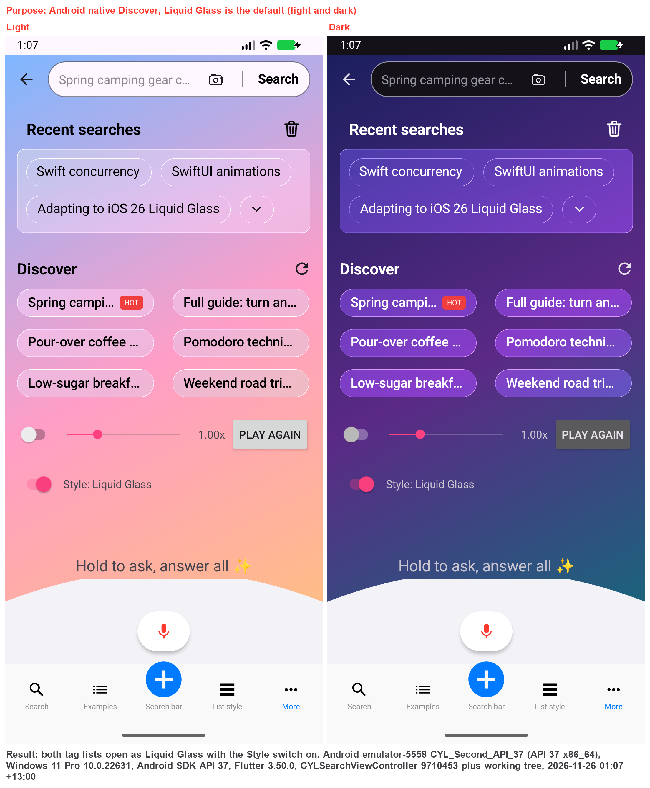 Android, CYL_Second_API_37 API 37 x86_64, Windows 11 Pro 10.0.22631, CYLSearchViewController 9710453 plus working tree, 2026-11-26 01:07 +13:00.
   Flutter 3.50.0 on Android emulator-5558 API 37, CYLSearchViewController 9710453 plus working tree, 2026-11-26 01:07 +13:00. Status bar transparent over the gradient with dark icons (light) and light icons (dark). Seen, not changed: the dark Flutter page's back arrow is dark on dark (native bar tint on Android does not follow the Flutter brightness).
- Mac must verify on the iOS simulator: (1) Flutter Discover first open (Discover tab, fresh launch, light and dark): back button inset from the left edge and the search bar starting at the same x as after an appearance change, no second layout pass needed; (2) status bar: dark text over the pale light gradient, light text over the dark gradient, on the Flutter tabs and the Discover page. If (1) still fails, report the first-open frame values (nav bar `layoutMargins`, `safeAreaInsets`).
