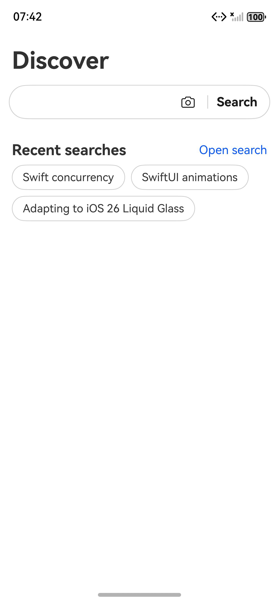
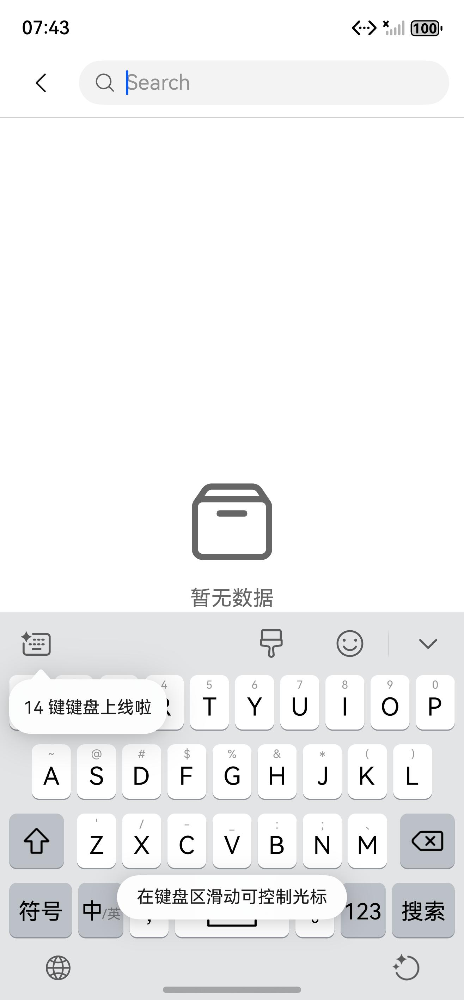
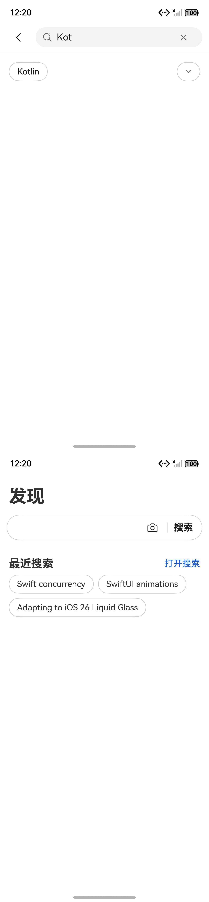

# Task Log

Tasks that have no better home in `docs/` are logged here (`AGENTS.md`,
"Task log before every task"). A task that belongs to a feature is logged in
that feature's document instead. Each entry starts as `TODO` before the work
begins and becomes `DONE` when it ends.

## DONE (2026-11-12): log every task in docs/ before starting it

- Context: the user runs several Claude sessions on this repository at once,
  and a session can stop mid-task (context limits, restarts, another session
  taking over a branch or the simulator). The next session needs to find
  what was asked and how far it got.
- Requirements:
  - Write the rule into the instruction files (`AGENTS.md`,
    `instructions.md`, folder `instructions.md` files) and the skills, in
    English.
  - Before any task: find the most suitable document in `docs/`, add the
    task there marked `TODO`, with the detailed context, the user's
    requirements and the user's prompt; then start the task.
  - When the task ends, mark it done.
  - Purpose: no context is lost when a task is interrupted.
- Prompt (verbatim): "写入instructions相关文件，skills相关文件，开始任何任务前总是找到docs里的合适文档，现将任务标记为TODO ，给出任务详细上下文以及我的要求，我的提示词，再开始任务，目的是防止任务中断后，丢失上下文，无法找到上下文。任务结束后再标记TODO为已完成。"
- Prompt (English): "Write into the instruction files and the skill files:
  before starting any task, always find a suitable document in docs/, first
  mark the task as TODO with the task's detailed context, my requirements
  and my prompt, then start the task. The purpose is to avoid losing the
  context when a task is interrupted. When the task ends, mark the TODO as
  done."
- Result: the rule is in `AGENTS.md` ("Task log before every task"),
  `instructions.md`, `docs/instructions.md`, the folder `instructions.md`
  files (`CYLSearchExample/`, `CYLSearchExampleTests/`,
  `Sources/CYLSearchViewController/`, `scripts/`) and all seven `cyl-*`
  skills; `cyl-docs` adds how to pick the document. This entry was logged
  first (commit `eb0ce70`), as the rule requires. Branch
  `feat/search-bar-view`.

## DONE (2026-11-12): merge PR #6, then PR #5, after CI

- Context: PR #6 (`docs/todo-sweep` → `feat/search-bar-view`) holds one
  commit, `29fdf24`: the scene life cycle (the example did not launch when
  built with the iOS 27 SDK), page titles that renamed their tabs, and
  `scripts/public-api-doc-coverage.sh`. PR #5 (`feat/search-bar-view` →
  `master`) holds CYLSearchBarView, the CYLTabBarController example and the
  search bar placement rule. The duplicate tab bar integration that was on
  `docs/todo-sweep` was dropped (local tag `backup/todo-sweep-935da41`).
- Requirements: wait until CI has finished, merge #6 into
  `feat/search-bar-view`, then wait for #5's CI and merge #5 into `master`.
- Prompt (verbatim): "CI结束后，合并分支，以下分支 #5 feat/search-bar-view → master … #6 docs/todo-sweep → feat/search-bar-view (its source)"
- Prompt (English): "After CI finishes, merge these branches: #5
  feat/search-bar-view → master, and #6 docs/todo-sweep →
  feat/search-bar-view."
- Result: #6 passed CI (6/6 jobs, run 43112176663) and was merged into
  `feat/search-bar-view` (merge commit `51a0e39`). #5 passed CI on
  `ac03541` (6/6 jobs) and was merged into `master` (merge commit
  `55022ba`).

## DONE (2026-11-12): retarget every open PR to the current branch, merge, keep only it

- Context: current branch `feat/swift-core` (PR #8 → `feat/search-api-parity`). Open PRs: #7
  (`feat/search-api-parity` → `master`), #8, and #2 from a fork (`master` → `master`, "Fix broken headings in
  Markdown files"). Remote branches `claude/youthful-mendel-pn01ru`, `docs/todo-sweep`, `feat/search-api-parity`
  and `feat/search-bar-view` have no commit that `feat/swift-core` lacks.
- Requirements: point every open PR at `feat/swift-core`; merge them all into it, resolving conflicts; keep only
  the current branch (delete the others; `master` stays as the default branch); then continue the unfinished tasks.
- Prompt (verbatim): "将所有处于open状态的分支的target branch指向本分支，当前分支，全部合并仅仅保留当前分支，处理冲突后合并，继续以上未完成的任务。"
- Prompt (English): "Point the target branch of every open branch at this branch, the current branch; merge them
  all and keep only the current branch; merge after resolving conflicts; continue the unfinished tasks above."
- Result: #2 (fork, README heading fix) retargeted to `feat/swift-core` and merged (`e9ca91e`). #7 could not be
  retargeted (GitHub: no new commits; all of `feat/search-api-parity` is in `feat/swift-core`), so it was closed
  with a note. #8 (`feat/swift-core`) now targets `master`. Remote branches `claude/youthful-mendel-pn01ru`,
  `docs/todo-sweep`, `feat/search-api-parity` and `feat/search-bar-view` (each with 0 commits missing from
  `feat/swift-core`) were deleted; `feat/swift-core` and `master` (the default branch, which cannot be deleted)
  remain. Local branches and worktrees of this session were removed. The shared working folder is still on the
  local `feat/search-bar-view` of another session and was not touched.

## DONE (2026-11-14; TODO 2026-11-12): pull request for the clean sibling checkout

- Context: while building, the sibling `CYLTableViewPlaceHolder` had another session's uncommitted, half-finished
  `CYLRefresh/Custom/Drawn/` folder, so this session built against a clean detached checkout of its last commit
  (`18971fe`) in its own scratch folder. That checkout has no changes of this session.
- Requirement: "then create a PR that merges into the current branch".
- Prompt (verbatim): "found an uncommitted, half-finished Drawn/ folder in the sibling's working tree, so I'm building from a clean checkout of their last commit in my own folder instead. then create pr merge to current branch"
- Status: logged; to check what can be put in a PR (this session changed nothing in the sibling).
- Status: DONE (2026-11-14): nothing to put in a pull request: the clean checkout had no changes of this session.
  The work built against it went in through this repository's own pull requests (#6 merged, then #8).

## DONE (2026-11-12): rule for open PRs and issues of projects we translate

- Context: `android/` holds Kotlin transcriptions of five GitHub projects, made from their default branches without
  their open pull requests and issues (`docs/android-and-cross-platform.md`).
- Requirements: write a rule (English) into the instruction files and the skills: when a document of this project
  links to another project's GitHub repository for translation or similar work, merge that project's open PRs
  (before translating; or, when the translation is done, translate the open PRs and merge them in); list its open
  issues in a `docs/` table (issue link, description, fix status, default `TODO`); find each issue's counterpart in
  our code and fix it; score after each fix until 100. Translation may start once the issues reach 60. The same rule
  applies on every platform.
- Prompt (verbatim): "写入一条规则到。instructions相关文件和skills文件中，全英文写入以下规则：如果本项目文档中出现了 非本项目的 GitHub 链接，切该链接是用来 做代码翻译等任务的，那么在翻译过程前，或者翻译过程后，需要 访问该GitHub 的 pr 链接，将处于open状态的pr合并进来。并且为该项目的issues页面，中处于open状态的issues在docs文件夹下相关文档，如果没有就新建文档中制作表格，第一列为issue地址 第二列为issue描述，第三列为修复状态，默认填TODO。你需要找到这些issue在我们项目代码中的对应项，尝试修复。issues修复完为满分，每修复一个issue打一次分，一直到满分为止。 举例说明：比如：本项目的android文件夹内，存在多个其他项目翻译为kotlin的任务，这些任务均默认翻译master分支代码，忽略了pr与issues内容，如果翻译任务还未开启那么就先 merge 该项目处于open状态的pr，再尝试解决open issues，只要issues处理状态达到60分，就可以开始翻译工作，翻译完成后，再开始尝试解决剩余的issues到满分。如果翻译工作已经完成，那么就单独对open pr内容进行翻译后，再merge到我们的项目中。基于翻译过的代码还是要处理issues。一直到满分。其他平台同样规则执行。"
- Prompt (English): "Write a rule into the instruction files and the skill files, all in English: if this project's
  documents contain a GitHub link that is not this project's, and the link is used for code translation or similar
  tasks, then before or after translating, visit that GitHub project's PRs and merge the open ones in. For the open
  issues on its issues page, make a table in a related document in docs (create one if none): first column the issue
  link, second the issue description, third the fix status, TODO by default. Find each issue's counterpart in our
  code and try to fix it. All issues fixed is full marks; score after each fixed issue until full marks. Example: the
  android folder has several projects translated to Kotlin, all from the master branch, ignoring PRs and issues. If a
  translation has not started, first merge the project's open PRs, then try to solve the open issues; once the issue
  status reaches 60 the translation may start, and after it, solve the remaining issues to full marks. If the
  translation is already done, translate the open PRs' content separately and merge it into our project, and still
  handle the issues on the translated code, until full marks. Other platforms follow the same rule."
- Result: the rule is in `AGENTS.md` ("Open pull requests and issues of projects we translate"), `instructions.md`,
  `docs/instructions.md`, `android/README.md` and every `cyl-*` skill. Applying it to the five projects in `android/`
  (their translation is done: translate and merge their open PRs, then the issue tables and fixes) is a follow-up
  recorded in `docs/android-and-cross-platform.md`.

## DONE (2026-11-16; TODO 2026-11-12): CYLTableViewPlaceHolder as a sub-repository on every platform

- Logged in [sub-repositories.md](sub-repositories.md) (context, requirements, prompt verbatim and in English).
  Done on every platform (2026-11-16): see the DONE entry in [sub-repositories.md](sub-repositories.md).

## DONE (2026-11-16; TODO 2026-11-14): finish the unfinished CYLSearchViewController tasks, then every `TODO` in the documents

- Context: after the search bar items work (`7d254d6` to `6a9b5d9`), several entries in `docs/` still say `TODO`:
  some are done but their status line is stale, some are open (the native iOS Discover screenshot, the "iPhone Duo"
  overlap, the iOS example's raised plus button, React Native touch checks and tab bar, the sibling-checkout pull
  request, Android's animated placeholder, HarmonyOS, mini programs).
- Requirements: 1) from the memory files and the local memory documents, continue and finish the unfinished tasks
  of CYLSearchViewController; 2) go through every document, find the keyword `TODO`, and complete all `TODO` work.
- Prompt (verbatim): "根据Memory 以及本地Memory文档，尝试继续完成对于 CYLSearchViewController 我们未结束的任务，然后遍历所有文档，找到关键词TODO 完成所有TODO工作。"
- Prompt (English): "From Memory and the local Memory documents, try to continue and finish our unfinished tasks for
  CYLSearchViewController, then go through all documents, find the keyword TODO and complete all TODO work."
- Order (oldest instruction first): the sibling-checkout pull request (2026-11-12); the "iPhone Duo" overlap; the
  iOS raised plus button; the tag-style, placeholder, cache and focus entries (status lines against what is done);
  React Native; the search bar items' last screenshot; HarmonyOS; mini programs.
- Status: DONE (2026-11-16). Every item of the order is done: the sibling-checkout pull request; the "iPhone Duo"
  overlap (`search-bar-view.md`); the iOS raised plus button; the tag-style, placeholder, cache and focus entries; React
  Native (touch checks and tab bar, `android-and-cross-platform.md`, Open TODOs 5/5); the native iOS Discover screenshot
  (`assets/ios-discover-tab.png`); Android's animated placeholder (CYLTableViewPlaceHolder PR #28, pin `6d8b264`);
  HarmonyOS (Scorecards 1 to 3 at 100, the last screenshot checks listed in `harmonyos-cross-platform.md`); mini programs.
  Left outside this entry: SVGA tab icons in the React Native example (`CYLTabBarController-Integration.md`).
- Progress (2026-11-14, usage limit reached mid-task):
  - Sibling-checkout pull request: DONE (entry above).
  - Android animated placeholder: not started here on purpose. CYLTableViewPlaceHolder's Android port is in progress
    in another session (its PR #28, `6ef5000`: the full scenario catalog and `CYLPlaceholderView` with
    `CYLPlaceholderAnimationPlayer` / `registerAnimationFactory`); `CYLPlaceholderStackView` does not play the
    scenarios' animations yet. When it does, `cylsearch` registers a Lottie factory and pins that commit.
  - iOS raised plus button: the iOS configuration file has no keys for it (Android has `CYLPlusButtonSize`,
    `CYLPlusButtonCenterYMultiplier`); on iOS it needs a `CYLPlusButton` subclass (`+multiplierOfTabBarHeight:`), and
    on iOS 26 the plus button is drawn by its tab item in the glass bar. A CYLTabBarController feature gap: open.
  - Native iOS Discover screenshot: `-CYLDemoTab 4` is Discover (2 is the plus page); the retake was running.
  - Not started: the "iPhone Duo" overlap, stale status lines (cache, focus, tag style, placeholder sub-repository),
    React Native touch checks and tab bar, HarmonyOS (0/323), mini programs. The React Native example's
    `Podfile.lock` still names `a96e9d2`; `pod install` updates it to `bdd78c7`.
- Progress (2026-11-14, later):
  - "iPhone Duo" overlap: DONE (`c9d1da3`): core fix in both search screens; iPhone 17 26/26, iPhone Duo 26/26.
  - Status lines of the cache, focus, tag style and placeholder entries: updated (`b073588`).
  - Search bar items: DONE (all four Discover pages screenshotted).
  - HarmonyOS: API table 397/397, 100/100 by the script (`db5481f`), library compiles; not run (no emulator device),
    no example app or tests yet.
  - React Native tab bar: wiring works for yarn, Metro, TypeScript and `pod install`; blocked on iOS by a
    CYLTabBarController header bug (details in `docs/android-and-cross-platform.md`); fix goes in that repository first.
  - Still open: mini programs; Android animated placeholder (waits for CYLTableViewPlaceHolder PR #28); iOS raised
    plus button (CYLTabBarController gap); React Native touch checks (no tap tool: `axe` is gone); HarmonyOS example
    app and tests.
- Progress (2026-11-15): React Native tab bar DONE (`94b6621`, CYLTabBarController `2a12582`); CYLTableViewPlaceHolder
  pinned at `c202b8c` (`04611dc`); mini program package, first increment (`c3f82f9`); HarmonyOS example app (`2da246e`);
  raised plus button on iOS 26: the config keys have no effect, see `docs/CYLTabBarController-Integration.md`.
  What remains needs something this machine lacks or another repository's decision: WeChat DevTools (mini program
  components, an example), a HarmonyOS device and hypium (tests, screenshots), a tap tool (React Native touch checks),
  CYLTableViewPlaceHolder's Android port (animated placeholder), CYLTabBarController (raised plus with a title on
  Liquid Glass). The headings above say IN PROGRESS where part is done.

- Progress (2026-11-15, later): React Native touch checks DONE (`a3f48b0`): the tap tool is xcodebuildmcp's bundled
  `axe` (`/opt/homebrew/Cellar/xcodebuildmcp/2.7.0/libexec/bundled/axe`); typing filters to "Swift", "More" unfolds.
  Still blocked: WeChat DevTools, a HarmonyOS device with hypium, CYLTableViewPlaceHolder PR #28, CYLTabBarController
  raised plus on Liquid Glass.
- Progress (2026-11-15, Android animated placeholder): DONE. The user set the order of what remains: the Android
  animated placeholder, then the raised plus button, then the mini program components, then HarmonyOS.
  CYLTableViewPlaceHolder PR #30 → PR #28's branch (`af23ea0`); Android pin moved; details and screenshot in
  `docs/core-todo.md`. Prompt: "Android animated placeholder: CYLTableViewPlaceHolder PR #28 merged with a Lottie
  animator. order is 3。4 1 2。"
- Progress (2026-11-15, raised plus button): skipped by the user's choice; stays TODO in
  `docs/CYLTabBarController-Integration.md`.
- Progress (2026-11-15, mini program): WeChat DevTools is installed and logged in. Added the example
  (`CrossPlatform/wechat-miniprogram-cylsearch/example`, `scripts/sync-example.js`) and a DevTools screenshot script
  (`scripts/devtools-screenshots.js`, miniprogram-automator). Not run: auto mode refused to launch the logged-in
  DevTools from this session; the user runs the script. Component rendering is still unverified.
- Progress (2026-11-15, HarmonyOS): an emulator is deployed (Mate 70 Pro, HarmonyOS 6.0.1, API 21), but there is no
  signing material (`build-profile.json5` `signingConfigs` is empty; no `.p12`/`.cer`/`.p7b` under `~/.ohos` or
  DevEco's support folder). A HarmonyOS emulator installs only signed HAPs, so the example run, the hypium tests and the
  screenshots wait for automatic signing in DevEco Studio (Huawei ID sign-in, then Project Structure > Signing Configs >
  "Automatically generate signature").
- Progress (2026-11-15, mini program, run by the user's go-ahead "item1自行执行 脚本"): the example runs in WeChat
  DevTools through `scripts/devtools-screenshots.js`. Fixed on the way: `cyl-search` recursed without end (its
  `sync()` wrote the `suggestions` property, whose observer calls `sync()`; the drawn list is now `shownSuggestions`);
  the example uses the AppID of CYLTabBarController's mini program example, since the tourist AppID cannot be automated.
  Verified: bar with items, search page with the empty-cache placeholder and the keyboard down, `submit: Swift`;
  screenshot `docs/assets/miniprogram-search-devtools.png`. Node tests 8/8. Still open: a search icon image in the
  field; Lottie in the mini program placeholders.
- Progress (2026-11-15, mini program core and example): DONE, see `docs/miniprogram-api-alignment.md` (397/397, the
  tab bar example, screenshot). The HarmonyOS project moved to `~/develop/CYLSearchViewController-swift-core/harmonyos`
  (the `feat/swift-core` worktree) for the user to open in DevEco Studio.
- Progress (2026-11-15, mini program playback controls and DevTools Skills, branch `feat/swift-core-next`): DONE, see
  `docs/miniprogram-api-alignment.md` ("playback controls on the animated placeholders"); verified in WeChat DevTools
  through `wechatide-skill`, Node tests 17/17.
- Progress (2026-11-15, mini program AppID): the example's AppID is local only, as the user chose: `project.config.json`
  keeps `touristappid` (DevTools refuses it), the real one is in the git-ignored `example/project.private.config.json`.
  Verified in DevTools: `wx.getAccountInfoSync()` reports the private AppID, the example renders, no console error.

- 2026-11-15 DONE: CYLTableViewPlaceHolder PR #28 merged into master (merge commit `7bc27a1`) at the user's
  go-ahead ("Merge PR #28 to master"). The Android pin `6d8b264` is now on master. HarmonyOS run still waits for
  DevEco signing (`signingConfigs: []`).

- 2026-11-15 DONE: HarmonyOS example on the emulator without signing. Prompt: "请使用模拟器 开发鸿蒙 忽略签名 继续开发"
  (use the emulator for HarmonyOS, ignore signing, keep developing). hvigor `assembleHap` skips signing and builds
  `entry-default-unsigned.hap`; `hdc install` accepts it on the Mate 70 Pro emulator (HarmonyOS 6.0.1, API 21),
  and `aa start` opens it. Screenshots (commit `ca56d68`, original 1316×2832), top to bottom:
  1. 
  2. 
- Progress (2026-11-15, "小程序example层要一比一复刻", branch `feat/swift-core-next`): DONE. The mini program example is a
  1:1 copy of the iOS example (tabs, pages, texts in four languages, data, images, interactions), with the core
  components it needed (`d19e0bb`); see `docs/miniprogram-api-alignment.md`. Verified in WeChat DevTools: 18 pages,
  11 interactions, no console error; Node tests 26/26.
- Progress (2026-11-15, "将searchviewcontroller封装为一个小程序库", branch `feat/swift-core-next`): DONE, modeled on
  CYLTableViewPlaceHolder's `wechat-miniprogram-cylplaceholder`: the DevTools project and the sync hooks at the package
  root (the AppID moved to the package's git-ignored `project.private.config.json`), `package.json` entry and files,
  MIT `LICENSE`, README; checked with `npm pack` in a new mini program (Build npm), which found and fixed three
  library-only faults. See `docs/miniprogram-api-alignment.md`. Node tests 30/30.
- Progress (2026-11-15, iOS CI, branch `feat/swift-core-next`): the example build failed in CYLTabBarController's
  `CYLTabBarManifest.swift:812` (`remote ?? dictionary`, two optionals of different types) at the pinned `2a12582`.
  The newest commit on any branch (`scripts/latest-cyl-commit.sh`), `c006143` on `feat/cross-platform-components`,
  fixes that line; its own `pod lib lint` and unit tests pass. Podfile and Podfile.lock now pin `c006143` (same version
  1.100.0 and subspecs; the lock's spec checksum is refreshed by the next `pod install`, which CI runs). The 4 commits
  of `fix/flutter-plus-title-hidden` that `c006143` lacks are Flutter/React Native work; the Flutter and Android pins
  stay on `2a12582`.
  Fixed ("fix 1"): the emulator runs in zh-CN; the library was localized ("暂无数据" is its zh_CN string) but the
  example hard-coded English. The example strings are now resources (`entry/.../base` and `zh_CN/element/string.json`),
  read with `getStringByNameSync`; the screenshots above are retaken in Chinese. Open: hypium tests not run yet.

- 2026-11-15 DONE: HarmonyOS hypium tests on the emulator. Prompt: "Run tests". There were none, so this adds
  `harmonyos/entry/src/ohosTest` (TestAbility, OpenHarmonyTestRunner, `CYLSearchCore.test.ets`: cache order and
  duplicates, maximum count and blanks, `none` policy, localized strings, placeholder kinds, search bar items),
  the `ohosTest` target in `entry/build-profile.json5` and `@ohos/hypium` 1.0.21. Run (unsigned):
  `hvigorw -p module=entry@ohosTest -p isOhosTest=true -p buildMode=test assembleHap`, `hdc install` both HAPs,
  `hdc shell aa test -b com.cyl.search.harmonyos -m entry_test -s unittest /ets/testrunner/OpenHarmonyTestRunner`.
  Result on the Mate 70 Pro emulator (HarmonyOS 6.0.1, API 21): Tests run: 6, Failure: 0, Error: 0, Pass: 6.

- 2026-11-15 DONE: HarmonyOS UI tests. Prompt: "ui tests". `entry/src/ohosTest/ets/test/CYLSearchUI.test.ets` drives
  the example with `@kit.TestKit` `Driver` (strings read from resources, so it passes in any system language):
  Discover shows its title and search bar; "Open search" (id `CYLSearchDiscoverOpenSearch`) shows the empty
  placeholder; typing "Kot" lists Kotlin and hides Flutter; Back returns to Discover.
  Bug found and fixed: the system Back gesture never closed the search page (the second press left the app). New core
  API `CYLSearchView.handleBackPress()` closes an open search view and returns true; the example page's
  `onBackPress()` returns it. Core test `handleBackPressOnlyWhenOpen` added.
  Result on the Mate 70 Pro emulator: Tests run: 11, Failure: 0, Error: 0, Pass: 11.

- 2026-11-15 DONE: Back gesture on the other HarmonyOS search views. Prompt: "check others". Same gap in
  `CYLSearchController` (the overlay stayed on Back) and `CYLMultiSearchView` (typing never ended on Back); neither
  is in the example, so they are covered by core tests. New API: `CYLSearchController.handleBackPress()` hides the
  presented overlay like its Cancel button (calls `searchControllerDidCancel`); `CYLMultiSearchView.handleBackPress()`
  ends the search being typed like `completeSearch`. `CYLSearchResultsViewController` is shown inside
  `CYLSearchController`, so it needs nothing. Tests `controllerHandleBackPressOnlyWhenPresented` and
  `multiSearchHandleBackPressCompletesTyping`; result on the emulator: Tests run: 13, Pass: 13.

- 2026-11-15 Screenshot: Back closes the search page (Mate 70 Pro emulator, HarmonyOS 6.0.1, API 21, unsigned,
  commit `82797a4`, originals 1316×2832 stacked top to bottom): the search page with "Kot" typed, then Discover after
  one Back press (the keyboard was already hidden).
  

- 2026-11-15 Back gesture parity on Android and mini programs. Prompt: "screenshot back continue" (the screenshot was
  already in; continued with the parity check offered next).
  - Android: `CYLSearchView` and `CYLSearchController` already close on Back (`OnBackPressedCallback`).
    `CYLMultiSearchView` did not: Back only hid the keyboard. DONE: a callback enabled while `isInSearchMode` ends
    the typed search like `completeSearch`; Robolectric test `CYLMultiSearchBackTest`; `:cylsearch` tests 17/17.
  - Mini program: the back button or gesture left the page with the search page open. `cyl-search` now holds a
    `page-container` while open, so back closes the search page (`onBackLeave`). The example's plus page (the only
    non-tab page) gets an "Open search" button to show it. TODO: verify in WeChat DevTools — the run stopped at
    "Login is required" (APPID_ERROR); the check script is `back-test.js` (navigateTo plus, open, navigateBack,
    expect plus still shown with the search page closed).
- Progress (2026-11-15, "先把本项目的example 丰富到与iOS端保持一致再考虑发布npm", branch `feat/swift-core-next`): DONE.
  The mini program example now shows CYLTableViewPlaceHolder's scenario placeholders and CYLRefreshNormalHeader, as
  iOS, and follows dark mode; see `docs/miniprogram-api-alignment.md`. Publishing to npm waits for the user.

- 2026-11-16 DONE: Android / React Native / Flutter TODO table in `docs/android-and-cross-platform.md` ("Open TODOs").
  4 of 5 rows done (two stale status lines fixed); the raised plus button stays TODO (user skipped it 2026-11-15).
  Prompt (verbatim): "找到跨端，相关文档，找到以下android端 rn端 flutter端，的TODO事项，汇总成表格第一列为找到的内容，第二列默认TODO，每每完成一项就删除一个TODO 没有TODO视为满分一直完成到满分。"
  Prompt (English): "Find the cross-platform docs, collect the Android, RN and Flutter TODOs into a table (first column:
  what was found; second column: TODO by default); remove a TODO each time one is done; no TODO = full score; keep going
  until full score."
- 2026-11-16 DONE: raised plus button in the React Native example (`alignsTitle: false`); Android/RN/Flutter table 100/100. Prompt: "continue do plus".
- 2026-11-16 DONE: RN raised plus icon green again (52 pt PNG instead of `imageSize`, which drew the SF Symbol black). Prompt: "green".
- 2026-11-16 DONE: RN plus title color follows the text color (black / white in dark mode). Prompt: "title black".
- 2026-11-16 TODO logged: SVGA animations + one SVGA demo per Rive demo, `docs/CYLTabBarController-Integration.md`.
- 2026-11-16 IN PROGRESS: SVGA TODO, 12 Rive scenes listed (0/12). Prompt: "start svga".
- 2026-11-16 DONE: SVGA rows 1-2 (iOS tab icons from keys and from a config file), 2/12. Prompt: "go ios svga".
- 2026-11-16 DONE: SVGA row 3 (FlatDesign on iOS 26.3, classic on iOS 17.5), 3/12. Prompt: "go flat classic".
- 2026-11-16 DONE: SVGA rows 4-5 (dark files, plus page), 5/12. Found: light after dark keeps dark SVGA files. Prompt: "go dark plus".
- 2026-11-16 DONE (no simulator, compiled only): HarmonyOS score table 397/397 = 100, the 67 UIKit-only rows now read
  `TODO: N/A on HarmonyOS: <reason>`; accessibility labels/ids on suggestions, tags, results, cancel, fold control,
  multi-search field; `cancelButtonTitle` / `navigationAccessibilityLabel` default to localized resources; "More/Less"
  localized; 5 shared strings (OK, Cancel, Default, No data, Hot) copied from CYLTabBarController into 30 new locales;
  rule "accessibility + localization everywhere, UI tests locate through them" in AGENTS.md, instructions.md,
  `cyl-verify` skill. App and test HAPs build.
  Prompt (verbatim): "在不需要模拟器的前提下开始代码开发。继续完成鸿蒙评分表。marking the rest "TODO: N/A on HarmonyOS" with a reason. 适配视觉辅助 盲人辅助 为鸿蒙代码 。 适配国际化本地化，本地化文件可以从CYLTabBarController中复制一份过来。筛选本项目用到的文字。并将下面的内容规则写入instructions相关文件并写入skills相关文件，如果相关文件不存在就新建文件确保成功。全英文写入：本项目全部代码已经支持适配视觉辅助 盲人辅助 为鸿蒙代码 。 适配国际化本地化，本地化文件。如果发现不支持请先支持，然后在自动化UI测试过程中，优先使用刚刚提到的功能进行UI控件定位。触发点击事件，或者触发复杂流程，连续操作等。"
  Prompt (English): "Without a simulator, develop code: finish the HarmonyOS score table, marking the rest "TODO: N/A on
  HarmonyOS" with a reason; add visual accessibility / screen reader support to the HarmonyOS code; internationalize and
  localize, copying the localization files from CYLTabBarController and keeping only the texts this project uses; write
  the rule (all code supports accessibility and localization; add it where missing; UI tests locate controls through
  these features first, for taps, complex flows and series of actions) in English into the instruction files and the
  skills, creating them if missing."
- 2026-11-16 DONE: SVGA rows 6-7 (SVGA animation above the Examples list; tab icon source switch), 7/12. Prompt: "go menu switch".
- 2026-11-16 DONE: SVGA Android row (pin 5682b9e, SVGAPlayer-Android, SVGA config file), 8/12. Prompt: "go android svga".
- 2026-11-16 PARTLY DONE: HarmonyOS run on the emulator (installs, starts, Examples screenshot); UI tests 10-11/13, blocked by another session using the same emulator. Prompt: "run our HarmonyOS version code on an emulator and update screenshot in docs".
- 2026-11-16 DONE: SVGA SwiftUI row (SwiftUI screen hosting the SVGA tab bar), 9/12. Prompt: "go swiftui svga".
- 2026-11-16 DONE: commit rule "git cz style, English-only commit messages, no Chinese" appended to the Commitizen
  sections of AGENTS.md and instructions.md; new skill `.agents/skills/cyl-commit` (listed in AGENTS.md). Last 30
  commits checked: no Chinese.
  Prompt (verbatim): "写入instructions相关文件以及skills，找到commit规范，如果没找到就新建，寻找关键字 git cz，如果没有就新建，如果有就追加以下规则：全英文写入： git cz 风格提交，全英文commit 不允许出现中午。 continue"
  Prompt (English): "Write into the instruction files and the skills: find the commit conventions (create them if missing),
  look for the keyword git cz (create if missing, append if present), and add in English: commit in git cz style,
  English-only commit messages, no Chinese allowed. continue"
- 2026-11-16 DONE (iOS): SVGA Flutter row, 10/12; plugin platform views made @MainActor for the new pin. Prompt: "go flutter svga".
- 2026-11-16 PARTLY DONE: HarmonyOS re-run with the new tab bar: builds (after sync-sub-repositories + ohpm install), runs, Search screenshot; taps did not reach the app, other tabs not captured. Prompt: "run our HarmonyOS version code on an emulator and update more screenshot in docs".
- 2026-11-16 DONE: rule "prefer bash for scripts (zsh does not split unquoted variables)" in a new section of
  AGENTS.md, instructions.md and the `cyl-verify` skill.
  Prompt (verbatim): "写入instructions相关文件，skills相关指令，找到脚本执行的相关章节，没有的话就新建，保证写入成功：全英文写入：优先使用bash 执行脚本 避免以下错误zsh doesn't split $box into words either. Running the same measurement as a bash script."
  Prompt (English): "Write into the instruction files and the skills, in the script-running section (create it if
  missing), in English: prefer running scripts with bash, to avoid this error: zsh doesn't split $box into words
  either. Running the same measurement as a bash script."
- 2026-11-16 DONE: open PRs #11 (feat/harmonyos-parity -> feat/swift-core) and #8 (feat/swift-core -> master) checked
  for sync: both branches had the same tree (3f4981e), so nothing was cherry-picked; this entry is committed on both.
  Prompt (verbatim): "将所有处于open状态的pr 互相cherry pick 保持所有pr保持代码同步" / "log both"
  Prompt (English): "Cherry-pick all open PRs into each other so every PR keeps the same code." / "log both"
- 2026-11-16 BLOCKED: HarmonyOS next-page screenshots: the current build ignores all touches and the CYLDemoTab launch parameter (BUG TODO in docs/android-and-cross-platform.md). Prompt: "run our HarmonyOS version code on an emulator and push next page update more screenshot in docs".
- 2026-11-16 DONE: HarmonyOS pushed-page screenshots (Examples + 4 pages, Tag style, Discover, plus page); the "ignores touches" BUG TODO was wrong (stale uitest dumpLayout), corrected. Prompt: "continue "fix harmony touch".
- 2026-11-16 DONE: rule "every branch with commits has an open pull request; check before each commit; base = the
  previously active pull request's branch, else master; ask the user when more than two pull requests are open" in
  AGENTS.md ("Commit readiness"), instructions.md ("Pull requests for new branches") and the `cyl-commit` skill.
  Applied: PR #8 (feat/swift-core) was closed unmerged, so feat/swift-core got a new pull request to
  feat/harmonyos-parity (PR #11, the active one).
  Prompt (verbatim): "写入instructions相关文件，skills相关指令，找到commit 的相关章节，没有的话就新建，保证写入成功：全英文写入：创建分支后有任何commit必须提交pr。不允许只新建分支，持续向该分支commit代码，但不创建pr。因为不创建pr会导致该分支上的所有commit代码全部被忽略。 commit前必须检查该分支pr是否处于open状态，如果不处于open状态必须新建pr。target 目标优先设置为 在创建pr前的活跃pr，如果没有才设置为master分支。如果open状态的pr已经超过两个，那么就要慎重，你需要询问我，是否新建分支创建pr还是保持在本分支继续提交。因为超过两个分支会导致代码合并困难，无法合理分配分支的目标分支。"
  Prompt (English): "Write into the instruction files and skills, in the commit section (create it if missing), in
  English: any branch with commits must have a pull request; never keep committing to a branch without one, because
  its commits are ignored. Before committing, check that the branch's pull request is open; if not, open one. Target:
  the active pull request from before, else master. When more than two pull requests are open, be careful and ask me
  whether to create a new branch with a pull request or keep committing on this branch, because more branches make
  merging hard and leave no sensible target."
- 2026-11-16 DONE: rule extended: at the end of every exchange, on any branch other than master / main, commit and push
  without asking (AGENTS.md, instructions.md, `cyl-commit` skill, under the pull request rule). PR #12 is open for
  feat/swift-core.
  Prompt (verbatim, new part): "一次问答结束后，只要当前分支不是master main，则必须commit 必须push ，无须询问，因为代码总是在分支上，并不会push 到master main分支。非常安全。无须担心push后的任何风险。"
  Prompt (English): "After every exchange, as long as the current branch is not master / main, commit and push without
  asking: the code is always on a branch and never pushed to master / main, so it is safe; no need to worry about any
  risk after pushing."
- 2026-11-16 DONE: HarmonyOS Rive crash fix via pins (CYLTableViewPlaceHolder 76762c6, CYLTabBarController c795d08); every platform checked. Prompt: "...learn from it update our 鸿蒙os core component library to fix crash..."

## DONE (2026-11-18; TODO 2026-11-18): rules for starting a task, scoring it, other sessions and hung emulators

- **Branch**: `feat/harmonyos-parity`.
- **Context**: `AGENTS.md` and `instructions.md` already have "Task log before every task", and four skills point to it
  (`cyl-api-map`, `cyl-docs`, `cyl-new-project`, `cyl-plus-button`). No rule yet for the session's TODO header,
  acceptance scores, checking other sessions or restarting hung emulators.
- **Requirements**:
  1. Before a task: mark `TODO` and the current branch at the top of the session; write the task into the most
     suitable `docs/` document with acceptance criteria (what full marks are, what a pass is).
  2. Score the work; do not stop before a pass; keep scoring until it passes. Say why it is not full marks, print the
     missing points as `TODO`s at the end of the session, and update the document written at the start.
  3. Check other sessions first (read their tasks, usually marked `TODO` at the top of their session): if none is
     editing the same branch, go on; if one is, check whether the task is a duplicate.
  4. An emulator that stays hung until restarted: tell the other sessions first, then restart it. An emulator that
     does not open: restart first. Restart from the command line without asking.
  5. Written in English, in the instructions files and the skills; create files where none exist.
- **Acceptance**: full marks (100) = the rules in `AGENTS.md`, `instructions.md`, a skill of their own, the skills
  table and the four skills' task-log sections, all consistent, committed and pushed. Pass (60) = the rules in
  `AGENTS.md`, `instructions.md` and a skill, committed and pushed.
- **Prompt** (verbatim): 找到本项目instructions 相关文件以及skills相关文件，如果没有就新增文件保证写入成功，全英文写入：找到开始任务先标注todo写入文档的相关描述没有就新建该规则，如果有就插入以下规则：开始任务前总是在任务顶部标注TODO 以及当前分支，并找到合适的文档将任务写进docs文档以及验收评分标准什么是满分，什么什么是及格，不达到及格不允许中断任务，一直打分到及格为止。并标注为什么打不到满分，并将缺失的分数以TODO的形式打印在会话结束末端。并更新任务开始时写入的文档。看看 check other sessions first read their task ，第一步看看有没有session在编辑相同分支，如果没有就继续，如果有继续坚持任务是否重复。usually marked as TODO at top of 会话， 遇到 emulator stays hung until it's restarted,  please tell the other sessions first, then restart it. 遇到模拟器打不开的情况优先使用重启策略。无须询问是否重启直接命令行执行重启。
- **Prompt** (English): Find this project's instructions files and skills files; create them if missing so the write
  succeeds; write in English. Find the rule about marking a task TODO in a document before starting; create it if
  missing, else insert: before a task, always mark TODO and the current branch at the top; write the task into a
  suitable docs document with acceptance criteria (what is full marks, what is a pass); do not stop before a pass,
  keep scoring until it passes; say why it is not full marks and print the missing points as TODOs at the end of the
  session; update the document written at the start. Check other sessions first and read their tasks: first see
  whether a session edits the same branch; if not, go on; if so, check whether the task is a duplicate (usually
  marked TODO at the top of a session). An emulator that stays hung until restarted: tell the other sessions first,
  then restart it. An emulator that will not open: prefer restarting. Restart from the command line without asking.
- **Status**: done. Other sessions checked (none busy on this repository). Written: `AGENTS.md` ("Start, score and
  finish every task" under "Task log before every task"; "Emulators and simulators: restart when hung"; the skills
  table), `instructions.md` (both rules), the new skill `.agents/skills/cyl-task-start/SKILL.md` (also seen through
  `.claude/skills`), and a pointer in `cyl-docs`, `cyl-api-map`, `cyl-new-project` and `cyl-plus-button`.
- **Score**: 100 of 100 (every acceptance item done, committed and pushed); pass mark 60.

## TODO (2026-11-18): stitched screenshot layout, header and footer

- **Context**: the user attached a stitched screenshot (red header "iOS 27.2, iPhone 17 Pro sim, Xcode 27.2,
  CYLTabBarController dcbfdec6 (ef1d0313), feat/harmony, 2026-11-18. Rive tags at rest (no play)"; one caption above
  each panel: "launch, no play", "11 s later, 0 changed pixels") as the example of the style to follow.
- **Prompt, verbatim**: "找到本项目instructions 相关文件以及skills相关文件，如果没有就新增文件保证写入成功，全英文写入：找到截图相关规范，如果没有就新建保证写入成功，截图除了 优先选用竖版排列风格。优先两列，多行。且给拼接好的图增加header，footer，header，footer不能与截图区域重叠 覆盖，标注关键信息：关键信息也是英文，测试模拟器平台，模拟器系统版本，操作系统版本，ide 版本，以及测试目的等等。以附带的截图为例。提取截图的附带信息以及风格 完善我的描述规则。 更新截图规则，优选一列多行 如果一列拼接后长度超过普通手机的一屏幕 则两列多行"
- **Prompt, English**: find this project's instruction files and skill files (create them if missing, make sure the
  write succeeds), all in English: find the screenshot rules (create them if missing). Stitched screenshots use a
  vertical layout; give the stitched image a header and a footer that never overlap or cover the screenshots, with the
  key information in English: simulator platform, simulator OS version, host OS version, IDE version, the purpose of
  the test, and so on. Take the attached screenshot as the example: extract its information and style and refine the
  rule. Update: prefer one column over several rows; if the one-column image is taller than one screen of an ordinary
  phone, use two columns over several rows.
- **Acceptance**: the rule in `AGENTS.md`, `instructions.md`, `cyl-verify` and `cyl-docs`; `scripts/stitch-screenshots.swift`
  draws the header, the captions and the footer outside the screenshots and picks one or two columns by that height.
- **Status**: TODO.
